# CellRank+Palantir套路：拟时序联合细胞命运图谱构建

> 原文：https://mp.weixin.qq.com/s?__biz=MzAwMzIzOTk5OQ==&mid=2247541302&idx=1&sn=898f8604b742ecdbf621f2178154a35a&chksm=9b3c5b66ac4bd27092e4e7bdd54563e4aa0f5252b58a8e41a4824084691986b97dc333138e60#rd
> 合集：单细胞教程全收录

**一、写在前面**

[ 单细胞RNA测序](<https://mp.weixin.qq.com/s?__biz=MzAwMzIzOTk5OQ==&mid=2247538934&idx=2&sn=9ae059e29a064302bcb737d23a58d87f&scene=21#wechat_redirect>)能够捕捉到组织中不同细胞的[转录](<https://mp.weixin.qq.com/mp/appmsgalbum?__biz=MzAwMzIzOTk5OQ==&action=getalbum&album_id=4531298467490824209#wechat_redirect>)状态，但获得的数据通常是不同细胞在某一时刻的“静态快照”，无法直接记录单个细胞随时间发生的连续变化。[拟时序](<https://mp.weixin.qq.com/s?__biz=MzAwMzIzOTk5OQ==&mid=2247535114&idx=1&sn=95b6364b67d7ae9f03ba8455863ddabe&scene=21#wechat_redirect>)与细胞命运分析通过比较不同细胞之间的表达相似性，在低维空间中重建潜在的状态转换过程，从而帮助研究细胞[分化](<https://mp.weixin.qq.com/s?__biz=MzAwMzIzOTk5OQ==&mid=2247531908&idx=1&sn=2f094e390621a57853ba17f59f298ebe&scene=21#wechat_redirect>)、损伤修复及疾病进展中的动态变化。

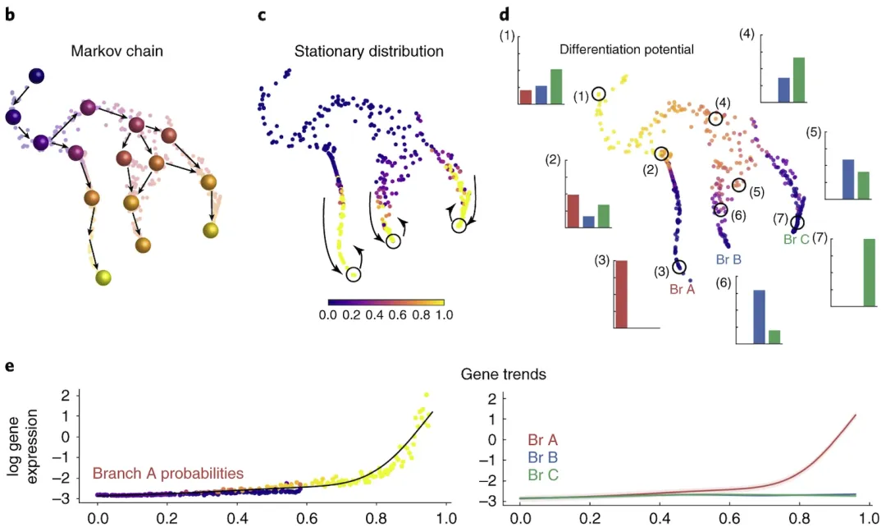

**[ Palantir](<https://mp.weixin.qq.com/s?__biz=MzAwMzIzOTk5OQ==&mid=2247535114&idx=1&sn=95b6364b67d7ae9f03ba8455863ddabe&scene=21#wechat_redirect>)是一种基于扩散映射和马尔可夫过程的单细胞轨迹推断方法，最终在《Nature Biotechnology》上发表。它从一个具有明确生物学意义的起始细胞出发，在多尺度扩散空间中计算细胞的拟时序，并估计分化熵和分支概率。其中，拟时序反映细胞相对于起点的状态进程，分化熵用于描述细胞命运的不确定程度，而分支概率则表示细胞趋向不同终末状态的相对可能性。因此，Palantir尤其适合分析连续、分支且包含过渡状态的生物学过程。**

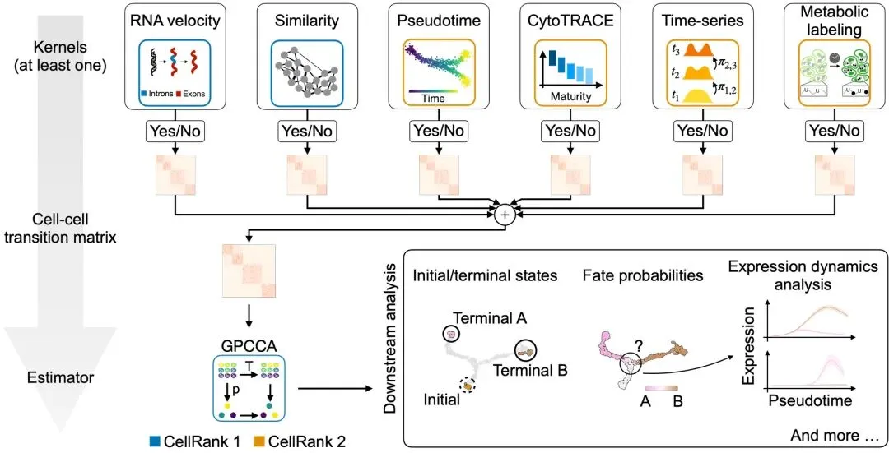

[CellRank](<https://mp.weixin.qq.com/s?__biz=MzAwMzIzOTk5OQ==&mid=2247507012&idx=1&sn=fb01cca63326fd6e8c682434a53fc2ea&scene=21#wechat_redirect>)是用来进一步从概率转移的角度描述细胞命运的工具，最终发表在了《Nature Methods》。它首先利用[RNA velocity](<https://mp.weixin.qq.com/s?__biz=MzAwMzIzOTk5OQ==&mid=2247535114&idx=1&sn=95b6364b67d7ae9f03ba8455863ddabe&scene=21#wechat_redirect>)、拟时序或其他先验信息构建有向的细胞转移矩阵，再通过马尔可夫链和GPCCA等方法识别宏状态、起始状态与终末状态，并计算每个细胞到达不同终末状态的命运概率。CellRank还能够根据基因表达与命运概率之间的相关性筛选候选驱动基因，并分析这些基因沿不同分化支路的动态表达趋势。

Palantir与CellRank具有良好的互补性：Palantir负责建立连续的拟时序方向并描述细胞命运的不确定性，CellRank则利用该拟时序对近邻图进行定向，进一步识别稳定状态并量化终末命运。

本教程以小鼠肺损伤再生单细胞数据为例，从AT2细胞出发，依次完成**[Palantir](<https://mp.weixin.qq.com/s?__biz=MzAwMzIzOTk5OQ==&mid=2247535114&idx=1&sn=95b6364b67d7ae9f03ba8455863ddabe&scene=21#wechat_redirect>)** 拟时序推断、[CellRank](<https://mp.weixin.qq.com/s?__biz=MzAwMzIzOTk5OQ==&mid=2247507012&idx=1&sn=fb01cca63326fd6e8c682434a53fc2ea&scene=21#wechat_redirect>)转移矩阵构建、GPCCA宏状态与终末状态识别、命运概率计算，以及Krt8⁺ ADI支路驱动基因筛选、趋势聚类和[功能富集](<https://mp.weixin.qq.com/s?__biz=MzAwMzIzOTk5OQ==&mid=2247500357&idx=2&sn=40034079b771c478b482e849ed4b216c&scene=21#wechat_redirect>)分析。

需要注意的是，拟时序表示根据转录组相似性推断的相对生物学进程，并不等同于真实时间；命运概率也不是对单个细胞未来状态的直接实验追踪。驱动基因反映的是基因表达与目标命运之间的统计关联，不能单独作为因果调控证据。因此，相关结果仍需结合细胞类型标志基因、时间点信息、已有生物学知识以及独立实验进行验证。

学习手册可视化集锦（文末可获得代码和测试文件）：

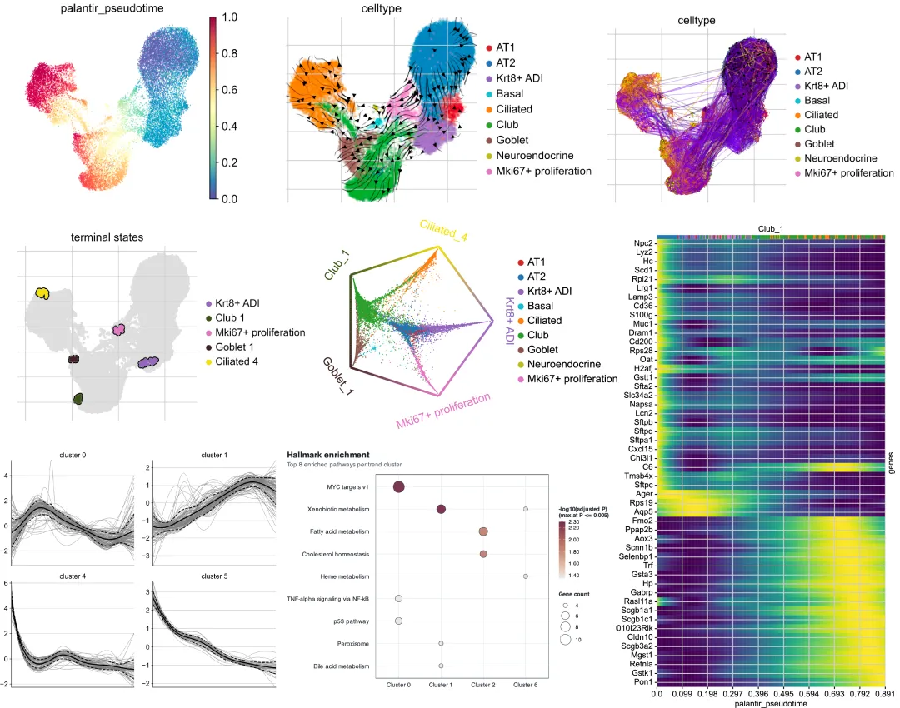

更多单细胞教程：[承包你未来40年的单细胞学习资料](<https://mp.weixin.qq.com/s?__biz=MzAwMzIzOTk5OQ==&mid=2247540976&idx=1&sn=178859bc9916bd7ccd9a5303aa10ceda&scene=21#wechat_redirect>)

[](<https://mp.weixin.qq.com/s?__biz=MzAwMzIzOTk5OQ==&mid=2247540932&idx=2&sn=713686d522279f84f3c2cc2aad7cb1bc&scene=21#wechat_redirect>)

**二、 Palantir流程**

### 1\. 环境安装与分析准备

#### 1.1 安装软件

服务器已经存在`cellrank`[环境](<https://mp.weixin.qq.com/s?__biz=MzAwMzIzOTk5OQ==&mid=2247539316&idx=2&sn=9417ef2ab995f37c514d9fabd0d69dbb&scene=21#wechat_redirect>)，运行本教程时只需在[Jupyter](<https://mp.weixin.qq.com/s?__biz=MzAwMzIzOTk5OQ==&mid=2247531443&idx=5&sn=2f10ef5cf97a7d5d255eb7e57b8bc14a&scene=21#wechat_redirect>)中选择**[Python](<https://mp.weixin.qq.com/s?__biz=MzAwMzIzOTk5OQ==&mid=2247537399&idx=1&sn=d14c7987d1384fe133094748844b8d59&scene=21#wechat_redirect>) (CellRank)** 内核。下面完整记录本项目的首次安装过程，**不要在已经配置好的[ 服务器](<https://mp.weixin.qq.com/s?__biz=MzAwMzIzOTk5OQ==&mid=2247539913&idx=2&sn=516a4224cdf85a68b119ce4a04f12d40&scene=21#wechat_redirect>)环境中重复执行**。
```
# 1. 新建环境（python 3.10–3.12 均可；这里用 3.11 最稳）
```
```bash
conda create -n cellrank python=3.11 -y
```
```bash
conda activate cellrank
```

```
# 2. 装 mamba（更快的求解器；新版 conda 也可改用 conda + --solver=libmamba）
```
```bash
conda install -c conda-forge mamba -y
```

```
# 3. 用 mamba 从 conda-forge 装主分析包
```
```
#    ★ 关键：把 pandas 钉在 3.0 以下 —— palantir 1.4.x 不兼容 pandas 3.0（.values 只读）
```
```
mamba install -c conda-forge -c bioconda \
```
```
  cellrank scanpy leidenalg python-igraph "pandas<3"-y
```

```
# 4. palantir 用 pip 装最稳（PyPI 上维护；同时约束 pandas 不被升级到 3.x）
```
```bash
pip install palantir "pandas<3"
```

```
# 5. 可选：大数据用的内存高效 Schur 求解器（GPCCA 的 krylov 方法）
```
```
#    conda 直接给编译好的 PETSc/SLEPc，省去自己编译
```
```
mamba install -c conda-forge petsc4py slepc4py -y
```

```
# 6. Jupyter + 注册内核
```
```
mamba install -c conda-forge jupyterlab ipykernel -y
```
```
python -m ipykernel install --user--name cellrank --display-name"Python (CellRank)"
```

向下滑动查看全部~

本服务器现有环境已验证为Python3.12.13、CellRank2.3.2、[Scanpy](<https://mp.weixin.qq.com/s?__biz=MzAwMzIzOTk5OQ==&mid=2247534702&idx=1&sn=f1531163f8f620b59cf63dfaa1c03e67&scene=21#wechat_redirect>) 1.12.2、[Palantir](<https://mp.weixin.qq.com/s?__biz=MzAwMzIzOTk5OQ==&mid=2247535114&idx=1&sn=95b6364b67d7ae9f03ba8455863ddabe&scene=21#wechat_redirect>)1.4.4、pandas2.3.3，并已安装`petsc4py`/`slepc4py`。这属于支持范围，无须为了匹配示例命令而降级或重建。

#### 1.2 导入包与参数配置

  * **[Palantir](<https://mp.weixin.qq.com/s?__biz=MzAwMzIzOTk5OQ==&mid=2247535114&idx=1&sn=95b6364b67d7ae9f03ba8455863ddabe&scene=21#wechat_redirect>)** ：从指定起点出发，在扩散空间里估计拟时序、分化熵与Palantir自身的分支概率。

  * **PseudotimeKernel** ：利用 Palantir 拟时序给近邻图定向，形成细胞间有向转移矩阵。

  * **GPCCA** ：从转移矩阵中识别宏状态，指定终末状态后计算每个细胞的命运概率。

  * **驱动基因** ：以“基因表达与目标命运概率的相关性”排序。它是候选调控关联，不等同于因果证据。

  * **趋势聚类** ：先用GAM平滑每个基因沿拟时序的表达，再按标准化后的曲线形状聚类。聚类反映动态模式相似性，不代表这些基因一定处于同一调控通路。

全量数据有24,882个细胞。GPCCA的Schur分解必须使用[稀疏](<https://mp.weixin.qq.com/s?__biz=MzAwMzIzOTk5OQ==&mid=2247529675&idx=1&sn=4d16321d68430f9a1c2d20fb77234d24&scene=21#wechat_redirect>)的`krylov`方法；`brandts`的稠密计算不适合该规模。
```
# 导入标准库：工作目录切换、路径管理和版本读取。
```
```
importos
```
```
importsys
```
```
fromimportlib.metadataimportversion
```
```
frompathlibimportPath
```

```
# 导入数值与表格工具：NumPy 负责数组计算，pandas 负责带标签表格。
```
```
importnumpyasnp
```
```
importpandasaspd
```

```
# 导入绘图工具；MultipleLocator 用于给 UMAP 加可读的主/次网格。
```
```
importmatplotlib.pyplotasplt
```
```
frommatplotlib.tickerimportMultipleLocator
```

```
# 导入单细胞分析包：Scanpy 管理 AnnData，Palantir 算拟时序，CellRank 算命运。
```
```
importscanpyassc
```
```
importpalantir
```
```
importcellrankascr
```

```
# 只隐藏已知的非关键绘图提示；分析阶段仍保留错误与重要警告。
```
```
importwarnings
```
```
warnings.filterwarnings("ignore", module="matplotlib", message="findfont")
```

```
# 固定 NumPy 随机种子；各分析步骤的 random_state 仍在各自单元中明确填写。
```
```
np.random.seed(0)
```

```
# 统一 notebook 内的绘图风格与保存分辨率。
```
```
sc.settings.verbosity=1
```
```
sc.settings.set_figure_params(dpi=120, dpi_save=300, frameon=False, facecolor="white")
```

```
# 打印关键版本，便于复现与排查 API 差异。
```
```
print("Python", sys.version.split()[0])
```
```
forpackagein ["scanpy", "cellrank", "palantir", "pandas", "numpy"]:
```
```
    print(f"{package:10s}", version(package))
```

向下滑动查看全部~

#### 1.3 配置目录

按参考[notebook](<https://mp.weixin.qq.com/s?__biz=MzAwMzIzOTk5OQ==&mid=2247531443&idx=3&sn=0930f54959a9bd13b99780d8f26a1155&scene=21#wechat_redirect>)的写法，这里只设置：**输入工作目录** 、**PDF 图片目录** 和**输出对象目录** 。数据文件名、起点细胞、终末状态、目标支路和聚类参数都放在实际使用它们的单元中，阅读代码时可以直接看到参数与分析步骤的对应关系。

  * `WORK_DIR`：教程与 `data/` 所在的工作目录。

  * `FIGURE_DIR`：每张图单独保存一份 PDF。

  * `OBJECT_DIR`：保存 CSV、可选中间 h5ad 等分析对象。

```
# 1) 输入工作目录：教程文件和 data/ 文件夹都位于这里。
```
```
WORK_DIR=Path("/data1/home/wanjiale/work/test/cellrank_tutoral")
```

```
# 2) 图片输出目录：所有分析图均单独保存为 PDF。
```
```
FIGURE_DIR=WORK_DIR/"figures"
```

```
# 3) 对象输出目录：保存 CSV、可选 h5ad 和其他可复用对象。
```
```
OBJECT_DIR=WORK_DIR/"objects"
```

```
# 切换到工作目录，使相对路径行为与参考 notebook 一致。
```
```
os.chdir(WORK_DIR)
```

```
# 若输出目录尚不存在则创建；不会修改 data/ 中的原始文件。
```
```
FIGURE_DIR.mkdir(parents=True, exist_ok=True)
```
```
OBJECT_DIR.mkdir(parents=True, exist_ok=True)
```

```
# CellRank 的 save 参数只给文件名时，默认保存到该图片目录。
```
```
cr.settings.figdir=FIGURE_DIR
```

```
# 打印三个目录，便于运行前核对。
```
```
print("输入工作目录:", WORK_DIR)
```
```
print("PDF 图片目录:", FIGURE_DIR)
```
```
print("输出对象目录:", OBJECT_DIR)
```

向下滑动查看全部~

####

### 2\. 实战教程

#### 2.1 读取示例数据

数据是CellRank的小鼠肺损伤再生数据：24,882 个细胞、24,051 个基因，包含`clusters_coarse`、`clusters`、`day`以及预计算的PCA/UMAP。教程把`clusters_coarse`复制为统一的 `celltype`字段。

教学代码直接从工作目录下的`data/`读取，不再包装额外的读入函数。换数据时只需要修改这一行文件名。
```
# 直接读取 data/ 下的本地示例数据。adata=sc.read_h5ad("data/lung_regeneration.h5ad")
# 使用粗粒度注释作为教程中的 celltype。adata.obs["celltype"] =adata.obs["clusters_coarse"].astype("category")
# 查看数据结构和各细胞类型数量。print(adata)display(adata.obs["celltype"].value_counts())
```
```
# 在同一画布查看粗细注释与采样天数，先建立数据的整体印象。
```
```
sc.pl.embedding(
```
```
    adata,
```
```
    basis="umap",
```
```
    color=["celltype", "clusters", "day"],
```
```
    ncols=3,
```
```
    wspace=0.45,
```
```
    show=False,
```
```
)
```

```
# 保存当前画布，便于脱离 notebook 查看。
```
```
plt.gcf().savefig(FIGURE_DIR/"01_data_overview_umap.pdf", bbox_inches="tight")
```

```
# 在 notebook 中显示后关闭画布，避免后续单元重复叠图。
```
```
plt.show()
```
```
plt.close("all")
```

向下滑动查看全部~

#### 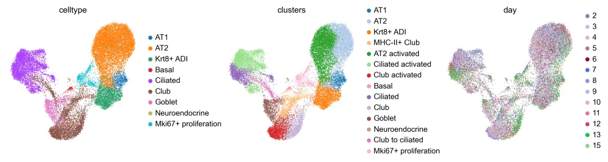

2.2 预处理与关键基因

`.X`是原始counts。我们先把原始[矩阵](<https://mp.weixin.qq.com/s?__biz=MzAwMzIzOTk5OQ==&mid=2247538803&idx=1&sn=02cb628b000cbdfaa03d85f4127b5a45&scene=21#wechat_redirect>)备份到`layers["counts"]`，再做每细胞总量标准化和 `log1p`。高变基因用于记录重点特征；同时强制纳入肺泡、气道、过渡态和增殖[marker](<https://mp.weixin.qq.com/s?__biz=MzAwMzIzOTk5OQ==&mid=2247535727&idx=1&sn=5a8dc6600a13455bcea612ac1cbe0173&scene=21#wechat_redirect>)，避免重要生物学基因仅因方差阈值被排除。

本数据自带PCA/UMAP，后续轨迹使用原始文件中的`X_pca`，以保持示例坐标和固定起点可复现。若换成自己的数据，应在标准化后重新计算 PCA、近邻图与 UMAP。
```
# 备份原始 counts，再做标准化和 log1p。
```
```
adata.layers["counts"] =adata.X.copy()
```
```
sc.pp.normalize_total(adata, target_sum=1e4)
```
```
sc.pp.log1p(adata)
```

```
# 肺再生关键 marker；后面用于细胞身份核对。
```
```
markers= [
```
```
    "Sftpc", "Sftpb", "Lamp3", "Etv5",       # AT2
```
```
    "Ager", "Pdpn", "Hopx", "Aqp5",         # AT1
```
```
    "Krt8", "Cldn4", "Sfn", "Krt18",        # Krt8+ ADI
```
```
    "Scgb1a1", "Scgb3a2", "Cyp2f2",          # Club
```
```
    "Foxj1", "Tubb4a", "Ccdc153",            # Ciliated
```
```
    "Muc5b", "Muc5ac", "Scgb3a1",            # Goblet
```
```
    "Mki67", "Top2a", "Trp63", "Krt5",      # 增殖 / Basal
```
```
    "Ascl1", "Calca",                         # Neuroendocrine
```
```
]
```
```
markers= [geneforgeneinmarkersifgeneinadata.var_names]
```

```
# 选择高变基因，并把 marker 一并纳入轨迹候选基因。
```
```
sc.pp.highly_variable_genes(adata, n_top_genes=3000, flavor="seurat")
```
```
use_genes=set(adata.var_names[adata.var["highly_variable"]]) |set(markers)
```
```
adata.var["use_gene"] =adata.var_names.isin(use_genes)
```

```
print("轨迹候选基因数:", int(adata.var["use_gene"].sum()))
```
```
print("可用 marker 数:", len(markers))
```

```
#轨迹候选基因数: 3006
```
```
#可用 marker 数: 27
```

向下滑动查看全部~

#### 2.3 Palantir：扩散空间、MAGIC 与拟时序

Palantir先在PCA空间构建扩散映射，再把有意义的扩散分量组合成多尺度空间。该空间强调连续状态变化，比单纯欧氏 PCA 更适合描述分化轨迹。MAGIC 使用扩散算子平滑表达，主要用于可视化和后续趋势拟合；不要把 imputed 表达当作新的原始 counts 做差异表达检验。

``run_magic_imputation``会产生较大的全基因layer。服务器内存不足时可减少分析基因范围，但必须保证后续所选驱动基因存在于用于拟合的表达矩阵中。

服务器内存不足？可参考：[三年套餐打骨折，足够支持你完成硕博生涯的共享服务器](<https://mp.weixin.qq.com/s?__biz=MzAwMzIzOTk5OQ==&mid=2247540790&idx=2&sn=3e34a111e77e0cf29ee21b48a7940a9a&scene=21#wechat_redirect>)
```
# 将 PCA 坐标转成 Palantir 使用的 DataFrame。
```
```
pca_projections=pd.DataFrame(
```
```
    adata.obsm["X_pca"][:, :30],
```
```
    index=adata.obs_names,
```
```
)
```

```
# 扩散映射、多尺度空间和 MAGIC 去噪。
```
```
dm_res=palantir.utils.run_diffusion_maps(pca_projections, n_components=10)
```
```
ms_data=palantir.utils.determine_multiscale_space(dm_res)
```
```
adata.obsm["DM_EigenVectors_multiscaled"] =ms_data.values
```
```
adata.layers["MAGIC_imputed_data"] =palantir.utils.run_magic_imputation(adata, dm_res)
```

```
print("多尺度空间形状:", ms_data.shape)
```

```
#多尺度空间形状: (24882, 2)
```

```
# 选择用于身份核对的 8 个代表性 marker，并确保它们都存在。
```
```
marker_panel= [geneforgenein ["Sftpc", "Ager", "Krt8", "Scgb1a1", "Foxj1", "Muc5b", "Mki67", "Trp63"] ifgeneinadata.var_names]
```

```
# 用 MAGIC 平滑表达画 UMAP；高表达区域对应各细胞类型的已知 marker。
```
```
sc.pl.embedding(
```
```
    adata,
```
```
    basis="umap",
```
```
    layer="MAGIC_imputed_data",
```
```
    color=marker_panel,
```
```
    cmap="Spectral_r",
```
```
    ncols=4,
```
```
    show=False,
```
```
)
```

```
# 保存 marker 面板。
```
```
plt.gcf().savefig(FIGURE_DIR/"02_magic_marker_umap.pdf", bbox_inches="tight")
```

```
# 显示并释放画布。
```
```
plt.show()
```
```
plt.close("all")
```

向下滑动查看全部~

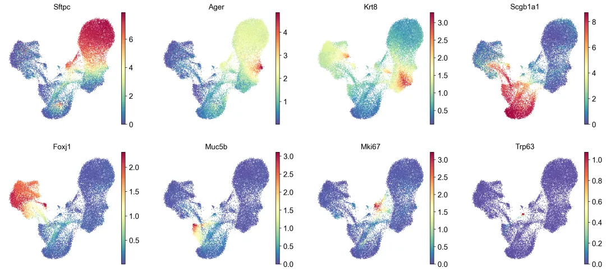

**三、 CellRank 流程**

### 1\. 选择起点：坐标定位 + 固定 barcode

参考流程先在带网格的UMAP上选定一个生物学合理区域，再将最近细胞的[barcode](<https://mp.weixin.qq.com/s?__biz=MzAwMzIzOTk5OQ==&mid=2247490952&idx=1&sn=364a3941e59e45234795c906a42fc9ab&scene=21#wechat_redirect>)固定下来。这里肺泡再生的起点是 AT2：目标坐标为`(6.0, 5.0)`，对应固定细胞`muc9275_AAACTAAACACG`。

与参考 notebook 一致，先计算离目标坐标最近的细胞并查看元数据；随后在运行Palantir的单元中明确填写最终确认的 `start_cell`barcode。这样既保留人工选择依据，也让正式分析使用固定起点。
```
# 为 9 个粗粒度肺上皮类型定义固定颜色。
```
```
celltype_colors= {
```
```
    "AT2": "#1f77b4",
```
```
    "AT1": "#d62728",
```
```
    "Krt8+ ADI": "#9467bd",
```
```
    "Club": "#2ca02c",
```
```
    "Ciliated": "#ff7f0e",
```
```
    "Goblet": "#8c564b",
```
```
    "Mki67+ proliferation": "#e377c2",
```
```
    "Basal": "#17becf",
```
```
    "Neuroendocrine": "#bcbd22",
```
```
}
```

```
# 确保 celltype 是有序类别，Scanpy 才能稳定复用颜色。
```
```
adata.obs["celltype"] =adata.obs["celltype"].astype("category")
```

```
# 找出未配置颜色的类别；换数据后这里会提醒更新色板。
```
```
missing_colors=sorted(set(adata.obs["celltype"].cat.categories) -set(celltype_colors))
```

```
# 色板不完整时停止，防止类别和颜色错位。
```
```
ifmissing_colors:
```
```
    raiseValueError(f"以下细胞类型缺少颜色：{missing_colors}")
```

```
# 按 pandas 类别顺序写入 AnnData，供所有 Scanpy 图复用。
```
```
adata.uns["celltype_colors"] = [
```
```
    celltype_colors[name] fornameinadata.obs["celltype"].cat.categories
```
```
]
```

向下滑动查看全部~

接着我们绘制一个**带网格的umap图** 便于我们确认起始细胞。
```
# 新建画布，绘制按细胞类型着色的 UMAP。
```
```
fig, ax=plt.subplots(figsize=(9, 7))
```
```
sc.pl.embedding(
```
```
    adata,
```
```
    basis="umap",
```
```
    color="celltype",
```
```
    size=6,
```
```
    alpha=0.55,
```
```
    legend_loc="right margin",
```
```
    frameon=True,
```
```
    ax=ax,
```
```
    show=False,
```
```
)
```

```
# 设置主刻度和次刻度；可根据自己的 UMAP 范围调整间隔。
```
```
ax.xaxis.set_major_locator(MultipleLocator(5))
```
```
ax.yaxis.set_major_locator(MultipleLocator(5))
```
```
ax.xaxis.set_minor_locator(MultipleLocator(1))
```
```
ax.yaxis.set_minor_locator(MultipleLocator(1))
```

```
# 把网格放在散点下方，主网格略深、次网格略浅。
```
```
ax.set_axisbelow(True)
```
```
ax.grid(which="major", color="#9E9E9E", linewidth=0.7, alpha=0.70)
```
```
ax.grid(which="minor", color="#D9D9D9", linewidth=0.35, alpha=0.75)
```

```
# 补充清晰的坐标轴标题，便于直接读取候选起点坐标。
```
```
ax.set_xlabel("UMAP 1")
```
```
ax.set_ylabel("UMAP 2")
```
```
ax.set_title("Cell types with UMAP coordinate grid")
```
```
plt.tight_layout()
```

```
# 保存 PDF，同时在 notebook 中显示同一张图。
```
```
fig.savefig(FIGURE_DIR/"03_celltype_umap_coordinate_grid.pdf", bbox_inches="tight")
```
```
plt.show()
```
```
plt.close(fig)
```

向下滑动查看全部~

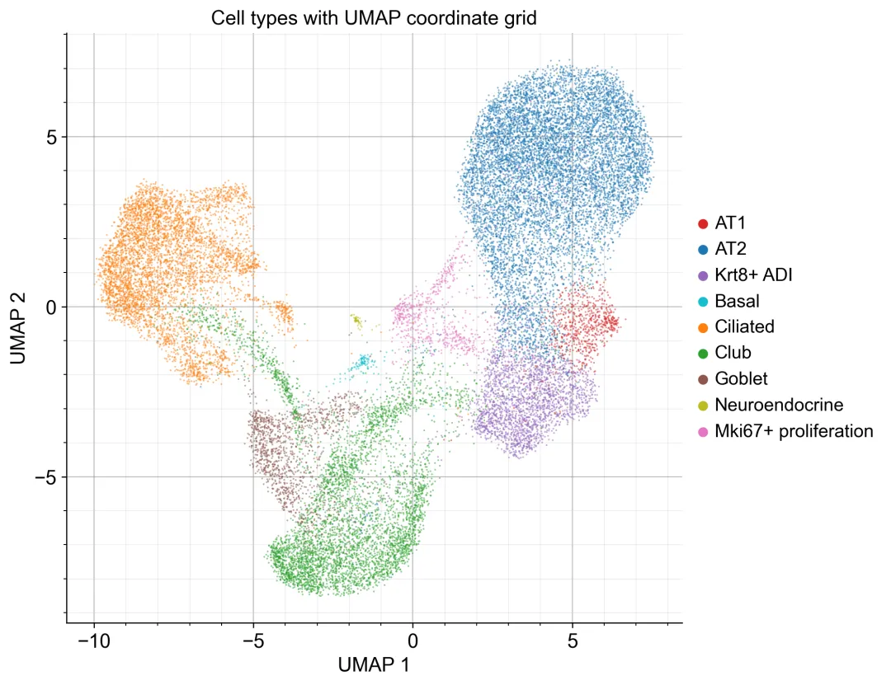

本次教程我们以 AT2 为起始细胞，可以从上图看出，**大致是 (5，6) 的位置** 。

ps:这个位置再后续计算不理想时可以调整，输入不同的起始位置，对后续的轨迹会有一定的影响。
```
# 获取 UMAP 坐标；行顺序与 adata.obs_names 完全一致。
```
```
umap_coordinates=np.asarray(adata.obsm["X_umap"])
```

```
# 在本单元设置目标坐标；它位于 AT2 主群内部。
```
```
target_x, target_y=6.0, 5.0
```
```
target_coordinate=np.array([target_x, target_y])
```

```
# 计算每个细胞到目标点的欧氏距离。
```
```
distances=np.linalg.norm(umap_coordinates-target_coordinate, axis=1)
```

```
# 找到距离最小的位置索引和对应 barcode。
```
```
closest_idx=int(distances.argmin())
```
```
closest_cell=str(adata.obs_names[closest_idx])
```

```
# 打印候选起点和距离，并查看细胞类型、亚群与采样天数。
```
```
print("坐标最近细胞:", closest_cell)
```
```
print("到目标坐标的距离:", float(distances[closest_idx]))
```
```
display(adata.obs.loc[[closest_cell], ["celltype", "clusters", "day"]])
```

向下滑动查看全部~

接着我们把所选细胞在umap图上标记出来，来检查一下是否符合我们的预期。
```
# 创建单独画布，先画完整的细胞类型背景。
```
```
fig, ax=plt.subplots(figsize=(9, 7))
```
```
sc.pl.embedding(
```
```
    adata,
```
```
    basis="umap",
```
```
    color="celltype",
```
```
    size=6,
```
```
    alpha=0.50,
```
```
    legend_loc="right margin",
```
```
    frameon=True,
```
```
    ax=ax,
```
```
    show=False,
```
```
)
```

```
# 用大红点和黑边标记坐标法选出的最近细胞。
```
```
ax.scatter(
```
```
    umap_coordinates[closest_idx, 0],
```
```
    umap_coordinates[closest_idx, 1],
```
```
    c="#E64B35",
```
```
    s=160,
```
```
    edgecolors="black",
```
```
    linewidths=1.2,
```
```
    zorder=5,
```
```
    label="selected AT2 start cell",
```
```
)
```

```
# 用黑色叉号标记最初人工读取的目标坐标，便于复核两者距离。
```
```
ax.scatter(
```
```
    target_x,
```
```
    target_y,
```
```
    marker="x",
```
```
    c="black",
```
```
    s=130,
```
```
    linewidths=2.0,
```
```
    zorder=6,
```
```
    label="target coordinate",
```
```
)
```

```
# UMAP 主刻度间隔为 5、次刻度间隔为 1。
```
```
foraxisin (ax.xaxis, ax.yaxis):
```
```
    axis.set_major_locator(MultipleLocator(5))
```
```
    axis.set_minor_locator(MultipleLocator(1))
```

```
# 添加浅色网格，方便下一次更换数据时人工读取坐标。
```
```
ax.grid(which="major", color="#9E9E9E", linewidth=0.6, alpha=0.6)
```
```
ax.grid(which="minor", color="#D9D9D9", linewidth=0.3, alpha=0.7)
```

```
# 设置坐标轴、图例和紧凑布局。
```
```
ax.set_xlabel("UMAP 1")
```
```
ax.set_ylabel("UMAP 2")
```
```
ax.legend(loc="upper left", frameon=False)
```
```
plt.tight_layout()
```

```
# 保存起点审计图后显示。
```
```
fig.savefig(FIGURE_DIR/"04_start_cell_audit.pdf", bbox_inches="tight")
```
```
plt.show()
```
```
plt.close(fig)
```

向下滑动查看全部~
```
# 明确填写经坐标法与元数据共同确认的起点 barcode，遵循参考 notebook 的写法。
```
```
start_cell="muc9275_AAACTAAACACG"
```

```
# 检查固定 barcode 仍存在，且确实属于 AT2；数据版本变化时会立即提示。
```
```
assertstart_cellinadata.obs_names, f"起点 barcode 不在数据中：{start_cell}"
```
```
assertstr(adata.obs.loc[start_cell, "celltype"]) =="AT2", "固定起点不是 AT2，请重新检查。"
```

```
# 从固定 AT2 起点运行 Palantir；1200 个 waypoint 在稳定性与速度之间折中。
```
```
palantir_result=palantir.core.run_palantir(
```
```
    adata,
```
```
    start_cell,
```
```
    num_waypoints=1200,
```
```
    use_early_cell_as_start=True,
```
```
)
```

```
# 确认关键结果已经写入 AnnData，后续 CellRank 会读取拟时序列。
```
```
required_palantir_keys= {"palantir_pseudotime", "palantir_entropy"}
```
```
missing_palantir_keys=sorted(required_palantir_keys-set(adata.obs.columns))
```
```
ifmissing_palantir_keys:
```
```
    raiseRuntimeError(f"Palantir 未生成 obs 字段：{missing_palantir_keys}")
```

```
# 输出拟时序范围；使用 early cell as start 时最小值应接近 0。
```
```
print("正式起点:", start_cell)
```
```
print(adata.obs["palantir_pseudotime"].describe())
```

```
# 列出 Palantir 自动识别的所有支路/终末细胞名称，便于与参考流程核对。
```
```
fate_probabilities=adata.obsm["palantir_fate_probabilities"]
```
```
ifisinstance(fate_probabilities, pd.DataFrame):
```
```
    palantir_branches=fate_probabilities.columns.tolist()
```
```
else:
```
```
    palantir_branches=adata.uns["palantir_fate_probabilities_columns"].tolist()
```
```
print("Palantir 自动支路:")
```
```
forbranch_number, branch_nameinenumerate(palantir_branches, start=1):
```
```
    print(f"{branch_number}. {branch_name}")
```

向下滑动查看全部~

Palantir结果中，`palantir_pseudotime`越大表示离起点越远；`palantir_entropy`越高表示命运越未确定。Palantir还会自动识别自己的终末细胞并生成分支概率，但后续CellRank会基于有向转移矩阵重新定义宏状态与终末状态，两套“终末状态”不要混为一谈。
```
# 绘制 Palantir 的拟时序、熵和自动分支概率总览。
```
```
palantir.plot.plot_palantir_results(
```
```
    adata,
```
```
    s=3,
```
```
    embedding_basis="X_umap",
```
```
)
```

```
# 保存 Palantir 总览图。
```
```
plt.gcf().savefig(FIGURE_DIR/"05_palantir_results.pdf", bbox_inches="tight")
```
```
plt.show()
```
```
plt.close("all")
```

```
# 单独并排绘制细胞类型、拟时序和熵，方便检查方向是否符合生物学预期。
```
```
sc.pl.embedding(
```
```
    adata,
```
```
    basis="umap",
```
```
    color=["celltype", "palantir_pseudotime", "palantir_entropy"],
```
```
    ncols=3,
```
```
    wspace=0.45,
```
```
    show=False,
```
```
)
```

```
# 保存方向核对图。
```
```
plt.gcf().savefig(FIGURE_DIR/"06_palantir_pseudotime_entropy.pdf", bbox_inches="tight")
```
```
plt.show()
```
```
plt.close("all")
```

向下滑动查看全部~

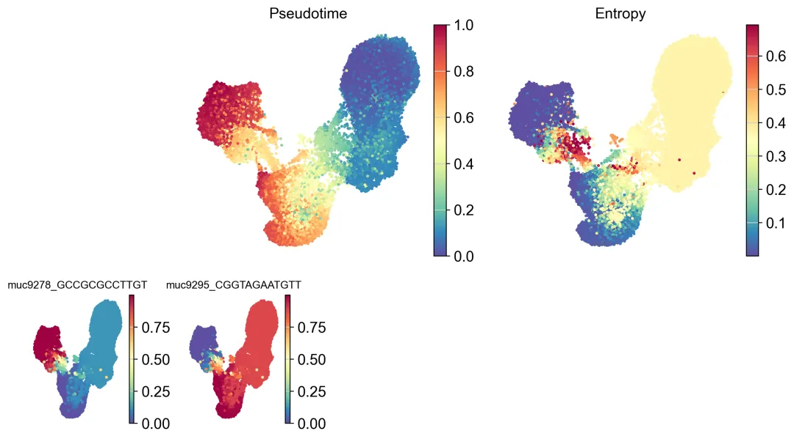

###

### 2\. CellRank PseudotimeKernel：把拟时序变成转移矩阵

`PseudotimeKernel`只在近邻图的局部连接中分配转移概率，并优先保留沿拟时序向前的方向。它不会凭空创建不相邻细胞之间的边。投影图和随机游走用于质量控制：箭头与轨迹应总体从 AT2 走向更晚状态，而不是系统性逆行。
```
# 导入拟时序核类。
```
```
fromcellrank.kernelsimportPseudotimeKernel
```

```
# 参考 notebook 在建立 CellRank 核前重新计算 Scanpy 近邻图。
```
```
# 本地肺数据已经包含 X_pca，因此直接基于前 30 个主成分构图。
```
```
sc.pp.neighbors(
```
```
    adata,
```
```
    n_neighbors=30,
```
```
    n_pcs=30,
```
```
    use_rep="X_pca",
```
```
    random_state=0,
```
```
)
```

```
# 用 Palantir 拟时序初始化核；它会复用刚刚计算的近邻连接。
```
```
pk=PseudotimeKernel(adata, time_key="palantir_pseudotime")
```

```
# 计算行归一化的有向细胞转移矩阵。
```
```
pk.compute_transition_matrix()
```

```
# 打印核对象，核对细胞数。
```
```
print(pk)
```

```
# 将转移矩阵方向投影到 UMAP，检查全局流向。
```
```
pk.plot_projection(
```
```
    basis="umap",
```
```
    color="celltype",
```
```
    legend_loc="right",
```
```
    recompute=True,
```
```
    show=False,
```
```
)
```

```
# 取出当前投影图，并把散点/箭头集合栅格化后嵌入 PDF。
```
```
# 这样既保留 PDF 文件格式，也能跳过极少数非有限投影箭头。
```
```
projection_figure=plt.gcf()
```
```
forprojection_axisinprojection_figure.axes:
```
```
    forcollectioninprojection_axis.collections:
```
```
        collection.set_rasterized(True)
```

```
# 单独保存一份 PDF，同时在下一行将同一张图显示到 notebook。
```
```
projection_figure.savefig(
```
```
    FIGURE_DIR/"07_kernel_projection.pdf",
```
```
    bbox_inches="tight",
```
```
    dpi=300,
```
```
)
```
```
plt.show()
```
```
plt.close("all")
```

向下滑动查看全部~

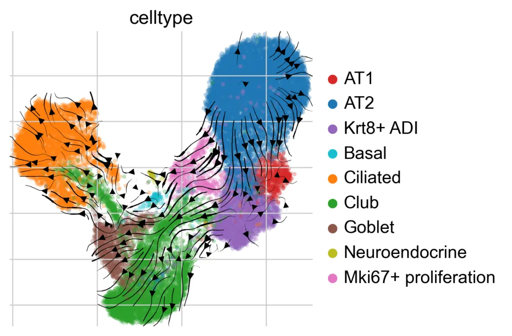
```
# 从 AT2 群体随机抽起点并模拟 100 条前向游走，观察可能的终末方向。
```
```
pk.plot_random_walks(
```
```
    seed=0,
```
```
    n_sims=100,
```
```
    max_iter=500,
```
```
    start_ixs={"celltype": "AT2"},
```
```
    basis="umap",
```
```
    color="celltype",
```
```
    legend_loc="right margin",
```
```
    n_jobs=1,
```
```
    backend="threading",
```
```
    show_progress_bar=False,
```
```
)
```

```
# 将随机游走图保存为 PDF，并在 notebook 内显示同一张图。
```
```
random_walk_figure=plt.gcf()
```
```
random_walk_figure.savefig(FIGURE_DIR/"08_random_walks_from_AT2.pdf", bbox_inches="tight")
```
```
plt.show()
```
```
plt.close("all")
```

```
# 是否保存包含 MAGIC layer 的大型中间 h5ad，在本单元按需要修改。
```
```
save_intermediate_h5ad=False
```

```
# 开启后把转移矩阵写回 AnnData，并保存到对象目录；原始数据不会被覆盖。
```
```
ifsave_intermediate_h5ad:
```
```
    pk.write_to_adata()
```
```
    adata.write(OBJECT_DIR/"lung_after_palantir_kernel.h5ad")
```
```
    print("已写入可恢复的中间 h5ad。")
```

向下滑动查看全部~

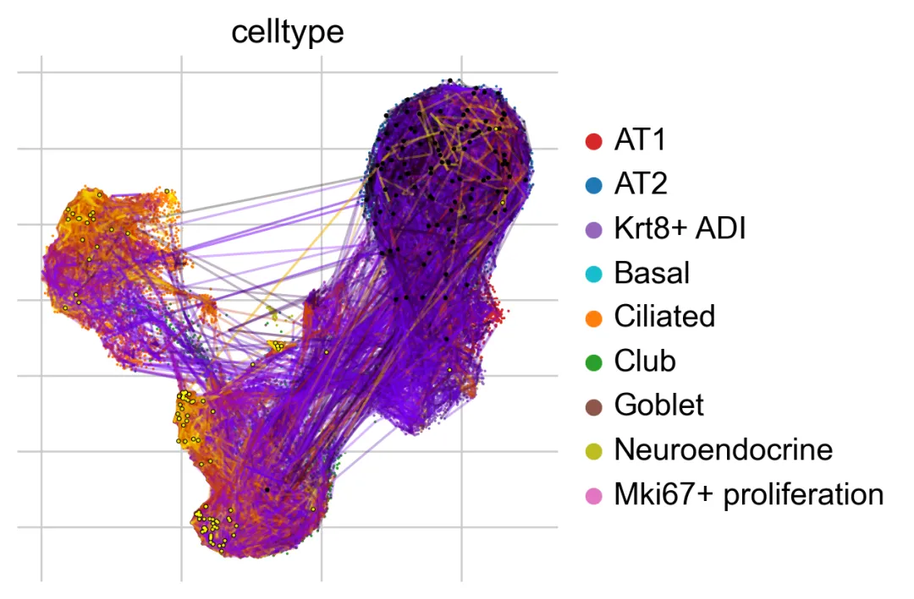

3\. GPCCA：Schur 分解、宏状态与手动终末状态

GPCCA用实Schur分解提取转移矩阵中变化缓慢、内部相对稳定的集合，再把细胞粗粒化为宏状态。`n_states=11`是本教程对该数据的固定设置；换数据时应同时参考特征值谱、宏状态在 UMAP 上的连续性、粗粒化转移矩阵稳定性和已知 marker，而不是只追求某个数字。

这里显式使用`method="krylov"`。它依赖已经安装好的PETSc/SLEPc，只计算需要的Schur子空间，适合24,882个细胞。
```
# 导入 GPCCA 估计器。
```
```
fromcellrank.estimatorsimportGPCCA
```

```
# 用已经计算好的 PseudotimeKernel 初始化估计器。
```
```
g=GPCCA(pk)
```

```
# 计算前 20 个 Schur 分量；krylov 是大数据的稀疏迭代方法。
```
```
g.compute_schur(
```
```
    n_components=20,
```
```
    method="krylov",
```
```
)
```

```
# 绘制实特征值谱；谱间隙可作为宏状态数的参考之一。
```
```
g.plot_spectrum(real_only=True)
```
```
plt.gcf().savefig(FIGURE_DIR/"09_schur_spectrum.pdf", bbox_inches="tight")
```
```
plt.show()
```
```
plt.close("all")
```

向下滑动查看全部~

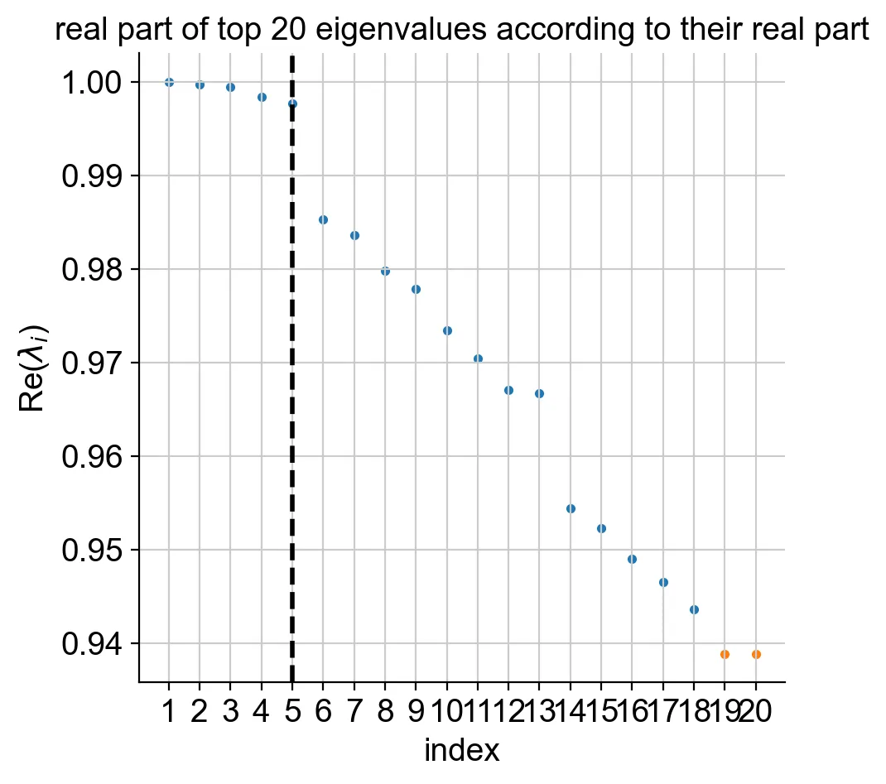

从上述图可以看出从**13宏状态 数**之后谱系的间隔有一个较大的下降，因此我们这里选择13个状态进行计算终末状态

ps：可以类比于单细胞聚类的PCA步骤
```
# 将细胞粗粒化为 11 个宏状态，并用 celltype 为宏状态生成可读名称。
```
```
g.compute_macrostates(
```
```
    n_states=11,
```
```
    cluster_key="celltype",
```
```
)
```

```
# 读取实际宏状态名称，后面会据此校验终末状态配置。
```
```
available_macrostates=g.macrostates.cat.categories.tolist()
```

```
# 打印全部宏状态，便于保存运行记录。
```
```
print("实际宏状态:")
```
```
forstateinavailable_macrostates:
```
```
    print(" -", state)
```

```
# 在 UMAP 上画所有宏状态。
```
```
g.plot_macrostates(
```
```
    which="all",
```
```
    basis="umap",
```
```
    legend_loc="right",
```
```
    size=30,
```
```
    show=False,
```
```
)
```
```
plt.gcf().savefig(FIGURE_DIR/"10_all_macrostates_umap.pdf", bbox_inches="tight")
```
```
plt.show()
```
```
plt.close("all")
```

```
# 画宏状态间粗粒化转移矩阵；对角线高表示状态内部更稳定。
```
```
g.plot_coarse_T()
```
```
plt.gcf().savefig(FIGURE_DIR/"11_coarse_transition_matrix.pdf", bbox_inches="tight")
```
```
plt.show()
```
```
plt.close("all")
```

向下滑动查看全部~

#### 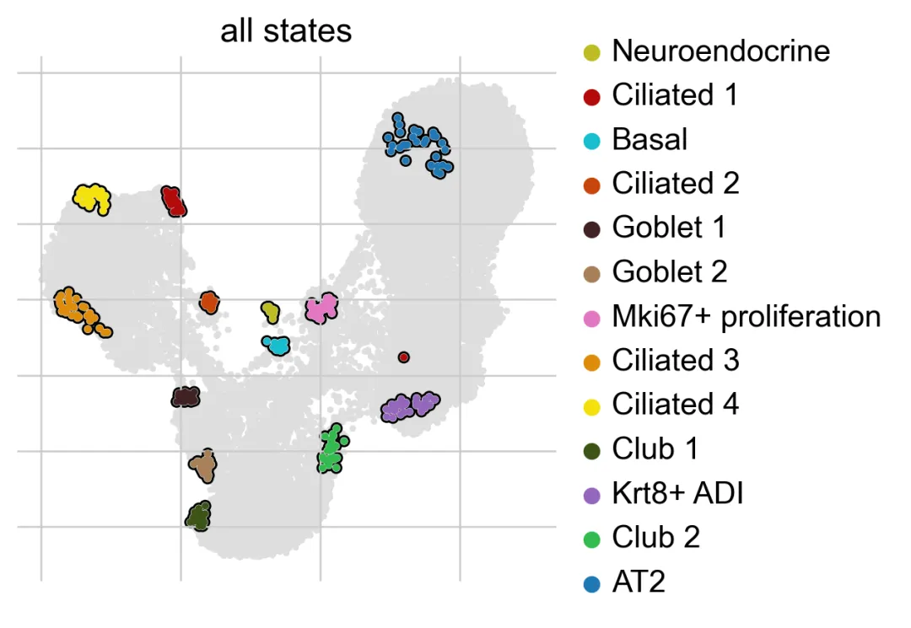

3.1 终末状态校验

所有的终末状态：

  * Neuroendocrine

  * Ciliated_1

  * Basal

  * Ciliated_2

  * Goblet_1

  * Goblet_2

  * Mki67+ proliferation

  * Ciliated_3

  * Ciliated_4

  * Club_1

  * Krt8+ ADI

  * Club_2

  * AT2

参考notebook的做法是先读取`g.macrostates`的真实类别，再检查手动名单。这样可避免CellRank因找不到状态而默默换用错误对象。当前固定名单为：

  * `Krt8+ ADI`

  * `Club_1`

  * `Mki67+ proliferation`

  * `Goblet_1`

  * `Ciliated_4`

这是面向本地肺再生数据和当前参数的教学选择。注意`Krt8+ ADI`在经典 AT2→AT1 叙事中常被称作过渡态；本教程把它作为一个吸收命运，是为了严格复现当前参考分析设定。若研究问题是成熟AT1命运，应重新评估宏状态数、起点与终末状态，而不能直接把本名单当作普遍生物学结论。
```
# 终末状态名称来自上一单元打印的实际宏状态。
```
```
terminal_states= [
```
```
    "Krt8+ ADI",
```
```
    "Club_1",
```
```
    "Mki67+ proliferation",
```
```
    "Goblet_1",
```
```
    "Ciliated_4",
```
```
]
```

```
# 确认名称存在，避免拼写错误。
```
```
missing_states=sorted(set(terminal_states) -set(available_macrostates))
```
```
assertnotmissing_states, f"以下名称不在宏状态中：{missing_states}"
```

```
# 每个终末宏状态选择 30 个代表性细胞作为终末状态集合。
```
```
g.set_terminal_states(
```
```
    states=terminal_states,
```
```
    n_cells=30,
```
```
)
```

```
# 再次读取并打印实际终末名称，供后续目标支路单元使用。
```
```
actual_terminal_states=g.terminal_states.cat.categories.tolist()
```
```
print("实际终末状态:", actual_terminal_states)
```

```
# 画终末宏状态在 UMAP 上的位置。
```
```
g.plot_macrostates(
```
```
    which="terminal",
```
```
    basis="umap",
```
```
    legend_loc="right margin",
```
```
    size=50,
```
```
    show=False,
```
```
)
```
```
plt.gcf().savefig(FIGURE_DIR/"12_terminal_macrostates_umap.pdf", bbox_inches="tight")
```
```
plt.show()
```
```
plt.close("all")
```

向下滑动查看全部~

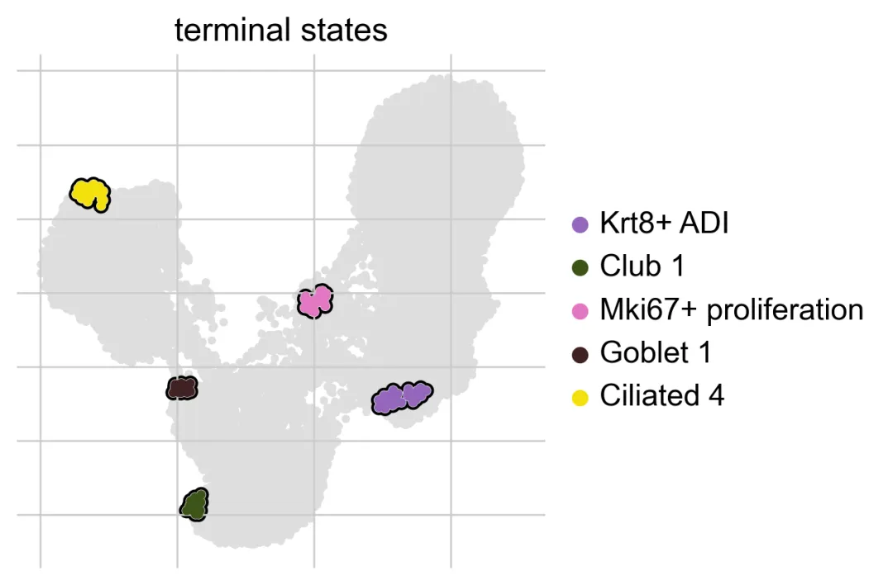

### 4\. 命运概率与环形投影

终末状态被设为吸收态后，CellRank求解每个细胞最终到达各终末状态的概率。对同一细胞，这些命运概率之和应接近1。概率是模型在当前数据、近邻图、拟时序与终末状态设定下的结果，不是单个细胞真实未来的实验追踪。
```
# 计算每个细胞到 5 个终末状态的吸收概率。
```
```
g.compute_fate_probabilities()
```

```
# 确保估计器已经产生命运概率对象。
```
```
ifg.fate_probabilitiesisNone:
```
```
    raiseRuntimeError("CellRank 未生成命运概率。")
```

```
# 把每个命运概率单独画在 UMAP 上，便于比较空间梯度。
```
```
g.plot_fate_probabilities(
```
```
    basis="umap",
```
```
    same_plot=False,
```
```
    ncols=3,
```
```
    show=False,
```
```
)
```
```
plt.gcf().savefig(FIGURE_DIR/"13_fate_probabilities_umap.pdf", bbox_inches="tight")
```
```
plt.show()
```
```
plt.close("all")
```

```
# 环形投影把命运概率映射到多边形顶点；越靠近某顶点越偏向对应命运。
```
```
cr.pl.circular_projection(
```
```
    adata,
```
```
    keys="celltype",
```
```
    legend_loc="right",
```
```
)
```

```
# 保存环形投影 PDF，并在 notebook 中显示同一张图。
```
```
circular_figure=plt.gcf()
```
```
circular_figure.savefig(FIGURE_DIR/"14_circular_projection_celltype.pdf", bbox_inches="tight")
```
```
plt.show()
```
```
plt.close("all")
```

向下滑动查看全部~

上述代码会绘制如下两图，首先是每种细胞发育到各个终末状态的概率，或者说每种终末状态的发育路径中有哪些细胞。

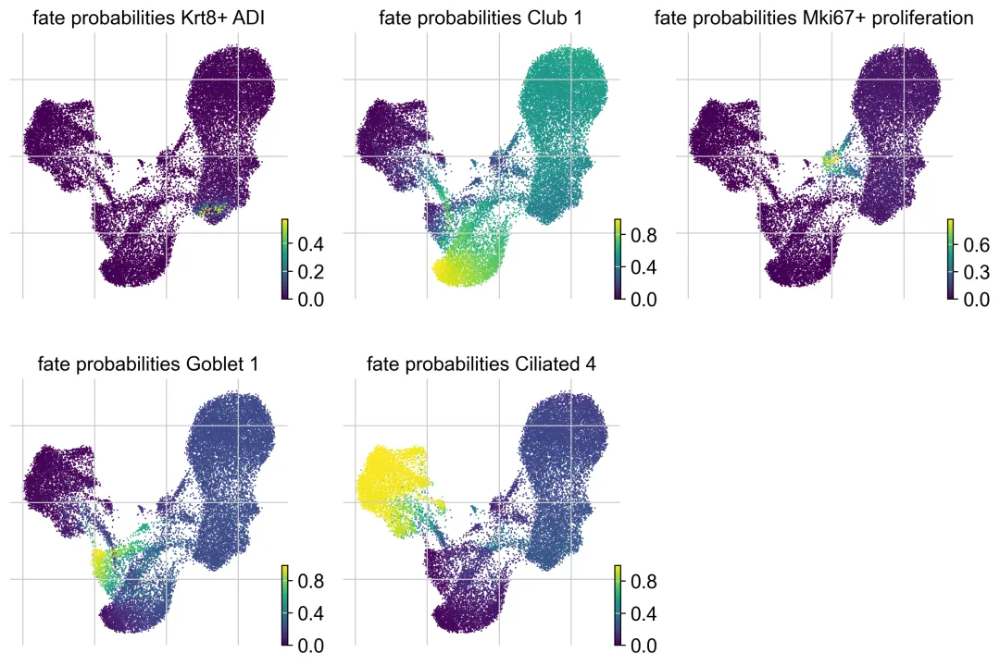

第二张图是计算得出的发育轨迹图，越靠近中间位置的细胞分化程度越低，越靠近5个顶点的终末状态的细胞分化程度越高。

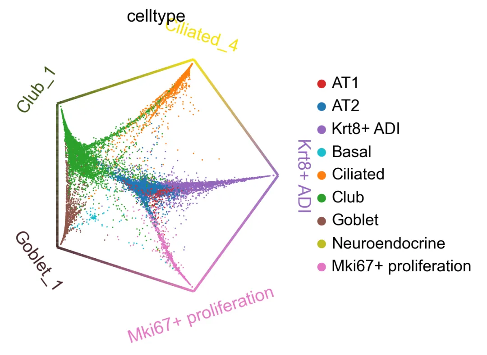

### 5\. 驱动基因：筛选、导出与趋势[热图](<https://mp.weixin.qq.com/s?__biz=MzAwMzIzOTk5OQ==&mid=2247522279&idx=1&sn=ea8a9f3c698cb030440f7e097f252803&scene=21#wechat_redirect>)

`compute_lineage_drivers`计算每个基因表达与各命运概率的相关系数，并进行多重检验校正。这里先对全部 5 个终末命运计算并导出总表，再聚焦`Krt8+ ADI`：保留正相关基因，按相关系数从高到低排序。

为严格对齐参考notebook，前500个基因的筛选条件只要求相关系数大于 0；结果表同时保留q值，正式研究中建议再根据预注册阈值（例如q<0.05）、表达比例和效应大小做二次过滤。
```
# 在驱动基因单元中设置目标支路，保持参数与实际分析步骤相邻。
```
```
lineage="Krt8+ ADI"
```

```
# 检查目标支路确实属于前面手动指定的终末状态。
```
```
assertlineageinactual_terminal_states, f"目标支路不在终末状态中：{lineage}"
```

```
# 一次计算所有手动终末状态的驱动基因，得到每条支路的 corr 与 qval 列。
```
```
lineage_drivers=g.compute_lineage_drivers(lineages=terminal_states)
```

```
# 将完整驱动基因矩阵写为 CSV，保留基因名索引。
```
```
all_drivers_path=OBJECT_DIR/"lineage_drivers_all.csv"
```
```
lineage_drivers.to_csv(all_drivers_path, index=True)
```

```
# 根据目标支路名称构造相关系数列和 q 值列。
```
```
corr_column=f"{lineage}_corr"
```
```
qval_column=f"{lineage}_qval"
```

```
# 检查当前 CellRank 输出是否包含预期列，避免名称拼写错误。
```
```
required_driver_columns= {corr_column, qval_column}
```
```
missing_driver_columns=sorted(required_driver_columns-set(lineage_drivers.columns))
```
```
ifmissing_driver_columns:
```
```
    raiseKeyError(f"驱动基因结果缺少列：{missing_driver_columns}")
```

```
# 仅保留与 Krt8+ ADI 命运概率正相关的基因，并按相关性降序排列。
```
```
positive_drivers= (
```
```
    lineage_drivers.loc[lineage_drivers[corr_column] >0]
```
```
    .sort_values(corr_column, ascending=False)
```
```
    .copy()
```
```
)
```

```
# 取前 500 个；若正相关基因不足 500 个，自动使用全部可用基因。
```
```
top_n_drivers=500
```
```
top500_drivers=positive_drivers.head(top_n_drivers).copy()
```

```
# 提取基因名列表，供趋势聚类复用。
```
```
genes_for_clustering=top500_drivers.index.astype(str).tolist()
```

```
# 导出目标支路前 500 个基因及其全部统计列。
```
```
top500_path=OBJECT_DIR/"Krt8_ADI_top500_positive_drivers.csv"
```
```
top500_drivers.to_csv(top500_path, index=True)
```

```
# 显示前 20 个基因并报告实际筛选数与输出路径。
```
```
display(top500_drivers[[corr_column, qval_column]].head(20))
```
```
print("用于趋势聚类的基因数:", len(genes_for_clustering))
```
```
print("完整驱动表:", all_drivers_path)
```
```
print("目标支路表:", top500_path)
```

向下滑动查看全部~
```
# 在热图单元中设置展示基因数；趋势聚类仍使用上一单元的前 500 个。
```
```
top_n_heatmap=50
```
```
genes_for_heatmap=positive_drivers.head(top_n_heatmap).index.astype(str).tolist()
```

```
# 创建 GAM：更多迭代和 10 个节点用于获得较平滑的展示曲线。
```
```
heatmap_model=cr.models.GAM(
```
```
    adata,
```
```
    max_iter=6000,
```
```
    spline_order=3,
```
```
    n_knots=10,
```
```
)
```

```
# 临时隐藏部分基因拟合不收敛的 RuntimeWarning；CellRank 仍会报告失败数量。
```
```
withwarnings.catch_warnings():
```
```
    warnings.simplefilter("ignore", RuntimeWarning)
```

```
    # 沿 Krt8+ ADI 命运拟合前 50 个基因并画趋势热图。
```
```
    heatmap_figures, fitted_heatmap_genes=cr.pl.heatmap(
```
```
        adata,
```
```
        model=heatmap_model,
```
```
        genes=genes_for_heatmap,
```
```
        lineages=[lineage],
```
```
        time_key="palantir_pseudotime",
```
```
        data_key="MAGIC_imputed_data",
```
```
        cluster_key="celltype",
```
```
        show_fate_probabilities=False,
```
```
        show_all_genes=True,
```
```
        cluster_genes=False,
```
```
        cbar=False,
```
```
        figsize=(9, 14),
```
```
        dpi=300,
```
```
        n_jobs=1,
```
```
        backend="threading",
```
```
        return_figure=True,
```
```
    )
```

```
# CellRank 即使只画一条支路，也可能返回长度为 1 的绘图对象列表。
```
```
heatmap_plot=heatmap_figures[0] ifisinstance(heatmap_figures, (list, tuple)) elseheatmap_figures
```

```
# Seaborn ClusterGrid 通过 .fig 暴露真正的 Matplotlib Figure；普通 Figure 则直接使用。
```
```
heatmap_figure=getattr(heatmap_plot, "fig", heatmap_plot)
```

```
# 单独保存热图 PDF，并把同一个 Figure 对象内嵌显示在 notebook 中。
```
```
heatmap_figure.savefig(
```
```
    FIGURE_DIR/"15_Krt8_ADI_top50_gene_trends_heatmap.pdf",
```
```
    bbox_inches="tight",
```
```
)
```
```
display(heatmap_figure)
```
```
plt.close(heatmap_figure)
```

向下滑动查看全部~

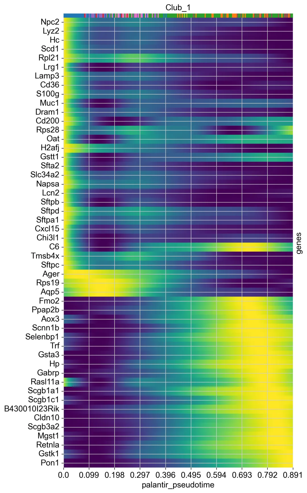
6. 前 500 个驱动基因的趋势聚类

这一步对齐参考notebook的最终分析：

  1. 为每个基因沿`Krt8+ ADI`支路拟合 GAM 曲线；

  2. 在 200 个等距拟时序点预测表达；

  3. 对每条曲线做标准化（`norm=True`），使聚类更关注“何时升高/降低”的形状，而不是绝对表达量；

  4. 对趋势矩阵降维、建图并用 Leiden 聚类；

  5. `resolution=0.7`控制模块粒度，值越大通常得到更多趋势模块。

`recompute=True`强制根据本次500个基因重新拟合与聚类。线程数与聚类分辨率就在下一代码单元设置；内存紧张时把`n_jobs`从4改为1。500个GAM可能需要数分钟到更久，这是整份教程最耗时的一步。
```
# 至少需要若干基因才能进行 PCA、近邻图和 Leiden 趋势聚类。
```
```
iflen(genes_for_clustering) <10:
```
```
    raiseValueError(f"正相关驱动基因仅 {len(genes_for_clustering)} 个，无法稳定聚类。")
```

```
# 趋势聚类使用较轻量的 GAM；1000 次迭代、8 个节点与参考 notebook 一致。
```
```
clustering_model=cr.models.GAM(
```
```
    adata,
```
```
    max_iter=1000,
```
```
    spline_order=3,
```
```
    n_knots=8,
```
```
)
```

```
# 在本单元设置并行线程数；内存不足时直接改为 1。
```
```
n_jobs=4
```

```
# 在本单元设置 Leiden 分辨率；数值越大通常产生越多趋势模块。
```
```
trend_resolution=0.7
```

```
# 指定趋势聚类 PDF 文件名；CellRank 会写入前面设置的 FIGURE_DIR。
```
```
trend_cluster_filename="16_Krt8_ADI_top500_trend_clusters.pdf"
```

```
# 只抑制常见的 GAM RuntimeWarning，保留真实异常。
```
```
withwarnings.catch_warnings():
```
```
    warnings.simplefilter("ignore", RuntimeWarning)
```

```
    # 拟合前 500 个基因的曲线并按趋势形状聚类。
```
```
    trend_models=cr.pl.cluster_trends(
```
```
        adata,
```
```
        model=clustering_model,
```
```
        genes=genes_for_clustering,
```
```
        lineage=lineage,
```
```
        time_key="palantir_pseudotime",
```
```
        data_key="MAGIC_imputed_data",
```
```
        n_points=200,
```
```
        norm=True,
```
```
        recompute=True,
```
```
        ncols=4,
```
```
        figsize=(16, 7),
```
```
        random_state=0,
```
```
        n_jobs=n_jobs,
```
```
        backend="threading",
```
```
        clustering_kwargs={
```
```
            "resolution": trend_resolution,
```
```
            "random_state": 0,
```
```
        },
```
```
        return_models=True,
```
```
        save=trend_cluster_filename,
```
```
    )
```

```
# 显示并关闭聚类趋势图。
```
```
plt.show()
```
```
plt.close("all")
```

```
# 根据 CellRank 图目录解析实际保存位置，并检查文件确实生成。
```
```
trend_cluster_path= (Path(cr.settings.figdir) /trend_cluster_filename).resolve()
```
```
ifnottrend_cluster_path.is_file():
```
```
    raiseFileNotFoundError(f"趋势聚类图未生成：{trend_cluster_path}")
```

```
# 从 CellRank 保存的趋势对象中提取每个基因对应的 Leiden 聚类。
```
```
trend_key=f"lineage_{lineage}_trend"
```
```
trend_cluster_table= (
```
```
    adata.uns[trend_key].obs[["clusters"]]
```
```
    .rename(columns={"clusters": "cluster"})
```
```
    .copy()
```
```
)
```
```
trend_cluster_table.insert(0, "gene", trend_cluster_table.index.astype(str))
```
```
trend_cluster_table["cluster"] =trend_cluster_table["cluster"].astype(str)
```

```
# 导出标准的 gene、cluster 两列表，可直接交给 R 富集函数。
```
```
trend_cluster_csv_path=OBJECT_DIR/"Krt8_ADI_top500_trend_clusters.csv"
```
```
trend_cluster_table.to_csv(trend_cluster_csv_path, index=False)
```

```
# 打印最终文件位置和模型返回状态，便于教学演示。
```
```
print("趋势聚类图:", trend_cluster_path)
```
```
print("趋势聚类表:", trend_cluster_csv_path)
```
```
print("返回拟合模型:", trend_modelsisnotNone)
```

向下滑动查看全部~

**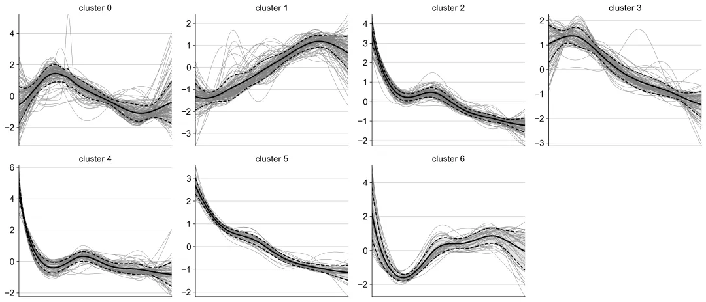**

**如何解释趋势模块**

  * **早期高、随后下降** ：可能与 AT2 起始身份维持或离开起始状态有关。

  * **中期短暂升高** ：可能对应损伤应答、过渡态形成或分支决策窗口。

  * **晚期持续升高** ：可能与目标命运获得和稳定有关。

  * **双峰或复杂曲线** ：先检查拟合质量、表达稀疏性和分支覆盖，再做生物学解释。

后续可从每个模块导出基因，分别做通路富集、[转录因子](<https://mp.weixin.qq.com/s?__biz=MzAwMzIzOTk5OQ==&mid=2247537055&idx=1&sn=170371b86b42d47373bf7f0500031f19&scene=21#wechat_redirect>)活性或外部队列验证。不要只依据趋势图给模块命名；应同时查看marker、相关系数、q值、表达比例和已知生物学。

###

7\. 趋势模块富集分析（R）

项目根目录的`trend_cluster_enrichment.R`提供了可复用函数`enrich_trend_clusters()`。输入是上一步导出的`gene,cluster`两列表和`data/gmtfile/`目录；函数会按物种自动查找 C2、GO-BP、GO-CC、GO-MF、Hallmark GMT，对每个趋势 cluster 分别做 ORA，并把点图保存到`figures/enrich_results/`。
```
# 设置工作目录并加载函数
```
```
rm(list=ls())
```
```
options(stringsAsFactors=F)
```
```
setwd('./cellrank_tutorial')
```
```
source("./objects/trend_cluster_enrichment.R")
```
```
getwd()
```

```
## 可选：制作背景基因集
```
```
#sce.all.int
```
```r
#hvg_genes <- VariableFeatures(sce.all.int[["RNA"]])
```
```
# 清理空值与重复值
```
```r
#hvg_genes <- unique(trimws(hvg_genes))
```
```r
#hvg_genes <- hvg_genes[!is.na(hvg_genes) & nzchar(hvg_genes)]
```

```
# 高变基因数量
```
```
length(hvg_genes)
```

```
# 执行富集分析
```
```r
enrichment<-enrich_trend_clusters(
```
```
  trend_file="objects/Krt8_ADI_top500_trend_clusters.csv", # ipynb最后输出的csv文件
```
```
  gmt_dir="data/gmtfile", # 通路文件路径
```
```
  project_dir=".", # 工作文件夹路径
```
```
  species="mouse", # 数据物种，human 或 mouse
```
```
  show_category=8, # 控制点图中每个 trend cluster 最多选择并展示多少个富集通路
```
```
  color_saturation_p=0.005, # 置信度截断值，避免极端数据影响
```
```
  universe=NULL# 控制富集分析使用的背景基因集合，可以输入单细胞数据集的高变基因，没有手动提供背景基因，clusterProfiler 会使用当前 GMT 数据库中收录的全部基因作为背景
```
```
)
```

向下滑动查看全部~

常用可调参数：

  * `species`：`"mouse"` 或 `"human"`；分别读取 `mm/` 或 `hg/`。

  * `collections`：选择要运行的 GMT 集合；也可通过命名向量 `gmt_files` 传入任意自定义 GMT。

  * `universe`：背景基因。正式分析建议传入所有进入驱动基因检验的基因；`NULL` 时使用 GMT 中被注释的全部基因作为背景。

  * `pvalue_cutoff`、`qvalue_cutoff`、`p_adjust_method`：显著性和多重检验参数。

  * `color_saturation_p`：点图颜色饱和阈值，默认为 `0.005`；`p.adjust <= 0.005` 的条目统一使用最深颜色。

  * `min_gene_set_size`、`max_gene_set_size`：通路基因集大小范围。

  * `show_category`、`size_by`、`wrap_width`：每组显示条目数、点大小映射和标签换行宽度。

  * `plot_width`、`plot_height`：默认按实际通路数自动计算；需要固定版式时可手动指定。

  * `save_tables`：默认为 `TRUE`，同时保存完整富集表与运行清单。

本示例会生成 5 张 PDF 点图、5 张完整结果表和 1 张运行清单。无显著条目的集合不会伪造空点图，具体状态会记录在 `manifest` 中。

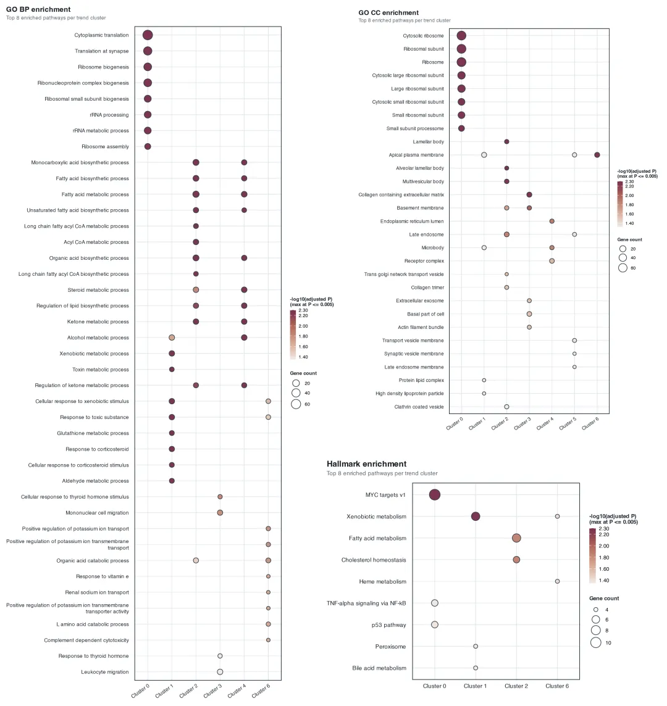

**三、资料领取**

本推送的代码和测试文件可以在以下链接中下载：


百度网盘链接: https://pan.baidu.com/s/1VodHExZbiNiUNAw_B0UQeQ

滴滴助手[Biomamba_zhushou]获取提取码

**四、 环境版本信息**

Python 版本信息
```
Python: 3.11.14NumPy: 2.4.6Pandas: 2.3.3Matplotlib: 3.10.9Scanpy: 1.11.5
```

R 版本信息
```
R version 4.5.1 (2025-06-13)
```
```
Platform: aarch64-apple-darwin20
```
```
Running under: macOS Tahoe 26.5.2
```

```
Matrix products: default
```
```
BLAS:   /System/Library/Frameworks/Accelerate.framework/Versions/A/Frameworks/vecLib.framework/Versions/A/libBLAS.dylib
```
```
LAPACK: /Library/Frameworks/R.framework/Versions/4.5-arm64/Resources/lib/libRlapack.dylib;  LAPACK version 3.12.1
```

```
locale:
```
```
[1] en_US.UTF-8/en_US.UTF-8/en_US.UTF-8/C/en_US.UTF-8/en_US.UTF-8
```

```
time zone: Asia/Shanghai
```
```
tzcode source: internal
```

```
attached base packages:
```
```
[1] stats     graphics  grDevices utils     datasets  methods   base
```

```
loaded via a namespace (and not attached):
```
```
  [1] RColorBrewer_1.1-3          rstudioapi_0.17.1           jsonlite_2.0.0
```
```
  [4] shape_1.4.6.1               magrittr_2.0.3              ggtangle_0.0.7
```
```
  [7] farver_2.1.2                rmarkdown_2.29              GlobalOptions_0.1.2
```
```
 [10] fs_1.6.6                    vctrs_0.6.5                 memoise_2.0.1
```
```
 [13] ggtree_3.16.3               rstatix_0.7.2               htmltools_0.5.8.1
```
```
 [16] S4Arrays_1.8.1              usethis_3.2.1               broom_1.0.9
```
```
 [19] Formula_1.2-5               SparseArray_1.8.1           gridGraphics_0.5-1
```
```
 [22] plyr_1.8.9                  zoo_1.8-14                  cachem_1.1.0
```
```
 [25] igraph_2.2.1                lifecycle_1.0.4             iterators_1.0.14
```
```
 [28] pkgconfig_2.0.3             Matrix_1.7-3                R6_2.6.1
```
```
 [31] fastmap_1.2.0               gson_0.1.0                  GenomeInfoDbData_1.2.14
```
```
 [34] MatrixGenerics_1.20.0       clue_0.3-66                 digest_0.6.37
```
```
 [37] aplot_0.2.8                 enrichplot_1.28.4           colorspace_2.1-1
```
```
 [40] patchwork_1.3.1             AnnotationDbi_1.70.0        S4Vectors_0.48.0
```
```
 [43] DESeq2_1.48.1               pkgload_1.4.1               GenomicRanges_1.60.0
```
```
 [46] RSQLite_2.4.2               ggpubr_0.6.1                labeling_0.4.3
```
```
 [49] km.ci_0.5-6                 httr_1.4.7                  abind_1.4-8
```
```
 [52] compiler_4.5.1              remotes_2.5.0               withr_3.0.2
```
```
 [55] bit64_4.6.0-1               doParallel_1.0.17           backports_1.5.0
```
```
 [58] BiocParallel_1.42.1         carData_3.0-5               DBI_1.2.3
```
```
 [61] pkgbuild_1.4.8              R.utils_2.13.0              ggsignif_0.6.4
```
```
 [64] DelayedArray_0.34.1         sessioninfo_1.2.3           rjson_0.2.23
```
```
 [67] gtools_3.9.5                tools_4.5.1                 ape_5.8-1
```
```
 [70] R.oo_1.27.1                 glue_1.8.0                  nlme_3.1-168
```
```
 [73] GOSemSim_2.34.0             grid_4.5.1                  cluster_2.1.8.1
```
```
 [76] reshape2_1.4.4              fgsea_1.34.2                generics_0.1.4
```
```
 [79] gtable_0.3.6                KMsurv_0.1-6                R.methodsS3_1.8.2
```
```
 [82] survminer_0.5.1             tidyr_1.3.1                 ggVennDiagram_1.5.4
```
```
 [85] data.table_1.17.8           car_3.1-3                   XVector_0.48.0
```
```
 [88] BiocGenerics_0.54.0         ggrepel_0.9.6               foreach_1.5.2
```
```
 [91] pillar_1.11.0               stringr_1.5.1               yulab.utils_0.2.0
```
```
 [94] limma_3.64.3                circlize_0.4.16             splines_4.5.1
```
```
 [97] dplyr_1.1.4                 treeio_1.32.0               lattice_0.22-7
```
```
[100] survival_3.8-3              bit_4.6.0                   tidyselect_1.2.1
```
```
[103] GO.db_3.21.0                ComplexHeatmap_2.24.1       locfit_1.5-9.12
```
```
[106] Biostrings_2.76.0           knitr_1.50                  gridExtra_2.3
```
```
[109] IRanges_2.42.0              edgeR_4.6.3                 SummarizedExperiment_1.38.1
```
```
[112] stats4_4.5.1                xfun_0.52                   Biobase_2.68.0
```
```
[115] statmod_1.5.0               devtools_2.4.6              matrixStats_1.5.0
```
```
[118] stringi_1.8.7               UCSC.utils_1.4.0            lazyeval_0.2.2
```
```
[121] ggfun_0.2.0                 yaml_2.3.10                 evaluate_1.0.4
```
```
[124] codetools_0.2-20            tibble_3.3.0                qvalue_2.40.0
```
```
[127] BiocManager_1.30.26         ggplotify_0.1.2             cli_3.6.5
```
```
[130] xtable_1.8-4                survMisc_0.5.6              Rcpp_1.1.0
```
```
[133] GenomeInfoDb_1.44.1         png_0.1-8                   parallel_4.5.1
```
```
[136] ellipsis_0.3.2              ggplot2_3.5.2               blob_1.2.4
```
```
[139] clusterProfiler_4.16.0      DOSE_4.2.0                  tidytree_0.4.6
```
```
[142] scales_1.4.0                purrr_1.1.0                 crayon_1.5.3
```
```
[145] GetoptLong_1.0.5            rlang_1.1.6                 cowplot_1.2.0
```
```
[148] fastmatch_1.1-6             KEGGREST_1.48.1
```

向下滑动查看全部~


**欢迎致谢**

如果以上内容对你有帮助，欢迎在文章的Acknowledgement中加上这一段，联系客服微信可以发放奖励：
```
Since Biomamba and his wechat public account team produce bioinformatics tutorials and share code with annotation, we thank Biomamba for their guidance in bioinformatics and data analysis for the current study.
```

**欢迎在发文/毕业时向我们分享你的喜悦~**

**已致谢文章**

[ 鼻咽癌的Bulk RNA-Seq与scRNA-Seq联合分析](<https://mp.weixin.qq.com/s?__biz=MzAwMzIzOTk5OQ==&mid=2247510548&idx=1&sn=58048c46e837b1d56dffa282272c6d96&chksm=9b3cd344ac4b5a52369e91b4e61fa0a2c951b82cc21165b99f42ba2c2191d4add803bd73c928&scene=21&cur_album_id=3425248581018714114#wechat_redirect>)

[13分+文章利用scRNA-Seq揭示地铁细颗粒物引起肺部炎症的分子机制](<https://mp.weixin.qq.com/s?__biz=MzAwMzIzOTk5OQ==&mid=2247511886&idx=1&sn=31c712d00377b0f0ed33703b5b4fbfd8&chksm=9b3cd61eac4b5f084fde14a2eb50356f2f40a66c608d38909f12a3d81f48cff029a09ce2ee8c&token=1453608870&lang=zh_CN&scene=21#wechat_redirect>)

[除了铁死亡，还有铜死亡？！](<https://mp.weixin.qq.com/s?__biz=MzAwMzIzOTk5OQ==&mid=2247518144&idx=1&sn=d036f1bb04b09eb73f53e2104d69404c&chksm=9b3cfe90ac4b77862f2f463b42132c7bfdb687a1b61d350dcf656117b1331271e179710fd4fa&scene=21&cur_album_id=3425248581018714114#wechat_redirect>)

[IF14.3| scRNA-seq+脂质组多组学分析揭示宫内生长受限导致肝损伤的性别差异](<https://mp.weixin.qq.com/s?__biz=MzAwMzIzOTk5OQ==&mid=2247520900&idx=1&sn=157134292ffc2e5df730c5ba8a357b61&chksm=9b3cebd4ac4b62c286543c30381e9b4fdb8b44b28d4fa902fb963bbd45b28e1d3f1bc98eb148&scene=21&cur_album_id=3425248581018714114#wechat_redirect>)[银屑病和脂肪肝病中共同病理和免疫特征](<https://mp.weixin.qq.com/s?__biz=MzAwMzIzOTk5OQ==&mid=2247521069&idx=1&sn=4ef441a885cb2525ee3b5c81001feddf&chksm=9b3cea7dac4b636be9f10ffdf75e13531fccae62129944b21a457db2e08c3f2db1e1b553ac34&scene=21&cur_album_id=3425248581018714114#wechat_redirect>) [《Advanced Science》新型Arf1抑制剂促进癌症干细胞衰老并增强抗肿瘤免疫](<http://mp.weixin.qq.com/s?__biz=MzAwMzIzOTk5OQ==&mid=2247522233&idx=1&sn=287a380de741ff55f0ce78dc9c727985&chksm=9b3ceee9ac4b67ffd925abafeba2cb215a5984e6dc85f0d8607340a07ec9208f1d19eae0e04b&scene=21#wechat_redirect>)

[scRNA-seq揭示脓毒症预后水平预测的关键靶点！](<http://mp.weixin.qq.com/s?__biz=MzAwMzIzOTk5OQ==&mid=2247522281&idx=1&sn=f95eb12fdc340b8da1123ec6253e6fac&chksm=9b3ceeb9ac4b67afa587e5fa3a2a8960e9bb28a1ad6dc48e49120a76154417a4c8be95af90b0&scene=21#wechat_redirect>)

[机器学习+生信多组学联合构建牙周炎"线粒体功能障碍与免疫微环境"关联网络](<https://mp.weixin.qq.com/s?__biz=MzAwMzIzOTk5OQ==&mid=2247527168&idx=1&sn=0791d2bf53a9a60015577f892b10d370&scene=21#wechat_redirect>)

[KIF18A在肝细胞癌转移中的双重角色](<https://mp.weixin.qq.com/s?__biz=MzAwMzIzOTk5OQ==&mid=2247528014&idx=1&sn=d285c9ebd415be328fc682d00e6182c0&scene=21#wechat_redirect>)

[bulk+scRNA-seq挖掘BCL2-MAPK14-TXN氧化应激诊断模型，鉴定脓毒症中氧化应激关键基因](<https://mp.weixin.qq.com/s?__biz=MzAwMzIzOTk5OQ==&mid=2247530000&idx=1&sn=e8ddca4e1b2e60839cdf2a7fe87b3dfe&chksm=9b3c0f40ac4b86562e0e307b9dbb8688159e72b3c19d9ceebf8a4bb2e21638896f005b497b11&scene=21&cur_album_id=3425248581018714114&search_click_id=#wechat_redirect>)

[致谢文章+1，中科院1区，scRNA-seq揭示麻黄-甘草配对治疗呼吸系统症状和多(I:C)诱发肺炎模型机制](<https://mp.weixin.qq.com/s?__biz=MzAwMzIzOTk5OQ==&mid=2247536407&idx=1&sn=4da88e13f112662a02fea89d1b7798e9&scene=21#wechat_redirect>)

[致谢文章又+1，生物信息学+机器学习鉴定驱动糖尿病肾病免疫激活和小管间隙损伤的PANoptosis枢纽基因](<https://mp.weixin.qq.com/s?__biz=MzAwMzIzOTk5OQ==&mid=2247537544&idx=1&sn=6e5bb738eb11af53173f9fef67b977df&scene=21#wechat_redirect>)

向下滑动查看更多

欢迎大家致谢~


**如何联系我们**

 留一个领取[资料](<https://mp.weixin.qq.com/s?__biz=MzAwMzIzOTk5OQ==&mid=2247539170&idx=1&sn=ebd269635da35335554c53709fa0a0c0&scene=21#wechat_redirect>)、[开箱即用的单细胞分析镜像](<https://mp.weixin.qq.com/s?__biz=MzAwMzIzOTk5OQ==&mid=2247528410&idx=2&sn=0f2bac25479cf8d20dab5d82ae986f2e&scene=21#wechat_redirect>)的助手[Biomamba_zhushou]，方便各位随时交流。同时我们也构建了[交流群矩阵](<https://mp.weixin.qq.com/s?__biz=MzAwMzIzOTk5OQ==&mid=2247528057&idx=1&sn=bb348c2a88c977c7cce67ee6731a3591&scene=21#wechat_redirect>)，欢迎大家一起讨论。您点的每个赞和在看，我都认真当成了喜欢

Evan
