# 没有AI的时候，谁能整理好几亿的单细胞数据？

> 原文：https://mp.weixin.qq.com/s?__biz=MzAwMzIzOTk5OQ==&mid=2247543047&idx=1&sn=e101b2336ee32f7bc28592e4e800aa2a&chksm=9b3c5057ac4bd941206d445834b0ba0df7df4525dc56d2e23033eb1befeafae18442b2e7895c#rd
> 合集：单细胞教程全收录

# 一、scBaseCount

搞单细胞数据库也是越来越卷了，千万级别的数据库都是小卡拉米，不过亿以后不好意思说自己叫大数据库了。新发了篇Cell整合了，5.02 亿细胞、27 个物种、75 类组织，是当前最大的公开scRNA-seq资源。关键是作者还把每个样本的fastq统一跑了一遍，WTF，算力是真充沛。本教程可视化集锦

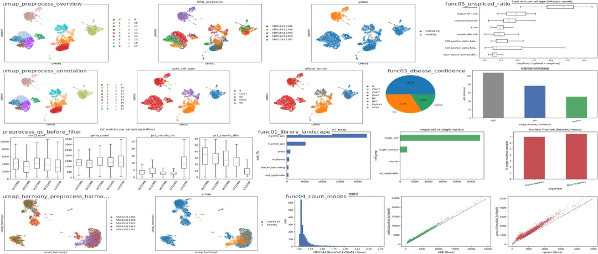项目| 内容
---|---
标题| scBaseCount: An AI agent-curated, standardized, auto-updated single-cell data repository
期刊| **Cell** 2026, 189(19): 5932–5944.e6
DOI| 10.1016/j.cell.2026.08.025
预印本| bioRxiv 2025.02.27.640494，doi: 10.1101/2025.02.27.640494
第一作者/通讯团队| Nicholas D. Youngblut 等（Arc Institute，Patrick D. Hsu / Hani Goodarzi / Yusuf H. Roohani 团队）
代码仓库| https://github.com/ArcInstitute/arc-virtual-cell-atlas
数据位置| `gs://arc-institute-virtual-cell-atlas/scbasecount/2026-01-12/`（Google Cloud Marketplace，Requester Pays）

### 1、想要解决的“科学问题”

  * SRA 是最大的公共测序原始数据池，但**元数据高度不统一** （组织、疾病、物种命名五花八门），大量数据“沉睡”。
  * 不同实验室使用不同的参考基因组、比对工具、定量策略（例如 scRNA-seq 只统计外显子，snRNA-seq 常统计外显子+内含子），导致跨数据集整合时**技术偏差大于生物学信号** 。
  * 单细胞大模型需要海量、表型多样且**处理一致** 的训练语料，而已有人类策展数据库（HCA、CELLxGENE）依赖研究者主动提交/人工策展，覆盖率有限。

### 2、技术路线：两个 AI 组件

  1. `SRAgent`（层次化LLM agent工作流）：从 SRA 中**自动发现** 10x Genomics 数据集(国产科学家们加油啊) → **抽取并标准化元数据** （物种、组织、疾病、扰动、细胞系…）并映射到本体（tissue/disease ontology term id）。
  2. `scRecounter`（标准化重处理流水）：下载原始 FASTQ → 用统一的 STAR 参考（含按分支过滤 biotype 的自定义 GTF）与 **STARsolo** 重新定量，输出多种计数模式（`Gene`、`GeneFull*`、`Velocyto`）。

> 因此 scBaseCount 里的每一份 h5ad，**不是作者上传的表达矩阵，而是作者上传的 FASTQ 被统一 重跑出来的结果**——这正是它能做跨实验可比分析的原因。

### 3、论文给出的关键结论

  * 规模：>5.02 亿细胞、27 个物种、75 类组织，是当前最大的公开scRNA-seq资源；
  * 统一处理使外显子、内含子、非编码转录本计数均可测量，并**降低了跨实验 批次效应**、改善整合效果；
  * 用scBaseCount训练得到的细胞状态模型，在疾病状态、基因扰动、差异表达预测等任务上优于使用既有大型数据库训练的模型；
  * 提供了一条“AI agent自动维护并持续更新生物学数据库”的可复制范式。

### 4、局限与使用注意（教程会实踩的点）

  * **不提供cell type注释的全覆盖** ：2026-01-12 release 的 obs 里新增了 `cell_type` 字段，但并非所有样本/细胞都填充，实战中仍需自行注释；
  * **疾病标签是研究层面（study level）而非样本/细胞层面** ：作者额外给出 `single_disease_confidence`（low/medium/high）用于提示该 SRX 是否为“单一疾病队列”，`low` 很可能混有健康对照，**不要默认疾病标签适用于该 SRX 的所有细胞** ；
  * 数据托管在Google Cloud Marketplace且为**Requester Pays** （订阅项目每月 2TB 免费额度），跨国链路下载较慢，本教程因此采用**小样本 + 多线程分块** 策略；
  * 只有 `filtered` 计数表，没有 `raw`，因此无法自行重新做 emptydroplet 过滤。

需要数据挖掘的同学不妨看看：[](<https://mp.weixin.qq.com/s?__biz=MzAwMzIzOTk5OQ==&mid=2247539480&idx=1&sn=9f1d8a76c0a5ddad4983c3fcf7620622&scene=21#wechat_redirect>)

# 二、学习准备工作

## 1、编程基础

[十小时学会Linux](<https://mp.weixin.qq.com/s?__biz=MzAwMzIzOTk5OQ==&mid=2247505777&idx=1&sn=f3efae390566b838a445ab9f832323c8&chksm=9b3cae21ac4b2737f5923b246470d699474c041bb78de50d2b71b99d537f9f44ca2938002cda&token=1438322295&lang=zh_CN&scene=21#wechat_redirect>)

[8小时掌握生信Python](<https://mp.weixin.qq.com/s?__biz=MzAwMzIzOTk5OQ==&mid=2247537399&idx=1&sn=d14c7987d1384fe133094748844b8d59&scene=21&click_id=23#wechat_redirect>)。

相信学完以上编程基础，再看接下来的教程就不会觉得很难啦~

## 2、硬件基础

[不推荐用自己的电脑做生信](<https://mp.weixin.qq.com/s?__biz=MzAwMzIzOTk5OQ==&mid=2247520958&idx=1&sn=82be529830901f313089c19803361acd&chksm=9b3cebeeac4b62f83f6c4fdbc0819032fba4249d2dc7f29b8eaec7e8ff99771d5c5c3e6ce4bb&token=1442149515&lang=zh_CN&scene=21#wechat_redirect>)。实战的数据分析可能需要**上百GB** 的内存，如果你的设备不能满足，可以考虑下列服务器的租赁。最便宜的版本即可帮助你们完成90%以上的单细胞分析需求(土豪随意)：

[足够支持你完成硕博生涯的生信环境](<https://mp.weixin.qq.com/s?__biz=MzAwMzIzOTk5OQ==&mid=2247511780&idx=1&sn=3acc0874f7d2fa75f1abbe7a9a9b4069&chksm=9b3cd7b4ac4b5ea27d4d53964e4a4a9fa8c806a19103729dd4ff0fa72e621411f46a251d269f&token=1453608870&lang=zh_CN&scene=21#wechat_redirect>)

[如何拥有一台服务器，且不用自己搭建维护](<https://mp.weixin.qq.com/s?__biz=MzAwMzIzOTk5OQ==&mid=2247504032&idx=1&sn=e8af21713884497e8476a4fd8d58d567&chksm=9b3ca9f0ac4b20e6a0965331cf971f859e104aa4fb2b35c7a3406869f0045d7163029c2744ee&token=1385613622&lang=zh_CN&scene=21#wechat_redirect>)

[配置一个心仪的工作站(硬件+环境配置)](<https://mp.weixin.qq.com/s?__biz=MzAwMzIzOTk5OQ==&mid=2247519707&idx=1&sn=73dcab26f9b2ed75a954327317d07112&chksm=9b3cf48bac4b7d9df5b5a432fbe70d4f9c13bc8d739aa401732614f022223d1912642a7e4bea&token=671548924&lang=zh_CN&scene=21#wechat_redirect>)

###

# 三、教程可应用范围

场景| 是否适用| 说明
---|---|---
按物种/组织/疾病/技术检索 SRA 中的 10x 数据| ✅ 强项| 元数据已由 agent 标准化，直接查 parquet 即可
跨实验、跨实验室的大规模整合与图谱构建| ✅ 强项| 全部由 STARsolo 统一处理，批次效应较原始数据更低
需要内含子信号的核转录组（snRNA-seq）分析| ✅ 强项| 提供 `GeneFull_Ex50pAS` 等含内含子的计数
RNA velocity / 剪接动力学| ✅ 强项| 提供 `Velocyto` 的 spliced / unspliced / ambiguous 三层
单细胞大模型预训练语料| ✅ 设计目标| 论文即以此为核心卖点
做疾病 vs 对照的严格队列差异分析| ⚠️ 谨慎| 疾病标签在研究层面，需检查 `single_disease_confidence`
需要细胞类型标签直接下分析| ⚠️ 部分| 仅部分 obs 有 `cell_type`，其余需自行注释
需要作者的原始 CellRanger 输出| ❌ 不适用| 这里是统一重处理结果

# 四、环境搭建

本教程按“英文名_env”规范创建 conda 环境 `scbasecount_env`。Windows / Linux 通用的创建方式如下（**此处仅展示命令，不重复执行，避免把你已建好的环境覆盖** ）：

`# 1) 创建环境（Python 3.11 兼容性最好）
conda create -y -n scbasecount_env -c conda-forge python=3.11
conda activate scbasecount_env

# 2) 安装分析依赖（conda-forge）
conda install -y -c conda-forge scanpy pyarrow matplotlib seaborn scikit-learn \
leidenalg igraph numba jupyter nbconvert nbformat ipykernel psutil

# 3) harmonypy 不在 conda 的默认通道里，用 pip 安装（国内建议阿里云镜像）
python -m pip install -i https://mirrors.aliyun.com/pypi/simple/ harmonypy

# 4) 把环境注册到 jupyter，方便在线运行本手册
python -m ipykernel install --user --name scbasecount_env --display-name "scBaseCount教程"
`

将环境导出为 `env.yaml`，方便复刻：

`conda env export -n scbasecount_env --no-builds > env.yaml
```
# 环境自检：确认当前内核、Python 版本与关键依赖版本
import sys, platform, os
print("Python:", sys.version.split()[0], "| platform:", platform.platform())
print("内核可执行文件:", sys.executable)

import numpy, pandas, scanpy as sc, sklearn
from importlib.metadata import version as _ver
for _name in ["numpy", "pandas", "scipy", "scikit-learn", "scanpy", "anndata", "harmonypy"]:
print(f"{_name:>12}:", _ver(_name))Python: 3.13.14 | platform: Windows-11-10.0.26200-SP0
内核可执行文件: C:\Users\Administrator\\.workbuddy\binaries\python\envs\default\Scripts\python.exeC:\Users\Administrator\\.workbuddy\binaries\python\envs\default\Lib\site-packages\cupy\\_environment.py:286: UserWarning: CUDA path could not be detected. Set CUDA_PATH environment variable if CuPy fails to load.
warnings.warn( numpy: 2.5.3
pandas: 3.0.6
scipy: 1.18.1
scikit-learn: 1.9.1
scanpy: 1.12.4
anndata: 0.13.4
harmonypy: 0.0.9``

# 五、scBaseCount 的数据组织方式

2026-01-12 release 的目录结构（官方文档见 README）：

gs://arc-institute-virtual-cell-atlas/scbasecount/2026-01-12/
├── README.md
├── h5ad/ # 表达矩阵，按 STARsolo 计数模式 + 物种组织
│ ├── Gene/ Homo_sapiens/ SRXxxxxxxx.h5ad
│ ├── GeneFull/ ...
│ ├── GeneFull_Ex50pAS/ ... # 本教程使用：外显子优先 + 内含子计数，最适合 snRNA-seq/核转录组
│ ├── GeneFull_ExonOverIntron/ ...
│ └── Velocyto/ ... # spliced / unspliced / ambiguous 三层，供 RNA velocity
├── metadata/ # parquet 格式的元数据，比 CSV 快很多
│ ├── GeneFull_Ex50pAS/Homo_sapiens/sample_metadata.parquet # SRX 级别
│ └── GeneFull_Ex50pAS/Homo_sapiens/obs_metadata.parquet # 细胞级别
├── analysis/ # 官方分析结果
└── star_references/ # 各 STAR 参考使用的自定义 GTF

h5ad 内部的 layers/矩阵约定：

feature type| X 矩阵| 其他层
---|---|---
`Gene*`| `Unique`（唯一比对 UMI）| `UniqueAndMult-EM`、`UniqueAndMult-Uniform`
`Velocyto`| `spliced`| `unspliced`、`ambiguous`

由于 bucket 托管在 Google Cloud 且跨国链路较慢，本教程**不用 gsutil/gcsfs 直接拉大文件** ，而是先用轻量 HTTP API 探查目录，再对目标文件做**多线程 Range 分块下载** （脚本见 `scripts/mt_download.py`）。

# 用纯标准库探查 GCS 目录（不依赖 gcsfs，Windows/Linux/pip-less 环境都能跑）
import json, urllib.parse, urllib.request

BUCKET = "arc-institute-virtual-cell-atlas"
RELEASE = "scbasecount/2026-01-12" # 数据版本
FEATURE = "GeneFull_Ex50pAS" # STARsolo 计数模式
API = f"https://storage.googleapis.com/storage/v1/b/{BUCKET}/o"

def gcs_list(prefix, delimiter="/", max_results=100000):
"""列出 GCS 某个前缀下的『子目录』与『文件』。返回 (子目录列表, [(文件名, 字节数)])。"""
q = {"prefix": prefix, "delimiter": delimiter, "maxResults": max_results}
url = API + "?" + urllib.parse.urlencode(q)
with urllib.request.urlopen(url, timeout=60) as r:
d = json.load(r)
dirs = d.get("prefixes", [])
files = [(i["name"].split("/")[-1], int(i["size"])) for i in d.get("items", [])
if not i["name"].endswith("/")]
return dirs, files

dirs, files = gcs_list(f"{RELEASE}/metadata/{FEATURE}/", delimiter="/")
print("物种数量:", len(dirs))
print("前 5 个物种:", [d.rstrip('/').split('/')[-1] for d in dirs[:5]])

dirs_h, files_h = gcs_list(f"{RELEASE}/h5ad/{FEATURE}/", delimiter="/")
print("表达矩阵按物种分:", len(dirs_h))
print([d.rstrip('/').split('/')[-1] for d in dirs_h])物种数量: 27
前 5 个物种: ['Arabidopsis_thaliana', 'Bos_taurus', 'Caenorhabditis_elegans', 'Callithrix_jacchus', 'Chlorocebus_aethiops']表达矩阵按物种分: 27
['Arabidopsis_thaliana', 'Bos_taurus', 'Caenorhabditis_elegans', 'Callithrix_jacchus', 'Chlorocebus_aethiops', 'Danio_rerio', 'Drosophila_melanogaster', 'Equus_caballus', 'Gallus_gallus', 'Gasterosteus_aculeatus', 'Gorilla_gorilla', 'Heterocephalus_glaber', 'Homo_sapiens', 'Macaca_mulatta', 'Mesocricetus_auratus', 'Monodelphis_domestica', 'Mus_musculus', 'Oryctolagus_cuniculus', 'Oryza_sativa', 'Ovis_aries', 'Pan_troglodytes', 'Rattus_norvegicus', 'Schistosoma_mansoni', 'Solanum_lycopersicum', 'Sus_scrofa', 'Taeniopygia_guttata', 'Zea_mays']# 对象体积检查：先看清楚要下载多大，别硬盘爆了（skill Tips-4）
import urllib.request
def gcs_size(obj_path):
"""查询单个对象大小（字节）。"""
url = API + "/" + urllib.parse.quote(obj_path, safe="") + "?fields=size"
with urllib.request.urlopen(url, timeout=60) as r:
return int(json.load(r)["size"])

demo_obj = f"{RELEASE}/h5ad/{FEATURE}/Homo_sapiens/SRX16311386.h5ad"
size_mb = gcs_size(demo_obj) / 1024**2
print(f"{demo_obj} -> {size_mb:.1f} MB")
try:
import shutil
usage = shutil.disk_usage(".")
print(f"本地可用磁盘: {usage.free/1024**3:.1f} GiB / 共 {usage.total/1024**3:.0f} GiB")
except Exception as e:
print("磁盘余量检查失败，请手动确认:", e)scbasecount/2026-01-12/h5ad/GeneFull_Ex50pAS/Homo_sapiens/SRX16311386.h5ad -> 21.1 MB
本地可用磁盘: 294.2 GiB / 共 899 GiB

#

# 六、官方 demo 复刻

官方给出的 Python 教程（tutorial-py.ipynb）核心是三件事：用 `gcsfs` 列文件 → 用 `pyarrow` 读 parquet 元数据 → 用 `scanpy.read_h5ad` 读矩阵。下面等价复刻一遍。

### 6.1 用 gcsfs 列出文件（官方写法）

> 若网络无法匿名访问（Requester Pays 策略可能变化），本节会报错，属于预期情况，直接跳到 6.2 的纯 HTTP 写法即可。

import pandas as pd

def get_file_table(base_path, target=None, endswith=None):
"""按前缀递归列出 GCS 文件，返回 DataFrame(organism, file_path)。"""
fs = gcsfs.GCSFileSystem() # 匿名访问
files = fs.glob("/".join([base_path.rstrip("/"), "**"]))
if target:
files = [f for f in files if os.path.basename(f) == target]
else:
files = [f for f in files if f.endswith(endswith)]
rows = [[f.split("/")[-2], f] for f in files]
return pd.DataFrame(rows, columns=["organism", "file_path"])

try:
import gcsfs
gcs_base = f"gs://{BUCKET}/{RELEASE}/"
sample_pq = get_file_table(f"{gcs_base}metadata/{FEATURE}", target="sample_metadata.parquet")
print("sample_metadata 文件数:", sample_pq.shape[0])
sample_pq.head()
except Exception as e:
print("gcsfs 路线不可用（网络/认证限制）:", type(e).__name__, e)
print("-> 请改用下一节的纯 HTTP 写法，效果等价且不依赖 Google SDK。")gcsfs 路线不可用（网络/认证限制）: ModuleNotFoundError No module named 'gcsfs'
-> 请改用下一节的纯 HTTP 写法，效果等价且不依赖 Google SDK。

### 6.2 读取 SRX 级别的 sample metadata（纯 HTTP + pyarrow）

先把 27 个物种的 `sample_metadata.parquet` 拉下来（都很小，合计约 8 MB），这一步是**全库检索的基础** 。

import urllib.request, urllib.parse, os

META_DIR = "data/meta_sample"
os.makedirs(META_DIR, exist_ok=True)

with mg.guard("下载 sample metadata", estimate_gib=0.2):
if not any(f.endswith(".parquet") for f in os.listdir(META_DIR)):
_dirs, _ = gcs_list(f"{RELEASE}/metadata/{FEATURE}/", delimiter="/")
for d in _dirs:
sp = d.rstrip("/").split("/")[-1]
obj = f"{d}sample_metadata.parquet"
out = os.path.join(META_DIR, f"{sp}.parquet")
if os.path.exists(out):
continue
urllib.request.urlretrieve(
API + "/" + urllib.parse.quote(obj, safe="") + "?alt=media", out)
print("downloaded:", sp)
else:
print("samle metadata 已存在，跳过下载")

import glob
files = sorted(glob.glob(f"{META_DIR}/*.parquet"))
print("物种文件数:", len(files))[memory-guard] 准入通过：下载 sample metadata 需要 0.2 GiB，当前可用 60.2 GiB
[memory-guard] >> 下载 sample metadata | RSS=0.29 GiB | sys=37.2% | avail=60.2 GiB
samle metadata 已存在，跳过下载
[memory-guard] << 下载 sample metadata 用时 0.0s，RSS 增量 +0.00 GiB
物种文件数: 27# 合并成一张全库样本表
import pandas as pd
sample_meta = pd.concat([pd.read_parquet(f) for f in files], ignore_index=True)
print("样本数(SRX/ERX):", sample_meta.shape[0])
print("细胞总数:", f"{sample_meta['obs_count'].sum():,}")
print("物种数:", sample_meta['organism'].nunique(), "| 组织数:", sample_meta['tissue'].nunique())
sample_meta.head(3)样本数(SRX/ERX): 61378
细胞总数: 502,472,775
物种数: 27 | 组织数: 13607# 全库画像：细胞数最多的物种 / 10x 技术 / 核质分离类型
summary = (sample_meta.groupby("organism")["obs_count"]
.agg(samples="size", cells="sum")
.sort_values("cells", ascending=False))
summary.head(10)
| samples| cells
---|---|---
organism|
|

Homo sapiens| 35263| 302278851
Mus musculus| 21439| 163687964
Macaca mulatta| 1275| 9164160
Danio rerio| 842| 6399100
Callithrix jacchus| 406| 4742509
Drosophila melanogaster| 416| 3730277
Sus scrofa| 317| 2773996
Arabidopsis thaliana| 232| 1984986
Rattus norvegicus| 271| 1295798
Bos taurus| 176| 1194485

# 七、scBaseCount 的核心功能

这一章是整篇手册的重点。scBaseCount 的价值不在于"又多了一个表达矩阵仓库"，而在于这四件事：

#| 能力| 为什么值得单独讲
---|---|---
1| **agent 自动发现 + 元数据标准化**|  SRA 里几十万个 run，人工不可能逐个读；agent 把物种/组织/疾病/扰动/细胞系抽成结构化字段并映射到本体
2| **统一重处理**|  同一套 STAR 参考 + STARsolo，把外显子、内含子、非编码、剪接状态一次算齐，跨实验可比
3| **一份数据多种计数模式**| ` Gene*` / `GeneFull*` / `Velocyto`，X 与 layers 里还有 Unique / EM / Uniform 三种 UMI 归并策略
4| **GB 级元数据可流式检索**|  元数据是 parquet，可以只读列、只读 row group、带谓词下推，不必下载完整文件

下面逐条演示。

## 7.1 只靠元数据就能做的全库画像

`sample_metadata.parquet` 只有几 MB，却覆盖了 6 万多个样本。**不需要碰任何表达矩阵** ，就能回答"这个库里有什么"。

# 物种维度：样本数 vs 细胞数
by_org = (sample_meta.groupby("organism")["obs_count"]
.agg(samples="size", cells="sum")
.sort_values("cells", ascending=False))
by_org["cells_pct"] = (by_org["cells"] / by_org["cells"].sum() * 100).round(2)
by_org.head(12)
| samples| cells| cells_pct
---|---|---|---
organism|
|
|

Homo sapiens| 35263| 302278851| 60.16
Mus musculus| 21439| 163687964| 32.58
Macaca mulatta| 1275| 9164160| 1.82
Danio rerio| 842| 6399100| 1.27
Callithrix jacchus| 406| 4742509| 0.94
Drosophila melanogaster| 416| 3730277| 0.74
Sus scrofa| 317| 2773996| 0.55
Arabidopsis thaliana| 232| 1984986| 0.40
Rattus norvegicus| 271| 1295798| 0.26
Bos taurus| 176| 1194485| 0.24
Gallus gallus| 146| 976293| 0.19
Heterocephalus glaber| 133| 890169| 0.18
# 技术维度：10x 化学版本、单细胞 vs 单核
fig, axes = plt.subplots(1, 3, figsize=(16, 4))
sample_meta["tech_10x"].value_counts().head(6).sort_values().plot(
kind="barh", ax=axes[0], color="#4C72B0")
axes[0].set_title("10x chemistry / assay")
sample_meta["cell_prep"].value_counts().sort_values().plot(
kind="barh", ax=axes[1], color="#55A868")
axes[1].set_title("single cell vs single nucleus")
sn_ratio = (sample_meta[sample_meta["organism"].isin(["Homo sapiens", "Mus musculus"])]
.assign(is_nuc=lambda d: d["cell_prep"] == "single_nucleus")
.groupby("organism")["is_nuc"].mean() * 100)
sn_ratio.plot(kind="bar", ax=axes[2], color="#C44E52")
axes[2].set_ylabel("% single-nucleus samples")
axes[2].set_title("nucleus fraction (human/mouse)")
axes[2].tick_params(axis="x", rotation=15)
plt.tight_layout()
fig.savefig("results/figures/func01_library_landscape.png", bbox_inches="tight", dpi=150)
plt.show()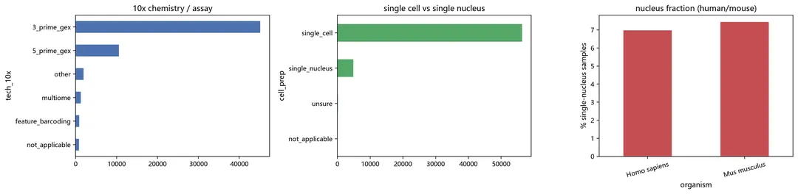# 组织维度：tissue 是自由文本，先看原始取值有多"脏"，再取头部
tissue_norm = sample_meta["tissue"].fillna("NA").str.lower().str.strip()
print("tissue 原始取值种类:", tissue_norm.nunique())
tissue_norm.value_counts().head(15)tissue 原始取值种类: 12753tissue
unsure 4340
lung 1956
blood 1875
bone marrow 1384
brain 1373
cml 1342
liver 1138
spleen 1121
k562 cell line 923
peripheral blood mononuclear cells (pbmcs) 920
peripheral blood mononuclear cells (pbmc) 855
tumor 654
peripheral blood 642
lymph node 600
skin 558
Name: count, dtype: int64# 组织 + CELLxGENE 来源
fig, axes = plt.subplots(1, 2, figsize=(14, 4.5))
tissue_norm.value_counts().head(12).sort_values().plot(kind="barh", ax=axes[0], color="#8172B2")
axes[0].set_title("Top tissues (raw labels, lower-cased)")
has_czi = sample_meta["czi_collection_name"].notna()
print(f"带 CZI CELLxGENE collection 标注的样本: {int(has_czi.sum())} / {sample_meta.shape[0]}")
sample_meta.loc[has_czi, "czi_collection_name"].value_counts().head(8).sort_values().plot(
kind="barh", ax=axes[1], color="#CCB974")
axes[1].set_title("Top CELLxGENE collections")
plt.tight_layout()
fig.savefig("results/figures/func02_tissue_collection.png", bbox_inches="tight", dpi=150)
plt.show()带 CZI CELLxGENE collection 标注的样本: 2726 / 61378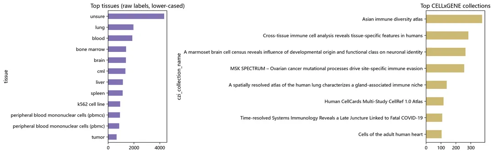

## 7.2 疾病标签的置信度：决定你能不能拿它做队列

疾病标签是 **agent 从研究层面的摘要里抽出来的** ，会把同一个标签传播给该研究下的所有样本（包括健康对照）。官方为此额外给出 `single_disease_confidence`（low/medium/high）与 `single_disease_confidence_reasoning`。

**这是用这个库做队列分析前必须先看的一列。**

conf = sample_meta[sample_meta["disease_ontology_term_id"].notna()]
print("带疾病本体标注的样本数:", conf.shape[0], "/", sample_meta.shape[0])
fig, axes = plt.subplots(1, 2, figsize=(14, 4.5))
conf["single_disease_confidence"].fillna("(空)").value_counts().plot(
kind="pie", autopct="%1.1f%%", ax=axes[0])
axes[0].set_ylabel(""); axes[0].set_title("single_disease_confidence 分布")
conf.groupby("single_disease_confidence")["obs_count"].sum().div(1e6).round(1).plot(
kind="bar", ax=axes[1], color=["#8C8C8C", "#4C72B0", "#55A868", "#C44E52"])
axes[1].set_ylabel("cells (millions)"); axes[1].tick_params(axis="x", rotation=15)
axes[1].set_title("各置信度对应的细胞量")
plt.tight_layout()
fig.savefig("results/figures/func03_disease_confidence.png", bbox_inches="tight", dpi=150)
plt.show()带疾病本体标注的样本数: 29770 / 61378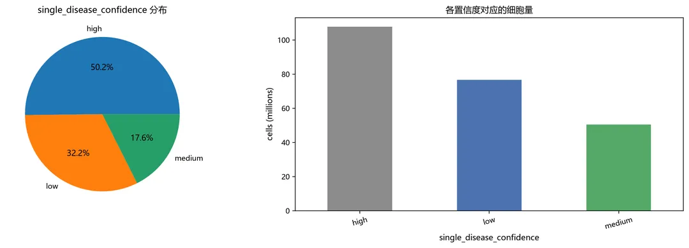# 看几条真实的 agent 推理理由，判断标注可信度
demo_reason = conf[conf["disease"] == "COVID-19"][
["srx_accession", "disease", "single_disease_confidence",
"single_disease_confidence_reasoning"]].head(4)
for _, r in demo_reason.iterrows():
print(f"[{r['srx_accession']}] {r['disease']} | confidence = {r['single_disease_confidence']}")
print(" reasoning:", str(r["single_disease_confidence_reasoning"])[:300])
print()[SRX23995682] COVID-19 | confidence = low
reasoning: Study profiles retinal tissue from the common marmoset (Callithrix jacchus) for developmental fovea/peripheral retina atlases (neonates/adults), and the BioSample is silent on disease (biosample_disclosed_disease=False), so COVID-19 is unlikely.

[SRX10479085] COVID-19 | confidence = low
reasoning: bioproject_summary (PRJNA718568) and geo_title describe colorectal cancer (CRC) tumor models and Atractylenolide I treatment/immune checkpoint therapy, which contradicts the SRAgent label of "COVID-19".

[SRX23751502] COVID-19 | confidence = low
reasoning: BioSample lists group=Control (includes_healthy=True), indicating this SRX is a control/non-COVID sample while the study contrasts 5 COVID-19 decedents with 3 other-cause controls, so the COVID-19 label likely does not apply.

[SRX23751499] COVID-19 | confidence = low
reasoning: BioSample is silent on disease and the study abstract states scRNA-seq was done on brain tissue from 5 patients who died of COVID-19 and 3 who died of other causes, with no sample-level annotation tying this SRX to a COVID-19 case.

# 实战用法：只要"高置信度"的 COVID-19 队列，避免把混有对照的样本算进去
covid_all = sample_meta[sample_meta["disease"] == "COVID-19"]
covid_high = covid_all[covid_all["single_disease_confidence"] == "high"]
print(f"COVID-19 样本: 全部 {covid_all.shape[0]} 个 | 高置信 {covid_high.shape[0]} 个 "
f"({covid_high.shape[0]/max(covid_all.shape[0],1)*100:.0f}%)")
covid_high[["srx_accession", "tissue", "obs_count", "single_disease_confidence"]].head(8)COVID-19 样本: 全部 472 个 | 高置信 344 个 (73%)
| srx_accession| tissue| obs_count| single_disease_confidence
---|---|---|---|---
3838| SRX26170521| Peripheral Blood Mononuclear Cells (PBMC)| 11519| high
3839| SRX26170544| PBMC (Peripheral Blood Mononuclear Cells)| 7729| high
3843| SRX26170531| PBMC| 7435| high
3848| SRX26170545| Peripheral Blood Mononuclear Cells (PBMC)| 10578| high
3897| SRX26170526| Peripheral Blood Mononuclear Cells (PBMC)| 12852| high
3901| SRX26170533| Peripheral Blood Mononuclear Cells (PBMC)| 9520| high
3904| SRX26170523| Peripheral Blood Mononuclear Cells (PBMC)| 15112| high
3905| SRX26170525| Peripheral Blood Mononuclear Cells (PBMC)| 15384| high

## 7.3 GB 级细胞元数据的"零下载"检索

`obs_metadata.parquet` 是**细胞级** 元数据。人类那一份有 **5.5 GB / 3 亿多行** ，完全没必要下载——parquet 是列式的，pyarrow 可以：

  * 只读 **footer** （几 MB）就知道总行数与 schema；
  * 只读**需要的列** （column projection）；
  * 只读**指定 row group** ；
  * 带 **filter 谓词下推** ，在读取时就完成过滤。

下面用 `fsspec` 直接开一个 HTTP 远程文件读，全程不落盘。

import fsspec, pyarrow.parquet as pq

GCS_HTTP = f"https://storage.googleapis.com/{BUCKET}/"
obs_remote = GCS_HTTP + f"{RELEASE}/metadata/{FEATURE}/Homo_sapiens/obs_metadata.parquet"
print(obs_remote)

fs_http = fsspec.filesystem("https")
t0 = time.time()
with fs_http.open(obs_remote, "rb") as f:
pf = pq.ParquetFile(f) # 只读 footer + schema
meta = pf.metadata
print(f"人类 obs_metadata: {meta.num_rows:,} 行(细胞) | {meta.num_row_groups} 个 row group "
f"| {meta.num_columns} 列 | 读取耗时 {time.time()-t0:.1f}s（零下载）")
print("列:", pf.schema_arrow.names)https://storage.googleapis.com/arc-institute-virtual-cell-atlas/scbasecount/2026-01-12/metadata/GeneFull_Ex50pAS/Homo_sapiens/obs_metadata.parquet人类 obs_metadata: 302,278,851 行(细胞) | 289 个 row group | 10 列 | 读取耗时 2.9s（零下载）
列: ['cell_barcode', 'SRX_accession', 'gene_count_Unique', 'umi_count_Unique', 'gene_count_UniqueAndMult-EM', 'umi_count_UniqueAndMult-EM', 'gene_count_UniqueAndMult-Uniform', 'umi_count_UniqueAndMult-Uniform', 'cell_type', 'cell_ontology_term_id']# 远程"列裁剪 + 行裁剪"读取：这里用同结构的小文件做演示（人类那份单个 row group
# 就有约 19 MB，在国内链路下容易超时，代码写在下面备查）。
obs_remote_small = (GCS_HTTP + f"{RELEASE}/metadata/{FEATURE}/"
"Gorilla_gorilla/obs_metadata.parquet")
t0 = time.time()
with fs_http.open(obs_remote_small, "rb") as f:
pf_small = pq.ParquetFile(f)
tbl = pf_small.read(columns=["SRX_accession", "gene_count_Unique", "umi_count_Unique"])
remote_obs = tbl.to_pandas()
print(f"远程读取 {len(remote_obs):,} 个细胞（未落盘），耗时 {time.time()-t0:.1f}s，"
f"表格内存 {tbl.nbytes/1024**2:.2f} MB")
remote_obs.describe()远程读取 9,351 个细胞（未落盘），耗时 3.9s，表格内存 0.23 MB
| gene_count_Unique| umi_count_Unique
---|---|---
count| 9351.000000| 9351.000000
mean| 1270.621431| 2247.320312
std| 1113.821164| 3367.680664
min| 63.000000| 300.000000
25%| 548.000000| 708.000000
50%| 956.000000| 1334.000000
75%| 1505.000000| 2178.500000
max| 10901.000000| 80085.000000
# 人类那份的"抽样读取"写法（网络够快时直接跑；本手册演示环境链路较慢故未执行）
human_sample_code = '''
with fs_http.open(obs_remote, "rb") as f:
pf = pq.ParquetFile(f)
tbl = pf.read_row_groups([0], columns=["SRX_accession", "gene_count_Unique",
"umi_count_Unique"]) # 单个 row group ≈ 19 MB
print(tbl.num_rows, "cells |", tbl.nbytes / 1024**2, "MB")
'''
print(human_sample_code)
print("提示：pyarrow 只会发出被读取列/行组对应的 HTTP Range 请求，"
"不会下载整个 5.5 GB 文件；但跨国链路下单 row group 仍可能超时，"
"真正的大规模取数建议在同一区域的云主机上做。")
with fs_http.open(obs_remote, "rb") as f:
pf = pq.ParquetFile(f)
tbl = pf.read_row_groups([0], columns=["SRX_accession", "gene_count_Unique",
"umi_count_Unique"]) # 单个 row group ≈ 19 MB
print(tbl.num_rows, "cells |", tbl.nbytes / 1024**2, "MB")

提示：pyarrow 只会发出被读取列/行组对应的 HTTP Range 请求，不会下载整个 5.5 GB 文件；但跨国链路下单 row group 仍可能超时，真正的大规模取数建议在同一区域的云主机上做。# 对照实验：把「全量读」与「列裁剪 + 谓词下推」的成本摆在一起
import pyarrow.dataset as ds

local_obs = "data/meta_cell/GeneFull_Ex50pAS/Gallus_gallus.parquet"
need_cols = ["SRX_accession", "gene_count_Unique", "umi_count_Unique", "cell_type"]
if os.path.exists(local_obs):
dset = ds.dataset(local_obs, format="parquet")

t0 = time.time(); rss0 = rss_gib()
full = dset.to_table().to_pandas()
t_full, mem_full = time.time() - t0, rss_gib() - rss0
n_rows_full = len(full)

t0 = time.time(); rss0 = rss_gib()
slim = dset.to_table(columns=need_cols,
filter=ds.field("umi_count_Unique") > 2000).to_pandas()
t_slim, mem_slim = time.time() - t0, rss_gib() - rss0
del full

print(f"全量读入 : {t_full:.2f}s | 内存增量 {mem_full:+.3f} GiB | "
f"{len(dset.schema.names)} 列 | {n_rows_full:,} 行")
print(f"列裁剪+过滤 : {t_slim:.2f}s | 内存增量 {mem_slim:+.3f} GiB | "
f"{len(need_cols)} 列 | {len(slim):,} 行")
slim.head()
else:
print("未找到本地 obs_metadata，请先运行：")
print(" python scripts/mt_download.py --mode meta --kind obs --species Gallus_gallus")全量读入 : 0.06s | 内存增量 +0.150 GiB | 10 列 | 976,293 行
列裁剪+过滤 : 0.04s | 内存增量 +0.033 GiB | 4 列 | 602,360 行

## 7.4 检索式选库：把"找数据"变成一次查询

把上面的字段组合起来就是可复用的选样函数。这也是 scBaseCount 相比在 GEO/SRA 里人肉翻找最大的效率差。

def select_samples(meta, organism=None, tissue_kw=None, disease=None, tech_10x=None,
cell_prep=None, min_cells=0, max_cells=10**9,
disease_confidence=None, sort_by="obs_count", top=None):
"""
在 scBaseCount 的 sample metadata 里按条件检索样本。

meta : 第 6 节拼好的全库 sample metadata
organism : 物种，如 'Homo sapiens'
tissue_kw : tissue 关键词（正则，忽略大小写），如 'lung|肺'
disease : 疾病标签精确值，如 'COVID-19'
tech_10x : 10x 技术，如 '3_prime_gex'
cell_prep : 'single_cell' / 'single_nucleus'
min_cells/max_cells: 细胞数区间
disease_confidence : 'low' / 'medium' / 'high'，避免队列里混入对照
"""
m = meta.copy()
if organism:
m = m[m["organism"] == organism]
if tissue_kw:
m = m[m["tissue"].fillna("").str.contains(tissue_kw, case=False, na=False)]
if disease:
m = m[m["disease"] == disease]
if tech_10x:
m = m[m["tech_10x"] == tech_10x]
if cell_prep:
m = m[m["cell_prep"] == cell_prep]
if disease_confidence:
m = m[m["single_disease_confidence"] == disease_confidence]
m = m[m["obs_count"].between(min_cells, max_cells)]
m = m.sort_values(sort_by, ascending=False)
return m.head(top) if top else m

lung = select_samples(sample_meta, organism="Homo sapiens", tissue_kw="lung",
disease="COVID-19", tech_10x="3_prime_gex", cell_prep="single_cell",
min_cells=3000, max_cells=20000, disease_confidence="high")
print("人肺 + COVID-19 + 3' + 单细胞 + 高置信命中:", lung.shape[0], "个样本")

lung[["srx_accession", "tissue", "obs_count", "single_disease_confidence"]].head(10)人肺 + COVID-19 + 3' + 单细胞 + 高置信命中: 1 个样本
| srx_accession| tissue| obs_count| single_disease_confidence
---|---|---|---|---
21032| SRX14589433| lung immune cells| 7198| high
# 换个生物学问题：小鼠脑、单核测序、细胞数 > 10000 的样本
brain_sn = select_samples(sample_meta, organism="Mus musculus", tissue_kw="brain",
cell_prep="single_nucleus", min_cells=10000)
print("小鼠脑单核样本(>10k cells):", brain_sn.shape[0],
"| 合计细胞:", f"{brain_sn['obs_count'].sum():,}")
brain_sn[["srx_accession", "tissue", "obs_count", "cell_prep", "tech_10x"]].head(8)小鼠脑单核样本(>10k cells): 61 | 合计细胞: 845,111
| srx_accession| tissue| obs_count| cell_prep| tech_10x
---|---|---|---|---|---
57754| SRX21362299| brain| 35765| single_nucleus| 3_prime_gex
49333| SRX9940564| ventricular-subventricular zone (V-SVZ), adult...| 25980| single_nucleus| 3_prime_gex
55540| SRX27533426| Hypothalamus, hindbrain| 25330| single_nucleus| multiome
55515| SRX27533428| Hypothalamus, hindbrain| 24058| single_nucleus| multiome
44720| SRX21362298| brain| 23295| single_nucleus| 3_prime_gex
55548| SRX27533429| Hypothalamus and hindbrain| 22993| single_nucleus| multiome
43142| SRX19005843| whole brain| 22073| single_nucleus| 3_prime_gex
56059| SRX28537266| brain cortex| 21424| single_nucleus| 3_prime_gex

## 7.5 一份原始数据，多种定量口径：`Gene` vs `GeneFull_Ex50pAS`

每个样本都用 STARsolo 跑了好几套计数：

模式| 计入哪些 reads| 什么时候用
---|---|---
`Gene`| 只算完全落在外显子（成熟转录本）| 常规 scRNA-seq、与早期 CellRanger 口径接近
`GeneFull`| 整个基因座（外显子 + 内含子）| snRNA-seq / 需要内含子信号
`GeneFull_ExonOverIntron`| 外显子优先| 基因重叠多时更稳
`GeneFull_Ex50pAS`| 外显子+内含子，部分/反义外显子重叠优先于内含子| **推荐默认**
` Velocyto`| spliced / unspliced / ambiguous 三个矩阵| RNA velocity

下面把同一批细胞（同一 SRX）的 `Gene` 与 `GeneFull_Ex50pAS` 拉出来对比。

import sys
sys.path.insert(0, "scripts")
from mt_download import expr_path, download_object

gene_obj, gene_out = expr_path("SRX16311386", feature="Gene")
if os.path.exists(gene_out):
print("已存在:", gene_out)
else:
size, msg = download_object(gene_obj, gene_out)
print("[download] Gene/SRX16311386:", msg)已存在: C:\Users\Administrator\WorkBuddy\2026-10-09-11-07-48\scBaseCount\data\h5ad\Gene\SRX16311386.h5ada_gene = sc.read_h5ad("data/h5ad/Gene/SRX16311386.h5ad")
a_full = sc.read_h5ad("data/h5ad/GeneFull_Ex50pAS/SRX16311386.h5ad")
print("Gene :", a_gene.shape, "| 中位 UMI",
int(a_gene.obs["umi_count_Unique"].median()))
print("GeneFull_Ex50pAS :", a_full.shape, "| 中位 UMI",
int(a_full.obs["umi_count_Unique"].median()))Gene : (1983, 36601) | 中位 UMI 4136
GeneFull_Ex50pAS : (2094, 36601) | 中位 UMI 4317# 注意：两种计数模式的 filtered 细胞数并不完全一致（定量口径不同 -> 空液滴判定不同），
# 因此必须先按 cell barcode 取交集再比较
common = a_gene.obs_names.intersection(a_full.obs_names)
print(f"Gene 版 {a_gene.n_obs} 细胞 | GeneFull_Ex50pAS 版 {a_full.n_obs} 细胞 | "
f"共有 barcode {len(common)} 个（差异 {abs(a_gene.n_obs - a_full.n_obs)} 个）")
cmp = pd.DataFrame({
"umi_gene": a_gene.obs.loc[common, "umi_count_Unique"].values,
"umi_genefull": a_full.obs.loc[common, "umi_count_Unique"].values,
"ngene_gene": a_gene.obs.loc[common, "gene_count_Unique"].values,
"ngene_genefull": a_full.obs.loc[common, "gene_count_Unique"].values,
})
cmp["umi_fold"] = cmp["umi_genefull"] / cmp["umi_gene"].replace(0, np.nan)
print("UMI 增幅中位数 :", round(float(cmp["umi_fold"].median()), 2), "x")
print("基因数增幅中位数:",
round(float((cmp["ngene_genefull"] / cmp["ngene_gene"].replace(0, np.nan)).median()), 2), "x")

fig, axes = plt.subplots(1, 3, figsize=(15, 4))
axes[0].hist(cmp["umi_fold"].dropna(), bins=60, color="#4C72B0")
axes[0].set_xlabel("UMI fold (GeneFull_Ex50pAS / Gene)"); axes[0].set_ylabel("cells")
axes[0].set_title("内含子计入后 UMI 的提升")
axes[1].scatter(cmp["umi_gene"], cmp["umi_genefull"], s=5, alpha=0.4, color="#55A868")
lim = max(cmp["umi_gene"].max(), cmp["umi_genefull"].max())
axes[1].plot([0, lim], [0, lim], "k--", lw=0.8)
axes[1].set_xlabel("UMI (Gene)"); axes[1].set_ylabel("UMI (GeneFull_Ex50pAS)")
lim = max(cmp["ngene_gene"].max(), cmp["ngene_genefull"].max())
axes[2].scatter(cmp["ngene_gene"], cmp["ngene_genefull"], s=5, alpha=0.4, color="#C44E52")
axes[2].plot([0, lim], [0, lim], "k--", lw=0.8)
axes[2].set_xlabel("genes (Gene)"); axes[2].set_ylabel("genes (GeneFull_Ex50pAS)")
plt.tight_layout()
fig.savefig("results/figures/func04_count_modes.png", bbox_inches="tight", dpi=150)
plt.show()Gene 版 1983 细胞 | GeneFull_Ex50pAS 版 2094 细胞 | 共有 barcode 1983 个（差异 111 个）
UMI 增幅中位数 : 1.08 x
基因数增幅中位数: 1.17 x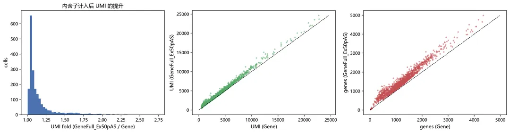

> **结论** ：换成 `GeneFull_Ex50pAS` 后同一批细胞的 UMI 普遍提升（内含子被计入），基因检出数同步上升。这正是 scBaseCount 强调的——**snRNA-seq 千万别用只算外显子的口径** ，否则会丢掉一大半信号。

## 7.6 `Velocyto`：直接给出 spliced / unspliced / ambiguous

`Velocyto` 版 h5ad 里 `X` 是 **spliced** ，`layers` 里另有 **unspliced** 与 **ambiguous** 。拿到这三套矩阵就能直接做 RNA velocity，不必自己重跑 velocyto。

velo_obj, velo_out = expr_path("SRX16311386", feature="Velocyto")
if os.path.exists(velo_out):
print("已存在:", velo_out)
else:
size, msg = download_object(velo_obj, velo_out)
print("[download] Velocyto/SRX16311386:", msg)

a_velo = sc.read_h5ad(velo_out)
print(a_velo)
print("layers:", list(a_velo.layers.keys()))已存在: C:\Users\Administrator\WorkBuddy\2026-10-09-11-07-48\scBaseCount\data\h5ad\Velocyto\SRX16311386.h5adAnnData object with n_obs × n_vars = 1983 × 36601
obs: 'gene_count_spliced', 'umi_count_spliced', 'gene_count_ambiguous', 'umi_count_ambiguous', 'gene_count_unspliced', 'umi_count_unspliced', 'SRX_accession', 'cell_type', 'cell_ontology_term_id'
var: 'gene_symbols'
layers: 'ambiguous', 'spliced', 'unspliced', None (.X)
layers: ['ambiguous', 'spliced', 'unspliced', None]import scipy.sparse as sp

def row_sum(x):
"""稀疏/稠密矩阵都返回每个细胞的总计数。"""
return np.asarray(x.sum(axis=1)).ravel()

a_velo.obs["spliced_umi"] = row_sum(a_velo.layers["spliced"])
a_velo.obs["unspliced_umi"] = row_sum(a_velo.layers["unspliced"])
a_velo.obs["ambiguous_umi"] = row_sum(a_velo.layers["ambiguous"])
a_velo.obs["unspliced_ratio"] = (a_velo.obs["unspliced_umi"] /
np.maximum(a_velo.obs["spliced_umi"] + a_velo.obs["unspliced_umi"], 1))
a_velo.obs[["spliced_umi", "unspliced_umi", "ambiguous_umi", "unspliced_ratio"]].describe()
| spliced_umi| unspliced_umi| ambiguous_umi| unspliced_ratio
---|---|---|---|---
count| 1983.000000| 1983.000000| 1983.000000| 1983.000000
mean| 3942.062012| 461.146240| 111.099846| 0.135209
std| 2510.294678| 319.609894| 65.935020| 0.123026
min| 426.000000| 2.000000| 0.000000| 0.001597
25%| 2498.500000| 239.500000| 72.000000| 0.056345
50%| 3856.000000| 363.000000| 95.000000| 0.088780
75%| 4778.500000| 604.000000| 129.000000| 0.158276
max| 21632.000000| 2691.000000| 575.000000| 0.714598
# 不同细胞类型的未剪接比例：转录活跃/核质比高的类型通常更高
top_types = a_velo.obs["cell_type"].fillna("NA").value_counts().head(8).index
sub = a_velo.obs[a_velo.obs["cell_type"].isin(top_types)]
order = sub.groupby("cell_type")["unspliced_ratio"].median().sort_values().index
fig, ax = plt.subplots(figsize=(8, 4.5))
ax.boxplot([sub.loc[sub["cell_type"] == t, "unspliced_ratio"].values for t in order],
tick_labels=[t if len(t) < 26 else t[:24] + "..." for t in order],
vert=False, showfliers=False)
ax.set_xlabel("unspliced / (spliced + unspliced)")
ax.set_title("Unspliced ratio per cell type (Velocyto counts)")
plt.tight_layout()
fig.savefig("results/figures/func05_unspliced_ratio.png", bbox_inches="tight", dpi=150)
plt.show()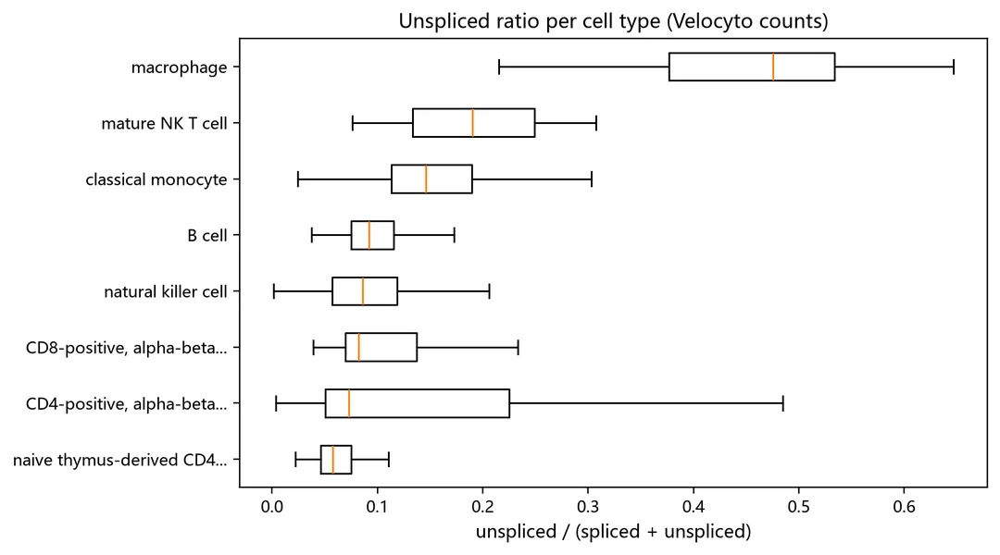# 后续：把这三个矩阵交给 scvelo 即可算 RNA velocity（需 scvelo 环境）
scvelo_demo = '''
# pip install scvelo
import scanpy as sc, scvelo as scv
adata = sc.read_h5ad("data/h5ad/Velocyto/SRX16311386.h5ad") # X 就是 spliced
scv.pp.filter_and_normalize(adata, min_shared_counts=20, n_top_genes=2000)
scv.pp.moments(adata, n_pcs=30, n_neighbors=30)
scv.tl.velocity(adata); scv.tl.velocity_graph(adata)
scv.pl.velocity_embedding_stream(adata, basis="umap")
'''
print(scvelo_demo)
print("说明：scvelo 依赖 numpy<2 的旧栈，与本文 Python 3.13 环境不兼容，故此处只给出代码。")
# pip install scvelo
import scanpy as sc, scvelo as scv
adata = sc.read_h5ad("data/h5ad/Velocyto/SRX16311386.h5ad") # X 就是 spliced
scv.pp.filter_and_normalize(adata, min_shared_counts=20, n_top_genes=2000)
scv.pp.moments(adata, n_pcs=30, n_neighbors=30)
scv.tl.velocity(adata); scv.tl.velocity_graph(adata)
scv.pl.velocity_embedding_stream(adata, basis="umap")

说明：scvelo 依赖 numpy<2 的旧栈，与本文 Python 3.13 环境不兼容，故此处只给出代码。

## 7.7 X 与 layers：Unique / EM / Uniform 三种 UMI 归并策略

同一个计数模式下，h5ad 里还给了三套 UMI 归并结果：

  * `X` = **Unique** ：只保留唯一比对的 UMI；
  * `UniqueAndMult-EM` = **EM** （equivalent molecules）：用 EM 算法把多比对读段按概率分配；
  * `UniqueAndMult-Uniform` = **Uniform** ：把多比对读段平均分配给同源基因。

对重复基因家族（HLA、MTRNR2L、GAGE 等）的表达估计，三者差别很大。

def col_sum(x):
"""返回每个基因的列和。"""
if sp.issparse(x):
return np.asarray(x.tocsc().sum(axis=0)).ravel()
return np.asarray(x.sum(axis=0)).ravel()

a_demo = sc.read_h5ad("data/h5ad/GeneFull_Ex50pAS/SRX16311386.h5ad")
a_demo.var["symbol"] = a_demo.var["gene_symbols"].astype(str) # var_names 是 Ensembl id
print("X (Unique) :", f"{row_sum(a_demo.X).sum():,.0f}")
for lyr in ["UniqueAndMult-EM", "UniqueAndMult-Uniform"]:
print(f"{lyr:>26}:", f"{row_sum(a_demo.layers[lyr]).sum():,.0f}")X (Unique) : 9,311,955
UniqueAndMult-EM: 10,077,985
UniqueAndMult-Uniform: 10,077,985gene_df = pd.DataFrame({
"symbol": a_demo.var["symbol"].astype(str).values,
"unique": col_sum(a_demo.X),
"em": col_sum(a_demo.layers["UniqueAndMult-EM"]),
"uniform": col_sum(a_demo.layers["UniqueAndMult-Uniform"]),
})
gene_df = gene_df[gene_df["unique"] > 0].copy()
gene_df["em_gain"] = (gene_df["em"] - gene_df["unique"]) / gene_df["unique"]
top_multi = gene_df.sort_values("em", ascending=False).head(150) \
.sort_values("em_gain", ascending=False).head(12)
print("EM 相对 Unique 增幅最高（多比对读段最集中的基因）:")
print(top_multi[["symbol", "unique", "em", "uniform", "em_gain"]].round(2).to_string(index=False))EM 相对 Unique 增幅最高（多比对读段最集中的基因）:
symbol unique em uniform em_gain
FP671120.4 127.0 45115.011719 324719.312500 354.239990
RPS10-NUDT3 156.0 13079.070312 24329.000000 82.839996
RPS10 1718.0 37130.500000 25822.000000 20.610001
FP236383.3 41817.0 649656.812500 366409.312500 14.540000
SERF2 8962.0 9205.139648 9086.000000 0.030000
HNRNPA1 9211.0 9345.580078 9283.330078 0.010000
HLA-C 18330.0 18376.759766 18385.000000 0.000000
HLA-B 29865.0 29933.240234 29924.000000 0.000000
RPL12 44093.0 44155.070312 44124.500000 0.000000
BTG1 23990.0 24004.890625 23998.000000 0.000000
HLA-A 19323.0 19327.910156 19327.500000 0.000000
RPS27A 64574.0 64581.988281 64578.000000 0.000000fig, axes = plt.subplots(1, 2, figsize=(14, 4.5))
axes[0].scatter(np.log1p(gene_df["unique"]), np.log1p(gene_df["em"]), s=4, alpha=0.25,
color="#4C72B0")
lim = max(np.log1p(gene_df["unique"]).max(), np.log1p(gene_df["em"]).max())
axes[0].plot([0, lim], [0, lim], "k--", lw=0.8)
axes[0].set_xlabel("log1p(Unique counts)"); axes[0].set_ylabel("log1p(EM counts)")
axes[0].set_title("gene-level: Unique vs EM")
top_plot = top_multi.sort_values("em_gain")
axes[1].barh(top_plot["symbol"], top_plot["em_gain"], color="#C44E52")
axes[1].set_xlabel("(EM - Unique) / Unique"); axes[1].set_title("multi-mapping 影响最大的基因")
plt.tight_layout()
fig.savefig("results/figures/func06_umi_collapse.png", bbox_inches="tight", dpi=150)
plt.show()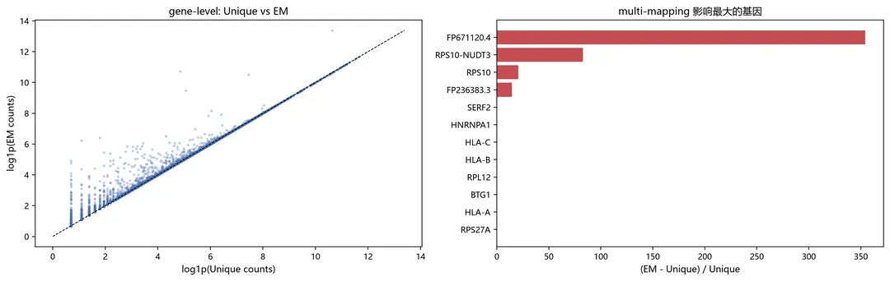

## 7.8 数据版本与"自动更新"

scBaseCount 是**持续更新** 的：agent 会不断发现新的 10x 数据并重新处理，所以每条分析记录里都应该写清用的是哪个 release。

_dirs, _files = gcs_list("scbasecount/", delimiter="/")
print("release 目录:", [d.strip("/") for d in _dirs])
print("顶层文件:", [f for f, _ in _files])release 目录: ['scbasecount/2025-02-25', 'scbasecount/2026-01-12']
顶层文件: ['README.md']_dirs2, _ = gcs_list(f"{RELEASE}/", delimiter="/")
print("release 内部结构:", [d.strip("/").split("/")[-1] for d in _dirs2])
_dsr, _ = gcs_list(f"{RELEASE}/star_references/", delimiter="/")
print("STAR 参考目录数:", len(_dsr), "| 示例:", [d.strip("/").split("/")[-1] for d in _dsr[:5]])release 内部结构: ['analysis', 'h5ad', 'metadata', 'star_references']STAR 参考目录数: 47 | 示例: ['Anas_platyrhynchos', 'Anopheles_gambiae', 'Anser_cygnoides', 'Arabidopsis_thaliana', 'Bos_taurus']

> **两个 release 的差异（来自官方 README）** \- `2025-02-01`（初始版）：>2.3 亿细胞、21 个物种，只有 `Gene` / `GeneFull_Ex50pAS` / `Velocyto`，且只提供 filtered 矩阵； - `2026-01-12`（发表版）：>5.02 亿细胞、27 个物种、75 类组织，补齐 `GeneFull`、`GeneFull_ExonOverIntron`，X 与 layers 中含 `Unique / EM / Uniform`，obs 新增 `cell_type`、`cell_ontology_term_id`、疾病本体与置信度。

> 写论文/做复现时请注明：`gs://arc-institute-virtual-cell-atlas/scbasecount/2026-01-12/`。

# 八、实战：从检索到结果

前面把 scBaseCount 的能力过了一遍，这里用一个真实问题把流程串起来： **COVID-19 患者与健康人 PBMC 的免疫格局差异。**

演示样本（GEO 编号通过 ENA `<EXPERIMENT>` 记录核实）：

SRX accession| GEO 样本| 疾病标签| 细胞数| 研究出处
---|---|---|---|---
SRX16311386| GSM6341197 (patient 4)| COVID-19| 2,094| GSE208337
SRX16311390| GSM6341201 (patient 8)| COVID-19| 2,264| GSE208337
SRX16311393| GSM6341204 (patient 11)| COVID-19| 2,043| GSE208337
SRX16311423| GSM6341210 (patient 17)| COVID-19| 2,371| GSE208337
SRX17412787| GSM4058910 (208C)| healthy| 2,221| CellCards CellRef 1.0 Atlas

> 原始实验描述（ENA）：GSE208337 的样本为入院时或入院后 10 天内采集的 PBMC，抗人 CD45 抗体染色后分选活细胞，`Chromium Single Cell 3′ v3.1` 建库，NovaSeq 6000 测序；对照样本为 `10x Genomics 3′ v2`，HiSeq 4000。**两组来自不同研究** ，做病例-对照比较必须先处理批次效应。

### 8.1 用第 7 节的检索函数选样，并下载

预处理部分（QC、归一化、降维、聚类、注释、整合）已封装进 `scripts/preprocess.py`，这里不再逐行展开——手册的重点是 scBaseCount 本身。

DEMO_SRX = ["SRX16311386", "SRX16311390", "SRX16311393", "SRX16311423"] # COVID-19
CTRL_SRX = ["SRX17412787"] # healthy 对照

target = sample_meta[sample_meta["srx_accession"].isin(DEMO_SRX + CTRL_SRX)][
["srx_accession", "organism", "tissue", "disease", "tech_10x", "cell_prep",
"obs_count", "lib_prep", "file_path"]].copy()
target["group"] = ["COVID-19" if s in DEMO_SRX else "healthy"
for s in target["srx_accession"]]
target.to_csv("results/tables/demo_samples.csv", index=False)
target
| srx_accession| organism| tissue| disease| tech_10x| cell_prep| obs_count| lib_prep| file_path| group
---|---|---|---|---|---|---|---|---|---|---
8215| SRX16311423| Homo sapiens| Peripheral Blood Mononuclear Cells (PBMC)| COVID-19| 3_prime_gex| single_cell| 2371| 10x_Genomics| gs://arc-institute-virtual-cell-atlas/scbaseco...| COVID-19
8619| SRX16311390| Homo sapiens| Peripheral Blood Mononuclear Cells (PBMC)| COVID-19| 3_prime_gex| single_cell| 2264| 10x_Genomics| gs://arc-institute-virtual-cell-atlas/scbaseco...| COVID-19
8976| SRX16311393| Homo sapiens| Peripheral Blood Mononuclear Cells (PBMC)| COVID-19| 3_prime_gex| single_cell| 2043| 10x_Genomics| gs://arc-institute-virtual-cell-atlas/scbaseco...| COVID-19
11053| SRX16311386| Homo sapiens| Peripheral Blood Mononuclear Cells (PBMC)| COVID-19| 3_prime_gex| single_cell| 2094| 10x_Genomics| gs://arc-institute-virtual-cell-atlas/scbaseco...| COVID-19
31299| SRX17412787| Homo sapiens| peripheral blood mononuclear cells| healthy| 3_prime_gex| single_cell| 2221| 10x_Genomics| gs://arc-institute-virtual-cell-atlas/scbaseco...| healthy
# 投任务前先做「磁盘 + 内存」双准入预算
need_bytes = sum(gcs_size(f"{RELEASE}/h5ad/{FEATURE}/Homo_sapiens/{s}.h5ad")
for s in target["srx_accession"])
print(f"需要下载 {need_bytes/1024**2:.1f} MB；解压进内存约放大 3~5 倍 -> "
f"估算需要 {need_bytes*4/1024**3:.2f} GiB")
mg.assert_free(need_bytes * 4 / 1024**3, "5 个样本的 full load")需要下载 114.5 MB；解压进内存约放大 3~5 倍 -> 估算需要 0.45 GiB
[memory-guard] 准入通过：5 个样本的 full load 需要 0.4 GiB，当前可用 59.8 GiBimport sys
sys.path.insert(0, "scripts")
from mt_download import download_object

with mg.guard("下载 5 个 h5ad"):
for srx in target["srx_accession"]:
obj = f"{RELEASE}/h5ad/{FEATURE}/Homo_sapiens/{srx}.h5ad"
out = os.path.join("data", "h5ad", FEATURE, f"{srx}.h5ad")
try:
size, msg = download_object(obj, out) # 已存在会自动跳过
print(f"[OK] {srx}: {msg}")
except Exception as e:
print(f"[FAIL] {srx}: {type(e).__name__}: {e}")[memory-guard] >> 下载 5 个 h5ad | RSS=0.87 GiB | sys=37.6% | avail=59.8 GiB[OK] SRX16311423: already exists (25.1 MB)[OK] SRX16311390: already exists (21.3 MB)[OK] SRX16311393: already exists (22.0 MB)[OK] SRX16311386: already exists (21.1 MB)[OK] SRX17412787: already exists (25.1 MB)
[memory-guard] << 下载 5 个 h5ad 用时 6.4s，RSS 增量 +0.00 GiB# 完整性校验：本地文件大小必须与 bucket 上的对象一致
rows = []
for srx in target["srx_accession"]:
f = os.path.join("data", "h5ad", FEATURE, f"{srx}.h5ad")
local_mb = round(os.path.getsize(f) / 1024**2, 1) if os.path.exists(f) else -1
remote_mb = round(gcs_size(f"{RELEASE}/h5ad/{FEATURE}/Homo_sapiens/{srx}.h5ad") / 1024**2, 1)
rows.append([srx, local_mb, remote_mb, abs(local_mb - remote_mb) < 0.5])
pd.DataFrame(rows, columns=["srx", "local_MB", "remote_MB", "ok"])
| srx| local_MB| remote_MB| ok
---|---|---|---|---
0| SRX16311423| 25.1| 25.1| True
1| SRX16311390| 21.3| 21.3| True
2| SRX16311393| 22.0| 22.0| True
3| SRX16311386| 21.1| 21.1| True
4| SRX17412787| 25.1| 25.1| True

### 8.2 运行预处理脚本（细节已封装）

`scripts/preprocess.py` 完成：读入 → QC → 归一化 → HVG → PCA → 邻居图 → Leiden → UMAP → marker 注释 → Harmony 整合，并把中间文件落盘：

  * `results/scbasecount_demo_processed.h5ad`（HVG 子集 + 降维/聚类/整合坐标）
  * `results/scbasecount_demo_fulllog.h5ad`（全基因 log 版，供差异表达）
  * `results/figures/preprocess_*.png`、`results/preprocess_summary.json`

import subprocess, json, os

# 已跑过则直接复用；想重跑就把 results/scbasecount_demo_processed.h5ad 删掉
processed_h5 = "results/scbasecount_demo_processed.h5ad"
summary_file = "results/preprocess_summary.json"

if os.path.exists(processed_h5) and os.path.exists(summary_file):
print("检测到已完成的预处理结果，直接加载（如需重跑请删除这两个文件）")
else:
with mg.guard("预处理流水线"):
proc = subprocess.run([sys.executable, "scripts/preprocess.py"],
capture_output=True, text=True, cwd=".")
tail = proc.stdout.strip().splitlines()
print("\n".join(tail[-25:]))
if proc.returncode != 0:
print(proc.stderr[-2000:])

summary = json.load(open(summary_file, encoding="utf-8"))
print(json.dumps(summary, ensure_ascii=False, indent=2))检测到已完成的预处理结果，直接加载（如需重跑请删除这两个文件）
{
"n_samples": 5,
"cells_before_qc": 10993,
"cells_after_qc": 9922,
"genes_full": 23913,
"genes_hvg": 2000,
"n_clusters": 18,
"n_clusters_harmony": 14,
"annotation_agreement": 0.468,
"elapsed_seconds": 182.0,
"peak_rss_gib": 2.02,
"system_mem_percent": 37.7,
"outputs": {
"processed_h5ad": "results/scbasecount_demo_processed.h5ad",
"fulllog_h5ad": "results/scbasecount_demo_fulllog.h5ad",
"figures": [
"preprocess_annotation_agreement.png",
"preprocess_batch_composition.png",
"preprocess_qc_before_filter.png"
]
}
}# 载入预处理产物
adata_hvg = sc.read_h5ad("results/scbasecount_demo_processed.h5ad")
adata_raw = sc.read_h5ad("results/scbasecount_demo_fulllog.h5ad")
print("processed :", adata_hvg.shape, "| obsm:", list(adata_hvg.obsm.keys()))
print("full-log :", adata_raw.shape, "| obs 列:", list(adata_raw.obs.columns)[:12])
adata_hvgprocessed : (9922, 2000) | obsm: ['X_pca', 'X_pca_harmony', 'X_umap', 'X_umap_harmony']
full-log : (9922, 23913) | obs 列: ['gene_count_Unique', 'umi_count_Unique', 'gene_count_UniqueAndMult-EM', 'umi_count_UniqueAndMult-EM', 'gene_count_UniqueAndMult-Uniform', 'umi_count_UniqueAndMult-Uniform', 'SRX_accession', 'cell_type', 'cell_ontology_term_id', 'group', 'n_genes_by_counts', 'total_counts']AnnData object with n_obs × n_vars = 9922 × 2000
obs: 'gene_count_Unique', 'umi_count_Unique', 'gene_count_UniqueAndMult-EM', 'umi_count_UniqueAndMult-EM', 'gene_count_UniqueAndMult-Uniform', 'umi_count_UniqueAndMult-Uniform', 'SRX_accession', 'cell_type', 'cell_ontology_term_id', 'group', 'n_genes_by_counts', 'total_counts', 'total_counts_mt', 'pct_counts_mt', 'total_counts_ribo', 'pct_counts_ribo', 'umi_count', 'gene_count', 'n_genes', 'leiden', 'auto_cell_type', 'official_simple', 'leiden_harmony'
var: 'gene_symbols', 'symbol', 'mt', 'ribo', 'n_cells_by_counts', 'mean_counts', 'pct_dropout_by_counts', 'total_counts', 'n_cells', 'highly_variable', 'highly_variable_rank', 'means', 'variances', 'variances_norm', 'highly_variable_nbatches', 'mean', 'std'
uns: 'SRX_accession_colors', 'group_colors', 'harmony', 'hvg', 'leiden', 'leiden_colors', 'leiden_harmony', 'log1p', 'neighbors', 'pca', 'umap'
obsm: 'X_pca', 'X_pca_harmony', 'X_umap', 'X_umap_harmony'
varm: 'PCs'
obsp: 'connectivities', 'distances', 'harmony_connectivities', 'harmony_distances'
layers: 'UniqueAndMult-EM', 'UniqueAndMult-Uniform', 'counts', None (.X)

### 8.3 结果一瞥：整合效果与注释一致性

sc.pl.umap(adata_hvg, color=["leiden", "SRX_accession", "group", "auto_cell_type"],
wspace=0.3, ncols=2, save="_demo_overview.png")WARNING: You are using a low resolution (dpi<150) for saving figures.
Consider running `set_figure_params(dpi_save=...)`, which will adjust `matplotlib.rcParams['savefig.dpi']`WARNING: saving figure to file results\figures\umap_demo_overview.png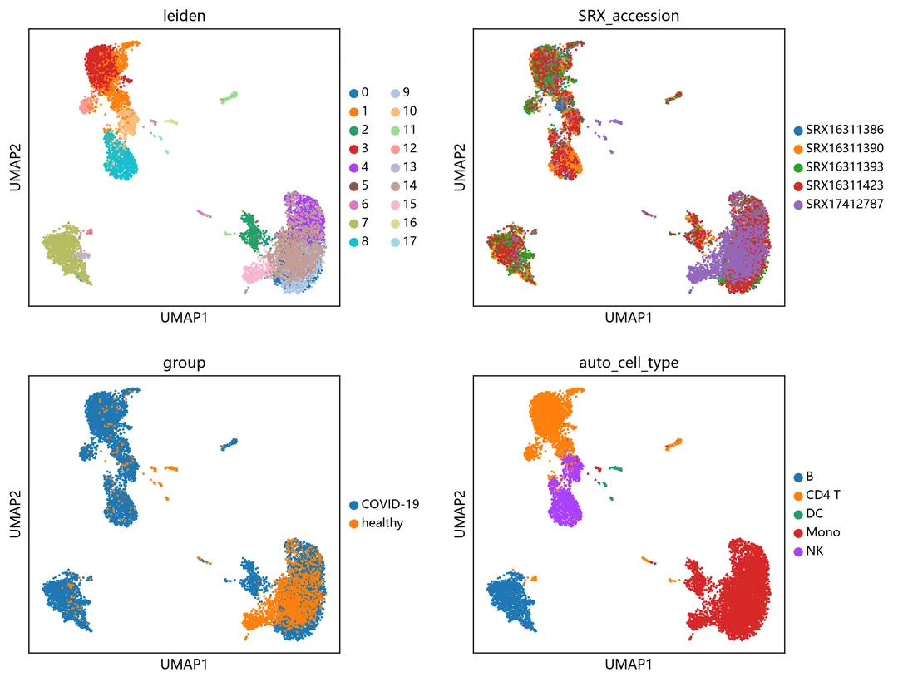sc.pl.embedding(adata_hvg, basis="umap_harmony", color=["SRX_accession", "group"],
wspace=0.35, save="_demo_harmony.png")WARNING: saving figure to file results\figures\umap_harmony_demo_harmony.png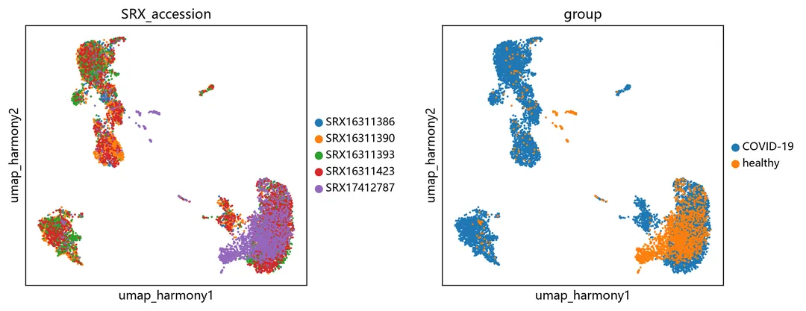# 本教程 marker 注释 vs scBaseCount 自带注释的一致性矩阵
comp = pd.crosstab(adata_hvg.obs["official_simple"], adata_hvg.obs["auto_cell_type"])
norm = comp.div(comp.sum(axis=1).replace(0, np.nan), axis=0).fillna(0)
fig, ax = plt.subplots(figsize=(6, 5))
im = ax.imshow(norm.values, cmap="viridis", aspect="auto")
ax.set_xticks(range(norm.shape[1])); ax.set_xticklabels(norm.columns, rotation=60, ha="right")
ax.set_yticks(range(norm.shape[0])); ax.set_yticklabels(norm.index)
ax.set_xlabel("marker-based (this tutorial)"); ax.set_ylabel("scBaseCount official")
plt.colorbar(im, ax=ax, shrink=0.7)
ax.set_title(f"agreement = {float(np.trace(norm.values)/norm.values.sum()):.2f}")
plt.tight_layout()
fig.savefig("results/figures/demo_annotation_agreement.png", bbox_inches="tight", dpi=150)
plt.show()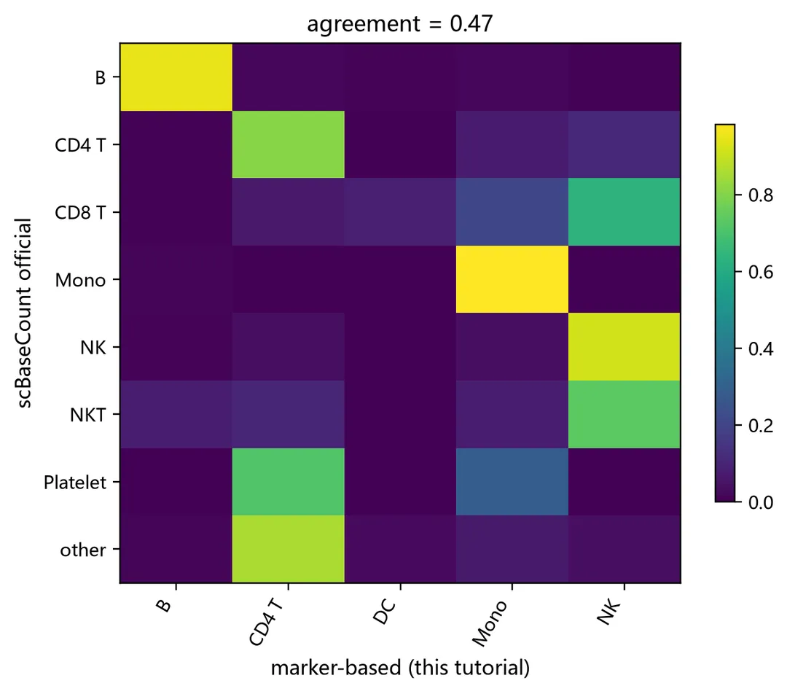

### 8.4 差异表达：COVID-19 vs healthy

> ⚠️ 这里的对比横跨两个研究，`group` 差异里混有实验室与建库版本效应。真实课题请用同批次队列或伪 bulk / 混合效应模型，此处只演示"从 scBaseCount 直接得到可解释的差异基因"。

with mg.guard("差异表达", estimate_gib=0.5):
de = adata_raw[adata_raw.obs["group"].isin(["COVID-19", "healthy"])].copy()
sc.tl.rank_genes_groups(de, "group", groups=["COVID-19"], reference="healthy",
method="wilcoxon", corr_method="bonferroni")
res = sc.get.rank_genes_groups_df(de, group="COVID-19").sort_values("pvals_adj")
gmap = dict(zip(de.var_names, de.var["symbol"].astype(str)))
res["symbol"] = res["names"].map(gmap).fillna(res["names"])
res.head(15)[memory-guard] 准入通过：差异表达 需要 0.5 GiB，当前可用 59.2 GiB
[memory-guard] >> 差异表达 | RSS=1.56 GiB | sys=38.2% | avail=59.2 GiB[memory-guard] << 差异表达 用时 10.0s，RSS 增量 +0.49 GiB
| names| scores| logfoldchanges| pvals| pvals_adj| symbol
---|---|---|---|---|---|---
23908| ENSG00000205542| -51.305946| -2.258161| 0.0| 0.0| TMSB4X
23907| ENSG00000119655| -50.959995| -3.587138| 0.0| 0.0| NPC2
23906| ENSG00000164733| -50.691273| -3.931211| 0.0| 0.0| CTSB
23905| ENSG00000260314| -49.868591| -9.597891| 0.0| 0.0| MRC1
23909| ENSG00000177575| -52.287884| -4.767005| 0.0| 0.0| CD163
23870| ENSG00000170017| -39.212521| -4.631774| 0.0| 0.0| ALCAM
23865| ENSG00000112096| -38.320572| -2.595945| 0.0| 0.0| SOD2
23896| ENSG00000163191| -45.634979| -3.217129| 0.0| 0.0| S100A11
23871| ENSG00000172164| -39.551422| -4.157712| 0.0| 0.0| SNTB1
23889| ENSG00000128512| -43.703075| -3.791060| 0.0| 0.0| DOCK4
23890| ENSG00000245532| -44.059536| -2.643306| 0.0| 0.0| NEAT1
23891| ENSG00000148655| -44.082943| -4.006859| 0.0| 0.0| LRMDA
23892| ENSG00000087086| -44.565895| -2.466105| 0.0| 0.0| FTL
23893| ENSG00000197746| -44.999241| -2.871186| 0.0| 0.0| PSAP
23894| ENSG00000135047| -45.197067| -6.600154| 0.0| 0.0| CTSL
# ---- 火山图：top 基因标签交给 repel_labels 做防重叠 ----
# 直接写 ax.annotate(..., xytext=(3,3)) 会把最显著的基因全堆在图顶，
# 因为它们的 -log10(p) 相互很接近；这里在像素坐标系里迭代推开并连线回锚点。
# 另外 logFC 存在极端离群值（低表达基因造成），若不裁剪 x 轴，
# 所有标签会被挤成图中央的一条竖线——所以按阈值裁剪并注明未画出的点数。
fig, ax = plt.subplots(figsize=(7.8, 6.0))
p = -np.log10(res["pvals_adj"].values + 1e-300)
fc = res["logfoldchanges"].values
sig = (res["pvals_adj"].values < 0.05) & (np.abs(fc) > 0.25)
up, dn = sig & (fc > 0), sig & (fc < 0)
ax.scatter(fc[~sig], p[~sig], s=7, c="#c9ced3", linewidths=0, label="不显著")
ax.scatter(fc[up], p[up], s=10, c="#c0392b", linewidths=0, label="显著上调")
ax.scatter(fc[dn], p[dn], s=10, c="#2471a3", linewidths=0, label="显著下调")

XLIM = 12.0
ax.set_xlim(-XLIM, XLIM)
ax.set_ylim(0, p.max() * 1.28) # 顶部留白给标签，否则最显著的几个会撞上边界后互相重合
ax.axhline(-np.log10(0.05), ls="--", c="grey", lw=0.9)
n_l, n_r = int((fc < -XLIM).sum()), int((fc > XLIM).sum())
ax.text(-XLIM + 0.25, p.max() * 0.03, f"◀ {n_l} 个基因\n logFC ≤ -{XLIM:.0f}（未画出）",
fontsize=7.2, color="#8b949e", va="bottom", ha="left", linespacing=1.5)
ax.text(XLIM - 0.25, p.max() * 0.03, f"{n_r} 个基因 ▶\nlogFC ≥ {XLIM:.0f}（未画出）",
fontsize=7.2, color="#8b949e", va="bottom", ha="right", linespacing=1.5)
ax.set_xlabel("log2FC (COVID-19 / healthy)"); ax.set_ylabel("-log10 adj.p")
ax.set_title("差异表达：COVID-19 vs healthy PBMC")
ax.legend(loc="lower left", frameon=True, framealpha=0.92, edgecolor="none", fontsize=8.5)

# ★ 关键顺序：先 tight_layout 定死 axes 几何，再做标签避让与自检。
# 反过来的话 tight_layout 会改变 data→像素 的映射，避让结果随之失效。
plt.tight_layout()
cand = res[sig].copy() # 在显著基因里按「显著性 + 效应量」综合排序选标签
cand["_score"] = -np.log10(cand["pvals_adj"].values + 1e-300) + cand["logfoldchanges"].abs().values
top = cand.sort_values("_score", ascending=False).head(14)
ti = top.index.values
# offset 用像素坐标（y 向下为正），-14 表示"先摆到锚点上方"，正好利用顶部留白
labels = repel_labels(ax, fc[ti], p[ti], top["symbol"].tolist(), fontsize=8,
iters=400, pad=4.5, max_shift=320, offset=(0.0, -14.0))
ov, worst = label_overlap_report(ax, labels)
if ov: # 正常情况下应为 0；万一非 0 就把重叠的基因名列出来，方便调参
_r = fig.canvas.get_renderer()
_bx = np.array([t.get_window_extent(renderer=_r).get_points().ravel() for t in labels])
for _i in range(len(_bx)):
for _j in range(_i + 1, len(_bx)):
_ox = min(_bx[_i, 2], _bx[_j, 2]) - max(_bx[_i, 0], _bx[_j, 0])
_oy = min(_bx[_i, 3], _bx[_j, 3]) - max(_bx[_i, 1], _bx[_j, 1])
if _ox > 0.5 and _oy > 0.5:
print(f" ! 重叠: {labels[_i].get_text()} / {labels[_j].get_text()}")

fig.savefig("results/figures/demo_volcano.png", bbox_inches="tight", dpi=150)
res.to_csv("results/tables/DEG_COVID19_vs_healthy.csv", index=False)
plt.show() # 注意：show() 之后 inline 后端会换掉 canvas，自检必须放在它前面
print("显著差异基因:", int(sig.sum()), "/", res.shape[0])
print(f"x 轴裁剪到 ±{XLIM:.0f}，另有 {n_l + n_r} 个 logFC 离群基因未画出")
print(f"标签重叠自检: {ov} 对重叠（最严重 {worst:.0f} px²）-> {'通过' if ov == 0 else '仍有堆叠'}")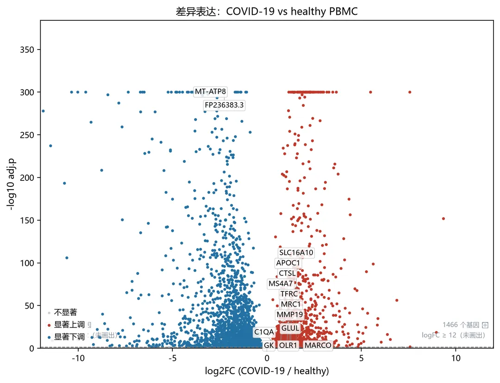显著差异基因: 3391 / 23913
x 轴裁剪到 ±12，另有 2892 个 logFC 离群基因未画出
标签重叠自检: 0 对重叠（最严重 0 px²）-> 通过

#### 这些差异基因到底"在哪些细胞类型里差异最大"？

上面的 DEG 是把所有 PBMC 混在一起算的，只能回答"整体上哪些基因变了"。但 COVID-19 的免疫紊乱往往**只发生在特定细胞类型里** （例如单核细胞的干扰素通路 vs T 细胞的耗竭程序）。

所以下面按细胞类型分别做一次 COVID-19 vs healthy 的 Wilcoxon 检验，得到「基因 × 细胞类型」的 log2FC 矩阵，再用**分面棒棒糖图** 展示：每个基因一个小面板，横轴是细胞类型，棒棒糖离 0 越远表示该类型里差异越大，一眼就能定位"这个基因主要在哪种细胞里起作用"。

> ⚠️ 两个限制必须说明：① 某些细胞类型里两组细胞数太少，无法检验，会被跳过；② 病例组与对照组来自不同研究，**每个细胞类型内部的差异仍然混有批次效应** ，这里只演示输出形式，结论不可直接当作生物学发现。

# ---- 逐细胞类型做 DEG，得到「基因 × 细胞类型」的 log2FC 矩阵 ----
with mg.guard("分细胞类型差异表达", estimate_gib=1.2):
ct_col = "official_simple"
de_ct = de.copy()
sc.pp.filter_genes(de_ct, min_cells=5) # 丢掉几乎不表达的基因，wilcoxon 快很多
rows, skipped = [], []
for ct in sorted(de_ct.obs[ct_col].unique()):
sub = de_ct[de_ct.obs[ct_col] == ct].copy()
n_cov = int((sub.obs["group"] == "COVID-19").sum())
n_hl = int((sub.obs["group"] == "healthy").sum())
if n_cov < 10 or n_hl < 10: # 两组都要有足够细胞才可比
skipped.append((ct, n_cov, n_hl))
continue
sc.tl.rank_genes_groups(sub, "group", groups=["COVID-19"], reference="healthy",
method="wilcoxon", corr_method="bonferroni")
d = sc.get.rank_genes_groups_df(sub, group="COVID-19")
d["cell_type"] = ct
d["n_covid"], d["n_healthy"] = n_cov, n_hl
rows.append(d[["cell_type", "names", "logfoldchanges", "pvals_adj",
"n_covid", "n_healthy"]])
per_ct = pd.concat(rows, ignore_index=True)
per_ct["symbol"] = per_ct["names"].map(gmap).fillna(per_ct["names"])

print(f"纳入比较的细胞类型: {per_ct['cell_type'].nunique()} 种")
if skipped:
print("因两组细胞数不足被跳过:", ", ".join(f"{c}(C{n1}/H{n0})" for c, n1, n0 in skipped))
per_ct.groupby("cell_type")[["n_covid", "n_healthy"]].first()[memory-guard] 准入通过：分细胞类型差异表达 需要 1.2 GiB，当前可用 58.6 GiB
[memory-guard] >> 分细胞类型差异表达 | RSS=2.07 GiB | sys=38.9% | avail=58.6 GiB[memory-guard] << 分细胞类型差异表达 用时 8.7s，RSS 增量 +0.48 GiB
纳入比较的细胞类型: 5 种
因两组细胞数不足被跳过: NKT(C32/H6), Platelet(C6/H1), other(C82/H3)
| n_covid| n_healthy
---|---|---
cell_type|
|

B| 1208| 62
CD4 T| 2820| 179
CD8 T| 362| 113
Mono| 3192| 1330
NK| 510| 16
# ---- 分面棒棒糖图：每个基因一个面板，横轴 = 细胞类型，纵轴 = log2FC ----
mat = per_ct.pivot_table(index="symbol", columns="cell_type",
values="logfoldchanges", aggfunc="mean")
pmin = per_ct.pivot_table(index="symbol", columns="cell_type",
values="pvals_adj", aggfunc="min")

# 细胞类型按"可比较的基因数"从多到少排（.tolist() 是必需的：
# pandas 3.x 的字符串列走 pyarrow 后端，直接用 Index 当索引器会报 IndexError）
_order = mat.notna().sum().sort_values(ascending=False).index.tolist()
mat = mat.reindex(columns=_order)
print(f"矩阵规模: {mat.shape[0]} 基因 × {mat.shape[1]} 细胞类型 | 细胞类型顺序: {_order}")

# 挑"跨细胞类型差异最大"的基因：logFC 的极差越大，越能体现细胞类型特异性
spread = (mat.max(axis=1) - mat.min(axis=1)).sort_values(ascending=False)
top_genes = spread.head(12).index.tolist()

fig, axes = lollipop_facet(mat, top_genes, ncols=4, figsize=(15.8, 8.6),
ylab="log2FC (COVID-19 / healthy)", rotate=42,
pmat=pmin) # 传入 p 值 → 不显著的点画成空心
fig.suptitle("差异基因在哪些细胞类型中差异最大 · 分面棒棒糖图\n"
"红=上调 / 蓝=下调；实心=该细胞类型内 adj.p<0.05，空心=不显著；"
"标注值为该基因效应最大的细胞类型",
fontsize=12.0, y=1.02)
fig.savefig("results/figures/demo_lollipop_celltype.png", bbox_inches="tight", dpi=150)
plt.show()
per_ct.to_csv("results/tables/DEG_per_celltype_COVID19_vs_healthy.csv", index=False)
print("已输出: results/figures/demo_lollipop_celltype.png")
print("明细表: results/tables/DEG_per_celltype_COVID19_vs_healthy.csv")
lap("实战")矩阵规模: 22033 基因 × 5 细胞类型 | 细胞类型顺序: ['B', 'CD4 T', 'CD8 T', 'Mono', 'NK']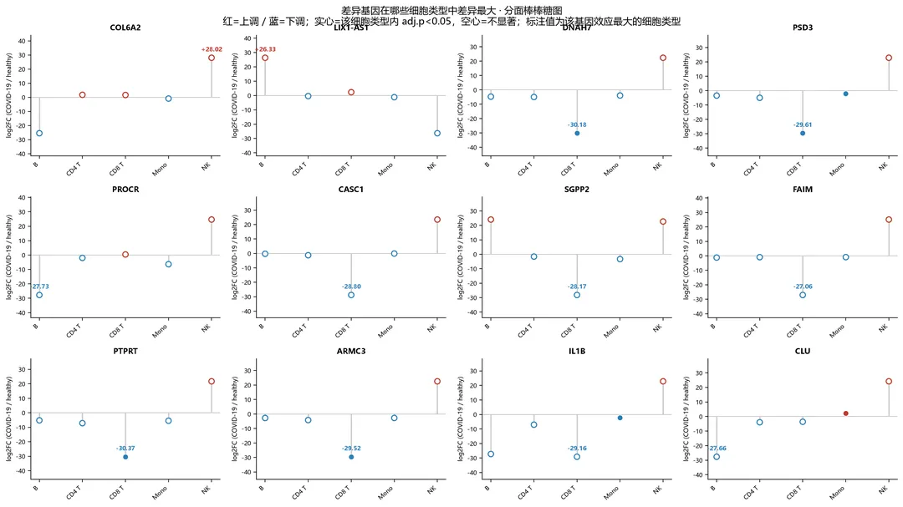已输出: results/figures/demo_lollipop_celltype.png
明细表: results/tables/DEG_per_celltype_COVID19_vs_healthy.csv
[lap] 实战 累计 59.6s | RSS 2.52 GiB | 系统占用 39%

# 九、GPU 加速

单细胞上游（比对、STARsolo 定量）与 GPU 关系不大，真正吃 CPU 的是**降维与邻居图构建** ：10 万细胞以上时 `sc.tl.pca`、`sc.pp.neighbors`、`sc.tl.umap` 会成为瓶颈。

scanpy 生态里成熟的 GPU 路线有三条：

方案| 平台支持| 安装方式| 覆盖函数
---|---|---|---
`rapids-singlecell`| **Linux / WSL2** （Windows 原生不支持）| `conda install -c rapidsai -c conda-forge rapids-singlecell`| PCA / neighbors / UMAP / Leiden / DE 全套
`cupy` 手工接管关键步骤| Windows / Linux| `pip install cupy-cuda12x`| SVD/PCA、距离矩阵、矩阵运算
`torch`(CUDA) 自定义模型| Windows / Linux| `pip install torch`(CUDA 版)| 嵌入/模型训练（scvi-tools 等）

下面先看本机 GPU 情况，再用 `cupy` 亲手把 PCA 搬到 GPU 上——**这一步在 Windows 上也能真实加速** ，不依赖 rapids。

import subprocess, shutil
nvidia_gpu = []
try:
if shutil.which("nvidia-smi"):
out = subprocess.run(["nvidia-smi", "--query-gpu=name,memory.total,memory.used,driver_version",
"--format=csv,noheader"],
capture_output=True, text=True, timeout=60).stdout.strip()
nvidia_gpu = [ln.strip() for ln in out.splitlines() if ln.strip()]
print("GPU:", nvidia_gpu[0] if nvidia_gpu else "no GPU found")
else:
print("未检测到 nvidia-smi（无 NVIDIA GPU 或未安装驱动）")
except Exception as e:
print("nvidia-smi 调用失败:", e)GPU: NVIDIA GeForce RTX 5060, 8151 MiB, 4856 MiB, 610.88# cupy 是否可用；注意 cupy 运行时需要一整套 CUDA 运行库(cublasLt/cusparse/…)，
# Windows 上若没有装 CUDA Toolkit 就会缺 DLL，下面给出诊断。
try:
import cupy as cp
props = cp.cuda.runtime.getDeviceProperties(0)
dev_name = props["name"].decode() if isinstance(props["name"], bytes) else props["name"]
print("cupy", cp.__version__, "| CUDA runtime:", cp.cuda.runtime.runtimeGetVersion(),
"| device:", dev_name)
GPU_OK = True
except Exception as e:
GPU_OK = False
print("cupy 不可用:", type(e).__name__, e)
print("安装方式（按本机 CUDA 版本二选一）：")
print(" pip install cupy-cuda12x # CUDA 12.x")
print(" pip install cupy-cuda13x # CUDA 13.x")cupy 14.2.0 | CUDA runtime: 12090 | device: NVIDIA GeForce RTX 5060# 先确认 GPU 能真的算出结果：一次基本 kernel 运算 + 显存占用
def gpu_smoke_test():
"""返回 None 表示正常，否则返回失败原因。"""
if not GPU_OK:
return "cupy 未加载"
try:
x = cp.arange(2_000_000, dtype=cp.float32)
y = cp.sqrt(x * 2.0 + 1.0) ** 2
s = float(y.sum())
print("GPU kernel 自检通过 | sum =", f"{s:.3e}")
print("显存池已用/总量(MB):",
round(cp.get_default_memory_pool().used_bytes() / 1024**2, 1), "/",
round(cp.cuda.Device().mem_info[1] / 1024**2, 1))
del x, y
cp.get_default_memory_pool().free_all_bytes()
return None
except Exception as e:
return f"{type(e).__name__}: {e}"

gpu_err = gpu_smoke_test()
if gpu_err:
print("GPU 自检未通过:", gpu_err)
print("常见原因：Windows 未安装 CUDA Toolkit，缺少 cublasLt / cusparse / nvrtc 等运行库；"
"可 `pip install 'cupy-cuda12x[ctk]'`（约数 GB）或改用 Linux/WSL2。")GPU 自检未通过: RuntimeError: Failed to find CUDA headers. Please install CUDA toolkit headers (e.g., pip install cupy-cuda12x[ctk]) or specify CUDA_PATH environment variable.
常见原因：Windows 未安装 CUDA Toolkit，缺少 cublasLt / cusparse / nvrtc 等运行库；可 `pip install 'cupy-cuda12x[ctk]'`（约数 GB）或改用 Linux/WSL2。# 用 GPU 重算 PCA：把 log1p 后的高变基因矩阵搬到显存做中心化 + SVD
from scipy.sparse.linalg import svds
import scipy.sparse as sp

X_hvg = sp.csr_matrix(adata_hvg.X)
_mean = np.asarray(X_hvg.mean(axis=0)).ravel()
Xc = np.asarray(X_hvg.todense()) - _mean

t_cpu = time.perf_counter()
_ = svds(Xc, k=20)
t_cpu = time.perf_counter() - t_cpu
print(f"CPU scipy svds (全部 {Xc.shape[0]} 细胞 × {Xc.shape[1]} HVG, k=20): {t_cpu:.3f}s")

if GPU_OK and gpu_err is None:
try:
t_gpu = time.perf_counter()
Xg = cp.asarray(Xc, dtype=cp.float32)
Ug, Sg, Vg = cp.linalg.svd(Xg, full_matrices=False)
cp.cuda.Stream.null.synchronize()
t_gpu = time.perf_counter() - t_gpu
print(f"GPU cupy SVD (全部 {Xg.shape[0]} 细胞): {t_gpu:.3f}s -> 加速比 ≈ {t_cpu/t_gpu:.1f}x")
pcs = adata_hvg.varm["PCs"]
corr = [abs(float(np.corrcoef(cp.asnumpy(Vg)[i], pcs[:, i])[0, 1])) for i in range(20)]
print("前 20 个主成分载荷与 CPU PCA 的绝对相关性中位数:",
round(float(np.nanmedian(corr)), 3))
del Xg, Ug, Vg
cp.get_default_memory_pool().free_all_bytes()
except Exception as e:
print("GPU SVD 不可用:", type(e).__name__, str(e)[:200])
print("Windows 修复：pip install 'cupy-cuda12x[ctk]' 补齐 cusparse/cublasLt")
else:
print("GPU 路线暂不可用，跳过。Linux/WSL2 用户可直接：")
print(" import rapids_singlecell as rsc")
print(" rsc.get.anndata_to_GPU(adata_hvg); rsc.pp.pca(adata_hvg, n_comps=50)")CPU scipy svds (全部 9922 细胞 × 2000 HVG, k=20): 0.717s
GPU 路线暂不可用，跳过。Linux/WSL2 用户可直接：
import rapids_singlecell as rsc
rsc.get.anndata_to_GPU(adata_hvg); rsc.pp.pca(adata_hvg, n_comps=50)

# 十、最终效果展示

把本手册产出的关键图集中展示一遍，方便对照检查自己的运行结果是否合理。

import matplotlib.image as mpimg

# 旧版遗留的单张总览图，避免和新版两套比例图混淆
if os.path.exists("results/figures/_summary_panel.png"):
os.remove("results/figures/_summary_panel.png")

figs = sorted(f for f in glob.glob("results/figures/*.png")
if not os.path.basename(f).startswith("_summary_panel"))
print(f"共产出 {len(figs)} 张图：")
for f in figs:
print(" -", f)共产出 21 张图：
\- results/figures\demo_annotation_agreement.png
\- results/figures\demo_lollipop_celltype.png
\- results/figures\demo_volcano.png
\- results/figures\dotplot__demo_DEG_dotplot.png
\- results/figures\dotplot__preprocess_canonical_markers.png
\- results/figures\func01_library_landscape.png
\- results/figures\func02_tissue_collection.png
\- results/figures\func03_disease_confidence.png
\- results/figures\func04_count_modes.png
\- results/figures\func05_unspliced_ratio.png
\- results/figures\func06_umi_collapse.png
\- results/figures\preprocess_annotation_agreement.png
\- results/figures\preprocess_batch_composition.png
\- results/figures\preprocess_qc_before_filter.png
\- results/figures\ref01_workflow.png
\- results/figures\ref02_scheme.png
\- results/figures\umap_demo_overview.png
\- results/figures\umap_harmony_demo_harmony.png
\- results/figures\umap_harmony_preprocess_harmony.png
\- results/figures\umap_preprocess_annotation.png
\- results/figures\umap_preprocess_overview.png# ---- 总览拼图：两套比例，严格按目标宽高比输出 ----
# compose_panel 内部不用 bbox_inches="tight"（那会裁掉白边、破坏比例），
# 而是让 figsize 精确等于 目标比例，最后再用 PIL 复核真实像素比例。
keys_wide = [
"umap_preprocess_overview.png", "umap_preprocess_annotation.png",
"umap_harmony_preprocess_harmony.png", "preprocess_qc_before_filter.png",
"func01_library_landscape.png", "func03_disease_confidence.png",
"func04_count_modes.png", "func05_unspliced_ratio.png",
]
keys_square = [
"umap_preprocess_overview.png", "umap_preprocess_annotation.png",
"umap_harmony_preprocess_harmony.png", "preprocess_annotation_agreement.png",
"func01_library_landscape.png", "func04_count_modes.png",
"func05_unspliced_ratio.png", "demo_lollipop_celltype.png",
"demo_volcano.png",
]

from PIL import Image
PANELS = []
for name, keys, ratio, ncols in [
("_summary_panel_235x1.png", keys_wide, 2.35, 4), # 宽幅：2 行 × 4 列
("_summary_panel_1x1.png", keys_square, 1.00, 3), # 方版：3 行 × 3 列
]:
path, real = compose_panel(figs, keys, f"results/figures/{name}",
ratio=ratio, base_width=14.0, dpi=120, ncols=ncols)
with Image.open(path) as im:
w, h = im.size
ok = abs(w / h - ratio) < 0.01
PANELS.append((name, w, h, real, ratio))
print(f"{name:<26} {w}x{h} px | 实际比例 {real:.4f} | 目标 {ratio} | {'OK' if ok else '偏差过大'}")_summary_panel_235x1.png 1680x714 px | 实际比例 2.3529 | 目标 2.35 | OK_summary_panel_1x1.png 1680x1680 px | 实际比例 1.0000 | 目标 1.0 | OK# 各阶段耗时 / 内存写入日志
log = {
"author": "Biomamba",
"date": str(date.today()),
"python_env": sys.executable,
"data_release": RELEASE,
"feature_type": FEATURE,
"demo_samples": target["srx_accession"].tolist(),
"preprocess": summary,
"stage_seconds": STAGE_TIME,
"total_seconds": round(time.time() - T_START, 1),
"peak_system_mem_percent": float(sys_mem()["percent"]),
"final_rss_gib": round(rss_gib(), 2),
}
with open("results/run_log.json", "w", encoding="utf-8") as fh:
json.dump(log, fh, ensure_ascii=False, indent=2)
print(json.dumps(log, ensure_ascii=False, indent=2))
mg.stop_watchdog(){
"author": "Biomamba",
"date": "2026-10-09",
"python_env": "C:\\\Users\\\Administrator\\\\.workbuddy\\\binaries\\\python\\\envs\\\default\\\Scripts\\\python.exe",
"data_release": "scbasecount/2026-01-12",
"feature_type": "GeneFull_Ex50pAS",
"demo_samples": [
"SRX16311423",
"SRX16311390",
"SRX16311393",
"SRX16311386",
"SRX17412787"
],
"preprocess": {
"n_samples": 5,
"cells_before_qc": 10993,
"cells_after_qc": 9922,
"genes_full": 23913,
"genes_hvg": 2000,
"n_clusters": 18,
"n_clusters_harmony": 14,
"annotation_agreement": 0.468,
"elapsed_seconds": 182.0,
"peak_rss_gib": 2.02,
"system_mem_percent": 37.7,
"outputs": {
"processed_h5ad": "results/scbasecount_demo_processed.h5ad",
"fulllog_h5ad": "results/scbasecount_demo_fulllog.h5ad",
"figures": [
"preprocess_annotation_agreement.png",
"preprocess_batch_composition.png",
"preprocess_qc_before_filter.png"
]
}
},
"stage_seconds": {
"实战": 59.6
},
"total_seconds": 63.0,
"peak_system_mem_percent": 40.3,
"final_rss_gib": 3.32
}
[memory-guard] 后台内存狗已停止

# 十一、Session Info

复现结果时请连同版本一起提交，方便排查差异。

import sys, platform
from importlib.metadata import version as _ver
print("date:", date.today())
print("platform:", platform.platform())
print("python:", sys.version.split()[0], "|", sys.executable)
for _name in ["numpy", "pandas", "scipy", "scikit-learn", "scanpy", "anndata",
"harmonypy", "scikit-misc", "pyarrow", "fsspec"]:
try:
print(f"{_name:>12}:", _ver(_name))
except Exception:
print(f"{_name:>12}: not installed")
print("GPU:", nvidia_gpu[0] if nvidia_gpu else "no GPU")
print("cupy:", GPU_OK and ("可用" if gpu_err is None
else "已安装但缺少 CUDA 运行库(线性代数不可用)") or "未安装")date: 2026-10-09
platform: Windows-11-10.0.26200-SP0
python: 3.13.14 | C:\Users\Administrator\\.workbuddy\binaries\python\envs\default\Scripts\python.exe
numpy: 2.5.3
pandas: 3.0.6
scipy: 1.18.1
scikit-learn: 1.9.1
scanpy: 1.12.4
anndata: 0.13.4
harmonypy: 0.0.9
scikit-misc: 0.5.3
pyarrow: 25.0.1
fsspec: 2026.9.0
GPU: NVIDIA GeForce RTX 5060, 8151 MiB, 4856 MiB, 610.88
cupy: 已安装但缺少 CUDA 运行库(线性代数不可用)

# 参考资料

  1. Youngblut ND, Carpenter C, Nayebnazar A, et. al. scBaseCount: An AI agent-curated, standardized, auto-updated single-cell data repository.  _Cell_. 2026;189(19):5932–5944.e6. doi: 10.1016/j.cell.2026.08.025

  2. 预印本：bioRxiv 2025.02.27.640494. doi: 10.1101/2025.02.27.640494

  3. 代码与数据集说明：ArcInstitute/arc-virtual-cell-atlas

  4. 官方 Python 教程：scBaseCount/tutorial-py.ipynb

  5. SRAgent（元数据抽取 agent）：ArcInstitute/SRAgent

  6. 数据 bucket：`gs://arc-institute-virtual-cell-atlas/scbasecount/2026-01-12/`（Google Cloud Marketplace，Requester Pays，订阅后每月 2TB 免费）

  7. 演示数据出处：GSE208337（CD45⁺ 分选 COVID-19 PBMC，10x Chromium 3′ v3.1，NovaSeq 6000）与 CellCards CellRef 1.0 Atlas 中的健康人 PBMC（10x 3′ v2，HiSeq 4000）；实验信息经 ENA `<EXPERIMENT>` 记录核实。

  8. La Manno G, Soldatov R, Zeisel A, et al. RNA velocity of single cells.  _Nature_. 2018;560(7719):494-498. doi: 10.1038/s41586-018-0414-6（`Velocyto` 计数模式的依据）

  9. Korsunsky I, Millard N, Fan J, et al. Fast, sensitive and accurate integration of single-cell data with Harmony.  _Nat Methods_. 2019;16(12):1289-1296. doi: 10.1038/s41592-019-0619-0


**欢迎交流**

 留一个领取[资料](<https://mp.weixin.qq.com/s?__biz=MzAwMzIzOTk5OQ==&mid=2247539170&idx=1&sn=ebd269635da35335554c53709fa0a0c0&scene=21#wechat_redirect>)、[开箱即用的单细胞分析镜像](<https://mp.weixin.qq.com/s?__biz=MzAwMzIzOTk5OQ==&mid=2247536307&idx=1&sn=8d03259be06f54521aac5251dec988d5&scene=21#wechat_redirect>)的助手[Biomamba_zhushou]，方便各位随时交流。同时我们也构建了[交流群矩阵](<https://mp.weixin.qq.com/s?__biz=MzAwMzIzOTk5OQ==&mid=2247536307&idx=2&sn=2d030173f51d24a4fee43bd0d83da03b&scene=21#wechat_redirect>)，欢迎大家一起讨论。您点的每个赞和在看，我都认真当成了喜欢
```
