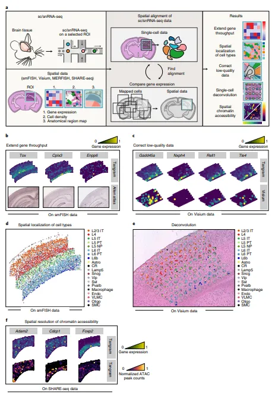
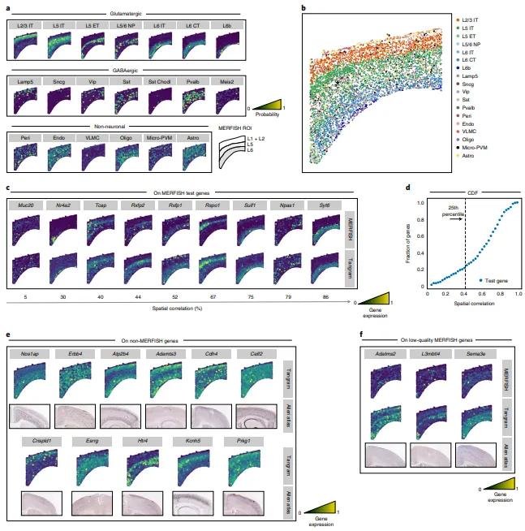
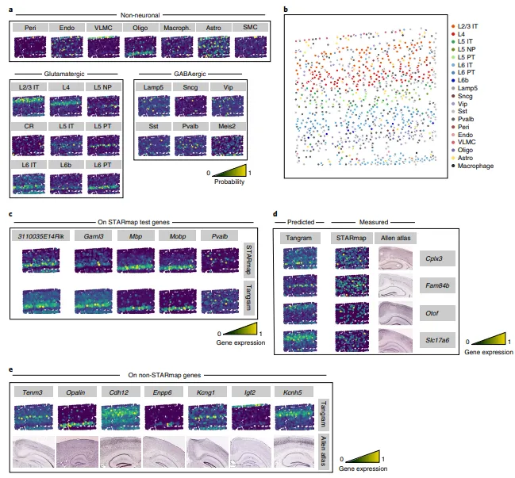
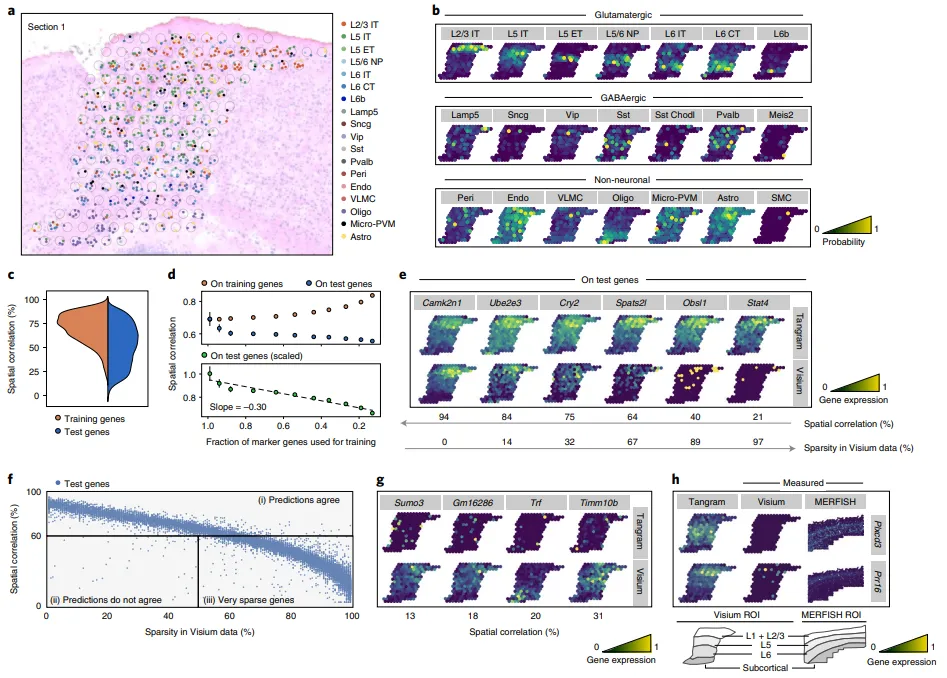
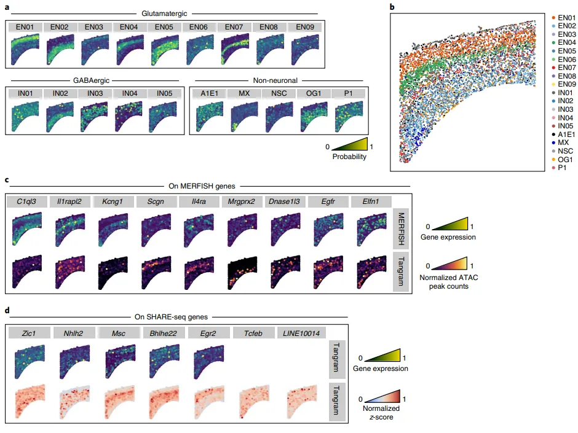
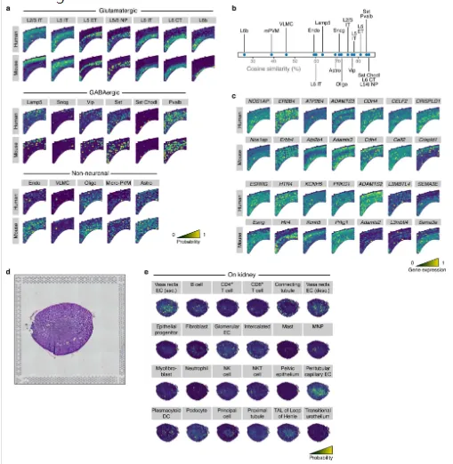
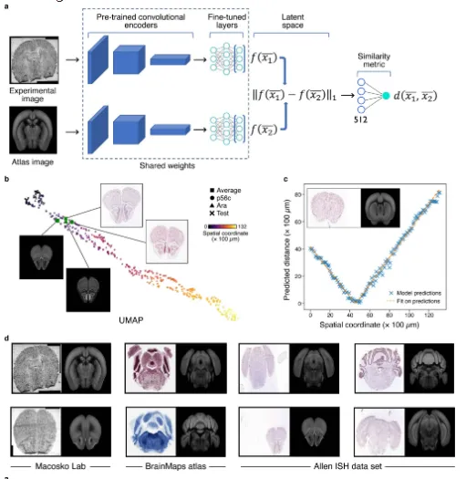
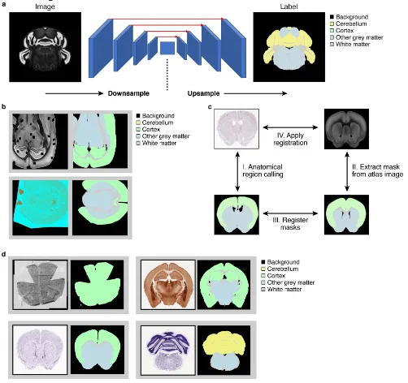
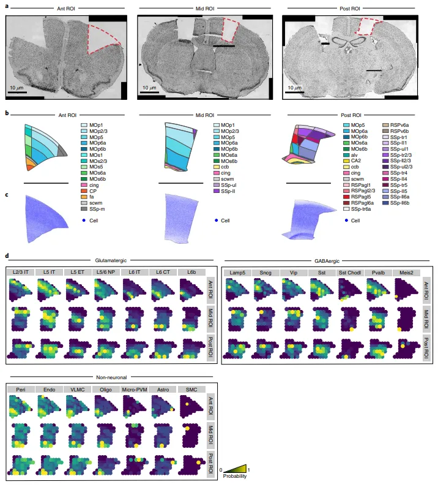

# Tangram利用深度学习完成空间与单细胞数据的整合

> 原文：https://mp.weixin.qq.com/s?__biz=MzAwMzIzOTk5OQ==&mid=2247521196&idx=1&sn=f77395164cd2e2568daa2aae811b8861&chksm=9b3ceafcac4b63ea5349ea37e1376ca3e0de875466bfc296721bd9e65568de342ddc406293df#rd
> 合集：空间转录组 / 文献速递

**一、写在前面**

[ 单细胞(single-cell)与单细胞核(single-nucleus)测序](<http://mp.weixin.qq.com/s?__biz=MzAwMzIzOTk5OQ==&mid=2247505219&idx=1&sn=d92cc2048e0568669d32e74c8df76484&chksm=9b3cac13ac4b2505bd4f9e36f38eee4e0fce3aea0e191b18f5cc678995c2ccc883e391132784&scene=21#wechat_redirect>)已经为许多物种、组织、器官提供了全面的细胞图谱，能够帮助我们了解细胞类型、表达特征、发育谱系等内容，遗憾的是它们丢失了空间信息。[空间转录组](<https://mp.weixin.qq.com/s?__biz=MzAwMzIzOTk5OQ==&mid=2247501296&idx=1&sn=cf4762197652fb023618bea6234f6343&chksm=9b3cbca0ac4b35b659392c508634c0efeb2ba5e203116de4854ece9bb32b648cc2648b2466cc&token=675330818&lang=zh_CN&scene=21#wechat_redirect>)能够为转录组提供"**空间尺度** "的信息，但现有的空间技术大都有低分辨率(sequencing-base)或低敏感性(image-base)的问题(或者说高分辨率与高的基因捕获通量不能兼得)。例如`MERFISH`、`smFISH`、`STARmap`这类`image-base`的技术往往只能测定**数百个基因** ，而`Visium`(100 μm)、`Slide-seq`(10 μm)等`sequencing-base`技术虽然能够测定整个基因组表达量，但其**分辨率** 又不完全等于单细胞。此时利用单细胞组学与空间组学技术互相弥补"缺失"就显得非常重要，因此作者于2021年发布了基于**深度学习**(去卷积容易受空间稀疏性影响)的**`Tangram`** ，可用于处理`MERFISH`、`STARmap`、`smFISH`、`Visium`、`histological images`等各空间组学来源数据(彼时还没有[`Stereo-seq`](<https://mp.weixin.qq.com/s?__biz=MzAwMzIzOTk5OQ==&mid=2247498650&idx=1&sn=6321c00467e4c339c48080ef2c816178&chksm=9b3c82caac4b0bdc1bebbc8a77d40073d6d82792c02272bc639391483e3d7dfd671237028555&token=675330818&lang=zh_CN&scene=21#wechat_redirect>)与[`SeekSpace™`](<https://mp.weixin.qq.com/s?__biz=MzAwMzIzOTk5OQ==&mid=2247506374&idx=1&sn=a1dac27b79bb4de6541fcb98edb3a1c3&chksm=9b3ca096ac4b298080bf63de6209ef3572463ca7325425351829560bb459255c8f4cf002218b&token=675330818&lang=zh_CN&scene=21#wechat_redirect>))与sc/snRNA-seq、scATAC-seq等单细胞级别技术的整合。

Tangram的使用代码教程与测试文件可见：

[一文搞定空间转录组与单细胞测序的整合分析](<http://mp.weixin.qq.com/s?__biz=MzAwMzIzOTk5OQ==&mid=2247507210&idx=1&sn=f32037ffefd60b0d1bcca7bf9c3e0823&chksm=9b3ca45aac4b2d4cf0c68299db3a2891130d89d9e0fe2a9ecb34b394736550bcf7d7c51090cc&scene=21#wechat_redirect>)

**二、主要内容**

#### (1)Tangram 为`sc`与`st`提供整合方式

`Tangram`能够将来源于相同组织/区域的sc/snRNA-seq数据作为"拼图碎片"整合到空间数据中(Fig.1a)，这一过程仅需要两组学技术间存在一些共同基因。这个过程中`Tangram`首先会随机将sc/snRNA-seq数据填充在空间坐标中，紧接着计算单细胞数据与空转数据在空间中的相关性，从而进行优化并达到整个图谱的最大相关性(`Kullback-Leibler divergence`与`cosine similarity`)，最终输出包含所有基因的"单细胞空间图谱"(Fig.1b)，即是一个包含每个单细胞数据在空间体素上分布可能性的`mapping`矩阵，也就是说`Tangram`的主要功能为：

  * 1 扩充部分基因至基因组水平

  * 2 矫正低质量的空间表达矩阵(Fig.1c)

  * 3 比对不同细胞类型的空间位置(Fig.1d)

  * 4 将低分辨率的空间图谱转变为单细胞水平(Fig.1e)

  * 5 通过空间多组学数据的整合提供单细胞染色质可及性数据的空间模式(Fig.1e)

注：一般情况下，单细胞的细胞量要大于空转的`spot`量，因此单细胞中只有高质量的部分会被选择参与分析。

**Figure 1**

#### (2)Tangram 比对`MERFISH`数据创建基因组规模水平高分辨率表达图谱

作者利用`Tangram`对基于`10X Genomics V3`平台的160,000个snRNA-seq数据与包含254个基因(overlap的数量为253)、4234个分割细胞的`MERFISH`数据做比对测试，预测出空转数据中细胞类型的比例与`snRNA-seq`相一致(Fig.2)。`Tangram`还能够预测各细胞类型在空间中分布的可能性(Fig.2a)，并与已注释图谱(Fig.2b)的分布相一致，证明这种概率能够符合真实的生物学意义而并非人为引入。此外，`Tangram`还能够通过`leave-one-out`分析来预测空间表达模式，253个基因中存在超过`75%`的基因相关性大于`40%`，其与空间表达模式也存在关联(Fig.2c)。此外，对于`ISH`来源的**少量** 基因(Fig.2e)及低质量基因(Fig.2f)而言，`Tangram`均能进行预测并矫正。

**Figure2**

#### (3)`Tangram`能够精准矫正`STARmap`来源的转录组信息

为了探究`Tangram`对低质量 _in situ_ 转录组的矫正能力，作者使用了一个基于`STARmap`的鼠脑切片数据(1,020个基因，972个细胞)与`SMART-Seq2`来源的单细胞数据进行`mapping`，最终使用了995个训练基因，预测的可能性图谱(Fig.3a)与实际鉴定后的确定性图谱(Fig.3b)在细胞分布上具有较高的一致性(值得一提的是在一些比例较小的细胞类型中，`mapping`还是会出现一定差异的)。此过程中，`Tangram`不仅预测了`STARmap`未能测定的基因表达(Fig.3c)，也有效的矫正了`STARmap`已经测定到的低质量基因表达量(Fig.3d)。这些结果能够与`ISH Atlas`中实际测到的值具有较高的一致性(Fig.3e)。

**Figure3**

#### (4)`Tangram`能够应用`single-cell`数据对空间组学进行去卷积并与组织学数据进行整合

对于分辨率低的空间组学，例如`Spot`直径为`50μm`的`10X Visium`，`Tangram`结合了染色切片图像中观察到的细胞对160个`Spot`进行了预测，共获得939个细胞(Fig.4)。去卷积过程中，先利用组织学图片获得对应`spot`的细胞数(即每个空间体素分布一个离散数)，后进行对应位点的单细胞分辨率解卷积预测。在超过三万个基因中筛选出各细胞类型的`Top100`个`marker gene`(共1,237个训练基因)参与计算，预测得到的空转数据与`snRNA-seq`数据的细胞比例相一致。需要注意的是，`Tangram`判断的是当前`Spot`中占据的细胞类型比例，并不能够精准的给出特定细胞类型位于`Spot`的哪个区域。

**Figure4**

#### (5)`Tangram`利用非稀疏性基因对空转数据进行`插补、填充`时更准确

分辨率低的空转(例如`10X Visium`)相比单细胞组学来说要**稀疏** 的多，这意味着空转数据的坐标之间存在大量的"缺失值"，`Tangram`在`mapping`多组学数据时可以高分辨率、密集的数据，这样较少的细胞类型，例如`Sst+Chodl+ GABAergic neurons`也可以被观测到(Fig.4b)。在这个过程中`Tangram`能够矫正并预测基因在空间中的表达量，对于`mapping`后的数据，作者利用上面提到的1,237个训练基因和剩余的29,816个测试基因分辨进行空间相关性评估，发现90分位数的训练基因集相关性大于`62%`，测试数据集中仅有50%大于这一阈值，这可能是由稀疏性导致的(Fig.4d)。作者在非稀疏性基因(`sparsity` < `50%`)中观察到其中的`98%`被`Tangram`的模型正确的预测出空间表达模型，这些结果也能够在`MERFISH`的验证中被观察到(Fig.4h)。(需要注意的是这里作者的测试数据仅是下丘脑的一部分)

#### (6)利用`SHARE-seq`数据与`scATAC`数据`mapping`获得具有空间坐标的染色质可及性信息

前面作者已经证明了`Tangram`在单细胞转录组与空转的整合方面有良好的新能，作者的目标不仅限于此，其还希望通过单其它细胞多组学(这里为`snATAC-seq`)与单细胞转录组(这里为`SHARE-seq`)进行联合后与空间组学数据进行整合(Fi.5)。作者`mapping`了这三种来源的数据并观察各细胞类型在不同空间区域的分布情况(Fig.5a-b)，并观察染色质可及性与转录因子活性之间的关联性，这些转录因子motif的活性展现出了特定的空间模式(Fig.5d)。

**Figure 5**

#### (7)`Tangram`能够跨物种完成细胞类型的预测¶

作者利用人脑的`snRNA-seq`数据与小鼠的`MERFISH`数据进行`mapping`，结果仅损失了两种细胞类型(Ext.Fig.3a-b)，在肾脏的数据中，除了免疫细胞外的细胞类型能够成功的`mapping`(Ext.Fig3.d-e)。

**Ext.Fig3**

#### (8)组织学、解剖学、分子表达的单细胞图谱

为了更好的整合组织学特征与分子信息进行分析，作者提供了`common coordinate framework`(`CCF`)来管理二者的数据。利用`Siamese`神经网络模型(Ext.Fig.4)和`semantic segmentation`算法(Ext.Fig.5)可以忽略技术/人为因素引起的误差在解剖学图像上自动生成`mask`，从而让分子图片与组织影像图片准确的匹配。作者利用包含160,000个细胞的`snRNA-seq`数据(Fig.6a)在200`μm`分辨率下预测基因表达与细胞密度(Fig.6c)。这一过程在三个感兴趣的区域(`ROIs`)上进行了重复，最终将`snRNA-seq`数据映射到它们各自的ROIs上(Fig.6d)。研究人员还使用相同的流程将`snRNA-seq`数据映射到空转测量的解剖部分上。研究结果显示，通过这种映射方法可以获得一致的细胞类型分布，尽管在某些情况下准确性较低。作者指出，对于非神经元细胞类型的稀疏、颗粒状的细胞类型模式，需要更先进的空间技术才能实现更高的准确性。`CCF`显然也更有利于后续空转矩阵与组织学图像的机器学习输入。

**Ext.Fig4**

**Ext.Fig.5**

Figure 6

**三、总结**

利用多组学的数据去理解生物学数据已经称为当下的共识，空间组学为这一共识提供了机会，然而其在分辨率、基因/细胞检测通量上的不足限制了自身发展。作者开发的`Tangram`能够整合多来源的单细胞、空间组学、甚至组织病理学数据进行分析，进一步完善了空间多组学的生态链。`Tangram`不仅能够考虑到多平台来源数据的稀疏性、规模，甚至能够跨物种完成数据的整合，为单细胞数据和空间组学数据取长补短提供了机会。外面后面也会为大家带来实操的内容。不过需要注意的是作者的测试数据大都是脑部组织，这种来源的数据往往细胞类型少、组织结构清晰，因而常用于空间组学软件开发的测试数据(作者用了一部分肾脏数据也是这个原因)。`Tangram`能否应对更复杂、更大、组织结构不清晰的数据，还需要大家的进一步探索。

Tangram的使用代码教程与测试文件可见：

[一文搞定空间转录组与单细胞测序的整合分析](<http://mp.weixin.qq.com/s?__biz=MzAwMzIzOTk5OQ==&mid=2247507210&idx=1&sn=f32037ffefd60b0d1bcca7bf9c3e0823&chksm=9b3ca45aac4b2d4cf0c68299db3a2891130d89d9e0fe2a9ecb34b394736550bcf7d7c51090cc&scene=21#wechat_redirect>)

参考：Biancalani, T., Scalia, G., Buffoni, L. et al. Deep learning and alignment of spatially resolved single-cell transcriptomes with Tangram. Nat Methods 18, 1352–1362 (2021).

**如何联系我们**

 公众号后台消息回复不便，这里给大家留一下领取资料及免费服务器([足够支持你完成硕博生涯的生信环境](<http://mp.weixin.qq.com/s?__biz=MzAwMzIzOTk5OQ==&mid=2247507693&idx=1&sn=d9517a0803ad75cb7be430806834e7b8&chksm=9b3ca7bdac4b2eaba1ad01ed04ab1fbcbafcf4f6ddfe9e4f76ed9229707f545fe7d9c9ffd6ae&scene=21#wechat_redirect>))的**微信号** ，方便各位随时交流、提建议（别问在么，添加时直接说来意）。此外呼声一直很高的**交流群** 也建好了，欢迎大家入群讨论：

[永久免费的生信、科研交流群](<http://mp.weixin.qq.com/s?__biz=MzAwMzIzOTk5OQ==&mid=2247505868&idx=2&sn=20c81313eaef9a7031a84ef3a691d1b5&chksm=9b3cae9cac4b278a42c8de97e864c7664a37e9a4adb5973625fe3f8dd1093e55aeda88d443aa&scene=21#wechat_redirect>)

大家可以阅读完这几篇之后添加[给生信入门初学者的小贴士](<http://mp.weixin.qq.com/s?__biz=MzAwMzIzOTk5OQ==&mid=2247493329&idx=1&sn=597870b7f7ce10346da3561e7c281627&chksm=9b3c9f81ac4b169794088ce9abbcacb5f18e9fd174fc0d7e28da62d78facadf3100ef38aaf22&scene=21#wechat_redirect>)
[如何搜索公众号过往发布内容](<http://mp.weixin.qq.com/s?__biz=MzAwMzIzOTk5OQ==&mid=2247506266&idx=2&sn=22b1164bc9602c25620d058847785422&chksm=9b3ca00aac4b291c16d738271746ffb90149282a728f484e8a1952463c46a8e7dc4f883ab928&scene=21#wechat_redirect>)

您点的每个赞和在看，我都认真当成了喜欢
