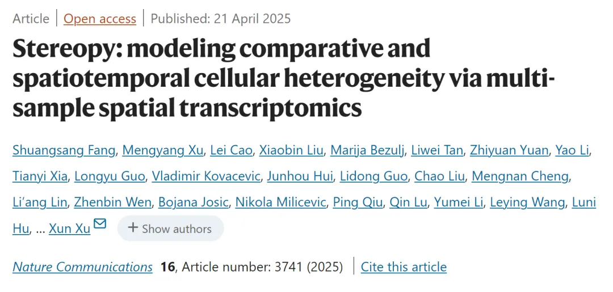
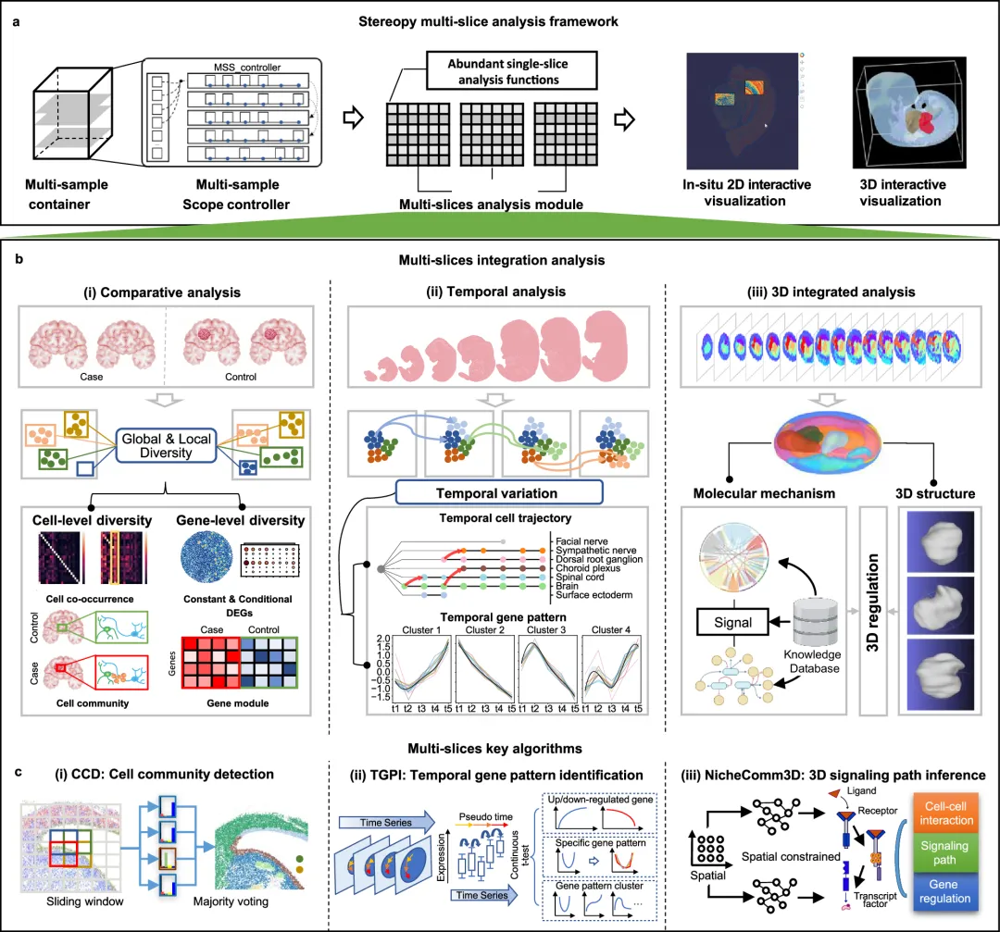
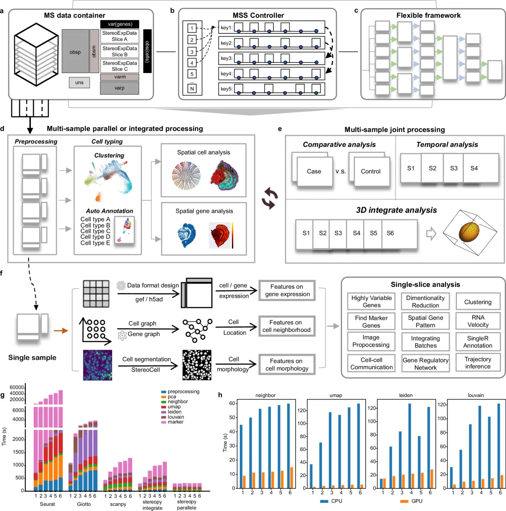
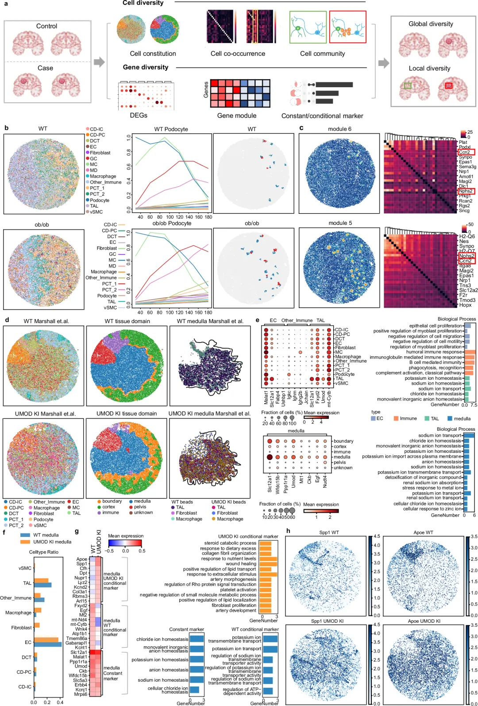
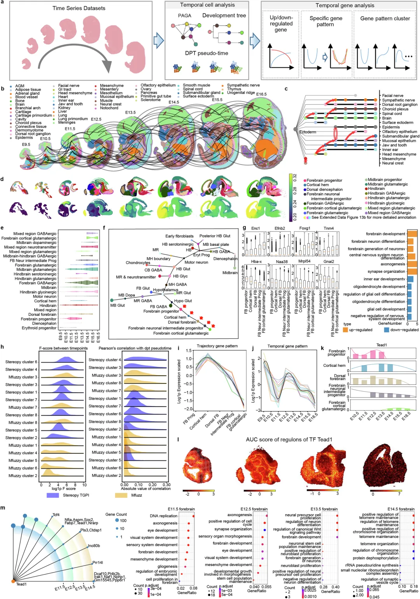
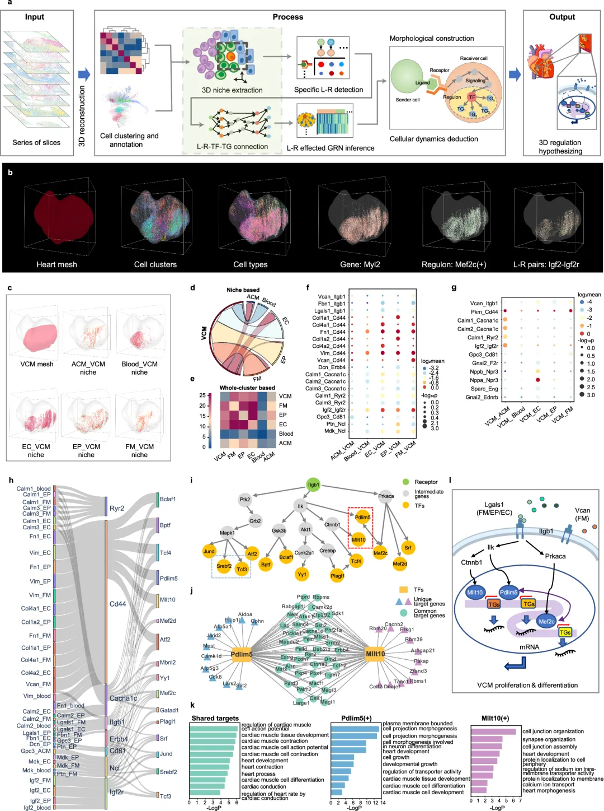

# Stereopy终于上架《NC》啦

> 原文：https://mp.weixin.qq.com/s?__biz=MzAwMzIzOTk5OQ==&mid=2247528611&idx=1&sn=f7cbe919af6b8ff9924962967bb0d1a5&chksm=9b3c09f3ac4b80e5855d708d4fd69a1b3535d53efefea0245a03b6e4107b60e708f3867ee66b#rd
> 合集：空间转录组 / 文献速递

**一、写在前面**

我们使用了很久的[Stereopy](<https://mp.weixin.qq.com/s?__biz=MzAwMzIzOTk5OQ==&mid=2247505686&idx=2&sn=925ce770136ec3e964b954c639eed29e&scene=21#wechat_redirect>)终于发表在了《**Nature Communications》** 上，题目为"**Stereopy: modelingcomparative andspatiotemporal cellular heterogeneity via multi.samplespatial transcriptomics** "，虽然平时也没少吐槽Stereopy，但现在终于有文献可以引用啦，大家不要吝啬自己文章中的引用。格式已经给大家整理好了：Fang S, Xu M, Cao L, et al. Stereopy: modeling comparative and spatiotemporal cellular heterogeneity via multi-sample spatial transcriptomics. Nat Commun. 2025 Apr 21;16(1):3741. 

**IF****： 14.7**********

**DOI:10.1038/s41467-025-58079-9**

**
**

更多空转分析教程可见：[空间转录组学习手册合辑](<https://mp.weixin.qq.com/s?__biz=MzAwMzIzOTk5OQ==&mid=2247505088&idx=1&sn=9f60dca1b21f5ba8c32d09595a512134&scene=21#wechat_redirect>)
[一文搞定空间转录组与单细胞测序的整合分析](<https://mp.weixin.qq.com/s?__biz=MzAwMzIzOTk5OQ==&mid=2247507210&idx=1&sn=f32037ffefd60b0d1bcca7bf9c3e0823&scene=21#wechat_redirect>)[CellChat空转细胞通讯合辑](<https://mp.weixin.qq.com/s?__biz=MzAwMzIzOTk5OQ==&mid=2247512011&idx=1&sn=fbd41832c5995d79fead016931d3bfbd&scene=21#wechat_redirect>)

**二、内容概要**

******** 空间转录组学技术的快速发展使研究人员能够在保留细胞空间信息的同时分析基因表达，为理解复杂生物系统提供了新视角。然而，如何整合多样本数据以探索细胞异质性仍是一个挑战。在这篇文章中，作者开发了Stereopy，这是一个灵活的框架，用于建模和解析多样本空间转录组学中的比较和时空模式，并提供交互式数据可视化。Stereopy针对三种代表性应用进行了优化：探究病理变化中负责的特定细胞群落和基因、结合空间和时间特征检测时空基因模式，以及推断连接细胞间通讯和细胞内调控的三维微环境基因互作网络。本文将对Stereopy的框架设计、分析模块和关键算法进行解析，展示其如何帮助研究人员增强数据解释能力并为挖掘多样本空间转录组数据提供新的途径。

**三、主要结果**

1\. Stereopy概览

**Stereopy** 是一种为多样本空间转录组学分析设计的全面工具，作者通过开发一个可扩展的框架，包含通用数据容器、范围控制器和转换器，**实现了多模态数据的存储、选择和整合** ，**从而更高效的管理复杂数据集** 。在实验设计中，作者针对比较分析、时空分析和 3D 整合分析三大场景，开发了专门的模块和核心算法，包括 CCD 算法用于检测病例对照样本中的共同或特异性细胞群落，TGPI 算法用于识别空间约束下的时间可变基因模式，以及 NicheReg3D 算法用于推断从细胞间通讯到 3D 基因调控网络的信号通路。此外，作者还为 Stereopy 配备了 2D 和 3D 交互式可视化工具，支持生成高质量的探索结果和用户自定义浏览。实验结果表明，**Stereopy 凭借其强大的数据管理、分析功能和直观的可视化能力，成为研究人员深入探索生物过程和机制不可或缺的工具，能够显著提升对空间转录组学数据的理解和解读效率。**

图1

#### 2.Stereopy开发了高效的多样本数据分析框架

Stereopy的核心在于其高效的多样本数据分析框架，包括**MsData（多样本数据）容器** 、**MSS（多样本范围）控制器** 和**多样本分析转换器** 。MsData容器扩展了AnnData格式，融入了适用于多样本的额外功能，同时保留单样本依赖关系（图2a），这使用户可以通过单一接口访问整个数据集和各个样本，实现跨多个样本的灵活分析。MSS控制器管理结果存储、跟踪分析依赖关系并可视化结果（图2b），通过在每个MsData函数中调整范围参数，用户可以将元信息和结果与相应样本关联，用于后续关联分析。Stereopy的多样本转换器支持具有多样化需求的多样本数据集的自定义分析（图2c），提供函数将单样本结果整合到多样本上下文中，或将多样本数据可逆拆分用于单样本分析。框架支持跨多个样本的**并行或整合分析** （图2d），实现全面的多样本联合分析和多样本数据的交互式可视化（图2e）。性能测试显示，与现有工具Giotto、Scanpy和Seurat相比，Stereopy的常规空间转录组分析模块在**处理时间方面表现优异** （图2g）。通过**GPU加速** ，Stereopy进一步提升了维度降低、邻域搜索、Leiden/Louvain聚类等时间密集型功能的性能（图2h）。

图2

#### 3\. Stereopy揭示比较分析中的细胞和基因多样性

将受扰动或疾病影响的样本与对照样本进行比较，可以帮助研究人员理解局部和全局水平上功能机制的变化。Stereopy整合了**细胞水平** 和**基因水平** 的模块，通过自主开发的算法，识别和分析比较样本中的全局和局部多样性（图3a）。在小鼠肾脏数据集上的应用显示，**Stereopy-CCD算法** 优于Giotto、SpaGCN等现有方法，在单样本场景（如小鼠胚胎大脑）和多样本场景（如连续小鼠大脑和肾脏）中表现出色。在野生型(WT)和糖尿病(ob/ob)小鼠肾脏样本中，Stereopy通过共现计算验证了足细胞与GC细胞的共现关系（图3b），且与WT相比，ob/ob样本中这些细胞类型的共现性更高。基因模块分析在两个样本中揭示了**Nphs2** （足细胞标记物）和**Ccn2** （足细胞损伤标记物）的共表达，局部自相关分析表明ob/ob样本中Nphs2和Ccn2之间的相关性更强（图3c）。在UMOD KI肾脏样本中，CCD算法识别的群落根据解剖结构进行了注释，包括肾皮质、髓质等，其中髓质区域与Marshall等人的研究中的标注区域高度一致（图3d）。髓质群落在WT和UMOD KI样本中显示出相似的上升支（TAL）、内皮细胞（EC）和其他免疫细胞类型的比例，UMOD KI样本中**成纤维细胞和巨噬细胞的百分比增加** （图3f）。通过分析髓质及其组成细胞类型（如TAL、EC和其他免疫细胞）的差异表达基因和富集的基因本体（GO）术语，发现标记基因显示出更高的显著性，髓质中富集的GO术语与**肾脏功能高度相关** ，包括钠离子转运、钾离子跨膜转运和氯离子稳态（图3e）。UMOD KI样本的**条件标记** 涉及肾功能损伤，如营养水平反应、伤口愈合和细胞外刺激反应（图3g），**Spp1和Apoe等重要条件标记与肾结石和肾小球疾病相关** （图3h）。

图3

#### 4.Stereopy识别时间序列分析中的时空变异

生物体的生长和发育涉及复杂的生物过程，特征是细胞类型和基因表达随时间变化。Stereopy强调在**空间和时间维度** 上检测动态变化，采用基于流形分区的方法保持全局拓扑并推断不同样本中细胞类型的轨迹，提供细胞轨迹的可视化表示和不同时间点细胞数量变化（图4a）。作者提出的**空间分辨时间基因模式推断（TGPI）** 方法能够识别具有相似时间表达变化的基因，包括连续上调或下调的基因，以及真实时间和拟时间中观察到的其他复杂模式。**假阳性风险评分（FPR score）** 在鉴定具有连续基因表达变化的真正上调和下调基因方面表现稳定可靠（图4h）。相比Mfuzz，**Stereopy-TGPI的识别与真实和拟时间趋势相关性更高** ，能够富集与神经元发育相关的显著GO术语。在Stereo-seq小鼠胚胎（E9.5至E16.5）数据集上，作者推断了整合数据集的轨迹，并使用树形图可视化细胞类型发育（图4b, c）。通过独立聚类和注释每个样本中的大脑，使用拟时间分析确认了前脑区域拟时间值的逐渐增加，表明较晚的发育（图4d）。细胞轨迹分析揭示了前脑祖细胞、皮质边缘区、背侧前脑、前脑中间祖细胞和前脑皮质谷氨酸能等阶段的发展过程（图4e, f）。作者利用Stereopy-TGPI分析前脑轨迹中的基因调控，鉴定出**Foxg1作为关键的前脑发育转录因子** ，呈现前脑轨迹上的逐渐上调（图4g），而**Hes5则呈下调趋势** 。通过分析前脑轨迹细胞类型特异的表达模式，发现一个特征基因模式在皮质边缘区阶段前上调，随后持续下调，其中**转录因子Tead1在皮质边缘区高表达，E11.5至E14.5表达峰值后显著下降** （图4i, j）。基因调控网络分析显示**Tead1调控的基因数量从E12.5的338个降至E13.5的7个** ，富集的GO术语从前脑发育转向神经母细胞增殖，表明Tead1和皮质边缘区在此阶段已完成其神经发生功能（图4k, l）。

图4

#### 5\. Stereopy揭示3D分析中微环境介导的调控

在多细胞生物中，细胞和组织在3D结构中组织，形成的复杂细胞相互作用无法用2D培养充分捕捉。Stereopy的**NicheReg3D流程** 通过精确表征3D微环境的细胞构成，促进探索细胞间和细胞内相互作用（图5a），结合数据预处理、3D对齐与重建、3D细胞微环境约束、细胞-微环境通讯和**配体-受体(L-R)-转录因子(TF)-靶基因(TG)通路推断** 等步骤。在小鼠心脏皮质区域（使用BARseq技术测序），结果表明**3D微环境** （由3D重建连续2D切片后准确定义的多种细胞类型组成）**优于单片的2D微环境组成分析** ，改进了皮质区域的预测识别（图5b）。在使用Stereo-seq测序的小鼠胚胎心脏数据上，从59个10μm厚2D连续冷冻切片中提取90,411个高质量分割细胞，覆盖30,254个基因，进行无监督聚类分析识别出六个心脏细胞簇（图5b）。作者研究了**心室心肌细胞（VCM）** 的发育及其与心脏微环境的相互作用。VCM微环境包含五种其他细胞类型：约28%心房心肌细胞(ACM)、27%血细胞、23%心内膜细胞(EC)、13%心外膜细胞(EP)和9%纤维间质细胞(FM)（图5c）。在3D的25μm物理距离内，**VCM是周围细胞信号的主要接收者** （图5d），这与传统理解不同。计算分析预测了FM-VCM细胞中配体**Vcan与其受体Itgb1的显著分子相互作用** （通讯评分=0.293，p=0.00），在其他微环境中存在度适中（图5f）。除ACM外的四个不同微环境组成通过相同的L-R对集合影响VCM基因表达，如**Vim-Cd44、Calm1-Ryr2、Igf2-Igf2r等** ，它们在CM增殖、迁移和分化调控中有重要作用（图5f, g）。此外，作者推断了微环境中VCM细胞特异表达的基因调控网络（图5h），识别出可能易受细胞-微环境通讯影响的核心转录因子及其对应的靶基因组。通过富集分析，建立了微环境细胞和VCM内部受影响转录因子之间的演绎信号通路。结果显示**Cd44是细胞外信号的主要接收者** ，由特定配体（Col1a1、Col4a1/2、Vcan）或来自不同微环境的共同表达基因（Fn1、Vim）刺激，可通过激活**Wnt/β-catenin信号通路** 调控Tcf4等转录因子，影响心脏成熟的时空控制（图5h, i）。基因调控网络分析显示不同的细胞间通讯可以共同调控相同的基因集，如**Itgb1相关的细胞通讯可能通过Ilk相关通路同时调节Pdlim5和Mllt10** ，它们的共享靶基因共同管理心肌发育和收缩（图5j, k）。最终，作者提出了一个**改进的3D调控模型** ，阐明VCM在心脏成熟和生理中的发育（图5l）：VCM是心脏功能的基本元素，而EC、EP、FM和血细胞是促进CM成熟的微环境关键组成部分，微环境共同或特异地通过共享或独特的L-R对传递信号，进一步促进或抑制VCM内部的特定转录因子，这些转录因子最终影响下游基因表达，共同展示细胞功能状态和亚型。

图5

**四**、最后聊聊****

Stereopy 在肾脏样本中验证了足细胞与 GC 细胞的共现性，并在小鼠大脑发育中揭示了关键的时空基因模式，凸显了其在解析复杂生物过程方面的潜力。尽管 Stereopy 在多样本数据处理上表现出色，其计算效率和算法在面对超大规模数据集时的优化仍需进一步探索。展望未来，随着空间分辨转录组学技术的持续进步，Stereopy 的可扩展性和开放性使其有望成为该领域的重要支柱，推动对细胞异质性及其调控网络的系统性理解，为生物医学研究提供新的思路和工具。

**如何联系我们**

 留一个领取资料、[免费两周学习版](<https://mp.weixin.qq.com/s?__biz=MzAwMzIzOTk5OQ==&mid=2247527585&idx=1&sn=fa32112c11b215b33096cab43baf08ea&scene=21#wechat_redirect>)服务器的**微信号[Biomamba_zhushou]**，方便各位随时交流。同时我们也构建了[交流群矩阵](<https://mp.weixin.qq.com/s?__biz=MzAwMzIzOTk5OQ==&mid=2247528057&idx=1&sn=bb348c2a88c977c7cce67ee6731a3591&scene=21#wechat_redirect>)，欢迎大家入群讨论。

大家可以阅读完这几篇之后添加[给生信入门初学者的小贴士](<http://mp.weixin.qq.com/s?__biz=MzAwMzIzOTk5OQ==&mid=2247493329&idx=1&sn=597870b7f7ce10346da3561e7c281627&chksm=9b3c9f81ac4b169794088ce9abbcacb5f18e9fd174fc0d7e28da62d78facadf3100ef38aaf22&scene=21#wechat_redirect>)
[如何搜索公众号过往发布内容](<http://mp.weixin.qq.com/s?__biz=MzAwMzIzOTk5OQ==&mid=2247506266&idx=2&sn=22b1164bc9602c25620d058847785422&chksm=9b3ca00aac4b291c16d738271746ffb90149282a728f484e8a1952463c46a8e7dc4f883ab928&scene=21#wechat_redirect>)

**已有生信基地联系方式的同学****无需重复添加**

 您点的每个赞和在看，我都认真当成了喜欢
