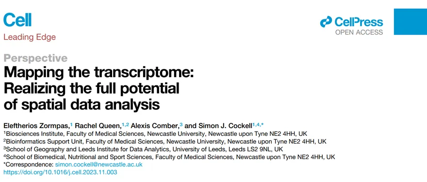
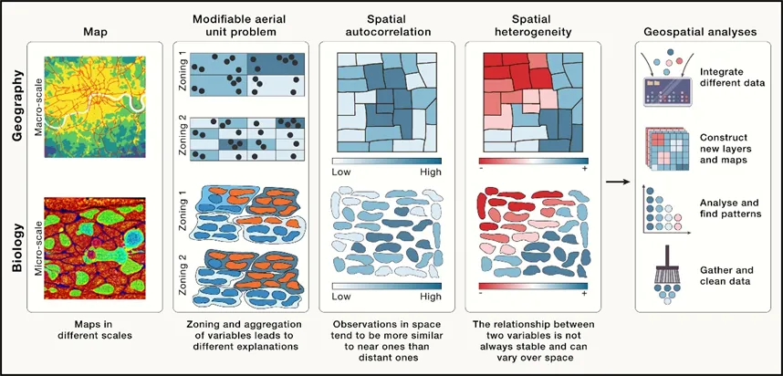
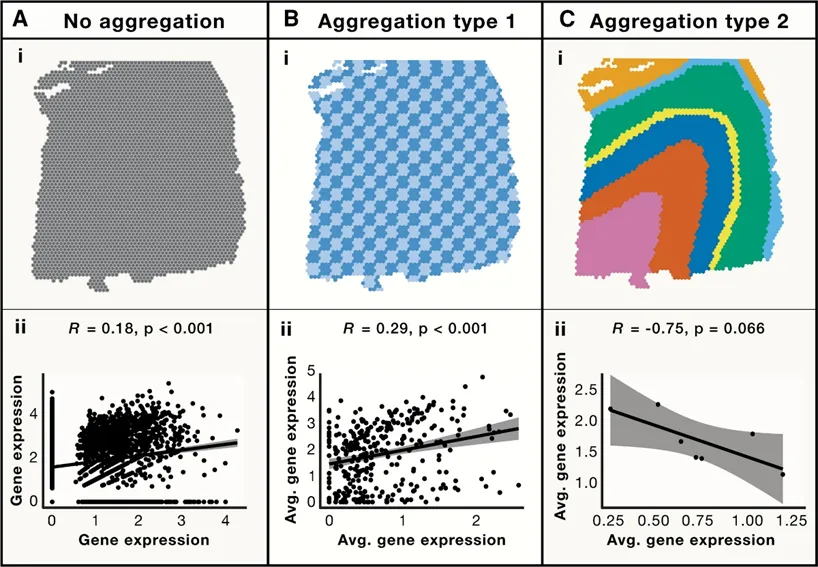
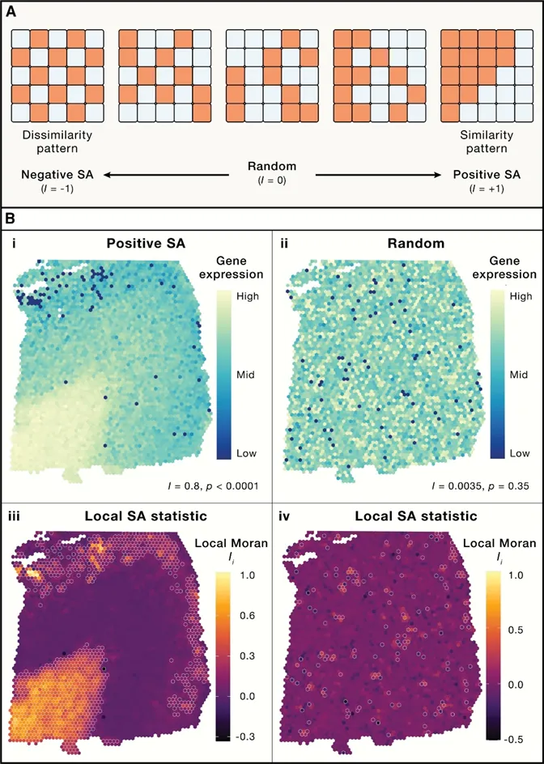
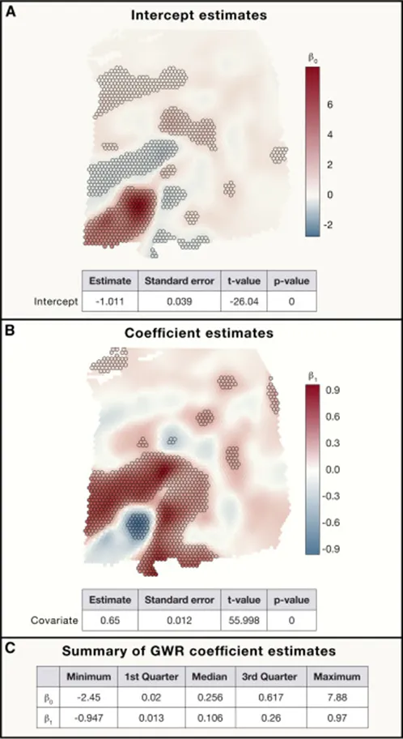

# 《Cell》综述| 空间组学的常见分析

> 原文：https://mp.weixin.qq.com/s?__biz=MzAwMzIzOTk5OQ==&mid=2247528807&idx=1&sn=14ffa34ad1a4c714b765bd33e9b48b55&chksm=9b3c0837ac4b81216df60919ed18bc881112ef648846038594a5f91068872d0f91dd77811939#rd
> 合集：空间转录组

**一、写在前面**

**空间转录组学（Spatial Transcriptomics，ST）是一种从空间层面上解析RNA-seq数据，从而解析单个组织切片中所有mRNA的技术。** 单细胞测序（ScRNA-seq）实现了在单细胞的分辨率下进行转录组分析，解决了组织中细胞异质性的问题，但是样本处理过程中单细胞的分离又会导致细胞间空间和拓扑信息的缺失。而空间转录组学中**RNA-seq的原位测序不仅可以获得较高的分辨率，同时还保留了****空间信息** ，但这些数据的产生导致生物信息学分析将面临新的挑战，**需要不同的统计和推理思路** 。

**空间转录组学一般产生三种不同但相互关联的数据：**

**（ 1）图像数据；**

**（ 2）基因表达数据；**

**（ 3）空间的方向和位置。**

把单个细胞观察的数据直接分析的话往往会忽略细胞间的相关性，因此需要考虑数据间的空间关系。

**目前空间组学的研究设计主要分为三类：**

**（ 1）将得到的数据进行聚类分析；**

**（ 2）考虑到不同细胞表达的特定基因从而进行定位分析；**

**（ 3）比较不同空间簇中基因表达的变化。**但是使用坐标信息作为空间数据的一部分进行分析仍有待挖掘，**在这篇文章中，作者联合 地理科学的统计方法讨论如何发挥空间数据分析的全部潜力（果然任何一个行业进军生物都是降维打击）**，让我们一起来看看具体内容吧。

对空间转录组、scRNA-seq分析及联合分析感兴趣的同学可参考：[空间转录组学习手册合辑](<https://mp.weixin.qq.com/s?__biz=MzAwMzIzOTk5OQ==&mid=2247505088&idx=1&sn=9f60dca1b21f5ba8c32d09595a512134&scene=21#wechat_redirect>)[scRNA-Seq学习手册Seurat V5更新版](<https://mp.weixin.qq.com/s?__biz=MzAwMzIzOTk5OQ==&mid=2247519711&idx=1&sn=d25d4f5daf609bda8367f16db676ecf3&scene=21#wechat_redirect>)[一文搞定空间转录组与单细胞测序的整合分析](<https://mp.weixin.qq.com/s?__biz=MzAwMzIzOTk5OQ==&mid=2247507210&idx=1&sn=f32037ffefd60b0d1bcca7bf9c3e0823&scene=21#wechat_redirect>)[CellChat空转细胞通讯合辑](<https://mp.weixin.qq.com/s?__biz=MzAwMzIzOTk5OQ==&mid=2247512011&idx=1&sn=fbd41832c5995d79fead016931d3bfbd&scene=21#wechat_redirect>)
如果需要数据分析**指导** 、生信热点**全文复现** 、自测数据**个性化分析** 辅导，欢迎联系客服微信[**Biomamba_zhushou**]

**二、主要内容**

****

  1. 作者在BOX1中展示了ST分析中的关键术语，大家可以先对照着看一下。
  2. **BOX1：**

  3. Aggregation problem| 使用不同的面积单位组合，即使在相同的比例尺上，也会观察到结果的变化。
---|---
Bandwidth| 描述地理加权回归模型的局域化程度的参数。
Curse of dimensionality| 使用的维数越高，观察到的距离就越等距。
Geographically weighted regression (GWR)| 一种考虑到空间异质性的方法，因为它允许自变量和因变量之间的关系在局部发生变化。
Global spatial autocorrelation measures| 评估一个变量在整个数据集中空间自相关程度的统计学。
Hot and cold spots| 一个变量的高(热)值或低(冷)值在空间中的聚集。
Interesting locations| 多元空间中表示“统计显著性”的术语。
Local indicators of multivariate spatial association (LIMSA)| 衡量多变量空间中的邻点(即基因表达谱彼此相似的点)在地理空间中相邻的程度。
Local indicators of spatial association (LISA)| 参见局部空间自相关度量。
Local spatial autocorrelation measures| 评估一个变量在每个位置与其相邻位置的空间自相关程度的统计学。
Modifiable aerial unit problem (MAUP)| 空间数据聚集尺度的选择将影响统计关系和分析过程。
Multiscale GWR (MGWR)| 通过确定每个自变量的最佳带宽，在多个尺度上计算地理加权回归。
Pseudo-p-value| 由计算排列产生的正态分布计算出的p值。
Scale problem| 对同一组数据在不同尺度上进行汇总，会得到不同的结果。****
Spatial autocorrelation (SA)|  附近的观测结果往往是相似的，这违反了经典统计学的一个主要假设——观测独立性。****
Negative SA|  附近的值往往不相同。
Positive SA| 附近的值趋于相似。
Spatial heterogeneity| 与结果和过程相关的因素，在空间上是不同的。也被称为空间非平稳性。
  4. **1. ****地理科学和空间转录组中类似问题的概念性说明。**

**空间数据中的关键特征：**

**（1）MAUP指空间精度，通常在空间转录组分析中指的是单细胞的精度；**

**（2）空间相关性(SA)，即表示空间细胞之间的相互影响；**

**（3）空间异质性（SH）指的是空间中存在时空变化，结果相似的在空间上也有可能位置不同****（Fig.1）。**

以上提到的概念往往适用于所有的空间转录组学数据分析。

**Fig.1******

  1.

  2. **2. ****空间精度**

空间转录组学分析中，对区域进行分组是常用的方法，不同的分组往往会得到不同的结果，如图所示，对所选区域进行不同分组，分析一对基因的表达能够得到完全不同的相关性和显著性（Fig.2），这表明所有的分析都受到MAUP和空间范围选择的影响，当相同的数据在不同MAPU、不同空间范围聚合或组合时，统计分布和相关性表现出了不同的趋势。地理学中，通常按照预先确定的面积单位（如人口普查报告区域）等来进行观测，而在生物学中，MAUP的定义与结构的关系更为紧密，组织是由细胞所构成的，细胞是最小的组成单位，因此对于区域的划分大都是由组织本身的结构所决定的。

**Fig.2******

****

  1. **3. ****空间相关性**

地理学中存在定律，一切事物都与其他事物相关，但近的事物比远的事物更相关，反映了我们对于现象的认知：现象通常是聚集的，而不是随机分布的。空间邻域可以由距离来定义，而且空间相关性可以用来分析空间邻近的变量（如细胞和基因），细胞的行为受到周围环境的影响，包括细胞与细胞间的相互接触，当细胞在空间范围分析时，需要考虑邻近细胞对其的影响，因此ScRNA-seq的分析并不适用于空间转录组学，因为其假设单细胞是完全独立的（Fig.3）。

**Fig.3******

**
**

  1. **4. ****空间异质性**

空间异质性描述了一个确定区域里不同地点间的变化，是一个经常用于地理和环境科学中的概念。生物学上，单个基因的表达在不同的部位常常发生变化。例如在肿瘤微环境中往往伴随着区域异质性，肿瘤相关巨噬细胞在不同类型肿瘤中表现出多维异质性。因此在空间转录组学的分析中往往也要考虑到空间异质性（Fig.4）。这个分析[Squidpy](<http://mp.weixin.qq.com/s?__biz=MzAwMzIzOTk5OQ==&mid=2247505844&idx=2&sn=5756c0702d080d6e602c504e7d461013&chksm=9b3caee4ac4b27f268c5f7cd39b6a1cbc138e465a6375c26c9a49b31697b63a4af2f702ec6b2&scene=21#wechat_redirect>)做起来非常之方便。

**Fig.4******

  1.

  2. **5. ****感知空间的空间转录组学分析**

**对于空间转录组学的整体分析主要包括：**

**（1）空间聚类；**

**（2）可变基因的定位；**

**（3）空间注释。** 标准的聚类不考虑值的空间分布，只考虑值的相似性，如果考虑到空间信息，将导致不同空间里面的最大值和最小值存在差异，从而影响聚类。因此在后续的分析中同时需要考虑空间聚类和空间位置的加权聚类，从而解决空间上不同亚群表达量不同的问题，例如SpaGCN方法。

转录组分析中，无论是TotalRNA-seq，ScRNA-seq还是空间转录组学，均在关注基因表达变化的差异，而空间转录组学能将这种变化体现在空间水平特定位置上，并与特定生物过程和细胞的存在相关，可以使用线性空间模型（GLSM）进行建模分析。

空间注释指的主要是空间形态学注释，SpatialLIBD方法能够实现空间转录组数据的交互式可视化，并提供逐点的手动注释。

这类分析同样可以通过squidpy来实现：[Squidpy空间转录组学习手册](<http://mp.weixin.qq.com/s?__biz=MzAwMzIzOTk5OQ==&mid=2247505844&idx=2&sn=5756c0702d080d6e602c504e7d461013&chksm=9b3caee4ac4b27f268c5f7cd39b6a1cbc138e465a6375c26c9a49b31697b63a4af2f702ec6b2&scene=21#wechat_redirect>)。

  1. **6. ****空间转录组学的其他分析方法**

空间转录组学常用的分析方法包括聚类、去卷积、图像分割、3D重建、细胞-细胞相互作用和数据集成等**。聚类** 是一种非常有用的工具，能够对数据进行结构化和排序而从复杂的多变量的数据中得到有用的信息。分辨率高于单细胞的空间转录组学技术，如：Visium，通常需要基因表达**去卷积** ，以帮助去了解被捕获的区域细胞类型组成。**高分辨率技术** 还能够利用图像分割方法来识别细胞边界从而区分转录组分布。同时空**间转录组学的数据分析常常与其他数据类型进行结合分析** ，来丰富对于单个数据集的分析。

以上分析均可以在我们往期教程中找到实例：

[空间转录组学习手册合辑](<http://mp.weixin.qq.com/s?__biz=MzAwMzIzOTk5OQ==&mid=2247505088&idx=1&sn=9f60dca1b21f5ba8c32d09595a512134&chksm=9b3cad90ac4b2486820dd335d997d2a96b77beb6ad463b1df6a2f307e47ebe8d7de3304ebf7c&scene=21#wechat_redirect>)

[一文搞定空间转录组与单细胞测序的整合分析](<http://mp.weixin.qq.com/s?__biz=MzAwMzIzOTk5OQ==&mid=2247507210&idx=1&sn=f32037ffefd60b0d1bcca7bf9c3e0823&chksm=9b3ca45aac4b2d4cf0c68299db3a2891130d89d9e0fe2a9ecb34b394736550bcf7d7c51090cc&scene=21#wechat_redirect>)

**三、总结讨论**

****综上所述，作者提出**结合地理科学对于空间数据的研究** ，利用地理加权回归，地理加权主成分分析，空间加权聚类分析和广义加权模型等跨学科的统计方法，能够发挥空间转录组学数据分析的全部潜力。大家分析自己的数据时也可以从空间精度、空间相关性、空间异质性等方面着手开展。

**如何联系我们**

 留一个领取资料、[免费两周学习版](<https://mp.weixin.qq.com/s?__biz=MzAwMzIzOTk5OQ==&mid=2247527585&idx=1&sn=fa32112c11b215b33096cab43baf08ea&scene=21#wechat_redirect>)服务器的**微信号[Biomamba_zhushou]**，方便各位随时交流。同时我们也构建了[交流群矩阵](<https://mp.weixin.qq.com/s?__biz=MzAwMzIzOTk5OQ==&mid=2247528057&idx=1&sn=bb348c2a88c977c7cce67ee6731a3591&scene=21#wechat_redirect>)，欢迎大家入群讨论。
大家可以阅读完这几篇之后添加[给生信入门初学者的小贴士](<http://mp.weixin.qq.com/s?__biz=MzAwMzIzOTk5OQ==&mid=2247493329&idx=1&sn=597870b7f7ce10346da3561e7c281627&chksm=9b3c9f81ac4b169794088ce9abbcacb5f18e9fd174fc0d7e28da62d78facadf3100ef38aaf22&scene=21#wechat_redirect>)
[如何搜索公众号过往发布内容](<http://mp.weixin.qq.com/s?__biz=MzAwMzIzOTk5OQ==&mid=2247506266&idx=2&sn=22b1164bc9602c25620d058847785422&chksm=9b3ca00aac4b291c16d738271746ffb90149282a728f484e8a1952463c46a8e7dc4f883ab928&scene=21#wechat_redirect>)

**已有生信基地联系方式的同学****无需重复添加**

 您点的每个赞和在看，我都认真当成了喜欢
