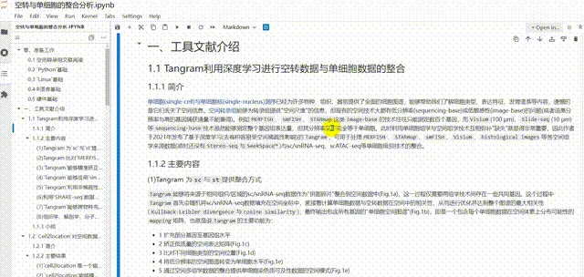
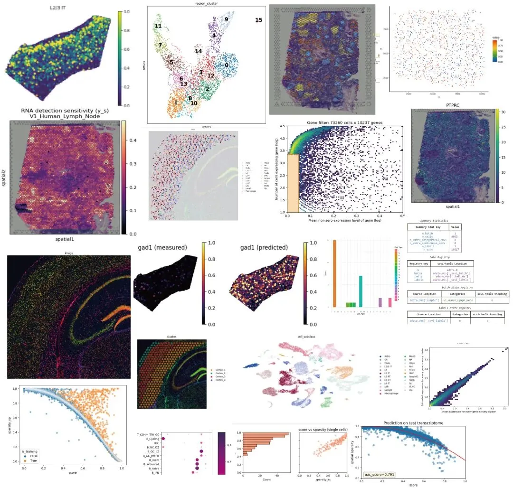
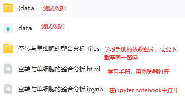
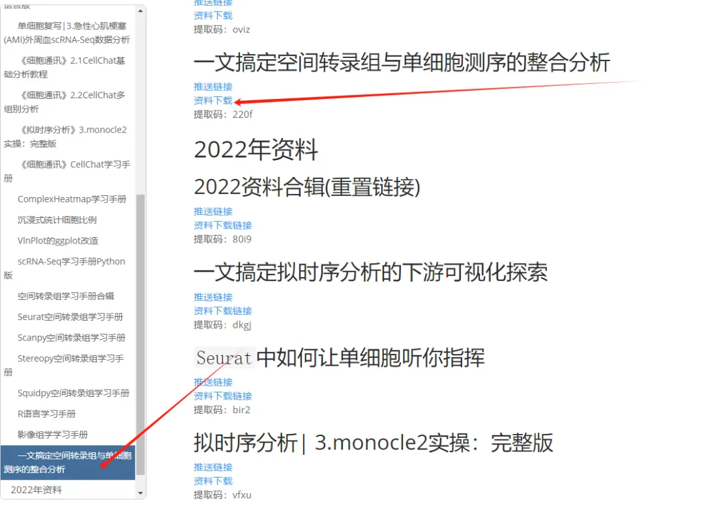

# 一文搞定空间转录组与单细胞测序的整合分析

> 原文：https://mp.weixin.qq.com/s?__biz=MzAwMzIzOTk5OQ==&mid=2247529485&idx=2&sn=441d93a7eb0db896b642a1e588945c4f&chksm=9b3c0d5dac4b844bf54bd050058d5d3859b147607fd02cf31334d9dc180bffe41ce5e8a0156c#rd
> 合集：空间转录组

学习手册

近年来**空间转录组** 的各类平台层出不穷，其也被《Nature Methods》评为年度技术。但目前许多空转技术仍无法达到单细胞分辨率，因此需要单细胞数据辅助空转的分析，进行去卷积、注释、缺失值填补等操作。本文整理了Tangram([Python](<http://mp.weixin.qq.com/s?__biz=MzAwMzIzOTk5OQ==&mid=2247499921&idx=1&sn=dcd6f95596e3de9bf378d850c217fe78&chksm=9b3cb9c1ac4b30d7bbd44057b181f87541f5904d24f903494ae557e768ae00c208c1b68b45c7&scene=21#wechat_redirect>))、Cell2location([Python](<http://mp.weixin.qq.com/s?__biz=MzAwMzIzOTk5OQ==&mid=2247499921&idx=1&sn=dcd6f95596e3de9bf378d850c217fe78&chksm=9b3cb9c1ac4b30d7bbd44057b181f87541f5904d24f903494ae557e768ae00c208c1b68b45c7&scene=21#wechat_redirect>))、RCTD([R语言](<http://mp.weixin.qq.com/s?__biz=MzAwMzIzOTk5OQ==&mid=2247506720&idx=1&sn=fe897ba3c33a8e63bf6a4e35aeac1896&chksm=9b3ca270ac4b2b66812aa311757bd15f28172a86215537f21a6fe3c7e96215a536bdab025bb8&scene=21#wechat_redirect>))三款软件的文献解读、测试代码、学习手册、测试文件和输出结果。希望这些资料可以帮助大家完成一站式学习。需要计算资源可点击：[足够支持你完成硕博生涯的生信环境](<http://mp.weixin.qq.com/s?__biz=MzAwMzIzOTk5OQ==&mid=2247506420&idx=1&sn=6867471200293a24ff3122583585da33&chksm=9b3ca0a4ac4b29b2ea3a3873acbccd80ff7c9ef487baf2865cd3fc5f744beb6881230ec3c1c4&scene=21#wechat_redirect>)

本文分享的软件支持GPU加速，需要GPU算力的同学可参考：[5090终于上架啦](<https://mp.weixin.qq.com/s?__biz=MzAwMzIzOTk5OQ==&mid=2247529343&idx=1&sn=988d600e144e51b48bc4b66df45d8e05&scene=21#wechat_redirect>)

也可以来找找组织：[生信Linux交流群](<https://mp.weixin.qq.com/s?__biz=MzAwMzIzOTk5OQ==&mid=2247528896&idx=1&sn=d06db51cab9a61ebd9e1865a9d6ca28b&scene=21#wechat_redirect>)

计算资源不足的同学可参考：
[生信分析为什么要使用服务器？](<https://mp.weixin.qq.com/s?__biz=MzAwMzIzOTk5OQ==&mid=2247491007&idx=1&sn=8619c2bad23791b3252a1c4cb1831931&chksm=9b3f64efac48edf9c02f84959aeee9b12480736fce70c5ddb8b41d79cfc22ce590ea2cb60fba&token=1760636281&lang=zh_CN&scene=21#wechat_redirect>)
[足够支持你完成硕博生涯的生信环境](<http://mp.weixin.qq.com/s?__biz=MzAwMzIzOTk5OQ==&mid=2247511780&idx=1&sn=3acc0874f7d2fa75f1abbe7a9a9b4069&chksm=9b3cd7b4ac4b5ea27d4d53964e4a4a9fa8c806a19103729dd4ff0fa72e621411f46a251d269f&scene=21#wechat_redirect>)
[独享用户硬件升级对比报告](<https://mp.weixin.qq.com/s?__biz=MzAwMzIzOTk5OQ==&mid=2247526418&idx=1&sn=d1ab22d2f98854faf21cb14dc0b494ee&scene=21#wechat_redirect>)

访问链接：https://biomamba.xiyoucloud.net/

**-Biomamba**

示例

分析输出图片示例：

联系客服获取下载链接

大家可以联系我们获领取下载链接，也欢迎考虑[生信基地终身订阅](<https://mp.weixin.qq.com/s?__biz=MzAwMzIzOTk5OQ==&mid=2247528482&idx=1&sn=7cc0715eace4f592a62bdaf157b25c01&scene=21#wechat_redirect>)学习手册相关文件目录：

本次资料在网址中的这里：

**-Biomamba**

**如何联系我们**

 留一个领取资料、[免费两周学习版](<https://mp.weixin.qq.com/s?__biz=MzAwMzIzOTk5OQ==&mid=2247527585&idx=1&sn=fa32112c11b215b33096cab43baf08ea&scene=21#wechat_redirect>)服务器的**微信号[Biomamba_zhushou]**，方便各位随时交流。同时我们也构建了[交流群矩阵](<https://mp.weixin.qq.com/s?__biz=MzAwMzIzOTk5OQ==&mid=2247528057&idx=1&sn=bb348c2a88c977c7cce67ee6731a3591&scene=21#wechat_redirect>)，欢迎大家入群讨论。
大家可以阅读完这几篇之后添加[给生信入门初学者的小贴士](<http://mp.weixin.qq.com/s?__biz=MzAwMzIzOTk5OQ==&mid=2247493329&idx=1&sn=597870b7f7ce10346da3561e7c281627&chksm=9b3c9f81ac4b169794088ce9abbcacb5f18e9fd174fc0d7e28da62d78facadf3100ef38aaf22&scene=21#wechat_redirect>)
[没有检索，就没有发言权](<https://mp.weixin.qq.com/s?__biz=MzAwMzIzOTk5OQ==&mid=2247529398&idx=2&sn=5a429852d61721916a405712677d5905&scene=21#wechat_redirect>)

**已有生信基地联系方式的同学****无需重复添加**

 您点的每个赞和在看，我都认真当成了喜欢
