# 一文学会10X Visium、寻因SeekSpace、华大Stereo-seq定量与数据读取

> 原文：https://mp.weixin.qq.com/s?__biz=MzAwMzIzOTk5OQ==&mid=2247539577&idx=1&sn=8132606ce1a0ec1001eae05145571fb6&chksm=9b3c2229ac4bab3f9276394a3914f471de5919097006c76a08e50fa0fa58b953f2acce38fb50#rd
> 合集：空间转录组

**一、写在前面**

[ 空间转录组](<https://mp.weixin.qq.com/mp/appmsgalbum?__biz=MzAwMzIzOTk5OQ==&action=getalbum&album_id=2879312479804489730#wechat_redirect>)学是一种能够在组织空间上下文中同时分析基因表达的方法，为理解组织结构、细胞类型分布和细胞互作提供了新的视角。

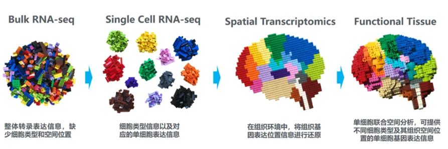

本文将介绍：空间转录组概述（主要是阐述发展历程、技术分类、平台对比）和**上游测序数据定量 （主要介绍三大平台10x Visium、 SeekSpace、Stereo-seq软件安装、定量实操、读取andata对象等手把手教你学会上游定量分析）**

如果你想彻底吃透[空间转录组](<https://mp.weixin.qq.com/mp/appmsgalbum?__biz=MzAwMzIzOTk5OQ==&action=getalbum&album_id=2879312479804489730#wechat_redirect>)全套内容、跟着老师系统学习，可以报名参加我们的课程：[Python空间转录组数据分析。当然，没有时间学习我们也可以代工：](<https://mp.weixin.qq.com/s?__biz=MzAwMzIzOTk5OQ==&mid=2247533721&idx=1&sn=9648ed4701224e5d2e4c704d7046d9de&scene=21#wechat_redirect>)[生信基地，永远都不是论文工厂](<https://mp.weixin.qq.com/s?__biz=MzAwMzIzOTk5OQ==&mid=2247539366&idx=1&sn=d6db6f6b2e220ccb7414f2c6d26e2abf&scene=21#wechat_redirect>)

[](<https://mp.weixin.qq.com/s?__biz=MzAwMzIzOTk5OQ==&mid=2247533721&idx=1&sn=9648ed4701224e5d2e4c704d7046d9de&scene=21&token=1258697299&lang=zh_CN&poc_token=HMBPW2qjSKdDOXcv4X0Q9B4dmudp4aDIek9Wo0rM#wechat_redirect>)

**二、上游测序数据定量**

如果你对下面的教程比较迷茫，那么你可以先行学习编程教程：

[十小时学会Linux](<https://mp.weixin.qq.com/s?__biz=MzAwMzIzOTk5OQ==&mid=2247505777&idx=1&sn=f3efae390566b838a445ab9f832323c8&scene=21#wechat_redirect>)

[生信Linux及服务器使用技巧](<https://mp.weixin.qq.com/mp/appmsgalbum?__biz=MzAwMzIzOTk5OQ==&action=getalbum&album_id=2980604042328702978&token=106440264&lang=zh_CN#wechat_redirect>)

[生信Python速查手册](<https://mp.weixin.qq.com/s?__biz=MzAwMzIzOTk5OQ==&mid=2247520999&idx=2&sn=7f6aa90c2ffa786bd660aa40b109de49&scene=21#wechat_redirect>)

如果你的计算机不足以支持大规模的计算，可按需选用适合自己的计算资源：共享(经济实惠)：[足够支持你完成硕博生涯的共享服务器](<https://mp.weixin.qq.com/s?__biz=MzAwMzIzOTk5OQ==&mid=2247532373&idx=2&sn=4708fac31ac8f4e347847e4b7f2a4fed&scene=21#wechat_redirect>)独享(省电省心)：[如何拥有一台服务器，且不用自己搭建维护](<https://mp.weixin.qq.com/s?__biz=MzAwMzIzOTk5OQ==&mid=2247534670&idx=2&sn=b4296f98e4f8e171a8833a202bd9f926&scene=21#wechat_redirect>)

访问链接：https://biomamba.xiyoucloud.net/

优惠码Biomammba

2.1 [10x Visium](<https://mp.weixin.qq.com/s?__biz=MzAwMzIzOTk5OQ==&mid=2247522444&idx=1&sn=91ddf9e2ca3fb75db3ad524fe0042fab&scene=21&token=106440264&lang=zh_CN&poc_token=HJmqw2mjCGMEC34r_0xfziZSwLozSIfG4chhS3D-#wechat_redirect>)**平台**

2.1.1 软件安装

  *   *   *   *   *   *   *   *   *   *   *

```
%%bash# 下载Space Rangerwget -O spaceranger-4.0.1.tar.gz "https://cf.10xgenomics.com/releases/spatial-exp/spaceranger-4.0.1.tar.gz?Expires=1755460872&Key-Pair-Id=APKAI7S6A5RYOXBWRPDA&Signature=OcHtPp5rc00BjbHoLZvo1owG9i6222bUJcMCapp9i3RM4qxDfcZaNTlFG-G-cbNUQOJ82yYZL7Tl~mCY1h0yzX~6KiKmOFea-xqL-TGLEPfxFNOlGj~xSi6e1Enf8eAfbugdU7b7FAvg2RCyxHsQzerHGGzUhBxONKvr~XrJOadOmblT1mhe2OYFS-XRf4SAHjjZjWSzqy0N3p~Gw7iqg-cvxMT6E7uK4rHtao6Q07LVf-m--jr8tirsOAdf0MWJp5fHVIdeJ8aENQj5nE-qKuoUf6ngZLutgQp7yfBAmQc7qwAF03gEA1jKzrgI9va4Y1Wc3r3SRA8B2rW7a4mNDw__"# 这里的链接是有时效性的，请在10x官网注册和申请获取最新的下载链接tar -xf spaceranger-4.0.1.tar.gz# 设置环境变量# 将当前目录（$(pwd)）添加到用户的环境变量 PATH 中，并且把这项设置永久保存在用户的 ~/.bashrc 文件中echo'export PATH=/data/04_ST_introduction/spaceranger/spaceranger-4.0.1/:$PATH' >> ~/.bashrcsource  ~/.bashrc# 检查 Space Ranger是否安装成功spaceranger
```
```
2.1.2 示例数据下载
```

  *   *   *   *   *   *   *   *   *   *   *   *   *   *   *

```
%%bash# 下载10x 官网提供的小鼠示例数据（10X visium HD）# Input Files# 空间转录组样本高精度图像文件wget https://cf.10xgenomics.com/samples/spatial-exp/3.0.0/Visium_HD_Mouse_Brain/Visium_HD_Mouse_Brain_image.tifwget https://cf.10xgenomics.com/samples/spatial-exp/3.0.0/Visium_HD_Mouse_Brain/Visium_HD_Mouse_Brain_tissue_image.tif# 空间转录组样本高精度图像缩放参数wget https://cf.10xgenomics.com/samples/spatial-exp/3.0.0/Visium_HD_Mouse_Brain/Visium_HD_Mouse_Brain_alignment_file.json# 测序数据wget https://s3-us-west-2.amazonaws.com/10x.files/samples/spatial-exp/3.0.0/Visium_HD_Mouse_Brain/Visium_HD_Mouse_Brain_fastqs.tar# 小鼠大脑样本的探针集 CSV 文件wget https://cf.10xgenomics.com/samples/spatial-exp/3.0.0/Visium_HD_Mouse_Brain/Visium_HD_Mouse_Brain_probe_set.csv# 下载小鼠参考基因组文件wget "https://cf.10xgenomics.com/supp/cell-exp/refdata-gex-mm10-2020-A.tar.gz"  #这是10X官网提供的构建好可以直接用于空间转录组分析的基因组文件tar -xf refdata-gex-mm10-2020-A.tar.gz
```

#### 参考基因组构建（适用于非模式动物）

  *   *   *   *   *   *   *   *

```
%%bash# 这里我们自己下载走一遍构建流程# 下载对应物种的gtf文件wget https://ftp.ensembl.org/pub/release-114/gtf/mus_musculus/Mus_musculus.GRCm39.114.chr.gtf.gzgunzip -xf Mus_musculus.GRCm39.114.chr.gtf.gz# 下载参考基因组的fasta文件wget https://ftp.ensembl.org/pub/release-114/fasta/mus_musculus/dna/Mus_musculus.GRCm39.dna.toplevel.fa.gzgunzip -xf Mus_musculus.GRCm39.dna.toplevel.fa.gz
```

在构建参考基因组前，我们还需要对基因组注释文件进行修饰

`spaceranger mkgtf`：

  * 过滤不必要的转录本（如保留最长转录本或主要 isoform）

  * 标准化 GTF 字段，确保 gene_id, gene_name, gene_biotype 符合 10x 的解析规则

  * 输出一个 经过优化的 GTF 文件，保证 Spaceranger 在生成 Feature-Barcode Matrix 时不会报错或漏掉基因

  *   *   *   *   *   *   *   *   *   *   *   *   *   *   *   *   *   *   *   *   *   *   *

```
%%bash# 构建参考基因组文件（尤其非模式动物）cd /data/04_ST_introduction/spaceranger# 根据推荐创建过滤后的gtf文件# 主要选择一些常用的基因类型spaceranger mkgtf Mus_musculus.GRCm39.114.chr.gtf Mus_musculus.GRCm39.114.chr.filtered.gtf \                   --attribute=gene_biotype:protein_coding \                   --attribute=gene_biotype:lincRNA \                   --attribute=gene_biotype:antisense \                   --attribute=gene_biotype:IG_LV_gene \                   --attribute=gene_biotype:IG_V_gene \                   --attribute=gene_biotype:IG_V_pseudogene \                   --attribute=gene_biotype:IG_D_gene \                   --attribute=gene_biotype:IG_J_gene \                   --attribute=gene_biotype:IG_J_pseudogene \                   --attribute=gene_biotype:IG_C_gene \                   --attribute=gene_biotype:IG_C_pseudogene \                   --attribute=gene_biotype:TR_V_gene \                   --attribute=gene_biotype:TR_V_pseudogene \                   --attribute=gene_biotype:TR_D_gene \                   --attribute=gene_biotype:TR_J_gene \                   --attribute=gene_biotype:TR_J_pseudogene \                   --attribute=gene_biotype:TR_C_gene
```

这样就生成了过滤后的gtf注释文件，用于下面构建用于空间转录组的参考基因组文件

  *   *   *   *   *

```
# 生成 mm10 的 spaceranger 参考spaceranger mkref \    --genome=mm10 \    --fasta=Mus_musculus.GRCm39.dna.toplevel.fa \    --genes=Mus_musculus.GRCm39.114.chr.filtered.gtf
```

看一下生成参考基因组的结构

  *   *

```
%%bashtree -L 3 /data/04_ST_introduction/spaceranger/reference/mm10
```
```
/home/chenao/jupyter_home/spaceranger/reference/mm10
```
```
├── fasta
```
```
│   ├── genome.fa
```
```
│   └── genome.fa.fai
```
```
├── genes│   └── genes.gtf.gz
```
```
├── reference.json
```
```
└── star
```
```
     ├── chrLength.txt
```
```
     ├── chrNameLength.txt
```
```
     ├── chrName.txt
```
```
     ├── chrStart.txt
```
```
     ├── exonGeTrInfo.tab
```
```
     ├── exonInfo.tab
```
```
     ├── geneInfo.tab
```
```
     ├── Genome
```
```
     ├── genomeParameters.txt
```
```
     ├── SA
```
```
     ├── SAindex
```
```
     ├── sjdbInfo.txt
```
```
     ├── sjdbList.fromGTF.out.tab
```
```
     ├── sjdbList.out.tab
```
```
     └── transcriptInfo.tab
```
```
  3 directories, 19 files
```

2.1.3 [定量](<https://mp.weixin.qq.com/s?__biz=MzAwMzIzOTk5OQ==&mid=2247522444&idx=1&sn=91ddf9e2ca3fb75db3ad524fe0042fab&scene=21#wechat_redirect>)

生成这样的文件结构就没有问题了，我们运行最重要的定量步骤 `spaceranger count`

  *   *   *   *   *   *   *   *   *   *   *   *   *   *   *   *   *

```
%%bash# 进行空间转录组数据的定量过程# 现在可以构建 spaceranger count 命令来从工作目录运行 (spaceranger_tutorial)。如果从不同的目录运行，请相应地修改路径以避免任何错误cd /data/04_ST_introduction/data/spacerangerspaceranger count \    --id=Visium_HD_Mouse_Brain \    --transcriptome=./refdata-gex-mm10-2020-A/ \    --fastqs=./Visium_HD_Mouse_Brain_fastqs \    --probe-set=./Visium_HD_Mouse_Brain_probe_set.csv \    --cytaimage=./Visium_HD_Mouse_Brain_image.tif \    --image=./Visium_HD_Mouse_Brain_tissue_image.tif\    --slide=H1-8CPZTMY \    --area=A1 \    --create-bam=false \    --localcores=30 \    --localmem=300 &
```

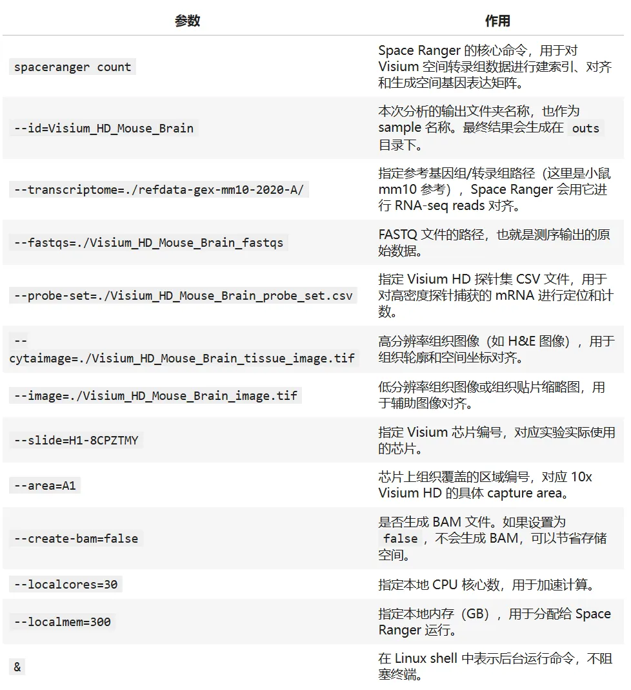
2.1.4 结果文件概况生成结果文件结构如下：

  *   *   *

```
%%bash# 查看输出结果文件夹tree -L 2 /data/04_ST_introduction/spaceranger/Visium_HD_Mouse_Brain/
```
```
/home/chenao/jupyter_home/downstream/output_files
```
```
├── binned_outputs
```
```
│   ├── square_002um
```
```
│   ├── square_008um
```
```
│   └── square_016um
```
```
├── spatial
```
```
│   ├── aligned_fiducials.jpg
```
```
│   ├── aligned_tissue_image.jpg
```
```
│   ├── cytassist_image.tiff
```
```
│   ├── detected_tissue_image.jpg
```
```
│   ├── tissue_hires_image.png
```
```
│   └── tissue_lowres_image.png
```
```
├── Visium_HD_Mouse_Brain_binned_outputs.tar.gz
```
```
├── Visium_HD_Mouse_Brain_cloupe_008um.cloupe
```
```
├── Visium_HD_Mouse_Brain_feature_slice.h5
```
```
├── Visium_HD_Mouse_Brain_metrics_summary.csv
```
```
├── Visium_HD_Mouse_Brain_molecule_info.h5
```
```
├── Visium_HD_Mouse_Brain_spatial.tar.gz
```
```
└── Visium_HD_Mouse_Brain_web_summary.html
```
```
  5 directories, 13 files
```

可以从summary文件中获取基本结果信息，用于评判数据基本质量

基本概况：

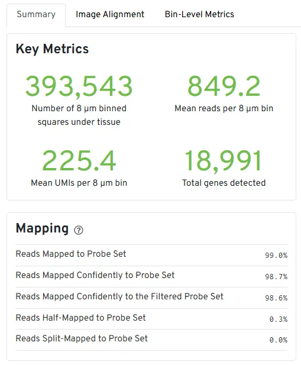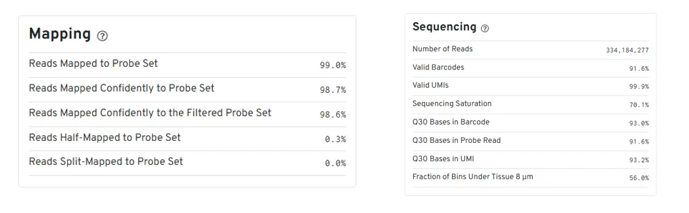

当然也提供了csv直接读取相应数据

  *   *

```
%%bash  head/data/04_ST_introduction/spaceranger/Visium_HD_Mouse_Brain/Visium_HD_Mouse_Brain_metrics_summary.csv
```
```
Sample ID,Number of Reads,Valid Barcodes,Valid UMIs,Sequencing Saturation,Q30 Bases in Barcode,Q30 Bases in Probe Read,Q30 Bases in UMI,Reads Mapped to Probe Set,Reads Mapped Confidently to Probe Set,Fraction Reads in Squares Under Tissue,Genes Detected,Reads Mapped Confidently to the Filtered Probe Set,Number of Genes,Reads Half-Mapped to Probe Set,Reads Split-Mapped to Probe Set,Estimated UMIs from Genomic DNA,Estimated UMIs from Genomic DNA per Unspliced Probe,Number of Squares Under Tissue 2 µm,Mean Reads Under Tissue per Square 2 µm,Fraction of Squares Under Tissue 2 µm,Mean Genes Under Tissue per Square 2 µm,Mean UMIs Under Tissue per Square 2 µm,Total Genes Detected Under Tissue 2 µm,Number of Bins Under Tissue 8 µm,Mean Reads Under Tissue per Bin 8 µm,Fraction of Bins Under Tissue 8 µm,Mean Genes Under Tissue per Bin 8 µm,Mean UMIs Under Tissue per Bin 8 µm,Total Genes Detected Under Tissue 8 µm,Number of Bins Under Tissue 16 µm,Mean Reads Under Tissue per Bin 16 µm,Fraction of Bins Under Tissue 16 µm,Mean Genes Under Tissue per Bin 16 µm,Mean UMIs Under Tissue per Bin 16 µm,Total Genes Detected Under Tissue 16 µm
```
```
Visium_HD_Mouse_Brain,334184277,0.916219634115222,0.9992119048736694,0.7007315415752939,0.929928272845814,0.9163983420027046,0.9316371230098888,0.9904359234710496,0.987388185830179,0.9832144290530476,18991,0.9861493842811762,19059,0.0027647081672846027,0.0002830294735859162,0.00218525223599439,5.0,6296688,53.073024580541386,0.5610771218534195,13.898829670455948,14.088088055180265,18991,393543,849.1683932886622,0.5604077784929454,201.59050726349983,225.40940888289433,18991,98917,3378.43117967589,0.5634337922431519,690.0716155969071,898.49544567669,18992
```

Space Ranger Metrics 说明

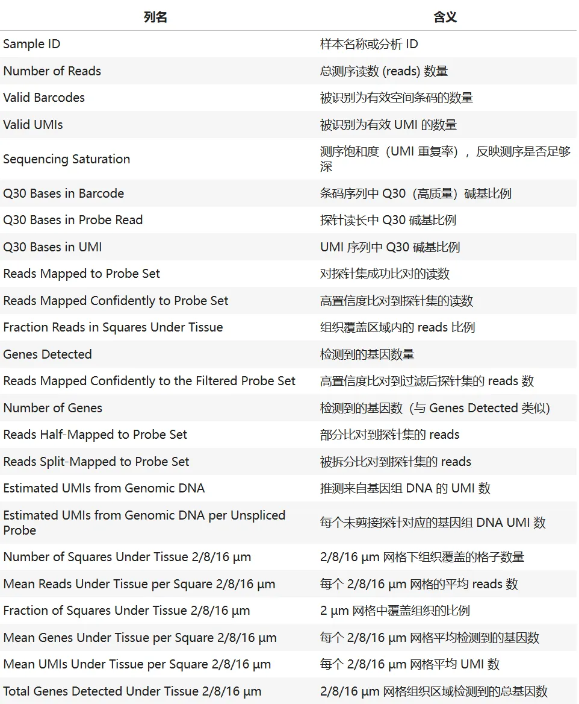

```
2.2 SeekSpace平台
```
```
2.2.1 软件安装
```

  *   *   *   *   *   *   *   *   *   *   *   *   *

```
%%bash# 下载seekspace需要分析软件seekspacetoolsmkdir seekspacetools_v1.0.0cd seekspacetools_v1.0.0wget -c -O seekspacetools_v1.0.0.tar.gz "https://seekgene-public.oss-cn-beijing.aliyuncs.com/software/seekspacetools/seekspacetools_v1.0.0.tar.gz"# 解压tar -xf seekspacetools_v1.0.0.tar.gz# 安装source ./bin/activate./bin/conda-unpack# 将软件路径添加到全局变量中export PATH=/data/04_ST_introduction/seekspace/seekspacetools_v1.0.0/bin:$PATHsource ~/.bashrc
```
```
2.2.2 下载示例数据
```

这里我们下载官网提供的小鼠大脑demo数据

  *   *   *   *   *   *   *   *   *   *   *   *

```
%%bash# 存放demo数据mkdir -p /data/04_ST_introduction/seekspace/datacd /data/04_ST_introduction/seekspace/data# 下载测试数据wget-c-O demo.tar "https://seekgene-public.oss-cn-beijing.aliyuncs.com/software/data/demodata/space/demo.tar"# decompresstar -xf demo.tar# 下载参考基因组文件wget-c-O mm10.tar.gz "https://seekgene-public.oss-cn-beijing.aliyuncs.com/software/data/reference/mm10.tar.gz"# 解压缩tar -zxvf mm10.tar.gz
```
```
2.2.3 参考基因组构建（兼容10X genomics格式）
```

  *   *   *   *   *   *   *   *   *   *   *   *   *   *   *   *   *   *   *   *   *   *   *

```
# 这里我们同样走一遍参考基因组文件的构建流程# seekspacetool支持兼容10X的cellranger构建的参考基因组# cellranger mkgtf Homo_sapiens.GRCh38.ensembl.gtf Homo_sapiens.GRCh38.ensembl.filtered.gtf \#    --attribute=gene_biotype:protein_coding \#    --attribute=gene_biotype:lncRNA \#    --attribute=gene_biotype:antisense \#    --attribute=gene_biotype:IG_LV_gene \#    --attribute=gene_biotype:IG_V_gene \#    --attribute=gene_biotype:IG_V_pseudogene \#    --attribute=gene_biotype:IG_D_gene \#    --attribute=gene_biotype:IG_J_gene \#    --attribute=gene_biotype:IG_J_pseudogene \#    --attribute=gene_biotype:IG_C_gene \#    --attribute=gene_biotype:IG_C_pseudogene \#    --attribute=gene_biotype:TR_V_gene \#    --attribute=gene_biotype:TR_V_pseudogene \#    --attribute=gene_biotype:TR_D_gene \#    --attribute=gene_biotype:TR_J_gene \#    --attribute=gene_biotype:TR_J_pseudogene \#    --attribute=gene_biotype:TR_C_gene#cellranger mkref --genome=GRCh38 --fasta=GRCh38.fa --genes=GRCh38-filtered-ensembl.gtf#cd GRCh38/genes#gunzip -dc genes.gtf.gz > genes.gtf
```

  *   *   *   *   *   *   *   *   *   *

```
%%bash# 如果只使用 seekspace构建 则运行：/demo/seekspacetools_v1.0.0/bin/STAR \  --runMode genomeGenerate \  --runThreadN16 \  --genomeDir /path/to/star \  --genomeFastaFiles /path/to/genome.fa \  --sjdbGTFfile /path/to/genome.gtf \  --sjdbOverhang149 \  --limitGenomeGenerateRAM17179869184
```

参数说明

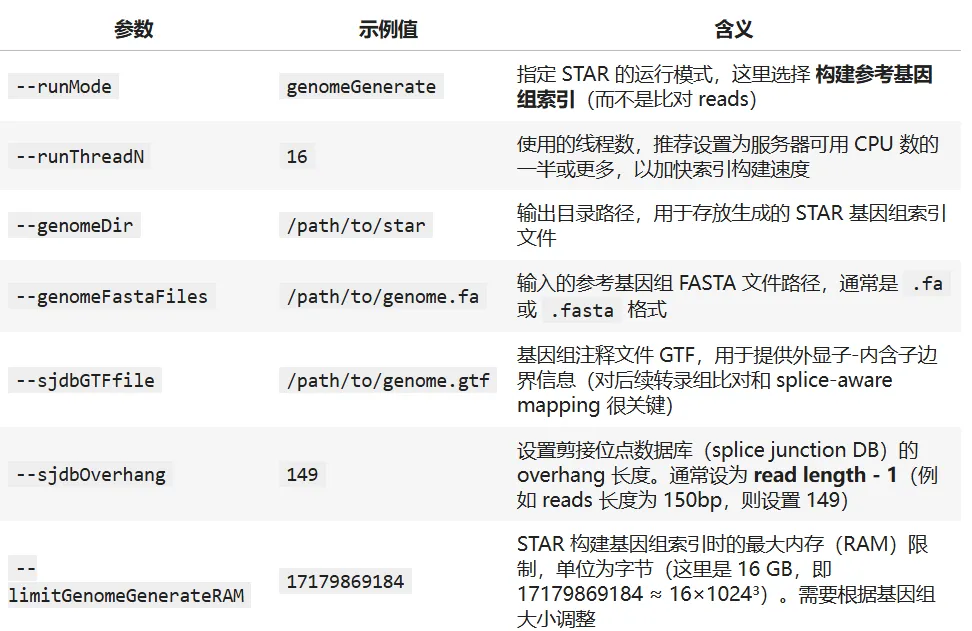

2.2.4 [定量](<https://mp.weixin.qq.com/s?__biz=MzAwMzIzOTk5OQ==&mid=2247533676&idx=1&sn=68dc75c55e05eabcfbdb29f46b112a0a&scene=21#wechat_redirect>)

示例1：基本用法

为分析设置必要的配置文件，包括样本数据的路径、试剂类型、基因组索引、GTF等。使用以下命令运行SeekSpace® Tools：

  *   *   *   *   *   *   *   *   *   *   *   *   *   *   *   *   *   *

```
%%bashseekspacetools run \    --fq1 /data/04_ST_introduction/data/seekspace/demo/demo_expression_S8_L007_R1_001.fastq.gz \    --fq2 /data/04_ST_introduction/data/seekspace/demo/demo_expression_S8_L007_R2_001.fastq.gz \    --spatialfq1 /data/04_ST_introduction/data/seekspace/demo/demo_spatial_S7_L007_R1_001.fastq.gz \    --spatialfq2 /data/04_ST_introduction/data/seekspace/demo/demo_spatial_S7_L007_R2_001.fastq.gz \    --hdmifq /data/04_ST_introduction/data/seekspace/demo/2P231224030A4.fq.gz \    --samplename demo \    --outdir /data/04_ST_introduction/data/seekspace/demo/outdir \    --genomeDir /home/data/04_ST_introduction/data/seekspace/mm10/star \    --gtf /home/data/04_ST_introduction/data/seekspace/mm10/genes/genes.gtf \    --chemistry DDVS \    --core 10 \    --include-introns \    --forceCell 80000 \    --min_umi 200 \    --chip_id 2P231224030A4 \    --DAPI/data/04_ST_introduction/data/seekspace/demo/2P231224030A4.tif &
```

参数说明：

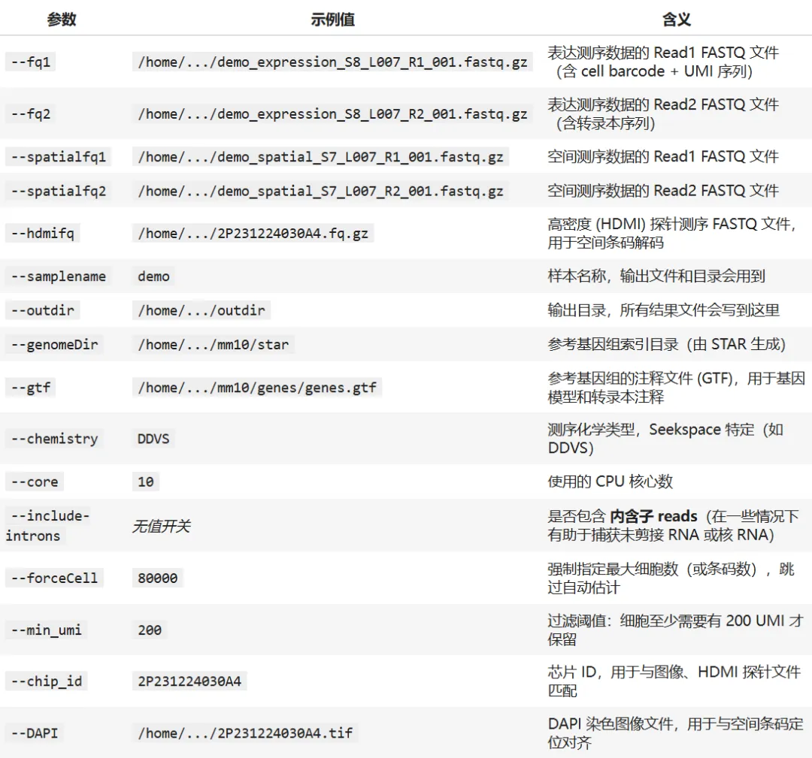

  *   *   *   *   *   *   *   *   *   *   *   *   *   *   *

```
=== Seekspace run started at Tue 19 Aug 2025 08:49:38 AM UTC ===2025-08-19 08:49:47.275 | INFO     | seekspacetools.utils.preflight:preflight_check:8 - start preflight check!2025-08-19 08:49:47.276 | INFO     | seekspacetools.utils.preflight:preflight_check:13 - check RNA library2025-08-19 08:49:47.276 | INFO     | seekspacetools.utils.wrappers:cmd_execute:39 - zcat "./jupyter_home/seekspace/data/demo/demo_expression_S8_L007_R1_001.fastq.gz"|head -n 400000|gzip > ./jupyter_home/seekspace/data/outdir/Analysis/.PREFLIGHT_CHECK/.test/data/demo_expression_S8_L007_R1_001.fastq.gz2025-08-19 08:49:49.456 | INFO     | seekspacetools.utils.wrappers:cmd_execute:39 - zcat "./jupyter_home/seekspace/data/demo/demo_expression_S8_L007_R2_001.fastq.gz"|head -n 400000|gzip > ./jupyter_home/seekspace/data/outdir/Analysis/.PREFLIGHT_CHECK/.test/data/demo_expression_S8_L007_R2_001.fastq.gz2025-08-19 08:49:51.073 | INFO     | seekspacetools.utils.barcode:chemistry_auto:133 - test DDVS!2025-08-19 08:49:51.074 | INFO     | seekspacetools.utils.barcode:barcode_main:406 - extract barcode start!2025-08-19 08:49:51.859 | INFO     | seekspacetools.utils.barcode:barcode_main:417 - barcode one base mismatch allowed.2025-08-19 08:49:51.859 | INFO     | seekspacetools.utils.barcode:barcode_main:428 - rescue barcode match multi barcode in whitelist.2025-08-19 08:50:05.002 | INFO     | seekspacetools.utils.barcode:barcode_main:472 - deal multi start!2025-08-19 08:50:05.063 | INFO     | seekspacetools.utils.barcode:barcode_main:524 - deal multi done!2025-08-19 08:50:05.068 | INFO     | seekspacetools.utils.barcode:barcode_main:528 - extract barcode done!2025-08-19 08:50:05.200 | INFO     | seekspacetools.utils.barcode:chemistry_auto:138 - valid barcode rate of DDVS: 93.045%2025-08-19 08:50:05.200 | INFO     | seekspacetools.utils.wrappers:cmd_execute:36 - STAR --runThreadN 1 --limitOutSJcollapsed 5000000 --readMapNumber -1 --genomeDir ./jupyter_home/seekspace/data/mm10/star --readFilesCommand zcat --outFileNamePrefix ./jupyter_home/seekspace/data/outdir/Analysis/.PREFLIGHT_CHECK/.test/test_1M_ --outSAMtype BAM Unsorted --readFilesIn ./jupyter_home/seekspace/data/outdir/Analysis/.PREFLIGHT_CHECK/.test/DDVS/step1/DDVS_2.fq.gz2025-08-19 08:50:21.509 | INFO     | seekspacetools.utils.barcode:mapping_report:45 -
```
```
生成这样的输出文件就说明我们已经运行成功了(这里如果java高于openjdk10可能会导致qc过程报错，如果需要请保证java环境低于该版本)
```

2.2.5 结果文件概况

检查一下生成的目录

  *

```
!tree -L3  /data/04_ST_introduction/data/seekspace/demo/outdir
```
```
/home/chenao/jupyter_home/seekspace/data/outdir
```
```
├── Analysis
```
```
│   ├── scRNA-seq_Analysis
```
```
│   │   ├── demo_summary.csv
```
```
│   │   ├── demo_summary.json
```
```
│   │   ├── step1
```
```
│   │   ├── step2
```
```
│   │   └── step3
```
```
│   ├── Spatial_Positioning
```
```
│   │   ├── demo_cell_locations.csv
```
```
│   │   ├── demo_spatial_barcode_counts.csv.gz
```
```
│   │   ├── demo_spatial_summary.csv
```
```
│   │   ├── demo_spatial_umis_cleaned.csv.gz
```
```
│   │   ├── demo_spatial_umis.csv.gz
```
```
│   │   └── demo_valid_spatial_umis.csv.gz
```
```
│   └── Tissue_Detection
```
```
│       ├── demo_aligned_DAPI.png
```
```
│       ├── demo_bc_under_tissue.csv
```
```
│       └── demo_processed_DAPI.png
```
```
└── Outs
```
```
     ├── clustering
```
```
     │   ├── demo.rds
```
```
     │   ├── FeatureScatter.png
```
```
     │   ├── FindAllMarkers.xls
```
```
     │   ├── mito_quantile.xls
```
```
     │   ├── nCount_quantile.xls
```
```
     │   ├── nFeature_quantile.xls
```
```
     │   ├── resolution.xls
```
```
     │   ├── top10_heatmap.png
```
```
     │   ├── tsne.png
```
```
     │   ├── tsne_umi.png
```
```
     │   ├── tsne_umi.xls
```
```
     │   ├── umap.png
```
```
     │   └── VlnPlot.png
```
```
     ├── demo_aligned_DAPI.png
```
```
     ├── demo_filtered_feature_bc_matrix
```
```
     │   ├── barcodes.tsv.gz
```
```
     │   ├── cell_locations.tsv.gz
```
```
     │   ├── features.tsv.gz
```
```
     │   └── matrix.mtx.gz
```
```
     ├── demo_report.html
```
```
     ├── demo_summary.csv
```
```
     └── demo_zarr
```
```
         ├── images
```
```
         ├── shapes
```
```
         ├── tables
```
```
         └── zmetadata
```
```
14 directories, 32 files
```

seekspace定量结果如上

也提供了html和csv文件供我们查询定量结果质量

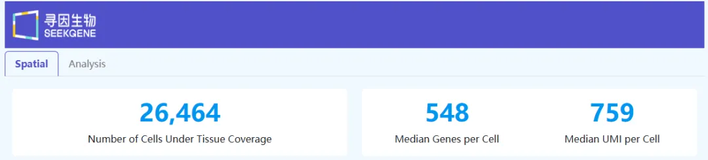

总体共检测到26，464个cell，细胞检测基因中位数为548，平均UMI为759

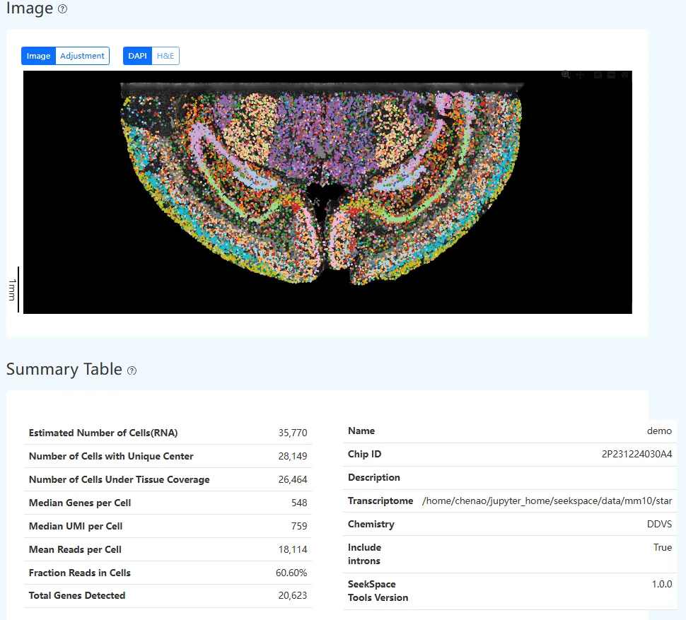

Summary Table 指标解释

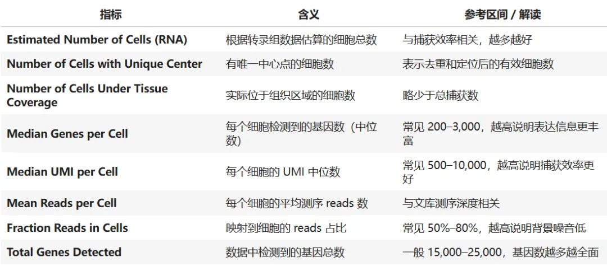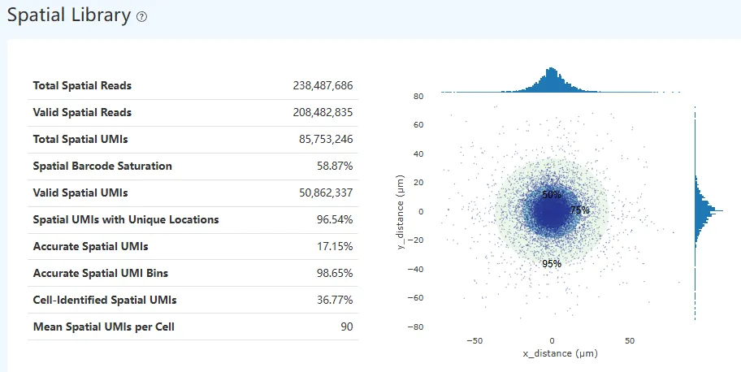

Spatial Library 指标解释

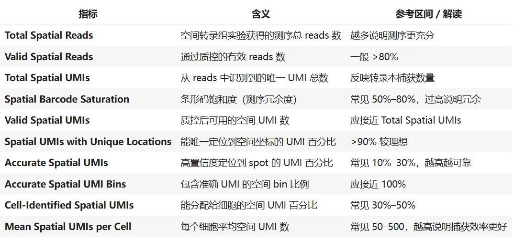

同样这些数据也可以通过 /Outs/demo_summary.csv 获取

  *   *

```
%%bashhead -n 5 /data/04_ST_introduction/seekspace/outdir/Outs/demo_summary.csv | cut -d',' -f1-5
```
```
Samplename,Estimated_Number_of_Cells_rna,Number_of_Cells_with_Unique_Center,Number_of_Cells_Under_Tissue_Coverage,Median_Genes_per_Cell demo,35770,28149,26464,548
```

2.2.6 读取为[Anndata](<https://mp.weixin.qq.com/s?__biz=MzAwMzIzOTk5OQ==&mid=2247528513&idx=1&sn=1ff1b8bee321f8f5bcac425ce96dc6ff&scene=21#wechat_redirect>)对象

  *   *   *   *   *   *

```
# 加载基础库import scanpy as scimport pandas as pdimport osimport matplotlib.pyplot as pltplt.rcdefaults()
```

  *   *   *   *   *   *   *   *

```
data_dir = "/data/04_ST_introduction/seekspace/outdir/Outs/demo_filtered_feature_bc_matrix/"  # 修改为你的路径# 可以直接使用scanpy的read_10x_mtx读取表达矩阵adata = sc.read_10x_mtx(    data_dir,                   var_names='gene_symbols',      cache=True)print(adata)
```
```
AnnData object with n_obs × n_vars = 26464 × 28158
```
```
     var: 'gene_ids', 'feature_types'
```

  *

```
adata.obs
```

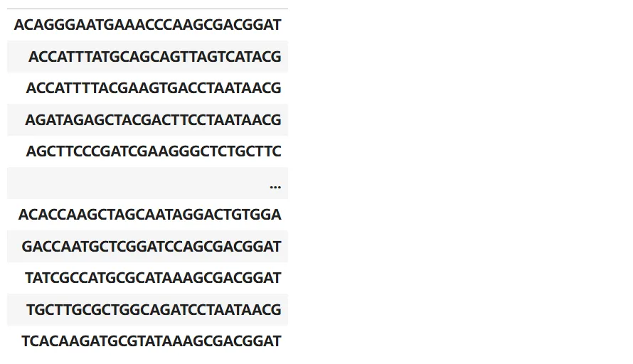
```
26464 rows × 0 columns
```

  *

```
adata.var
```

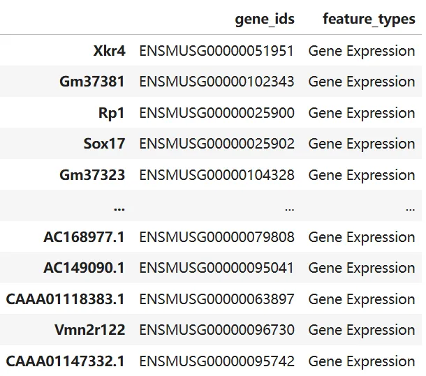
```
28158 rows × 2 columns
```

  *   *   *   *   *

```
# 读取空间坐标(存在cell_locations.tsv.gz中)loc = pd.read_csv(os.path.join(data_dir, "cell_locations.tsv.gz"),                  sep='\t', index_col=0)print(loc.head())print(loc.columns)
```
```
                                                               X         Y
```
```
Cell_Barcode
```
```
AAACCCAATGAAACCATAAGGCACTAT   21787  16874
```
```
AAACCCAATGAAACCATGGACTGTGGA  32707  10284
```
```
AAACCCAATGCCGAGTGAAGGCACTAT  22737   9885
```
```
AAACCCAATGCCGAGTGGCTCTGCTTC   37394   7228
```
```
AAACCCAATGCCGAGTGTAGTCATACG   20748  11338
```
```
Index(['X', 'Y'], dtype='object')
```

  *   *

```
# 对齐 obsloc = loc.loc[adata.obs_names, ['X','Y']]
```

  *   *

```
# 添加到 AnnDataadata.obs = adata.obs.join(loc)
```

  *   *

```
# 添加到 AnnDataadata.obs = adata.obs.join(loc)
```

  *

```
adata
```
```
AnnData object with n_obs × n_vars = 26464 × 28158
```
```
     obs: 'X', 'Y'
```
```
     var: 'gene_ids', 'feature_types'
```

可以用于后续空间转录组分析

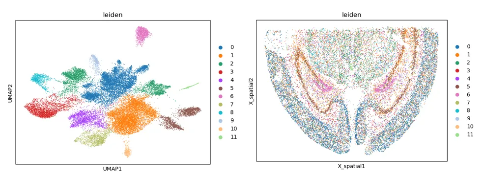

2.3[Stereo-seq](<https://mp.weixin.qq.com/s?__biz=MzAwMzIzOTk5OQ==&mid=2247505686&idx=2&sn=925ce770136ec3e964b954c639eed29e&scene=21&poc_token=HKmsw2mjzWoWPjGiyFow_qQH3qySDBWd99fqWIk_&token=106440264&lang=zh_CN#wechat_redirect>)平台

2.3.1 [软件下载与安装](<https://mp.weixin.qq.com/s?__biz=MzAwMzIzOTk5OQ==&mid=2247528611&idx=1&sn=f7cbe919af6b8ff9924962967bb0d1a5&scene=21#wechat_redirect>)

  *   *   *   *   *   *   *

```
%%bash##wtih curlcurl -o saw-8.1.3.tar.gz "https://cdn-newfile.stomics.tech/saw-8.1.3.tar.gz"##or with wgetwget -O saw-8.1.3.tar.gz "https://cdn-newfile.stomics.tech/saw-8.1.3.tar.gz"##参考基因组下载wget -c ftp://ftp2.cngb.org/pub/stomics/STT0000124/supp/reference-data-mouse.tar.gz
```

  *   *   *

```
## 解压cd /saw/packagetar -xzf saw-8.1.3.tar.gz
```

2.3.2 [构建参考基因组（非模式动物）](<https://mp.weixin.qq.com/s?__biz=MzAwMzIzOTk5OQ==&mid=2247528411&idx=1&sn=efa4ace804c343379073dea63de64b4e&scene=21#wechat_redirect>)

  *   *   *   *   *   *   *

```
%%bashcd /data/04_ST_introduction/saw/datasets/referencesaw makeRef \    --mode=STAR \    --fasta=/path/to/FASTA1 \    --gtf=/path/to/GTF/or/GFF \    --genome=./transcriptome
```

SAW makeRef 参数说明

参数| 示例值| 含义
---|---|---
`--mode`| `STAR`| 选择构建索引的方式，通常使用 `STAR` 作为比对器
`--fasta`| `/path/to/FASTA`| 参考基因组序列文件（FASTA 格式）
`--gtf`| `/path/to/GTF/or/GFF`| 基因注释文件（GTF 或 GFF 格式），包含基因坐标和功能注释
`--genome`| `./transcriptome`| 指定输出索引的目录或名称，用于后续比对

  *   *   *   *   *   *   *   *

```
%%bash# 如果不关注细胞中的rRNA信息，也可以选择去除rRNA   --rRNA-FASTA 参数来指定 rRNA 信息，将添加其到参考基因组 --fasta 中saw makeRef \    --mode=STAR \    --fasta=/path/to/FASTA \    --gtf=/path/to/GTF/or/GFF \    --rRNA-fasta=/path/to/rRNA/FASTA \    --genome=./transcriptome_with_rRNA
```

2.3.3 [定量](<https://mp.weixin.qq.com/s?__biz=MzAwMzIzOTk5OQ==&mid=2247528611&idx=2&sn=af1605fbace7975e1e6bfab88f5425a0&scene=21#wechat_redirect>)

SAW count 是分析软件包的核心部分，支持处理绝大部分的 Stereo-seq FF，Stereo-seq FFPE 和 Stereo-CITE FF 的数据。输入文集包括芯片 mask 文件、测序 FASTQ 、参考基因组和显微镜图像，输出空间特征表达矩阵和下游分析结果

根据时空试剂盒产品线的不同，运行分析所需的参数设置也有所区别。在开始分析任务之前，需要注意产品试剂盒的版本信息，选择一个合适的，这里我们以Stereo-seq Chip T为例，其他示例可以参考

https://www.stomics.tech/service/saw_8_1/docs/analysis/pipelines/count

Stereo-seq Kit 版本与测序类型：

Stereo-seq Solution| Stereo-seq Kit Version| \--kit-version| \--sequencing-type
---|---|---|---
Transcriptomics Solution| V1.2.1| Stereo-seq T FF V1.2| PE100_50+100
Transcriptomics mIF Solution| V1.2| Stereo-seq T FF V1.2| PE100_50+100
Transcriptomics H&E Solution| V1.2.1| Stereo-seq T FF V1.2| PE100_50+100
Transcriptomics Mini Chip Solution| V1.2| Stereo-seq T FF V1.2| PE100_50+100
Large Chip Designs| V1.0| Stereo-seq T FF V1.2| PE100_50+100
Transcriptomics Solution| V1.3| Stereo-seq T FF V1.3| PE75_50+100
Transcriptomics mIF Solution| V1.3| Stereo-seq T FF V1.3| PE75_50+100
Transcriptomics H&E Solution| V1.3| Stereo-seq T FF V1.3| PE75_50+100
Transcriptomics Mini Chip Solution| V1.3| Stereo-seq T FF V1.3| PE75_50+100
Large Chip Designs| V1.3| Stereo-seq T FF V1.3| PE75_50+100

(1) 输入文件

SAW count 分析流程需要输入以下文件：

  * Stereo-seq Chip T 芯片 mask 文件 (--mask)
  * 时空测序 FASTQ 数据 (--fastqs)
  * 显微镜图像支持TIFF或 StereoMap QC模块输出的图像.tar.gz文件
    * image参数支持直接输入显微镜拼接大图TIFF
    * image-tar参数支持输入 StereoMap QC模块输出的图像.tar.gz文件
  * Reference 包含物种的参考基因组 (FASTA) 和注释文件 (GTF/GFF) (--reference)
    * 参考基因组的索引文件需要预先构建，可使用 SAW makeRef
    * 分析流程会自动对注释文件的格式进行检查，也可以单独调用 SAW checkGTF 进行格式检查

(2) 运行

使用 Stereo-seq FF 样本的测序数据进行基因比对和注释，输出空间特征表达矩阵，基于显微镜拍照图像，标准流程调用自动配准、组织分割、细胞分割和细胞修正算法对图像进行处理，结合表达矩阵数据和图像结果进行分析，使用下面的代码命令行开启SAW count分析：

如果是QC失败的图像数据，SAW count将不会在标准分析过程中调用图像算法，仅基于表达矩阵数据进行组织区域的识别。

  *   *   *   *   *   *   *   *   *   *   *   *   *   *

```
%% bashcd /data/04_ST_introduction/data/saw/runssaw count \        --id="Demo" \    --sn="C04042E3" \     --omics=transcriptomics \    --kit-version="Stereo-seq T FF V1.3" \    --sequencing-type="PE75_50+100" \    --chip-mask="/data/04_ST_introduction/saw/data/pos/C03937C4.barcodeToPos.h5" \    --organism="Mouse" \    --tissue="brain" \    --fastqs=/data/04_ST_introduction/saw/data/reads/L01,/data/04_ST_introduction/saw/data/reads/L02,/data/04_ST_introduction/saw/data/reads/L03,/data/04_ST_introduction/saw/data/reads/L04 \    --reference=/data/04_ST_introduction/saw/Mus_musculus_index \    --image-tar=/data/04_ST_introduction/saw/data/supp/C03937C4_SC_20250317_200459_4.0.1.tar.gz
```

saw count 参数说明

参数| 示例值| 含义
---|---|---
`--id`| `"Demo"`| 本次分析的运行 ID，用于区分不同项目或任务
`--sn`| `"C04042E3"`| 芯片编号 (Serial Number)，用于和实验设计、组织切片对应
`--omics`| `transcriptomics`| 分析的组学类型，Stereo-seq 目前主要是转录组 (transcriptomics)
`--kit-version`| `"Stereo-seq T FF V1.3"`| 使用的试剂盒版本，需要与实验匹配
`--sequencing-type`| `"PE75_50+100"`| 测序类型，表示双端测序模式：Read1=75bp，Index=50bp，Read2=100bp
`--chip-mask`| `./data/pos/C03937C4.barcodeToPos.h5`| 芯片掩码文件，包含条码与空间位置的对应关系
`--organism`| `"Mouse"`| 物种信息，用于选择参考基因组
`--tissue`| `"brain"`| 样本组织类型（脑组织），主要用于记录和结果标注
`--fastqs`| `./data/reads/L01,./data/reads/L02,./data/reads/L03,./data/reads/L04`| 输入的测序数据 FASTQ 文件路径，可以写多个 lane（逗号分隔）
`--reference`| `./jupyter_home/saw/Mus_musculus_index`| 参考基因组索引（由 `saw makeRef` 生成）
`--image-tar`| `./jupyter_home/saw/data/supp/C03937C4_SC_20250317_200459_4.0.1.tar.gz`| 图像文件（压缩包），包含组织切片的显微镜图像和配套信息，用于和空间条码对齐

小结：

核心输入：--fastqs (测序数据)，--reference(参考基因组)，--chip-mask (条码位置信息)，--image-tar (组织图像)。

元信息：--id, --sn, --organism, --tissue

实验参数：--kit-version, --sequencing-type

2.3.4 结果文件概况

  *   *   *

```
%%bash# 检查生成文件目录tree -L 3 /data/04_ST_introduction/saw/Demo/outs
```
```
/home/chenao/jupyter_home/saw/Demo/outs
```
```
├── analysis
```
```
│   ├─��� C03937C4.bin20_1.0.h5ad
```
```
│   ├── C03937C4.bin20_1.0.marker_features.csv
```
```
│   ├─�� C03937C4.bin50_1.0.h5ad
```
```
│   ├── C03937C4.bin50_1.0.marker_features.csv
```
```
│   ├── C03937C4.cellbin_1.0.adjusted.h5ad
```
```
│   ├── C03937C4.cellbin_1.0.adjusted.marker_features.csv
```
```
│   ├── C03937C4.cellbin_1.0.h5ad
```
```
│   └── C03937C4.cellbin_1.0.marker_features.csv
```
```
├── bam
```
```
│   └── annotated_bam
```
```
│       ├── C03937C4.Aligned.sortedByCoord.out.merge.q10.dedup.target.bam
```
```
│       └── C03937C4.Aligned.sortedByCoord.out.merge.q10.dedup.target.bam.csi
```
```
├── C03937C4.report.html
```
```
├── feature_expression
```
```
│   ├── C03937C4.adjusted.cellbin.gef
```
```
│   ├── C03937C4.cellbin.gef
```
```
│   ├── C03937C4.merge.barcodeReadsCount.txt
```
```
│   ├── C03937C4_raw_barcode_gene_exp.txt
```
```
│   ├── C03937C4.raw.gef
```
```
│   └── C03937C4.tissue.gef
```
```
├── image
```
```
│   ├── C03937C4_DAPI_mask_edm_dis_10.tif
```
```
│   ├─��� C03937C4_DAPI_mask.tif
```
```
│   ├── C03937C4_DAPI_regist.tif
```
```
│   ├── C03937C4_DAPI_tissue_cut.tif
```
```
│   ├── C03937C4_NeuN_IF_mask.tif
```
```
│   ├── C03937C4_NeuN_IF_regist.tif
```
```
│   ├── C03937C4_NeuN_IF_tissue_cut.tif
```
```
│   ├── C03937C4_SMI32_IF_mask.tif
```
```
│   ├── C03937C4_SMI32_IF_regist.tif
```
```
│   └── C03937C4_SMI32_IF_tissue_cut.tif
```
```
├── visualization.tar.gz
```
```
└── visualization.tar.gz.md5
```
```
5 directories, 29 files
```

同样可以通过 HTML 查看空间转录组数据质量

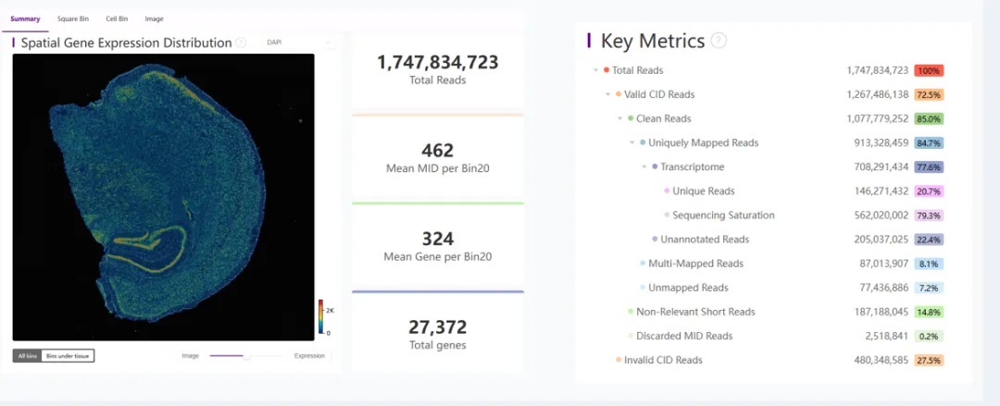

结果参数解读：

指标| 示例值| 占比| 含义
---|---|---|---
**Total Reads**|  1,747,834,723| 100%| 总测序 reads 数
**Valid CID Reads**|  1,267,486,138| 72.5%| 含有有效空间条码 (CID, Coordinate ID) 的 reads，能定位到芯片坐标
**Invalid CID Reads**|  480,348,585| 27.5%| 空间条码无效或无法识别的 reads
**Clean Reads**|  1,077,779,252| 85.0%| 去除低质量和无效条码后的有效 reads
**Uniquely Mapped Reads**|  913,328,459| 84.7%| 能唯一比对到参考基因组的 reads
**Transcriptome**|  708,291,434| 77.6%| 落在注释基因转录本区域的 reads
├─ Unique Reads| 146,271,432| 20.7%| 对应唯一基因的 reads（非冗余 UMI 计数，反映真实转录水平）
└─ Sequencing Saturation| 562,020,002| 79.3%| 已达到的测序饱和度，越高表示重复测序贡献有限
**Unannotated Reads**|  205,037,025| 22.4%| 能比对到基因组但未落在已知注释区域的 reads
**Multi-Mapped Reads**|  87,013,907| 8.1%| 同时比对到多个位置的 reads，通常无法确定唯一来源
**Unmapped Reads**|  77,436,886| 7.2%| 完全无法比对到参考基因组的 reads
**Non-Relevant Short Reads**|  187,188,045| 14.8%| 长度过短、无生物学意义的 reads，被过滤掉
**Discarded MID Reads**|  2,518,841| 0.2%| 无效的分子标签 (MID) reads，被丢弃

总结：

关键关注指标：

  * Valid CID Reads（空间条码有效率，72.5%）

  * Uniquely Mapped Reads（唯一比对率，84.7%）

  * Transcriptome Reads（转录组比对率，77.6%）

  * Sequencing Saturation（测序饱和度，79.3%）

(1) 不同大小 Bin 统计信息

把空间位点聚合成不同大小的 bin（类似 20×20、50×50、200×200 个 spot），然后统计每个 bin 的测序特征

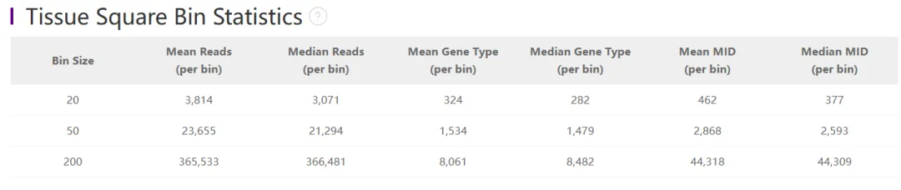指标| 含义| 计算方式| 说明
---|---|---|---
**Bin Size**|  Bin 的边长（以 DNB 数量为单位）| 例如 Bin50 = 50×50 DNBs| Bin 越小 → 分辨率高，信号弱；Bin 越大 → 分辨率低，信号强
**Mean Reads (per bin)**|  每个 bin 的平均测序 reads 数| 总 reads ÷ bin 数量| 反映总体测序深度
**Median Reads (per bin)**|  每个 bin 的测序 reads 中位数| 所有 bin reads 排序后取中位值| 代表典型 bin 的 reads 水平，避免极端值干扰
**Mean Gene Type (per bin)**|  每个 bin 平均检测到的基因种类数| 总基因种类数 ÷ bin 数量| 衡量每个 bin 的基因覆盖度
**Median Gene Type (per bin)**|  每个 bin 基因种类数的中位数| 所有 bin 基因数排序后取中位值| 更稳健地反映典型 bin 的检测能力
**Mean MID (per bin)**|  每个 bin 平均的去重分子数（UMI 数）| 总 UMI 数 ÷ bin 数量| 衡量真实转录本的捕获能力
**Median MID (per bin)**|  每个 bin 的 UMI 数中位数| 所有 bin UMI 数排序后取中位值| 代表典型 bin 的转录本捕获水平

(2) Cell Bin 统计信息

cell bin（细胞级别的空间单位）不是直接测出来的，而是通过 后处理算法 从 bin 数据里推断出来的

获得 cell bin 的常见流程

1.固定 bin size 的初始分辨率

  * 一般用 20×20、50×50 或 200×200 的 DNB bin 作为基础统计单位。

  * 例如你看到的 Bin Size 20/50/200 就是空间分辨率不同的统计结果。

2.基因表达矩阵构建

  * 每个 bin 都会有一个表达 profile（基因 × bin 的矩阵）。

  * 高分辨率 bin（如 20）有更细粒度的空间信息，但噪声更大。大 bin（如 200）更平滑，但可能跨越多个细胞。

3.细胞区域识别 (Cell Segmentation)

  * 通过组织切片图像（HE/IF 染色图）配合基因表达分布，使用图像算法或机器学习（如 U-Net、watershed、Cellpose）识别出细胞边界。

  * 对应到坐标系上，把哪些 bin 属于同一个细胞区域。

4.生成 cell bin 表达矩阵

  * 将属于同一细胞区域的 bin 合并（通常是加和或UMI计数合并），得到一个 cell × gene 的表达矩阵。

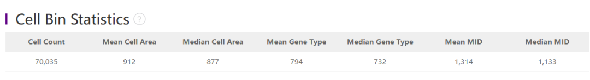

2.3.5 读取为Anndata对象

  *   *   *   *

```
import stereo as stimport warningsimport matplotlib.pyplotas pltplt.rcdefaults()
```

  *   *   *   *   *   *   *

```
data_path = '/data/04_ST_introduction/saw/Demo/outs/feature_expression/C03937C4.cellbin.gef'# 这里视情况设置bin大小data = st.io.read_gef(        file_path=data_path,        is_sparse=True,        bin_type='cell_bins',        )
```
```
[2025-09-26 01:55:48][Stereo][3734767][MainThread][139774559557440][reader][956][INFO]: read_gef begin ...
```
```
version is 1.1.22
```
```
[2025-09-26 01:55:52][Stereo][3734767][MainThread][139774559557440][reader][993][INFO]: the matrix has 70026 cells, and 27372 genes.
```
```
[2025-09-26 01:55:53][Stereo][3734767][MainThread][139774559557440][reader][1116][INFO]: This is GEF file which contains cell bin infomation.
```
```
[2025-09-26 01:55:53][Stereo][3734767][MainThread][139774559557440][reader][1117][INFO]: bin_type: cell_bins
```
```
[2025-09-26 01:55:53][Stereo][3734767][MainThread][139774559557440][reader][1123][INFO]: Number of cells: 70026
```
```
[2025-09-26 01:55:53][Stereo][3734767][MainThread][139774559557440][reader][1126][INFO]: Number of gene: 27372
```
```
[2025-09-26 01:55:53][Stereo][3734767][MainThread][139774559557440][reader][1129][INFO]: Resolution: 500
```
```
[2025-09-26 01:55:53][Stereo][3734767][MainThread][139774559557440][reader][1132][INFO]: offsetX: 0
```
```
[2025-09-26 01:55:53][Stereo][3734767][MainThread][139774559557440][reader][1135][INFO]: offsetY: 0
```
```
[2025-09-26 01:55:53][Stereo][3734767][MainThread][139774559557440][reader][1138][INFO]: Average number of genes: 380.7226257324219
```
```
[2025-09-26 01:55:53][Stereo][3734767][MainThread][139774559557440][reader][1141][INFO]: Maximum number of genes: 2386
```
```
[2025-09-26 01:55:53][Stereo][3734767][MainThread][139774559557440][reader][1144][INFO]: Average expression: 576.9555053710938
```
```
[2025-09-26 01:55:53][Stereo][3734767][MainThread][139774559557440][reader][1147][INFO]: Maximum expression: 6631
```
```
[2025-09-26 01:55:53][Stereo][3734767][MainThread][139774559557440][reader][1051][INFO]: read_gef end.
```
```
version is 1.1.22
```

  *

```
data
```
```
StereoExpData object with n_cells X n_genes = 70026 X 27372
```
```
bin_type: cell_bins
```
```
offset_x = None
```
```
offset_y = None
```
```
cells: ['cell_name']
```
```
genes: ['gene_name']
```

  *

```
data.tl.cal_qc()
```
```
[2025-09-26 01:56:03][Stereo][3734767][MainThread][139774559557440][st_pipeline][37][INFO]: start to run cal_qc...
```
```
[2025-09-26 01:56:04][Stereo][3734767][MainThread][139774559557440][st_pipeline][40][INFO]: cal_qc end, consume time 0.4335s.
```

  *

```
data.plt.violin()
```

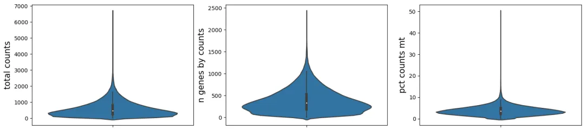

  *

```
data.plt.spatial_scatter()
```

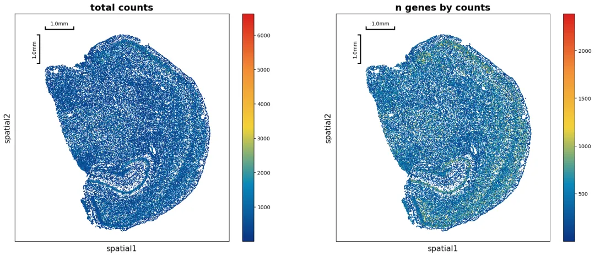

  *

```
data.tl.raw_checkpoint()
```

  *

```
adata = st.io.stereo_to_anndata(data,flavor='scanpy',output='/home/chenao/jupyter_home/saw/Demo/outs/scanpy_out.h5ad')
```
```
Variable names are not unique. To make them unique, call `.var_names_make_unique`.
```
```
Variable names are not unique. To make them unique, call `.var_names_make_unique`.
```
```
[2025-09-25 09:25:27][Stereo][999397][MainThread][139828267292480][reader][711][INFO]: Adding sample in adata.obs['orig.ident'].
```
```
[2025-09-25 09:25:27][Stereo][999397][MainThread][139828267292480][reader][714][INFO]: Adding data.position as adata.obsm['spatial'] .
```
```
[2025-09-25 09:25:27][Stereo][999397][MainThread][139828267292480][reader][719][INFO]: Adding data.position as adata.obs['x'] and adata.obs['y'] .
```
```
[2025-09-25 09:25:27][Stereo][999397][MainThread][139828267292480][reader][822][INFO]: Adding data.tl.raw.exp_matrix as adata.raw .
```
```
Variable names are not unique. To make them unique, call `.var_names_make_unique`.
```
```
[2025-09-25 09:25:27][Stereo][999397][MainThread][139828267292480][reader][855][INFO]: Finished conversion to anndata.
```
```
[2025-09-25 09:25:28][Stereo][999397][MainThread][139828267292480][reader][859][INFO]: Finished output to /home/chenao/jupyter_home/saw/Demo/outs/scanpy_out.h5ad
```

  *

```
adata
```
```
AnnData object with n_obs × n_vars = 70026 × 27372
```
```
     obs: 'total_counts', 'n_genes_by_counts', 'pct_counts_mt', 'orig.ident', 'x', 'y'
```
```
     var: 'n_cells', 'n_counts', 'mean_umi'
```
```
     uns: 'bin_type', 'bin_size', 'resolution', 'sn'
```
```
     obsm: 'spatial'
```

  *   *   *

```
# 这样就成功生成了stereo-seq的sacnpy对象anndata，可以用于下游分析# 当然也可以存为seurat对象在R中分析#adata = st.io.stereo_to_anndata(data,flavor='seurat',output='seurat_out.h5ad')
```

**三、参考**

10x Genomics官方手册：https://www.10xgenomics.com/

SeekSpacetools：https://seekspace.seekgene.com/zh/v1.0.0/index.html

SAW用户手册：https://www.stomics.tech/service/saw_8_1/docs/index.html

**四、资料领取**

本教程基于Linux环境的[jupyter](<https://mp.weixin.qq.com/s?__biz=MzAwMzIzOTk5OQ==&mid=2247531443&idx=3&sn=0930f54959a9bd13b99780d8f26a1155&scene=21#wechat_redirect>)演示，计算资源不足的同学可参考：

[足够支持你完成硕博生涯的生信环境](<https://mp.weixin.qq.com/s?__biz=MzAwMzIzOTk5OQ==&mid=2247511780&idx=1&sn=3acc0874f7d2fa75f1abbe7a9a9b4069&chksm=9b3cd7b4ac4b5ea27d4d53964e4a4a9fa8c806a19103729dd4ff0fa72e621411f46a251d269f&scene=21&token=1904068475&lang=zh_CN#wechat_redirect>)

[忘记宣传了，独享用户连技术支持都是独享的](<https://mp.weixin.qq.com/s?__biz=MzAwMzIzOTk5OQ==&mid=2247529475&idx=1&sn=10827e982a637e0fc36e4b6e857736c8&scene=21&token=1904068475&lang=zh_CN&poc_token=HF-eN2mj01zsfxe_I4r8D5pfZx80xO2AVYSB6qtT#wechat_redirect>)

访问链接：https://biomamba.xiyoucloud.net/

本推送的代码和测试文件可以在以下链接中下载：

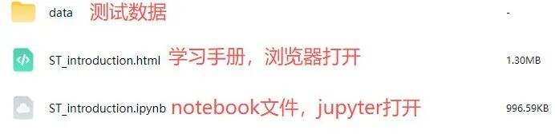

百度网盘链接: https://pan.baidu.com/s/1c0ypEEP2LVRz3mM2abtl5A

提取码请联系客服微信Biomamba_zhushou


**欢迎致谢**

如果以上内容对你有帮助，欢迎在文章的Acknowledgement中加上这一段，联系客服微信可以发放奖励：
```
Since Biomamba and his wechat public account team produce bioinformatics tutorials and share code with annotation, we thank Biomamba for their guidance in bioinformatics and data analysis for the current study.
```

**欢迎在发文/毕业时向我们分享你的喜悦~**

**已致谢文章**

[ 鼻咽癌的Bulk RNA-Seq与scRNA-Seq联合分析](<https://mp.weixin.qq.com/s?__biz=MzAwMzIzOTk5OQ==&mid=2247510548&idx=1&sn=58048c46e837b1d56dffa282272c6d96&chksm=9b3cd344ac4b5a52369e91b4e61fa0a2c951b82cc21165b99f42ba2c2191d4add803bd73c928&scene=21&cur_album_id=3425248581018714114#wechat_redirect>)

[13分+文章利用scRNA-Seq揭示地铁细颗粒物引起肺部炎症的分子机制](<https://mp.weixin.qq.com/s?__biz=MzAwMzIzOTk5OQ==&mid=2247511886&idx=1&sn=31c712d00377b0f0ed33703b5b4fbfd8&chksm=9b3cd61eac4b5f084fde14a2eb50356f2f40a66c608d38909f12a3d81f48cff029a09ce2ee8c&token=1453608870&lang=zh_CN&scene=21#wechat_redirect>)

[除了铁死亡，还有铜死亡？！](<https://mp.weixin.qq.com/s?__biz=MzAwMzIzOTk5OQ==&mid=2247518144&idx=1&sn=d036f1bb04b09eb73f53e2104d69404c&chksm=9b3cfe90ac4b77862f2f463b42132c7bfdb687a1b61d350dcf656117b1331271e179710fd4fa&scene=21&cur_album_id=3425248581018714114#wechat_redirect>)

[IF14.3| scRNA-seq+脂质组多组学分析揭示宫内生长受限导致肝损伤的性别差异](<https://mp.weixin.qq.com/s?__biz=MzAwMzIzOTk5OQ==&mid=2247520900&idx=1&sn=157134292ffc2e5df730c5ba8a357b61&chksm=9b3cebd4ac4b62c286543c30381e9b4fdb8b44b28d4fa902fb963bbd45b28e1d3f1bc98eb148&scene=21&cur_album_id=3425248581018714114#wechat_redirect>)[银屑病和脂肪肝病中共同病理和免疫特征](<https://mp.weixin.qq.com/s?__biz=MzAwMzIzOTk5OQ==&mid=2247521069&idx=1&sn=4ef441a885cb2525ee3b5c81001feddf&chksm=9b3cea7dac4b636be9f10ffdf75e13531fccae62129944b21a457db2e08c3f2db1e1b553ac34&scene=21&cur_album_id=3425248581018714114#wechat_redirect>) [《Advanced Science》新型Arf1抑制剂促进癌症干细胞衰老并增强抗肿瘤免疫](<http://mp.weixin.qq.com/s?__biz=MzAwMzIzOTk5OQ==&mid=2247522233&idx=1&sn=287a380de741ff55f0ce78dc9c727985&chksm=9b3ceee9ac4b67ffd925abafeba2cb215a5984e6dc85f0d8607340a07ec9208f1d19eae0e04b&scene=21#wechat_redirect>)

[scRNA-seq揭示脓毒症预后水平预测的关键靶点！](<http://mp.weixin.qq.com/s?__biz=MzAwMzIzOTk5OQ==&mid=2247522281&idx=1&sn=f95eb12fdc340b8da1123ec6253e6fac&chksm=9b3ceeb9ac4b67afa587e5fa3a2a8960e9bb28a1ad6dc48e49120a76154417a4c8be95af90b0&scene=21#wechat_redirect>)

[机器学习+生信多组学联合构建牙周炎"线粒体功能障碍与免疫微环境"关联网络](<https://mp.weixin.qq.com/s?__biz=MzAwMzIzOTk5OQ==&mid=2247527168&idx=1&sn=0791d2bf53a9a60015577f892b10d370&scene=21#wechat_redirect>)

[KIF18A在肝细胞癌转移中的双重角色](<https://mp.weixin.qq.com/s?__biz=MzAwMzIzOTk5OQ==&mid=2247528014&idx=1&sn=d285c9ebd415be328fc682d00e6182c0&scene=21#wechat_redirect>)

[bulk+scRNA-seq挖掘BCL2-MAPK14-TXN氧化应激诊断模型，鉴定脓毒症中氧化应激关键基因](<https://mp.weixin.qq.com/s?__biz=MzAwMzIzOTk5OQ==&mid=2247530000&idx=1&sn=e8ddca4e1b2e60839cdf2a7fe87b3dfe&chksm=9b3c0f40ac4b86562e0e307b9dbb8688159e72b3c19d9ceebf8a4bb2e21638896f005b497b11&scene=21&cur_album_id=3425248581018714114&search_click_id=#wechat_redirect>)

[致谢文章+1，中科院1区，scRNA-seq揭示麻黄-甘草配对治疗呼吸系统症状和多(I:C)诱发肺炎模型机制](<https://mp.weixin.qq.com/s?__biz=MzAwMzIzOTk5OQ==&mid=2247536407&idx=1&sn=4da88e13f112662a02fea89d1b7798e9&scene=21#wechat_redirect>)

向下滑动查看更多

欢迎大家致谢~


