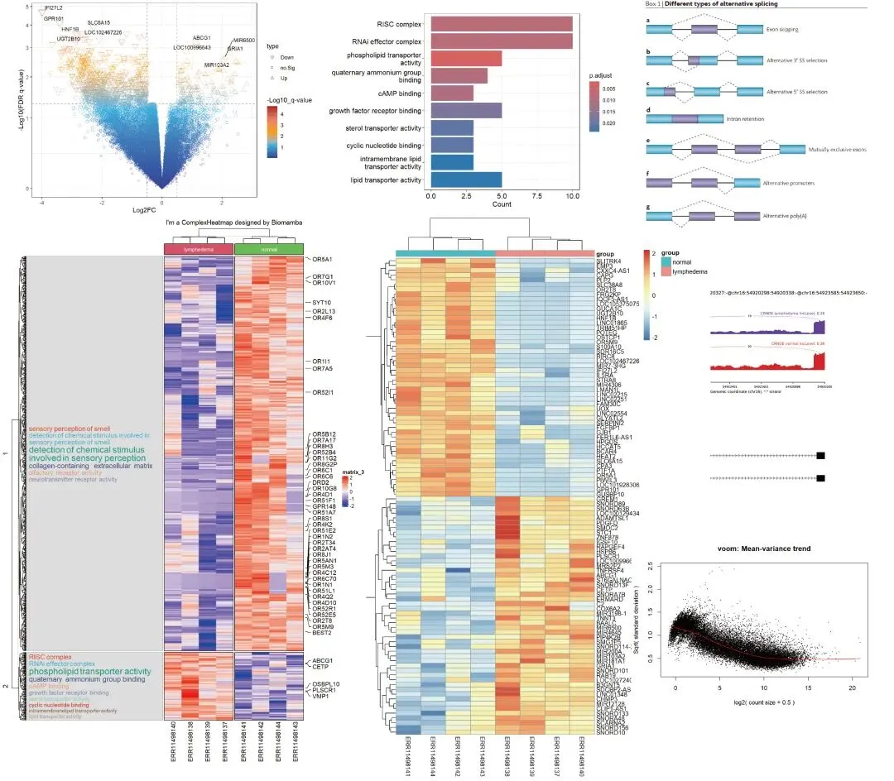
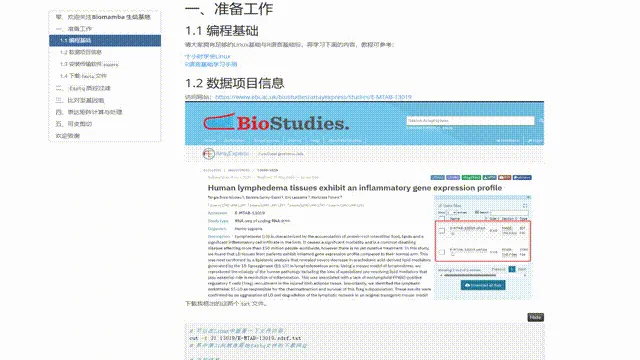
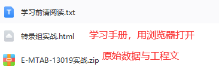

# Bulk RNASeq| 转录组实战

> 原文：https://mp.weixin.qq.com/s?__biz=MzAwMzIzOTk5OQ==&mid=2247510793&idx=1&sn=bfa69e8f261932d9bea74443fab732f0&chksm=9b3cd259ac4b5b4fd4b3bb80d0210a3396cda777b32ab49be1a45339453db314bb2a17fc438d#rd
> 合集：Bulk RNA-seq

学习手册

很多同学希望我们能够出一个Bulk RNA-Seq的教程，我个人也觉得很有必要，毕竟能算作scRNA-Seq的前课。这里我们利用E-MTAB-13019数据集为例，通过Rmarkdown的形式编译成了一个**学习手册**(HTML文件，用浏览器打开，在**文末获取**)，其中包含了代码、测试文件和输出结果。希望该手册可以帮助大家完成Bulk RNA-Seq分析的**一站式学习** ：
分析图片集锦

**-Biomamba**

所见即所得

解锁前需阅读：[龙年订阅须知](<http://mp.weixin.qq.com/s?__biz=MzAwMzIzOTk5OQ==&mid=2247509093&idx=1&sn=d82ed3738bc25b922a4837016198951e&chksm=9b3cdd35ac4b5423f08cf6ab2f4afc5d815c2321991d880e8b7162e63fd1d7e4695cd7391022&scene=21#wechat_redirect>)

文末还可解锁以下内容

，龙年订阅合集持续更新中，联系客服微信[Biomamba_yunying]可以以119￥获取全部资料(包括今年后面更新的内容)。当然，付费不是目的，以下资料都可以通过**转发领取**(更推荐这种方式)。

[龙年订阅须知](<http://mp.weixin.qq.com/s?__biz=MzAwMzIzOTk5OQ==&mid=2247509093&idx=1&sn=d82ed3738bc25b922a4837016198951e&chksm=9b3cdd35ac4b5423f08cf6ab2f4afc5d815c2321991d880e8b7162e63fd1d7e4695cd7391022&scene=21#wechat_redirect>)
[单细胞Figure 1常见图表](<http://mp.weixin.qq.com/s?__biz=MzAwMzIzOTk5OQ==&mid=2247509260&idx=1&sn=9ff90a428c3f22d43a31ec864e2d8a94&chksm=9b3cdc5cac4b554a2f7cb2a6368f7df9a9a3f6e406eb070663f53d81841a76e188c0b50727de&scene=21#wechat_redirect>)
[快速上手Seurat V5](<http://mp.weixin.qq.com/s?__biz=MzAwMzIzOTk5OQ==&mid=2247509880&idx=1&sn=3b7cd169ccfe688d10cb1ca70dc91e91&chksm=9b3cde28ac4b573ec6d5f4bceafa4294c0e9a001b7d0c0b64f274a9978b1438eeccc747ca0c0&scene=21#wechat_redirect>)
[机器学习基础手册](<http://mp.weixin.qq.com/s?__biz=MzAwMzIzOTk5OQ==&mid=2247510121&idx=1&sn=87b53d350d9aedd5b3205d59e51356a0&chksm=9b3cd139ac4b582f23dd0ca65dcc66bed80b4240da76ee5abfbb61ec1bf62674ebfd2c50a45e&scene=21#wechat_redirect>)
[scRNA-Seq学习手册Seurat V4修订版](<http://mp.weixin.qq.com/s?__biz=MzAwMzIzOTk5OQ==&mid=2247510380&idx=1&sn=0eb2b0c519ef1dc25ee8821b736a0fde&chksm=9b3cd03cac4b592ad93149fb4847e6ba3dd03ab69e1ca594ddc64d323fb7496775789cae245d&scene=21#wechat_redirect>)

订阅后获取学习手册下载链接：

