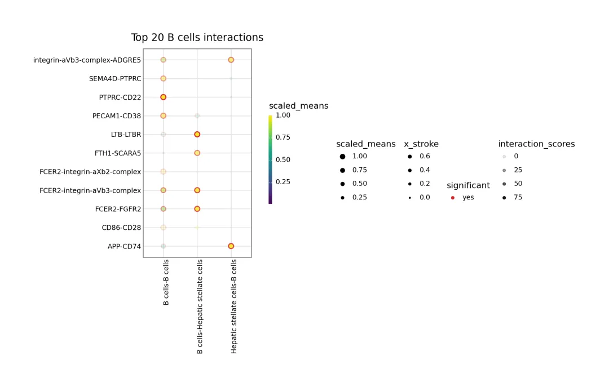
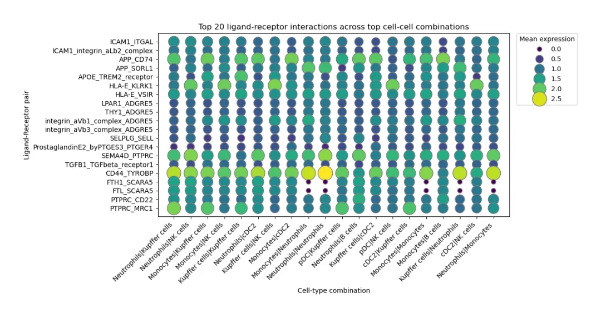
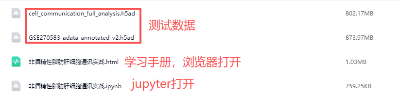

# GSE270583细胞通讯实战（基于CellPhoneDB）

> 原文：https://mp.weixin.qq.com/s?__biz=MzAwMzIzOTk5OQ==&mid=2247541081&idx=2&sn=3ecf22a0c12214607f83447c081d7e68&chksm=9b3c5809ac4bd11fa9e779f4f328138b216bd33524eec297b69757343162131dbe67ff487554#rd
> 合集：全文复现


**写在前面**

解析**非酒精性脂肪性肝病** NAFLD的分子机制，仅关注基因层面的共表达调控远远不够——肝脏作为高度复杂的[异质性](<https://mp.weixin.qq.com/s?__biz=MzAwMzIzOTk5OQ==&mid=2247531103&idx=2&sn=cad11d768e252d2489d124e68b71c7b0&scene=21#wechat_redirect>)器官，其微环境中各类细胞（如Kupffer细胞、[T细胞](<https://mp.weixin.qq.com/s?__biz=MzAwMzIzOTk5OQ==&mid=2247531388&idx=7&sn=801a250297aa2871f840a57e23ca4b86&scene=21#wechat_redirect>)、肝细胞等）的相互作用的调控，是推动疾病发生发展的核心驱动力。细胞间通过配体-受体（Ligand-Receptor, L-R）信号通路传递信息，调控炎症浸润、脂质代谢、纤维化等关键病理过程，而解析这些细胞通讯网络，正是揭示NAFLD发病机制、挖掘潜在干预靶点的重要突破口。

本次延续[GSE270583](<https://mp.weixin.qq.com/s?__biz=MzAwMzIzOTk5OQ==&mid=2247534107&idx=1&sn=24c3f2f1a2ba2a3db6d49acc1ba1220a&scene=21#wechat_redirect>)单细胞转录组数据集，CellPhoneDB v5（当前主流细胞通讯分析工具）为核心的细胞通讯实操，主要包括：[CellPhoneDB](<https://mp.weixin.qq.com/s?__biz=MzAwMzIzOTk5OQ==&mid=2247532763&idx=1&sn=f6e4df9242f1341d2dc7e6154c33aa46&scene=21#wechat_redirect>)所需meta文件构建、数据库下载与小鼠-人类基因同源转换（实现物种适配）、CellPhoneDB v5统计分析运行，以及三大核心可视化（总体显著配对热图、特定细胞类型配体-受体交互图、核心细胞组合L-R交互散点图）

更多Python单细胞教程：

[](<https://mp.weixin.qq.com/s?__biz=MzAwMzIzOTk5OQ==&mid=2247537658&idx=2&sn=f3adf25c6d116aa2fcc4ef6f9cc9bc2e&scene=21#wechat_redirect>)

学前tips:本教程基于Linux环境的[jupyter](<https://mp.weixin.qq.com/s?__biz=MzAwMzIzOTk5OQ==&mid=2247531443&idx=3&sn=0930f54959a9bd13b99780d8f26a1155&scene=21#wechat_redirect>)演示，计算资源不足的同学可参考：[足够支持你完成硕博生涯的生信环境](<https://mp.weixin.qq.com/s?__biz=MzAwMzIzOTk5OQ==&mid=2247532373&idx=2&sn=4708fac31ac8f4e347847e4b7f2a4fed&scene=21#wechat_redirect>)访问链接：https://biomamba.xiyoucloud.net/欢迎联系客服微信[Biomamba_zhushou]获取帮助

如果需要[单细胞数据分析](<https://mp.weixin.qq.com/s?__biz=MzAwMzIzOTk5OQ==&mid=2247531160&idx=2&sn=04d3798dc60958af2c9020fe7c4bd9b8&scene=21#wechat_redirect>)教学、生信热点[全文复现](<https://mp.weixin.qq.com/mp/appmsgalbum?__biz=MzAwMzIzOTk5OQ==&action=getalbum&album_id=2981710763847614469#wechat_redirect>)、自测数据[个性化分析](<https://mp.weixin.qq.com/s?__biz=MzAwMzIzOTk5OQ==&mid=2247539480&idx=1&sn=9f1d8a76c0a5ddad4983c3fcf7620622&scene=21#wechat_redirect>)辅导、[常态化实验学习](<https://mp.weixin.qq.com/s?__biz=MzAwMzIzOTk5OQ==&mid=2247530174&idx=1&sn=c3b0499adcc9093546e4ba1cfffba7bd&scene=21#wechat_redirect>)，欢迎联系客服微信[Biomamba_zhushou]。


**实操流程**

资料下载见文末：
如果你对下面的教程比较迷茫，那么你可以先行学习编程教程：[十小时学会Linux](<https://mp.weixin.qq.com/s?__biz=MzAwMzIzOTk5OQ==&mid=2247505777&idx=1&sn=f3efae390566b838a445ab9f832323c8&scene=21#wechat_redirect>)[生信Linux及服务器使用技巧](<https://mp.weixin.qq.com/mp/appmsgalbum?__biz=MzAwMzIzOTk5OQ==&action=getalbum&album_id=2980604042328702978#wechat_redirect>)[5.5h入门R语言](<https://mp.weixin.qq.com/s?__biz=MzAwMzIzOTk5OQ==&mid=2247530924&idx=2&sn=ba3b03a998e48de5cec08933b734d905&scene=21#wechat_redirect>)

**[生信Python速查手册](<https://mp.weixin.qq.com/s?__biz=MzAwMzIzOTk5OQ==&mid=2247520999&idx=2&sn=7f6aa90c2ffa786bd660aa40b109de49&scene=21#wechat_redirect>)**

**
**

**1. 加载必要的 Python 包**

  *   *   *   *   *   *   *   *   *

```
# 基础系统包import os# 单细胞分析核心包import scanpy as scimport pandas as pdimport numpy as np# 可视化import matplotlib.pyplot as pltimport ktplotspy as kpy
```

## **2\. 设置项目路径**

  *   *   *   *   *   *   *   *

```
# 项目根目录PROJECT_DIR = "/data1/home/zouhuren/data/cell_communication"# 切换到项目目录os.chdir(PROJECT_DIR)# 各个子目录DATA_DIR = "01_data"                 # 存放 h5ad 和注释DB_DIR   = "02_cpdb_database/v5.0.0" # CellPhoneDB 数据库OUT_DIR  = "03_results/cpdb_outputs" # 输出结果
```

## **3\. 读取数据**

数据来源于此前基础流程中的输出文件：[学员代码复现|scRNA-seq解析非酒精性脂肪性肝发生机制](<https://mp.weixin.qq.com/s?__biz=MzAwMzIzOTk5OQ==&mid=2247534107&idx=1&sn=24c3f2f1a2ba2a3db6d49acc1ba1220a&scene=21#wechat_redirect>)

  *   *   *   *

```
# 读取 AnnData 对象adata = sc.read_h5ad("/data1/home/zouhuren/data/GSE270583_adata_annotated_v2.h5ad")# 查看数据基本信息adata
```
```
AnnData object with n_obs × n_vars = 19528 × 23055     obs: 'sample', 'n_genes_by_counts', 'log1p_n_genes_by_counts', 'total_counts', 'log1p_total_counts', 'pct_counts_in_top_50_genes', 'pct_counts_in_top_100_genes', 'pct_counts_in_top_200_genes', 'pct_counts_in_top_500_genes', 'total_counts_mt', 'log1p_total_counts_mt', 'pct_counts_mt', 'total_counts_ribo', 'log1p_total_counts_ribo', 'pct_counts_ribo', 'total_counts_hb', 'log1p_total_counts_hb', 'pct_counts_hb', 'leiden', 'cell_type'     var: 'mt', 'ribo', 'hb', 'n_cells_by_counts', 'mean_counts', 'log1p_mean_counts', 'pct_dropout_by_counts', 'total_counts', 'log1p_total_counts', 'n_cells', 'highly_variable', 'means', 'dispersions', 'dispersions_norm', 'highly_variable_nbatches', 'highly_variable_intersection'     uns: 'cell_type_colors', 'hvg', 'leiden', 'leiden_colors', 'log1p', 'neighbors', 'pca', 'rank_genes_groups', 'sample_colors', 'tsne', 'umap'     obsm: 'X_pca', 'X_pca_harmony', 'X_tsne', 'X_umap'     varm: 'PCs'     layers: 'counts'     obsp: 'connectivities', 'distances'
```

  *   *

```
# 查看每种细胞类型的数量adata.obs["cell_type"].value_counts()
```
```
cell_type
```
```
LSECs    3887
```
```
CD4 T cells    3471
```
```
Monocytes    2590
```
```
Kupffer cells    2112
```
```
CD8 T cells    1356
```
```
cDC2    1207
```
```
Neutrophils    1191
```
```
B cells    1150
```
```
cDC1    823
```
```
NK cells    783
```
```
pDC    381
```
```
Hepatocytes    350
```
```
Cholangiocytes    188
```
```
Hepatic stellate cells    39
```
```
Name: count, dtype: int64
```

  *   *   *   *   *   *

```
# 确保表达矩阵是 log-normalizedif"log1p"notin adata.uns:# 每个细胞总表达量归一化到 1e4    sc.pp.normalize_total(adata, target_sum=1e4)# log1p 转换    sc.pp.log1p(adata)
```

# **4\. 构建 CellPhoneDB 所需的 meta 文件**

告诉 CellPhoneDB：每一个 cell 属于哪一种 cell type

  *   *   *   *   *   *   *   *   *   *   *   *   *   *   *

```
# 只保留 cell_type 这一列meta = adata.obs[["cell_type"]].copy()
# index 必须是细胞 barcodemeta.index.name = "Cell"
# 列名必须叫 cell_type（CellPhoneDB 规范）meta.columns = ["cell_type"]
# 保存为 tsv 文件meta_path = "/data1/home/zouhuren/data/cell_communication/01_data/cell_annotations.tsv"meta.to_csv(meta_path, sep="\t")
# 看前几行，确认格式正确meta.head()
```

Cell| cell_type
---|---
AAACCCAAGGACGCAT-1| Hepatocytes
AAACCCAAGGCTAAAT-1| CD8 T cells
AAACCCAAGTTCCAGT-1| pDC
AAACCCACAGCACGAA-1| cDC2
AAACCCACATGTAACC-1| Neutrophils

## **
**

# **5\. 运行 CellPhoneDB v5**

  *   *   *   *   *   *   *   *   *   *   *

```
# 设定数据库版本cpdb_version = 'v5.0.0'
# 数据库资料所需的存放文件的路径# 路径自行设定cpdb_target_dir = os.path.join('/data1/home/zouhuren/data/cell_communication/02_cpdb_database/v5.0.0', cpdb_version)
# 开始下载数据from cellphonedb.utils import db_utils
db_utils.download_database(cpdb_target_dir, cpdb_version)# 提取 Kupffer cells 差异基
```
```
Downloaded cellphonedb.zip into /data1/home/zouhuren/data/cell_communication/02_cpdb_database/v5.0.0/v5.0.0
Downloaded complex_input.csv into /data1/home/zouhuren/data/cell_communication/02_cpdb_database/v5.0.0/v5.0.0
Downloaded gene_input.csv into /data1/home/zouhuren/data/cell_communication/02_cpdb_database/v5.0.0/v5.0.0
Downloaded interaction_input.csv into /data1/home/zouhuren/data/cell_communication/02_cpdb_database/v5.0.0/v5.0.0
Downloaded protein_input.csv into /data1/home/zouhuren/data/cell_communication/02_cpdb_database/v5.0.0/v5.0.0
Downloaded uniprot_synonyms.tsv into /data1/home/zouhuren/data/cell_communication/02_cpdb_database/v5.0.0/v5.0.0/sources
Downloaded transcription_factor_input.csv into /data1/home/zouhuren/data/cell_communication/02_cpdb_database/v5.0.0/v5.0.0/sources
```

  *   *   *   *   *   *   *

```
# adata.var_names 就是所有基因名mouse_genes = adata.var_names.tolist()
# 保存为 CSV，一列叫 'Gene'pd.DataFrame({'Gene': mouse_genes}).to_csv("mouse_genes.csv", index=False)
print("已生成 mouse_genes.csv，可用于 R biomaRt 同源转换")
```
```
已生成 mouse_genes.csv，可用于 R biomaRt 同源转换
```

  *   *   *   *   *   *   *   *   *   *   *   *   *   *   *   *   *   *   *   *   *   *   *   *   *   *   *   *   *   *   *   *   *   *   *   *   *   *   *   *   *   *   *   *   *

```r
# R 脚本：小鼠基因映射到人类 HGNC# ========================================================# 1. 安装并加载 biomaRtlibrary(biomaRt)
# 2. 连接 Ensembl 数据库library(httr)set_config(config(timeout = 300))  # 设置超时时间 300 秒
# 人类数据集human <- useMart(  "ensembl",  dataset = "hsapiens_gene_ensembl",  host = "https://dec2021.archive.ensembl.org/"  # 指定稳定版本)
# 小鼠数据集mouse <- useMart(  "ensembl",  dataset = "mmusculus_gene_ensembl",  host = "https://dec2021.archive.ensembl.org/")
# 3. 读取小鼠基因列表（Python 导出的 CSV）# 假设你的 CSV 文件在当前目录，列名为 Genemouse_genes <- read.csv("mouse_genes.csv", header = TRUE, stringsAsFactors = FALSE)$Gene
# 4. 小鼠基因映射到人类 HGNCmouse2human <- getLDS(  attributes = c("mgi_symbol"),        # 小鼠基因属性（MGI 符号）  filters = "mgi_symbol",              # 用 MGI 符号匹配  values = mouse_genes,                # 要转换的小鼠基因列表  mart = mouse,                         # 小鼠 mart 数据集  attributesL = c("hgnc_symbol"),       # 输出 human HGNC 符号  martL = human                         # human mart 数据集)
# 5. 查看结果head(mouse2human)# mouse2human 是 data.frame，包含两列：# MGI.symbol  (小鼠基因名)# HGNC.symbol (对应人类基因名)
# 6. 保存映射结果write.csv(mouse2human, "mouse2human_mapping.csv", row.names = FALSE)
```

  *   *   *   *   *   *   *   *   *   *   *   *   *   *

```
# 读取 R 端生成的映射表ortholog_df = pd.read_csv("/data1/home/zouhuren/R/Python_scRNA/mouse2human_mapping.csv")  # 包含两列：MGI.symbol, HGNC.symbol
# 映射 human geneadata.var['hgnc_symbol'] = adata.var_names.map(    lambda x: ortholog_df.set_index('MGI.symbol').loc[x,'HGNC.symbol']    if x in ortholog_df['MGI.symbol'].values else None)
# 删除 NAadata = adata[:, ~adata.var['hgnc_symbol'].isna()].copy()
# 删除重复 human geneadata = adata[:, ~adata.var['hgnc_symbol'].duplicated()].copy()
```

  *   *   *   *   *   *   *   *   *   *   *   *   *   *   *   *   *   *   *

```
# 只保留有 human gene 的列adata = adata[:, adata.var['hgnc_symbol'].notna()].copy()
# 将 human gene 列强制转换为字符串adata.var['hgnc_symbol'] = adata.var['hgnc_symbol'].astype(str)
# 确保 var_names 是字符串且唯一adata_cpdb = adata.copy()adata_cpdb.var_names = adata_cpdb.var['hgnc_symbol'].valuesadata_cpdb.var_names_make_unique()
# 把 var 中其他列也全部转换为字符串，防止 h5py 报错for col in adata_cpdb.var.columns:    adata_cpdb.var[col] = adata_cpdb.var[col].astype(str)
# 保存 h5adcpdb_h5ad_path = "/data1/home/zouhuren/data/cell_communication/01_data/adata_cpdb.h5ad"adata_cpdb.write_h5ad(cpdb_h5ad_path)print("用于 CellPhoneDB 的 h5ad 已生成:", cpdb_h5ad_path
```
```
用于 CellPhoneDB 的 h5ad 已生成: /data1/home/zouhuren/data/cell_communication/01_data/adata_cpdb.h5ad
```

  *   *   *   *   *   *   *   *   *   *   *   *   *   *   *   *

```
fromcellphonedb.src.core.methods import cpdb_statistical_analysis_method
cpdb_results = cpdb_statistical_analysis_method.call(cpdb_file_path="/data1/home/zouhuren/data/cell_communication/02_cpdb_database/v5.0.0/v5.0.0/cellphonedb.zip",meta_file_path="/data1/home/zouhuren/data/cell_communication/01_data/cell_annotations.tsv",counts_file_path="/data1/home/zouhuren/data/cell_communication/01_data/adata_cpdb.h5ad",counts_data="gene_name",  # 使用 var_namesiterations=1000,threshold=0.01,           # 表达阈值，按需可调低threads=8,score_interactions=True,result_precision=3,pvalue=0.05,output_path="/data1/home/zouhuren/data/cell_communication/03_results",debug=False)
```
```
Reading user files...
The following user files were loaded successfully:
/data1/home/zouhuren/data/cell_communication/01_data/adata_cpdb.h5ad
/data1/home/zouhuren/data/cell_communication/01_data/cell_annotations.tsv
[ ][CORE][16/01/26-01:31:47][INFO] [Cluster Statistical Analysis] Threshold:0.01 Iterations:1000 Debug-seed:-1 Threads:8 Precision:3
[ ][CORE][16/01/26-01:31:49][INFO] Running Real Analysis
[ ][CORE][16/01/26-01:31:49][INFO] Running Statistical Analysis
```
```
100%|██████████| 1000/1000 [03:30<00:00,  4.76it/s]
```
```
[ ][CORE][16/01/26-01:35:19][INFO] Building Pvalues result
```
```
[ ][CORE][16/01/26-01:35:19][INFO] Building results
[ ][CORE][16/01/26-01:35:20][INFO] Scoring interactions: Filtering genes per cell type..
```
```
100%|██████████| 14/14 [00:00<00:00, 73.20it/s]
```
```
[ ][CORE][16/01/26-01:35:20][INFO] Scoring interactions: Calculating mean expression of each gene per group/cell type..
```
```
100%|██████████| 14/14 [00:00<00:00, 196.16it/s]
```
```
[ ][CORE][16/01/26-01:35:20][INFO] Scoring interactions: Calculating scores for all interactions and cell types..
```
```
100%|██████████| 196/196 [00:14<00:00, 13.12it/s]
```
```
Saved deconvoluted to /data1/home/zouhuren/data/cell_communication/03_results/statistical_analysis_deconvoluted_01_16_2026_013536.txt
Saved deconvoluted_percents to /data1/home/zouhuren/data/cell_communication/03_results/statistical_analysis_deconvoluted_percents_01_16_2026_013536.txt
Saved means to /data1/home/zouhuren/data/cell_communication/03_results/statistical_analysis_means_01_16_2026_013536.txt
Saved pvalues to /data1/home/zouhuren/data/cell_communication/03_results/statistical_analysis_pvalues_01_16_2026_013536.txt
Saved significant_means to /data1/home/zouhuren/data/cell_communication/03_results/statistical_analysis_significant_means_01_16_2026_013536.txt
Saved interaction_scores to /data1/home/zouhuren/data/cell_communication/03_results/statistical_analysis_interaction_scores_01_16_2026_013536.txt
```

# **6\. 可视化**

# **（1）总体显著配对热图**

  *   *   *   *   *   *

```
kpy.plot_cpdb_heatmap(    pvals=cpdb_results['pvalues'],      # 使用 Python API 输出的 pvalues    degs_analysis=False,    figsize=(6,6),    title="Sum of significant interactions")
```
```
<seaborn.matrix.ClusterGrid at 0x7fc4864fca90>
```
[/code]
```
## **（2）B cells 与其他细胞的配体-受体交互**

  *   *   *   *   *   *   *   *   *   *   *   *   *   *   *   *   *   *   *   *   *   *   *   *   *   *   *   *

[code]
# 取每个细胞组合的均值bcell_cols = [col for col in means.columns if col.startswith("B cells|")]bcell_means = means[['interacting_pair'] + bcell_cols].copy()bcell_means['mean_across_cells'] = bcell_means[bcell_cols].mean(axis=1)
# 排序取 top 20 ligand-receptortop20_lr = bcell_means.sort_values('mean_across_cells', ascending=False)['interacting_pair'].head(20).tolist()
# 再取 top 5 最重要的细胞组合top_cells = bcell_cols[:5]  # 这里取前5列组合，也可以根据均值排序
# 绘图kpy.plot_cpdb(    adata=adata,    cell_type1="B cells",    cell_type2=top_cells,  # 只画前5个细胞组合    means=cpdb_results['means'],    pvals=cpdb_results['pvalues'],    celltype_key="cell_type",    genes=top20_lr,    figsize=(10,6),    title="Top 20 B cells interactions",    max_size=3,    highlight_size=0.75,    standard_scale=True,    interaction_scores=cpdb_results['interaction_scores'],    scale_alpha_by_interaction_scores=True)
```

## **
**

## **（3）主要细胞组合中的前20个配体-受体相互作用**

  *   *   *   *   *   *   *   *   *   *   *   *   *   *   *   *   *   *   *   *   *   *   *   *   *   *   *   *   *   *   *   *   *   *   *   *   *   *   *   *   *   *   *   *   *   *

```
# -----------------------------# 计算每个 cell_combination 在 Top20 L-R 上的均值# -----------------------------cell_means = df_long.groupby('cell_combination')['mean_expression'].mean()top_cells = cell_means.sort_values(ascending=False).head(20).index.tolist()
# 筛选数据df_long_top = df_long[df_long['cell_combination'].isin(top_cells)]
# 排序分类，保证横轴顺序从均值高到低df_long_top['cell_combination'] = pd.Categorical(df_long_top['cell_combination'], categories=top_cells, ordered=True)
# -----------------------------# 绘图# -----------------------------plt.figure(figsize=(12,6))scatter = sns.scatterplot(    data=df_long_top,    x='cell_combination',    y='interacting_pair',    size='mean_expression',    hue='mean_expression',    palette='viridis',    sizes=(50,500),    edgecolor='grey')
# 横轴倾斜，防止拥挤plt.xticks(rotation=45, ha='right', fontsize=10)plt.xlabel("Cell-type combination")plt.ylabel("Ligand-Receptor pair")plt.title("Top 20 ligand-receptor interactions across top cell-cell combinations")
# -----------------------------# 图例放在图外# -----------------------------plt.legend(    bbox_to_anchor=(1.02, 1),   # 右上角图外    loc='upper left',    borderaxespad=0,    title='Mean expression',    fontsize=10)
plt.tight_layout()plt.show()
```



  *

```
adata.write("cell_communication_full_analysis.h5ad")
```


**资料领取**

本推送的代码和测试文件可以在以下链接中下载：

通过网盘文件分享的文件：https://pan.baidu.com/s/1UF1ecQuXOYgFssO0QJfryw

联系助理微信[Biomamba_zhushou]获取提取码


**欢迎致谢**

如果以上内容对你有帮助，欢迎在文章的Acknowledgement中加上这一段，联系客服微信可以发放奖励：
```
Since Biomamba and his wechat public account team produce bioinformatics tutorials and share code with annotation, we thank Biomamba for their guidance in bioinformatics and data analysis for the current study.
```

**欢迎在发文/毕业时向我们分享你的喜悦~**

**已致谢文章**

[ 鼻咽癌的Bulk RNA-Seq与scRNA-Seq联合分析](<https://mp.weixin.qq.com/s?__biz=MzAwMzIzOTk5OQ==&mid=2247510548&idx=1&sn=58048c46e837b1d56dffa282272c6d96&chksm=9b3cd344ac4b5a52369e91b4e61fa0a2c951b82cc21165b99f42ba2c2191d4add803bd73c928&scene=21&cur_album_id=3425248581018714114#wechat_redirect>)

[13分+文章利用scRNA-Seq揭示地铁细颗粒物引起肺部炎症的分子机制](<https://mp.weixin.qq.com/s?__biz=MzAwMzIzOTk5OQ==&mid=2247511886&idx=1&sn=31c712d00377b0f0ed33703b5b4fbfd8&chksm=9b3cd61eac4b5f084fde14a2eb50356f2f40a66c608d38909f12a3d81f48cff029a09ce2ee8c&token=1453608870&lang=zh_CN&scene=21#wechat_redirect>)

[除了铁死亡，还有铜死亡？！](<https://mp.weixin.qq.com/s?__biz=MzAwMzIzOTk5OQ==&mid=2247518144&idx=1&sn=d036f1bb04b09eb73f53e2104d69404c&chksm=9b3cfe90ac4b77862f2f463b42132c7bfdb687a1b61d350dcf656117b1331271e179710fd4fa&scene=21&cur_album_id=3425248581018714114#wechat_redirect>)

[IF14.3| scRNA-seq+脂质组多组学分析揭示宫内生长受限导致肝损伤的性别差异](<https://mp.weixin.qq.com/s?__biz=MzAwMzIzOTk5OQ==&mid=2247520900&idx=1&sn=157134292ffc2e5df730c5ba8a357b61&chksm=9b3cebd4ac4b62c286543c30381e9b4fdb8b44b28d4fa902fb963bbd45b28e1d3f1bc98eb148&scene=21&cur_album_id=3425248581018714114#wechat_redirect>)[银屑病和脂肪肝病中共同病理和免疫特征](<https://mp.weixin.qq.com/s?__biz=MzAwMzIzOTk5OQ==&mid=2247521069&idx=1&sn=4ef441a885cb2525ee3b5c81001feddf&chksm=9b3cea7dac4b636be9f10ffdf75e13531fccae62129944b21a457db2e08c3f2db1e1b553ac34&scene=21&cur_album_id=3425248581018714114#wechat_redirect>) [《Advanced Science》新型Arf1抑制剂促进癌症干细胞衰老并增强抗肿瘤免疫](<http://mp.weixin.qq.com/s?__biz=MzAwMzIzOTk5OQ==&mid=2247522233&idx=1&sn=287a380de741ff55f0ce78dc9c727985&chksm=9b3ceee9ac4b67ffd925abafeba2cb215a5984e6dc85f0d8607340a07ec9208f1d19eae0e04b&scene=21#wechat_redirect>)

[scRNA-seq揭示脓毒症预后水平预测的关键靶点！](<http://mp.weixin.qq.com/s?__biz=MzAwMzIzOTk5OQ==&mid=2247522281&idx=1&sn=f95eb12fdc340b8da1123ec6253e6fac&chksm=9b3ceeb9ac4b67afa587e5fa3a2a8960e9bb28a1ad6dc48e49120a76154417a4c8be95af90b0&scene=21#wechat_redirect>)

[机器学习+生信多组学联合构建牙周炎"线粒体功能障碍与免疫微环境"关联网络](<https://mp.weixin.qq.com/s?__biz=MzAwMzIzOTk5OQ==&mid=2247527168&idx=1&sn=0791d2bf53a9a60015577f892b10d370&scene=21#wechat_redirect>)

[KIF18A在肝细胞癌转移中的双重角色](<https://mp.weixin.qq.com/s?__biz=MzAwMzIzOTk5OQ==&mid=2247528014&idx=1&sn=d285c9ebd415be328fc682d00e6182c0&scene=21#wechat_redirect>)

[bulk+scRNA-seq挖掘BCL2-MAPK14-TXN氧化应激诊断模型，鉴定脓毒症中氧化应激关键基因](<https://mp.weixin.qq.com/s?__biz=MzAwMzIzOTk5OQ==&mid=2247530000&idx=1&sn=e8ddca4e1b2e60839cdf2a7fe87b3dfe&chksm=9b3c0f40ac4b86562e0e307b9dbb8688159e72b3c19d9ceebf8a4bb2e21638896f005b497b11&scene=21&cur_album_id=3425248581018714114&search_click_id=#wechat_redirect>)

向下滑动查看更多

欢迎大家致谢~


**如何联系我们**

 留一个领取[资料](<https://mp.weixin.qq.com/s?__biz=MzAwMzIzOTk5OQ==&mid=2247539170&idx=1&sn=ebd269635da35335554c53709fa0a0c0&scene=21#wechat_redirect>)、[开箱即用的单细胞分析镜像](<https://mp.weixin.qq.com/s?__biz=MzAwMzIzOTk5OQ==&mid=2247528410&idx=2&sn=0f2bac25479cf8d20dab5d82ae986f2e&scene=21#wechat_redirect>)的助手[Biomamba_zhushou]，方便各位随时交流。同时我们也构建了[交流群矩阵](<https://mp.weixin.qq.com/s?__biz=MzAwMzIzOTk5OQ==&mid=2247528057&idx=1&sn=bb348c2a88c977c7cce67ee6731a3591&scene=21#wechat_redirect>)，欢迎大家一起讨论。您点的每个赞和在看，我都认真当成了喜欢

Laker
