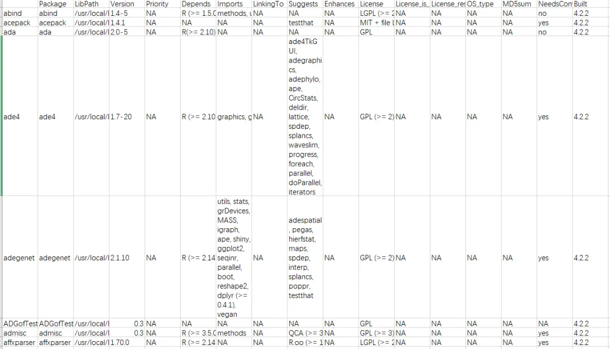
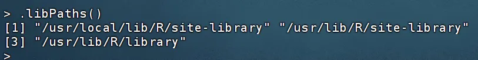

# 搞定两千款R包的安装

> 原文：https://mp.weixin.qq.com/s?__biz=MzAwMzIzOTk5OQ==&mid=2247520150&idx=1&sn=710f70f74dc77d0b254b74eaae7c028f&chksm=9b3cf6c6ac4b7fd0ee3fa3f5f57aee6850629f3e9885199721ab8075114c3f9b159c579a6ddd#rd
> 合集：服务器


**一、写在前面**

最近有粉丝要我们在西柚云环境中布置好的R环境，算是变相给我们来了波宣传。


如果你对下面的教程比较迷茫，那么你可以先行学习些编程基础：[R语言基础学习手册](<http://mp.weixin.qq.com/s?__biz=MzAwMzIzOTk5OQ==&mid=2247509991&idx=2&sn=b5094747b9944caf3c2283e179e2aca0&chksm=9b3cdeb7ac4b57a1ccbd2f1ec07424cb197e83451c464166a96ea2924f53b180b05c4c663309&scene=21#wechat_redirect>)
[十小时学会Linux](<http://mp.weixin.qq.com/s?__biz=MzAwMzIzOTk5OQ==&mid=2247505777&idx=1&sn=f3efae390566b838a445ab9f832323c8&chksm=9b3cae21ac4b2737f5923b246470d699474c041bb78de50d2b71b99d537f9f44ca2938002cda&scene=21#wechat_redirect>)
[生信Linux及服务器使用技巧](<https://mp.weixin.qq.com/mp/appmsgalbum?__biz=MzAwMzIzOTk5OQ==&action=getalbum&album_id=2980604042328702978#wechat_redirect>)
如果你的计算机不足以支持下面流程的计算，可按需选用适合自己的计算资源：共享(经济实惠)：[有root权限的共享服务器,报我名字立减200￥](<http://mp.weixin.qq.com/s?__biz=MzAwMzIzOTk5OQ==&mid=2247503869&idx=1&sn=142f8c7ba8620815a8770773df077f12&chksm=9b3cb6adac4b3fbb1acdf7593df06af5ac77d1fe9c0144c999de7109bd063b76080a33c50e0d&scene=21#wechat_redirect>)独享(省电省心)：[生信分析不求人](<http://mp.weixin.qq.com/s?__biz=MzAwMzIzOTk5OQ==&mid=2247508226&idx=1&sn=69e0eea720ac6aecc0362bcb9ac339ba&chksm=9b3cd852ac4b51445651a091be0fb6f638bd8cf5eb399af1c54804631fe3047706cf1d4044de&scene=21#wechat_redirect>)

[](<http://mp.weixin.qq.com/s?__biz=MzAwMzIzOTk5OQ==&mid=2247508226&idx=1&sn=69e0eea720ac6aecc0362bcb9ac339ba&chksm=9b3cd852ac4b51445651a091be0fb6f638bd8cf5eb399af1c54804631fe3047706cf1d4044de&scene=21#wechat_redirect>)实体(稳定高效)：[配置一个心仪的工作站(硬件+环境配置)](<http://mp.weixin.qq.com/s?__biz=MzAwMzIzOTk5OQ==&mid=2247519707&idx=1&sn=73dcab26f9b2ed75a954327317d07112&chksm=9b3cf48bac4b7d9df5b5a432fbe70d4f9c13bc8d739aa401732614f022223d1912642a7e4bea&scene=21#wechat_redirect>)

访问链接：https://biomamba.xiyoucloud.net/

更多内容可咨询客服微信[**Biomamba_kefu**]

其实获得环境中的R包即版本号的方法很简单，两行就可以搞定：

  *   *

```r
package_list <- installed.packages()write.csv(package_list,'package_list.csv')
```

package_list.csv的下载链接见下文，文件表头为：



其中的每一列的内容代表：

  1. Package:

     * 包的名称。

  2. LibPath:

     * 包安装的库路径。这与 `.libPaths()` 函数返回的路径相关，显示了包所在的具体位置。

  3. Version:

     * 已安装的包的版本号。

  4. Priority:

     * 如果包是基本必须的（例如，base 或 recommended），这一列会标明其优先级。大多数包这一栏为空，表示它们不是基础包。

  5. Depends:

     * 列出了安装和运行此包所依赖的其他包及版本。这有助于理解包之间的依赖关系。

  6. Imports:

     * 列出了该包在函数中调用的其他包的函数或数据，不过这些包并不需要被加载为了该包的正常使用（不同于Depends，Depends的包需要被加载）。

  7. LinkingTo:

     * 主要用于R包涉及到编译代码（如C, C++或Fortran）时，列出了需要链接到的其他包。

  8. Suggests:

     * 包括那些不是必须的，但是增强包功能的建议包。这些包通常用于示例或扩展功能。

  9. Enhances:

     * 列出了哪些包可能会被当前包增强功能。

  10. License:

     * 包的许可证类型。

  11. Built:

     * 这列显示了包是在哪个R版本下构建的。这有助于了解包与特定R版本的兼容性。

大家可以对着上面的信息来安装指定的版本


**二、.libPaths**

另外我还从我的.libPaths中导出了R包相关文件



  *   *   *

```
tar -zcf site-libraray.tar.gz  /usr/local/lib/R/site-librarytar -zcf library.tar.gz /usr/lib/R/librarytar -zcf lib_site-library.tar.gz /usr/lib/R/site-library
```

这三个R包路径有一些不同的用途和特点：

  1. "/usr/local/lib/R/site-library":

     * 这个路径通常用于存放系统级别的R包，这些包是由系统管理员安装的，供所有系统用户使用。

     * 位于`/usr/local/lib`的路径表明这些库可能是由管理员或通过超级用户权限安装的，通常不受R默认安装过程的影响，而是独立安装的包。

  2. "/usr/lib/R/site-library":

     * 这个路径与`/usr/local/lib/R/site-library`相似，也是用来存放系统级的R包。

     * 位置在`/usr/lib`，这通常意味着这些包可能是由操作系统的包管理系统安装的（如使用APT或YUM的Linux系统），或者是系统在初始安装时预装的包。

  3. "/usr/lib/R/library":

     * 这个路径是R的默认库路径，存放的是R的基础包和核心包，这些包随R软件一起被安装。

     * 这些包通常是R安装过程的一部分，是R运行的基本组件，包括了统计、图形处理等基础功能的包。

列表和R包路径的文件都给大家准备好了，大家可以自行下载使用，使用教程请参考以下教程：

[在Rstudio中使用同一个R包的不同版本](<http://mp.weixin.qq.com/s?__biz=MzAwMzIzOTk5OQ==&mid=2247505248&idx=1&sn=a8ac5af6f8827019c15b30be3490a64d&chksm=9b3cac30ac4b2526697877572b49323d499d705f697135fc2fbd1e6a6c2a77a6041e90056581&scene=21#wechat_redirect>)

[ (解)压缩与md5值校验](<http://mp.weixin.qq.com/s?__biz=MzAwMzIzOTk5OQ==&mid=2247499664&idx=1&sn=4864161942d45fedee2fa28e6d85460e&chksm=9b3c86c0ac4b0fd67ff1798290f95695b8284943d468aaa9ae2db38fe79927ef47dd7d73f7f6&scene=21#wechat_redirect>)


**三、资料下载**

下载链接：

https://pan.baidu.com/s/1NfiGlJQZDFu_y2xQzkJAlA?pwd=d9ia

提取码：d9ia


**注意，我的环境是Ubuntu 20.04.5 LTS，R版本为4.2.2**


**如何联系我们**

 公众号后台消息回复不便，这里给大家留一下领取资料及免费服务器([足够支持你完成硕博生涯的生信环境](<http://mp.weixin.qq.com/s?__biz=MzAwMzIzOTk5OQ==&mid=2247507693&idx=1&sn=d9517a0803ad75cb7be430806834e7b8&chksm=9b3ca7bdac4b2eaba1ad01ed04ab1fbcbafcf4f6ddfe9e4f76ed9229707f545fe7d9c9ffd6ae&scene=21#wechat_redirect>))的**微信号** ，方便各位随时交流、提建议（别问在么，添加时直接说来意）。此外呼声一直很高的**交流群** 也建好了，欢迎大家入群讨论：

[永久免费的生信、科研交流群](<http://mp.weixin.qq.com/s?__biz=MzAwMzIzOTk5OQ==&mid=2247505868&idx=2&sn=20c81313eaef9a7031a84ef3a691d1b5&chksm=9b3cae9cac4b278a42c8de97e864c7664a37e9a4adb5973625fe3f8dd1093e55aeda88d443aa&scene=21#wechat_redirect>)

大家可以阅读完这几篇之后添加[给生信入门初学者的小贴士](<http://mp.weixin.qq.com/s?__biz=MzAwMzIzOTk5OQ==&mid=2247493329&idx=1&sn=597870b7f7ce10346da3561e7c281627&chksm=9b3c9f81ac4b169794088ce9abbcacb5f18e9fd174fc0d7e28da62d78facadf3100ef38aaf22&scene=21#wechat_redirect>)
[如何搜索公众号过往发布内容](<http://mp.weixin.qq.com/s?__biz=MzAwMzIzOTk5OQ==&mid=2247506266&idx=2&sn=22b1164bc9602c25620d058847785422&chksm=9b3ca00aac4b291c16d738271746ffb90149282a728f484e8a1952463c46a8e7dc4f883ab928&scene=21#wechat_redirect>)


您点的每个赞和在看，我都认真当成了喜欢
