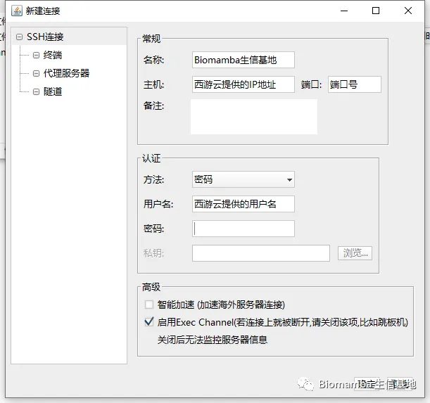
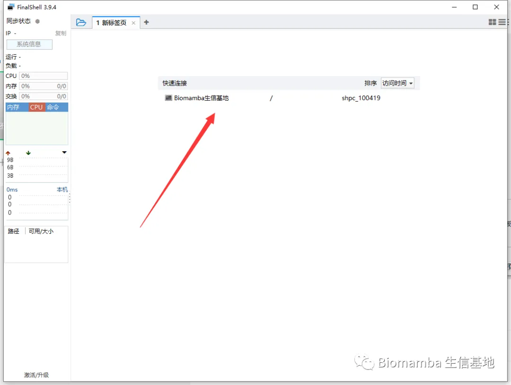
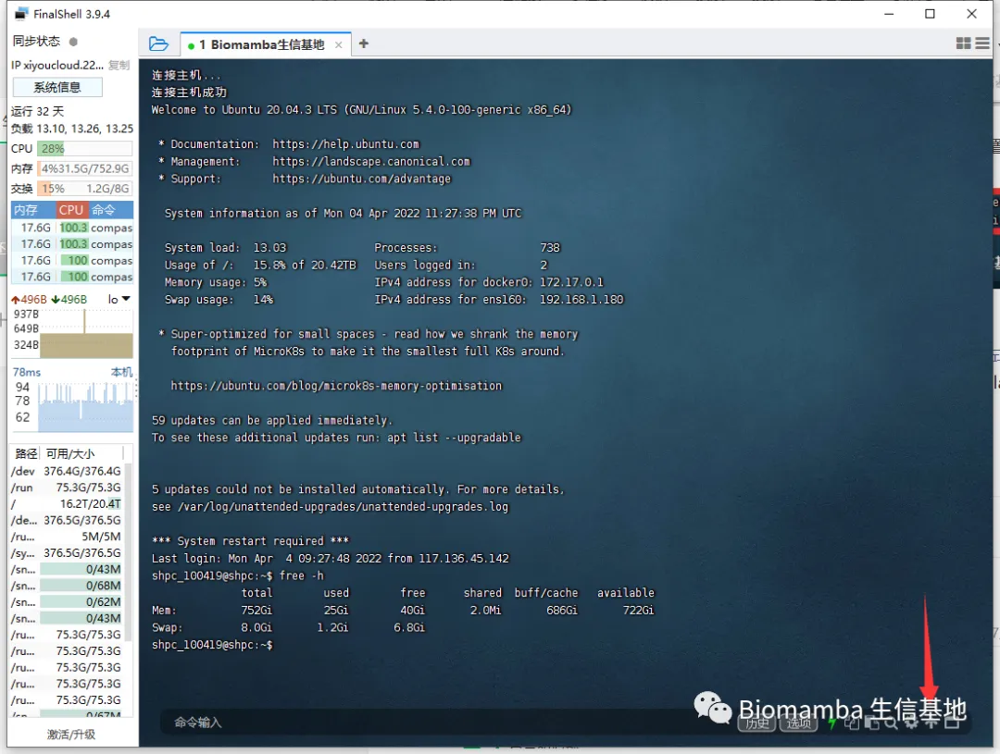
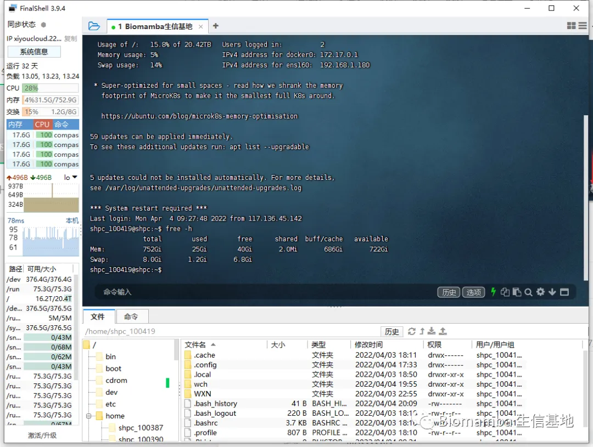
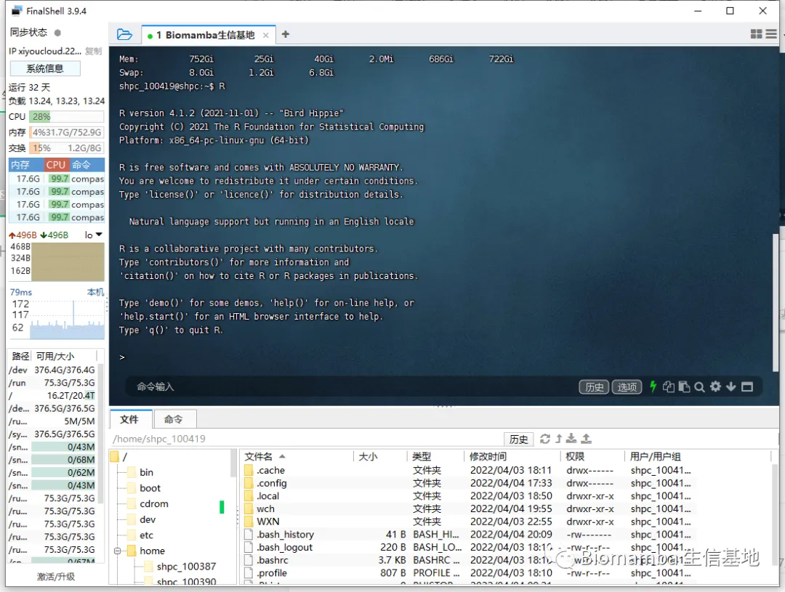

# 做生信，如果你还在为电脑配置而烦恼

> 原文：https://mp.weixin.qq.com/s?__biz=MzAwMzIzOTk5OQ==&mid=2247485661&idx=1&sn=9d7f7988305cb6478049cf60aeb111f1&chksm=9b3f718dac48f89ba30ce48664154164afafc5dbbb70ef549bb6c2c44894fa49067fb8b961fb#rd
> 合集：服务器

没错，我又替你们去谈判了，我们的粉丝中主要是从事于单细胞测序分析的，其中的很多人也问过我一些关于硬件配置的问题，不难发现，大家都曾为自己的电脑配置而困扰。还有一个比较普遍的问题是，大家的设备、R语言、Rstudio的版本与我有所出入，有相当一部分同学运行我的代码时由于版本的问题会遇到报错，综合这两个问题，初步有一个解决的办法——共享服务器。使用这个服务器，我们都可以在同样的环境下进行操作，其中预先安装了很多R包，直接加载即可，排除版本问题并拥有足够的配置：https://www.xiyoucloud.net/aff/UPWEQQBD

以上为各类配置服务器（共享）每年的租用价格，需要购买的可以文末加我微信先联系我一下，如果购买人数超过15个，我考虑买一个整机（独享）然后以更便宜的价格（85折）租给大家。大家也可以申请一个免费的先试一试。

下面演示一下基本操作流程和优势！1、下载并安装finalshell
http://www.hostbuf.com/downloads/finalshell_install.exe这一步应该不用多说，下载后双击运行按默认参数点下一步直至完成安装即可。

2、连接服务器：（1）创立连接：第一次创建连接的时候可能有点麻烦，需要按以下1、2、3号箭头依次点击。

在弹出的窗口中依次填入购买成功页面显示的以下信息后点击确定。

关闭finalshell并重启后即可通过双击快速连接访问服务器，以上的信息填写一次就好啦，以后直接点击这个快速连接即可：

进来以后就是Linux的页面：

可以看出服务器的中还有722GB的内存处于可获取状态，这个配置对大家来说肯定绰绰有余，无论运行什么样的单细胞数据应当都不在话下。

3、文件传输老粉丝看过我这个教程（[Linux与Windows实现文件交互的几种方式](<http://mp.weixin.qq.com/s?__biz=MzAwMzIzOTk5OQ==&mid=2247483912&idx=1&sn=c7717aed4492c48913e2259cec6455da&chksm=9b3f7b58ac48f24e28774b7fdcd4bc27d8789bcf045a4289a4f703a5e64234912544286adde9&scene=21#wechat_redirect>)）的应该知道，如果用Putty连接Linux，文件传输还得额外安装一个FileZilla。但是Finalshell是集命令行和文件传输于一体的远程控件：
（1）点击打开文件传输页面

（2）即可通过下面的列表进行文件传输

4、使用R语言

(1)R

用过Linux的都知道，在命令行敲一个R即可进入R环境，但是这种方式不太好操作。不推荐。

（2）Rstudio

购买产品后的页面会提供一个网页版Rstudio的链接，复制到浏览器打开即可，下面的红色箭头即可上传文件，用起来比较方便

以下是实际使用时的测试视频：

我的联系方式，非诚勿扰
