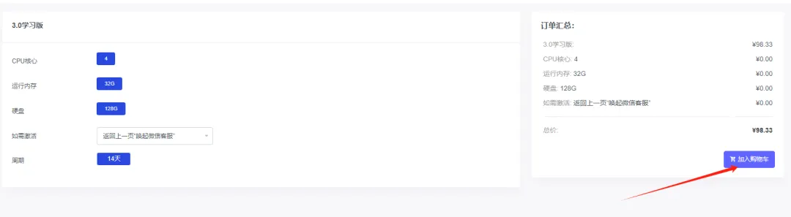
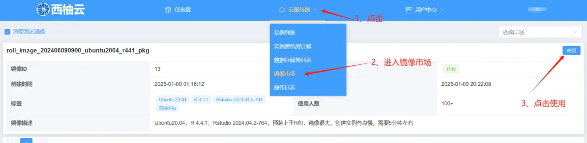
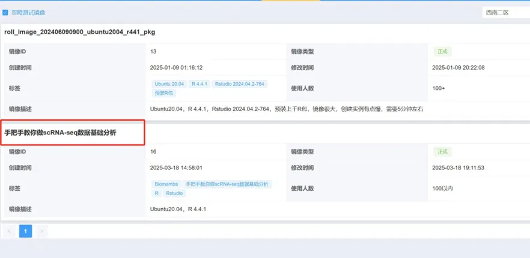
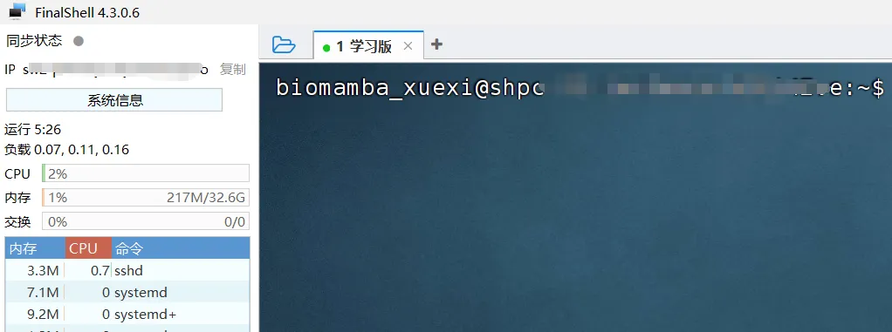

# 新增50个免费名额|学习版服务器使用权限

> 原文：https://mp.weixin.qq.com/s?__biz=MzAwMzIzOTk5OQ==&mid=2247528838&idx=2&sn=d4741a1a46d8e87e737e4221abfc6f01&chksm=9b3c08d6ac4b81c0c17eb768d27fa61ebdeb5fe944f0f83a352a2cc6d84a6b27cf923fe69caf#rd
> 合集：服务器

之前给大家用来练手的学习版由于机房升级一直没有上架，现在是时候回归啦。给大家上架了一批**免费的** 、**32GB** 、**4线程** 的服务器(使用时长两周)，配合我们的[十小时学会Linux](<http://mp.weixin.qq.com/s?__biz=MzAwMzIzOTk5OQ==&mid=2247505777&idx=1&sn=f3efae390566b838a445ab9f832323c8&chksm=9b3cae21ac4b2737f5923b246470d699474c041bb78de50d2b71b99d537f9f44ca2938002cda&scene=21#wechat_redirect>)，应该足够你完成Linux的学习啦。每个月都会新增50个名额，正式使用版不限名额：[足够支持你完成硕博生涯的生信环境](<https://mp.weixin.qq.com/s?__biz=MzAwMzIzOTk5OQ==&mid=2247528429&idx=2&sn=26c1d429b2458ea066582e0cb823d935&scene=21#wechat_redirect>)。大家可以随时联系微信[Biomamba_zhushou]申请免费的服务器：

大家可以根据视频来申请体验权限：
现在还有专属的单细胞数据分析镜像：
学习版权限申请图文流程：**第一步** ，复制网址(**https://biomamba.xiyoucloud.net/**)至浏览器，注册账号实名认证。**第二步** ，点击进入生信服务器列表，选择3.0学习版的"点击购买"，加入购物车：
**第三步** ，输入并应用优惠码(联系文末领取)，查看价格是否变成**0元**

**第四步** ，联系文末微信，发送账号/用户ID，我们为您激活服务器
**第五步** ，进入控制台创建实例选择西南二区

现额外添加了"手把手教你做scRNA-sseq基础分析"镜像，大家选择这个镜像就可以参加本次的课程啦~

创建服务器实例，设置账户和密码，获取IP和端口

设置好之后就可以用ssh正常远程连接啦：
[Rstudio-server](<https://mp.weixin.qq.com/mp/appmsgalbum?__biz=MzAwMzIzOTk5OQ==&action=getalbum&album_id=3747730159902867464#wechat_redirect>)也是可以正常使用的，大家可以愉快的学习[R语言](<https://mp.weixin.qq.com/s?__biz=MzAwMzIzOTk5OQ==&mid=2247527337&idx=1&sn=6893269670fc98b41d6bb1decf5abadb&scene=21#wechat_redirect>)和[单细胞](<https://mp.weixin.qq.com/s?__biz=MzAwMzIzOTk5OQ==&mid=2247522324&idx=2&sn=121c6dcb2687ed94bd3f8b2dd318aa9a&scene=21#wechat_redirect>)：
**
**

**如何联系我们**

 留一个领取资料、[免费两周学习版上](<https://mp.weixin.qq.com/s?__biz=MzAwMzIzOTk5OQ==&mid=2247527585&idx=1&sn=fa32112c11b215b33096cab43baf08ea&scene=21#wechat_redirect>)服务器的**微信号** ，方便各位随时交流（别问在么，添加时直接说来意）。同时我们也构建了[交流群矩阵](<https://mp.weixin.qq.com/s?__biz=MzAwMzIzOTk5OQ==&mid=2247528057&idx=1&sn=bb348c2a88c977c7cce67ee6731a3591&scene=21#wechat_redirect>)，欢迎大家入群讨论。

大家可以阅读完这几篇之后添加[给生信入门初学者的小贴士](<http://mp.weixin.qq.com/s?__biz=MzAwMzIzOTk5OQ==&mid=2247493329&idx=1&sn=597870b7f7ce10346da3561e7c281627&chksm=9b3c9f81ac4b169794088ce9abbcacb5f18e9fd174fc0d7e28da62d78facadf3100ef38aaf22&scene=21#wechat_redirect>)
[如何搜索公众号过往发布内容](<http://mp.weixin.qq.com/s?__biz=MzAwMzIzOTk5OQ==&mid=2247506266&idx=2&sn=22b1164bc9602c25620d058847785422&chksm=9b3ca00aac4b291c16d738271746ffb90149282a728f484e8a1952463c46a8e7dc4f883ab928&scene=21#wechat_redirect>)

**已有生信基地联系方式的同学****无需重复添加**

 您点的每个赞和在看，我都认真当成了喜欢
