# 选择西柚云的11个理由

> 原文：https://mp.weixin.qq.com/s?__biz=MzAwMzIzOTk5OQ==&mid=2247529471&idx=2&sn=c191f2df999820bf7f1f96832d120d2d&chksm=9b3c0aafac4b83b94c0b76e95a8be80421de213bca85280a71f66a575fbe57cfda234bce60a7#rd
> 合集：服务器

# 写在前面

大数据的趋势不必赘述，长期以来我们一直给大家提供[足够支持你完成硕博生涯的生信环境](<https://mp.weixin.qq.com/s?__biz=MzAwMzIzOTk5OQ==&mid=2247526504&idx=2&sn=417d07347cebe0a1bd403f6c3e7d9b29&scene=21#wechat_redirect>)，本文我们整理了西柚云服务器在生信圈的独特生态位，[独立环境](<https://mp.weixin.qq.com/s?__biz=MzAwMzIzOTk5OQ==&mid=2247529125&idx=1&sn=e0bdd85b3e95acf89c49793b7f065c42&scene=21#wechat_redirect>)、[灵活调度](<https://mp.weixin.qq.com/s?__biz=MzAwMzIzOTk5OQ==&mid=2247502091&idx=1&sn=616584a04370d483da5697acc5d7350a&scene=21#wechat_redirect>)、[开箱即用](<https://mp.weixin.qq.com/s?__biz=MzAwMzIzOTk5OQ==&mid=2247528410&idx=2&sn=0f2bac25479cf8d20dab5d82ae986f2e&scene=21#wechat_redirect>)、[数据保障](<https://mp.weixin.qq.com/s?__biz=MzAwMzIzOTk5OQ==&mid=2247490796&idx=1&sn=99bdd182e1f02f88d30b196e4960b9b0&scene=21#wechat_redirect>)、[天级快照](<https://mp.weixin.qq.com/s?__biz=MzAwMzIzOTk5OQ==&mid=2247529432&idx=2&sn=72e5349f1be889c099cda59ab93cc392&scene=21#wechat_redirect>)、多线接入、国际网络、[入侵防御](<https://mp.weixin.qq.com/s?__biz=MzAwMzIzOTk5OQ==&mid=2247526504&idx=1&sn=4ebfe72e195cb1d2097396648ae822db&scene=21#wechat_redirect>)、[GPU选配](<https://mp.weixin.qq.com/s?__biz=MzAwMzIzOTk5OQ==&mid=2247529343&idx=1&sn=988d600e144e51b48bc4b66df45d8e05&scene=21#wechat_redirect>)、知识沉淀、[技术支持](<https://mp.weixin.qq.com/s?__biz=MzAwMzIzOTk5OQ==&mid=2247520567&idx=1&sn=6800842ddd5ad1c17224c4b20ca1d145&scene=21#wechat_redirect>)等11个优势，都是我们多年沉淀的结果。有任何想法随时欢迎客服微信[**Biomamba_yunying**]如果你对服务器比较迷茫，那么你可以先行学习以下教程：[十小时学会Linux](<http://mp.weixin.qq.com/s?__biz=MzAwMzIzOTk5OQ==&mid=2247505777&idx=1&sn=f3efae390566b838a445ab9f832323c8&chksm=9b3cae21ac4b2737f5923b246470d699474c041bb78de50d2b71b99d537f9f44ca2938002cda&scene=21#wechat_redirect>)
[生信Linux及服务器使用技巧](<https://mp.weixin.qq.com/mp/appmsgalbum?__biz=MzAwMzIzOTk5OQ==&action=getalbum&album_id=2980604042328702978#wechat_redirect>)

如果你的计算机不足以支持下面流程的计算，可按需选用适合自己的计算资源：共享(经济实惠)：[有root权限的共享服务器,报我名字立减200￥](<http://mp.weixin.qq.com/s?__biz=MzAwMzIzOTk5OQ==&mid=2247503869&idx=1&sn=142f8c7ba8620815a8770773df077f12&chksm=9b3cb6adac4b3fbb1acdf7593df06af5ac77d1fe9c0144c999de7109bd063b76080a33c50e0d&scene=21#wechat_redirect>)独享(省电省心)：[生信分析不求人](<http://mp.weixin.qq.com/s?__biz=MzAwMzIzOTk5OQ==&mid=2247508226&idx=1&sn=69e0eea720ac6aecc0362bcb9ac339ba&chksm=9b3cd852ac4b51445651a091be0fb6f638bd8cf5eb399af1c54804631fe3047706cf1d4044de&scene=21#wechat_redirect>)GPU算力：[5090终于上架啦](<https://mp.weixin.qq.com/s?__biz=MzAwMzIzOTk5OQ==&mid=2247529343&idx=1&sn=988d600e144e51b48bc4b66df45d8e05&scene=21#wechat_redirect>)

访问链接：https://biomamba.xiyoucloud.net/

更多内容可咨询客服微信[**Biomamba_yunying**]

# 独立环境

  * 每个用户服务器之间完全隔离，拥有root权限的同时确保数据防泄漏。详细介绍可参考：[传统共享服务器，可能有数据泄露风险！](<https://mp.weixin.qq.com/s?__biz=MzAwMzIzOTk5OQ==&mid=2247529125&idx=1&sn=e0bdd85b3e95acf89c49793b7f065c42&scene=21#wechat_redirect>)

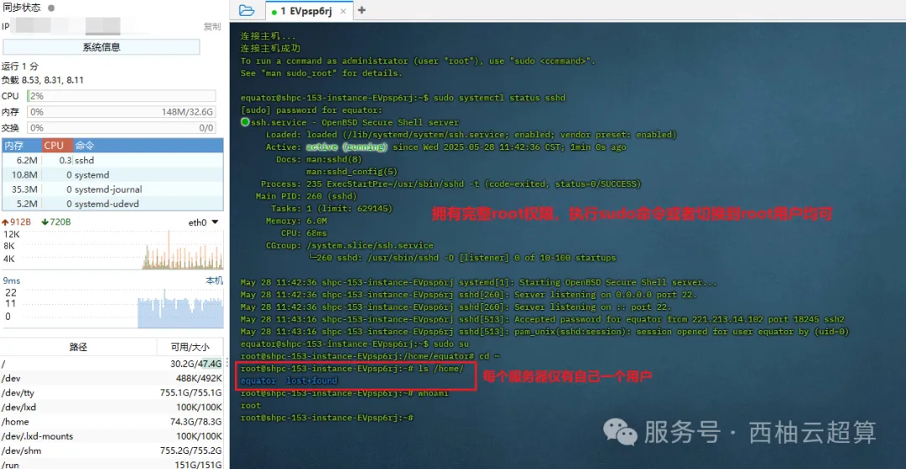

# 灵活调度

  * 可以在不同服务器之间灵活调度，随着计算节点的增加，真正实现共享的价格独享的体验，迁移后无需修改主机和端口，通过原地址即可访问。详细教程可参考：[如何利用服务器进行“时空穿梭”](<https://mp.weixin.qq.com/s?__biz=MzAwMzIzOTk5OQ==&mid=2247529432&idx=2&sn=72e5349f1be889c099cda59ab93cc392&scene=21#wechat_redirect>)

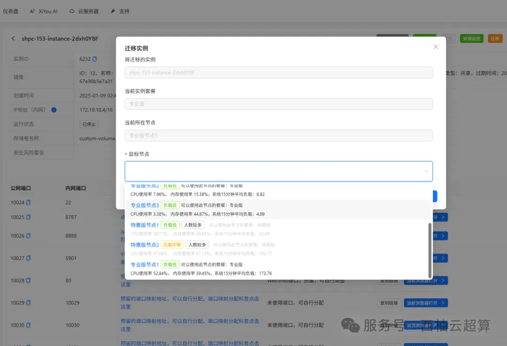

# 开箱即用

  * 提供多个基础环境镜像，预装上千R包，我们也在不断打包镜像：[开箱即用的单细胞分析镜像](<https://mp.weixin.qq.com/s?__biz=MzAwMzIzOTk5OQ==&mid=2247528410&idx=2&sn=0f2bac25479cf8d20dab5d82ae986f2e&scene=21#wechat_redirect>)

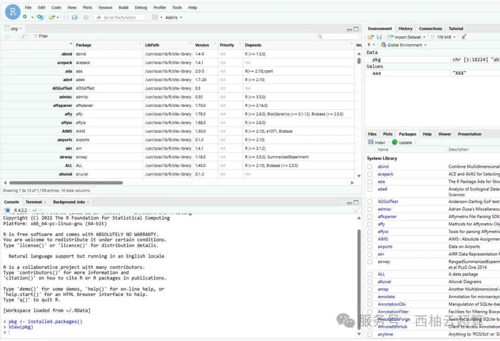

  * 打造课程配套镜像，[代码复现](<https://mp.weixin.qq.com/mp/appmsgalbum?__biz=MzAwMzIzOTk5OQ==&action=getalbum&album_id=2981710763847614469#wechat_redirect>)更加轻松。

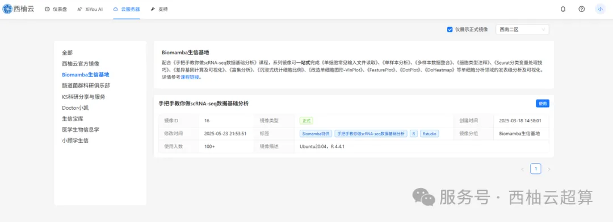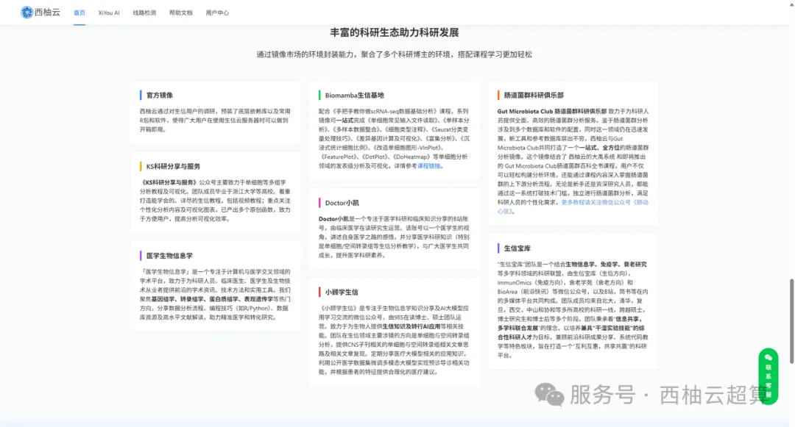

# 数据保障

  * 分布式存储多副本数据备份，数据更可靠。详细介绍可见：[传统共享服务器，可能有数据泄露风险！](<https://mp.weixin.qq.com/s?__biz=MzAwMzIzOTk5OQ==&mid=2247529125&idx=1&sn=e0bdd85b3e95acf89c49793b7f065c42&scene=21#wechat_redirect>)、[大家的宝贝数据怎么存储才最安全](<https://mp.weixin.qq.com/s?__biz=MzAwMzIzOTk5OQ==&mid=2247490796&idx=1&sn=99bdd182e1f02f88d30b196e4960b9b0&scene=21#wechat_redirect>)

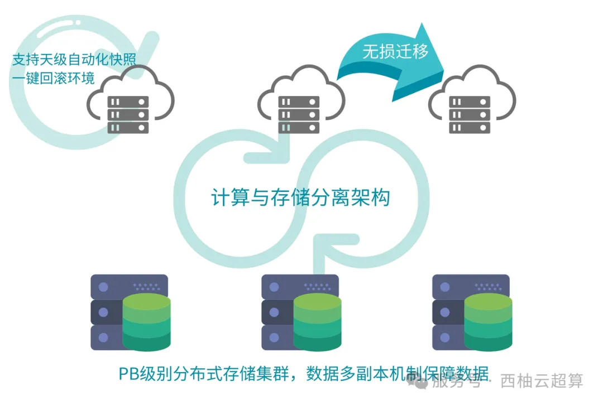

# 天级快照

  * 购买云快照服务后，支持天级快照，每天凌晨快照一次，相当于每天一个存档点，再也不怕：云服务器环境被配置乱了，无法复原；数据被误删除；软件奇奇怪怪的bug崩溃导致目录文件丢失；实例被入侵导致数据丢失；服务器被入侵中了勒索病毒需要高额赎金等问题。详细使用可见：[如何利用服务器进行“时空穿梭”](<https://mp.weixin.qq.com/s?__biz=MzAwMzIzOTk5OQ==&mid=2247529432&idx=2&sn=72e5349f1be889c099cda59ab93cc392&scene=21#wechat_redirect>)

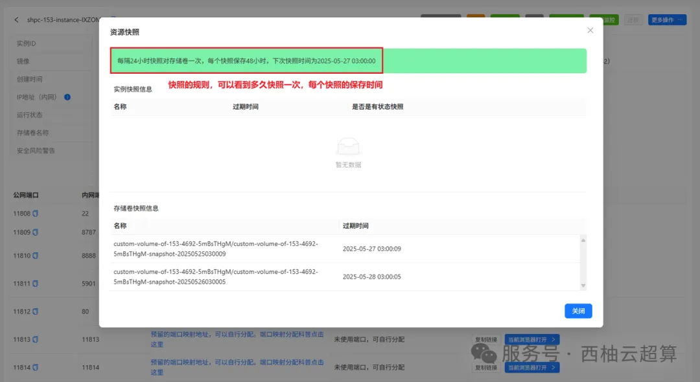

# 多线接入

  * 每个机房至少4条线路可以访问西柚云服务器，避免单一运营商故障导致无法访问服务器。

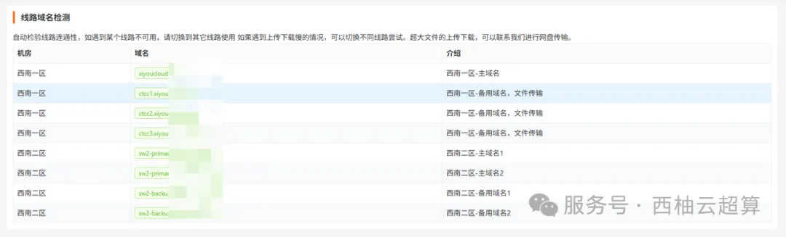

# 国际网络

  * 购买国际网络服务后，可顺畅下载安装国外软件，顺畅访问国外科研网站。

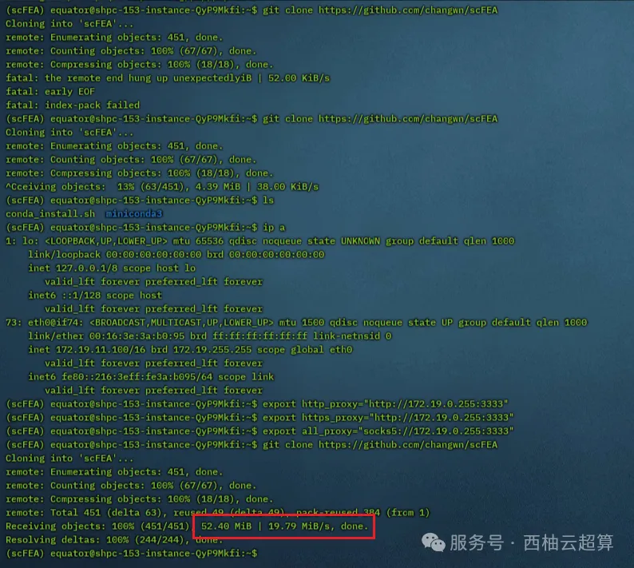

# 入侵防御

  * 提供免费的网络入侵防御，拦截SSH、Rstudio、Jupyter密码爆破等网络攻击，提供入侵前防御以及入侵后告警的完善防御机制。我们做的努力值得被看见：[拦截了10亿+网络病毒攻击的查杀技巧](<https://mp.weixin.qq.com/s?__biz=MzAwMzIzOTk5OQ==&mid=2247526504&idx=1&sn=4ebfe72e195cb1d2097396648ae822db&scene=21#wechat_redirect>)

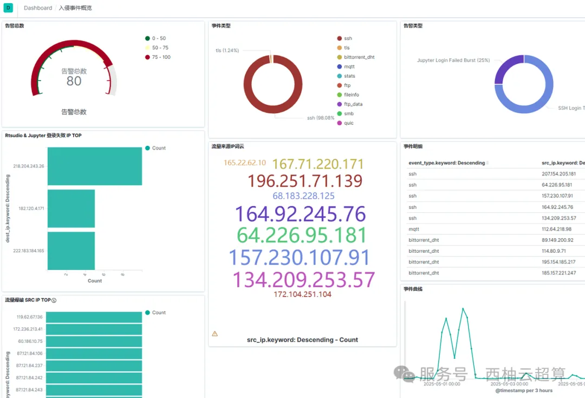

# GPU选配

  * [5090终于上架啦](<https://mp.weixin.qq.com/s?__biz=MzAwMzIzOTk5OQ==&mid=2247529343&idx=1&sn=988d600e144e51b48bc4b66df45d8e05&scene=21#wechat_redirect>)，支持选配3090、5090GPU，GPU加速运算，出结果快人一步。

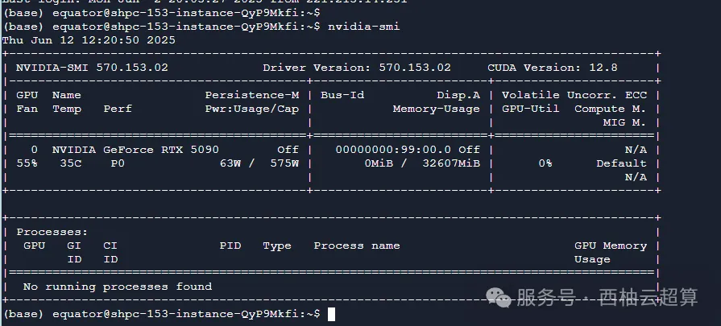

# 知识沉淀

  * 经过多年发展，积累了内部以及面向用户的完善知识库，可以快速解决服务器使用过程中遇到的绝大部分问题。哔哩哔哩同步推出系列视频课程《给科研人的计算机课程》，系统学习操作系统、计算机网络、编程思想以及各种软件的使用，让您知其然更知其所以然。

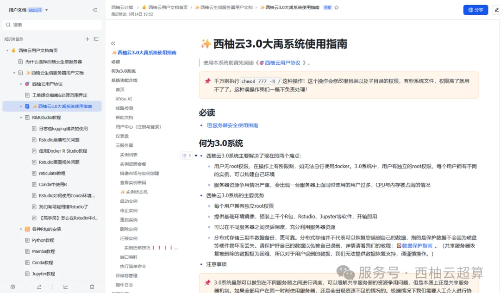

# 技术支持

  * 拥有独立的工单处理技术团队，团队成员均为精心选拔培养的计算机专业人士，无生信背景，即使授权工作人员登录服务器处理相关问题，也无需担心科研创意被泄露。管理员经过授权后方可使用内部堡垒机操作用户实例，操作过程全程录屏，可回放溯源。甚至可以[白嫖五次技术支持](<https://mp.weixin.qq.com/s?__biz=MzAwMzIzOTk5OQ==&mid=2247520567&idx=1&sn=6800842ddd5ad1c17224c4b20ca1d145&scene=21#wechat_redirect>)

  * 得益于西柚云的知识库沉淀，我们可以快速处理用户遇到的问题。独享服务器用户更有多对一技术支持群聊，实时解决用户遇到的问题。

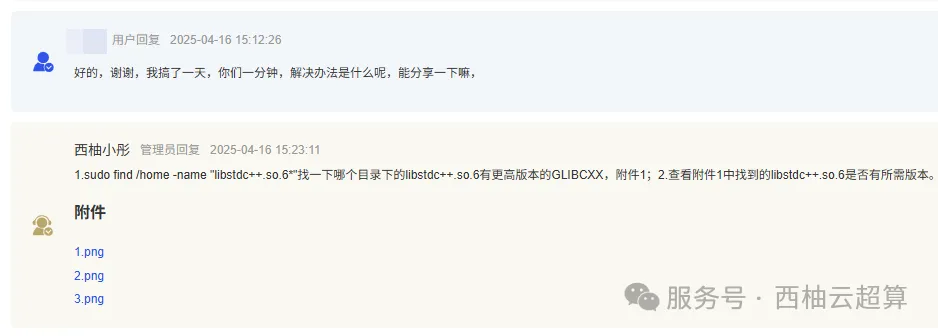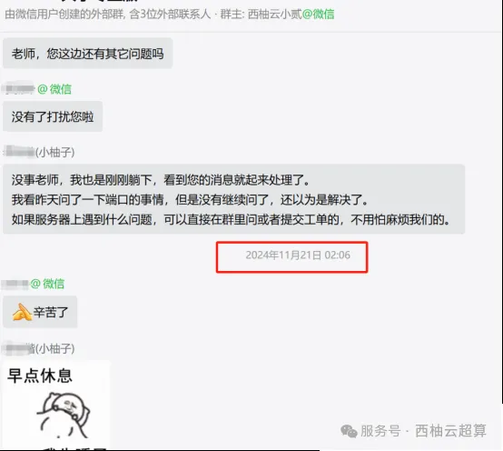

#

#

最后

GPU算力可参考：[5090终于上架啦](<https://mp.weixin.qq.com/s?__biz=MzAwMzIzOTk5OQ==&mid=2247529343&idx=1&sn=988d600e144e51b48bc4b66df45d8e05&scene=21#wechat_redirect>)目前一共发布了两款产品，专业版为60核、768GB内存、GPU为RTX5090（32GB显存）；特惠版为40核、512GB内存、GPU为RTX3090(24GB显存)。相信足够大家完成大部分的生信和机器学习加速需求。有需求的小伙伴不要错过~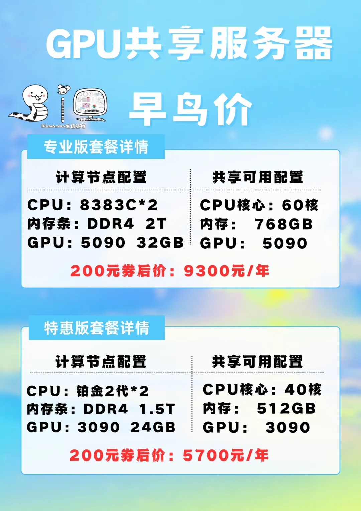

CPU产品也仍然发行，欢迎大家联系客服微信[Biomamba_yunying]优惠下单。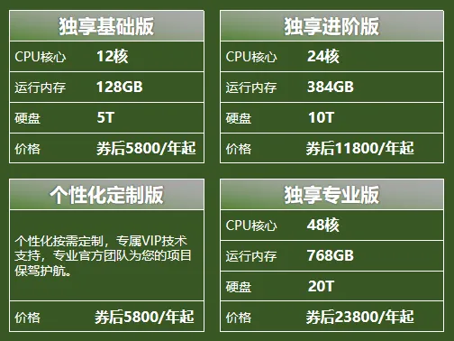
如果你还不能熟练使用Linux，那么你可以先行学习Linux教程：[十小时学会Linux](<http://mp.weixin.qq.com/s?__biz=MzAwMzIzOTk5OQ==&mid=2247505777&idx=1&sn=f3efae390566b838a445ab9f832323c8&chksm=9b3cae21ac4b2737f5923b246470d699474c041bb78de50d2b71b99d537f9f44ca2938002cda&scene=21#wechat_redirect>)
[生信Linux及服务器使用技巧](<https://mp.weixin.qq.com/mp/appmsgalbum?__biz=MzAwMzIzOTk5OQ==&action=getalbum&album_id=2980604042328702978#wechat_redirect>)也可以来找找组织：[生信Linux交流群](<https://mp.weixin.qq.com/s?__biz=MzAwMzIzOTk5OQ==&mid=2247528896&idx=1&sn=d06db51cab9a61ebd9e1865a9d6ca28b&scene=21#wechat_redirect>)
大家可按需选用适合自己的计算资源：共享(经济实惠)：[有root权限的共享服务器,报我名字立减200￥](<http://mp.weixin.qq.com/s?__biz=MzAwMzIzOTk5OQ==&mid=2247503869&idx=1&sn=142f8c7ba8620815a8770773df077f12&chksm=9b3cb6adac4b3fbb1acdf7593df06af5ac77d1fe9c0144c999de7109bd063b76080a33c50e0d&scene=21#wechat_redirect>)独享(省电省心)：[生信分析不求人](<http://mp.weixin.qq.com/s?__biz=MzAwMzIzOTk5OQ==&mid=2247508226&idx=1&sn=69e0eea720ac6aecc0362bcb9ac339ba&chksm=9b3cd852ac4b51445651a091be0fb6f638bd8cf5eb399af1c54804631fe3047706cf1d4044de&scene=21#wechat_redirect>)

访问链接：https://biomamba.xiyoucloud.net/

更多内容可咨询客服微信[**Biomamba_yunying**]

**如何联系我们**

 留一个领取资料、[免费两周学习版](<https://mp.weixin.qq.com/s?__biz=MzAwMzIzOTk5OQ==&mid=2247527585&idx=1&sn=fa32112c11b215b33096cab43baf08ea&scene=21#wechat_redirect>)服务器的**微信号[Biomamba_yunying]**，方便各位随时交流。同时我们也构建了[交流群矩阵](<https://mp.weixin.qq.com/s?__biz=MzAwMzIzOTk5OQ==&mid=2247528057&idx=1&sn=bb348c2a88c977c7cce67ee6731a3591&scene=21#wechat_redirect>)，欢迎大家入群讨论。
大家可以阅读完这几篇之后添加[给生信入门初学者的小贴士](<http://mp.weixin.qq.com/s?__biz=MzAwMzIzOTk5OQ==&mid=2247493329&idx=1&sn=597870b7f7ce10346da3561e7c281627&chksm=9b3c9f81ac4b169794088ce9abbcacb5f18e9fd174fc0d7e28da62d78facadf3100ef38aaf22&scene=21#wechat_redirect>)
[没有检索，就没有发言权](<https://mp.weixin.qq.com/s?__biz=MzAwMzIzOTk5OQ==&mid=2247529398&idx=2&sn=5a429852d61721916a405712677d5905&scene=21#wechat_redirect>)

**已有生信基地联系方式的同学****无需重复添加**

 您点的每个赞和在看，我都认真当成了喜欢
