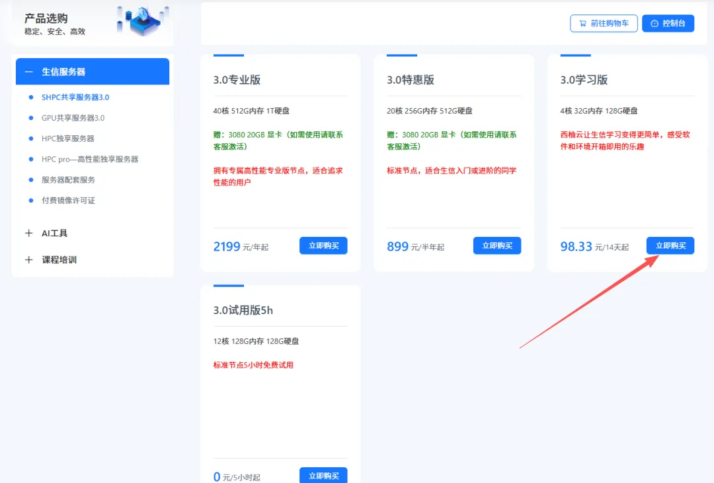
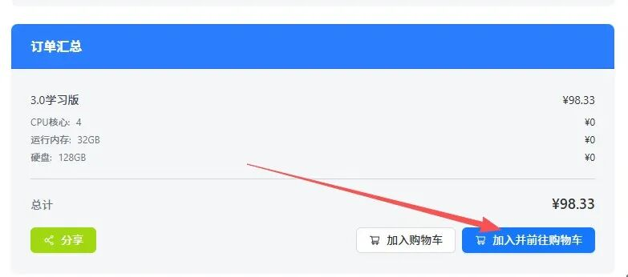

# 新增50个免费名额|学习版服务器使用权限

> 原文：https://mp.weixin.qq.com/s?__biz=MzAwMzIzOTk5OQ==&mid=2247532717&idx=2&sn=eb98e578098b9f432ea6ecbdc3c0d74b&chksm=9b3c39fdac4bb0eba77fcaaf208f1213d69769c5579188af6956c419894fc90f70b424ef616d#rd
> 合集：服务器

之前给大家用来练手的学习版由于机房升级一直没有上架，现在是时候回归啦。给大家上架了一批**免费的** 、**32GB** 、**4线程** 的服务器(使用时长两周)，配合我们的[十小时学会Linux](<http://mp.weixin.qq.com/s?__biz=MzAwMzIzOTk5OQ==&mid=2247505777&idx=1&sn=f3efae390566b838a445ab9f832323c8&chksm=9b3cae21ac4b2737f5923b246470d699474c041bb78de50d2b71b99d537f9f44ca2938002cda&scene=21#wechat_redirect>)，应该足够你完成Linux的学习啦。每个月都会新增50个名额，正式使用版不限名额：[足够支持你完成硕博生涯的生信环境](<https://mp.weixin.qq.com/s?__biz=MzAwMzIzOTk5OQ==&mid=2247528429&idx=2&sn=26c1d429b2458ea066582e0cb823d935&scene=21#wechat_redirect>)。大家可以随时联系微信[Biomamba_zhushou]申请免费的服务器：

大家可以根据视频来申请体验权限：
现在还有专属的单细胞数据分析镜像：
学习版权限申请图文流程：**第一步** ，复制网址(**https://biomamba.xiyoucloud.net/**)至浏览器，注册账号实名认证。**第二步** ，点击进入生信服务器列表，选择3.0学习版的"点击购买"，加入购物车：**第三步** ，输入并应用优惠码(联系文末领取)，查看价格是否变成**0元**

**第四步** ，联系文末微信，发送账号/用户ID，我们为您激活服务器**第五步** ，进入控制台创建实例选择西南二区

现额外添加了"手把手教你做scRNA-sseq基础分析"镜像，大家选择这个镜像就可以参加本次的课程啦~

获取"手把手教你做scRNA-sseq基础分析"镜像，请联系客服微信[Biomamba_zhushou]

创建服务器实例，设置账户和密码，获取IP和端口

设置好之后就可以用ssh正常远程连接啦：
[Rstudio-server](<https://mp.weixin.qq.com/mp/appmsgalbum?__biz=MzAwMzIzOTk5OQ==&action=getalbum&album_id=3747730159902867464#wechat_redirect>)也是可以正常使用的，大家可以愉快的学习[R语言](<https://mp.weixin.qq.com/s?__biz=MzAwMzIzOTk5OQ==&mid=2247532105&idx=2&sn=b606848ae823f7911bbe14a81876d548&scene=21#wechat_redirect>)和[单细胞](<https://mp.weixin.qq.com/s?__biz=MzAwMzIzOTk5OQ==&mid=2247531388&idx=3&sn=dfaf8cac9db70bb408206fb3da27ffda&scene=21#wechat_redirect>)：

**如何联系我们**

 留一个领取[资料](<https://mp.weixin.qq.com/s?__biz=MzAwMzIzOTk5OQ==&mid=2247528482&idx=1&sn=7cc0715eace4f592a62bdaf157b25c01&scene=21#wechat_redirect>)、[开箱即用的单细胞分析镜像](<https://mp.weixin.qq.com/s?__biz=MzAwMzIzOTk5OQ==&mid=2247528410&idx=2&sn=0f2bac25479cf8d20dab5d82ae986f2e&scene=21#wechat_redirect>)的**微信号[Biomamba_zhushou]**，方便各位随时交流。同时我们也构建了[交流群矩阵](<https://mp.weixin.qq.com/s?__biz=MzAwMzIzOTk5OQ==&mid=2247528057&idx=1&sn=bb348c2a88c977c7cce67ee6731a3591&scene=21#wechat_redirect>)，欢迎大家入群讨论。
大家可以阅读完这几篇之后添加[给生信入门初学者的小贴士](<http://mp.weixin.qq.com/s?__biz=MzAwMzIzOTk5OQ==&mid=2247493329&idx=1&sn=597870b7f7ce10346da3561e7c281627&chksm=9b3c9f81ac4b169794088ce9abbcacb5f18e9fd174fc0d7e28da62d78facadf3100ef38aaf22&scene=21#wechat_redirect>)
[没有检索，就没有发言权](<https://mp.weixin.qq.com/s?__biz=MzAwMzIzOTk5OQ==&mid=2247529398&idx=2&sn=5a429852d61721916a405712677d5905&scene=21#wechat_redirect>)

**已有生信基地联系方式的同学****无需重复添加**

 您点的每个赞和在看，我都认真当成了喜欢
