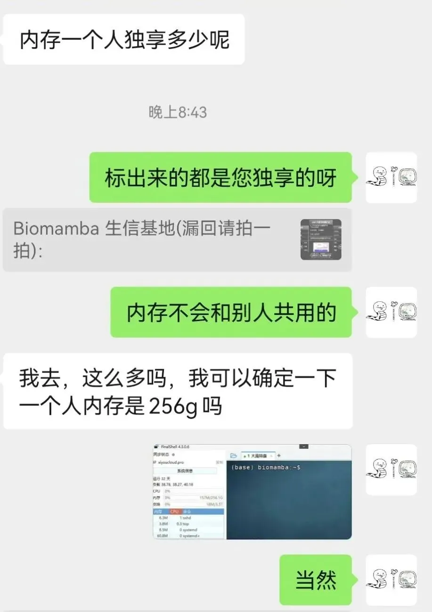
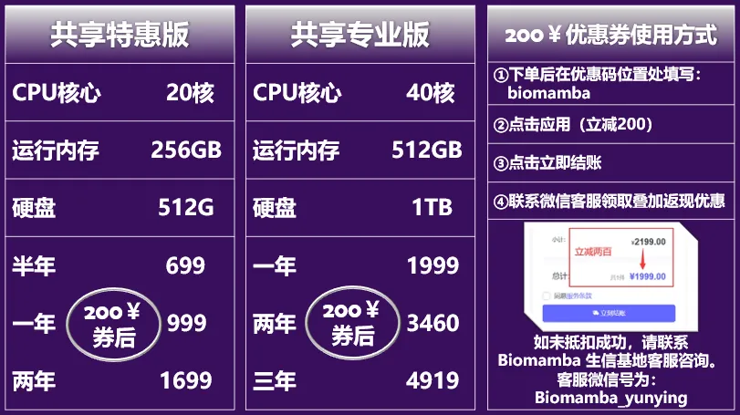
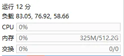
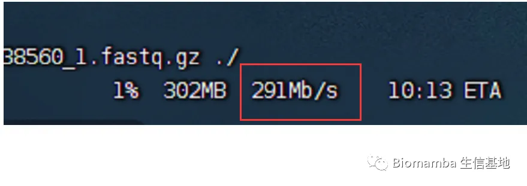
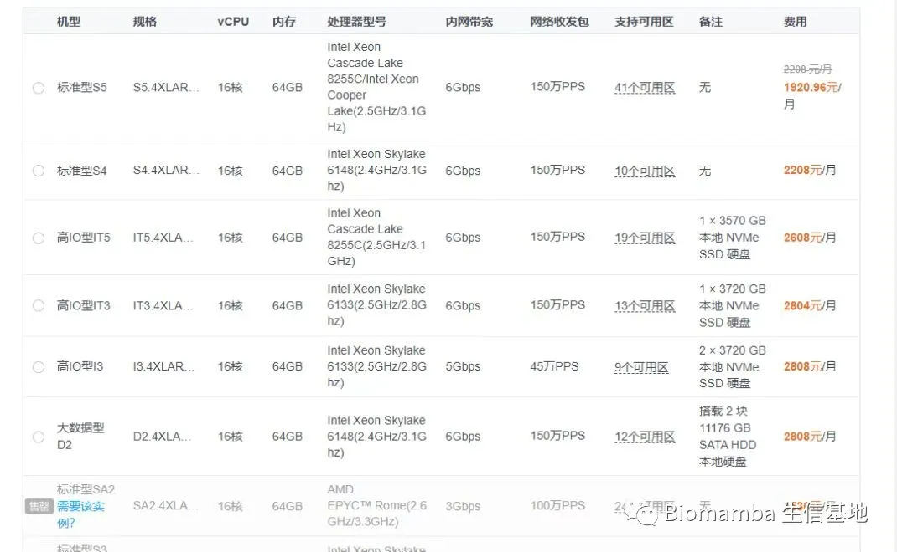
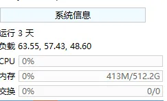

# 我去，这么多吗

> 原文：https://mp.weixin.qq.com/s?__biz=MzAwMzIzOTk5OQ==&mid=2247532796&idx=2&sn=a67e494f21dae0f5e7b6c844b3e7ba17&chksm=9b3c39acac4bb0ba121bcb9446a909601324c1e5907343a06e2622f7f61c63b60f4526f3d5b7#rd
> 合集：服务器

我们在给粉丝介绍云服务器的时候，收到了难以置信的惊呼，是的没错，256GB、20线程的服务器半年**只需要699￥(其实整台机器的配置是：[见过2TB内存，160核的共享服务器吗？](<https://mp.weixin.qq.com/s?__biz=MzAwMzIzOTk5OQ==&mid=2247530467&idx=1&sn=e1ccaf2d8a825dcb9bc987ed9c9f9c13&scene=21#wechat_redirect>))**。大家可以去某东、某宝搜一搜，同等大小的内存条需要**多少米** ，这个价格就真的纯交朋友补个电费了。详情可咨询客服微信Biomamba_zhushou。

**服务器与本地电脑相比的优势**

**一、升级配置、升级时长**

公众号内的粉丝大都是研究单细胞测序的，现在动辄就百万细胞的数据集，拿自己的8G内存笔记本显然配置够不上需求。以下为各档位服务器的配置，起步**256GB** 、**20线程** 的配置足够为你的大数据集保驾护航。可以看出我们也相比此前推出了时长更长，优惠力度更大的套餐，**年限越长** 、**性价比最高**(最多可以一次性购买五年，打骨折)。

短平快，配置与价格见下图，详细介绍见[入手足够完成硕博生涯的生信环境](<https://mp.weixin.qq.com/s?__biz=MzAwMzIzOTk5OQ==&mid=2247530226&idx=2&sn=0522eb4eae67efeea2b96404474af611&scene=21#wechat_redirect>)、[独享用户连技术支持都是独享的](<https://mp.weixin.qq.com/s?__biz=MzAwMzIzOTk5OQ==&mid=2247529475&idx=1&sn=10827e982a637e0fc36e4b6e857736c8&scene=21#wechat_redirect>)、[RTX5090、4080S、5070显卡上机](<https://mp.weixin.qq.com/s?__biz=MzAwMzIzOTk5OQ==&mid=2247529840&idx=1&sn=704b0a3d60a17c5bc2445d54c97b834f&scene=21#wechat_redirect>)。随时滴滴**微信号[Biomamba_zhushou]咨询获取[教程](<https://mp.weixin.qq.com/s?__biz=MzAwMzIzOTk5OQ==&mid=2247505777&idx=1&sn=f3efae390566b838a445ab9f832323c8&scene=21#wechat_redirect>),也欢迎注册试用：https://biomamba.xiyoucloud.net/******●******** 真的≈独享，机器中当前账号中没有计算任务时配置全空，无需与他人共享计算资源：

****●** **当然，记得合理分配计算资源，并不是调用的资源越多计算速度就越快：[调用的线程越多就算的越快嘛?](<http://mp.weixin.qq.com/s?__biz=MzAwMzIzOTk5OQ==&mid=2247488995&idx=1&sn=7140e0d037671542fb37dff3a3c94b28&chksm=9b3f6cb3ac48e5a5f54a02be9e6af9f5a4cf8da1de1770f9035130c84dedf059a024964fc15a&scene=21#wechat_redirect>)

**二、预装Rstudio-server**

做生信分析难免会遇到环境配置和软件安装的问题，自己一个个去搜软件安装办法和依赖环境效率过低，而作为专业的生信服务器，西柚云的生信技术人员已经在服务器中预装了上千款生信软件/R包:

**三、不用关机**

这点我想大家深有体会，很多软件或函数任务运行时可能会花费数天时间，在本地电脑运行期间若自己的电脑若遇到断电、断网等问题，运行中的任务则会付之一炬。而服务器在机房稳定运行、永不关机，在服务器中执行任务时，无论是挂载在**Linux** 还是用**Rstudio-server** 运行，即使本地的电脑掉线或关机，服务器依然可以继续执行任务，完全不用守着自己的电脑。

**四、网速快**

相较于大家的塑料校园网，服务器每台接入1000M的专线，且我们具有正规备案，即使访问境外的数据库依旧可以达到相同的速度，即使是使用最简单的**wget** 命令也能达到极高的下载速度，即使是用作一个网盘，似乎也比百度云更有优势。

**五、性价比高**

如上，一年服务器的费用差不多与一年的百度云会员、一个16GB内存条、1T的固态硬盘价格相当，但功能却多了许多。与其花重金升级自己的电脑，倒不如低价租用一台服务器，现在通过联名页面注册即**送200￥优惠券** ，填写优惠码[**biomamba**]立减。

另外，可咨询文末微信号**领取返现福利**(200￥粉丝专属优惠券与返现可叠加)，注册链接：

https://biomamba.xiyoucloud.net/

**六、损耗低**

电脑的工作是有损耗的，相信大家在用自己的电脑计算时已经感受到机器的**风扇在嗡嗡作响** ，倘若电脑不堪重负出现故障，随便换哪个**零件** 想来也比服务器的租金要高。

**七、数据存储有保障**

相较于传统的硬盘直储，服务器的存储方式为超融合集群存储，具体优点为高可靠性、高性能高可用，并且具有在线更换硬件、恢复数据的优势。这些优点我们之前专门花推送去说过([大家的宝贝数据怎么存储才最安全](<http://mp.weixin.qq.com/s?__biz=MzAwMzIzOTk5OQ==&mid=2247490796&idx=1&sn=99bdd182e1f02f88d30b196e4960b9b0&chksm=9b3f65bcac48ecaa845cda6ce3a127feae4776966297c75978a55cced57f90646564aded6438&scene=21#wechat_redirect>))。并且用户各自环境独立，**数据私密性** 保障拉到最高！

**八、正经Linux系统**

无论是windows下的子系统、双系统，还是虚拟机，与**真正的Linux** 环境还是有所区别。而服务器原汁原味的Linux可以帮助大家在真正的Linux环境中学习生信。没有Linux基础的小伙伴也不用担心，我们已经为大家准备好了系列教程：

[生信Linux课程](<https://mp.weixin.qq.com/mp/appmsgalbum?__biz=MzAwMzIzOTk5OQ==&action=getalbum&album_id=2545945566388977666&scene=173&from_msgid=2247503144&from_itemidx=1&count=3&nolastread=1#wechat_redirect>)[合辑](<https://mp.weixin.qq.com/mp/appmsgalbum?__biz=MzAwMzIzOTk5OQ==&action=getalbum&album_id=2545945566388977666&scene=173&from_msgid=2247503144&from_itemidx=1&count=3&nolastread=1#wechat_redirect>)

[生信Linux及服务器使用技巧](<https://mp.weixin.qq.com/mp/appmsgalbum?__biz=MzAwMzIzOTk5OQ==&action=getalbum&album_id=2980604042328702978#wechat_redirect>)

**优惠优惠优惠！**

首先，我们这个服务器**价格优势** 很明显了，西柚云基本只需要1/4的价格就能买到4~5倍的配置，给大家看看某大厂的报价，64GB内存一个月就要两千了：

另外，新的3.0服务器把内存变成了完全的**独享** ，每个用户都单独拥有全部的内存，CPU也变成了**半独享** ，并且支持一键迁移系统至其它资源闲置节点，真真正正解决了共享服务器领域资源分配不均的情况）。并且还**具有root权限** ，可以安装许多需要root的软件。总体配置比以前更**空旷** ，以下是我的实时配置空余情况，没有程序运行时服务器**基本处于空载状态** ：

具体配置的服务器每年的租用价格，需要购买的可以文末**加客服微信先联系一下** ，目前谈下来最终的方案是标价-200￥，填写优惠码[**biomamba**]立减，且有额外返现（购买后加微信Biomamba返现）。注册购买链接：https://biomamba.xiyoucloud.net/(粘贴至浏览器打开，不要从微信中跳转)

为了大家学习体验需要，免费版依然在运行（128GB，可**免费使用5** h，大家可以申请免费版或试用版**学习我的教程****[十小时学会Linux](<http://mp.weixin.qq.com/s?__biz=MzAwMzIzOTk5OQ==&mid=2247505777&idx=1&sn=f3efae390566b838a445ab9f832323c8&chksm=9b3cae21ac4b2737f5923b246470d699474c041bb78de50d2b71b99d537f9f44ca2938002cda&scene=21#wechat_redirect>)** ，**有大量运算需求时再购买** ）。试用版也是可以访问**Rstudio-server** 的，这样大家就不用总在命令行里操作啦。

避免装软件的烦恼：
大家自己的设备、R语言、Rstudio的版本与我有所出入，相当一部分同学运行我的代码时由于如上问题会遇到报错，综合这两个问题，初步有一个解决的办法——共享服务器。使用这个服务器，我们都可以在同样的环境下进行操作，每台服务器已经预先安装了我使用过的全部R包，直接加载即可，排除版本问题并拥有足够的配置。**以后我们的课程都会在西柚云中进行录制。**

这里放一个实际使用时的测试视频：

连接教程请参考：[如何连接终端和Rstudio-server](<http://mp.weixin.qq.com/s?__biz=MzAwMzIzOTk5OQ==&mid=2247506371&idx=2&sn=84c5999e37c8f411b13a2aac159649b8&chksm=9b3ca093ac4b29859fce5951ac87f34fbaaef16a5160c427f7d3c3dd06273d9741ee9fa157bc&scene=21#wechat_redirect>)

**如何联系我们**

 留一个领取[资料](<https://mp.weixin.qq.com/s?__biz=MzAwMzIzOTk5OQ==&mid=2247532585&idx=1&sn=e265d2846ec66e5faaaf21403d274d2f&scene=21#wechat_redirect>)、[开箱即用的单细胞分析镜像](<https://mp.weixin.qq.com/s?__biz=MzAwMzIzOTk5OQ==&mid=2247528410&idx=2&sn=0f2bac25479cf8d20dab5d82ae986f2e&scene=21#wechat_redirect>)的**微信号[Biomamba_zhushou]**，方便各位随时交流。同时我们也构建了[交流群矩阵](<https://mp.weixin.qq.com/s?__biz=MzAwMzIzOTk5OQ==&mid=2247528057&idx=1&sn=bb348c2a88c977c7cce67ee6731a3591&scene=21#wechat_redirect>)，欢迎大家入群讨论。
大家可以阅读完这几篇之后添加[给生信入门初学者的小贴士](<http://mp.weixin.qq.com/s?__biz=MzAwMzIzOTk5OQ==&mid=2247493329&idx=1&sn=597870b7f7ce10346da3561e7c281627&chksm=9b3c9f81ac4b169794088ce9abbcacb5f18e9fd174fc0d7e28da62d78facadf3100ef38aaf22&scene=21#wechat_redirect>)
[没有检索，就没有发言权](<https://mp.weixin.qq.com/s?__biz=MzAwMzIzOTk5OQ==&mid=2247529398&idx=2&sn=5a429852d61721916a405712677d5905&scene=21#wechat_redirect>)

**已有生信基地联系方式的同学****无需重复添加**

****

您点的每个赞和在看，我都认真当成了喜欢
