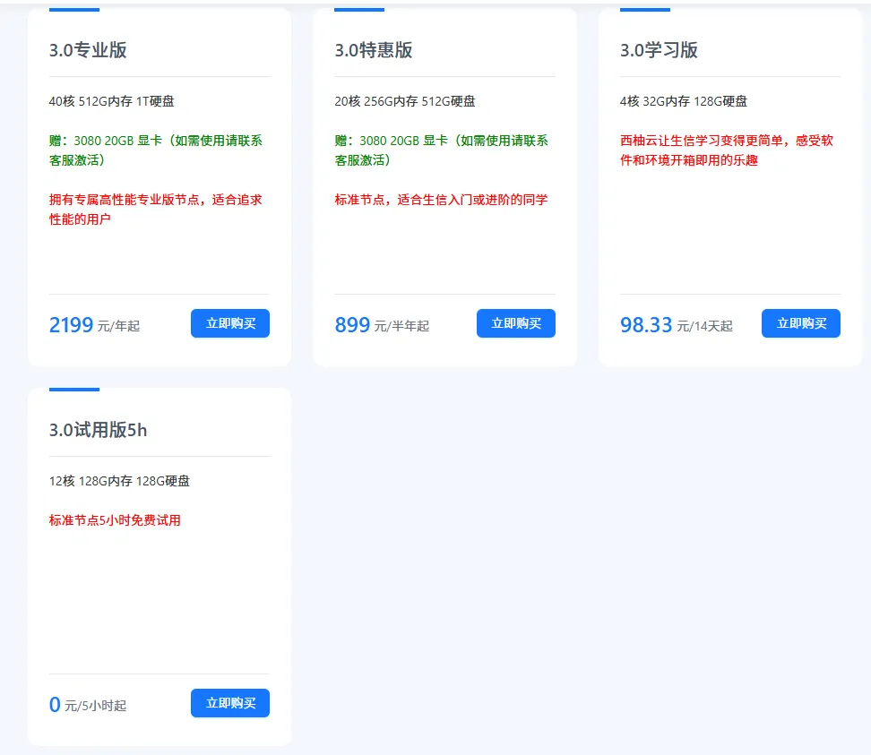
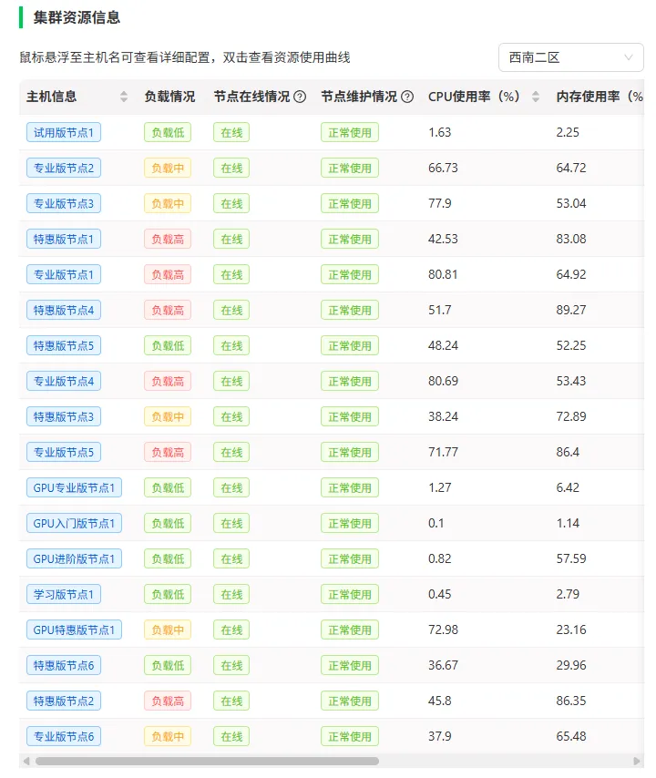
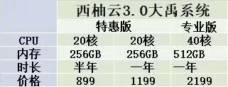
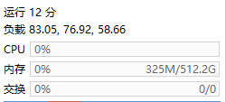
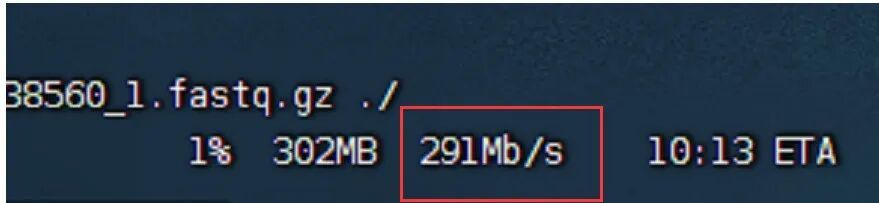
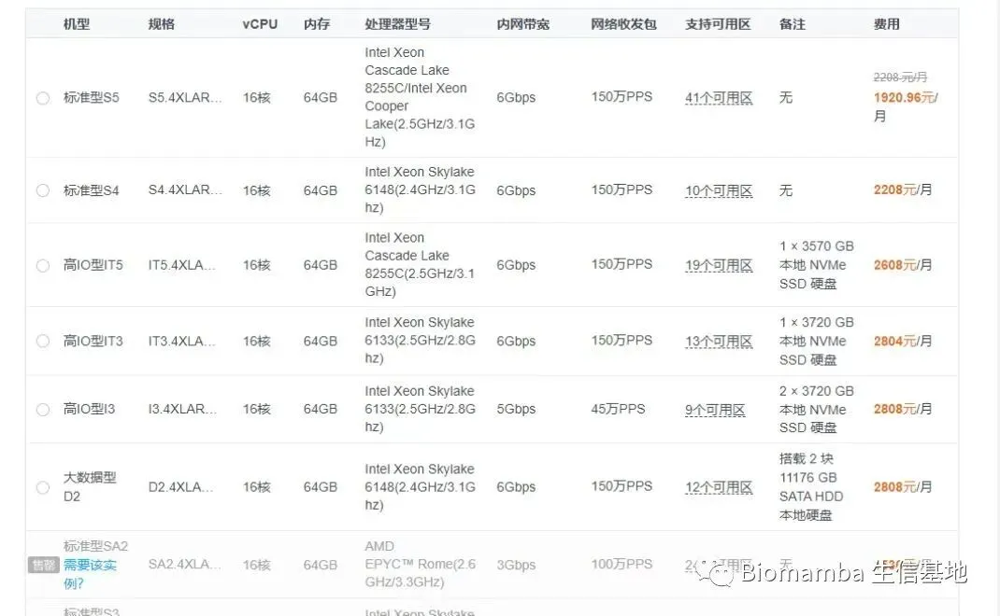
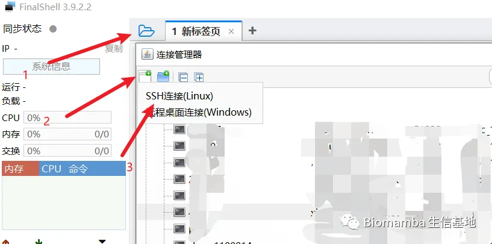
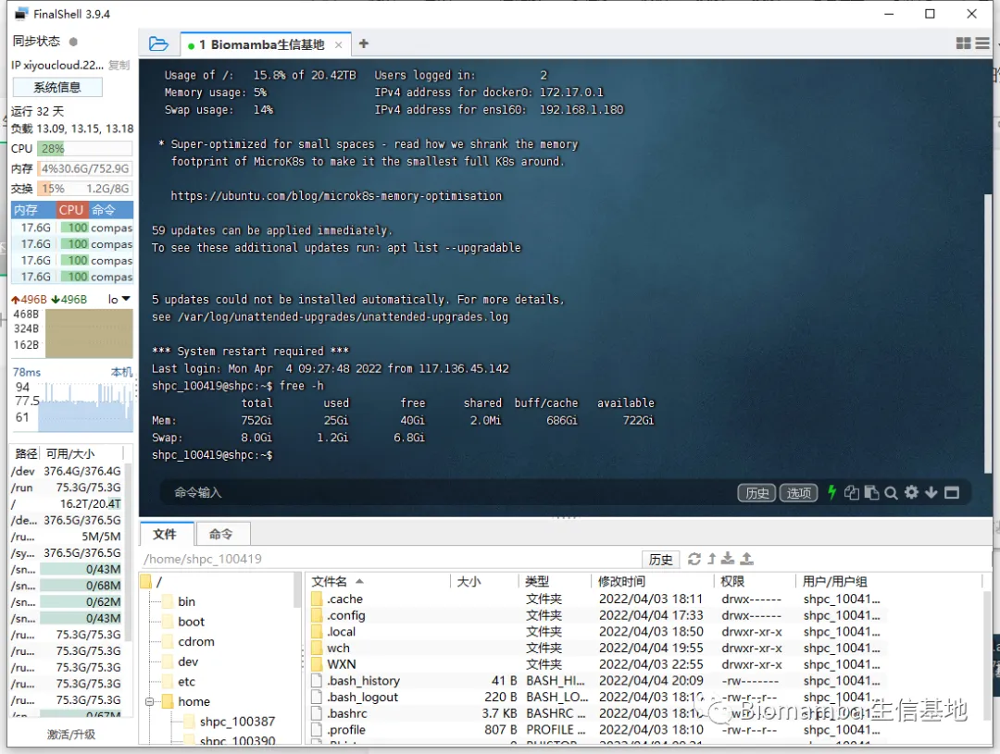
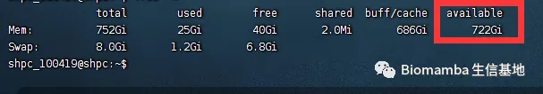
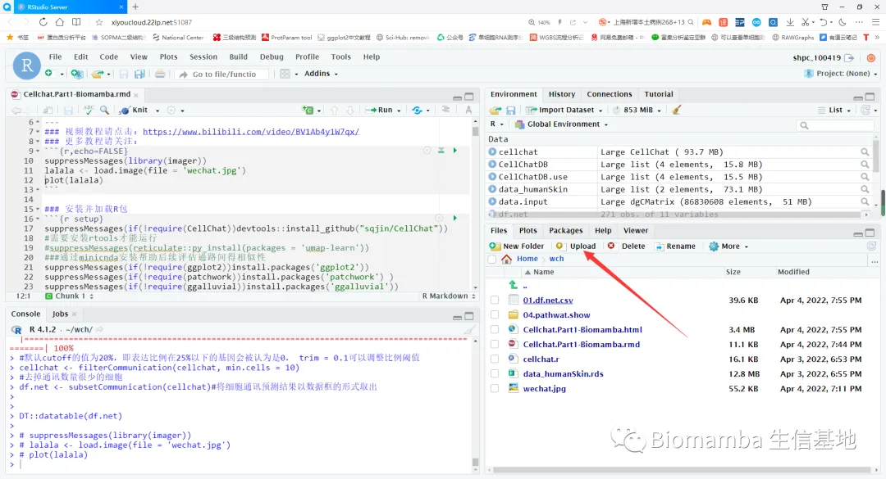

# 有root权限的共享服务器,报我名字立减200￥

> 原文：https://mp.weixin.qq.com/s?__biz=MzAwMzIzOTk5OQ==&mid=2247532785&idx=2&sn=c364ab8365a845cd709251c026075e0a&chksm=9b3c39a1ac4bb0b736a176ec651ec567a54a33e1535f31edb00a421a27c65e1b5aa515692ec4#rd
> 合集：服务器

千呼万唤始出来****●**** Biomamba生信基地与西柚云超算携手给大家提供生信服务器已经有相当长的一段时间了([生信分析为什么要使用服务器？](<http://mp.weixin.qq.com/s?__biz=MzAwMzIzOTk5OQ==&mid=2247493231&idx=2&sn=6ca55bd540fd12686da05a3ac2a40e33&chksm=9b3c9f3fac4b1629940794a6974a033cc78db1ac5c391fc02b66d299db29319415a5dd9cdfc7&scene=21#wechat_redirect>))。但各个社区间资源分配、没有root权限问题一直是共享服务器业内的一个瓶颈，所以我们也一直在致力于推出**有root权限** 、**用户之间互不干扰** 、**计算资源更充沛** 的结构。我们做了很长一段时间的尝试，盼望着盼望着，”大禹系统“终于完成搭建并可以开始发售，在这个系统里，每个用户都有管理员权限并且可以在当前计算节点拥挤时，一键将数据无损迁移至计算资源空余。最近我们也新加入了一些计算节点，计算资源如大海般宽广，大大提升了云计算的稳定性。某种意义上说CPU与内存**几乎实现了独享** ，唯一共享的只剩下宽带：
****●**** 以下是目前各类型服务器配置与价格目录：****●**** 现在通过优惠码[**biomamba**]可以**立减200￥** ，填写优惠码

****●**** 另外，可咨询文末微信号**领取返现福利**(200￥折扣可与返现可叠加)，注册链接：

https://biomamba.xiyoucloud.net/

生信分析需要服务器的几点理由

**一、升级配置**

****●**** 这一点可以说是刚需，公众号内的粉丝大都是研究单细胞测序的，现在动辄就百万细胞的数据集，拿自己的8G内存笔记本显然配置够不上需求。以下为各档位服务器的配置，起步**256GB** 、**20核** 的配置(大禹系统里的配置基本等于独享，而非共享资源)足够为你的大数据集保驾护航：******●****** 真的≈独享，机器中当前账号中没有计算任务时配置全空，无需与他人共享计算资源：

****●**** 当然，记得合理分配计算资源，并不是调用的资源越多计算速度就越快：[调用的线程越多就算的越快嘛?](<http://mp.weixin.qq.com/s?__biz=MzAwMzIzOTk5OQ==&mid=2247488995&idx=1&sn=7140e0d037671542fb37dff3a3c94b28&chksm=9b3f6cb3ac48e5a5f54a02be9e6af9f5a4cf8da1de1770f9035130c84dedf059a024964fc15a&scene=21#wechat_redirect>)

**二、技术支持**

****●**** 做生信分析难免会遇到**环境配置** 和**软件安装** 的问题，自己一个个去搜软件安装办法和依赖环境效率过低，而作为专业的生信服务器，西柚云的生信技术人员已经在服务器中**预装了上千款生信软件/R包** :

**三、不用关机**

****●**** 这点我想大家深有体会，很多软件或函数任务运行时可能会花费**数天** 时间，在本地电脑运行期间若自己的电脑若遇到**断电** 、**断网** 等问题，运行中的任务则会**付之一炬** 。而服务器在机房稳定运行、永不关机，在服务器中执行任务时，无论是挂载在**Linux** 还是用**Rstudio-server** 运行，即使本地的电脑掉线或关机，服务器依然可以**继续执行任务** ，完全不用守着自己的电脑。

**四、网速快**

****●**** 相较于大家的塑料校园网，服务器每台接入**1000M** 的专线，且我们具有正规备案，即使访问**境外的数据库** 依旧可以达到相同的速度，即使是使用最简单的wget命令也能达到极高的下载速度，即使是用作一个**网盘** ，似乎也比百度云更有优势。

**五、性价比高**

****●**** 如上，一年服务器的费用差不多与一年的百度云会员、一个16GB内存条、1T的固态硬盘价格相当，但功能却多了许多。与其花重金升级自己的电脑，倒不如低价租用一台服务器，现在购买在标价的基础上还可以减两百****，联系微信Biomamba领取优惠。

**六、损耗低**

****●**** 电脑的工作是有损耗的，相信大家在用自己的电脑计算时已经感受到机器的**风扇在嗡嗡作响** ，倘若电脑不堪重负出现故障，随便换哪个**零件** 想来也比服务器的租金要高。

**七、数据存储有保障**

****●**** 相较于传统的硬盘直储，服务器的存储方式为超融合集群存储，具体优点为高可靠性、高性能高可用，并且具有在线更换硬件、恢复数据的优势。这些优点我们之前专门在推送里描述过([大家的宝贝数据怎么存储才最安全](<http://mp.weixin.qq.com/s?__biz=MzAwMzIzOTk5OQ==&mid=2247490796&idx=1&sn=99bdd182e1f02f88d30b196e4960b9b0&chksm=9b3f65bcac48ecaa845cda6ce3a127feae4776966297c75978a55cced57f90646564aded6438&scene=21#wechat_redirect>))。

**八、正经Linux系统******●**** 无论是windows下的子系统、双系统，还是虚拟机，与**真正的Linux环境** 还是有所区别。而服务器原汁原味的Linux可以帮助大家在真正的Linux环境中学习生信。没有Linux基础的小伙伴也不用担心，我们已经为大家准备好了系列教程：[跟着Biomamba一起学Linux| 一.计算机硬件组成](<http://mp.weixin.qq.com/s?__biz=MzAwMzIzOTk5OQ==&mid=2247491413&idx=1&sn=1252abc3bd5584bdf5d59487c8dd61e3&chksm=9b3f6605ac48ef13bf0bc605a9f3bba4b804f56b824a0b2a550f7c831516441e829f35ed9f69&scene=21#wechat_redirect>)[Linux| 二.计算机软件组成与Linux](<http://mp.weixin.qq.com/s?__biz=MzAwMzIzOTk5OQ==&mid=2247492243&idx=1&sn=bbb06cfd7a0836943262bf4897a390d1&chksm=9b3c9bc3ac4b12d529d9e5173c1ef22f43db3dbffac9143384fb463f30da1ca6afeea8d987bb&scene=21#wechat_redirect>)[Linux| 三.免费获得Linux系统-WSL](<http://mp.weixin.qq.com/s?__biz=MzAwMzIzOTk5OQ==&mid=2247493279&idx=1&sn=ab7f430ea98de7f29d8f4bfb238eb0d6&chksm=9b3c9fcfac4b16d916ba186e658ffb8973043e85f2fd0cf524a1f27715056555ba0130b0c2d5&scene=21#wechat_redirect>)[Linux| 四.免费获得Linux系统-虚拟机](<http://mp.weixin.qq.com/s?__biz=MzAwMzIzOTk5OQ==&mid=2247493649&idx=1&sn=0b3070157cc16bb54424bec5b8641d32&chksm=9b3c9141ac4b18574a6a09a78749e40df7bbbb320fad2a593d7a61586526085ebbdabd148384&scene=21#wechat_redirect>)[Linux| 五.免费获得Linux系统-服务器](<http://mp.weixin.qq.com/s?__biz=MzAwMzIzOTk5OQ==&mid=2247494994&idx=2&sn=0cecd945228792a6be108cca83e85779&chksm=9b3c9402ac4b1d14893b28d8618d437c0aec1ac6117154bd8ffeaac8f8f129ddefb0d4377cfb&scene=21#wechat_redirect>)[Linux| 六.命令行与与基本命令](<http://mp.weixin.qq.com/s?__biz=MzAwMzIzOTk5OQ==&mid=2247495054&idx=2&sn=13d1f8d0c6b8c974e31a355ed7b997eb&chksm=9b3c94deac4b1dc81477c239380aea22aeac952fa0495f61cd769393d165d8122c42bab830af&scene=21#wechat_redirect>)[Linux| 七.获取Linux命令帮助的几种方式](<http://mp.weixin.qq.com/s?__biz=MzAwMzIzOTk5OQ==&mid=2247495054&idx=1&sn=1a418b6877f7d8905902abe7f73ebf7a&chksm=9b3c94deac4b1dc8e1da4756108994ba6f4e0e385385df21d8fbc5a0947edef369592b9b1d3a&scene=21#wechat_redirect>)[Linux| 八.Linux的文件目录系统](<http://mp.weixin.qq.com/s?__biz=MzAwMzIzOTk5OQ==&mid=2247496291&idx=2&sn=1813f6615aa2f5a8598851f43bfdafbf&chksm=9b3c8b33ac4b0225b397b56465d559ae80c1d6cc1ab6135bb12153b9beaa04ff1e0ca1ec4402&scene=21#wechat_redirect>)[Linux| 九.路径查看与切换: pwd,cd,ls命令](<http://mp.weixin.qq.com/s?__biz=MzAwMzIzOTk5OQ==&mid=2247496291&idx=1&sn=e4afc3656c82173ff5ec8fa6b39c9d9f&chksm=9b3c8b33ac4b0225a50550199bb85c025667b2c104af270812e2baa81577789308572ac4da23&scene=21#wechat_redirect>)[Linux| 十.通配符](<http://mp.weixin.qq.com/s?__biz=MzAwMzIzOTk5OQ==&mid=2247496442&idx=1&sn=3a60951daf331f134f2959b3e654d085&chksm=9b3c8baaac4b02bc952d526e498861efa4fabf0eb8fbdf6b7f291c7e80d0105aaff454323ccb&scene=21#wechat_redirect>)[Linux| 11.文件删除: rm命令](<http://mp.weixin.qq.com/s?__biz=MzAwMzIzOTk5OQ==&mid=2247496527&idx=1&sn=fe8eec0be5994a08496bf41d803abeb9&chksm=9b3c8a1fac4b030974c5c1bdc8ccd18cb96ba6e23c5aea29fe30353db0b433294d9952d765c1&scene=21#wechat_redirect>)[Linux| 12.文件的复制(cp)与移动(mv)](<http://mp.weixin.qq.com/s?__biz=MzAwMzIzOTk5OQ==&mid=2247496599&idx=1&sn=648b97b3ffc0e7d37faf8b71f7ba2a8e&chksm=9b3c8ac7ac4b03d11c0bc81aa4c411d6bdad34e4c07cad476c792938844ae2d4e76e1c979c54&scene=21#wechat_redirect>)[Linux| 13.用户与组群概念](<http://mp.weixin.qq.com/s?__biz=MzAwMzIzOTk5OQ==&mid=2247496613&idx=1&sn=463621761f8ebb28ae229c7a4eff809a&chksm=9b3c8af5ac4b03e37a3e959617a49fb0e7304b042dbd7a548cda620c682013632214e41ae911&scene=21#wechat_redirect>)[Linux| 14.用户管理命令(useradd, passwd, userdel, su)](<http://mp.weixin.qq.com/s?__biz=MzAwMzIzOTk5OQ==&mid=2247496892&idx=1&sn=960dbca843a51a73c1b331abee5c127d&chksm=9b3c8decac4b04fa3fb1fec375e6c6950f277f6c128c9decf5c38a689086ef798f519cd10acd&scene=21#wechat_redirect>)[Linux| 15.文件权限管理: chown, chmod](<http://mp.weixin.qq.com/s?__biz=MzAwMzIzOTk5OQ==&mid=2247496931&idx=1&sn=392e2b97f850374c96de50194b95bfbf&chksm=9b3c8db3ac4b04a5ddc57970bcb36f64587725d1ddcd9bec12e0902953483eeec314a5f4a3aa&scene=21#wechat_redirect>)[Linux| 16.快捷键](<http://mp.weixin.qq.com/s?__biz=MzAwMzIzOTk5OQ==&mid=2247497180&idx=1&sn=e4d998d9c9d5a7672cba67654f7e8c1c&chksm=9b3c8c8cac4b059abd73e1e026f5d705d1bd2f25883b462cb09bdc72f140fe2727f93abb0c1f&scene=21#wechat_redirect>)[Linux| 17.输出重定向](<http://mp.weixin.qq.com/s?__biz=MzAwMzIzOTk5OQ==&mid=2247497255&idx=1&sn=304d5492738068f33d377317c31bf75b&chksm=9b3c8f77ac4b0661a7e4306071f129f06a2ca680caeecaa9d6af1f24720170d9e1fa3a371de1&scene=21#wechat_redirect>)[Linux| 18.管道符](<http://mp.weixin.qq.com/s?__biz=MzAwMzIzOTk5OQ==&mid=2247497261&idx=1&sn=8d4177937f7ff4ee7db2eb9a59878af9&chksm=9b3c8f7dac4b066b7ce3dd9f815d631bc43c8d7115c508c88c1b8038b2a5af5b6cfde6734148&scene=21#wechat_redirect>)[Linux| 19.文件查找 find, locate, which](<http://mp.weixin.qq.com/s?__biz=MzAwMzIzOTk5OQ==&mid=2247497743&idx=1&sn=f8e9fda7d325262f129a80faf77217dd&chksm=9b3c815fac4b0849c12cfb926cef2eaed8e0c779cb50c92647c48230b99492dc12aed135e03f&scene=21#wechat_redirect>)[Linux| 20.别名 alias](<http://mp.weixin.qq.com/s?__biz=MzAwMzIzOTk5OQ==&mid=2247498050&idx=1&sn=9f29a0c594743a6cd0ce2b2beaaef037&chksm=9b3c8012ac4b0904666979588c25b2025eded47d5f05885f9101d7d0e81a96d8feeff837859c&scene=21#wechat_redirect>)[Linux| 21.软链接与硬链接 ln](<http://mp.weixin.qq.com/s?__biz=MzAwMzIzOTk5OQ==&mid=2247498073&idx=1&sn=658f9059b05cc2859deb3cd4f2b5df4b&chksm=9b3c8009ac4b091f9baea3f3ca640b138358edd768d906703004323622516c7af7fedb72c446&scene=21#wechat_redirect>)[Linux| 22. (解)压缩与md5值校验](<http://mp.weixin.qq.com/s?__biz=MzAwMzIzOTk5OQ==&mid=2247499664&idx=1&sn=4864161942d45fedee2fa28e6d85460e&chksm=9b3c86c0ac4b0fd67ff1798290f95695b8284943d468aaa9ae2db38fe79927ef47dd7d73f7f6&scene=21#wechat_redirect>)
[Linux| 23. 文件查看 wc, cat, head, tail](<http://mp.weixin.qq.com/s?__biz=MzAwMzIzOTk5OQ==&mid=2247500401&idx=1&sn=e4270e426c7e1dcbc55ce9320955c21a&chksm=9b3cbb21ac4b3237b1be87b1ea466584fd996c18564b50b65a6ff7e66d0732530b0bf5e006eb&scene=21#wechat_redirect>)
[Linux| 24. 文件浏览器 more,less](<http://mp.weixin.qq.com/s?__biz=MzAwMzIzOTk5OQ==&mid=2247500554&idx=2&sn=3d20b135ac7f78500d439beac16f2067&chksm=9b3cba5aac4b334c89ad2b040b90f291118072bf3a6ee566591b42920163a965f3095e41a4e4&scene=21#wechat_redirect>)
[Linux| 25. 文件编辑器 vim](<http://mp.weixin.qq.com/s?__biz=MzAwMzIzOTk5OQ==&mid=2247500900&idx=1&sn=f8e41737d22588beaeb6cfeea8865a7d&chksm=9b3cbd34ac4b3422ded73466e862117a5b4989eb0ca2125f2c1f45b67f9ca3772d40a1bb6835&scene=21#wechat_redirect>)
[Linux| 26. 文件处理 cut, paste](<http://mp.weixin.qq.com/s?__biz=MzAwMzIzOTk5OQ==&mid=2247501934&idx=1&sn=2f942aef95ba543a5bf0226b0c7301bf&chksm=9b3cb13eac4b382838329a8519730347602e993374b063e7abafcecb7b2f476eedae6c9dd9bb&scene=21#wechat_redirect>)
[Linux| 27. 文件处理 sort, uniq](<http://mp.weixin.qq.com/s?__biz=MzAwMzIzOTk5OQ==&mid=2247502039&idx=1&sn=8e92a5f845315b6fd2c0d229aa606d17&chksm=9b3cb187ac4b3891b9e94b1e4cd3849975db7461291a1d905f28b1751619803fc89e335d9a83&scene=21#wechat_redirect>)

大禹系统介绍视频

**详细描述及图文教程**

首先，我们这个服务器**价格优势** 很明显了，西柚云基本只需要1/4的价格就能买到4~5倍的配置，给大家看看某大厂的报价，64GB内存一个月就要两千了：

另外，新旧两代服务器最大的差别是内存变成了完完全全的**独享** ，每个用户都单独拥有全部的内存，CPU也变成了**半独享** （打个比方，原先是22人共享48核、768GB内存，现在升级为100个用户共享每台96核、3T内存的10台计算节点，每当用户觉得当前计算节点拥堵时可选择一键迁移至其它资源闲置节点，真真正正解决了当前共享服务器领域资源分配不均的情况）。并且还**具有root权限** ，可以安装许多需要root的软件，这样私密性也更强。由于是半独享，总体配置比以前更**空旷** ，以下是我的实时配置空余情况，没有程序运行时服务器**基本处于空载状态** ：

具体配置的服务器每年的租用价格，需要购买的可以文末**加客服微信先联系一下** ，目前谈下来最终的方案是标价-200￥、且有额外返现（购买后加微信Biomamba返现）。注册购买链接：https://biomamba.xiyoucloud.net/(粘贴至浏览器打开，不要从微信中跳转)
为了大家学习体验需要，免费版依然在运行（128GB，可**免费使用** 1h，大家可以申请免费版或试用版**学习我的教程** ，**有大量运算需求时再购买** ）。试用版也是可以访问**Rstudio-server** 的，这样大家就不用总在命令行里操作啦。

西柚云的几点好处：1、价格优势上面已经给大家说过了，何况还有免费版供大家学习2、第二个好处是大家的设备、R语言、Rstudio的版本与我有所出入，有相当一部分同学运行我的代码时由于版本的问题会遇到报错，综合这两个问题，初步有一个解决的办法——共享服务器。使用这个服务器，我们都可以在同样的环境下进行操作，每台服务器已经预先安装了我使用过的全部R包，直接加载即可，排除版本问题并拥有足够的配置。**以后我们的课程都会在西柚云中进行录制。** 这里放一个实际使用时的测试视频：

3、网速方面也比较给力我下载文件时最大速度可以超过100M/S。就我个人来说，就当买个网盘用来高速传输也是很划算的。没有梯子的同学也可以试试用西柚云下一些墙外的东西。

4、另外，与putty连接不同的是，即使你在远程登录时自己的电脑发生以外的网络终端，远端窗口正在运行的任务并不会shut down，而是被自动挂载至后台自动运行（相当于nohup，而putty掉线了就全GG啦），这一点是很方便的，避免了重复运行的烦恼。

下面演示一下基本操作流程和优势！没有用过服务器、不会安装与连接的同学也不用担心，会有客服**手把手教学** ！1、下载并安装finalshell
http://www.hostbuf.com/downloads/finalshell_install.exe这一步应该不用多说，下载后双击运行按默认参数点下一步直至完成安装即可。2、连接服务器：（1）创立连接：第一次创建连接的时候可能有点麻烦，需要按以下1、2、3号箭头依次点击。
在弹出的窗口中依次填入购买成功页面显示的以下信息后点击确定。关闭finalshell并重启后即可通过双击快速连接访问服务器，以上的信息填写一次就好啦，以后直接点击这个快速连接即可：
进来以后就是Linux的页面：可以看出服务器的中还有722GB的内存处于可获取状态，这个配置对大家来说肯定绰绰有余，无论运行什么样的单细胞数据应当都不在话下。3、文件传输老粉丝看过我这个教程（[Linux与Windows实现文件交互的几种方式](<http://mp.weixin.qq.com/s?__biz=MzAwMzIzOTk5OQ==&mid=2247483912&idx=1&sn=c7717aed4492c48913e2259cec6455da&chksm=9b3f7b58ac48f24e28774b7fdcd4bc27d8789bcf045a4289a4f703a5e64234912544286adde9&scene=21#wechat_redirect>)）的应该知道，如果用Putty连接Linux，文件传输还得额外安装一个FileZilla。但是Finalshell是集命令行和文件传输于一体的远程控件：
（1）点击打开文件传输页面（2）即可通过下面的列表进行文件传输

4、使用R语言

(1)R

用过Linux的都知道，在命令行敲一个R即可进入R环境，但是这种方式不太好操作。不推荐。

（2）Rstudio

购买产品后的页面会提供一个网页版Rstudio的链接，复制到浏览器打开即可，下面的红色箭头即可上传文件，用起来比较方便

**如何联系我们**

 留一个领取[资料](<https://mp.weixin.qq.com/s?__biz=MzAwMzIzOTk5OQ==&mid=2247532585&idx=1&sn=e265d2846ec66e5faaaf21403d274d2f&scene=21#wechat_redirect>)、[开箱即用的单细胞分析镜像](<https://mp.weixin.qq.com/s?__biz=MzAwMzIzOTk5OQ==&mid=2247528410&idx=2&sn=0f2bac25479cf8d20dab5d82ae986f2e&scene=21#wechat_redirect>)的**微信号[Biomamba_zhushou]**，方便各位随时交流。同时我们也构建了[交流群矩阵](<https://mp.weixin.qq.com/s?__biz=MzAwMzIzOTk5OQ==&mid=2247528057&idx=1&sn=bb348c2a88c977c7cce67ee6731a3591&scene=21#wechat_redirect>)，欢迎大家入群讨论。
大家可以阅读完这几篇之后添加[给生信入门初学者的小贴士](<http://mp.weixin.qq.com/s?__biz=MzAwMzIzOTk5OQ==&mid=2247493329&idx=1&sn=597870b7f7ce10346da3561e7c281627&chksm=9b3c9f81ac4b169794088ce9abbcacb5f18e9fd174fc0d7e28da62d78facadf3100ef38aaf22&scene=21#wechat_redirect>)
[没有检索，就没有发言权](<https://mp.weixin.qq.com/s?__biz=MzAwMzIzOTk5OQ==&mid=2247529398&idx=2&sn=5a429852d61721916a405712677d5905&scene=21#wechat_redirect>)

**已有生信基地联系方式的同学****无需重复添加**

****

您点的每个赞和在看，我都认真当成了喜欢
