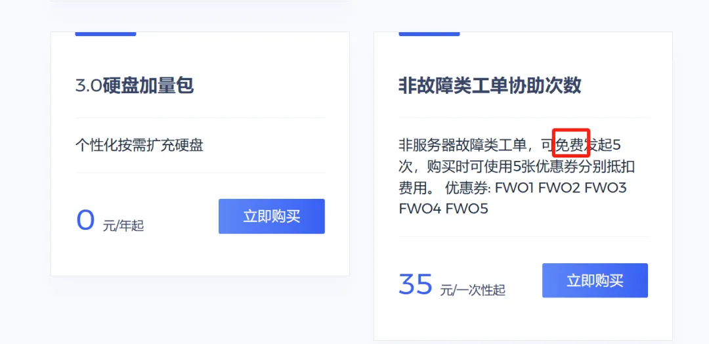

# 白嫖五次技术支持

> 原文：https://mp.weixin.qq.com/s?__biz=MzAwMzIzOTk5OQ==&mid=2247533035&idx=2&sn=6b9dcac09426b462a071bf81be50a556&chksm=9b3c38bbac4bb1ad8c0b712b62b52b236432807ab97c9d8a7ba6e670f60107a133f332a20385#rd
> 合集：服务器

**写在前面**

我们已经很努力的再给大家做各类生物信息、编程基础的知识分享：[R语言基础学习手册](<http://mp.weixin.qq.com/s?__biz=MzAwMzIzOTk5OQ==&mid=2247509991&idx=2&sn=b5094747b9944caf3c2283e179e2aca0&chksm=9b3cdeb7ac4b57a1ccbd2f1ec07424cb197e83451c464166a96ea2924f53b180b05c4c663309&scene=21#wechat_redirect>)、[十小时学会Linux](<http://mp.weixin.qq.com/s?__biz=MzAwMzIzOTk5OQ==&mid=2247505777&idx=1&sn=f3efae390566b838a445ab9f832323c8&chksm=9b3cae21ac4b2737f5923b246470d699474c041bb78de50d2b71b99d537f9f44ca2938002cda&scene=21#wechat_redirect>)、[生信Linux及服务器使用技巧](<https://mp.weixin.qq.com/mp/appmsgalbum?__biz=MzAwMzIzOTk5OQ==&action=getalbum&album_id=2980604042328702978#wechat_redirect>)但是大家还是更习惯遇到问题时**寻求帮助** ，所以现在我们开通了非服务器故障类工单的**免费协助** ，每个账号五次机会，可通过链接注册访问：https://biomamba.xiyoucloud.net/
当然仅包含西柚云产品的协助哈，我们的服务能力有限，各位自己的电脑和友商的服务器由于环境不同，就暂时不支持啦：共享(经济实惠)：[有root权限的共享服务器,报我名字立减200￥](<http://mp.weixin.qq.com/s?__biz=MzAwMzIzOTk5OQ==&mid=2247503869&idx=1&sn=142f8c7ba8620815a8770773df077f12&chksm=9b3cb6adac4b3fbb1acdf7593df06af5ac77d1fe9c0144c999de7109bd063b76080a33c50e0d&scene=21#wechat_redirect>)独享(省电省心)：[生信分析不求人](<http://mp.weixin.qq.com/s?__biz=MzAwMzIzOTk5OQ==&mid=2247508226&idx=1&sn=69e0eea720ac6aecc0362bcb9ac339ba&chksm=9b3cd852ac4b51445651a091be0fb6f638bd8cf5eb399af1c54804631fe3047706cf1d4044de&scene=21#wechat_redirect>)

访问链接：https://biomamba.xiyoucloud.net/

更多内容可咨询客服微信[**Biomamba_zhushou**]

**服务器与本地电脑相比的优势**

**一、升级配置、升级时长**

公众号内的粉丝大都是研究单细胞测序的，现在动辄就百万细胞的数据集，拿自己的8G内存笔记本显然配置够不上需求。以下为各档位服务器的配置，起步**256GB** 、**20线程** 的配置足够为你的大数据集保驾护航。可以看出我们也相比此前推出了时长更长，优惠力度更大的套餐，**年限越长** 、**性价比最高**(最多可以一次性购买五年，打骨折)。

****************●**** 当然，记得合理分配计算资源，并不是调用的资源越多计算速度就越快：[调用的线程越多就算的越快嘛?](<http://mp.weixin.qq.com/s?__biz=MzAwMzIzOTk5OQ==&mid=2247488995&idx=1&sn=7140e0d037671542fb37dff3a3c94b28&chksm=9b3f6cb3ac48e5a5f54a02be9e6af9f5a4cf8da1de1770f9035130c84dedf059a024964fc15a&scene=21#wechat_redirect>)
******●****** 真的≈独享，机器中当前账号中没有计算任务时配置全空，无需与他人共享计算资源：

我们也有**纯独享** 的机器可以提供：AI时代在向前走，我们也得顺应潮流，长期以来我们都在致力于提供大内存的CPU算力([足够支持你完成硕博生涯的生信环境](<https://mp.weixin.qq.com/s?__biz=MzAwMzIzOTk5OQ==&mid=2247528429&idx=2&sn=26c1d429b2458ea066582e0cb823d935&scene=21#wechat_redirect>))，是时候插上显卡啦，我们准备了一批RTX5090与、RTX4080S、5070的显卡(终于可以不再用我的[1650做加速了](<https://mp.weixin.qq.com/s?__biz=MzAwMzIzOTk5OQ==&mid=2247529437&idx=1&sn=1f8f39ba2ae063e1e0ec6646cebf2d2d&scene=21#wechat_redirect>))。经过两年的开发与测试([共享的价格，独享的体验](<https://mp.weixin.qq.com/s?__biz=MzAwMzIzOTk5OQ==&mid=2247529125&idx=1&sn=e0bdd85b3e95acf89c49793b7f065c42&scene=21#wechat_redirect>))，终于可以跟大家见面了，例如我们此前发布的[利用GPU加速TensorFlow](<https://mp.weixin.qq.com/s?__biz=MzAwMzIzOTk5OQ==&mid=2247529437&idx=1&sn=1f8f39ba2ae063e1e0ec6646cebf2d2d&scene=21#wechat_redirect>)、[部署本地DeepSeek](<https://mp.weixin.qq.com/s?__biz=MzAwMzIzOTk5OQ==&mid=2247529437&idx=1&sn=1f8f39ba2ae063e1e0ec6646cebf2d2d&scene=21#wechat_redirect>)，[空间转录组学习手册合辑](<https://mp.weixin.qq.com/s?__biz=MzAwMzIzOTk5OQ==&mid=2247505088&idx=1&sn=9f60dca1b21f5ba8c32d09595a512134&scene=21#wechat_redirect>)加速，就离不开显卡的并行加速计算。我们还组建了[生信Linux交流群](<https://mp.weixin.qq.com/s?__biz=MzAwMzIzOTk5OQ==&mid=2247528896&idx=1&sn=d06db51cab9a61ebd9e1865a9d6ca28b&scene=21#wechat_redirect>)，欢迎大家入群交流！有任何问题都欢迎添加客服微信[Biomamba_zhushou]聊一聊。
目前一共发布了三款产品，专业版为60核、768GB内存、GPU为RTX5090（32GB显存）；进阶版为40核、512GB内存、GPU为RTX4080S(16GB显存)；特惠版为32核、384GB内存、GPU为5070(12GB显存)。相信足够大家完成大部分的生信和机器学习加速需求。有需求的小伙伴不要错过~********

**二、预装Rstudio-server**

做生信分析难免会遇到环境配置和软件安装的问题，自己一个个去搜软件安装办法和依赖环境效率过低，而作为专业的生信服务器，西柚云的生信技术人员已经在服务器中预装了上千款生信软件/R包:

**三、不用关机**

这点我想大家深有体会，很多软件或函数任务运行时可能会花费数天时间，在本地电脑运行期间若自己的电脑若遇到断电、断网等问题，运行中的任务则会付之一炬。而服务器在机房稳定运行、永不关机，在服务器中执行任务时，无论是挂载在**Linux** 还是用**Rstudio-server** 运行，即使本地的电脑掉线或关机，服务器依然可以继续执行任务，完全不用守着自己的电脑。大家把自己的任务提交到后台运行即可：[程序可以自己跑的，不用盯着](<http://mp.weixin.qq.com/s?__biz=MzAwMzIzOTk5OQ==&mid=2247511096&idx=1&sn=14191291fa6fbdb625b9601d230509f7&chksm=9b3cd568ac4b5c7e77ef9c3bf2970902e77d96474cc2ce36b14f406824c5363bb4c0b754306f&scene=21#wechat_redirect>)

**四、网速快**

相较于大家的塑料校园网，服务器每台接入1000M的专线，且我们具有正规备案，即使访问境外的数据库依旧可以达到相同的速度，即使是使用最简单的**wget** 命令也能达到极高的下载速度，即使是用作一个网盘，似乎也比百度云更有优势。

**五、性价比高**

如上，一年服务器的费用差不多与一年的百度云会员、一个16GB内存条、1T的固态硬盘价格相当，但**功能却多了许多** 。与其花**重金** 升级自己的电脑，倒不如低价租用一台服务器，现在通过联名页面注册即**送200￥优惠券** ，填写优惠码[**biomamba**]立减：[“200元”粉丝福利使用方式](<http://mp.weixin.qq.com/s?__biz=MzAwMzIzOTk5OQ==&mid=2247510088&idx=1&sn=9475687e466d5290c1a3a376dea6c9e6&chksm=9b3cd118ac4b580e760655b7f7a3bc6f7ca8085e68e73be1a98178e3db290667c82648a9d19d&scene=21#wechat_redirect>)。

另外，可咨询文末微信号**领取返现福利**(200￥粉丝专属优惠券与返现可叠加：[“](<http://mp.weixin.qq.com/s?__biz=MzAwMzIzOTk5OQ==&mid=2247510088&idx=1&sn=9475687e466d5290c1a3a376dea6c9e6&chksm=9b3cd118ac4b580e760655b7f7a3bc6f7ca8085e68e73be1a98178e3db290667c82648a9d19d&scene=21#wechat_redirect>)[200元”粉丝福利使用方式](<http://mp.weixin.qq.com/s?__biz=MzAwMzIzOTk5OQ==&mid=2247510088&idx=1&sn=9475687e466d5290c1a3a376dea6c9e6&chksm=9b3cd118ac4b580e760655b7f7a3bc6f7ca8085e68e73be1a98178e3db290667c82648a9d19d&scene=21#wechat_redirect>))，注册链接：

https://biomamba.xiyoucloud.net/

**六、损耗低**

电脑的工作是有损耗的，相信大家在用自己的电脑计算时已经感受到机器的**风扇在嗡嗡作响** ，倘若电脑不堪重负出现故障，随便换哪个**零件** 想来也比服务器的租金要高。

**七、数据存储有保障**

相较于传统的硬盘直储，服务器的存储方式为超融合集群存储，具体优点为高可靠性、高性能高可用，并且具有在线更换硬件、恢复数据的优势。这些优点我们之前专门花推送去说过([大家的宝贝数据怎么存储才最安全](<http://mp.weixin.qq.com/s?__biz=MzAwMzIzOTk5OQ==&mid=2247490796&idx=1&sn=99bdd182e1f02f88d30b196e4960b9b0&chksm=9b3f65bcac48ecaa845cda6ce3a127feae4776966297c75978a55cced57f90646564aded6438&scene=21#wechat_redirect>))。并且用户各自环境独立，**数据私密性** 保障拉到最高！

**八、正经Linux系统**

无论是windows下的子系统、双系统，还是虚拟机，与**真正的Linux** 环境还是有所区别。而服务器原汁原味的Linux可以帮助大家在真正的Linux环境中学习生信。没有Linux基础的小伙伴也不用担心，我们已经为大家准备好了系列教程：

[生信Linux课程](<https://mp.weixin.qq.com/mp/appmsgalbum?__biz=MzAwMzIzOTk5OQ==&action=getalbum&album_id=2545945566388977666&scene=173&from_msgid=2247503144&from_itemidx=1&count=3&nolastread=1#wechat_redirect>)[合辑](<https://mp.weixin.qq.com/mp/appmsgalbum?__biz=MzAwMzIzOTk5OQ==&action=getalbum&album_id=2545945566388977666&scene=173&from_msgid=2247503144&from_itemidx=1&count=3&nolastread=1#wechat_redirect>)

[生信Linux及服务器使用技巧](<https://mp.weixin.qq.com/mp/appmsgalbum?__biz=MzAwMzIzOTk5OQ==&action=getalbum&album_id=2980604042328702978#wechat_redirect>)

**优惠优惠优惠！**

首先，我们这个服务器**价格优势** 很明显了，西柚云基本只需要1/4的价格就能买到4~5倍的配置，给大家看看某大厂的报价，64GB内存一个月就要两千了：

另外，新的3.0服务器把内存变成了完全的**独享** ，每个用户都单独拥有全部的内存，CPU也变成了**半独享** ，并且支持一键迁移系统至其它资源闲置节点，真真正正解决了共享服务器领域资源分配不均的情况）。并且还**具有root权限** ，可以安装许多需要root的软件。总体配置比以前更**空旷** ，以下是我的实时配置空余情况，没有程序运行时服务器**基本处于空载状态** ：

具体配置的服务器每年的租用价格，需要购买的可以文末**加客服微信先联系一下** ，目前谈下来最终的方案是标价-200￥，填写优惠码[**biomamba**]立减，且有额外返现（购买后加微信Biomamba返现）。注册购买链接：https://biomamba.xiyoucloud.net/(粘贴至浏览器打开，不要从微信中跳转)

为了大家学习体验需要，免费版依然在运行（128GB，可**免费使用5** h，大家可以申请免费版或试用版**学习我的教程****[十小时学会Linux](<http://mp.weixin.qq.com/s?__biz=MzAwMzIzOTk5OQ==&mid=2247505777&idx=1&sn=f3efae390566b838a445ab9f832323c8&chksm=9b3cae21ac4b2737f5923b246470d699474c041bb78de50d2b71b99d537f9f44ca2938002cda&scene=21#wechat_redirect>)** ，**有大量运算需求时再购买** ）。试用版也是可以访问**Rstudio-server** 的，这样大家就不用总在命令行里操作啦。连接教程可见：[如何连接终端和Rstudio-server](<http://mp.weixin.qq.com/s?__biz=MzAwMzIzOTk5OQ==&mid=2247506371&idx=2&sn=84c5999e37c8f411b13a2aac159649b8&chksm=9b3ca093ac4b29859fce5951ac87f34fbaaef16a5160c427f7d3c3dd06273d9741ee9fa157bc&scene=21#wechat_redirect>)

避免装软件的烦恼：
大家自己的设备、R语言、Rstudio的版本与我有所出入，相当一部分同学运行我的代码时由于如上问题会遇到报错，综合这两个问题，初步有一个解决的办法——共享服务器。使用这个服务器，我们都可以在同样的环境下进行操作，每台服务器已经预先安装了我使用过的全部R包，直接加载即可，排除版本问题并拥有足够的配置。**以后我们的课程都会在西柚云中进行录制。**
****这里放一个实际使用时的测试视频：

连接教程请参考：[如何连接终端和Rstudio-server](<http://mp.weixin.qq.com/s?__biz=MzAwMzIzOTk5OQ==&mid=2247506371&idx=2&sn=84c5999e37c8f411b13a2aac159649b8&chksm=9b3ca093ac4b29859fce5951ac87f34fbaaef16a5160c427f7d3c3dd06273d9741ee9fa157bc&scene=21#wechat_redirect>)

**如何联系我们**

 留一个领取[资料](<https://mp.weixin.qq.com/s?__biz=MzAwMzIzOTk5OQ==&mid=2247530154&idx=2&sn=e5d0a63646094c3094b7b916350d22ad&scene=21#wechat_redirect>)、[开箱即用的单细胞分析镜像](<https://mp.weixin.qq.com/s?__biz=MzAwMzIzOTk5OQ==&mid=2247528410&idx=2&sn=0f2bac25479cf8d20dab5d82ae986f2e&scene=21#wechat_redirect>)的**微信号[Biomamba_zhushou]**，方便各位随时交流。同时我们也构建了[交流群矩阵](<https://mp.weixin.qq.com/s?__biz=MzAwMzIzOTk5OQ==&mid=2247528057&idx=1&sn=bb348c2a88c977c7cce67ee6731a3591&scene=21#wechat_redirect>)，欢迎大家入群讨论。
大家可以阅读完这几篇之后添加[给生信入门初学者的小贴士](<http://mp.weixin.qq.com/s?__biz=MzAwMzIzOTk5OQ==&mid=2247493329&idx=1&sn=597870b7f7ce10346da3561e7c281627&chksm=9b3c9f81ac4b169794088ce9abbcacb5f18e9fd174fc0d7e28da62d78facadf3100ef38aaf22&scene=21#wechat_redirect>)
[没有检索，就没有发言权](<https://mp.weixin.qq.com/s?__biz=MzAwMzIzOTk5OQ==&mid=2247529398&idx=2&sn=5a429852d61721916a405712677d5905&scene=21#wechat_redirect>)

**已有生信基地联系方式的同学****无需重复添加**

 您点的每个赞和在看，我都认真当成了喜欢
