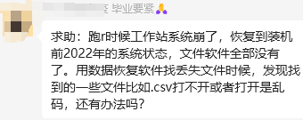
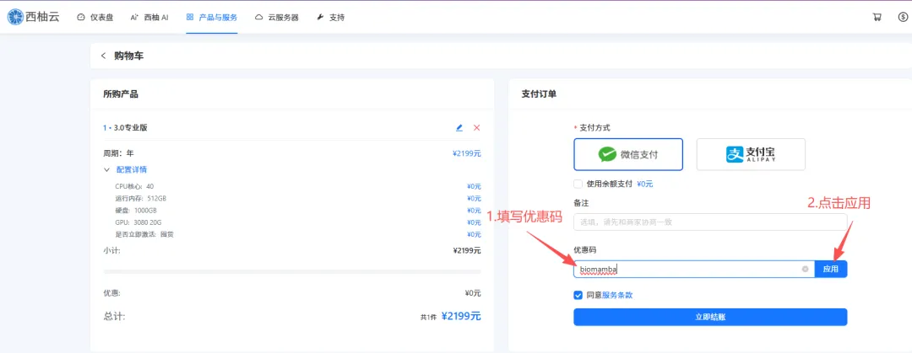
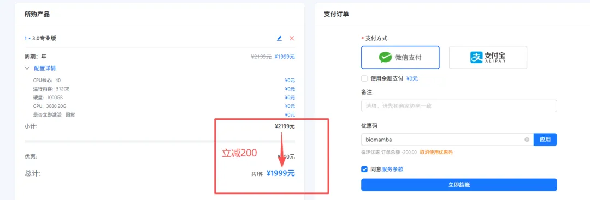

# 不推荐用自己的电脑做生信

> 原文：https://mp.weixin.qq.com/s?__biz=MzAwMzIzOTk5OQ==&mid=2247533659&idx=2&sn=8e7b9243228fa6531fb7549399f21d95&chksm=9b3c3d0bac4bb41dd2024a5edff8853453159d55a022b5b10744869e2bfc170659bcd0502e07#rd
> 合集：服务器

**
**看见群里有同学把自己的电脑跑崩了，这又回到我们常说的话题：**不推荐** 大家用**自己的电脑** 做生信分析。因为大家的电脑通常**配置有限** ，面对着指数级增长的生信数据，个人的电脑常常力不从心。若是像这位同学一样把机器**跑崩了** ，恐怕**苦不堪言**(人生苦短，毕业要紧)。再次提醒大家日常工作过程中要养成**备份数据** 的好习惯，云服务器能做到多副本的**冗余存储** ，具体原理可参考：[大家的宝贝数据怎么存储才最安全](<http://mp.weixin.qq.com/s?__biz=MzAwMzIzOTk5OQ==&mid=2247490796&idx=1&sn=99bdd182e1f02f88d30b196e4960b9b0&chksm=9b3f65bcac48ecaa845cda6ce3a127feae4776966297c75978a55cced57f90646564aded6438&scene=21#wechat_redirect>)。不想让自己电脑负重前行的同学，也可以看看服务器处理数据的优势，按需选用适合自己的计算资源：共享(经济实惠)：[有root权限的共享服务器,报我名字立减200￥](<https://mp.weixin.qq.com/s?__biz=MzAwMzIzOTk5OQ==&mid=2247532797&idx=2&sn=1ee326256c4a818e2d9c563e6d3ea28d&scene=21#wechat_redirect>)独享(省电省心)：[生信分析不求人](<https://mp.weixin.qq.com/s?__biz=MzAwMzIzOTk5OQ==&mid=2247529475&idx=1&sn=10827e982a637e0fc36e4b6e857736c8&scene=21#wechat_redirect>)

访问链接：https://biomamba.xiyoucloud.net/

更多内容可咨询客服微信[**Biomamba_zhushou**]

**服务器处理数据的优势：**

**一、升级配置**

这一点可以说是刚需，公众号内的粉丝大都是研究单细胞测序的，现在动辄就百万细胞的数据集，拿自己的8G内存笔记本显然配置够不上需求。以下为各档位服务器的配置，起步**256GB** 、**20线程** 的配置足够为你的大数据集保驾护航：

[趁开学前| 入手足够完成硕博生涯的生信环境](<https://mp.weixin.qq.com/s?__biz=MzAwMzIzOTk5OQ==&mid=2247530226&idx=2&sn=0522eb4eae67efeea2b96404474af611&scene=21#wechat_redirect>)

******●** ****真的≈独享，机器中当前账号中没有计算任务时配置全空，无需与他人共享计算资源：

******●** ****当然我们也提供真正的**独享** 服务器：

********
用到显卡的计算就更不建议用自己的电脑跑啦，谁也不想自己的显卡变“矿卡”：
****●** **当然，记得合理分配计算资源，并不是调用的资源越多计算速度就越快：[调用的线程越多就算的越快嘛?](<http://mp.weixin.qq.com/s?__biz=MzAwMzIzOTk5OQ==&mid=2247488995&idx=1&sn=7140e0d037671542fb37dff3a3c94b28&chksm=9b3f6cb3ac48e5a5f54a02be9e6af9f5a4cf8da1de1770f9035130c84dedf059a024964fc15a&scene=21#wechat_redirect>)

**二、技术支持**

做生信分析难免会遇到环境配置和软件安装的问题，自己一个个去搜软件安装办法和依赖环境效率过低，而作为专业的生信服务器，西柚云的生信技术人员已经在服务器中预装了上千款生信软件/R包:

**三、不用关机**

这点我想大家深有体会，很多软件或函数任务运行时可能会花费数天时间，在本地电脑运行期间若自己的电脑若遇到断电、断网等问题，运行中的任务则会付之一炬。而服务器在机房稳定运行、永不关机，在服务器中执行任务时，无论是挂载在**Linux** 还是用**Rstudio-server** 运行，即使本地的电脑掉线或关机，服务器依然可以继续执行任务，完全不用守着自己的电脑。大家把自己的任务提交到后台运行即可：[程序可以自己跑的，不用盯着](<http://mp.weixin.qq.com/s?__biz=MzAwMzIzOTk5OQ==&mid=2247511096&idx=1&sn=14191291fa6fbdb625b9601d230509f7&chksm=9b3cd568ac4b5c7e77ef9c3bf2970902e77d96474cc2ce36b14f406824c5363bb4c0b754306f&scene=21#wechat_redirect>)

**四、网速快**

相较于大家的塑料校园网，服务器每台接入1000M的专线，且我们具有正规备案，即使访问境外的数据库依旧可以达到相同的速度，即使是使用最简单的**wget** 命令也能达到极高的下载速度，即使是用作一个网盘，似乎也比百度云更有优势。

**五、性价比高**

如上，一年服务器的费用差不多与一年的百度云会员、一个16GB内存条、1T的固态硬盘价格相当，但**功能却多了许多** 。与其花**重金** 升级自己的电脑，倒不如低价租用一台服务器，现在通过联名页面注册即**送200￥优惠券** ，填写优惠码[**biomamba**]立减：[“200元”粉丝福利使用方式](<http://mp.weixin.qq.com/s?__biz=MzAwMzIzOTk5OQ==&mid=2247510088&idx=1&sn=9475687e466d5290c1a3a376dea6c9e6&chksm=9b3cd118ac4b580e760655b7f7a3bc6f7ca8085e68e73be1a98178e3db290667c82648a9d19d&scene=21#wechat_redirect>)。

另外，可咨询文末微信号**领取返现福利**(200￥粉丝专属优惠券与返现可叠加：[“](<http://mp.weixin.qq.com/s?__biz=MzAwMzIzOTk5OQ==&mid=2247510088&idx=1&sn=9475687e466d5290c1a3a376dea6c9e6&chksm=9b3cd118ac4b580e760655b7f7a3bc6f7ca8085e68e73be1a98178e3db290667c82648a9d19d&scene=21#wechat_redirect>)[200元”粉丝福利使用方式](<http://mp.weixin.qq.com/s?__biz=MzAwMzIzOTk5OQ==&mid=2247510088&idx=1&sn=9475687e466d5290c1a3a376dea6c9e6&chksm=9b3cd118ac4b580e760655b7f7a3bc6f7ca8085e68e73be1a98178e3db290667c82648a9d19d&scene=21#wechat_redirect>))，注册链接：

https://biomamba.xiyoucloud.net/

**六、损耗低**

电脑的工作是有损耗的，相信大家在用自己的电脑计算时已经感受到机器的**风扇在嗡嗡作响** ，倘若电脑不堪重负出现故障，随便换哪个**零件** 想来也比服务器的租金要高。

**七、数据存储有保障**

相较于传统的硬盘直储，服务器的存储方式为**超融合集群存储** ，具体优点为高可靠性、高性能高可用，并且具有在线更换硬件、恢复数据的优势。这些优点我们之前专门花推送去说过([大家的宝贝数据怎么存储才最安全](<http://mp.weixin.qq.com/s?__biz=MzAwMzIzOTk5OQ==&mid=2247490796&idx=1&sn=99bdd182e1f02f88d30b196e4960b9b0&chksm=9b3f65bcac48ecaa845cda6ce3a127feae4776966297c75978a55cced57f90646564aded6438&scene=21#wechat_redirect>))。

**八、正经Linux系统**

无论是windows下的子系统、双系统，还是虚拟机，与**真正的Linux** 环境还是有所区别。而服务器原汁原味的Linux可以帮助大家在真正的Linux环境中学习生信。没有Linux基础的小伙伴也不用担心，我们已经为大家准备好了系列教程：

[十小时学会Linux](<http://mp.weixin.qq.com/s?__biz=MzAwMzIzOTk5OQ==&mid=2247505777&idx=1&sn=f3efae390566b838a445ab9f832323c8&chksm=9b3cae21ac4b2737f5923b246470d699474c041bb78de50d2b71b99d537f9f44ca2938002cda&scene=21#wechat_redirect>)

详细试用教程可联系客服微信**Biomamba_zhushou**

**如何联系我们**

 留一个领取[资料](<https://mp.weixin.qq.com/s?__biz=MzAwMzIzOTk5OQ==&mid=2247530154&idx=2&sn=e5d0a63646094c3094b7b916350d22ad&scene=21#wechat_redirect>)、[开箱即用的单细胞分析镜像](<https://mp.weixin.qq.com/s?__biz=MzAwMzIzOTk5OQ==&mid=2247528410&idx=2&sn=0f2bac25479cf8d20dab5d82ae986f2e&scene=21#wechat_redirect>)的**微信号[Biomamba_zhushou]**，方便各位随时交流。同时我们也构建了[交流群矩阵](<https://mp.weixin.qq.com/s?__biz=MzAwMzIzOTk5OQ==&mid=2247528057&idx=1&sn=bb348c2a88c977c7cce67ee6731a3591&scene=21#wechat_redirect>)，欢迎大家入群讨论。
大家可以阅读完这几篇之后添加[给生信入门初学者的小贴士](<http://mp.weixin.qq.com/s?__biz=MzAwMzIzOTk5OQ==&mid=2247493329&idx=1&sn=597870b7f7ce10346da3561e7c281627&chksm=9b3c9f81ac4b169794088ce9abbcacb5f18e9fd174fc0d7e28da62d78facadf3100ef38aaf22&scene=21#wechat_redirect>)
[没有检索，就没有发言权](<https://mp.weixin.qq.com/s?__biz=MzAwMzIzOTk5OQ==&mid=2247529398&idx=2&sn=5a429852d61721916a405712677d5905&scene=21#wechat_redirect>)

**已有生信基地联系方式的同学****无需重复添加**

 您点的每个赞和在看，我都认真当成了喜欢
