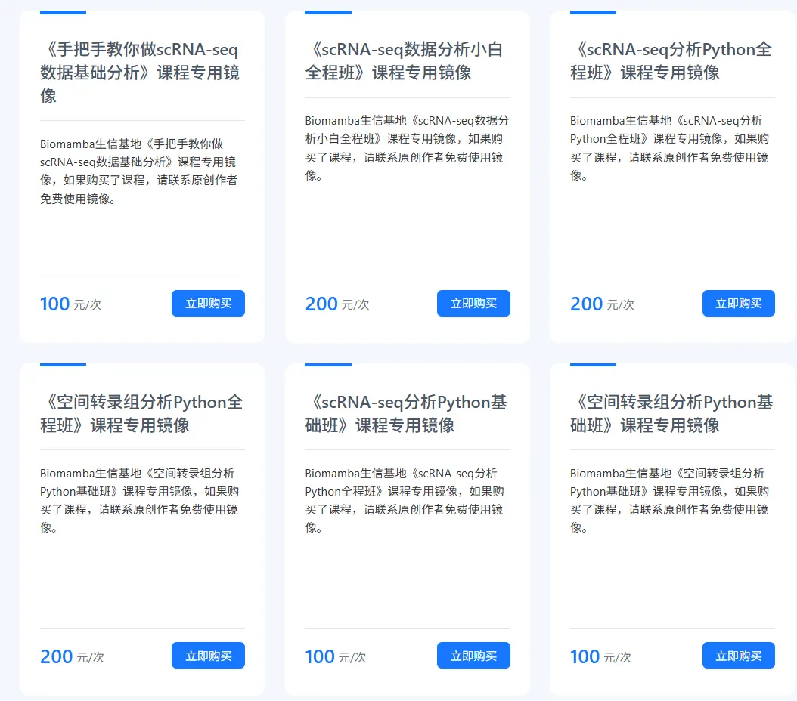
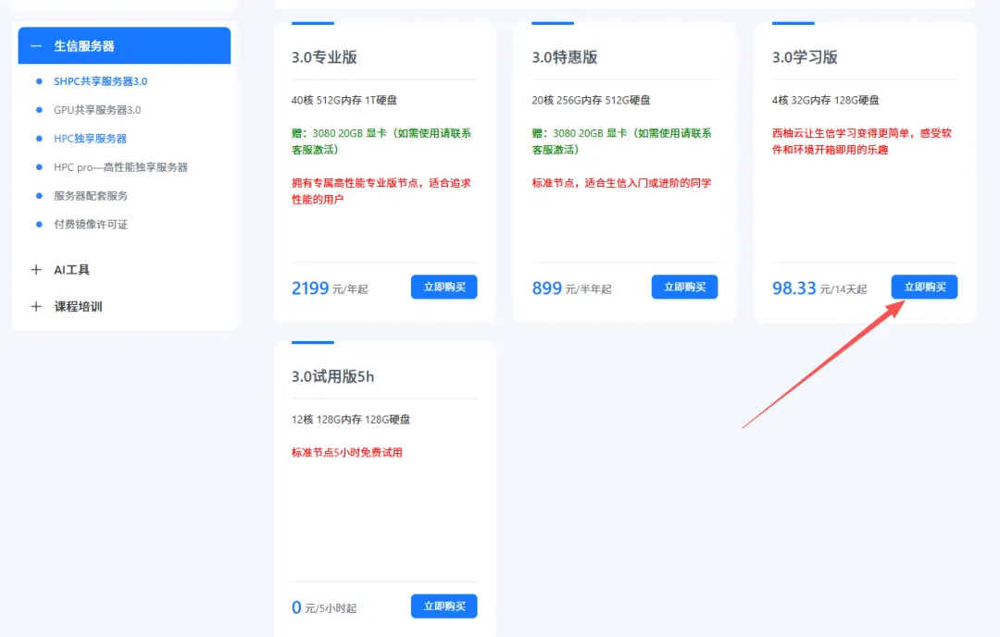
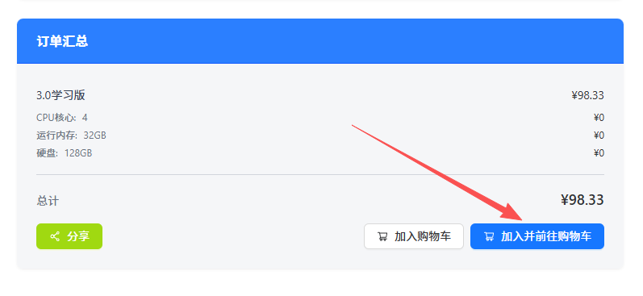
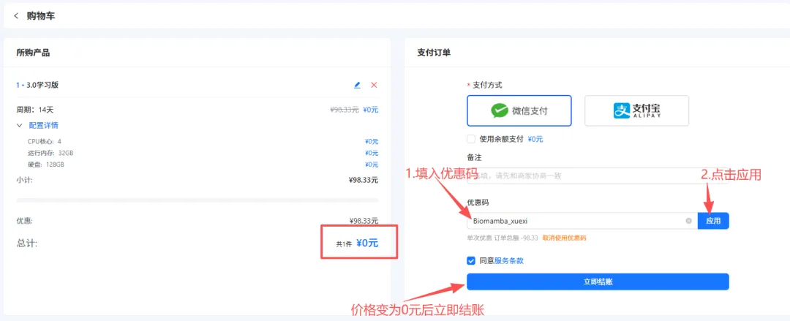
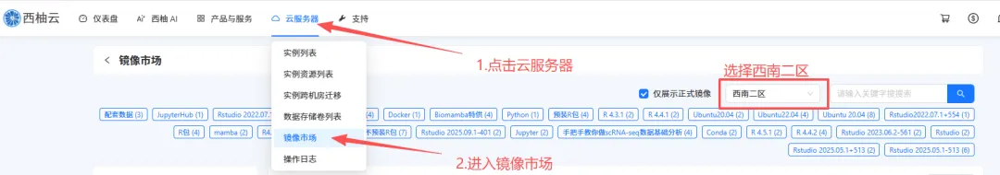
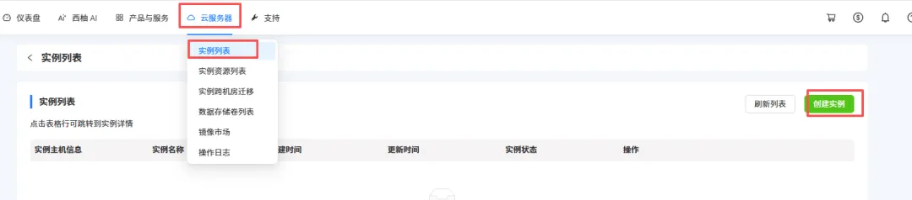
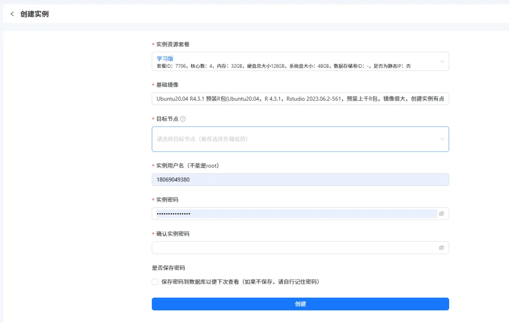

# 开箱即用的单细胞/空转分析镜像

> 原文：https://mp.weixin.qq.com/s?__biz=MzAwMzIzOTk5OQ==&mid=2247533721&idx=2&sn=ff2f23c988bb2e96038671f713f62807&chksm=9b3c3dc9ac4bb4dfd37518035ef414275c95fffede46e21199cfaa79ffccfd7dce3f42c9fec9#rd
> 合集：服务器

为了配合我们的[《手把手教你做scRNA-seq数据基础分析](<https://mp.weixin.qq.com/s?__biz=MzAwMzIzOTk5OQ==&mid=2247528175&idx=1&sn=f1e4b73fcdb4e1ee9dfa8bfc641b1474&scene=21#wechat_redirect>)》课程，我们把教学中用到的环境封装打包，整理成专属的镜像，大家可以一键布置后跟着课程内容进行学习(杜绝版本差异、踏平学习门槛)。学习版服务器为**免费的****32GB内存** 、**4线程 、100GB硬盘**(使用时长两周)。
目前我们还封装了多种单细胞/空间分析的镜像，包含TB级别的测试数据与代码教程，欢迎添加我们了解详情~学习版权限申请视频流程：镜像说明： 学习版权限申请图文流程：**第一步** ，复制网址(**https://biomamba.xiyoucloud.net/**)至浏览器，注册账号实名认证。**第二步** ，点击进入生信服务器列表，选择3.0学习版的"点击购买"，加入购物车：**第三步** ，输入并应用优惠码(联系文末领取)，查看价格是否变成**0元**
**第四步** ，联系文末微信，发送账号/用户ID，我们为您激活服务器**第五步** ，进入控制台创建实例选择西南二区

现额外添加了"手把手教你做scRNA-sseq基础分析"镜像，大家选择这个镜像就可以参加本次的课程啦~

获取"手把手教你做scRNA-sseq基础分析"镜像，请联系客服微信[Biomamba_zhushou]

创建服务器实例，设置账户和密码，获取IP和端口
设置好之后就可以用ssh正常远程连接啦：[Rstudio-server](<https://mp.weixin.qq.com/mp/appmsgalbum?__biz=MzAwMzIzOTk5OQ==&action=getalbum&album_id=3747730159902867464#wechat_redirect>)也是可以正常使用的，大家可以愉快的学习[R语言](<https://mp.weixin.qq.com/s?__biz=MzAwMzIzOTk5OQ==&mid=2247527337&idx=1&sn=6893269670fc98b41d6bb1decf5abadb&scene=21#wechat_redirect>)和[单细胞](<https://mp.weixin.qq.com/s?__biz=MzAwMzIzOTk5OQ==&mid=2247522324&idx=2&sn=121c6dcb2687ed94bd3f8b2dd318aa9a&scene=21#wechat_redirect>)：

**如何联系我们**

 留一个领取资料、[免费两周学习版](<https://mp.weixin.qq.com/s?__biz=MzAwMzIzOTk5OQ==&mid=2247527585&idx=1&sn=fa32112c11b215b33096cab43baf08ea&scene=21#wechat_redirect>)服务器的**微信号[Biomamba_zhushou]**，方便各位随时交流。同时我们也构建了[交流群矩阵](<https://mp.weixin.qq.com/s?__biz=MzAwMzIzOTk5OQ==&mid=2247528057&idx=1&sn=bb348c2a88c977c7cce67ee6731a3591&scene=21#wechat_redirect>)，欢迎大家入群讨论。

大家可以阅读完这几篇之后添加[给生信入门初学者的小贴士](<http://mp.weixin.qq.com/s?__biz=MzAwMzIzOTk5OQ==&mid=2247493329&idx=1&sn=597870b7f7ce10346da3561e7c281627&chksm=9b3c9f81ac4b169794088ce9abbcacb5f18e9fd174fc0d7e28da62d78facadf3100ef38aaf22&scene=21#wechat_redirect>)
[如何搜索公众号过往发布内容](<http://mp.weixin.qq.com/s?__biz=MzAwMzIzOTk5OQ==&mid=2247506266&idx=2&sn=22b1164bc9602c25620d058847785422&chksm=9b3ca00aac4b291c16d738271746ffb90149282a728f484e8a1952463c46a8e7dc4f883ab928&scene=21#wechat_redirect>)

**已有生信基地联系方式的同学****无需重复添加**

 您点的每个赞和在看，我都认真当成了喜欢
