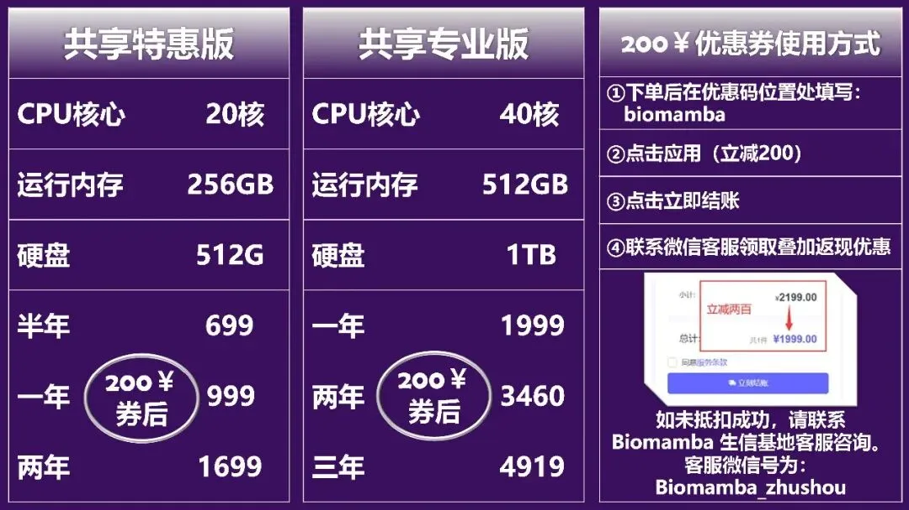
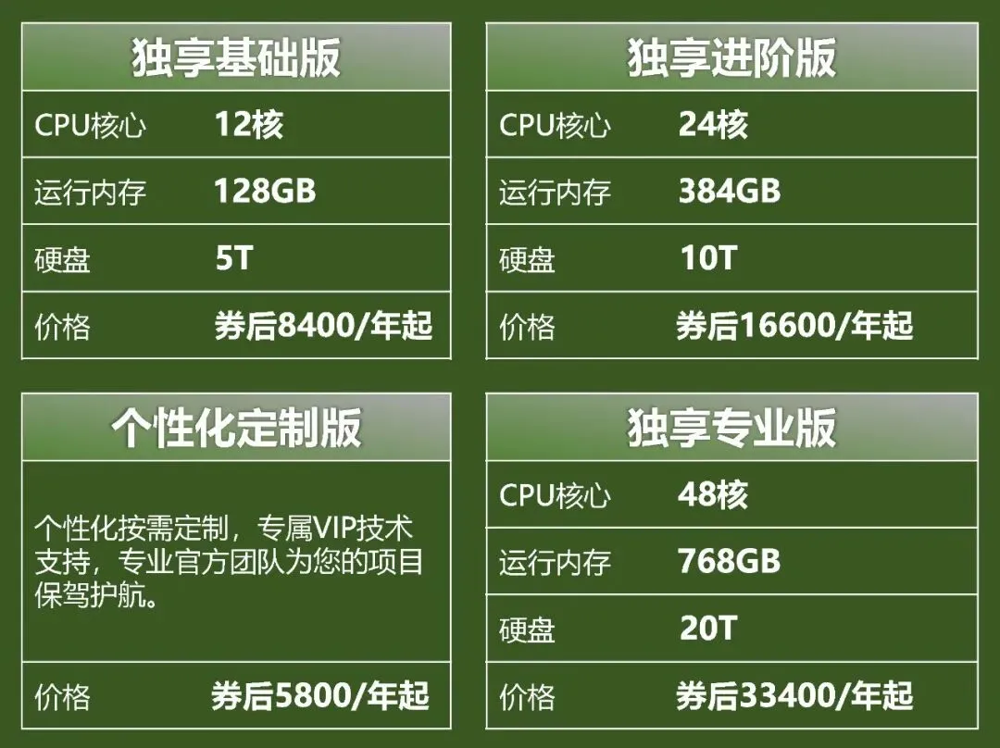
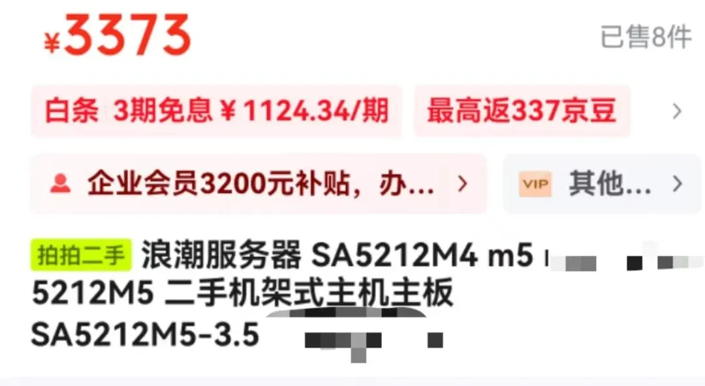
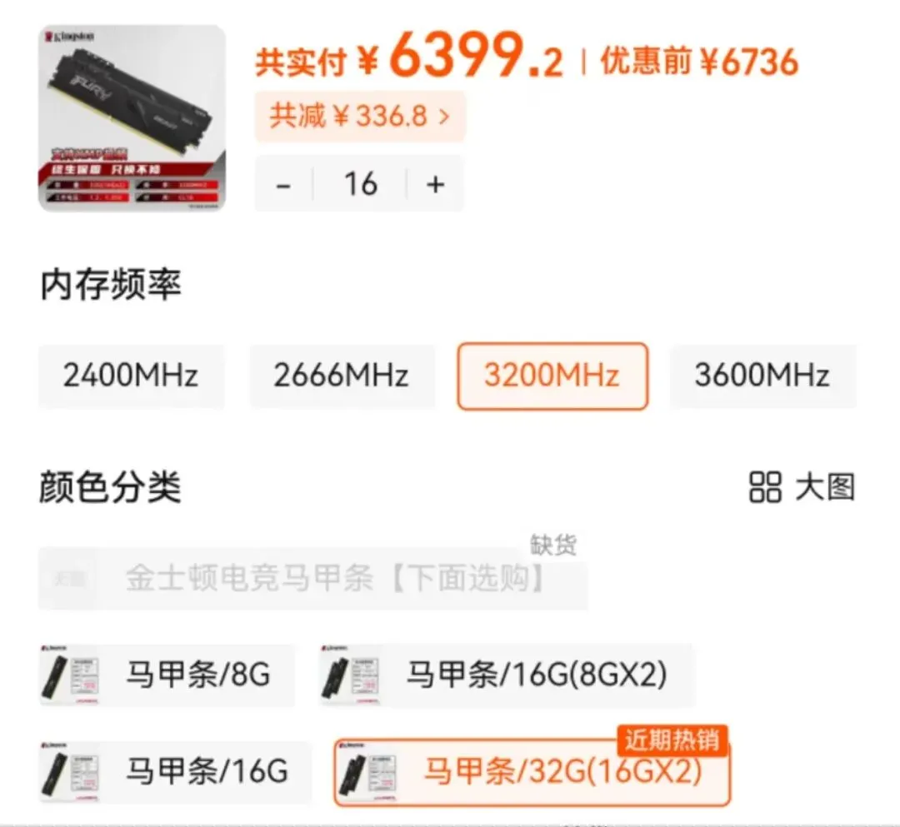
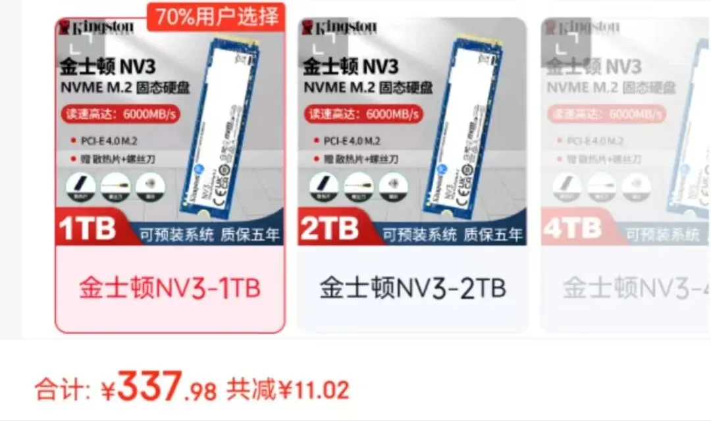

# 多少米可以自己攒一台512GB、40线程1TB硬盘的服务器？

> 原文：https://mp.weixin.qq.com/s?__biz=MzAwMzIzOTk5OQ==&mid=2247534107&idx=2&sn=9b206d333ceccf52af7085e21aecfd4d&chksm=9b3c3f4bac4bb65d5b33b32b49309756b6d4e54aca8bdcccefd6a7357b6b1951ffd5d58bb1fd#rd
> 合集：服务器

**一、成本计算**

长期以来我们一直给大家提供[](<https://mp.weixin.qq.com/s?__biz=MzAwMzIzOTk5OQ==&mid=2247526504&idx=2&sn=417d07347cebe0a1bd403f6c3e7d9b29&scene=21#wechat_redirect>)[足够支持你完成硕博生涯的生信环境](<https://mp.weixin.qq.com/s?__biz=MzAwMzIzOTk5OQ==&mid=2247532373&idx=2&sn=4708fac31ac8f4e347847e4b7f2a4fed&scene=21#wechat_redirect>)，大家有没有好奇过，如果配置我们的同款512GB、40线程、1TB的服务器，需要花费多少米？经过在终端中查询信息、某东上搜索价格，我们得知，服务器的CPU型号为Intel(R) Xeon(R) Platinum 8269CY CPU @ 2.50GHz；内存无法查看到型号，只能知道总大小为1.5TB，我自行配置512GB(以DDR4为例)即可、主板为SA5212M5(这个主板其实搭载我们需要的配置还有很多冗余。这样，公平起见，我们淘一个二手的)、硬盘为INTEL SSDPE2KX040T8，容量为4TB，公平起见我们淘一个1TB的吧。即使我们尽量选取二手设备或性价比高的散片，这台机器的硬件一过性成本也达到了：3373+6399.2+337+4910=15019.2￥。另外，我们给大家配置的千兆宽带算一年300￥好了，另外再加上电费(八小时工作很合理，算三分之一的时间满载：1.2kw*24h*0.3(载荷比例)*365天*0.55￥每度=1734.48￥。那么总计成本就是17k￥。然而对比之下，我们的服务器一年只需要2k，还不需要考虑设备折损和更新换代。也就是说，你自己买机器，考虑到宽带费用和电费永远都回不了本。若无需自己承担维护费用，那么大约八年可以回本，大家有用过超过八年的电脑嘛~

**二、西柚云服务器**

如果你对服务器比较迷茫，那么你可以先行学习以下教程：[十小时学会Linux](<http://mp.weixin.qq.com/s?__biz=MzAwMzIzOTk5OQ==&mid=2247505777&idx=1&sn=f3efae390566b838a445ab9f832323c8&chksm=9b3cae21ac4b2737f5923b246470d699474c041bb78de50d2b71b99d537f9f44ca2938002cda&scene=21#wechat_redirect>)
[生信Linux及服务器使用技巧](<https://mp.weixin.qq.com/mp/appmsgalbum?__biz=MzAwMzIzOTk5OQ==&action=getalbum&album_id=2980604042328702978#wechat_redirect>)[R语言基础学习手册](<https://mp.weixin.qq.com/s?__biz=MzAwMzIzOTk5OQ==&mid=2247506720&idx=1&sn=fe897ba3c33a8e63bf6a4e35aeac1896&scene=21#wechat_redirect>)

[](<https://mp.weixin.qq.com/s?__biz=MzAwMzIzOTk5OQ==&mid=2247530226&idx=2&sn=0522eb4eae67efeea2b96404474af611&scene=21#wechat_redirect>)[](<https://mp.weixin.qq.com/s?__biz=MzAwMzIzOTk5OQ==&mid=2247529475&idx=1&sn=10827e982a637e0fc36e4b6e857736c8&scene=21#wechat_redirect>)[](<https://mp.weixin.qq.com/s?__biz=MzAwMzIzOTk5OQ==&mid=2247529840&idx=1&sn=704b0a3d60a17c5bc2445d54c97b834f&scene=21#wechat_redirect>)
共享(经济实惠)：[有root权限的共享服务器,报我名字立减200￥](<http://mp.weixin.qq.com/s?__biz=MzAwMzIzOTk5OQ==&mid=2247503869&idx=1&sn=142f8c7ba8620815a8770773df077f12&chksm=9b3cb6adac4b3fbb1acdf7593df06af5ac77d1fe9c0144c999de7109bd063b76080a33c50e0d&scene=21#wechat_redirect>)独享(省电省心)：[生信分析不求人](<http://mp.weixin.qq.com/s?__biz=MzAwMzIzOTk5OQ==&mid=2247508226&idx=1&sn=69e0eea720ac6aecc0362bcb9ac339ba&chksm=9b3cd852ac4b51445651a091be0fb6f638bd8cf5eb399af1c54804631fe3047706cf1d4044de&scene=21#wechat_redirect>)

访问链接：https://biomamba.xiyoucloud.net/

更多内容可咨询客服微信[**Biomamba_zhushou**]


**三、各硬件价格截图**

二手主板：
内存条：16GB*32根

1TB硬盘：
CPU散片，性价比更高（有次品或二手风险）：

**四、如何查看硬件信息**

如何查看硬件相关信息：

  *   *   *   *   *   *   *   *   *   *   *   *   *   *   *   *   *   *   *   *   *   *   *   *   *   *   *   *   *   *   *   *   *   *   *   *   *   *   *   *   *   *   *   *   *   *   *   *   *   *   *   *   *   *   *   *   *   *   *   *   *

```
# 查看CPU信息：lscpu
Architecture:                    x86_64CPU op-mode(s):                  32-bit, 64-bitByte Order:                      Little EndianAddress sizes:                   46 bits physical, 48 bits virtualCPU(s):                          104On-line CPU(s) list:             1-3,7,10,11,13,15,18,20,23,27,30,32,34,38,42,43,49,50,53,57-60,                                 63,67,69,73-75,78,79,87,88,90-93,95Off-line CPU(s) list:            0,4-6,8,9,12,14,16,17,19,21,22,24-26,28,29,31,33,35-37,39-41,44                                 -48,51,52,54-56,61,62,64-66,68,70-72,76,77,80-86,89,94,96-103Thread(s) per core:              0Core(s) per socket:              26Socket(s):                       2NUMA node(s):                    2Vendor ID:                       GenuineIntelCPU family:                      6Model:                           85Model name:                      Intel(R) Xeon(R) Platinum 8269CY CPU @ 2.50GHzStepping:                        7CPU MHz:                         3199.998CPU max MHz:                     3800.0000CPU min MHz:                     1200.0000BogoMIPS:                        5000.00Virtualization:                  VT-xL1d cache:                       832 KiBL1i cache:                       832 KiBL2 cache:                        26 MiBL3 cache:                        35.8 MiBNUMA node0 CPU(s):               0-25,52-77NUMA node1 CPU(s):               26-51,78-103Vulnerability Itlb multihit:     KVM: Mitigation: VMX disabledVulnerability L1tf:              Not affectedVulnerability Mds:               Not affectedVulnerability Meltdown:          Not affectedVulnerability Mmio stale data:   Mitigation; Clear CPU buffers; SMT vulnerableVulnerability Retbleed:          Mitigation; Enhanced IBRSVulnerability Spec store bypass: Mitigation; Speculative Store Bypass disabled via prctlVulnerability Spectre v1:        Mitigation; usercopy/swapgs barriers and __user pointer sanitiz                                 ationVulnerability Spectre v2:        Mitigation; Enhanced IBRS, IBPB conditional, RSB filling, PBRSB                                 -eIBRS SW sequenceVulnerability Srbds:             Not affectedVulnerability Tsx async abort:   Mitigation; TSX disabledFlags:                           fpu vme de pse tsc msr pae mce cx8 apic sep mtrr pge mca cmov p                                 at pse36 clflush dts acpi mmx fxsr sse sse2 ss ht tm pbe syscal                                 l nx pdpe1gb rdtscp lm constant_tsc art arch_perfmon pebs bts r                                 ep_good nopl xtopology nonstop_tsc cpuid aperfmperf pni pclmulq                                 dq dtes64 ds_cpl vmx smx est tm2 ssse3 sdbg fma cx16 xtpr pdcm                                  pcid dca sse4_1 sse4_2 x2apic movbe popcnt tsc_deadline_timer a                                 es xsave avx f16c rdrand lahf_lm abm 3dnowprefetch cpuid_fault                                  epb cat_l3 cdp_l3 invpcid_single intel_ppin ssbd mba ibrs ibpb                                  stibp ibrs_enhanced tpr_shadow vnmi flexpriority ept vpid ept_a                                 d fsgsbase tsc_adjust bmi1 avx2 smep bmi2 erms invpcid cqm mpx                                  rdt_a avx512f avx512dq rdseed adx smap clflushopt clwb intel_pt                                  avx512cd avx512bw avx512vl xsaveopt xsavec xgetbv1 xsaves cqm_                                 llc cqm_occup_llc cqm_mbm_total cqm_mbm_local dtherm ida arat p                                 ln pts hwp hwp_act_window hwp_epp hwp_pkg_req pku ospke avx512_                                 vnni md_clear flush_l1d arch_capabilities
```

  *   *   *

```
# 查看主板信息： cat /sys/class/dmi/id/board_nameSA5212M5
```

  *   *   *   *   *   *   *   *   *   *   *   *   *   *   *   *   *   *   *   *   *   *   *   *   *   *   *

```
 sudo lsblk -d -o name,modelNAME    MODELloop0   loop1   loop2   loop3   loop4   loop5   loop6   sda     MR9362-8i       rbd0    rbd1    rbd2    rbd3    rbd4    rbd5    rbd6    rbd7    rbd8    rbd9    rbd10   rbd11   rbd12   rbd13   rbd14   rbd15   nvme0n1 INTEL SSDPE2KX040T8
```


**如何联系我们**

 留一个领取[资料](<https://mp.weixin.qq.com/s?__biz=MzAwMzIzOTk5OQ==&mid=2247532585&idx=1&sn=e265d2846ec66e5faaaf21403d274d2f&scene=21#wechat_redirect>)、[开箱即用的单细胞分析镜像](<https://mp.weixin.qq.com/s?__biz=MzAwMzIzOTk5OQ==&mid=2247528410&idx=2&sn=0f2bac25479cf8d20dab5d82ae986f2e&scene=21#wechat_redirect>)的**微信号[Biomamba_zhushou]**，方便各位随时交流。同时我们也构建了[交流群矩阵](<https://mp.weixin.qq.com/s?__biz=MzAwMzIzOTk5OQ==&mid=2247528057&idx=1&sn=bb348c2a88c977c7cce67ee6731a3591&scene=21#wechat_redirect>)，欢迎大家入群讨论。
大家可以阅读完这几篇之后添加[给生信入门初学者的小贴士](<http://mp.weixin.qq.com/s?__biz=MzAwMzIzOTk5OQ==&mid=2247493329&idx=1&sn=597870b7f7ce10346da3561e7c281627&chksm=9b3c9f81ac4b169794088ce9abbcacb5f18e9fd174fc0d7e28da62d78facadf3100ef38aaf22&scene=21#wechat_redirect>)
[没有检索，就没有发言权](<https://mp.weixin.qq.com/s?__biz=MzAwMzIzOTk5OQ==&mid=2247529398&idx=2&sn=5a429852d61721916a405712677d5905&scene=21#wechat_redirect>)

**已有生信基地联系方式的同学****无需重复添加**

 您点的每个赞和在看，我都认真当成了喜欢
