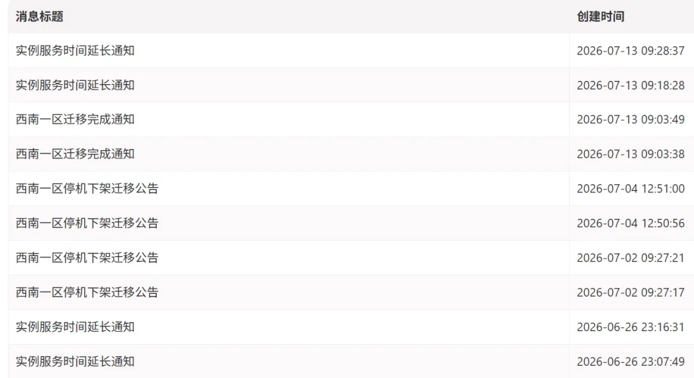
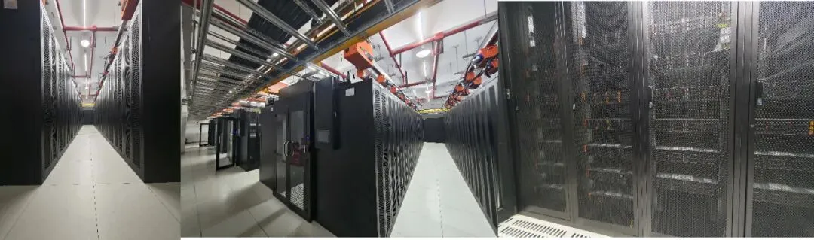
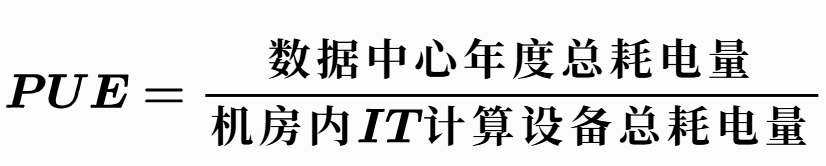
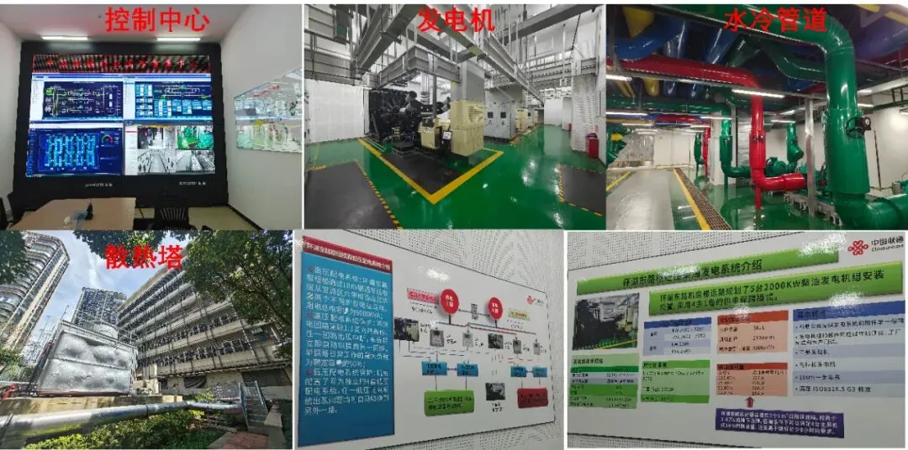
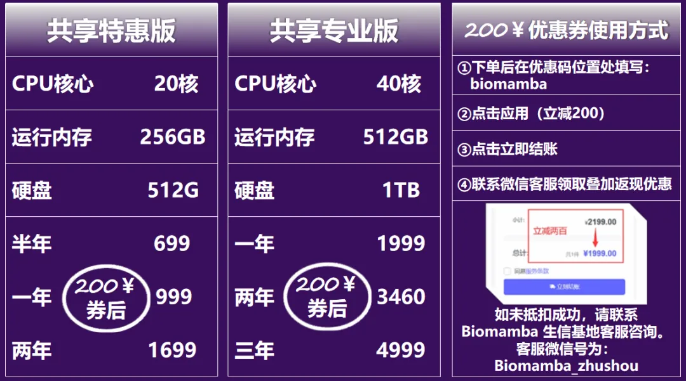
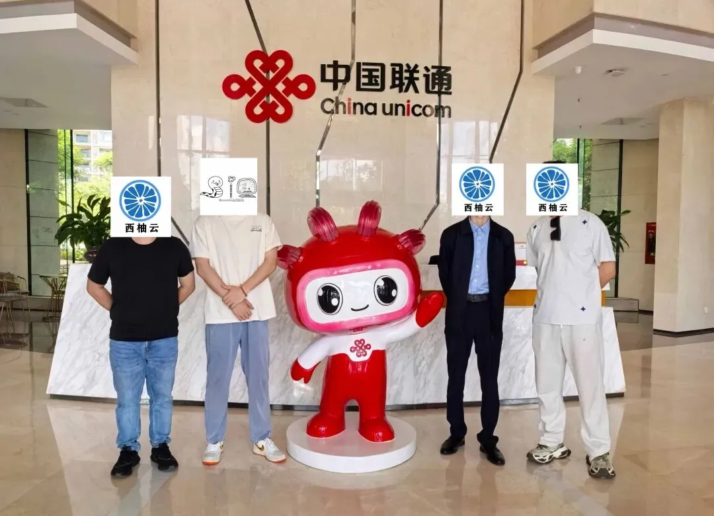

# 为了让你顺利分析生信数据，我们默默的做了这些事情

> 原文：https://mp.weixin.qq.com/s?__biz=MzAwMzIzOTk5OQ==&mid=2247539358&idx=1&sn=f302a65a9d12106341602b0546636106&chksm=9b3c23ceac4baad86bb13860826ee240c0c7deae3a18a7caa667d2e714d93f0f4662b28ad926#rd
> 合集：服务器

**一、搬家搬家**

就在这个月初，我们停机迁移了西南一区的机房，并给大家双倍延长了停机的这段时长。至于为什么要做迁移，自然是给大家的数据分析保驾护航。[西柚云超算与云南联通正式达成战略合作 ：共同建设云南科研超算中心节点。](<https://mp.weixin.qq.com/s?__biz=MzkzMzMxMjg4Mw==&mid=2247492271&idx=1&sn=0320643700e353c6b7f7379a53c621b7&scene=21#wechat_redirect>)

访问链接：https://biomamba.xiyoucloud.net/

[足够支持你完成硕博生涯的生信环境](<https://mp.weixin.qq.com/s?__biz=MzAwMzIzOTk5OQ==&mid=2247511780&idx=1&sn=3acc0874f7d2fa75f1abbe7a9a9b4069&chksm=9b3cd7b4ac4b5ea27d4d53964e4a4a9fa8c806a19103729dd4ff0fa72e621411f46a251d269f&scene=21&token=1904068475&lang=zh_CN#wechat_redirect>)

[忘记宣传了，独享用户连技术支持都是独享的](<https://mp.weixin.qq.com/s?__biz=MzAwMzIzOTk5OQ==&mid=2247529475&idx=1&sn=10827e982a637e0fc36e4b6e857736c8&scene=21&token=1904068475&lang=zh_CN&poc_token=HF-eN2mj01zsfxe_I4r8D5pfZx80xO2AVYSB6qtT#wechat_redirect>)

[RTX5090、4080S、5070显卡上机](<https://mp.weixin.qq.com/s?__biz=MzAwMzIzOTk5OQ==&mid=2247529840&idx=1&sn=704b0a3d60a17c5bc2445d54c97b834f&scene=21#wechat_redirect>)

更多内容可咨询客服微信[**Biomamba_zhushou**]

**二、全方位护航**

这么大费周章做迁移，当然是有意义的。虽然西柚云从来没用过那种私接滥造的民用机房，但现在接入联通的两亚国际智算中心这样的IDC，把大家的服务器放在冷通道封闭机柜中，有冷风通道+地冷管道，不仅保障恒温恒湿，还有消防七氟丙烷气体灭火管道，实时监测烟感，在防火安全性上是夯爆了。大家的服务器就在这个机房里：
冗余不仅体现在机房内布，机房外也配备了三台V16的高达数千kw的发电机、以及能全楼满载运行十五分钟的电池组。还配备全套水冷，机房恒温23°C，并且比氟利昂压缩机省电40%。并且整个机房100%绿点，并且PUE约为1.2（电能使用效率，<1.5达标)，最大限度满足环保要求。两亚超算中心也具有完备的出海光缆，能够保证大家稳定的[获取境外数据库的数据](<https://mp.weixin.qq.com/s?__biz=MzAwMzIzOTk5OQ==&mid=2247486008&idx=1&sn=ce2eb0fa3a8653d1c26a702bff9b8bcb&scene=21#wechat_redirect>)。

**三、直接硬广**

从[使用西柚云服务器的十个理由(](<https://mp.weixin.qq.com/s?__biz=MzAwMzIzOTk5OQ==&mid=2247538845&idx=2&sn=4f2984867981df3d282b9f5405c85c09&scene=21#wechat_redirect>)高配算力、专属技术支持、开箱即用分析环境、7×24 小时不间断运行、千兆高速专线、高性价比租用、无个人硬件损耗、集群安全存储、原生 Linux 系统、全流程增值服务[)可以看出，我们的产品定位还是比较特殊的。即使是在能耗、环保、稳定性、](<https://mp.weixin.qq.com/s?__biz=MzAwMzIzOTk5OQ==&mid=2247538845&idx=2&sn=4f2984867981df3d282b9f5405c85c09&scene=21#wechat_redirect>)[数据安全](<https://mp.weixin.qq.com/s?__biz=MzAwMzIzOTk5OQ==&mid=2247490796&idx=1&sn=99bdd182e1f02f88d30b196e4960b9b0&scene=21#wechat_redirect>)[、](<https://mp.weixin.qq.com/s?__biz=MzAwMzIzOTk5OQ==&mid=2247538845&idx=2&sn=4f2984867981df3d282b9f5405c85c09&scene=21#wechat_redirect>)[防黑客攻击](<https://mp.weixin.qq.com/s?__biz=MzAwMzIzOTk5OQ==&mid=2247526504&idx=1&sn=4ebfe72e195cb1d2097396648ae822db&scene=21#wechat_redirect>)[等你看不到的地方，我们也在默默努力。所以，硬广，欢迎大家使用西柚云服务器：](<https://mp.weixin.qq.com/s?__biz=MzAwMzIzOTk5OQ==&mid=2247538845&idx=2&sn=4f2984867981df3d282b9f5405c85c09&scene=21#wechat_redirect>)

**四、十大核心优势**

一、算力配置拉满，256GB起大内存、多线程及 GPU 机型可轻松承载[百万细胞数据集](<https://mp.weixin.qq.com/s?__biz=MzAwMzIzOTk5OQ==&mid=2247531160&idx=1&sn=ecf56af3b929ec2b241854c89d25c671&scene=21#wechat_redirect>)，独享资源无争抢；

二、配套专业[生信技术支持](<https://mp.weixin.qq.com/s?__biz=MzAwMzIzOTk5OQ==&mid=2247533035&idx=2&sn=6b9dcac09426b462a071bf81be50a556&scene=21#wechat_redirect>)，预装[上千款软件与R包](<https://mp.weixin.qq.com/s?__biz=MzAwMzIzOTk5OQ==&mid=2247535250&idx=2&sn=56a11385eebfabd73cdcc4958a29580b&scene=21#wechat_redirect>)，还赠送 5 次免费工单协助；

三、内置一站式[单细胞分析镜像环境](<https://mp.weixin.qq.com/s?__biz=MzAwMzIzOTk5OQ==&mid=2247533721&idx=2&sn=ff2f23c988bb2e96038671f713f62807&scene=21#wechat_redirect>)，开箱即用无需繁琐配置；

四、机房7×24小时稳定运行，本地断机关机也不中断[服务器后台计算任务](<https://mp.weixin.qq.com/s?__biz=MzAwMzIzOTk5OQ==&mid=2247511096&idx=1&sn=14191291fa6fbdb625b9601d230509f7&scene=21#wechat_redirect>)；

五、配备千兆专线与国际加速网络，下载测序数据、访问[境外数据库](<https://mp.weixin.qq.com/s?__biz=MzAwMzIzOTk5OQ==&mid=2247486008&idx=1&sn=ce2eb0fa3a8653d1c26a702bff9b8bcb&scene=21#wechat_redirect>)速度飞快；

六、租用[成本性价比](<https://mp.weixin.qq.com/s?__biz=MzAwMzIzOTk5OQ==&mid=2247534107&idx=2&sn=9b206d333ceccf52af7085e21aecfd4d&scene=21#wechat_redirect>)远超自行升级电脑硬件，注册可领 200 元叠加优惠券(https://biomamba.xiyoucloud.net/)；

七、长期大负载计算不会损耗个人电脑硬件，省去维修开支；

八、超融合[集群存储](<https://mp.weixin.qq.com/s?__biz=MzAwMzIzOTk5OQ==&mid=2247490796&idx=1&sn=99bdd182e1f02f88d30b196e4960b9b0&scene=21#wechat_redirect>)多重保障，数据不易丢失损坏；

九、纯净原生 Linux 系统，适配全套生信代码运行，配套入门 Linux 教学；

十、丰富[增值服务](<https://mp.weixin.qq.com/s?__biz=MzAwMzIzOTk5OQ==&mid=2247537263&idx=2&sn=2ca24eed3797c0be9478528e51f020b9&scene=21#wechat_redirect>)全覆盖，包含扩容硬盘、Rstudio 内置 AI 编程工具、数据快照、国际专线、专属超级会员等，全方位解决生信分析各类难题。

Biomamba实地考察：

**如何联系我们**

 留一个领取[资料](<https://mp.weixin.qq.com/s?__biz=MzAwMzIzOTk5OQ==&mid=2247535983&idx=1&sn=99378a252908b06f56432eb08741d278&scene=21#wechat_redirect>)、[开箱即用的单细胞分析镜像](<https://mp.weixin.qq.com/s?__biz=MzAwMzIzOTk5OQ==&mid=2247536307&idx=1&sn=8d03259be06f54521aac5251dec988d5&scene=21#wechat_redirect>)的**微信号[Biomamba_zhushou]**，方便各位随时交流。同时我们也构建了[交流群矩阵](<https://mp.weixin.qq.com/s?__biz=MzAwMzIzOTk5OQ==&mid=2247536307&idx=2&sn=2d030173f51d24a4fee43bd0d83da03b&scene=21#wechat_redirect>)，欢迎大家入群讨论。
大家可以阅读完这几篇之后添加[给生信入门初学者的小贴士](<http://mp.weixin.qq.com/s?__biz=MzAwMzIzOTk5OQ==&mid=2247493329&idx=1&sn=597870b7f7ce10346da3561e7c281627&chksm=9b3c9f81ac4b169794088ce9abbcacb5f18e9fd174fc0d7e28da62d78facadf3100ef38aaf22&scene=21#wechat_redirect>)[没有检索，就没有发言权](<https://mp.weixin.qq.com/s?__biz=MzAwMzIzOTk5OQ==&mid=2247529398&idx=2&sn=5a429852d61721916a405712677d5905&scene=21#wechat_redirect>)

**已有生信基地联系方式的同学****无需重复添加**

 您点的每个赞和在看，我都认真当成了喜欢
