# 急得学生都准备在网吧分析单细胞了

> 原文：https://mp.weixin.qq.com/s?__biz=MzAwMzIzOTk5OQ==&mid=2247542028&idx=2&sn=824abb827a0dc0416f9ac4f818fc16a0&chksm=9b3c5c5cac4bd54a8f977eba3b1df462c70bd06b4c4cd54907a6995953102f0548bf820d6649#rd
> 合集：服务器

为啥导师们还意识不到给学生安排分析任务的时候要优先准备好计算设备？我们的课程都知道[送256GB单细胞专属服务器(开箱即用)](<https://mp.weixin.qq.com/s?__biz=MzAwMzIzOTk5OQ==&mid=2247535952&idx=2&sn=1e867b98de5717aace4024ced57d372a&scene=21#wechat_redirect>)。干实验和[湿实验](<https://mp.weixin.qq.com/s?__biz=MzAwMzIzOTk5OQ==&mid=2247541567&idx=2&sn=950d0a9ccf24015cea0d5aeef3d68b7b&scene=21#wechat_redirect>)一样需要准备仪器啊！给学生急得都准备用网吧的机器分析数据了。不过网吧的内存一般也就32GB，其实没有比大家的个人电脑好到哪里去，我们向来是[不推荐用自己的电脑做生信](<https://mp.weixin.qq.com/s?__biz=MzAwMzIzOTk5OQ==&mid=2247533659&idx=2&sn=8e7b9243228fa6531fb7549399f21d95&scene=21#wechat_redirect>)。个人的电脑处理处理少量[bulk RNA数据](<https://mp.weixin.qq.com/s?__biz=MzAwMzIzOTk5OQ==&mid=2247510793&idx=1&sn=bfa69e8f261932d9bea74443fab732f0&scene=21#wechat_redirect>)还行，[scRNA](<https://mp.weixin.qq.com/s?__biz=MzAwMzIzOTk5OQ==&mid=2247541362&idx=1&sn=aa987d7569fa3892a65adb616fe9a73e&scene=21#wechat_redirect>)的话，16GB内存可能处理三四个样本，到[多样本整合CCA](<https://mp.weixin.qq.com/s?__biz=MzAwMzIzOTk5OQ==&mid=2247500117&idx=2&sn=cef0b0abec6d73a8c2615980ef68aec1&scene=21#wechat_redirect>)这步内存就过不了关了。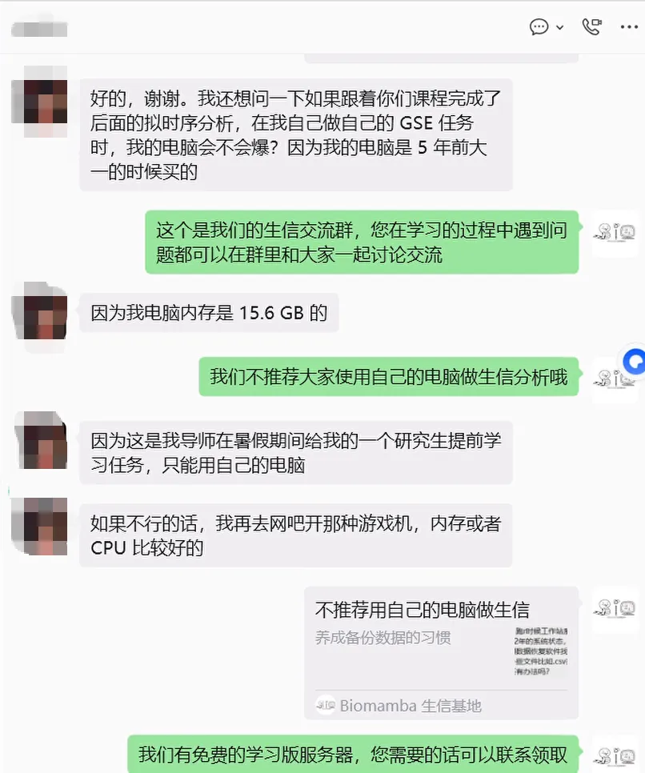
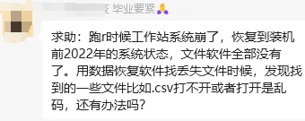又看见群里有同学把自己的电脑跑崩了，这又回到我们常说的话题：**不推荐** 大家用**自己的电脑** 做生信分析。因为大家的电脑通常**配置有限** ，面对着指数级增长的生信数据，个人的电脑常常力不从心。若是像这位同学一样把机器**跑崩了** ，恐怕**苦不堪言**(人生苦短，毕业要紧)。再次提醒大家日常工作过程中要养成**备份数据** 的好习惯，云服务器能做到多副本的**冗余存储** ，具体原理可参考：[大家的宝贝数据怎么存储才最安全](<http://mp.weixin.qq.com/s?__biz=MzAwMzIzOTk5OQ==&mid=2247490796&idx=1&sn=99bdd182e1f02f88d30b196e4960b9b0&chksm=9b3f65bcac48ecaa845cda6ce3a127feae4776966297c75978a55cced57f90646564aded6438&scene=21#wechat_redirect>)。不想让自己电脑负重前行的同学，也可以看看服务器处理数据的优势，按需选用适合自己的计算资源：共享(经济实惠)：[有root权限的共享服务器,报我名字立减200￥](<https://mp.weixin.qq.com/s?__biz=MzAwMzIzOTk5OQ==&mid=2247532797&idx=2&sn=1ee326256c4a818e2d9c563e6d3ea28d&scene=21#wechat_redirect>)独享(省电省心)：[生信分析不求人](<https://mp.weixin.qq.com/s?__biz=MzAwMzIzOTk5OQ==&mid=2247529475&idx=1&sn=10827e982a637e0fc36e4b6e857736c8&scene=21#wechat_redirect>)

访问链接：https://biomamba.xiyoucloud.net/

更多内容可咨询客服微信[**Biomamba_zhushou**]

**服务器处理数据的优势：**

**一、升级配置**

这一点可以说是刚需，公众号内的粉丝大都是研究单细胞测序的，现在动辄就百万细胞的数据集，拿自己的8G内存笔记本显然配置够不上需求。以下为各档位服务器的配置，起步**256GB** 、**20线程** 的配置足够为你的大数据集保驾护航：

[三年套餐打骨折，足够支持你完成硕博生涯的共享服务器](<https://mp.weixin.qq.com/s?__biz=MzAwMzIzOTk5OQ==&mid=2247540790&idx=2&sn=3e34a111e77e0cf29ee21b48a7940a9a&scene=21#wechat_redirect>)

[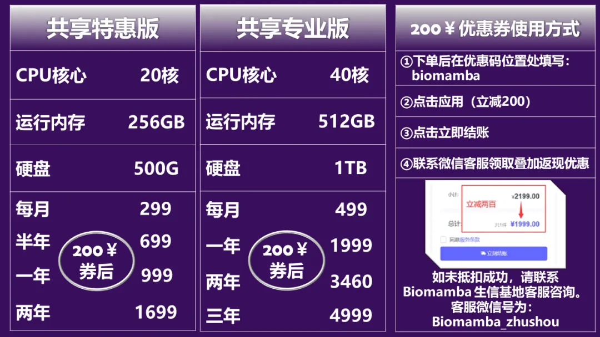](<https://mp.weixin.qq.com/s?__biz=MzAwMzIzOTk5OQ==&mid=2247540790&idx=2&sn=3e34a111e77e0cf29ee21b48a7940a9a&scene=21#wechat_redirect>)

访问链接：https://biomamba.xiyoucloud.net/

******●** ****真的≈独享，机器中当前账号中没有计算任务时配置全空，无需与他人共享计算资源：

******●** ****当然我们也提供真正的**独享** 服务器：

[忘记宣传了，独享用户连技术支持都是独享的](<https://mp.weixin.qq.com/s?__biz=MzAwMzIzOTk5OQ==&mid=2247529475&idx=1&sn=10827e982a637e0fc36e4b6e857736c8&scene=21#wechat_redirect>)

[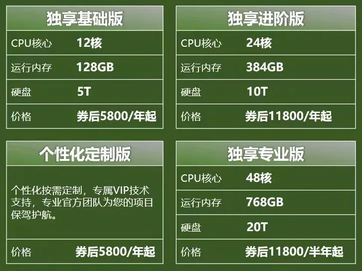](<https://mp.weixin.qq.com/s?__biz=MzAwMzIzOTk5OQ==&mid=2247534707&idx=2&sn=2844377758ce00e07435a5dd376b4715&scene=21#wechat_redirect>)
******●****** 现在还有GPU服务器供大家选择：[RTX5090、4080S、5070显卡上机](<https://mp.weixin.qq.com/s?__biz=MzAwMzIzOTk5OQ==&mid=2247537769&idx=3&sn=ba4234ca47a3c4a7f3442859653b14b2&scene=21#wechat_redirect>)[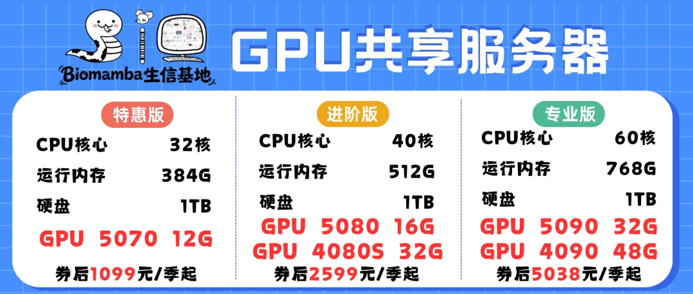](<https://mp.weixin.qq.com/s?__biz=MzAwMzIzOTk5OQ==&mid=2247537769&idx=3&sn=ba4234ca47a3c4a7f3442859653b14b2&scene=21#wechat_redirect>)现在还有配套OmicsOS的服务器使用：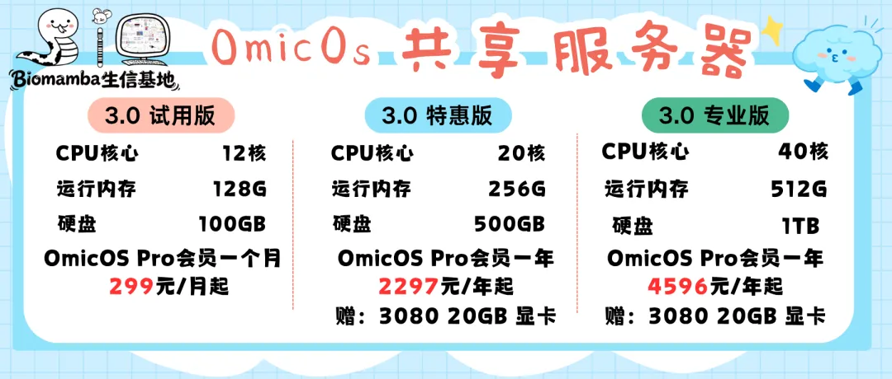

****●** **当然，记得合理分配计算资源，并不是调用的资源越多计算速度就越快：[调用的线程越多就算的越快嘛?](<http://mp.weixin.qq.com/s?__biz=MzAwMzIzOTk5OQ==&mid=2247488995&idx=1&sn=7140e0d037671542fb37dff3a3c94b28&chksm=9b3f6cb3ac48e5a5f54a02be9e6af9f5a4cf8da1de1770f9035130c84dedf059a024964fc15a&scene=21#wechat_redirect>)

**二、技术支持**

做生信分析难免会遇到环境配置和软件安装的问题，自己一个个去搜软件安装办法和依赖环境效率过低，而作为专业的生信服务器，西柚云的生信技术人员已经在服务器中[预装了上千款生信软件/R包](<https://mp.weixin.qq.com/s?__biz=MzAwMzIzOTk5OQ==&mid=2247520150&idx=1&sn=710f70f74dc77d0b254b74eaae7c028f&scene=21#wechat_redirect>)。还可以[白嫖五次技术支持](<https://mp.weixin.qq.com/s?__biz=MzAwMzIzOTk5OQ==&mid=2247533035&idx=2&sn=6b9dcac09426b462a071bf81be50a556&scene=21#wechat_redirect>)。

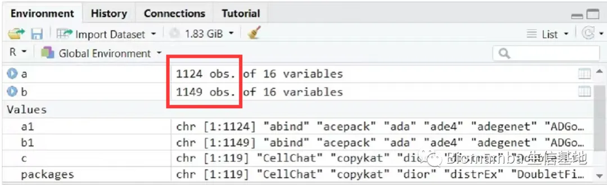

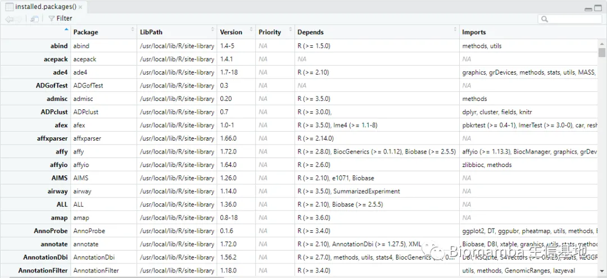

三、开箱即用的分析环境我们在服务器镜像中打包了数十个单细胞工具与流程，封装了R包环境、代码、测试数据，可以完成单细胞的一站式学习。优惠码领取请联系客服[Biomamba_zhushou]。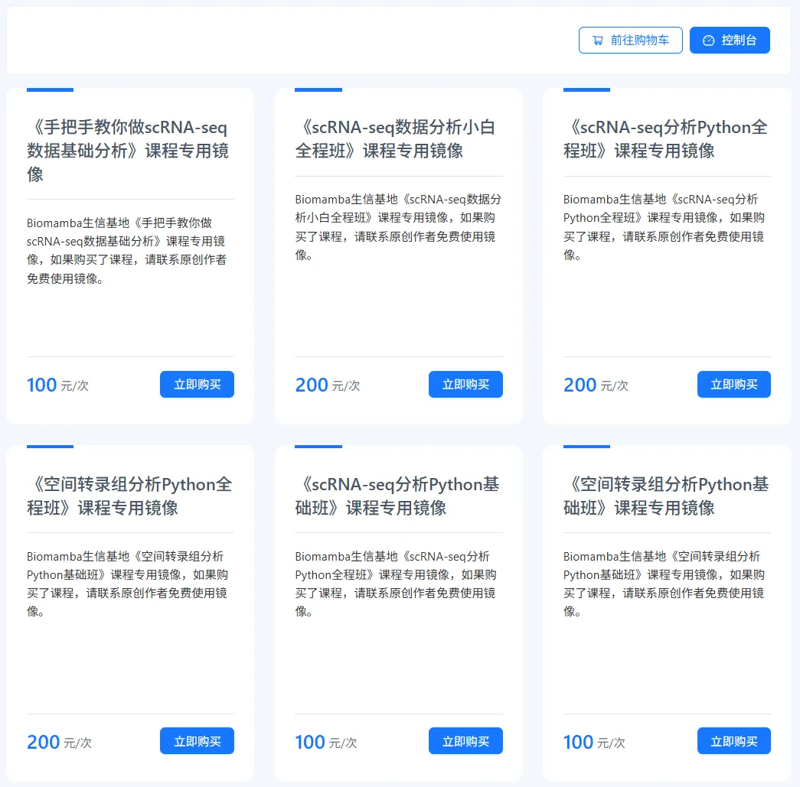

**四、不用关机**

这点我想大家深有体会，很多软件或函数任务运行时可能会花费数天时间，在本地电脑运行期间若自己的电脑若遇到断电、断网等问题，运行中的任务则会付之一炬。而服务器在机房稳定运行、永不关机，在服务器中执行任务时，无论是挂载在**Linux** 还是用**Rstudio-server** 运行，即使本地的电脑掉线或关机，服务器依然可以继续执行任务，完全不用守着自己的电脑。大家把自己的任务提交到后台运行即可：[程序可以自己跑的，不用盯着](<http://mp.weixin.qq.com/s?__biz=MzAwMzIzOTk5OQ==&mid=2247511096&idx=1&sn=14191291fa6fbdb625b9601d230509f7&chksm=9b3cd568ac4b5c7e77ef9c3bf2970902e77d96474cc2ce36b14f406824c5363bb4c0b754306f&scene=21#wechat_redirect>)

**五、网速快**

相较于大家的塑料校园网，服务器每台接入1000M的专线，且我们具有正规备案，即使访问境外的数据库依旧可以达到相同的速度，即使是使用最简单的**wget** 命令也能达到极高的下载速度，即使是用作一个网盘，似乎也比百度云更有优势。

有网友惊呼过我们的网速之快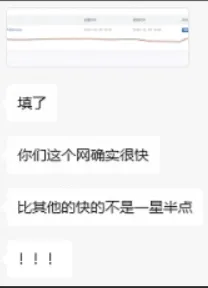

**六、性价比高**

如上，一年服务器的费用差不多与一年的百度云会员、一个16GB内存条、1T的固态硬盘价格相当，但**功能却多了许多** 。与其花**重金** 升级自己的电脑，倒不如低价租用一台服务器，现在通过联名页面注册即**送200￥优惠券** ，填写优惠码[**biomamba**]立减：200元”粉丝福利使用方式。

另外，可咨询文末微信号**领取返现福利**(200￥粉丝专属优惠券与返现可叠加：[“](<http://mp.weixin.qq.com/s?__biz=MzAwMzIzOTk5OQ==&mid=2247510088&idx=1&sn=9475687e466d5290c1a3a376dea6c9e6&chksm=9b3cd118ac4b580e760655b7f7a3bc6f7ca8085e68e73be1a98178e3db290667c82648a9d19d&scene=21#wechat_redirect>)[200元”粉丝福利使用方式](<http://mp.weixin.qq.com/s?__biz=MzAwMzIzOTk5OQ==&mid=2247510088&idx=1&sn=9475687e466d5290c1a3a376dea6c9e6&chksm=9b3cd118ac4b580e760655b7f7a3bc6f7ca8085e68e73be1a98178e3db290667c82648a9d19d&scene=21#wechat_redirect>))，注册链接：

https://biomamba.xiyoucloud.net/

**七、损耗低**

电脑的工作是有损耗的，相信大家在用自己的电脑计算时已经感受到机器的**风扇在嗡嗡作响** ，倘若电脑不堪重负出现故障，随便换哪个**零件** 想来也比服务器的租金要高。

**八、数据存储有保障**

相较于传统的硬盘直储，服务器的存储方式为**超融合集群存储** ，具体优点为高可靠性、高性能高可用，并且具有在线更换硬件、恢复数据的优势。这些优点我们之前专门花推送去说过([大家的宝贝数据怎么存储才最安全](<http://mp.weixin.qq.com/s?__biz=MzAwMzIzOTk5OQ==&mid=2247490796&idx=1&sn=99bdd182e1f02f88d30b196e4960b9b0&chksm=9b3f65bcac48ecaa845cda6ce3a127feae4776966297c75978a55cced57f90646564aded6438&scene=21#wechat_redirect>))。

**九、正经Linux系统**

无论是windows下的子系统、双系统，还是虚拟机，与**真正的Linux** 环境还是有所区别。而服务器原汁原味的Linux可以帮助大家在真正的Linux环境中学习生信。没有Linux基础的小伙伴也不用担心，我们已经为大家准备好了系列教程：

[十小时学会Linux](<http://mp.weixin.qq.com/s?__biz=MzAwMzIzOTk5OQ==&mid=2247505777&idx=1&sn=f3efae390566b838a445ab9f832323c8&chksm=9b3cae21ac4b2737f5923b246470d699474c041bb78de50d2b71b99d537f9f44ca2938002cda&scene=21#wechat_redirect>)

十、增值服务

西柚云还有更多增值服务，为大家的数据分析保驾护航

1、硬盘加量包现在的单细胞/基因组数据分析动辄数以TB计，默认的硬盘大小可能满足不了各位的产出需求，因此我们推出了"硬盘加量包"，60￥/100GB/年，大家可以估摸着下订：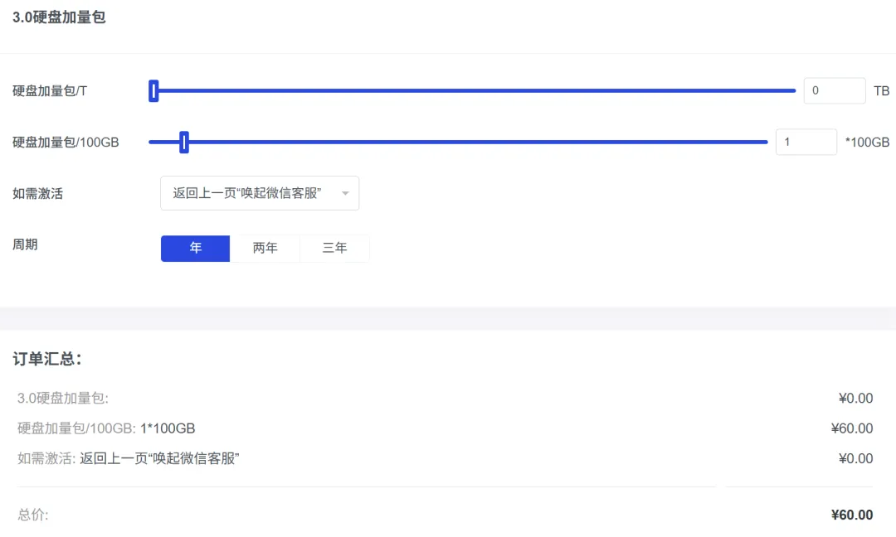
2、非故障类工单协助生信分析难免磕磕绊绊，目前来说，我们的服务器几bug。不仅如此，我们还提供[白嫖五次技术支持](<https://mp.weixin.qq.com/s?__biz=MzAwMzIzOTk5OQ==&mid=2247520567&idx=1&sn=6800842ddd5ad1c17224c4b20ca1d145&scene=21#wechat_redirect>)。换句话说，大家需要装包、解决环境依赖等问题，也欢迎通过"非故障类工单协助"邀请我们的技术解决。不过要注意，超过5次后就需要35￥/次协助了哦。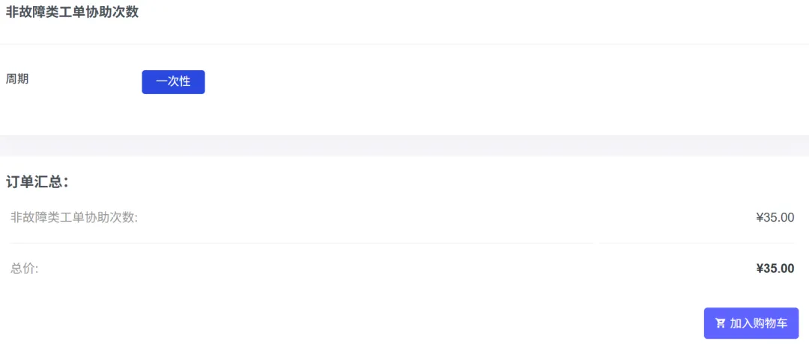3、[AI无缝接入Rstudio≈言出法随](<https://mp.weixin.qq.com/s?__biz=MzAwMzIzOTk5OQ==&mid=2247528429&idx=1&sn=64fda7160dc6b4e5b962170aa3a9043c&scene=21#wechat_redirect>)现在的生信领域没AI已经完全无法干活了。西柚云结合大家对AI编程以及日常运行任务时的实际需求，推出了不用魔法上网、无缝接入Rstudio的AI编程工具——xiyouAgent。能够帮助大家做到在Rstudio中直接调用AI进行对话、代码修改、代码注释，结合分析环境([足够支持你完成硕博生涯的生信环境](<https://mp.weixin.qq.com/s?__biz=MzAwMzIzOTk5OQ==&mid=2247526504&idx=2&sn=417d07347cebe0a1bd403f6c3e7d9b29&scene=21#wechat_redirect>))，几乎能做到数据分析的言出法随，反馈的代码直接就能在Rstudio里跑。目前也给各位用户老爷准备了免费的token，详细申请及使用方法可见：[xiyouAgent](<https://mp.weixin.qq.com/s?__biz=MzAwMzIzOTk5OQ==&mid=2247528429&idx=1&sn=64fda7160dc6b4e5b962170aa3a9043c&scene=21#wechat_redirect>)
4、[云快照服务](<https://mp.weixin.qq.com/s?__biz=MzAwMzIzOTk5OQ==&mid=2247529432&idx=2&sn=72e5349f1be889c099cda59ab93cc392&scene=21#wechat_redirect>)快照功能给云服务器的数据在某时间点的数据进行拍照留存，后续可以将云服务器的数据回滚到快照时间点。也就是说西柚云的用户无需担心以下场景：

    * 云服务器环境被配置乱了，无法复原
    * 数据被误删除
    * 软件因奇奇怪怪的bug崩溃，进而导致目录文件丢失
    * 实例被入侵导致数据丢失
    * 服务器被入侵中了勒索病毒需要高额赎金

详细介绍与申请方法可见：[如何利用服务器进行“时空穿梭”](<https://mp.weixin.qq.com/s?__biz=MzAwMzIzOTk5OQ==&mid=2247529432&idx=2&sn=72e5349f1be889c099cda59ab93cc392&scene=21#wechat_redirect>)
5、国际专线外部站点访问不了([一文学会5种网络代理加速软件安装](<https://mp.weixin.qq.com/s?__biz=MzAwMzIzOTk5OQ==&mid=2247529581&idx=2&sn=35ee6e0fdd1b34f46f39bb699d10eb00&scene=21#wechat_redirect>))，镜像总是抽风，这下解决方案来了：国际专线帮助你解决NCBI、GEO、SRA、EBI等诸多境外数据库的访问限速问题。
6、西柚超级会员
包含天级快照、1v1工单管家(无限次工单支持)、新手护航特权。

详细试用教程可联系客服微信**Biomamba_zhushou**

**欢迎交流**

 留一个领取[资料](<https://mp.weixin.qq.com/s?__biz=MzAwMzIzOTk5OQ==&mid=2247539170&idx=1&sn=ebd269635da35335554c53709fa0a0c0&scene=21#wechat_redirect>)、[开箱即用的单细胞分析镜像](<https://mp.weixin.qq.com/s?__biz=MzAwMzIzOTk5OQ==&mid=2247536307&idx=1&sn=8d03259be06f54521aac5251dec988d5&scene=21#wechat_redirect>)的助手[Biomamba_zhushou]，方便各位随时交流。同时我们也构建了[交流群矩阵](<https://mp.weixin.qq.com/s?__biz=MzAwMzIzOTk5OQ==&mid=2247536307&idx=2&sn=2d030173f51d24a4fee43bd0d83da03b&scene=21#wechat_redirect>)，欢迎大家一起讨论。您点的每个赞和在看，我都认真当成了喜欢
