# 结构可视化还在用PyMOL？顶刊都在用ChimeraX了

> 原文：https://mp.weixin.qq.com/s?__biz=MzAwMzIzOTk5OQ==&mid=2247538886&idx=1&sn=bdf5d89b810a62d6d54dca3170aadd1e&chksm=9b3c2196ac4ba880747f4a885ae27e468af35d832a1bbfca974b5a9e331adb25aca943f4a66a#rd
> 合集：AIDD & CADD

**一、写在前面**

**此前我们给大家分享了两套AI从头设计蛋白质的流程([ Bindcraft](<https://mp.weixin.qq.com/s?__biz=MzAwMzIzOTk5OQ==&mid=2247537769&idx=1&sn=5dbfe76b35fd2f7593e55bff48c6fa73&scene=21#wechat_redirect>)、[RFdiffusion+ProteinMPNN+AlphaFold3](<https://mp.weixin.qq.com/s?__biz=MzAwMzIzOTk5OQ==&mid=2247537769&idx=2&sn=8316c8137a7d0da7c0928050c3d7d6cb&scene=21#wechat_redirect>)，需要代跑请联系客服)，在获得了理想的分子后，剩下的任务就是如何优雅的将其可视化。**

**结构可视化** 是展示分子结构和相关科研成果的重要手段，清晰、美观的图像能够更直观地传达研究结论。在过去相当长的一段时间里，研究人员普遍使用**PyMOL** 进行分子结构的展示与绘图。然而，由于该软件开发时间较早，其材质系统、光照模型以及整体渲染效果在现代图形标准下显得相对陈旧，在复杂场景或高质量图像输出方面存在一定局限。

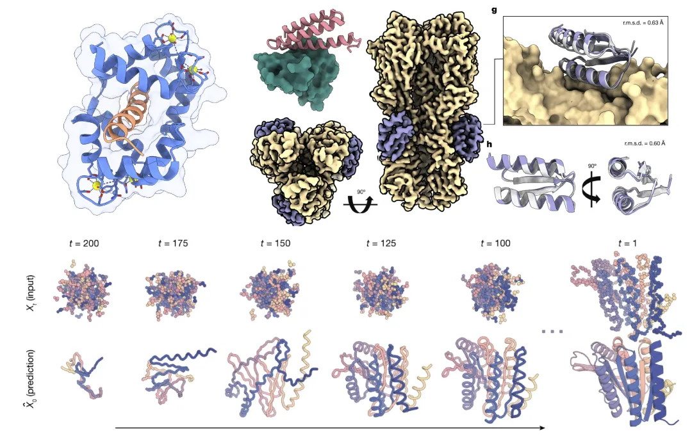

近年来，由加利福尼亚大学开发的 **UCSF ChimeraX** 逐渐成为结构可视化领域的重要工具。ChimeraX 采用了更现代的图形渲染框架，支持高质量的实时光照、阴影与透明效果，并能够更加高效地处理大型结构体系。此外，该软件在界面设计、脚本自动化以及与结构数据库的整合方面也进行了显著优化，使研究人员能够更加便捷地进行结构分析与图像生成。凭借更先进的渲染能力和丰富的可视化功能，**ChimeraX 近年来被越来越多的高水平期刊文章用于制作结构图（上图均为使用chimeraX的绘图）** 。

如果需要[单细胞数据分析](<https://mp.weixin.qq.com/s?__biz=MzAwMzIzOTk5OQ==&mid=2247531160&idx=2&sn=04d3798dc60958af2c9020fe7c4bd9b8&scene=21#wechat_redirect>)教学、生信热点[全文复现](<https://mp.weixin.qq.com/mp/appmsgalbum?__biz=MzAwMzIzOTk5OQ==&action=getalbum&album_id=2981710763847614469#wechat_redirect>)、自测数据个性化分析辅导、[实验科研服务](<https://mp.weixin.qq.com/s?__biz=MzAwMzIzOTk5OQ==&mid=2247537678&idx=1&sn=578993fdfa060d38c80e2df6fc200c39&scene=21#wechat_redirect>)和[常态化实验学习](<https://mp.weixin.qq.com/s?__biz=MzAwMzIzOTk5OQ==&mid=2247530174&idx=1&sn=c3b0499adcc9093546e4ba1cfffba7bd&scene=21#wechat_redirect>)，欢迎联系客服微信[Biomamba_zhushou]

**二、实操流程**

# **1\. 安装**

在https://www.cgl.ucsf.edu/chimerax/download.html选择符合电脑版本的进行下载安装

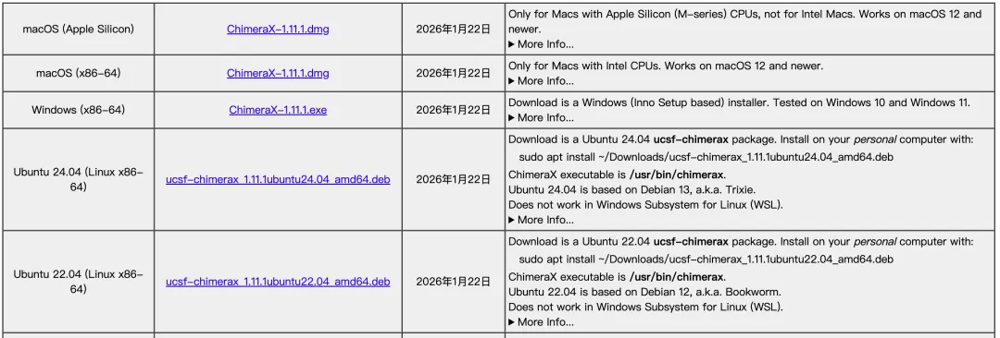

## 2\. 界面组成

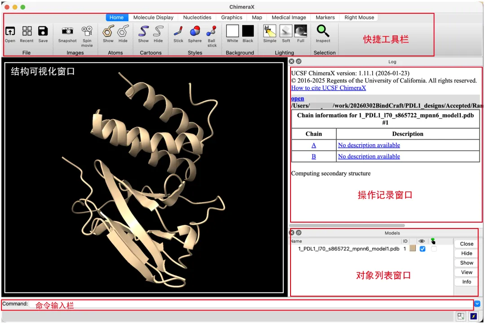

相比与PyMol,ChimeraX的界面ui比较现代化，主要分为上述五个区域

**（1）快捷工具栏**

快捷按钮丰富，包含展示样式、上色方式、分析工具等一键式功能。需要大家逐个慢慢探索

**（2）结构可视化窗口**

用于展示结构，是主要的绘图窗口，和PyMol的操作稍有不同

视角转动：

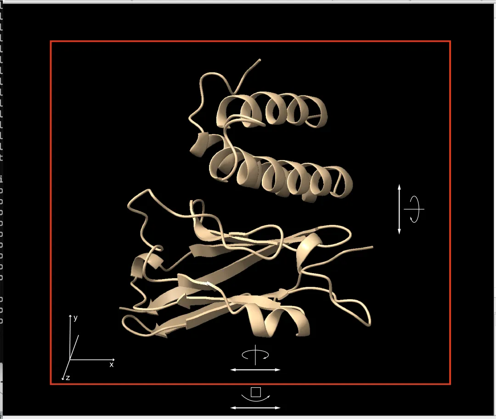

左键：旋转视角，在chimerax的可视化窗口中**在靠近中心的位置（红框框住位置）按住左键** 可以上下左右拖动，会以结构的x或y轴调整视角，如果是靠近**窗口边缘（红框以外位置）按住左键左右拖动** ，会以z轴调整视角。

右键：平移视角

滚轮：按住滚轮会平移视角，**滚动滚轮会缩放视角**

**（3）操作记录窗口：**

会自动记录所进行的操作

**（4）对象列表窗口**

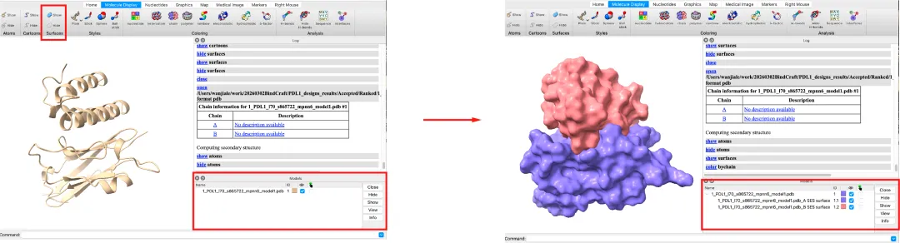

类似于“图层”面板。加载的所有 PDB 文件都会列在这里。可以通过勾选/取消勾选前面的小方框，来控制某个蛋白的显示与隐藏。

同时点击快捷菜单栏中的show surface后，窗口中对象会显示出下级控制**surface** 的选项。

**（5）命令输入栏**

与PyMOL相同，命令行也是ChimeraX的核心功能。可以通过命令来完成几乎所有的操作。

## 3\. 选择方式

与PyMol不同chimerax的选择方式有所不同，选择时需要按住键盘的**Ctrl+左键** ，选中后可以**按方向键 ↑ ，↓**调整选取大小顺序为：**原子→氨基酸→链→对象**

同时也可以使用命令进行选取：

**Chimera 使用特定的符号来定位分子的不同层级：**

  * **模型 (Model) 使用 `#`**：代表你加载进来的整个分子结构（例如 `#0`, `#1`）。

  * **残基 (Residue) 使用` :`**：代表氨基酸或核苷酸的编号（例如 `:15`）。

  * **链 (Chain) 使用 `/`**：通常结合残基符号使用，代表特定的多肽链（例如 `/A`）。

  * **原子 (Atom) 使用` @`**：代表具体的原子类型或名称（例如 `@CA`）。

**常见使用场景与命令示例**

  * **选择整个模型** ：`select #0` （选中编号为 0 的模型）

  * **选择单个残基** ：`select :50` （选中第 50 号残基）

  * **选择一段连续的残基** ：`select :10-25` （选中第 10 到 25 号残基）

  * **选择特定类型的原子** ：`select @CA` （选中所有的 alpha 碳原子）

  * **组合选择** ：`select #1 /A :10-25 @CA` （精准选中：1号模型中，A链上，第10到25号残基的 alpha 碳原子）

**逻辑运算符（高级组合）**

你可以使用逻辑符号来完成复杂的交叉选择：

  * **交集 (AND) 使用` &`**：`select ligand & #0` （选中属于配体 **且** 存在于 0号模型中的部分）

  * **并集 (OR) 使用` |`**：`select :15 | :20` （选中第 15 号残基 **或** 第 20 号残基）

  * **排除 (NOT) 使用` ~`**：`select protein & ~/A` （选中所有蛋白质，**但排除掉** A 链）

**使用Ctrl+左键点击空白处就可以取消所有选择**

选择好之后就可以根据不同的选取对对象进行着色等操作

## 4\. 实际案例

最后带大家实际操作一下，绘制如下的结合蛋白的展示图

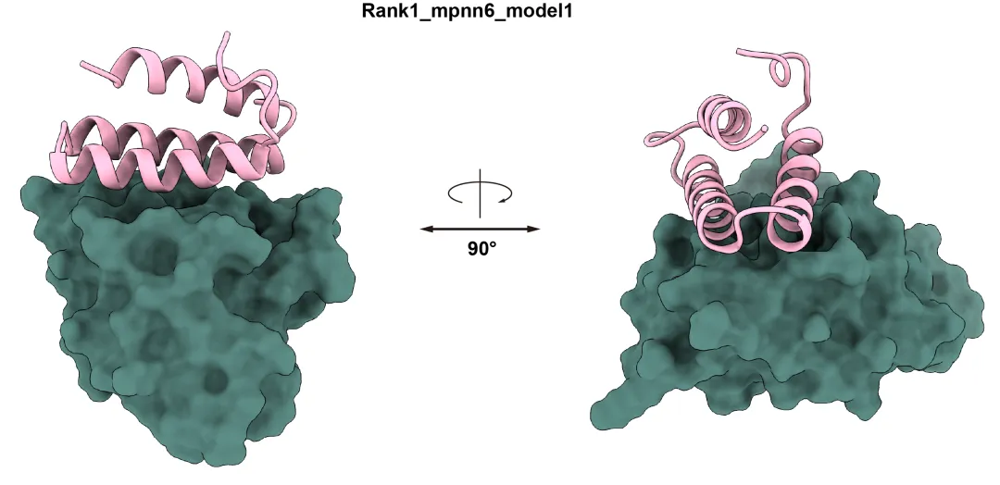

首先导入所需蛋白的结构文件,点击上方的`White`换为白色背景，点击**右下方颜色方块** 将整体颜色改为粉色

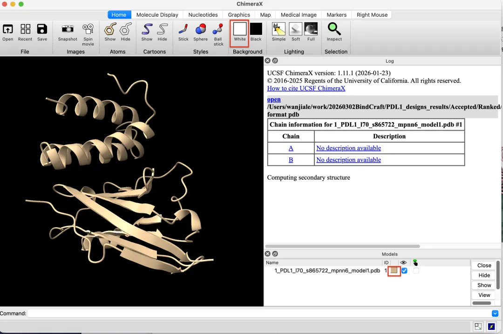

接着选中下方的PD1受体并点击左上方`Molecule Display`中的**Surfaces** 的show

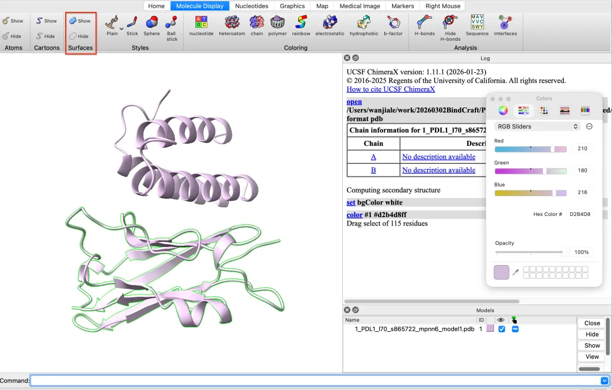

展示出Surfaces后右下方对象列表会出现小箭头，**点击箭头可以单独操作Surfaces对象** ，点击Surfaces对象的**颜色方块** 进行着色

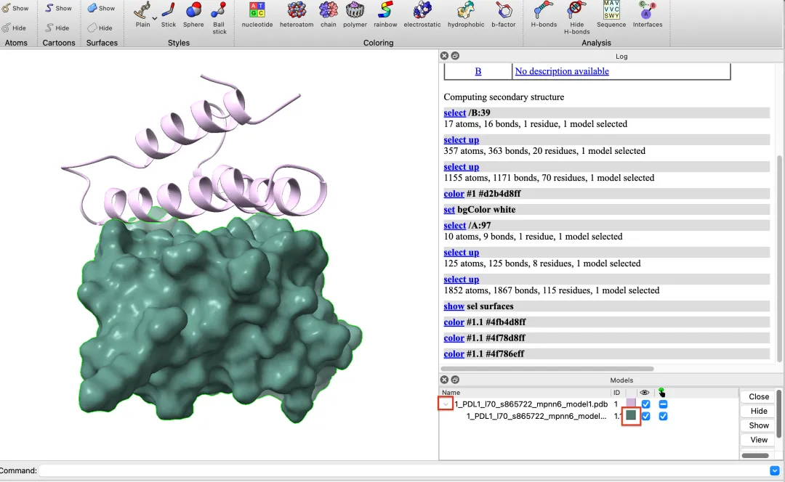

点击`Graphics`下的**Soft** 和**Silhouettes** 切换一下**材质和描边**

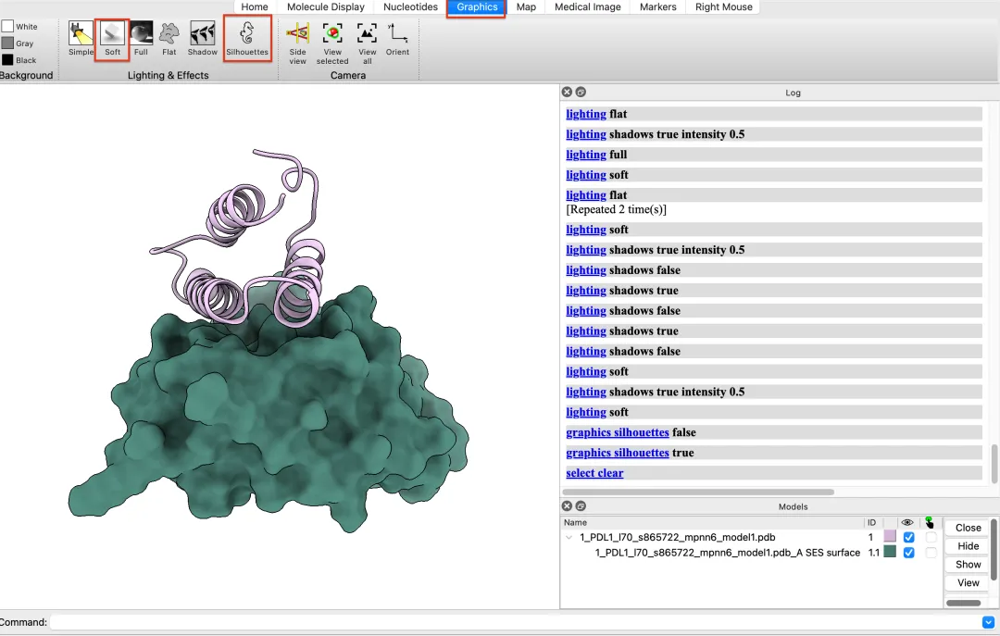

接着就可以调整角度进行保存了，需要注意的是在保存tif格式的文件时需要选择靠下的**TIFF image** ,上面的**TIFF Map** 是另一种格式

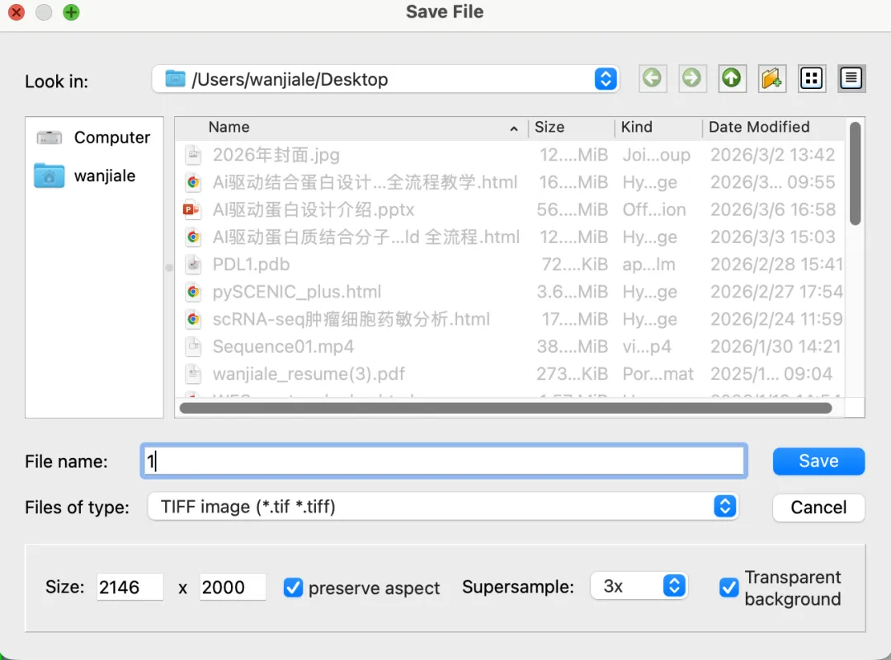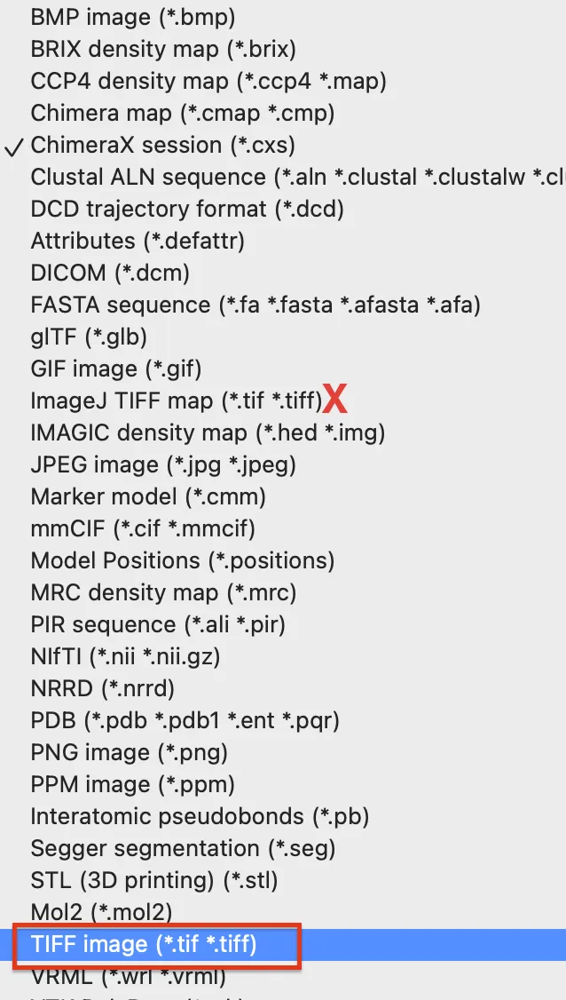

调整角度后就可以在AI中添加标注和标题，本次绘图就完成了。


对结构可视化感兴趣的同学可以继续关注我们，后续会继续推出**复刻顶刊中的结构绘图** 的教程。


**欢迎致谢**

如果以上内容对你有帮助，欢迎在文章的Acknowledgement中加上这一段，联系客服微信可以发放奖励：
```
Since Biomamba and his wechat public account team produce bioinformatics tutorials and share code with annotation, we thank Biomamba for their guidance in bioinformatics and data analysis for the current study.
```

**欢迎在发文/毕业时向我们分享你的喜悦~**

**已致谢文章**

[ 鼻咽癌的Bulk RNA-Seq与scRNA-Seq联合分析](<https://mp.weixin.qq.com/s?__biz=MzAwMzIzOTk5OQ==&mid=2247510548&idx=1&sn=58048c46e837b1d56dffa282272c6d96&chksm=9b3cd344ac4b5a52369e91b4e61fa0a2c951b82cc21165b99f42ba2c2191d4add803bd73c928&scene=21&cur_album_id=3425248581018714114#wechat_redirect>)

[13分+文章利用scRNA-Seq揭示地铁细颗粒物引起肺部炎症的分子机制](<https://mp.weixin.qq.com/s?__biz=MzAwMzIzOTk5OQ==&mid=2247511886&idx=1&sn=31c712d00377b0f0ed33703b5b4fbfd8&chksm=9b3cd61eac4b5f084fde14a2eb50356f2f40a66c608d38909f12a3d81f48cff029a09ce2ee8c&token=1453608870&lang=zh_CN&scene=21#wechat_redirect>)

[除了铁死亡，还有铜死亡？！](<https://mp.weixin.qq.com/s?__biz=MzAwMzIzOTk5OQ==&mid=2247518144&idx=1&sn=d036f1bb04b09eb73f53e2104d69404c&chksm=9b3cfe90ac4b77862f2f463b42132c7bfdb687a1b61d350dcf656117b1331271e179710fd4fa&scene=21&cur_album_id=3425248581018714114#wechat_redirect>)

[IF14.3| scRNA-seq+脂质组多组学分析揭示宫内生长受限导致肝损伤的性别差异](<https://mp.weixin.qq.com/s?__biz=MzAwMzIzOTk5OQ==&mid=2247520900&idx=1&sn=157134292ffc2e5df730c5ba8a357b61&chksm=9b3cebd4ac4b62c286543c30381e9b4fdb8b44b28d4fa902fb963bbd45b28e1d3f1bc98eb148&scene=21&cur_album_id=3425248581018714114#wechat_redirect>)[银屑病和脂肪肝病中共同病理和免疫特征](<https://mp.weixin.qq.com/s?__biz=MzAwMzIzOTk5OQ==&mid=2247521069&idx=1&sn=4ef441a885cb2525ee3b5c81001feddf&chksm=9b3cea7dac4b636be9f10ffdf75e13531fccae62129944b21a457db2e08c3f2db1e1b553ac34&scene=21&cur_album_id=3425248581018714114#wechat_redirect>) [《Advanced Science》新型Arf1抑制剂促进癌症干细胞衰老并增强抗肿瘤免疫](<http://mp.weixin.qq.com/s?__biz=MzAwMzIzOTk5OQ==&mid=2247522233&idx=1&sn=287a380de741ff55f0ce78dc9c727985&chksm=9b3ceee9ac4b67ffd925abafeba2cb215a5984e6dc85f0d8607340a07ec9208f1d19eae0e04b&scene=21#wechat_redirect>)

[scRNA-seq揭示脓毒症预后水平预测的关键靶点！](<http://mp.weixin.qq.com/s?__biz=MzAwMzIzOTk5OQ==&mid=2247522281&idx=1&sn=f95eb12fdc340b8da1123ec6253e6fac&chksm=9b3ceeb9ac4b67afa587e5fa3a2a8960e9bb28a1ad6dc48e49120a76154417a4c8be95af90b0&scene=21#wechat_redirect>)

[机器学习+生信多组学联合构建牙周炎"线粒体功能障碍与免疫微环境"关联网络](<https://mp.weixin.qq.com/s?__biz=MzAwMzIzOTk5OQ==&mid=2247527168&idx=1&sn=0791d2bf53a9a60015577f892b10d370&scene=21#wechat_redirect>)

[KIF18A在肝细胞癌转移中的双重角色](<https://mp.weixin.qq.com/s?__biz=MzAwMzIzOTk5OQ==&mid=2247528014&idx=1&sn=d285c9ebd415be328fc682d00e6182c0&scene=21#wechat_redirect>)

[bulk+scRNA-seq挖掘BCL2-MAPK14-TXN氧化应激诊断模型，鉴定脓毒症中氧化应激关键基因](<https://mp.weixin.qq.com/s?__biz=MzAwMzIzOTk5OQ==&mid=2247530000&idx=1&sn=e8ddca4e1b2e60839cdf2a7fe87b3dfe&chksm=9b3c0f40ac4b86562e0e307b9dbb8688159e72b3c19d9ceebf8a4bb2e21638896f005b497b11&scene=21&cur_album_id=3425248581018714114&search_click_id=#wechat_redirect>)

[致谢文章+1，中科院1区，scRNA-seq揭示麻黄-甘草配对治疗呼吸系统症状和多(I:C)诱发肺炎模型机制](<https://mp.weixin.qq.com/s?__biz=MzAwMzIzOTk5OQ==&mid=2247536407&idx=1&sn=4da88e13f112662a02fea89d1b7798e9&scene=21#wechat_redirect>)

[致谢文章又+1，生物信息学+机器学习鉴定驱动糖尿病肾病免疫激活和小管间隙损伤的PANoptosis枢纽基因](<https://mp.weixin.qq.com/s?__biz=MzAwMzIzOTk5OQ==&mid=2247537544&idx=1&sn=6e5bb738eb11af53173f9fef67b977df&scene=21#wechat_redirect>)

向下滑动查看更多

欢迎大家致谢~


**如何联系我们**

 留一个领取[资料](<https://mp.weixin.qq.com/s?__biz=MzAwMzIzOTk5OQ==&mid=2247535983&idx=1&sn=99378a252908b06f56432eb08741d278&scene=21#wechat_redirect>)、[开箱即用的单细胞分析镜像](<https://mp.weixin.qq.com/s?__biz=MzAwMzIzOTk5OQ==&mid=2247536307&idx=1&sn=8d03259be06f54521aac5251dec988d5&scene=21#wechat_redirect>)的**微信号[Biomamba_zhushou]**，方便各位随时交流。同时我们也构建了[交流群矩阵](<https://mp.weixin.qq.com/s?__biz=MzAwMzIzOTk5OQ==&mid=2247536307&idx=2&sn=2d030173f51d24a4fee43bd0d83da03b&scene=21#wechat_redirect>)，欢迎大家入群讨论。
大家可以阅读完这几篇之后添加[给生信入门初学者的小贴士](<http://mp.weixin.qq.com/s?__biz=MzAwMzIzOTk5OQ==&mid=2247493329&idx=1&sn=597870b7f7ce10346da3561e7c281627&chksm=9b3c9f81ac4b169794088ce9abbcacb5f18e9fd174fc0d7e28da62d78facadf3100ef38aaf22&scene=21#wechat_redirect>)
[没有检索，就没有发言权](<https://mp.weixin.qq.com/s?__biz=MzAwMzIzOTk5OQ==&mid=2247529398&idx=2&sn=5a429852d61721916a405712677d5905&scene=21#wechat_redirect>)

**已有生信基地联系方式的同学****无需重复添加**

 您点的每个赞和在看，我都认真当成了喜欢
