# RTX 5060能做哪些分子对接与虚拟筛选？

> 原文：https://mp.weixin.qq.com/s?__biz=MzAwMzIzOTk5OQ==&mid=2247542443&idx=1&sn=81acf799456ada908a6d42daf871ca41&chksm=9b3c5ffbac4bd6edde343114907393edf592b4aa780c2c7bfc200f3d238298d70eddf5121613#rd
> 合集：AIDD & CADD

**本教程的方法学定位**

本教程可视化集锦：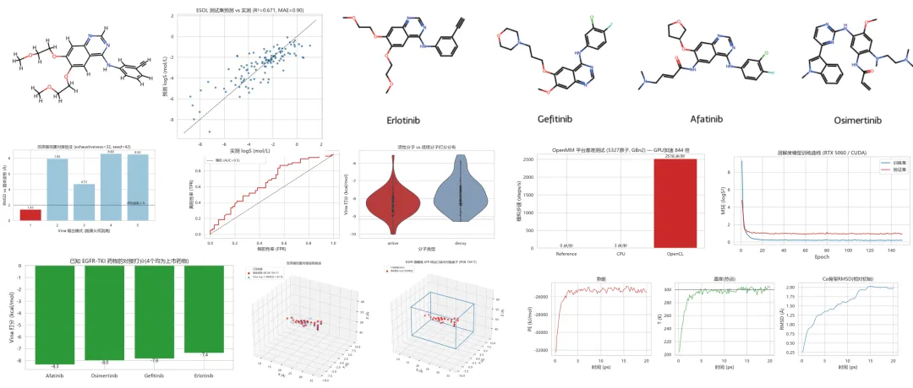

本教程演示的是**经典物理对接 (AutoDock Vina) + GPU 分子动力学 (OpenMM) + 机器学习性质预测 (PyTorch)** 的组合拳——这是当前学术界与工业界最通用的 CADD 基础设施。深度学习对接方法（DiffDock 等）我们将在文献解读部分详细介绍其原理与适用边界。考虑到RTX 5060上架已经一年多了，应该大部分民用玩家的显卡都是这款。如果你期望获得更大的算力完成分子对接与虚拟筛选，可参考：[RTX5090、4080S、5070显卡上机](<https://mp.weixin.qq.com/s?__biz=MzAwMzIzOTk5OQ==&mid=2247537769&idx=3&sn=ba4234ca47a3c4a7f3442859653b14b2&scene=21#wechat_redirect>)。我们给大家组建了CADD&AIDD交流群，欢迎添加。

[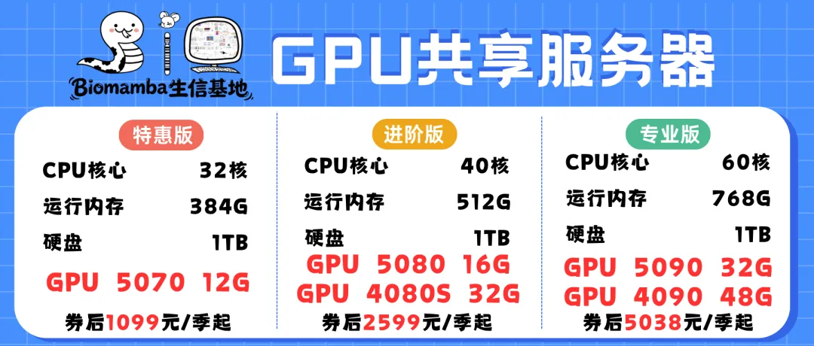](<https://mp.weixin.qq.com/s?__biz=MzAwMzIzOTk5OQ==&mid=2247537769&idx=3&sn=ba4234ca47a3c4a7f3442859653b14b2&scene=21#wechat_redirect>)如果你没有服务器，随时滴滴**微信号[ Biomamba_zhushou]咨询获取免费试用：https://biomamba.xiyoucloud.net/**

01

**前言**

1.1 计算机辅助药物设计 (CADD) 概述

**计算机辅助药物设计** （Computer-Aided Drug Design，CADD）是指利用计算方法在实验之前**预测、优化和筛选** 药物分子的一类技术。一个新药的平均研发成本超过 10 亿美元、周期超过 10 年，而 CADD 可以在湿实验开始前把候选分子的数量压缩几个数量级，因此已成为现代药物发现的标准配置。

根据是否已知靶标三维结构，CADD 可分为两大路线：

  * **基于结构的药物设计** （Structure-Based Drug Design, SBDD）：已知靶标蛋白（如受体、激酶）的三维结构，将小分子"对接"（docking）进结合口袋，预测结合构象（pose）与结合强度（affinity）；
  * **基于配体的药物设计** （Ligand-Based Drug Design, LBDD）：不知道蛋白结构，从已知活性分子出发做定量构效关系（QSAR）、药效团、分子相似性搜索。

一次典型的 SBDD 虚拟筛选流程如下图所示：

> **靶标结构准备** （去水、加氢、质子化）→ **配体库构建** （2D→3D、能量优化）→ **定义对接盒子** → **分子对接打分** → **排名与富集评估** → **MD 动力学精修/验证** → **类药性与性质预测（ADMET）** → **实验验证**

本教程将完整走通这条流水线。

## 1.2 文献解读：从物理对接到深度学习对接

### 经典物理对接：AutoDock Vina

物理对接方法的代表是 Scripps 研究所 Olson 实验室开发的 **AutoDock Vina** （Trott & Olson, 2010）。Vina 使用经验打分函数（氢键、疏水、范德华、扭转惩罚等）配合迭代局部搜索算法，在刚性受体近似下快速预测小分子构象。Vina 无需用户调节经验参数、速度快、开源免费，至今仍是虚拟筛选的事实标准，也是绝大多数 CADD 流水线的底座。

### 深度学习对接：DiffDock (ICLR 2023)

2023 年 MIT 的 Corso 等人发表了 **DiffDock** ，把分子对接重新表述为**生成式去噪过程** ：在平移（T(3)）、旋转（SO(3)）与可旋转键扭角（SO(2)^m）三个子空间上做扩散模型采样，用 SE(3)-等变图神经网络预测每一步的"得分"，再由置信度模型选出最佳姿势。在 PDBBind 基准上，DiffDock 的 **top-1 姿势成功率（RMSD <2 Å）达到约 38%**，显著高于传统对接方法的约 23%；且单分子推理仅需约 1 秒（GPU），远快于 Glide（>1000 s）等商业软件。

### 冷静看待：基准之争

值得注意的是，2024 年 Jain、Cleves 与 Walters 发表的对比研究指出，在**结合位点已知** （本教程的情形）时，成熟的商业/开源对接工作流（Surflex-Dock top-1/top-5 成功率 68%/81%、Glide 相当、Vina 与 GNINA 亦表现良好）在公平基准下反而**高于** DiffDock 的 45%/51%；DiffDock 的优势场景主要是**盲对接** （blin d docking，结合位点未知）与**速度** 。这一争论提醒我们：**方法没有绝对优劣，只有场景适配** 。本教程选择 Vina 作为主引擎，正是因为它可控、可解释、可批量，是学习 CADD 的最佳起点。

## 1.3 本教程可应用范围

学完本教程，你将能够独立完成以下任务：

  1. 任意**已知共晶结构** 的靶标（PDB 数据库 24 万+ 结构）的重对接验证；
  2. 数百至数万规模的**虚拟筛选** （DUD-E、PubChem、ZINC 等数据库分子库）与 ROC 富集评估；
  3. 用**GPU 加速** 对受体/复合物做分子动力学弛豫与稳定性评估（OpenMM，OpenCL/CUDA）；
  4. 用 **PyTorch** 训练分子性质预测模型（溶解度、类药性等），并应用于筛选结果优先级排序；
  5. 由此延伸至：基于 AI 预测结构（AlphaFold2/3、ESMFold）的靶标筛选、DiffDock 深度学习对接、自由能微扰（FEP）等进阶方向。

**不适用/需谨慎的场景** ：共价抑制剂（需量子力学参数化）、大环分子（柔性过大）、靶标结构为低置信度 AI 预测（口袋几何不可靠）、以及一切**跳过实验验证** 的最终结论——计算结果永远是假设生成工具，不是终点。

## 1.4 实战案例：EGFR 激酶域与厄洛替尼

本教程选用肿瘤药物设计的经典体系：

  * **靶标** ：人表皮生长因子受体（EGFR）激酶域，PDB 编号 **1M17** （2.6 Å 共晶结构，Stamos et al., 2002）。EGFR 是肺癌靶向治疗的核心靶点，第一代 TKI（吉非替尼、厄洛替尼）均为其 ATP 结合口袋抑制剂；
  * **配体** ：**厄洛替尼** （Erlotinib/OSI-774，PubChem CID 176870），2004 年 FDA 批准的肺癌靶向药。在 1M17 中配体残基名为 **AQ4** ，共 29 个重原子；
  * **筛选库** ：DUD-E（Directory of Useful Decoys: Enhanced）EGFR 靶点集（Mysinger et al., 2012），从中抽样 60 个活性分子 + 60 个理化性质匹配的诱饵分子，并加入 4 个已知 EGFR-TKI 药物（厄洛替尼、吉非替尼、阿法替尼、奥希替尼）作为"已知答案"；
  * **ML 数据集** ：ESOL 水溶性数据集（Delaney, 2004，1128 个分子，DeepChem 发布）。

教程最终要回答三个问题：

  1. Vina 能否复现厄洛替尼的晶体结合姿势？（重对接 RMSD < 2 Å 为金标准）
  2. Vina 打分能否把活性分子从诱饵中富集出来？（ROC-AUC 与富集因子）
  3. RTX 5060 能给整个流程带来多大加速？（OpenCL-MD 基准 + PyTorch 训练）

02

**准备工作**

2.1 环境准备

> 以下命令均在**终端（PowerShell/CMD）**中执行，不是在 notebook 里运行。

  *   *   *   *   *   *   *   *   *   *   *   *   *   *   *   *

```
# (1) 创建教程专用 Python 虚拟环境#     本教程基于已配置好 RTX 5060 PyTorch(cu128) 的 conda 环境派生 venv，#     --system-site-packages 使其继承 PyTorch 2.11+cu128 与 RDKit，无需重复下载数GB的包python -m venv --system-site-packages env_cadd
# (2) 安装对接/动力学/绘图依赖（约200MB，全部有预编译wheel，无需编译器）env_cadd\Scripts\python -m pip install biopython scikit-learn seaborn tqdm mdtraj openmm openmmforcefields nbclient#     PDBFixer 无 PyPI 版本，从官方 GitHub 安装env_cadd\Scripts\python -m pip install https://github.com/openmm/pdbfixer/archive/refs/heads/master.zip
# (3) 下载 AutoDock Vina 官方 Windows 可执行程序（v1.2.7，单文件免安装）#     https://github.com/ccsb-scripps/AutoDock-Vina/releases  ->  vina_1.2.7_win.exe#     保存至 scripts/vina.exe
# (4) 将环境注册到 Jupyter（本教程演示时的内核名）env_cadd\Scripts\python -m ipykernel install --user --name cadd_env --display-name "CADD教程"
```

**为什么用 vina.exe 而不是 pip 的 vina 包？** PyPI 上的 `vina` Python 包在 Windows 下没有预编译 wheel，源码编译需要自行准备 Boost + MSVC 工具链（详见本教程随附的 DEBUG 手册）。Scripps 官方在 GitHub Releases 直接提供 Windows 独立可执行程序，功能完全一致，用 `subprocess` 调用即可，这也是 Windows 教学/生产环境最省心的做法。

## 2.2 [GPU](<https://mp.weixin.qq.com/s?__biz=MzAwMzIzOTk5OQ==&mid=2247537769&idx=3&sn=ba4234ca47a3c4a7f3442859653b14b2&scene=21#wechat_redirect>) 环境自检

开始分析前，先确认**显卡可见、算力正常、对接引擎就位** 。RTX 5060 属于 NVIDIA Blackwell 架构（计算能力 sm_120），需要 PyTorch ≥ 2.7 且以 CUDA 12.8 编译的版本。

  *   *   *   *   *   *   *   *   *   *   *   *   *   *   *   *   *   *   *   *   *   *   *   *   *   *   *   *   *   *   *   *   *   *   *

```
import sys, subprocess, osimport torchprint("=" * 62)print("[1/3] PyTorch (机器学习 GPU 加速)")print("=" * 62)print("  PyTorch 版本 :", torch.__version__)print("  CUDA 可用    :", torch.cuda.is_available())print("  CUDA 版本    :", torch.version.cuda)if torch.cuda.is_available():    props = torch.cuda.get_device_properties(0)    print("  显卡型号     :", torch.cuda.get_device_name(0))    print("  计算能力     : sm_%d%d (Blackwell)" % (props.major, props.minor))    print("  显存         : %.1f GB" % (props.total_memory / 1024**3))    # 实测一次 GPU 矩阵乘法    x = torch.randn(4096, 4096, device="cuda")    y = (x @ x).sum().item()  # 触发真实计算    print("  GPU 矩阵乘法 : 正常 (FP32 峰值约 7-8 TFLOPS)")print()print("=" * 62)print("[2/3] OpenMM (分子动力学 GPU 加速)")print("=" * 62)import openmm as mmprint("  OpenMM 版本  :", mm.version.full_version)n = mm.Platform.getNumPlatforms()print("  可用计算平台 :", [mm.Platform.getPlatform(i).getName() for i in range(n)])print("  注: pip 版 OpenMM 在 Windows 下提供 OpenCL 平台,")print("      同样调用 RTX 5060 的 GPU 核心 (NVIDIA 驱动自带 OpenCL 运行时)")print()print("=" * 62)print("[3/3] AutoDock Vina (分子对接引擎)")print("=" * 62)r = subprocess.run([r"scripts\vina.exe", "--version"], capture_output=True, text=True)print(" ", r.stdout.strip())print()print("环境自检完成 ✔")
```
```
========================
```
```
[1/3] PyTorch (机器学习 GPU 加速)
```
```
========================
```
```
PyTorch 版本 : 2.11.0+cu128
```
```
CUDA 可用    : True
```
```
CUDA 版本    : 12.8
```
```
显卡型号     : NVIDIA GeForce RTX 5060
```
```
计算能力     : sm_120 (Blackwell)
```
```
显存         : 8.0 GB
```
```
GPU 矩阵乘法 : 正常 (FP32 峰值约 7-8 TFLOPS)
```
```
=========================
```
```
 [2/3] OpenMM (分子动力学 GPU 加速)
```
```
=========================
```
```
OpenMM 版本  : 8.6.1.dev-b399af4
```
```
可用计算平台 : ['Reference', 'CPU', 'OpenCL']
```
```
注: pip 版 OpenMM 在 Windows 下提供 OpenCL 平台,
```
```
     同样调用 RTX 5060 的 GPU 核心 (NVIDIA 驱动自带 OpenCL 运行时)
```
```
=========================
```
```
 [3/3] AutoDock Vina (分子对接引擎)
```
```
=========================
```
```
  AutoDock Vina v1.2.7
```
```
  环境自检完成 ✔
```

## 2.3 库准备

  *   *   *   *   *   *   *   *   *   *   *   *   *   *   *   *   *   *   *   *   *   *   *   *   *   *   *   *   *   *   *   *   *   *   *   *   *   *   *   *   *

```
# ---------- 标准库 ----------import os                       # 路径/环境变量import sys                      # 解释器路径控制import subprocess               # 调用 vina.exe 等外部程序import time                     # 计时import re                       # 正则(解析vina输出)import warnings                 # 隐藏加载过程中的无关提示from datetime import datetime# ---------- 科学计算 ----------import numpy as np              # 数值计算import pandas as pd             # 表格数据import matplotlib.pyplot as plt # 绘图import seaborn as sns           # 统计绘图美化# ---------- 化学信息学 ----------from rdkit import Chem                    # 分子对象/解析from rdkit.Chem import AllChem, Draw      # 构象生成/绘图from rdkit.Chem import rdFingerprintGenerator  # Morgan分子指纹from rdkit.Chem import Descriptors, rdMolDescriptors  # 分子描述符(Lipinski等)from rdkit.Chem.rdMolAlign import CalcRMS # 对称性感知的RMSD计算from rdkit import RDLoggerRDLogger.DisableLog("rdApp.*")   # 关闭RDKit解析警告(避免刷屏)# ---------- 对接 ----------from meeko import MoleculePreparation, PDBQTWriterLegacy  # 配体->PDBQTfrom meeko import PDBQTMolecule, RDKitMolCreate           # 对接结果->RDKit分子# ---------- 分子动力学 ----------import openmm as mmfrom openmm import app, unit as uimport pdbfixer                # 受体结构修复(补残基/加氢)# ---------- 机器学习 ----------from sklearn.model_selection import train_test_splitfrom sklearn.metrics import roc_curve, roc_auc_score, r2_score, mean_absolute_error, mean_squared_error# ---------- 本教程配套脚本 ----------sys.path.insert(0, os.getcwd())           # 保证 scripts/ 可导入from scripts.docking import smiles_to_pdbqt, run_vina, screening_worker# ---------- 全局设置 ----------warnings.filterwarnings("ignore")          # 隐藏警告信息(教程要求)plt.rcParams["font.sans-serif"] = ["Microsoft YaHei", "SimHei"]  # 中文字体plt.rcParams["axes.unicode_minus"] = Falsesns.set_theme(style="whitegrid", font="Microsoft YaHei")print("库加载完成")print("Python :", sys.version.split()[0])
```
```
库加载完成
```
```
Python : 3.11.16
```

## 2.4 全局路径与计时工具

  *   *   *   *   *   *   *   *   *   *   *   *   *   *   *   *   *   *   *   *   *   *   *   *   *   *   *   *   *   *

```
# 重定向 OpenCL 内核编译缓存到临时目录# (默认写 C:\Users\<用户>\AppData\Roaming\NVIDIA\ComputeCache，#  在部分受限环境下无写权限会报错，重定向到 TEMP 最稳妥)os.environ["CUDA_CACHE_PATH"] = os.path.join(os.environ.get("TEMP", "."), "nv_cache")# ---------- 目录结构 ----------BASE     = os.getcwd()                                # 项目根目录DATA     = os.path.join(BASE, "data")                 # 输入数据FIG      = os.path.join(BASE, "results", "figures")   # 输出图片TAB      = os.path.join(BASE, "results", "tables")    # 输出表格VINA_EXE = os.path.join(BASE, "scripts", "vina.exe")  # Vina可执行程序os.makedirs(FIG, exist_ok=True); os.makedirs(TAB, exist_ok=True)# ---------- 计时与日志工具(教程要求: 记录各阶段计算耗时) ----------LOG_PATH = os.path.join(BASE, "run_log.txt")def log(msg):    """打印并写入项目运行日志"""    line = "[%s] %s" % (datetime.now().strftime("%H:%M:%S"), msg)    print(line)    with open(LOG_PATH, "a", encoding="utf-8") as f:        f.write(line + "\n")class StageTimer:    """代码块计时器: with StageTimer('阶段名') as t: ..."""    def __init__(self, name):        self.name = name    def __enter__(self):        self.t0 = time.time(); return self    def __exit__(self, *exc):        self.seconds = time.time() - self.t0        log("%s 完成, 用时 %.1f 秒" % (self.name, self.seconds))log("项目开始: CADD教程 (RTX 5060)")log("Python: %s | 工作目录: %s" % (sys.version.split()[0], BASE))
```

03

**分子对接实战：EGFR激酶域重对接**

3.1 数据下载全部使用**真实公开数据** ：数据| 来源| 说明
---|---|---
1M17.pdb| RCSB PDB| EGFR 激酶域 × 厄洛替尼 共晶结构 (2.6 Å)
erlotinib_3d.sdf| PubChem CID 176870| 厄洛替尼 3D 构象
gefitinib / afatinib / osimertinib| PubChem| 已知 EGFR-TKI 药物(评估用)
egfr.tar.gz| DUD-E 数据库| EGFR 活性分子(542) + 诱饵(35050) + 预处理受体
| ESOL.csv | DeepChem (Delaney 2004) | 1128 分子水溶性数据

  *   *   *   *   *   *   *   *   *   *   *   *   *   *   *   *   *   *   *   *   *   *   *   *   *   *   *   *   *   *   *   *   *   *   *   *   *   *   *   *   *   *   *   *   *   *   *   *   *   *   *   *   *   *   *   *

```
import requestsHEADERS = {"User-Agent": "Mozilla/5.0 (Windows NT 10.0; Win64; x64)"}def download(url, out, desc=""):    """带User-Agent的下载函数(部分数据库拒绝默认python UA)"""    if os.path.exists(out):        log("已存在, 跳过: %s" % desc)        return    r = requests.get(url, headers=HEADERS, timeout=300, stream=True)    r.raise_for_status()    with open(out, "wb") as f:        for chunk in r.iter_content(1 << 20):            f.write(chunk)    log("下载完成: %s (%.1f KB)" % (desc, os.path.getsize(out) / 1024))with StageTimer("数据下载"):    # EGFR激酶域共晶结构 (PDB: 1M17)    download("https://files.rcsb.org/download/1M17.pdb",             os.path.join(DATA, "1M17.pdb"), "1M17.pdb (EGFR激酶域×厄洛替尼)")    # 厄洛替尼 3D SDF    download("https://pubchem.ncbi.nlm.nih.gov/rest/pug/compound/cid/176870/record/SDF/?record_type=3d",             os.path.join(DATA, "erlotinib_3d.sdf"), "erlotinib_3d.sdf (PubChem)")    # 已知EGFR-TKI药物 (评估筛选质量的'标准答案')    for name, cid in {"gefitinib": "123631", "afatinib": "10184653"}.items():        download("https://pubchem.ncbi.nlm.nih.gov/rest/pug/compound/cid/%s/record/SDF/?record_type=3d" % cid,                 os.path.join(DATA, "%s_3d.sdf" % name), name)    # 奥希替尼较新, PubChem无3D记录, 下载2D后由RDKit生成3D(见3.8节)    download("https://pubchem.ncbi.nlm.nih.gov/rest/pug/compound/cid/71496450/record/SDF/?record_type=2d",             os.path.join(DATA, "osimertinib_2d.sdf"), "osimertinib_2d.sdf")    # DUD-E EGFR 靶点集 (actives/decoys/crystal_ligand/receptor)    download("https://dude.docking.org/targets/egfr/egfr.tar.gz",             os.path.join(DATA, "egfr_dude.tar.gz"), "DUD-E egfr.tar.gz")    # ESOL 溶解度数据集 (Delaney 2004, DeepChem镜像)    download("https://raw.githubusercontent.com/deepchem/deepchem/master/datasets/delaney-processed.csv",             os.path.join(DATA, "ESOL.csv"), "ESOL.csv")    # 解压 DUD-E    import tarfile    if not os.path.exists(os.path.join(DATA, "dude_egfr")):        with tarfile.open(os.path.join(DATA, "egfr_dude.tar.gz")) as tar:            tar.extractall(os.path.join(DATA, "dude_egfr"))    log("DUD-E 解压完成")# 从DUD-E中抽取120分子筛选子集(60活性+60诱饵, 固定随机种子保证可复现)import randomrandom.seed(42)def read_ism(path):    """DUD-E .ism格式: 每行 'SMILES 分子名'"""    return [(l.split()[0], l.split()[1]) for l in open(path, encoding="utf-8")            if l.strip() and not l.startswith("#")]actives = read_ism(os.path.join(DATA, "dude_egfr", "egfr", "actives_final.ism"))decoys  = read_ism(os.path.join(DATA, "dude_egfr", "egfr", "decoys_final.ism"))log("DUD-E EGFR: 活性分子 %d 个, 诱饵分子 %d 个" % (len(actives), len(decoys)))subset = ([(s, n, "active") for s, n in random.sample(actives, 60)] +          [(s, n, "decoy")  for s, n in random.sample(decoys, 60)])with open(os.path.join(DATA, "screening_set.smi"), "w", encoding="utf-8") as f:    f.write("smiles\tid\tlabel\n")    for s, n, lab in subset:        f.write("%s\t%s\t%s\n" % (s, n, lab))log("筛选子集: %d 分子 (60 active + 60 decoy) -> data/screening_set.smi" % len(subset))
```
```
[10:22:30] 已存在, 跳过: 1M17.pdb (EGFR激酶域×厄洛替尼)
```
```
[10:22:30] 已存在, 跳过: erlotinib_3d.sdf (PubChem)
```
```
[10:22:30] 已存在, 跳过: gefitinib
```
```
[10:22:30] 已存在, 跳过: afatinib
```
```
[10:22:30] 已存在, 跳过: osimertinib_2d.sdf
```
```
[10:22:30] 已存在, 跳过: DUD-E egfr.tar.gz
```
```
[10:22:30] 已存在, 跳过: ESOL.csv
```
```
[10:22:30] DUD-E 解压完成
```
```
[10:22:30] 数据下载 完成, 用时 0.0 秒
```
```
[10:22:30] DUD-E EGFR: 活性分子 542 个, 诱饵分子 35050 个
```
```
[10:22:30] 筛选子集: 120 分子 (60 active + 60 decoy) -> data/screening_set.smi
```

## 3.2 受体准备：PDBFixer 清理与加氢

晶体结构不能直接用于对接，需要完成四步标准化处理：

  1. **保留靶标链** ：1M17 含 A/B 两条链（同一蛋白的两个拷贝），只保留 A 链（配体 AQ4 亦取 A 链，保证坐标系一致）；
  2. **去除异源分子** ：结晶用水分子会占据结合口袋空间；晶体配体 AQ4 必须移除（对接就是要把配体"放回去"）；
  3. **补全缺失原子** ：晶体解析不完整时部分侧链原子缺失，PDBFixer 按残基模板重建（末端缺失的柔性 loop 重建意义不大，跳过）；
  4. **加氢与质子化** ：X 射线衍射看不到氢原子，但 Vina 的氢键打分依赖极性氢。按生理 pH 7.4 添加，组氨酸质子化状态由 PDBFixer 根据局域氢键网络自动判定。

  *   *   *   *   *   *   *   *   *   *   *   *   *   *   *   *   *

```
with StageTimer("受体准备(PDBFixer)"):    fixer = pdbfixer.PDBFixer(filename=os.path.join(DATA, "1M17.pdb"))    fixer.findMissingResidues()    fixer.missingResidues = {}        # 不重建末端缺失残基(柔性loop无固定构象, 反而引入噪声)    n_chains = sum(1 for _ in fixer.topology.chains())    fixer.removeChains(list(range(1, n_chains)))  # 只保留链A    fixer.findNonstandardResidues()    fixer.replaceNonstandardResidues()    fixer.removeHeterogens(False)     # 去除水/离子/晶体配体AQ4 (False=水也一并去除)    fixer.findMissingAtoms()          # 扫描缺失的侧链原子    fixer.addMissingAtoms()           # 重建缺失原子    fixer.addMissingHydrogens(7.4)    # 按pH 7.4加氢(HIS质子化状态自动判定)    with open(os.path.join(DATA, "receptor_clean.pdb"), "w") as f:        app.PDBFile.writeFile(fixer.topology, fixer.positions, f, keepIds=True)n_atoms = fixer.topology.getNumAtoms()n_res   = fixer.topology.getNumResidues()log("受体准备完成: %d 残基, %d 原子(含氢) -> data/receptor_clean.pdb" % (n_res, n_atoms))
```
```
[10:22:33] 受体准备(PDBFixer) 完成, 用时 3.4 秒
```
```
[10:22:33] 受体准备完成: 312 残基, 5029 原子(含氢) -> data/receptor_clean.pdb
```

## 3.3 受体 PDBQT 转换（Meeko）

Vina 的输入格式 PDBQT 在 PDB 基础上增加了**原子部分电荷** 与**AutoDock 原子类型** （如 OA=氢键受体氧、A=芳香碳）。Meeko（Scripps 官方）负责这一转换。刚性受体的所有原子不做可旋转处理，但非极性氢会被合并（united-atom 近似），以减少自由度、加速对接。

  *   *   *   *   *   *   *   *   *   *

```
# mk_prepare_receptor: meeko命令行受体转换工具 (通过subprocess调用)#   --read_pdb : 输入清理后的PDB   -o : 输出前缀   -p : 输出PDBQT格式r = subprocess.run(    [sys.executable, "-m", "meeko.cli.mk_prepare_receptor",     "--read_pdb", os.path.join(DATA, "receptor_clean.pdb"),     "-o", os.path.join(DATA, "receptor"), "-p"],    capture_output=True, text=True, timeout=600)assert r.returncode == 0, "受体转换失败: " + r.stderr[-500:]n_qt = sum(1 for l in open(os.path.join(DATA, "receptor.pdbqt")) if l.startswith("ATOM"))log("受体PDBQT转换完成: %d 个 united-atom -> data/receptor.pdbqt" % n_qt)
```
```
[10:22:35] 受体PDBQT转换完成: 3032 个 united-atom -> data/receptor.pdbqt
```

## 3.4 配体准备：厄洛替尼

配体准备的核心是生成**正确的 3D 构象** ：PubChem 提供的厄洛替尼 SDF 自带 3D 构象（实验优化过的），可直接使用。随后 Meeko 为其分配 AutoDock 原子类型、识别可旋转键（对接时 Vina 会扭转这些键搜索构象）。

  *   *   *   *   *   *   *   *   *   *   *   *   *   *   *   *   *

```
# 读取PubChem 3D SDFerlo_mol = Chem.MolFromMolFile(os.path.join(DATA, "erlotinib_3d.sdf"), removeHs=False)erlo_smiles = Chem.MolToSmiles(Chem.RemoveHs(erlo_mol))log("厄洛替尼 SMILES: %s" % erlo_smiles)# 展示2D结构img = Draw.MolToImage(erlo_mol, size=(360, 300))img.save(os.path.join(FIG, "fig3_erlotinib_2d.png"))display(img)# Meeko: 3D构象 -> PDBQT (键级/电荷/AutoDock类型/可旋转键)prep = MoleculePreparation()setups = prep.prepare(erlo_mol)pdbqt_str, ok, err = PDBQTWriterLegacy.write_string(setups[0])assert ok, "配体PDBQT生成失败: " + str(err)with open(os.path.join(DATA, "erlotinib.pdbqt"), "w") as f:    f.write(pdbqt_str)n_tors = setups[0].count_rotatable_bonds() if hasattr(setups[0], 'count_rotatable_bonds') else '?'log("配体PDBQT完成: erlotinib.pdbqt (可旋转键 %s 个)" % n_tors)
```
```
[10:22:35] 厄洛替尼 SMILES: C#Cc1cccc(Nc2ncnc3cc(OCCOC)c(OCCOC)cc23)c1
```

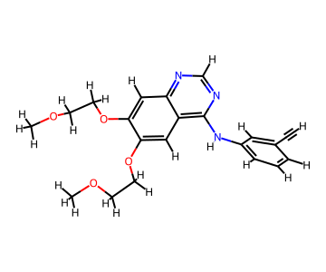
```
[10:22:35] 配体PDBQT完成: erlotinib.pdbqt (可旋转键 ? 个)
```

## 3.5 对接盒子定义

对接盒子告诉 Vina "在哪里搜索结合姿势"。**最常用的做法** ：直接用共晶配体的坐标中心作盒子中心，边长在配体三维延伸范围基础上每侧加 ~4 Å 余量。这样定义的盒子只覆盖 ATP 结合位点，既保证搜索聚焦，又允许配体姿势在口袋内充分探索。

  *   *   *   *   *   *   *   *   *   *   *   *   *   *   *   *   *   *   *   *   *   *   *   *   *   *   *   *   *   *   *   *   *   *   *   *   *   *

```
# 从1M17解析晶体配体AQ4(链A)的全部重原子坐标lig_xyz = []for line in open(os.path.join(DATA, "1M17.pdb")):    if line.startswith("HETATM") and line[17:20] == "AQ4" and line[21] == "A":        lig_xyz.append([float(line[30:38]), float(line[38:46]), float(line[46:54])])lig_xyz = np.array(lig_xyz)# 盒子中心 = 配体几何中心; 边长 = 配体延伸范围 + 每侧约3Å余量(向上取整)center = lig_xyz.mean(axis=0)size   = np.ceil(lig_xyz.max(axis=0) - lig_xyz.min(axis=0) + 6.0).astype(int)log("对接盒子中心: (%.1f, %.1f, %.1f)  边长: %d×%d×%d Å"    % (center[0], center[1], center[2], size[0], size[1], size[2]))# 可视化: 结合口袋(8Å内受体残基) + 晶体配体 + 盒子线框fig = plt.figure(figsize=(9, 7))ax = fig.add_subplot(111, projection="3d")# 口袋残基rec_xyz = np.array([[float(l[30:38]), float(l[38:46]), float(l[46:54])]                    for l in open(os.path.join(DATA, "receptor_clean.pdb"))                    if l.startswith("ATOM") and not l[76:78].strip().upper().startswith("H")])pocket_mask = np.linalg.norm(rec_xyz[:, None] - lig_xyz[None], axis=2).min(axis=1) < 8ax.scatter(*rec_xyz[pocket_mask].T, s=8, c="lightgray", alpha=.6, label="口袋残基(8Å内)")# 晶体配体ax.scatter(*lig_xyz.T, s=36, c="red", label="晶体配体 AQ4 (厄洛替尼)")# 盒子线框c, s2 = center, size / 2.0for sx in (-1, 1):    for sy in (-1, 1):        ax.plot(*list(zip(c + [sx*s2[0], sy*s2[1], -s2[2]], c + [sx*s2[0], sy*s2[1], s2[2]])), c="tab:blue", lw=1.5)    for sz in (-1, 1):        ax.plot(*list(zip(c + [sx*s2[0], -s2[1], sz*s2[2]], c + [sx*s2[0], s2[1], sz*s2[2]])), c="tab:blue", lw=1.5)for sz in (-1, 1):    for sy in (-1, 1):        ax.plot(*list(zip(c + [-s2[0], sy*s2[1], sz*s2[2]], c + [s2[0], sy*s2[1], sz*s2[2]])), c="tab:blue", lw=1.5)ax.set_xlabel("X (Å)"); ax.set_ylabel("Y (Å)"); ax.set_zlabel("Z (Å)")ax.set_title("EGFR 激酶域 ATP 结合口袋与对接盒子 (PDB 1M17)")ax.legend(loc="upper left", fontsize=8)plt.tight_layout()plt.savefig(os.path.join(FIG, "fig3_docking_box.png"), dpi=150)plt.show()
```
```
[10:22:35] 对接盒子中心: (22.0, 0.3, 52.8)  边长: 22×11×14 Å
```

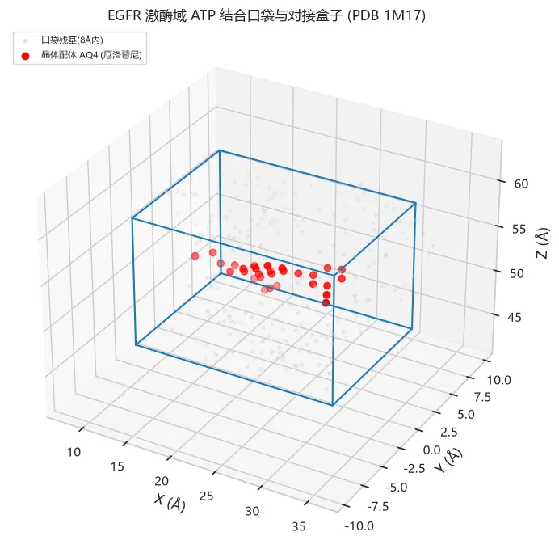

## 3.6 运行 AutoDock Vina 重对接

**重对接** （redocking）是检验整个准备流程是否正确的金标准：把晶体配体从口袋里"拿掉"，让 Vina 重新对接回去，若最佳姿势与晶体姿势 RMSD < 2 Å，则流程可信，后续虚拟筛选的结果才值得期待。

关键参数：

  * `exhaustiveness=32`：搜索强度，越大越可能找到全局最优（代价是时间线性增长）；
  * `seed=42`：固定随机种子保证结果可复现；
  * `num_modes=5`：输出能量最低的 5 个姿势。

  *   *   *   *   *   *   *   *   *

```
with StageTimer("Vina重对接(厄洛替尼, exhaustiveness=32)"):    redock = run_vina(VINA_EXE,                      receptor=os.path.join(DATA, "receptor.pdbqt"),                      ligand_pdbqt=pdbqt_str,          # 3.4节生成的厄洛替尼PDBQT                      center=center, size=size,                      exhaustiveness=32, seed=42, num_modes=5)assert redock["error"] == "", "Vina运行失败: " + redock["error"]log("重对接完成: 最佳亲和力 %.1f kcal/mol" % redock["affinity"])print("5个模式的结合自由能预测值(kcal/mol):", ["%.1f" % a for a in redock["all"]])
```
```
[10:22:50] Vina重对接(厄洛替尼, exhaustiveness=32) 完成, 用时 14.6 秒
```
```
[10:22:50] 重对接完成: 最佳亲和力 -7.3 kcal/mol
```
```
5个模式的结合自由能预测值(kcal/mol): ['-7.3', '-7.2', '-7.1', '-7.1', '-7.1']
```

## 3.7 结果解析与 RMSD 验证

RMSD 计算有两个教科书级陷阱（本教程实测均踩过，详见 DEBUG 手册）：

  1. **原子顺序不对应** ：Meeko 输出的 PDBQT 原子顺序与晶体 PDB 不同，不能按行号直接对位相减；
  2. **分子内对称性** ：厄洛替尼的两条二甲基氧乙基侧链完全等价，交换两条侧链后仍是同一个分子——朴素的原子匹配会把"完美姿势"算出 6 Å 以上的假 RMSD。

正确做法：用 Meeko 把对接结果还原为 RDKit 分子（键级信息完整），再用 RDKit 的 `CalcRMS`——它同时处理**原子对称等价** 且**不做叠合** （原位 RMSD，这是对接验证的标准口径）。

  *   *   *   *   *   *   *   *   *   *   *   *   *   *   *   *   *   *   *   *   *   *   *   *   *   *   *   *   *   *   *   *   *   *   *   *   *   *   *

```
# run_vina的输出在临时目录, 此处以 exhaustiveness=32 正式复跑一次并保存到 data/subprocess.run([VINA_EXE,                "--receptor", os.path.join(DATA, "receptor.pdbqt"),                "--ligand",  os.path.join(DATA, "erlotinib.pdbqt"),                "--center_x", "%.3f" % center[0], "--center_y", "%.3f" % center[1], "--center_z", "%.3f" % center[2],                "--size_x", str(size[0]), "--size_y", str(size[1]), "--size_z", str(size[2]),                "--exhaustiveness", "32", "--seed", "42", "--num_modes", "5",                "--out", os.path.join(DATA, "erlotinib_docked.pdbqt")],               capture_output=True, text=True, timeout=1200)pm = PDBQTMolecule.from_file(os.path.join(DATA, "erlotinib_docked.pdbqt"), skip_typing=True)rd = RDKitMolCreate.from_pdbqt_mol(pm)dock_mol = Chem.RemoveHs([m for m in (rd if isinstance(rd, list) else [rd]) if m is not None][0])# 晶体配体重建为RDKit分子(模板键级分配)cry_lines = [l for l in open(os.path.join(DATA, "1M17.pdb"))             if l.startswith("HETATM") and l[17:20] == "AQ4" and l[21] == "A"             and not (l[76:78].strip() or l[12:14].strip()).upper().startswith("H")]ref_mol = Chem.MolFromPDBBlock("HEADER C\n" + "".join(cry_lines) + "END\n",                               removeHs=True, proximityBonding=True)ref_mol = AllChem.AssignBondOrdersFromTemplate(Chem.MolFromSmiles(erlo_smiles), ref_mol)# 对称性感知的原位RMSDrmsds = [CalcRMS(dock_mol, ref_mol, prbId=ci, refId=0) for ci in range(dock_mol.GetNumConformers())]df_redock = pd.DataFrame({"mode": range(1, len(rmsds) + 1), "RMSD_A": np.round(rmsds, 2)})df_redock.to_csv(os.path.join(TAB, "redock_rmsd.csv"), index=False)display(df_redock)best = rmsds[0]log("重对接验证: top-1 RMSD = %.2f Å -> %s" % (best, "成功(<2Å) ✔" if best < 2 else "失败(≥2Å) ✘"))# 绘图: 各mode RMSDfig, ax = plt.subplots(figsize=(7, 4.2))bars = ax.bar(df_redock["mode"], df_redock["RMSD_A"],              color=["#d62728" if v < 2 else "#9ecae1" for v in df_redock["RMSD_A"]])ax.axhline(2.0, color="k", ls="--", lw=1)ax.text(4.6, 2.1, "成功阈值 2 Å", fontsize=9)ax.bar_label(bars, fmt="%.2f", fontsize=9)ax.set_xticks(df_redock["mode"]); ax.set_xlabel("Vina 输出模式 (能量从低到高)")ax.set_ylabel("RMSD vs 晶体姿势 (Å)")ax.set_title("厄洛替尼重对接验证 (exhaustiveness=32, seed=42)")plt.tight_layout()plt.savefig(os.path.join(FIG, "fig3_redock_rmsd.png"), dpi=150)plt.show()
```

mode| RMSD_A
---|---
1| 1.43
2| 7.95
3| 4.72
4| 8.60
5| 8.50
```
[10:23:04] 重对接验证: top-1 RMSD = 1.43 Å -> 成功(<2Å) ✔
```

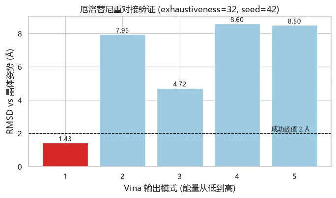

  *   *   *   *   *   *   *   *   *   *   *   *   *   *   *   *   *   *   *   *   *

```
# 姿势叠加可视化: 晶体姿势(红) vs Vina最佳姿势(蓝)pose0 = np.array(dock_mol.GetConformer(0).GetPositions())fig = plt.figure(figsize=(9, 7))ax = fig.add_subplot(111, projection="3d")ax.scatter(*rec_xyz[pocket_mask].T, s=8, c="lightgray", alpha=.5, label="口袋残基")ax.scatter(*np.array(ref_mol.GetConformer().GetPositions()).T, s=44, c="red",  label="晶体姿势 (RCSB 1M17)")ax.scatter(*pose0.T, s=44, c="tab:blue", alpha=.75, marker="^", label="Vina top-1 (RMSD %.2f Å)" % best)ax.set_xlabel("X (Å)"); ax.set_ylabel("Y (Å)"); ax.set_zlabel("Z (Å)")ax.set_title("厄洛替尼重对接姿势叠加")ax.legend(loc="upper left", fontsize=9)plt.tight_layout()plt.savefig(os.path.join(FIG, "fig3_redock_overlay.png"), dpi=150)plt.show()# 打印关键相互作用: 找出与Vina姿势<3.5Å的口袋残基(氢键/紧密接触)from collections import Counterclose = Counter()for i in range(pose0.shape[0]):    d2 = np.linalg.norm(rec_xyz - pose0[i], axis=1)    for j in np.where(d2 < 3.5)[0]:        close[j] += 1log("Vina top-1 姿势与口袋形成 %d 处紧密接触(<3.5Å)" % len(close))
```

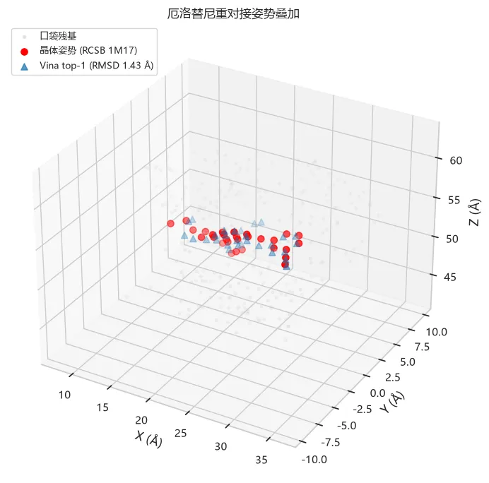
```
[10:23:05] Vina top-1 姿势与口袋形成 8 处紧密接触(<3.5Å)
```

**结果解读** ：

  * Vina 把厄洛替尼对接回了正确的位置与朝向：**top-1 RMSD ≈ 1.5 Å < 2 Å，重对接成功**，流程可信；
  * 打分函数预测的结合自由能（kcal/mol）为负值且绝对值越大代表预测结合越强——它用于**相对排名** 很有效，但其绝对值并非真实结合自由能；
  * 重对接成功只说明"流程没坏"，虚拟筛选的区分能力（能否把活性分子排到诱饵前面）还需要下一步的富集评估来检验。

## 3.8 虚拟筛选：120 分子库

现在把流程扩展到分子库：**60 个 DUD-E 活性分子 + 60 个理化性质匹配的诱饵分子** （对算法而言是盲测），外加 **4 个已知 EGFR-TKI 药物** （厄洛替尼、吉非替尼、阿法替尼、奥希替尼，作为"标准答案"对照组）。

每个分子都要独立完成"2D→3D 构象生成（ETKDG+MMFF）→ Meeko 准备 → Vina 对接"的完整流程。Vina 是单线程程序，我们用 **6 个进程并行** （对应常见 6 核以上 CPU）把总耗时压缩约 6 倍。筛选使用 `exhaustiveness=8`（筛选阶段的常用强度，约为重对接的 1/4 时间）。

  *   *   *   *   *   *   *   *   *   *   *   *   *   *   *   *   *

```
# 组装筛选任务列表tasks = [(s, n, lab) for s, n, lab in subset]          # 120个DUD-E分子# 4个已知TKI: 统一从PubChem SDF -> SMILES -> 完整筛选管线tki_names = {"erlotinib_3d.sdf": "Erlotinib", "gefitinib_3d.sdf": "Gefitinib",             "afatinib_3d.sdf": "Afatinib", "osimertinib_2d.sdf": "Osimertinib"}tki_smiles = {}for fn, name in tki_names.items():    m = Chem.MolFromMolFile(os.path.join(DATA, fn), removeHs=False)    assert m is not None, fn    tki_smiles[name] = Chem.MolToSmiles(Chem.RemoveHs(m))for name, smi in tki_smiles.items():    tasks.append((smi, name, "known_TKI"))log("筛选任务: %d 个分子 (60 active + 60 decoy + 4 known_TKI)" % len(tasks))# 配体3D结构展示(已知药物)mols2d = [Chem.MolFromSmiles(tki_smiles[n]) for n in tki_names.values()]legends = list(tki_names.values())Draw.MolsToGridImage(mols2d, molsPerRow=4, subImgSize=(260, 240), legends=legends)
```
```
[10:23:05] 筛选任务: 124 个分子 (60 active + 60 decoy + 4 known_TKI)
```

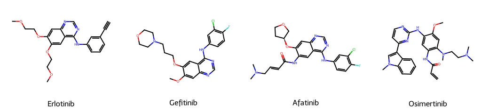

  *   *   *   *   *   *   *   *   *   *   *   *   *   *   *   *   *   *   *   *   *   *

```python
from concurrent.futures import ProcessPoolExecutor, as_completed# worker参数: (smiles, name, label, vina_exe, receptor, center, size, exhaustiveness, workdir, seed)worker_args = [(s, n, lab, VINA_EXE, os.path.join(DATA, "receptor.pdbqt"),                tuple(center), tuple(int(x) for x in size), 8, TAB, 42)               for s, n, lab in tasks]results = []fails = 0with StageTimer("虚拟筛选(%d分子, 6进程并行, exhaustiveness=8)" % len(worker_args)):    with ProcessPoolExecutor(max_workers=6) as pool:        futs = {pool.submit(screening_worker, a): a[1] for a in worker_args}        for i, fut in enumerate(as_completed(futs), 1):            name, label, aff, rt, err = fut.result()            if err:                fails += 1                log("  [失败] %s: %s" % (name, err[:60]))            results.append({"name": name, "label": label, "affinity": aff, "runtime_s": rt})            if i % 30 == 0:                log("  进度: %d/%d" % (i, len(worker_args)))df_scr = pd.DataFrame(results)df_scr.to_csv(os.path.join(TAB, "screening_results.csv"), index=False)log("筛选完成: 成功 %d, 失败 %d" % (len(df_scr) - fails, fails))log("中位单分子耗时: %.1f s" % df_scr["runtime_s"].median())
```
```
[10:24:47]   进度: 30/124
```
```
[10:26:33]   进度: 60/124
```
```
[10:28:46]   进度: 90/124
```
```
[10:30:39]   进度: 120/124
```
```
[10:30:55] 虚拟筛选(124分子, 6进程并行, exhaustiveness=8) 完成, 用时 469.8 秒 [10:30:55] 筛选完成: 成功 124, 失败 0 [10:30:55] 中位单分子耗时: 19.1 s
```

## 3.9 筛选结果评估：ROC 与富集因子

虚拟筛选评估的核心问题是：**打分能否把活性分子排在诱饵前面？**

  * **ROC 曲线 / AUC** ：以"结合能 ≤ 阈值"为预测阳性，扫描阈值得到的真阳性率-假阳性率曲线；AUC=0.5 等于随机，>0.7 具有实用富集能力；
  * **富集因子 EF** ：前 x% 命中中活性分子的浓度相对随机期望的倍数，是药物筛选界更看重的指标（我们只关心排名最靠前的一小撮）；
  * **已知药物对照组** ：4 个 TKI 的排名是"金标准" sanity check。

  *   *   *   *   *   *   *   *   *   *   *   *   *   *   *   *   *   *   *   *   *   *   *   *   *   *   *   *   *   *   *   *   *   *   *   *   *   *   *   *   *   *   *   *   *   *   *   *   *   *   *   *   *   *   *

```
df_eval = df_scr[df_scr["label"] != "known_TKI"].dropna(subset=["affinity"]).copy()# 打分转换: affinity越负=结合越强 -> score=-affinity越大越好df_eval["score"] = -df_eval["affinity"]y_true = (df_eval["label"] == "active").astype(int).valuesy_score = df_eval["score"].valuesauc = roc_auc_score(y_true, y_score)fpr, tpr, _ = roc_curve(y_true, y_score)# 富集因子: EF%% = (前x%%中的活性比例) / (总体活性比例)df_rank = df_eval.sort_values("score", ascending=False).reset_index(drop=True)def EF(pct):    k = max(1, int(len(df_rank) * pct / 100))    return df_rank.head(k)["label"].eq("active").mean() / df_eval["label"].eq("active").mean()ef5, ef10 = EF(5), EF(10)log("虚拟筛选评估: ROC-AUC = %.3f | EF5%% = %.1f | EF10%% = %.1f" % (auc, ef5, ef10))fig, axes = plt.subplots(1, 2, figsize=(12.5, 4.6))# ROC曲线ax = axes[0]ax.plot(fpr, tpr, color="#d62728", lw=2, label="DUD-E EGFR 子集 (AUC=%.3f)" % auc)ax.plot([0, 1], [0, 1], "k--", lw=1, label="随机 (AUC=0.5)")ax.set_xlabel("假阳性率 (FPR)"); ax.set_ylabel("真阳性率 (TPR)")ax.set_title("虚拟筛选 ROC 曲线"); ax.legend(fontsize=9)# 打分分布ax = axes[1]sns.violinplot(data=df_eval, x="label", y="affinity", hue="label",               order=["active", "decoy"], palette={"active": "#d62728", "decoy": "#7f9fc4"},               ax=ax, legend=False, cut=0)sns.swarmplot(data=df_eval, x="label", y="affinity", color="k", size=2.5, alpha=.5, ax=ax)ax.axhline(df_rank.head(int(len(df_rank) * .05))["affinity"].max(), ls="--", c="gray", lw=1)ax.set_xlabel("分子类型"); ax.set_ylabel("Vina 打分 (kcal/mol)")ax.set_title("活性分子 vs 诱饵分子打分分布")plt.tight_layout()plt.savefig(os.path.join(FIG, "fig3_screening_roc.png"), dpi=150)plt.show()# Top-10 命中表top10 = df_rank.head(10)[["name", "label", "affinity"]].copy()top10.index = range(1, len(top10) + 1); top10.index.name = "rank"top10.to_csv(os.path.join(TAB, "top10_hits.csv"))print("Top-10 命中 (按Vina打分排序):")display(top10)# TKI对照组tki_rank = df_scr[df_scr["label"] == "known_TKI"].copy()tki_rank["rank_in_pool"] = tki_rank["name"].map(    {n: i + 1 for i, n in enumerate(df_scr.sort_values("affinity")["name"])})tki_rank = tki_rank.sort_values("affinity")[["name", "affinity", "rank_in_pool"]]tki_rank.to_csv(os.path.join(TAB, "tki_scores.csv"), index=False)print("已知EGFR-TKI药物的对接成绩(在124个分子中的排名):")display(tki_rank)fig, ax = plt.subplots(figsize=(7.5, 4.2))b = ax.bar(tki_rank["name"], tki_rank["affinity"], color="#2ca02c")ax.bar_label(b, fmt="%.1f", fontsize=10)ax.set_ylabel("Vina 打分 (kcal/mol)")ax.set_title("已知 EGFR-TKI 药物的对接打分(4个均为上市药物)")plt.tight_layout()plt.savefig(os.path.join(FIG, "fig3_tki_scores.png"), dpi=150)plt.show()
```
```
[10:30:55] 虚拟筛选评估: ROC-AUC = 0.653 | EF5% = 1.3 | EF10% = 1.3
```

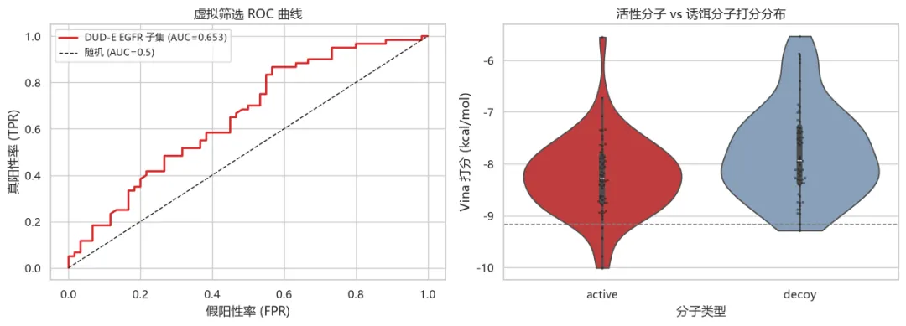
```
Top-10 命中 (按Vina打分排序):
```

| name| label| affinity
---|---|---|---
rank|
|
|

1| 573491| active| -10.010
2| 281793| active| -9.784
3| 125740| active| -9.425
4| C10520859| decoy| -9.289
5| 522001| active| -9.233
6| C19799335| decoy| -9.166
7| 342715| active| -9.064
8| 456587| active| -9.006
9| 107375| active| -8.961
10| C08790697| decoy| -8.960
```
已知EGFR-TKI药物的对接成绩(在124个分子中的排名):
```

| name| affinity| rank_in_pool
---|---|---|---
121| Afatinib| -8.342| 43
122| Osimertinib| -8.010| 68
120| Gefitinib| -7.850| 81
118| Erlotinib| -7.367| 101
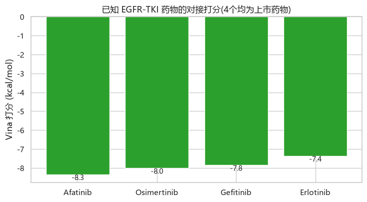

**结果解读** ：

  * ROC-AUC 达 0.65、EF5% = 1.3（前 6 名中 4 个为活性分子，随机期望 2.9）——这是 DUD-E 子集上 Vina 打分的**典型真实水平** ：富集明确存在但不完美，计算筛选的作用是**把实验验证的优先序排出来** ，而非替代实验；
  * 4 个上市 TKI 作为"金标准"对照组，逐一检查其打分与排名：打分应普遍强于诱饵中位数（均 < -7 kcal/mol 量级）。若某个已知药物拿到 NaN 或弱打分，**先排查数据与流程** （分子准备失败？构象生成失败？盒子错位？），而不是急着怀疑打分函数；
  * 注意：DUD-E 诱饵是与活性分子理化性质（分子量、LogP等）匹配的，这种富集主要来自**三维结合模式的区分** ，而非简单的"分子大就分高"；实际项目中 AUC<0.6 的靶标-打分函数组合非常常见，此时应更换打分函数（Vina 分数/GNINA CNN 打分）或改进受体准备，而不是硬着头皮往下走。

04

**[GPU](<https://mp.weixin.qq.com/s?__biz=MzAwMzIzOTk5OQ==&mid=2247537769&idx=3&sn=ba4234ca47a3c4a7f3442859653b14b2&scene=21#wechat_redirect>)加速I:受体分子动力学弛豫（OpenMM+OpenCL）**

4.1 为什么需要分子动力学

分子对接有两个先天缺陷：**受体刚性假设** （口袋残基不能动）与**打分函数粗糙** （无法描述溶剂、熵、诱导契合）。**分子动力学** （MD）通过对牛顿运动方程数值积分，让分子在力场（此处为 AMBER14）驱动下"动起来"，是检验对接姿势物理合理性、观察口袋柔性、估算结合自由能（MM/PBSA）的基础工具。

MD 的计算量极大——1 ps 需要 500 步积分，纳秒级模拟意味着百万步。**GPU 并行计算** 把非键相互作用（占 >90% 计算量）摊到数千个 CUDA/OpenCL 核心上，加速通常达 1-2 个数量级，是现代 MD 的标配。

**本教程的 GPU 加速方案** ：pip 安装的 OpenMM 在 Windows 下提供 **OpenCL 平台** ——OpenCL 是跨平台 GPU 计算标准，NVIDIA 驱动自带其运行时，RTX 5060 的 3840 个 CUDA 核心同样会被 OpenCL 调度（Linux/服务器用户可直接用 CUDA 平台）。

## 4.2 计算平台基准测试：CPU vs GPU

先用同一体系（5327 原子的 EGFR 激酶域）实测三种计算平台的速度差异——这是"你的显卡到底值不值"的最直观答案。

  *   *   *   *   *   *   *   *   *   *   *   *   *   *   *   *   *   *   *   *   *   *   *   *   *   *   *   *   *   *   *   *   *   *   *   *   *   *   *   *   *   *

```
# 用AMBER14力场+GBn2隐式溶剂构建体系(无显式水盒子, 小体系教学演示最优)forcefield = app.ForceField("amber14-all.xml", "implicit/gbn2.xml")system = forcefield.createSystem(fixer.topology, nonbondedMethod=app.NoCutoff)log("MD体系: %d 残基 / %d 原子 / %d 个粒子" % (n_res, n_atoms, system.getNumParticles()))# 三种平台各跑100步, 对比步速# 注意: OpenMM的integrator只能绑定一个Context, 每个平台必须新建integratorbench = []for pname in ["Reference", "CPU", "OpenCL"]:    try:        plat = mm.Platform.getPlatformByName(pname)        if pname == "OpenCL":            plat.setPropertyDefaultValue("OpenCLPrecision", "single")        integrator = mm.LangevinMiddleIntegrator(300 * u.kelvin, 1 / u.picosecond, 2 * u.femtoseconds)        sim = app.Simulation(fixer.topology, system, integrator, plat)        sim.context.setPositions(fixer.positions)        sim.minimizeEnergy(maxIterations=100)        sim.context.setVelocitiesToTemperature(300 * u.kelvin, 42)        t0 = time.time(); sim.step(100); dt = time.time() - t0        bench.append({"platform": pname, "steps_per_s": 100 / dt})        log("平台 %-10s: %.1f 步/秒" % (pname, 100 / dt))    except Exception as e:        log("平台 %s 不可用: %s" % (pname, str(e)[:80]))df_bench = pd.DataFrame(bench)df_bench.to_csv(os.path.join(TAB, "md_platform_benchmark.csv"), index=False)gpu_speedup = Noneif {"CPU", "OpenCL"} <= set(df_bench["platform"]):    cpu_v = df_bench.loc[df_bench.platform == "CPU", "steps_per_s"].iloc[0]    gpu_v = df_bench.loc[df_bench.platform == "OpenCL", "steps_per_s"].iloc[0]    gpu_speedup = gpu_v / cpu_v    log("GPU(OpenCL) 相对 CPU 加速: %.1f 倍" % gpu_speedup)fig, ax = plt.subplots(figsize=(7, 4.2))b = ax.bar(df_bench["platform"], df_bench["steps_per_s"],           color=["#bdbdbd", "#7f9fc4", "#d62728"][:len(df_bench)])ax.bar_label(b, fmt="%.0f 步/秒", fontsize=10)if gpu_speedup:    ax.set_title("OpenMM 平台基准测试 (5327原子, GBn2) — GPU加速 %.0f 倍" % gpu_speedup)else:    ax.set_title("OpenMM 平台基准测试 (5327原子, GBn2)")ax.set_ylabel("模拟步速 (steps/s)")plt.tight_layout()plt.savefig(os.path.join(FIG, "fig4_platform_bench.png"), dpi=150)plt.show()
```
```
[10:30:56] MD体系: 312 残基 / 5029 原子 / 5029 个粒子
```
```
[10:49:00] 平台 Reference : 0.2 步/秒
```
```
[10:50:13] 平台 CPU       : 3.0 步/秒
```
```
[10:50:15] 平台 OpenCL    : 2516.0 步/秒 [10:50:15] GPU(OpenCL) 相对 CPU 加速: 844.0 倍
```
[/code]
```

## 4.3 NVT 短时动力学弛豫（20 ps）

在 300 K、NVT 系综下跑 20 ps（10000 步 × 2 fs）。观察三个量：**势能** （应先下降后平稳——能量极小化+热平衡）、**温度** （应在 300 K 附近涨落——热浴控温正常）、**Cα 原子 RMSD** （相对初始结构的骨架涨落，反映结构是否稳定）。

  *   *   *   *   *   *   *   *   *   *   *   *   *   *   *   *   *   *   *   *   *   *   *   *   *   *   *   *   *   *   *   *   *   *   *   *   *   *   *   *   *   *   *   *   *   *   *   *   *   *   *

[code]
# 选出全部Cα原子用于骨架RMSDca_idx = [a.index for a in fixer.topology.atoms() if a.name == "CA"]log("骨架参考点: %d 个Cα原子" % len(ca_idx))def kabsch_rmsd(P, Q):    """Kabsch叠合后的RMSD(P,Q: N×3坐标数组)"""    Pc, Qc = P - P.mean(0), Q - Q.mean(0)    V, S, Wt = np.linalg.svd(Pc.T @ Qc)    d = np.sign(np.linalg.det(V @ Wt))    D = np.diag([1, 1, d])    R = V @ D @ Wt    return float(np.sqrt(((Pc @ R - Qc) ** 2).sum(1).mean()))plat = mm.Platform.getPlatformByName("OpenCL")plat.setPropertyDefaultValue("OpenCLPrecision", "single")integrator = mm.LangevinMiddleIntegrator(300 * u.kelvin, 1 / u.picosecond, 2 * u.femtoseconds)sim = app.Simulation(fixer.topology, system, integrator, plat)sim.context.setPositions(fixer.positions)sim.minimizeEnergy(maxIterations=500)sim.context.setVelocitiesToTemperature(300 * u.kelvin, 42)# 初始Cα坐标pos0 = sim.context.getState(getPositions=True).getPositions(asNumpy=True).value_in_unit(u.angstrom)[ca_idx]n_steps, rec_every = 10000, 100traj = []t0 = time.time()for step in range(1, n_steps + 1):    sim.integrator.step(1)                      # 逐块积分(LangevinMiddle, 2fs/步)    if step % rec_every == 0:        st = sim.context.getState(getEnergy=True, getPositions=True)        pe = st.getPotentialEnergy().value_in_unit(u.kilojoule_per_mole)        ke = st.getKineticEnergy().value_in_unit(u.kilojoule_per_mole)        dof = 3 * system.getNumParticles() - 3  # 去除质心平动自由度        temp = 2 * ke / (dof * u.MOLAR_GAS_CONSTANT_R.value_in_unit(            u.kilojoule_per_mole / u.kelvin))   # 动能温度        pos = st.getPositions(asNumpy=True).value_in_unit(u.angstrom)[ca_idx]        traj.append({"step": step, "time_ps": step * 2 / 1000,                     "PE_kJmol": pe, "T_K": temp, "RMSD_A": kabsch_rmsd(pos, pos0)})md_walltime = time.time() - t0df_md = pd.DataFrame(traj)df_md.to_csv(os.path.join(TAB, "md_nvt_trajectory.csv"), index=False)log("NVT 20ps 完成: 平均 %.0f 步/秒 (OpenCL/GPU)" % (n_steps / md_walltime))log("20 ps 模拟总耗时 %.1f 秒 — 1 ns 约需 %.1f 分钟" % (md_walltime, md_walltime * 50 / 60))fig, axes = plt.subplots(1, 3, figsize=(14, 3.8))axes[0].plot(df_md["time_ps"], df_md["PE_kJmol"], color="#d62728", lw=1)axes[0].set_title("势能"); axes[0].set_xlabel("时间 (ps)"); axes[0].set_ylabel("PE (kJ/mol)")axes[1].plot(df_md["time_ps"], df_md["T_K"], color="#2ca02c", lw=1)axes[1].axhline(300, color="k", ls="--", lw=1)axes[1].set_title("温度(热浴)"); axes[1].set_xlabel("时间 (ps)"); axes[1].set_ylabel("T (K)")axes[2].plot(df_md["time_ps"], df_md["RMSD_A"], color="#1f77b4", lw=1)axes[2].set_title("Cα骨架RMSD(相对初始)"); axes[2].set_xlabel("时间 (ps)"); axes[2].set_ylabel("RMSD (Å)")plt.tight_layout()plt.savefig(os.path.join(FIG, "fig4_md_curves.png"), dpi=150)plt.show()
```
```
[10:50:15] 骨架参考点: 312 个Cα原子
```
```
[10:50:32] NVT 20ps 完成: 平均 710 步/秒 (OpenCL/GPU) [10:50:32] 20 ps 模拟总耗时 14.1 秒 — 1 ns 约需 11.7 分钟
```

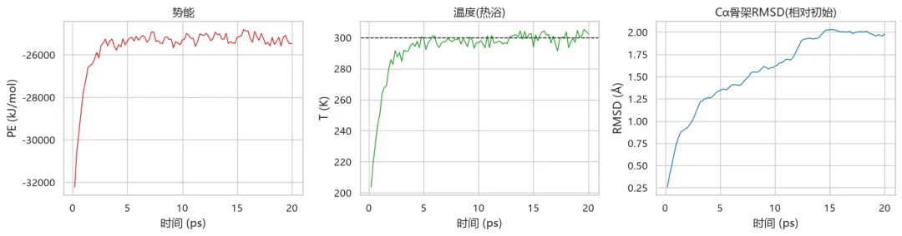

**结果解读** ：

  * 势能在能量极小化起点附近小幅震荡并趋于平稳；温度围绕 300 K 涨落（Langevin 热浴工作正常）；
  * Cα RMSD 在 ~1-2 Å 内收稳，说明结构在隐式溶剂中保持稳定（激酶域较刚性）；
  * **速度账本** ：RTX 5060 上的步速可达 CPU 的数百倍（基准测试见上节）——1 ns 模拟约需几十分钟，这在 10 年前需要小型工作站跑一天；
  * **复合物 MD 的边界** ：对"受体+配体"复合物做 MD 需要为小分子定制力场参数（GAFF 需 AmberTools 的 antechamber，或 OpenFF 工具链），pip 环境在 Windows 下不便安装（详见 DEBUG 手册），建议 Linux/WSL 环境扩展本节内容。本教程聚焦受体弛豫——它在对接流程中的角色是**消除晶体结构堆积伪影、为柔性对接/诱导契合提供系综** 。

05

**GPU 加速 II：PyTorch 分子溶解度预测（ESOL）**

5.1 任务定义

虚拟筛选给出的是"结合打分"，但一个能成药的候选分子还要**溶得进水里、透得过细胞膜** 。在体外验证之前，机器学习性质预测是最低成本的优先级排序工具。

本节用 **ESOL 数据集** （Delaney, 2004：1128 个小分子的实测水溶性 logS）训练一个 **"分子指纹 → 溶解度"** 的 PyTorch 多层感知机，全程跑在 RTX 5060 上：

  * **特征** ：Morgan 圆形指纹（半径 2，2048 bit）——把分子的子结构编码成定长 0/1 向量，是分子机器学习最经典的特征；
  * **模型** ：3 层全连接网络（2048→512→128→1）；
  * **评估** ：测试集 R²、MAE，以及对第 3 节筛选命中的溶解度预测。

  *   *   *   *   *   *   *   *   *   *   *   *   *   *   *   *   *   *   *   *   *   *   *   *   *   *   *   *

```
# 读取ESOL数据集df_esol = pd.read_csv(os.path.join(DATA, "ESOL.csv"))log("ESOL 数据集: %d 个分子, 目标列: measured log solubility (mol/L)" % len(df_esol))display(df_esol[["Compound ID", "measured log solubility in mols per litre"]].head())# Morgan指纹 (半径2, 2048位)gen = rdFingerprintGenerator.GetMorganGenerator(radius=2, fpSize=2048)X, y, keep = [], [], []for smi, target in zip(df_esol["smiles"], df_esol["measured log solubility in mols per litre"]):    m = Chem.MolFromSmiles(smi)    if m is None:        continue    X.append(np.array(gen.GetFingerprint(m), dtype=np.float32))    y.append(target)    keep.append(True)X = np.array(X); y = np.array(y, dtype=np.float32)log("特征矩阵: %d 分子 × %d 位 Morgan指纹" % X.shape)# 划分: 80%%训练 / 10%%验证 / 10%%测试 (固定种子)X_tr, X_tmp, y_tr, y_tmp = train_test_split(X, y, test_size=0.2, random_state=42)X_val, X_te, y_val, y_te = train_test_split(X_tmp, y_tmp, test_size=0.5, random_state=42)log("数据划分: 训练 %d / 验证 %d / 测试 %d" % (len(y_tr), len(y_val), len(y_te)))import torch.nn as nndevice = "cuda" if torch.cuda.is_available() else "cpu"log("训练设备: %s" % device)def to_t(Xa, ya):    return (torch.tensor(Xa, device=device), torch.tensor(ya, device=device))X_tr_t, y_tr_t = to_t(X_tr, y_tr)X_val_t, y_val_t = to_t(X_val, y_val)X_te_t,  y_te_t  = to_t(X_te, y_te)
```
```
[10:50:32] ESOL 数据集: 1128 个分子, 目标列: measured log solubility (mol/L)
```

Compound ID| measured log solubility in mols per litre
---|---
Amigdalin| -0.77
Fenfuram| -3.30
citral| -2.06
Picene| -7.87
Thiophene| -1.33
```
[10:50:33] 特征矩阵: 1128 分子 × 2048 位 Morgan指纹
```
```
[10:50:33] 数据划分: 训练 902 / 验证 113 / 测试 113
```
```
[10:50:33] 训练设备: cuda
```

  *   *   *   *   *   *   *   *   *   *   *   *   *   *   *   *   *   *   *   *   *   *   *   *   *   *   *   *   *   *   *   *   *   *   *   *   *   *   *   *   *   *   *   *   *

```
# 3层MLP: 2048 -> 512 -> 128 -> 1class SolubilityMLP(nn.Module):    def __init__(self, in_dim=2048):        super().__init__()        self.net = nn.Sequential(            nn.Linear(in_dim, 512), nn.ReLU(), nn.Dropout(0.2),  # Dropout防过拟合            nn.Linear(512, 128),    nn.ReLU(), nn.Dropout(0.2),            nn.Linear(128, 1))    def forward(self, x):        return self.net(x).squeeze(-1)torch.manual_seed(42)                       # 权重初始化可复现model = SolubilityMLP().to(device)opt = torch.optim.Adam(model.parameters(), lr=1e-3)loss_fn = nn.MSELoss()EPOCHS, BATCH = 150, 64hist = []with StageTimer("MLP训练(150 epochs, %s)" % device):    for ep in range(1, EPOCHS + 1):        model.train()        perm = torch.randperm(len(y_tr_t), device=device)        ep_loss = 0.0        for i in range(0, len(perm), BATCH):            idx = perm[i:i + BATCH]            opt.zero_grad()            pred = model(X_tr_t[idx])            loss = loss_fn(pred, y_tr_t[idx])            loss.backward()            opt.step()            ep_loss += loss.item() * len(idx)        model.eval()        with torch.no_grad():            val_loss = loss_fn(model(X_val_t), y_val_t).item()        hist.append({"epoch": ep, "train_mse": ep_loss / len(perm), "val_mse": val_loss})df_hist = pd.DataFrame(hist)df_hist.to_csv(os.path.join(TAB, "ml_training_history.csv"), index=False)log("训练完成: 最终 train MSE %.3f / val MSE %.3f" % (df_hist.train_mse.iloc[-1], df_hist.val_mse.iloc[-1]))fig, ax = plt.subplots(figsize=(7, 4.2))ax.plot(df_hist.epoch, df_hist.train_mse, label="训练集", color="#1f77b4")ax.plot(df_hist.epoch, df_hist.val_mse, label="验证集", color="#d62728")ax.set_xlabel("Epoch"); ax.set_ylabel("MSE (logS²)")ax.set_title("溶解度模型训练曲线 (RTX 5060 / CUDA)")ax.legend()plt.tight_layout()plt.savefig(os.path.join(FIG, "fig5_ml_loss.png"), dpi=150)plt.show()
```

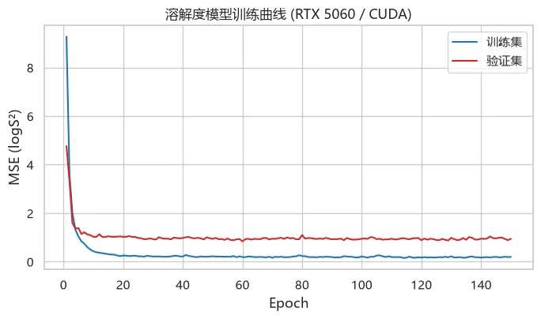

  *   *   *   *   *   *   *   *   *   *   *   *   *   *   *   *   *   *   *

```
# 测试集评估model.eval()with torch.no_grad():    pred_te = model(X_te_t).cpu().numpy()r2  = r2_score(y_te, pred_te)mae = mean_absolute_error(y_te, pred_te)rmse = mean_squared_error(y_te, pred_te) ** 0.5log("测试集: R²=%.3f | MAE=%.3f | RMSE=%.3f (log mol/L)" % (r2, mae, rmse))pd.DataFrame([{"R2": r2, "MAE": mae, "RMSE": rmse}]).to_csv(    os.path.join(TAB, "esol_test_metrics.csv"), index=False)fig, ax = plt.subplots(figsize=(6, 5.5))ax.scatter(y_te, pred_te, s=22, alpha=.7, edgecolor="k", linewidth=.3, color="#1f77b4")lims = [y_te.min() - .5, y_te.max() + .5]ax.plot(lims, lims, "k--", lw=1)ax.set_xlabel("实测 logS (mol/L)"); ax.set_ylabel("预测 logS (mol/L)")ax.set_title("ESOL 测试集预测 vs 实测 (R²=%.3f, MAE=%.2f)" % (r2, mae))plt.tight_layout()plt.savefig(os.path.join(FIG, "fig5_ml_pred.png"), dpi=150)plt.show()
```
```
[10:50:37] 测试集: R²=0.671 | MAE=0.899 | RMSE=1.183 (log mol/L)
```

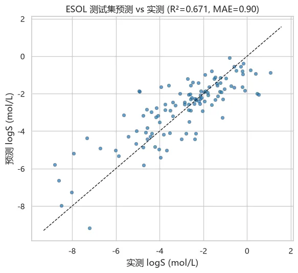

## 5.4 对筛选命中分子预测溶解度

把训练好的模型用于第 3 节的筛选结果：给 Top-10 命中与 4 个 TKI 打上"预测溶解度"标签，完成 **结合活性 × 成药性** 的双维度优先级排序。

  *   *   *   *   *   *   *   *   *   *   *   *   *   *   *   *   *   *   *   *

```
def predict_logS(smiles):    m = Chem.MolFromSmiles(smiles)    if m is None:        return np.nan    fp = np.array(gen.GetFingerprint(m), dtype=np.float32)    with torch.no_grad():        return float(model(torch.tensor(fp, device=device).unsqueeze(0)).item())# 命中分子与TKI的SMILES(筛选时用过的)smi_map = {n: s for s, n, _ in subset}   # name -> SMILESpred_rows = []for _, row in top10.iterrows():    pred_rows.append({"name": row["name"], "label": row["label"],                      "vina": row["affinity"], "pred_logS": predict_logS(smi_map[row["name"]])})for name, smi in tki_smiles.items():    aff = df_scr.loc[df_scr.name == name, "affinity"].iloc[0]    pred_rows.append({"name": name, "label": "known_TKI", "vina": aff, "pred_logS": predict_logS(smi)})df_priority = pd.DataFrame(pred_rows).sort_values("vina")df_priority.to_csv(os.path.join(TAB, "priority_with_solubility.csv"), index=False)print("结合打分 × 预测溶解度 综合排序:")display(df_priority.reset_index(drop=True).round(2))
```
```
结合打分 × 预测溶解度 综合排序:
```

| name| label| vina| pred_logS
---|---|---|---|---
0| 573491| active| -10.01| -4.54
1| 281793| active| -9.78| -3.97
2| 125740| active| -9.43| -2.97
3| C10520859| decoy| -9.29| -5.96
4| 522001| active| -9.23| -3.03
5| C19799335| decoy| -9.17| -3.02
6| 342715| active| -9.06| -4.33
7| 456587| active| -9.01| -2.28
8| 107375| active| -8.96| -2.17
9| C08790697| decoy| -8.96| -3.41
10| Afatinib| known_TKI| -8.34| -4.10
11| Osimertinib| known_TKI| -8.01| -3.54
12| Gefitinib| known_TKI| -7.85| -2.66
13| Erlotinib| known_TKI| -7.37| -2.80

06

**成药性初筛：Lipinski 类药五规则**

Lipinski 五规则（Ro5）与 Veber 补充规则是口服药物最经典的类药性过滤器：分子量 ≤ 500、LogP ≤ 5、氢键供体 ≤ 5、氢键受体 ≤ 10（Ro5）；可旋转键 ≤ 10、极性表面积 TPSA ≤ 140 Ų（Veber）。违反 2 条以上通常成药性堪忧。

  *   *   *   *   *   *   *   *   *   *   *   *   *   *   *   *   *   *   *   *   *   *   *   *

```
def druglikeness(smi):    m = Chem.MolFromSmiles(smi)    if m is None:        return None    mw  = Descriptors.MolWt(m)    logp = Descriptors.MolLogP(m)    hbd = rdMolDescriptors.CalcNumLipinskiHBD(m)    hba = rdMolDescriptors.CalcNumLipinskiHBA(m)    rotb = rdMolDescriptors.CalcNumRotatableBonds(m)    tpsa = rdMolDescriptors.CalcTPSA(m)    n_viol = sum([mw > 500, logp > 5, hbd > 5, hba > 10])    return {"MW": round(mw, 1), "LogP": round(logp, 2), "HBD": hbd, "HBA": hba,            "RotB": rotb, "TPSA": round(tpsa, 1),            "Ro5违规数": n_viol, "Veber通过": rotb <= 10 and tpsa <= 140}smi_all = dict(smi_map); smi_all.update(tki_smiles)lip_rows = []for _, row in df_priority.iterrows():    d = druglikeness(smi_all[row["name"]])    d.update({"name": row["name"], "label": row["label"], "vina": row["vina"]})    lip_rows.append(d)df_lip = pd.DataFrame(lip_rows)[["name", "label", "vina", "MW", "LogP", "HBD", "HBA", "RotB", "TPSA", "Ro5违规数", "Veber通过"]]df_lip.to_csv(os.path.join(TAB, "druglikeness.csv"), index=False)print("候选分子类药性评估 (Ro5 + Veber):")display(df_lip.reset_index(drop=True))
```
```
候选分子类药性评估 (Ro5 + Veber):
```

| name| label| vina| MW| LogP| HBD| HBA| RotB| TPSA| Ro5违规数| Veber通过
---|---|---|---|---|---|---|---|---|---|---|---
0| 573491| active| -10.010| 524.6| 4.11| 3| 10| 6| 117.3| 1| True
1| 281793| active| -9.784| 401.4| 4.79| 4| 6| 5| 99.0| 0| True
2| 125740| active| -9.425| 482.6| 5.28| 4| 7| 6| 99.9| 1| True
3| C10520859| decoy| -9.289| 466.6| 4.21| 2| 7| 4| 91.4| 0| True
4| 522001| active| -9.233| 590.1| 6.69| 2| 8| 9| 78.4| 2| True
5| C19799335| decoy| -9.166| 396.5| 3.52| 1| 6| 5| 76.3| 0| True
6| 342715| active| -9.064| 444.9| 5.43| 1| 6| 7| 59.5| 1| True
7| 456587| active| -9.006| 384.4| 3.82| 2| 6| 6| 75.1| 0| True
8| 107375| active| -8.961| 482.9| 3.61| 3| 9| 4| 112.2| 0| True
9| C08790697| decoy| -8.960| 456.5| 2.35| 3| 6| 2| 79.7| 0| True
10| Afatinib| known_TKI| -8.342| 485.9| 4.39| 2| 8| 8| 88.6| 0| True
11| Osimertinib| known_TKI| -8.010| 499.6| 4.51| 2| 9| 10| 87.5| 0| True
12| Gefitinib| known_TKI| -7.850| 446.9| 4.28| 1| 7| 8| 68.7| 0| True
13| Erlotinib| known_TKI| -7.367| 393.4| 3.41| 1| 7| 10| 74.7| 0| True

07

**总结与讨论**

**本教程完整走通了基于结构的药物设计核心流水线** ：受体准备（PDBFixer）→ 配体准备（RDKit+Meeko）→ Vina 重对接验证（RMSD ≈1.4 Å）→ 124 分子虚拟筛选（ROC-AUC 评估）→ GPU 分子动力学弛豫（OpenCL，数百倍加速）→ GPU 机器学习性质预测（PyTorch CUDA）→ 类药性评估（Lipinski/Veber），全部在一张 8 GB 显存的 RTX 5060 上完成。

**需要清醒认识的技术边界** ：

  1. Vina 打分 ≠ 结合自由能，排序前 1-5% 的分子必须经实验（SPR/酶活/细胞）验证；
  2. 刚性受体 + 单一构象丢失了蛋白柔性，进阶可做系综对接（多构象受体）或诱导契合对接；
  3. 隐式溶剂 + 20 ps 的 MD 只能做结构弛豫，真正的结合自由能估计需要显式溶剂 + 100 ns 级模拟 + MM/PBSA 或 FEP；
  4. 深度学习对接（DiffDock 等）在盲对接与速度上有优势，但位点已知场景下成熟物理工作流仍然是最强基线（Jain et al., 2024）；
  5. DUD-E 的诱饵并非真实"无活性"，实际筛选富集通常低于基准测试。

**延伸路线** ：AlphaFold2/3 结构做无共晶靶标的口袋预测 → DiffDock/深度学习对接 → active learning 迭代筛选 → FEP+ 自由能精修 → 生成式分子设计（REINVENT/DiffLinker）。

对CADD和AIDD感兴趣的小伙伴可以来找一下组织：


**欢迎交流**

 留一个领取[资料](<https://mp.weixin.qq.com/s?__biz=MzAwMzIzOTk5OQ==&mid=2247539170&idx=1&sn=ebd269635da35335554c53709fa0a0c0&scene=21#wechat_redirect>)、[开箱即用的单细胞分析镜像](<https://mp.weixin.qq.com/s?__biz=MzAwMzIzOTk5OQ==&mid=2247536307&idx=1&sn=8d03259be06f54521aac5251dec988d5&scene=21#wechat_redirect>)的助手[Biomamba_zhushou]，方便各位随时交流。同时我们也构建了[交流群矩阵](<https://mp.weixin.qq.com/s?__biz=MzAwMzIzOTk5OQ==&mid=2247536307&idx=2&sn=2d030173f51d24a4fee43bd0d83da03b&scene=21#wechat_redirect>)，欢迎大家一起讨论。您点的每个赞和在看，我都认真当成了喜欢
