# GROMACS入门到实战：冰水蛋白体系分子动力学模拟全流程

> 原文：https://mp.weixin.qq.com/s?__biz=MzAwMzIzOTk5OQ==&mid=2247542992&idx=1&sn=70b2a71175d1f9440e5069665b95ca60&chksm=9b3c5180ac4bd896fa92abb17ebdd7d774659793ca893e5cd0ae3f86a84c0d9175b190b37451#rd
> 合集：AIDD & CADD

**一、写在前面**

1.1 为什么需要分子动力学模拟

蛋白质、核酸等生物大分子并非静态结构，它们在生理环境下始终处于不停的热运动中。这种动态行为（如构象变化、配体结合与解离）对其发挥生物学功能至关重要。传统的实验方法（如X射线晶体学）虽然能提供高分辨率的静态结构，却难以捕捉这些动态过程。

分子动力学（Molecular Dynamics, MD）模拟正是在计算机中重现这种动态过程的核心工具。它基于牛顿力学，通过计算体系中每个原子所受到的力，来更新其位置和速度，从而计算出一段分子在皮秒至微秒时间尺度上的运动。

1.2 GROMCAS能做什么

GROMACS是目前生物分子模拟领域使用最广泛、性能最优秀、速度最快的开源分子动力学软件之一，它能够在以下几个方面在研究中应用。

  * 结构验证与优化：通过能量最小和短时间的平衡，消除分子结构中不合理的原子接触，使得构象在能量上更稳定。

  * 动态分析：模拟蛋白在溶液环境中的动态行为，计算结构的RMSD、RMSF等参数，评估蛋白的稳定性和柔性区域。

  * 相互作用机制研究：对蛋白质-配体之间的氢键、疏水作用、范德华力、静电相互作用进行定量分析，揭示结合与识别机制。

  * 结合自由能计算：通过MM-PBSA/MM-GBSA等方法，对配体和靶点的结合[亲和力](<https://mp.weixin.qq.com/s?__biz=MzAwMzIzOTk5OQ==&mid=2247530154&idx=1&sn=90de71a3b453e635920d309faedb36c7&scene=21#wechat_redirect>)进行计算，辅助药物筛选和优化。

要下载和流畅运行GROMACS及进行分析，强烈建议使用搭载NVIDIA独立显卡的机器，[RTX5090、4080S、5070显卡上机](<https://mp.weixin.qq.com/s?__biz=MzAwMzIzOTk5OQ==&mid=2247537769&idx=3&sn=ba4234ca47a3c4a7f3442859653b14b2&scene=21#wechat_redirect>)~。GROMACS对GPU加速的支持非常成熟（CUDA），能够显著缩短模拟时间。

不建议使用普通轻薄本或仅靠CPU进行运行，尤其是对于包含数万原子以上的体系（如蛋白质-配体复合物体系），只用CPU进行模拟计算的可能会使计算模拟的时间从数天延长到数个星期。

建议至少准备以下配置：

  * GPU：NVIDIA显卡，显存8GB起步（如RTX3070/4060及以上），显存12GB以上更好，能够支持大体系模拟。

  * 系统：Linux系统（如Ubuntu）为最佳运行环境；Windows 用户可通过 WSL 2 进行安装和使用。

  * 如果本地硬件未达标，推荐租赁[GPU云服务器](<https://mp.weixin.qq.com/s?__biz=MzAwMzIzOTk5OQ==&mid=2247542443&idx=2&sn=6c76a5b422ddf941577c27273b6ad11a&scene=21#wechat_redirect>)（如[西柚云](<https://mp.weixin.qq.com/s?__biz=MzAwMzIzOTk5OQ==&mid=2247542152&idx=2&sn=7e7748b4a35a1c3cab4c2e9df21d3da9&scene=21#wechat_redirect>)、阿里云、腾讯云等），避免陷入本地环境配置的泥潭。

  * 更多AIDD与CADD技能欢迎交流：


**二、GROMACS的下载与使用流程**

2.1 GROMACS下载

GROMACS提供两种主要的安装版本：纯CPU版和GPU加速版，两者的计算效率差距巨大。在纯CPU版中，仅依靠CPU多核处理，在GPU版中能够利用CUDA使显卡进行并行计算，大阪大学超级计算机中心实测数据实现2.3~2.9倍的运行速度。

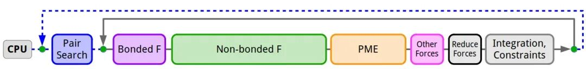

▲ CPU版计算流程

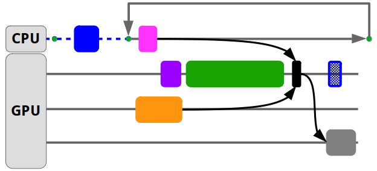

▲ GPU版计算流程

这里的安装以WSL2中UBUNTU的GPU版本为例：

CUDA下载

在下载GPU版GROMCAS之前，必须先安装好NVIDIA的CUDA。以下是标准流程：

在终端中输入以下命令确认NVIDIA显卡型号及驱动：

  *

```
nvidia-smi
```

确认显卡型号后，根据对应显卡在CUDA官网（https://developer.nvidia.com/cuda/toolkit）中找到对应的版本并进行下载编译。

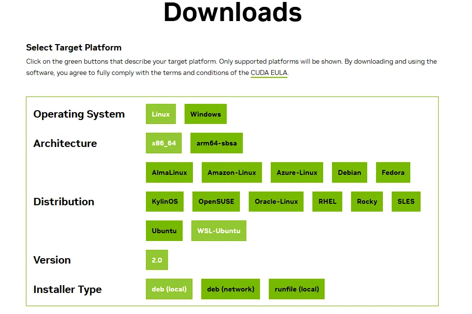

▲ CUDA官网上会根据选择的不同系统和版本给出命令

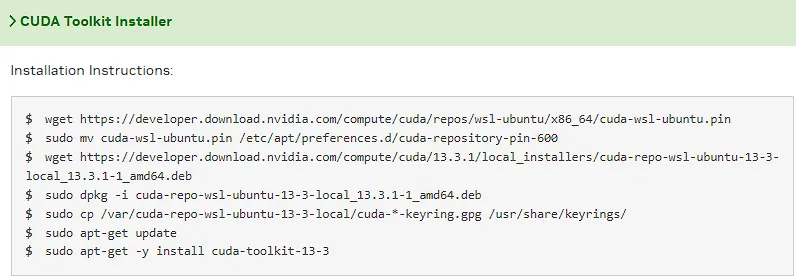

▲根据给出的命令在WSL中一步一步下载即可完成编译

CUDA已经编译完成，可以进行下一步的GROMACS安装了。

GROMACS下载（以GROMACS/2025.2版本，显卡4060为例）

  *   *   *   *   *

```
mkdir package #创建安装包的文件夹cd package #进入文件夹wget ftp://ftp.gromacs.org/gromacs/gromacs-2025.2.tar.gz #下载安装包tar -xzvf gromacs-2025.2.tar.gz #解压cd gromacs-2025.2 #进入文件夹
```

这一步完成对文件的下载和解压

  *   *   *   *   *   *   *   *   *

```
mkdir build #建立编译文件夹cmake .. \    -DCMAKE_INSTALL_PREFIX=/usr/local/gmx2025.2 \    -DGMX_USE_RDTSCP=ON \    -DGMX_GPU=CUDA \    -DCUDA_TOOLKIT_ROOT_DIR=/usr/local/cuda-12.9 \    -DCMAKE_CUDA_ARCHITECTURES=89 \    -DGMX_BUILD_OWN_FFTW=ON #对GROMACS进行编译，其中版本以实际的安装的CUDA和GROMACS为准
```

其中CUDA_ARCHITECHURES代表是显卡的架构，下方是常见的显卡架构。[RTX5090、4080S、5070显卡上机](<https://mp.weixin.qq.com/s?__biz=MzAwMzIzOTk5OQ==&mid=2247537769&idx=3&sn=ba4234ca47a3c4a7f3442859653b14b2&scene=21#wechat_redirect>)~

架构编号| 代表显卡型号
---|---
12.0| RTX 50系显卡 (5090, 5080, 5070)
8.9| RTX 40系显卡 (4090, 4080, 4070, 4060)
8.6| RTX 30系显卡 (3090, 3080, 3070, 3060)

▲ 常见显卡架构编号，CMake中去掉小数点

进行编译和安装

  *   *   *   *   *   *   *   *

```
make -j #编译，耗时较长。配置较低可以选择make -j4 代表使用四个核，减少核心数量make check #测试make install #安装gedit ~/.bashrc #打开bashrc文件，划到最后一行添加export PATH=/usr/local/gmx2025.2/bin:$PATHexport LD_LIBRARY_PATH=/usr/local/gmx2025.2/lib:$LD_LIBRARY_PATHsource ~/.bashrc#添加路径，根据下载版本添加，最后保存。
```

▲ 编译、安装、添加路径

  *   *

```
which gmx #如果返回/usr/local/gmx2025.2/bin/gmx说明安装成功。#返回gmx not found说明环境变量没有生效
```

▲ gmx安装验证

恭喜！安装完成

2.2 GROMACS的使用流程（以冰水蛋白体系为例,水采用TIP4P）

2.2.1 模拟体系构建

本小节将以一个冰-水-蛋白混合复杂体系为例，完成GROMACS模拟的核心流程。这个案例涵盖了从复杂体系的初始结构搭建，到能量最小化、NVT/NPT平衡，最后到生产模拟（一次模拟产生很多文件，一次模拟用所有文件请保存在一个新建的文件夹内）。

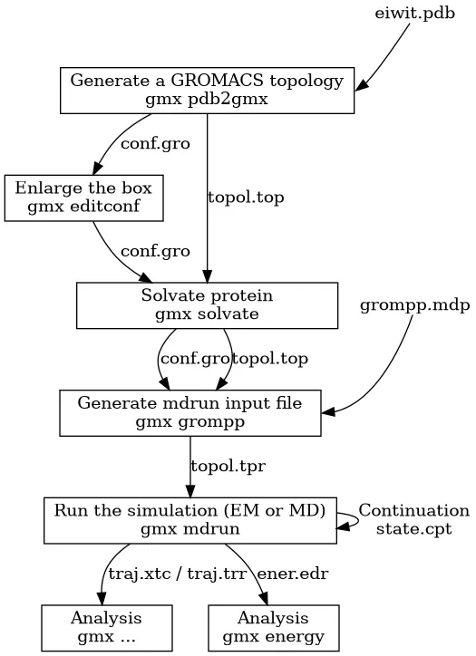

▲ GROMACS模拟所需流程

模拟文件

模拟文件包括蛋白质结构文件，冰结构，水。

2.2.1.1 冰结构生成

在分子动力学模拟中，冰晶的初始结构通常不是手动“搭建”的，而是由专门的工具根据晶体学数据生成。这一步的关键在于： 冰是一种氢无序（hydrogen-disordered）的晶体 ——每个水分子在晶格中的取向是随机的，但同时必须满足“冰规则”（每个氧原子周围恰好有两个共价O-H键和两个氢键），且整个晶胞的净偶极矩为零。手动构建这样的结构几乎不可能，因此需要GenIce来完成。

GenIce基本介绍

GenIce是专门为解决这一问题而开发的工具。它的核心功能是：从冰的单位晶胞（unit cell）出发，通过图论算法生成满足冰规则、且总偶极矩为零的大规模冰晶结构。

GenIce安装使用

在终端即可快速下载

  *

```
pip install genice2
```

下载完成后可以直接使用命令

  *

```
genice2 --rep 7 7 3 --water tip4p 1h > ice.gro
```

该命令即可生成本次模拟使用的冰结构，在文末可获取本次模拟的冰PDB文件（冰晶结构文件：ice.pdb）。

2.2.1.2 蛋白结构文件

蛋白质结构可以在PDB数据库中选择需要的结构或由[Alphafold](<https://mp.weixin.qq.com/s?__biz=MzAwMzIzOTk5OQ==&mid=2247535726&idx=1&sn=fa3a01ca6ec0f20d0e9b7ac960712ac3&scene=21#wechat_redirect>)生成。本次模拟的Alphafold数据库为例，结构在数据库中下载直接使用。而在PDB库获得的pdb文件中，通常包含多个水分子和配体、离子等非蛋白组分。这些组分对于分子动力学模拟来说通常是不需要的，需要先进行清理，只保留目标蛋白。

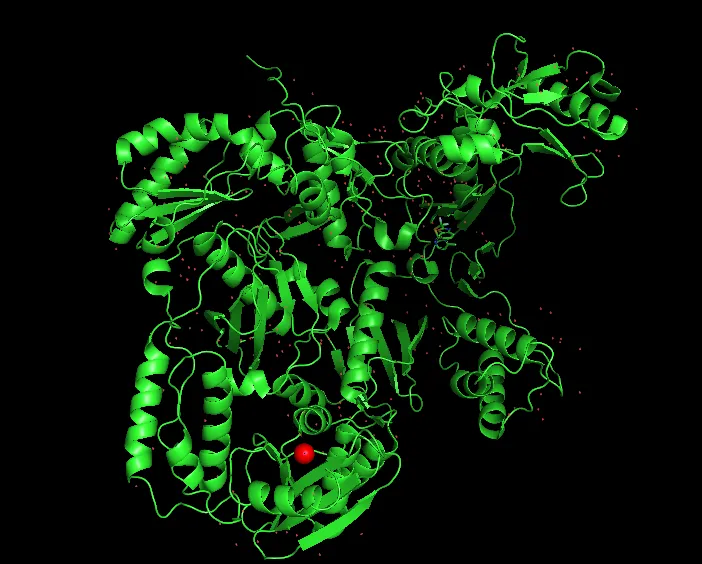

▲ 图中小红点就是水，大红点就是离子等组分

pymol打开文件后控制台输入

  *   *   *   *   *   *

```
remove solvent#移除所有水remove sele#选中要删除的部分后输入即可删除save protein.pdb#删除后保存PDB
```

同时文末也可获得本次模拟使用的加氢后的蛋白结构文件（蛋白结构文件：protein.pdb）。

2.2.1.3 体系构建

在进行分子动力学模拟之前，第一步也是最重要的一步，就是构建合理的模拟体系。对于常见体系来说有两种主流选择，gmx editconf与Packmol。

首先是GROMACS自带的工具editconf：

  *   *   *   *   *   *

```
# 蛋白加氢并生成拓扑（力场：amber99sb-ildn）gmx pdb2gmx -ignh -f protein.pdb -o protein_processed.gro -water tip4p -ff amber99sb-ildn# 自动生成立方盒子，蛋白距盒子边界 1.0 nmgmx editconf -f protein_processed.gro -o protein_newbox.gro -bt cubic -d 1.0# 向盒子中填充水分子gmx solvate -cp protein_newbox.gro -cs tip4p.gro -p topol.top -o protein_solvated.gro
```

这些命令能够快速生成水盒子，但是生成的盒子蛋白位置，水分子数量都是不可控制的，只适合简单体系。因此我们选择第二种方法：

Packmol下载

packmol可以通过三种方式下载，官网、Github和终端（CMD）。

官网：https://m3g.github.io/packmol/

打开官网选择版本后下载

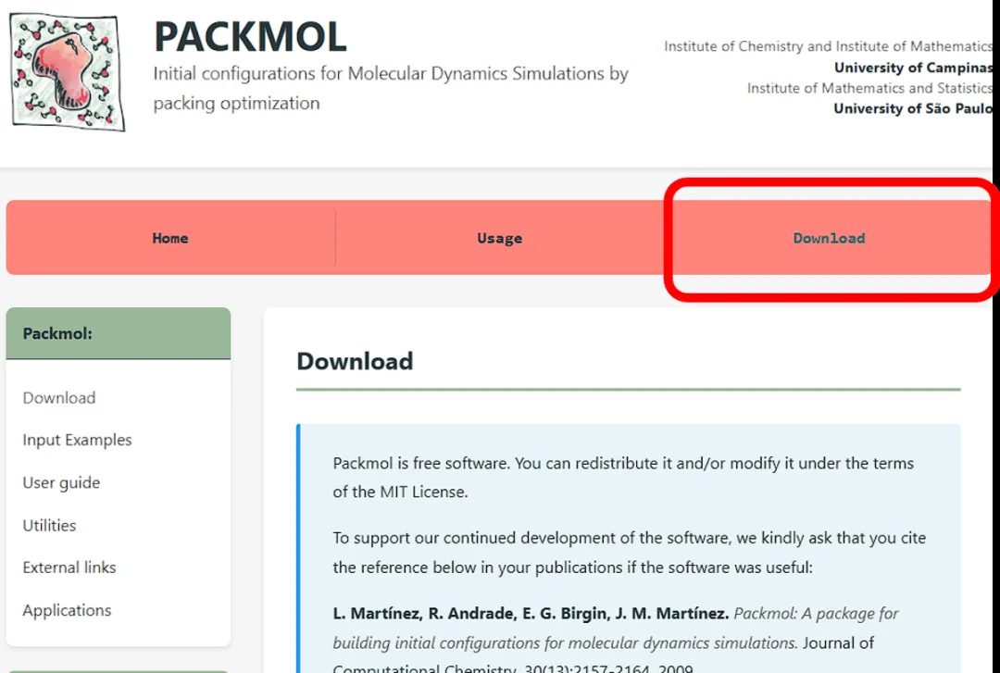

Github下载

Github：https://github.com/m3g/packmol

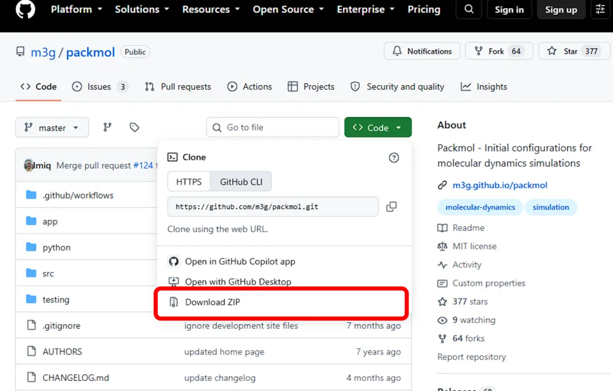

▲ 点code后Download Zip

终端下载

  *

```
pip install packmol
```

windows用户推荐采用终端下载，简单并且直接进入系统环境

Packmol构建模拟体系

Packmol能够根据需求自定义盒子大小、放置位置、数量等，通过inp文件设置即可。

大多数 PDB 文件里没有氢原子，而分子动力学模拟需要完整的原子信息。所以第一步是用 gmx pdb2gmx 给蛋白加氢，同时生成后续模拟需要的top拓扑文件。

利用gmx给PDB添加氢原子

  *   *

```
gmx pdb2gmx -ignh -f protein.pdb -o protein_h.gro -water tip4p -ff amber99sb-ildn#采用对应的力场添加氢键
```

▲ PDB文件加氢

完成加氢后输出的gro文件，需要用gmx命令转为PDB

  *   *

```
gmx editconf -f protein_h.gro -o protein.pdb#直接覆盖原本的pdb即可
```

生成蛋白的itp文件

itp文件是用于具体分子的拓扑信息：原子、电荷、键、键角、二面角、位置限制等。

我们打开蛋白加氢后生成的topol.top文件，从[moleculetype]复制到[dihedrals]，新建一个txt文件复制进去并将txt文件改名为protein.itp即可。

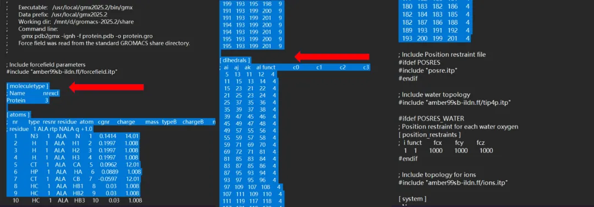

蛋白质限制文件（posre.itp，本教程未启用）

posre.itp是 pdb2gmx 自动生成的位置限制文件。能够在能量最小化或 NVT/NPT 平衡阶段，把蛋白原子“拴”在初始位置附近，防止它在升温或盒子缩放时剧烈漂移。启用方法是在 topol.top 中 #include "posre.itp"，并在对应 mdp 中加入 define = -DPOSRES。

水结构文件

在分子动力学模拟中，选择合适的水模型是决定模拟能否成功的关键。特别是要研究“结冰”这类相变过程，必须选用专门为固相水设计的模型。

目前常用的水分子模型，根据其模型中带电荷的“点”的数量，主要分为三类：

  * 3点水模型：水分子由一个氧原子和两个氢原子上的点电荷构成。这类模型（如SPC、TIP3P）计算速度快，但无法准确描述氢键的方向性，容易高估冰的密度。

  * 4点水模型：在3点水模型基础上，增加一个位于氧原子附近的虚拟位点（带负电的孤对电子）来改善氢键方向性。TIP4P系列就属于此类，其中TIP4P/Ice是专门为冰模拟优化的版本。

  * 5点模型：在氧原子周围放置两个虚拟位点来更精确地模拟电荷分布。代表模型如TIP5P，能更好地描述液态水的性质，但计算成本更高。

TIP4P/Ice模型预测的六方冰熔点约为272.2 K ，与实验值高度吻合，而其他模型预测的熔点偏差较大或无法结冰。该模型能够准确模拟出冰的密度冰更好地维持冰晶地晶格，其他水模型选择请参考论文（https://pubs-acs-org-443.webvpna.lzu.edu.cn/cgdefu/article/26/5/2209/5080125/Molecular-Simulation-of-Hydrate-Bearing-Sediments#4）。下面是本次模型使用的水结构文件：

  * 水结构文件tip4p-ice（water.pdb）：水层结构文件：water.pdb

  * 隔离水结构文件（SOH.pdb）：水层结构文件：SOH.pdb

▲ 和water.pdb相同，用作区分

添加离子

在完成蛋白加氢、冰晶生成和水层构建后，体系往往带有净电荷。如果直接使用 PME 等 Ewald 静电方法，净电荷会产生均匀背景电荷，导致离子异常分布、静电相互作用偏差等影响。因此，需要加入反离子中和体系，使总电荷为零。

离子数量可以按以下原则确定：中和电荷：若体系总电荷为 +Q，则加入 Q 个 Cl⁻；若为 -Q，则加入 Q 个 Na⁺

文末提供两种离子的pdb。

  * 钠离子文件（NA.pdb）：钠结构文件：NA.pdb

  * 氯离子文件（CL.pdb）：氯结构文件：CL.pdb

本次模拟生成的体系总电荷为：1.0，因此需要在inp文件最下面额外加入：

  *   *   *   *

```
structure CL.pdb number 1   inside box 0 0 33.110 54.760 51.475  109.11  # 离子end structure
```

下文会讲解如何判定体系电荷。

打包文件inp设置

在获得所有体系所需要的pdb文件后，即可开始打包体系。Packmol所有的打包设置均通过inp文件实现，下面是本次模拟的inp文件设置：

  *   *   *   *   *   *   *   *   *   *   *   *   *   *   *   *   *   *   *   *   *   *   *   *   *   *   *   *   *   *   *   *   *   *   *   *   *   *

```
#inp文件设置tolerance 2.0 #原子间距离add_box_sides 2.0 #与盒子边界距离filetype pdboutput system.pdb #输出# 冰（放在盒子底部区域）structure ice.pdb  number 1 #放置数量  inside box 0 0 6 54.760 51.475  33.110 #006为放置起始位置，54.760 51.475 33.110为宽长高end structure# 蛋白（高于冰）structure protein.pdb  number 1  inside box 0 0 35.110 54.760 51.475  48.110 #起始位置为0、0、35.11，必须高于冰面end structure# 水分子（TIP4P水填满盒子剩余区域）structure water.pdb  number 7200  inside box  0 0 33.110 54.760 51.475  109.11 #起始位置冰面开始，最后的109.11则是盒子设置的高度end structure#水分子根据盒子体积估算structure water.pdb number 300    inside box 0 0 0 54.760 51.475   5  end structure#盒子底部隔离水structure CL.pdb number 1  # 适当增加水分子数量填充盒子 inside box 0 0 33.110 54.760 51.475  109.11  # 离子end structurenloop 30
```

向下滑动查看全部~

▲Packmol所需的inp文件设置，其中的配体受体需要提前加氢，在2.2.1.3我们已经进行过此步骤。

输入命令

  *   *

```
packmol < system.inp #packmol运行inp文件
```

▲ 终端命令即可运行生成自定义盒子

Packmol解析

输入命令后Packmol开始生成体系，但是不是所有体系都都能够直接使用的。

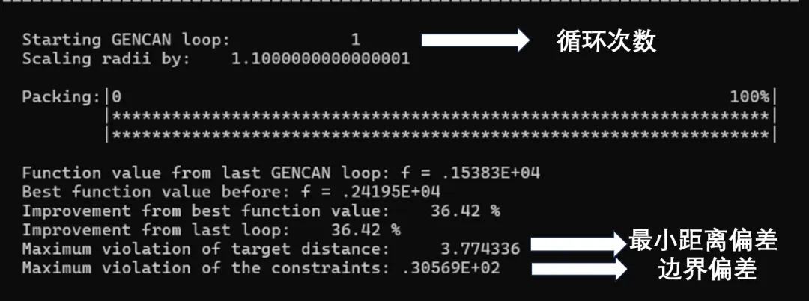

其中最重要的就是最小距离偏差与边界偏差。Packmol在循环中会不停尝试，反复调整原子位置，并重新进行packing，直到找到满足约束的解。每完成一轮优化，它都会输出当前的最优结果，并用这两个指标来评判结构是否合格。一般两者的值在0即为最优，不需要等待Packmol运行结束即可停止。

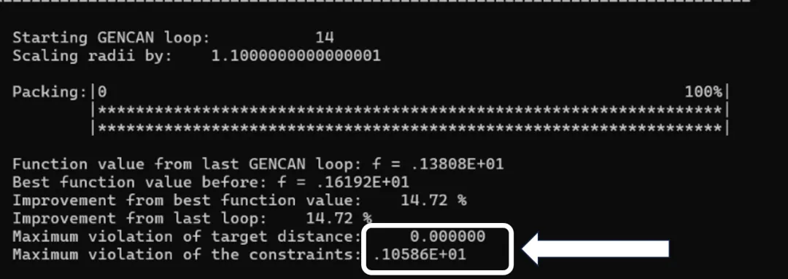

▲ 在最小距离偏差为0时即可停止运行

最后生成冰水蛋白体系

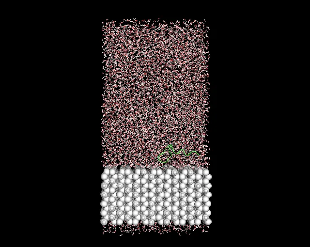

2.2.2 模拟参数设置

基本文件

top文件（topology）是系统总拓扑，定义整个模拟体系，告诉 GROMACS 体系里有哪些分子、各有多少个，以及它们分别使用哪个.itp 定义。

在模拟开始前，我们需要体系的拓扑文件.top，可以通过下面命令生成拓扑文件和gro文件。

  *   *

```
gmx pdb2gmx -ignh -f system.pdb -o system.gro#生成gro文件的同时也生成top文件
```

而冰水体系中的拓扑文件含有gmx不能读取的残基ICE，所以在模拟中需要自定义蛋白的itp文件和体系的top文件（力场可选amber99sb-ildn，水类型需要选择TIP4P，itp文件如何生成前面2.2.1.3也讲过啦~）。

以下是自定义的.top文件

; Include forcefield parameters

#include "amber99sb-ildn.ff/forcefield.itp"

;力场信息

[ atomtypes ]

; name at.num mass charge ptype sigma (nm) epsilon (kJ/mol)

OW_ice 8 15.9994 0.0000 A 0.31668 0.88216

HW_ice 1 1.0080 0.0000 A 0.0 0.0

;自定义的原子类型

#include "ICE.itp"

#include "tip4p-ice.itp"

#include "protein.itp"

#include "amber99sb-ildn.ff/ions.itp"

#include "tip4p-restraints.itp"

;引入的力场信息，分别是冰，四点水，蛋白，离子，限制水

[system]

Built with Packmol

[ molecules ]

; Compound #mols

ICE 2352

Protein 1

SOL 7200

SOH 300

CL 1

;体系中的原子数量，第一项ICE为冰，第二项为蛋白。顺序需要和PDB组分顺序保持一致

向下滑动查看全部~

▲ 自定义的拓扑top文件

其中使用的.itp如下：

  * ICE拓扑文件（ICE.itp）：ICE.itp

▲ 其中使用的ICE.itp和tip4p-ice.itp相同，仅用作区分

  * 四点水文件（tip4p-ice.itp）：tip4p-ice.itp

  * 水限制文件（tip4p-restraints.itp）：tip4p-ice.itp

▲ position-restraint限制SOH的氧原子位置，protein.itp文件如何生成详见前文2.2.1.3部分

在topol.top的[molecules]区域的数量必须与PDB文件相同，否则后续模拟出现报错，警告top和pdb原子数量不符。

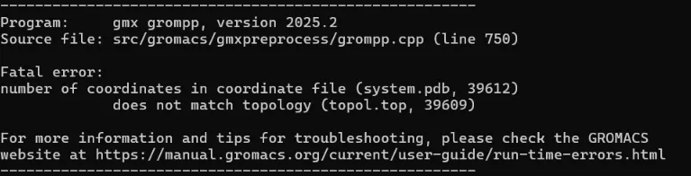

2.2.2.1 能量最小化

由于刚生成的体系中可能有不合理原子接触、键长偏离平衡值或空间重叠，直接进行分子动力学模拟会导致体系能量过高，甚至使模拟崩溃。因此在模拟之前必须对体系进行能量最小化（Energy Minimization）。GROMACS的模拟参数通过.mdp(Molecular Dynamics Parameters)文件控制，控制模拟的积分器、步长、温度、压力、截断、输出频率等。能量最小化需要以下的关键参数：

; em.mdp# 以下是能量最小化所需要的mdp文件，具体参数值可根据情况调整integrator = steep #最陡下降法emtol = 1000.0 #收敛阈值，可以降到 500 或 200emstep = 0.01 #初始步长nsteps = 50000 #最大步数nstenergy = 100 #每100步输出能量到edr文件nstlog = 100 #每100步输出到log日志文件nstxout = 0 #EM阶段不输出坐标nstvout = 0 #EM阶段不输出速度constraints = h-bonds #约束所有氢键的键长，对TIP4P/Ice体系保持水分子刚性很重要cutoff-scheme = Verlet #相邻原子列表方案，gpu加速友好nstlist = 10 #每10步更新一下相邻列表（EM阶段也可设为1）rcoulomb = 1.2 #静电截断半径（nm），常用值，配合PMErvdw = 1.2 #范德华截断半径（nm），通常与静电相同coulombtype = PME #处理长程静电的方法，生物分子模拟可选，精度高pme_order = 4 #默认值fourierspacing = 0.16 #PME傅里叶网格间距（nm）常用值。越小越精确，计算量越大pbc = xyz #在 x、y、z 三个方向都使用周期性边界条件DispCorr = no #冰-水-蛋白体系含界面，关闭色散校正，避免界面假象

向下滑动查看全部~

▲ 能量最小化mdp文件

进行能量最小化

  *   *   *   *

```
gmx grompp -f em.mdp -c system.pdb -r system.pdb -p topol.top -o em.tpr# 生成文件，-maxwarn 1仅在确认警告不影响结果时使用，不建议默认添加gmx mdrun -v -deffnm em# 执行能量最小化
```

运行后会出现以下的输出，则说明运行成功。

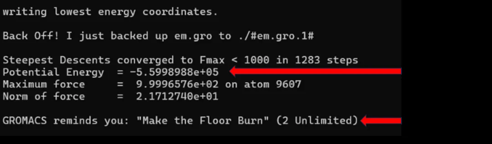

▲ Maximum force需要小于设定的最大值（<1000）

当出现too many warnings，需要手动检查错误。

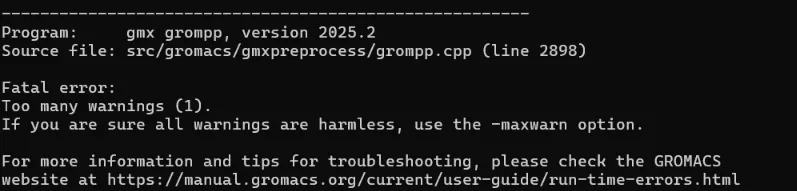

如果是体系电荷问题，会出现如下报错。


该错误提示体系的总电荷为1.0，则需要加入CL-。

如果该报错不影响模拟，则在命令的最后加入：

  *

```
-maxwarn 1
```

2.2.2.2 NVT平衡（温度平衡）

经过能量最小化消除体系中的不合理接触后，体系的势能已处于局部极小值。然而此时体系尚未获得与目标温度相对应的动能，因此需要在正式模拟之前将体系逐步升温至目标温度，使体系达到热平衡。

在进行温度平衡之前，必须对体系的不同组分分别进行温度耦合。因为冰、液态水、蛋白在热力学性质上差异显著，热弛豫行为不同。若将整个体系作为单一组进行控温，恒温器可能无法均匀地平衡各相之间的温度，容易诱发非物理的结构变化。将冰、水（含隔离水层和离子）、蛋白分别设为独立的控温组，可以让各组分独立地与热浴耦合，使每相温度更准确地趋近目标温度，从而获得更可靠的热平衡状态

  *   *

```
gmx make_ndx -f system.pdb -o index.ndx#打开分组信息
```

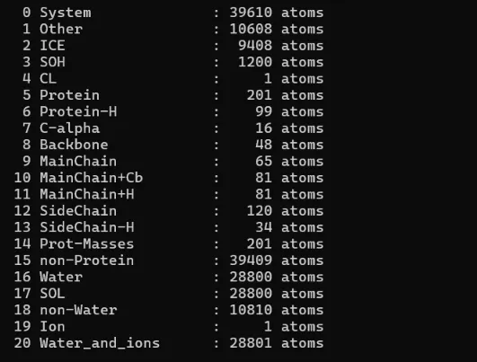

▲ 模拟体系的分组

  *   *   *   *   *   *   *

```
17 | 3 | 4#将组3，4，17合并为一组name 21 SOL_all#将三组合并的新组进行命名#最后输出一个index.ndx，可以文本查看分组#命令查看分组#gmx make_ndx -f system.gro -n index.ndx -o /dev/null
```

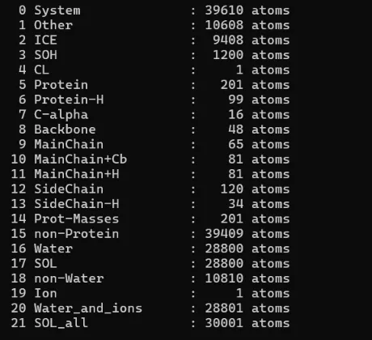

▲ 新建 ’SOL_all‘ 组，包含SOL,SOH和CL

NVT平衡的参数文件 nvt.mdp 需要指定恒温器类型、目标温度、耦合时间常数等关键参数。以下是针对冰水蛋白体系推荐的配置：

; nvt.mdp

# 以下是NVT平衡所需要的mdp文件，具体参数值可根据情况调整

integrator = md #默认积分器，使用牛顿运动方程进行动力学模拟

nsteps = 50000 #模拟总步长（50000*0.002fs=100ps）

dt = 0.002 #模拟步长（常用安全值）

nstxout = 5000 #每5000步输出坐标到trr文件

nstvout = 5000 #每5000步输出速度到trr文件

nstenergy = 5000 #每5000步输出能量到trr文件

nstlog = 5000 #每5000步输出到log日志文件

continuation = no #表示这是一次新的模拟，需要续跑则改为yes并搭配-cpi使用

constraint_algorithm = lincs #使用 LINCS 算法约束键长，常用算法

constraints = h-bonds #约束所有氢键的键长

lincs_iter = 1 #LINCS 迭代次数，1次足够

lincs_order = 4 #LINCS展开阶数，4为默认值

cutoff-scheme = Verlet # 相邻原子列表方案，gpu加速友好

nstlist = 10 #每10步更新一下相邻列表

rcoulomb = 1.2 #静电阶段半径（nm），常用值，配合PME

rvdw = 1.2 #范德华截断半径（nm），通常与静电相同

coulombtype = PME #处理长程静电的方法，生物分子模拟可选，精度高

pme_order = 4 #默认值

fourierspacing = 0.16 #PME傅里叶网格间距（nm）常用值。越小越精确，计算量越大

tcoupl = v-rescale #能产生正确的正则系综（NVT）分布，平衡速度快，温度波动小，适用于生物分子模拟。

; #选用Nose-Hoover，平衡速度慢，温度波动大（更自然），适用于膜蛋白等模拟场景

tc-grps = ICE SOL_all Protein #温度耦合组

tau_t = 0.4 0.4 0.4#也可以设置为1.0，值越小耦合越强，波动越小

ref_t = 267.15 267.15 267.15#目标温度-6℃

pcoupl = no #压力耦合选项，nvt不进行压力耦合

pbc = xyz #在 x、y、z 三个方向都使用周期性边界条件

DispCorr = no #Amber力场下均匀各向同性体系选用EnerPres，OPLS选用Ener。前者同时对压力和能量进行矫正，后者对能量进行矫正。

gen_vel = yes #生成初始速度，新文件默认。续跑则为no

gen_temp = 267.15 #生成初始速度对应的温度-6℃

gen_seed = -1 #随机种子

向下滑动查看全部~

▲ 温度平衡mdp文件

进行温度平衡

  *   *   *   *

```
gmx grompp -f nvt.mdp -c em.gro -r em.gro -p topol.top -o nvt.tpr -n index.ndx #生成文件，-maxwarn 1仅在确认警告不影响结果时使用，不建议默认添加gmx mdrun -deffnm nvt#运行
```

2.2.2.3 压力平衡（NPT平衡）

经过NVT平衡后，体系温度已稳定在目标值，但此时体系的密度和压力可能尚未达到实验条件对应的状态。NPT平衡阶段在保持温度恒定的同时，允许盒子体积发生改变，使体系压力达到目标值（通常为1 bar）。以下是针对冰水蛋白体系推荐的 npt.mdp 配置：

; npt.mdp

integrator = md

nsteps = 200000

dt = 0.002

nstxout = 500

nstvout = 500

nstenergy = 500

nstlog = 500

continuation = yes #对于NVT的续跑

constraint_algorithm = lincs

constraints = h-bonds

lincs_iter = 1

lincs_order = 4

cutoff-scheme = Verlet

nstlist = 10

rcoulomb = 1.2

rvdw = 1.2

coulombtype = PME

pme_order = 4

fourierspacing = 0.16

tcoupl = v-rescale

tc-grps = ICE SOL_all Protein

tau_t = 0.4 0.4 0.4

ref_t = 267.15 267.15 267.15

pcoupl = Parrinello-Rahman #速度慢但能产生正确的 NPT 系综分布，许多模拟选择。官方推荐C-rescale，但是不支持各向异性的压力耦合

pcoupltype = semiisotropic ; isotropic

tau_p = 2.0 #压力耦合时间常用值

ref_p = 1.01325 1.01325 #1bar 两个值分别代表XY平面和Z方向

compressibility = 4.5e-5 4.5e-5 #水的可压缩系数，分别代表xy和z。只影响压力耦合的响应快慢、不影响平衡目标值；z 方向含冰，此处以液态水值近似

refcoord_scaling = com #位置限制参考坐标随质心移动；SOH限制始终生效，NPT缩放盒子时必须开启

pbc = xyz

DispCorr = no

gen_vel = no

向下滑动查看全部~

▲ 压力平衡mdp文件

适用场景警告！！

pcoupltype 决定了压力耦合的方式，常见选项如下：

isotropic：各向同性，X、Y、Z 三个方向一起耦合

semiisotropic：XY 平面与 Z 方向分别独立耦合

anisotropic：X、Y、Z 三个方向完全独立耦合

本教程的冰水蛋白体系中，底部是冰层，上方是水层和蛋白，Z 方向存在明显的冰-水界面和各向异性应力。冰层结构刚性较强，XY 平面与 Z 方向的压力响应并不相同。因此，在 NPT 平衡和生产模拟中使用semiisotropic，普通水溶液蛋白体系必须用 isotropic。读者在迁移本流程时，务必先判断自己的体系是否存在各向异性，再选择对应的压力耦合方式。

进行压力平衡

  *   *   *   *

```
gmx grompp -f npt.mdp -c nvt.gro -r nvt.gro -t nvt.cpt -p topol.top -o npt.tpr -n index.ndx#生成文件gmx mdrun -deffnm npt#运行
```

2.2.2.4 分子动力学模拟（MD）

经过能量最小化、NVT平衡和NPT平衡后，体系已达到目标温度（267.15 K）和目标压力（1 bar），密度也已收敛。此时可以开始生产模拟，即正式采集用于分析的数据轨迹。

; md.mdp

integrator = md

nsteps = 200000000 #模拟总步数（2×10⁸ × 0.002 ps = 400 ns）

dt = 0.002 #步长

nstxout = 10000

nstvout = 10000

nstenergy = 10000

nstlog = 5000

nstxout-compressed = 5000

compressed-x-grps = System

continuation = yes

constraint_algorithm = lincs

constraints = h-bonds

lincs_iter = 1

lincs_order = 4

cutoff-scheme = Verlet

nstlist = 10

rcoulomb = 1.2

rvdw = 1.2

coulombtype = PME

pme_order = 4

fourierspacing = 0.16

tcoupl = Nose-Hoover

tc-grps = System

tau_t = 0.4

ref_t = 267.15 #温度

pcoupl = Parrinello-Rahman

pcoupltype = semiisotropic ; isotropic

tau_p = 2.0

ref_p = 1.01325 1.01325 #压力

compressibility = 4.5e-5 4.5e-5 #同npt

refcoord_scaling = com #同npt，SOH限制下缩放盒子必须开启

pbc = xyz

DispCorr = no

gen_vel = no

#参数根据需要进行调整

向下滑动查看全部~

▲ 生产所需要的mdp文件

适用场景警告！！

体系原子数量约40000个，本地模拟配置AMD Ryzen 7 7840H+4060模拟400ns需要三天半，普通尝试模拟20ns查看体系即可。推荐使用服务器进行模拟。

进行模拟

  *   *   *   *

```
gmx grompp -f md.mdp -c nvt.gro -r nvt.gro -t nvt.cpt -p topol.top -o md_1.tpr -n index.ndx#生成文件gmx mdrun -deffnm md_1 -v#开始生产，-v可以查看进度
```


恭喜！成功开始模拟。

获得模拟轨迹后就可以进入下一步分析了。

2.2.3 模拟数据分析

2.2.3.1.能量最小化校验

在能量最小化阶段需要关注势能变化的曲线

  *   *   *   *

```
# 势能gmx energy -f em.edr -o em_potential.xvg# 输入 Potential 并回车#输出纯数据则加上 -xvg none
```

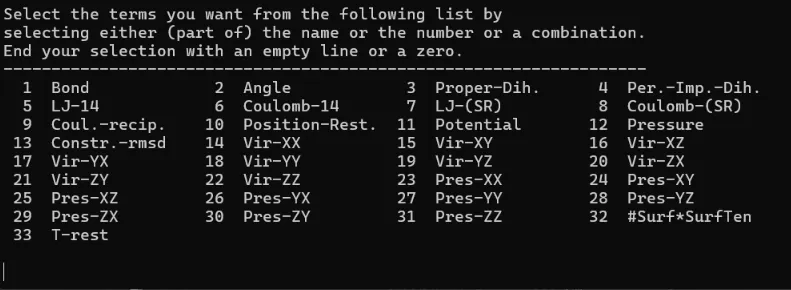

▲ 输入Potential后回车

生成文件后，通过即可下列代码中修改文件名实现生成图像。也可以在excel中进行手动构图。

  *   *   *   *   *   *   *   *   *   *   *   *   *   *   *   *   *   *   *   *   *   *   *   *   *   *   *   *   *   *   *   *   *

```
import matplotlib.pyplot as pltimport numpy as np# ===== 只需要修改这一行 =====filename = 'nvt_temp.xvg'fname_lower = filename.lower()if 'temp' in fname_lower:    ylabel = 'Temperature (K)'    target = 267.15          # 目标温度elif 'press' in fname_lower:    ylabel = 'Pressure (bar)'    target = 1.01325         # 目标压力elif 'dens' in fname_lower:    ylabel = 'Density (kg/m³)'    target = Noneelif 'pot' in fname_lower:    ylabel = 'Potential Energy (kJ/mol)'    target = Noneelse:    ylabel = 'Value'    target = Nonedata = np.loadtxt(filename, comments=['#', '@'])plt.figure(figsize=(8, 4))plt.plot(data[:, 0], data[:, 1], linewidth=1)plt.xlabel('Time (ps)')plt.ylabel(ylabel)plt.title(filename)if target is not None: #基准线    plt.axhline(y=target, color='r', linestyle='--', linewidth=1, label=f'Target = {target}')    plt.legend()plt.tight_layout()plt.savefig(filename.replace('.xvg', '.png'), dpi=150)plt.show()
```

▲ 该代码能够实现势能，温度，压力，密度的XVG文件画图。

python对数据进行画图

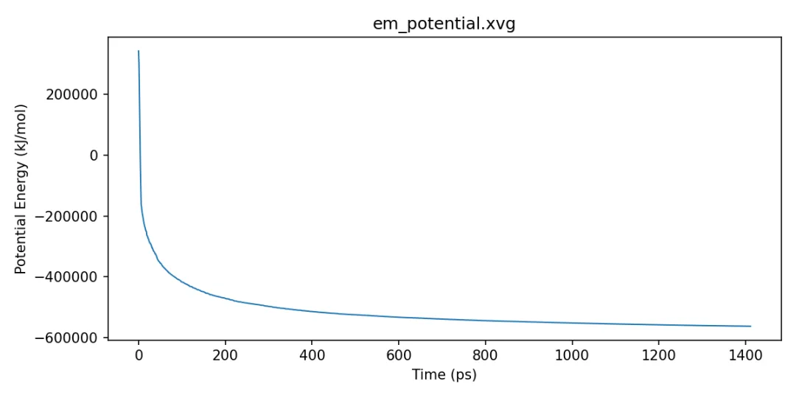

观察势能曲线，刚开始势能较大并快速下降，最后随着模拟时间趋于平稳，即为体系稳定。

2.2.3.2NVT平衡阶段

在NVT平衡阶段，我们主要关注体系的温度和势能变化，压力通常会有较大的变化不需要关注。

  *   *   *   *

```
gmx energy -f nvt.edr -o nvt_temp.xvg# 按提示输入 Temperature 并回车gmx energy -f nvt.edr -o nvt_pot.xvg# 按提示输入 Potential 并回车
```

▲ 得到的两个文件就是NVT阶段体系的温度和势能变化

通过上面的python代码即可生成曲线

生成温度曲线

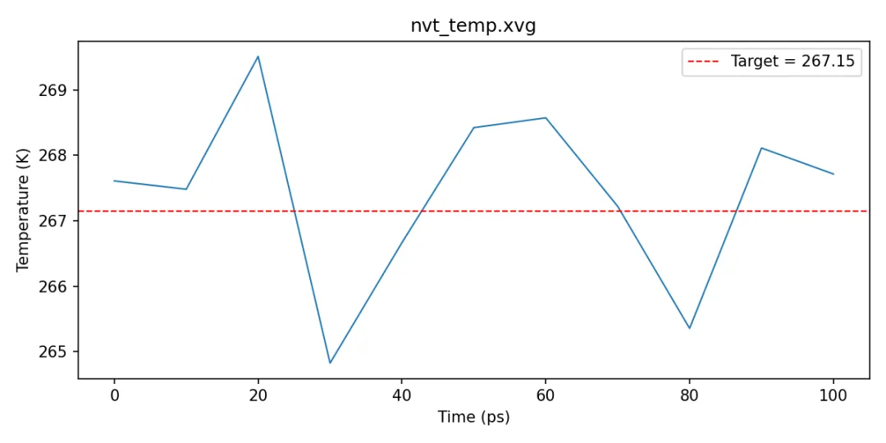

温度曲线在设定的目标温度（267.15），体系在目标温度有±2℃左右温度波动，属于正常范围。延长模拟时间可以减小温度波动（100ps通常足够）。

生成势能曲线

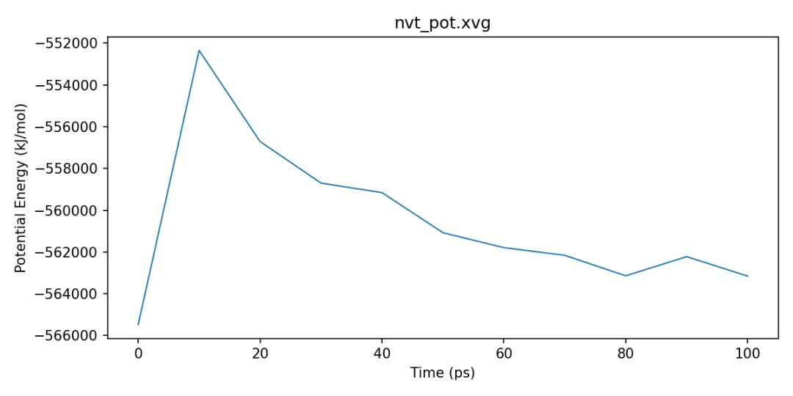

势能曲线由于刚开始从0K升温到267.15K造成势能升高，恒温后势能平稳下降，是很多体系常见的曲线，升高后平稳后则认为体系稳定。

2.2.3.3 NPT平衡阶段

NPT阶段可以对温度，势能，密度，压力的曲线进行观察

其中温度，势能与前面NVT方法一致。

密度

  *   *

```
gmx energy -f npt.edr -o npt_den.xvg#输入density并回车
```

并使用上述的python生成图片

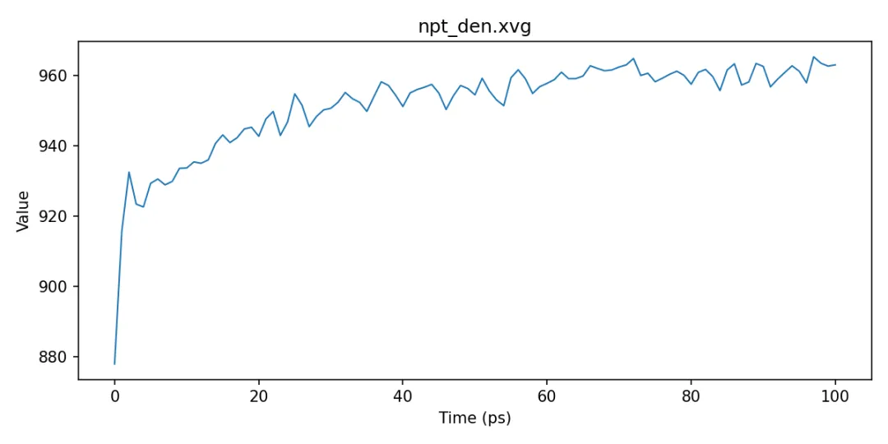

体系密度曲线由880涨到950左右波动，这通常说明体系在 NPT 压力耦合下被逐渐压缩，密度正在收敛。而体系内包含大量密度较低的冰，因此低于水密度的1000属于正常情况。在模拟后30%趋于稳定说明体系稳定。

压力

  *   *

```
gmx energy -f npt.edr -o npt_pre.xvg#输入pressure并回车
```

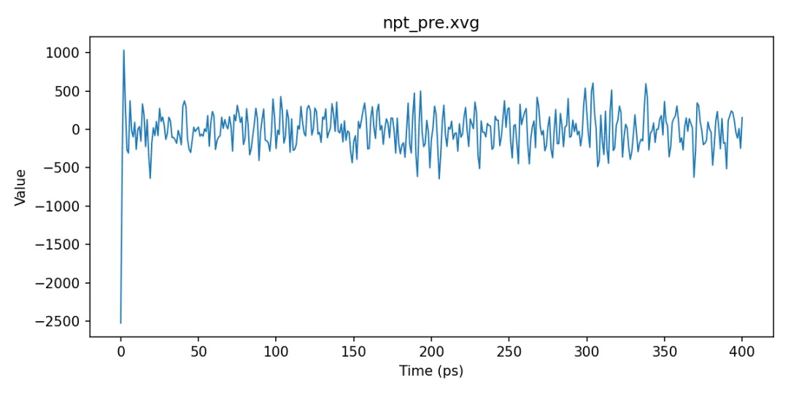

压力曲线在初期快速上升，从-2500到500后最后0±400bar附近波动，说明体系压力趋于稳定（体系的瞬时压力很大，只看瞬时压力没有意义，体系平均压力接近1.01bar即体系稳定，如果平均压力明显偏离，比如-100bar，则说明没有稳定）。下面给出python代码计算后30%的平均压力。

  *   *   *   *   *   *   *

```
import numpy as npdata = np.loadtxt('npt_pre.xvg', comments=['#', '@'])n = len(data)last = data[int(n*0.7):, 1]   # 后 30% 数据print(f"平均压力: {last.mean():.2f} bar")print(f"标准差:   {last.std():.2f} bar")print(f"目标压力: 1.01325 bar")
```

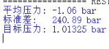

体系平均压力为-1.06bar，在统计上可以认为与目标值一致，认为体系稳定，能够进入生产模拟。

2.2.3.4 模拟文件数据分析

在完成模拟后，GROMACS会给出名人名言提示生产模拟已完成，下面对每个模拟文件进行介绍。


▲ 生成多个模拟文件

cpt：检查点文件。用于中断后续跑

edr：能量文件。保存温度、压力、密度、势能等随模拟时间的变化。

gro：最终结构文件。在模拟结束时生成最终的构象。

log：日志文件。记录模拟过程中的所有输出信息、警告和性能统计

tpr：运行输入文件。包含模拟的全部参数、拓扑和初始坐标。用于后续分析。

trr：全精度轨迹文件。保存坐标、速度、力，精度高但体积巨大。

xtc：压缩轨迹文件。保存模拟全过程的原子坐标，文件较小，是后续分析的主要轨迹文件。

md_1_prev.cpt：上一检查点备份。自动保留的上一个检查点，防止最新检查点损坏。

模拟可视化

在模拟完成后，想要观察模拟期间体系内的变化，需要用软件进行读取，软件包括：VMD，ChimeraX等软件。本次模拟主要介绍VMD进行轨迹分析。

VMD是一款免费分子可视化软件，它专为显示、动画和分析大型生物分子体系而设计，是处理分子动力学模拟结果的主流工具之一。在官网直接下载即可，这里以windows版本为例。

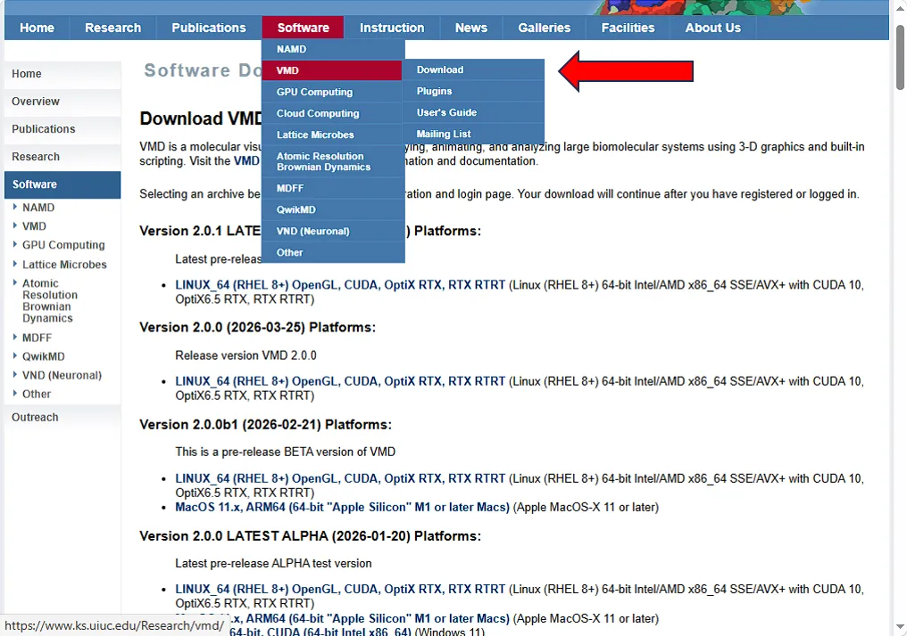

下载完成后打开npt.gro文件。

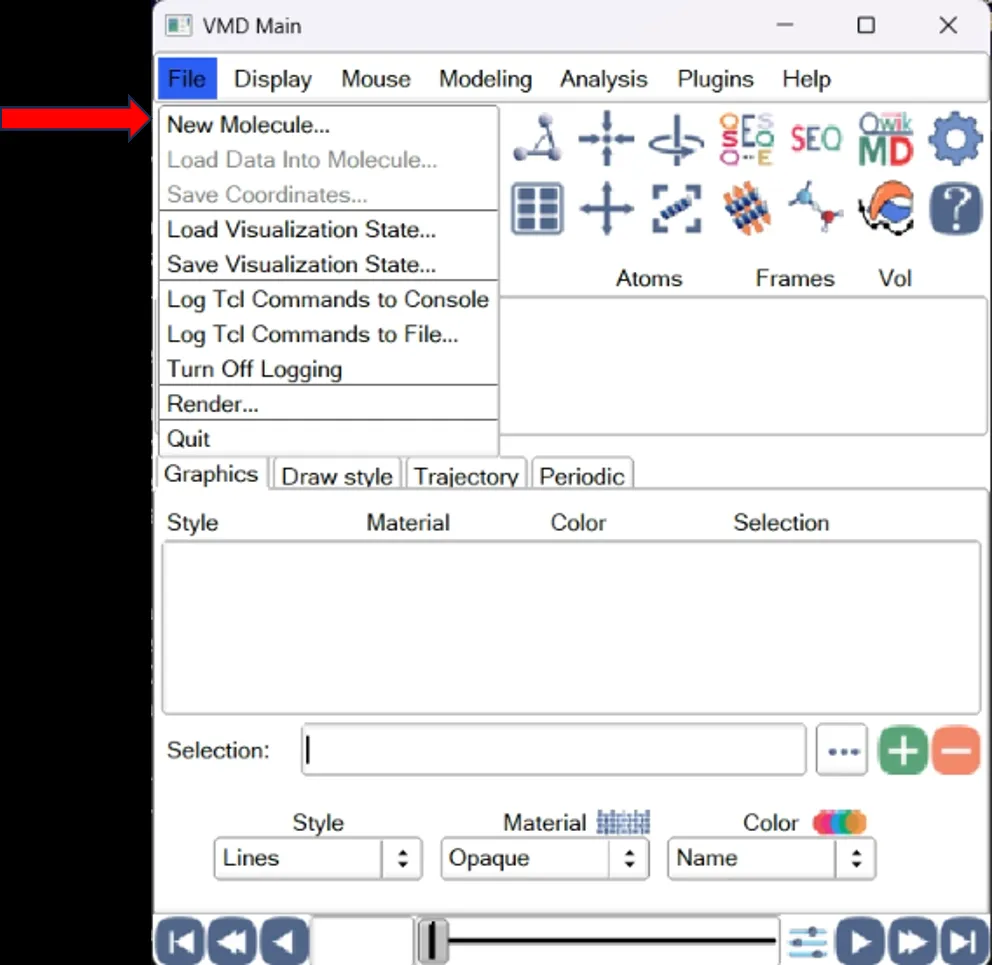

打开后gro文件后操作如下：

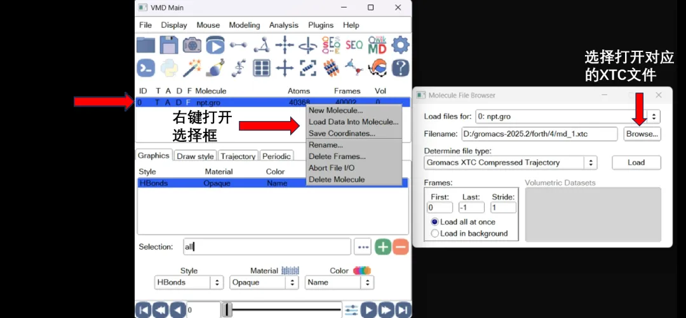

左键选中文件后右键点开选择框，选择load data into molecule。然后选择Browse找到对应的XTC文件，下方的last改为-1，点击load即可加载轨迹（需要等待几分钟）。

在左上角display中选择Orthographic，可以更好的观察冰晶。在左下角style中选择H-bond作为更清晰的展示

2.2.3.5 蛋白构象分析

对体系的模拟过程中蛋白构象进行分析，包括RMSD、RMSF、RG回旋半径氢键分析。首先需要需要对轨迹进行预处理，减少周期性边界盒子的影响。

  *

```
echo "Protein System" | gmx trjconv -s md_1.tpr -f md_1.xtc -o md_1_noPBC.xtc -pbc mol -center
```

▲ 将protein居中并输出轨迹，后续对md_1_noPBC.xtc进行分析。

RMSD分析

RMSD 用于衡量模拟过程中蛋白骨架相对于初始结构的平均偏移程度

  *

```
echo "Backbone Backbone" | gmx rms -s md_1.tpr -f md_1_noPBC.xtc -o rmsd.xvg -tu ns
```

通过下方的python代码进行RMSD曲线绘制

  *   *   *   *   *   *   *   *   *   *   *   *

```
import matplotlib.pyplot as pltimport numpy as npdata = np.loadtxt('rmsd.xvg', comments=['#', '@'])plt.figure(figsize=(8, 4))plt.plot(data[:, 0], data[:, 1], linewidth=1.2)plt.xlabel('Time (ns)')plt.ylabel('RMSD (nm)')plt.title('Backbone RMSD')plt.grid(True, alpha=0.3)plt.tight_layout()plt.savefig('rmsd.png', dpi=150)plt.show()
```

得到的结果如下图所示

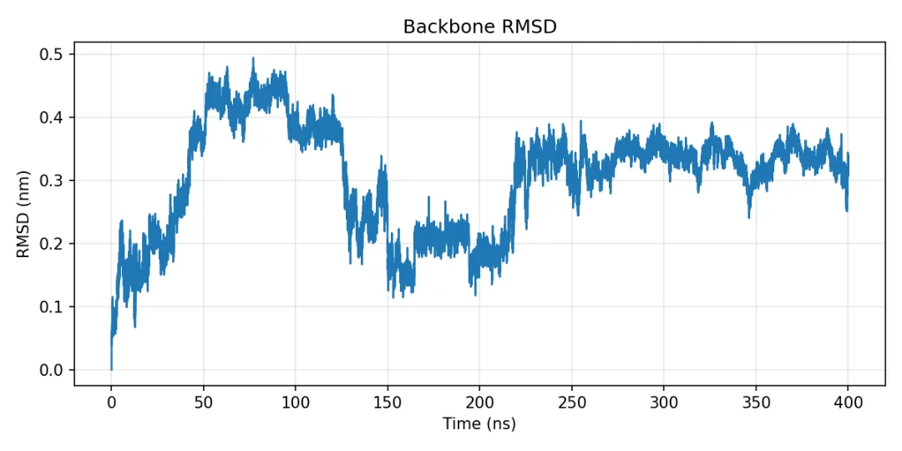

该曲线展示了蛋白的RMSD随着模拟时间的变化，通常认为 RMSD < 0.3 nm 表示结构稳定，0.3–0.5 nm 表示有局部构象变化，> 0.5 nm 表示较大构象转变。

RMSF分析

用于计算每个残基在模拟过程中的平均波动幅度，可以识别蛋白中柔性较高的区域和刚性区域。

  *

```
echo "Backbone" | gmx rmsf -s md_1.tpr -f md_1_noPBC.xtc -o rmsf.xvg -res
```

用python计算rmsf曲线

  *   *   *   *   *   *   *   *   *   *   *   *

```
import matplotlib.pyplot as pltimport numpy as npdata = np.loadtxt('rmsf.xvg', comments=['#', '@'])plt.figure(figsize=(10, 4))plt.plot(data[:, 0], data[:, 1], linewidth=1.2)plt.xlabel('Residue Number')plt.ylabel('RMSF (nm)')plt.title('Residue Fluctuation')plt.grid(True, alpha=0.3)plt.tight_layout()plt.savefig('rmsf.png', dpi=150)plt.show()
```

得到的结果如下图所示

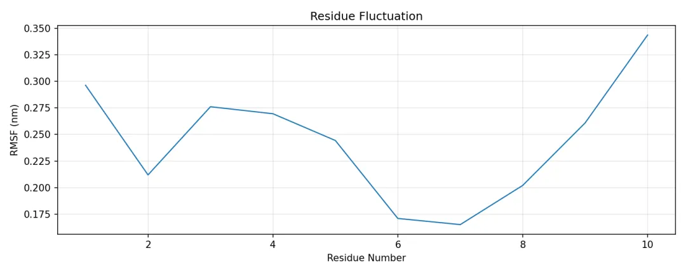

该曲线展示了蛋白质每个残基的rmsf，图中峰值对应柔性区域（如 loop 区、末端），谷值对应刚性区域（如 α-螺旋、β-折叠核心）。活性中心通常 RMSF 较低，说明结构刚性；底物结合口袋边缘可能 RMSF 较高。

rg分析（回旋半径）

命令输出的文件描述的是蛋白整体构象的紧凑程度，Rg 值越小，结构越紧凑；Rg 值增大则可能表示结构松散或去折叠。

  *

```
echo "Protein" | gmx gyrate -s md_1.tpr -f md_1_noPBC.xtc -o gyrate.xvg
```

用下面的python代码画出曲线：

  *   *   *   *   *   *   *   *   *   *   *   *

```
import matplotlib.pyplot as pltimport numpy as npdata = np.loadtxt('gyrate.xvg', comments=['#', '@'])plt.figure(figsize=(8, 4))plt.plot(data[:, 0], data[:, 1], linewidth=1.2, label='Rg')plt.xlabel('Time (ps)')plt.ylabel('Rg (nm)')plt.title('Radius of Gyration')plt.grid(True, alpha=0.3)plt.tight_layout()plt.savefig('gyrate.png', dpi=150)plt.show()
```

得到的结果如下图所示

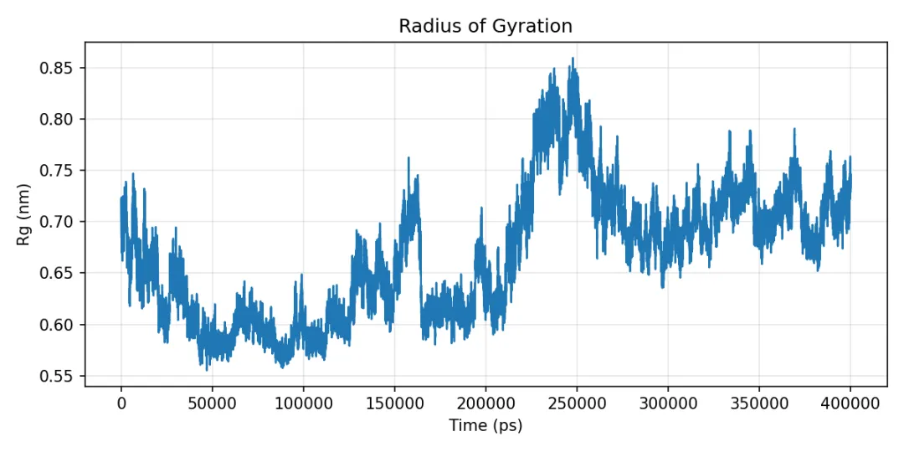

该曲线展示了蛋白随着时间改变的紧凑程度，曲线平稳说明蛋白紧凑度保持稳定，曲线持续上升说明蛋白可能去折叠或构象膨胀，曲线下降说明蛋白变得更紧凑（可能发生折叠或收缩）。

氢键分析

氢键分析可以统计模拟过程中氢键的数量和存在情况。对于蛋白体系，通常关注蛋白内部以及蛋白与配体之间的氢键。

  *   *

```
gmx make_ndx -f md_1.gro -o index.ndxgmx hbond -f md_1_noPBC.xtc -s md_1.tpr -n index.ndx -num hbn.xvg
```

命令先创建体系的分组，输入第二条命令后两次都输入Protein，即可以分析蛋白质内产生的氢键了。输入Protein和SOL即可分析蛋白质和水之间产生的氢键。

用下方的python计算曲线：

  *   *   *   *   *   *   *   *   *   *   *   *

```
import matplotlib.pyplot as pltimport numpy as npdata = np.loadtxt('hbnum.xvg', comments=['#', '@'])plt.figure(figsize=(8, 4))plt.plot(data[:, 0], data[:, 1], linewidth=1.2)plt.xlabel('Time (ps)')plt.ylabel('Number of H-bonds')plt.title('Intramolecular H-bonds in Protein')plt.grid(True, alpha=0.3)plt.tight_layout()plt.savefig('hbnum.png', dpi=150)plt.show()
```

得到的结果如下图所示

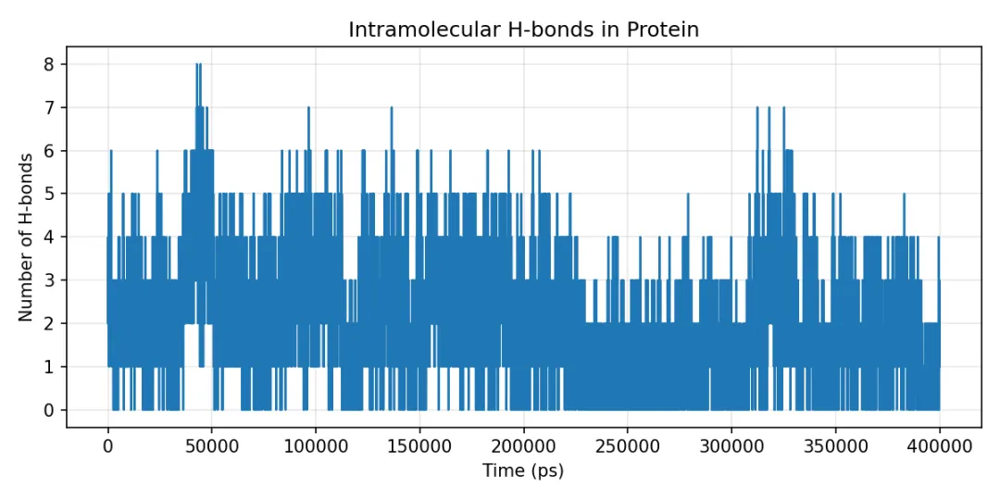

该曲线展示了蛋白质内部的随着模拟时间变化的氢键数量。氢键曲线在某个数值附近波动说明氢键网络稳定。氢键数量逐渐下降说明蛋白二级结构可能遭到破坏。氢键数量波动大说明蛋白柔性较高，或模拟时间不足。

**三、总结**

本教程从CUDA和GROMACS下载安装开始，经过蛋白加氢、冰晶生成、Packmol 体系搭建、拓扑自定义、离子中和，再到能量最小化、NVT/NPT 平衡和生产模拟，最后完成 RMSD、RMSF、Rg 和氢键分析——这套流程构成了冰水蛋白体系分子动力学模拟的完整闭环。只要每一步的体系分析判断指标（收敛、温度、压力、密度、势能、轨迹稳定性）都达到要求，就可以认为模拟结果可靠，可用于后续分析。

**四、资料领取**

本教程相关文件：

files文件内容如下：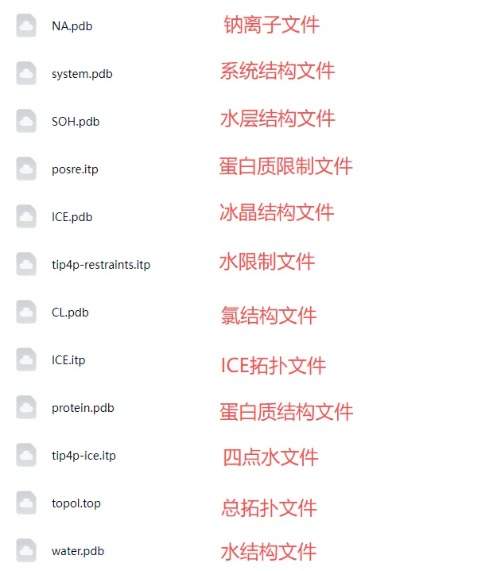

百度网盘链接: https://pan.baidu.com/s/1jQMhugixY9HpQ0ktfrpO5g

提取码可滴滴助手[Biomamba_zhushou]领取哦~

DavidXie


**欢迎致谢**

如果以上内容对你有帮助，欢迎在文章的Acknowledgement中加上这一段，联系客服微信可以发放奖励：
```
Since Biomamba and his wechat public account team produce bioinformatics tutorials and share code with annotation, we thank Biomamba for their guidance in bioinformatics and data analysis for the current study.
```

**欢迎在发文/毕业时向我们分享你的喜悦~**

**已致谢文章**

[ 鼻咽癌的Bulk RNA-Seq与scRNA-Seq联合分析](<https://mp.weixin.qq.com/s?__biz=MzAwMzIzOTk5OQ==&mid=2247510548&idx=1&sn=58048c46e837b1d56dffa282272c6d96&chksm=9b3cd344ac4b5a52369e91b4e61fa0a2c951b82cc21165b99f42ba2c2191d4add803bd73c928&scene=21&cur_album_id=3425248581018714114#wechat_redirect>)

[13分+文章利用scRNA-Seq揭示地铁细颗粒物引起肺部炎症的分子机制](<https://mp.weixin.qq.com/s?__biz=MzAwMzIzOTk5OQ==&mid=2247511886&idx=1&sn=31c712d00377b0f0ed33703b5b4fbfd8&chksm=9b3cd61eac4b5f084fde14a2eb50356f2f40a66c608d38909f12a3d81f48cff029a09ce2ee8c&token=1453608870&lang=zh_CN&scene=21#wechat_redirect>)

[除了铁死亡，还有铜死亡？！](<https://mp.weixin.qq.com/s?__biz=MzAwMzIzOTk5OQ==&mid=2247518144&idx=1&sn=d036f1bb04b09eb73f53e2104d69404c&chksm=9b3cfe90ac4b77862f2f463b42132c7bfdb687a1b61d350dcf656117b1331271e179710fd4fa&scene=21&cur_album_id=3425248581018714114#wechat_redirect>)

[IF14.3| scRNA-seq+脂质组多组学分析揭示宫内生长受限导致肝损伤的性别差异](<https://mp.weixin.qq.com/s?__biz=MzAwMzIzOTk5OQ==&mid=2247520900&idx=1&sn=157134292ffc2e5df730c5ba8a357b61&chksm=9b3cebd4ac4b62c286543c30381e9b4fdb8b44b28d4fa902fb963bbd45b28e1d3f1bc98eb148&scene=21&cur_album_id=3425248581018714114#wechat_redirect>)[银屑病和脂肪肝病中共同病理和免疫特征](<https://mp.weixin.qq.com/s?__biz=MzAwMzIzOTk5OQ==&mid=2247521069&idx=1&sn=4ef441a885cb2525ee3b5c81001feddf&chksm=9b3cea7dac4b636be9f10ffdf75e13531fccae62129944b21a457db2e08c3f2db1e1b553ac34&scene=21&cur_album_id=3425248581018714114#wechat_redirect>) [《Advanced Science》新型Arf1抑制剂促进癌症干细胞衰老并增强抗肿瘤免疫](<http://mp.weixin.qq.com/s?__biz=MzAwMzIzOTk5OQ==&mid=2247522233&idx=1&sn=287a380de741ff55f0ce78dc9c727985&chksm=9b3ceee9ac4b67ffd925abafeba2cb215a5984e6dc85f0d8607340a07ec9208f1d19eae0e04b&scene=21#wechat_redirect>)

[scRNA-seq揭示脓毒症预后水平预测的关键靶点！](<http://mp.weixin.qq.com/s?__biz=MzAwMzIzOTk5OQ==&mid=2247522281&idx=1&sn=f95eb12fdc340b8da1123ec6253e6fac&chksm=9b3ceeb9ac4b67afa587e5fa3a2a8960e9bb28a1ad6dc48e49120a76154417a4c8be95af90b0&scene=21#wechat_redirect>)

[机器学习+生信多组学联合构建牙周炎"线粒体功能障碍与免疫微环境"关联网络](<https://mp.weixin.qq.com/s?__biz=MzAwMzIzOTk5OQ==&mid=2247527168&idx=1&sn=0791d2bf53a9a60015577f892b10d370&scene=21#wechat_redirect>)

[KIF18A在肝细胞癌转移中的双重角色](<https://mp.weixin.qq.com/s?__biz=MzAwMzIzOTk5OQ==&mid=2247528014&idx=1&sn=d285c9ebd415be328fc682d00e6182c0&scene=21#wechat_redirect>)

[bulk+scRNA-seq挖掘BCL2-MAPK14-TXN氧化应激诊断模型，鉴定脓毒症中氧化应激关键基因](<https://mp.weixin.qq.com/s?__biz=MzAwMzIzOTk5OQ==&mid=2247530000&idx=1&sn=e8ddca4e1b2e60839cdf2a7fe87b3dfe&chksm=9b3c0f40ac4b86562e0e307b9dbb8688159e72b3c19d9ceebf8a4bb2e21638896f005b497b11&scene=21&cur_album_id=3425248581018714114&search_click_id=#wechat_redirect>)

[致谢文章+1，中科院1区，scRNA-seq揭示麻黄-甘草配对治疗呼吸系统症状和多(I:C)诱发肺炎模型机制](<https://mp.weixin.qq.com/s?__biz=MzAwMzIzOTk5OQ==&mid=2247536407&idx=1&sn=4da88e13f112662a02fea89d1b7798e9&scene=21#wechat_redirect>)

[致谢文章又+1，生物信息学+机器学习鉴定驱动糖尿病肾病免疫激活和小管间隙损伤的PANoptosis枢纽基因](<https://mp.weixin.qq.com/s?__biz=MzAwMzIzOTk5OQ==&mid=2247537544&idx=1&sn=6e5bb738eb11af53173f9fef67b977df&scene=21#wechat_redirect>)

[致谢论文+1，MXRA7在骨髓衰老中调控巨噬细胞极化与微环境重塑](<https://mp.weixin.qq.com/s?__biz=MzAwMzIzOTk5OQ==&mid=2247541265&idx=1&sn=1f6d654ad1c0e774756a982a455a9144&scene=21#wechat_redirect>)

[IF=15，生信基地作为作者单位的第一篇SCI：计算机设计CLDN4导向肽载纳米气泡](<https://mp.weixin.qq.com/s?__biz=MzAwMzIzOTk5OQ==&mid=2247541821&idx=1&sn=27235b32dda0a46efa1df58ca6a0cdbd&scene=21#wechat_redirect>)

向下滑动查看更多

欢迎大家致谢~


**如何联系我们**

 留一个领取[资料](<https://mp.weixin.qq.com/s?__biz=MzAwMzIzOTk5OQ==&mid=2247539170&idx=1&sn=ebd269635da35335554c53709fa0a0c0&scene=21#wechat_redirect>)、[开箱即用的单细胞分析镜像](<https://mp.weixin.qq.com/s?__biz=MzAwMzIzOTk5OQ==&mid=2247528410&idx=2&sn=0f2bac25479cf8d20dab5d82ae986f2e&scene=21#wechat_redirect>)的助手[Biomamba_zhushou]，方便各位随时交流。同时我们也构建了[交流群矩阵](<https://mp.weixin.qq.com/s?__biz=MzAwMzIzOTk5OQ==&mid=2247528057&idx=1&sn=bb348c2a88c977c7cce67ee6731a3591&scene=21#wechat_redirect>)，欢迎大家一起讨论。您点的每个赞和在看，我都认真当成了喜欢
