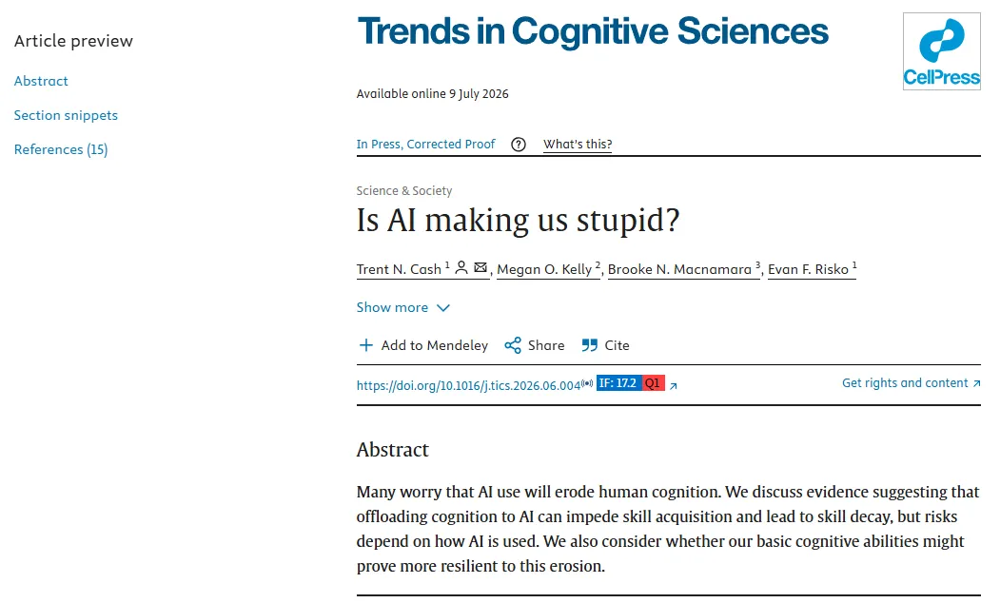
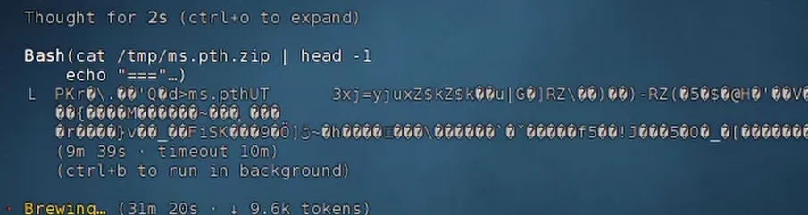
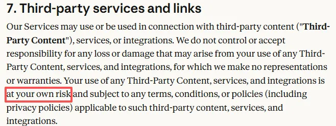
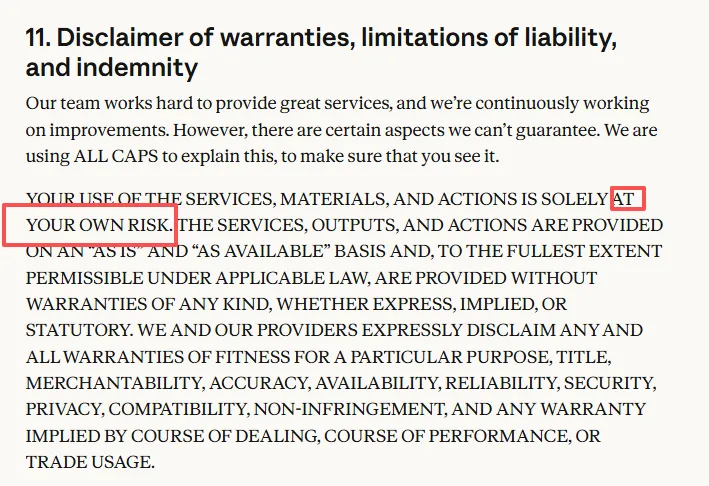
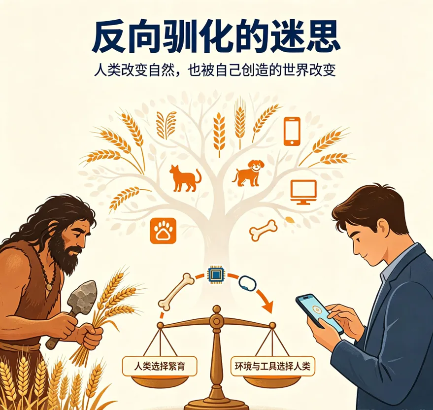
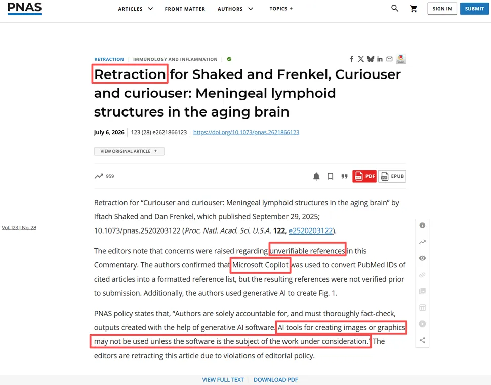
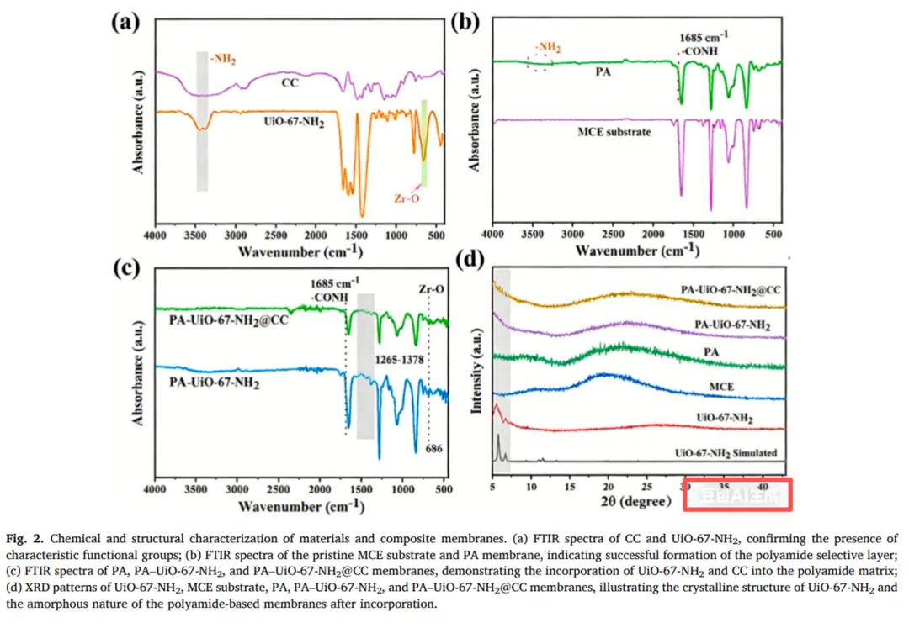
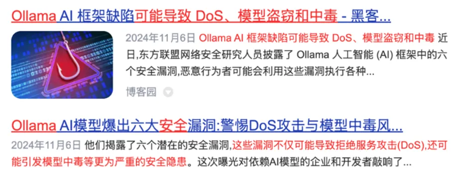
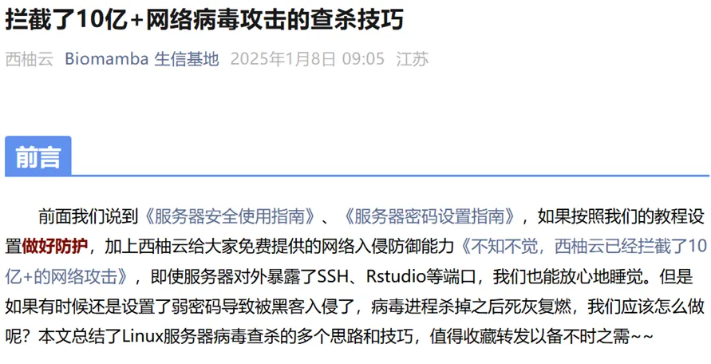

# 《PNAS》误用AI撤稿，不怕被坑，那就把所有工作都丢给AI就好了

> 原文：https://mp.weixin.qq.com/s?__biz=MzAwMzIzOTk5OQ==&mid=2247540791&idx=1&sn=310273e0de61c25bedbb5eb44321bb93&chksm=9b3c5967ac4bd071af4ce0819a6a14c0b8c083d99a7e813ef2beefd15f451c1219377c8f7cc9#rd
> 合集：AI时代，不用就会被淘汰

**一、AI不仅会让你变蠢，它也会犯错**

我们一直在坚持["古法"单细胞教学](<https://mp.weixin.qq.com/s?__biz=MzAwMzIzOTk5OQ==&mid=2247536584&idx=1&sn=45ce7503565a8e3905b3b21e1f8a41bd&scene=21#wechat_redirect>)。之前我们聊过，AI代替你去写作、编程、整理文件，会逐步剥夺你的思考能力，[“认知”卸载](<https://mp.weixin.qq.com/s?__biz=MzAwMzIzOTk5OQ==&mid=2247539732&idx=1&sn=9136ff3ad1f99cbd4e19ef4f96b11e9b&scene=21#wechat_redirect>)。现象是真实存在的[1]。考虑到AI幻觉依旧存在、大模型性能仍然有限。当你思维麻痹的时候，AI没准就会冷不丁的给你个惊喜，在Biomamba的实际工作过程中，一个简单的下载生信数据处理的场景中，居然还会写出cat **.zip的场景，显然，直接查看压缩文件未解码前的内容有点幽默了，一堆乱码能看出来个啥。还是那句话，不可尽信AI，Agent也会犯傻福。
事实上各家AI Agent也都有自己的免责声明，例如使用claude的过程中，无论自行操作材料、文件、服务或者面向第三方的服务，Anthropic都明确告诉你"at your own risk"(风险自担)。

**二、别被反向驯化**

土豆与玉米的野生祖先，本质上并不适配人类直接食用。野生马铃薯块茎含有高浓度龙葵素，具备毒性，生食会引发中毒；野生大刍草籽粒细小、果壳坚硬，籽粒产量极低，外壳难以剥离，无法作为稳定食物来源，二者最初都不属于可供人类大量取食的食物。经过数千年人工驯化，人类逐步筛选出低毒素的马铃薯品种，同时将外壳坚硬、籽粒稀疏的大刍草改造为穗大粒满的栽培玉米，把两种原本不宜食用的野生植物，转化为高产、耐贫瘠的主粮作物。

驯化完成之后，土豆、玉米走出美洲原产地，重塑了全球人类的地域分布格局。二者对土地条件适应性极强，玉米可以在山地、坡地等小麦水稻难以丰产的区域种植，土豆能够适应高纬度、高海拔寒冷贫瘠土地。欧洲高纬度山区、中国西南山地等传统粮食低产区域，因为引入这两类高产作物，粮食承载力大幅提升，能够供养更多人口，推动人口向过去难以定居的山地、高寒区域扩张定居，改变人群聚居地的地域版图，催生大规模人口增长，也间接驱动人口迁移与流动。

食物的大规模改变，进一步推动人类消化系统与饮食习惯发生协调进化。在数代人的持续食用过程中，人群肠道菌群发生适应性重塑，肠道微生物演化出更高效分解玉米、土豆淀粉的菌群谱系，提升对块茎、谷物淀粉的消化吸收效率。

所以，某种意义上来说，人类和农作物的协调进化，究竟是人驯化了作物，还是作物驯化了人？现在的AI同样有这样的问题，人类创造并使用AI来协助自己的工作，但是若长期以往的滥用，导致认知卸载，那究竟是人类驯化了AI，还是AI圈养了人类？

**三、AI有幻觉**

AI幻觉是指生成式人工智能生成看似合理但实际上虚构、错误、脱离上下文的信息。“一本正经地胡说八道”也常常存在，例如下面这篇PNAs，插参考文献用AI生成了很多根本就不存在的引用，直接GG，撤稿[3]。

**四、别让低级误用害了你**

还有更搞笑的，兰州大学发表的这篇膜科学期刊，Figure 2右下角赫然出现了一个豆包的水印。你说豆老师又不要作者位，你给人家留个水印干啥。现行的投稿逻辑还是不支持大家直接用AI生成图片和文章正文的，用的时候还是小心为上。

**五、AI模型部署存在安全漏洞**

在D老师总繁忙的年代，我们也尝试过用Ollama把DeepSeek部署到服务器中直接使用[总是服务器繁忙？一文教你部署本地DeepSeek，结果就是Ollama又漏洞，莫名其妙服务器被盗去挖矿。](<https://mp.weixin.qq.com/s?__biz=MzAwMzIzOTk5OQ==&mid=2247528007&idx=1&sn=a7f78a1fb63ee4bd7a014ee137790423&scene=21#wechat_redirect>)
也算是给我们累积了点防护技巧：[拦截了10亿+网络病毒攻击的查杀技巧](<https://mp.weixin.qq.com/s?__biz=MzAwMzIzOTk5OQ==&mid=2247526504&idx=1&sn=4ebfe72e195cb1d2097396648ae822db&scene=21#wechat_redirect>)

参考:1、https://www.sciencedirect.com/science/article/abs/pii/S13646613260013122、https://www.anthropic.com/legal/consumer-terms3、https://www.pnas.org/doi/10.1073/pnas.2621866123

**欢迎交流**

 留一个领取[资料](<https://mp.weixin.qq.com/s?__biz=MzAwMzIzOTk5OQ==&mid=2247532585&idx=1&sn=e265d2846ec66e5faaaf21403d274d2f&scene=21#wechat_redirect>)、[开箱即用的单细胞分析镜像](<https://mp.weixin.qq.com/s?__biz=MzAwMzIzOTk5OQ==&mid=2247528410&idx=2&sn=0f2bac25479cf8d20dab5d82ae986f2e&scene=21#wechat_redirect>)的助手[Biomamba_zhushou]，方便各位随时交流。同时我们也构建了[交流群矩阵](<https://mp.weixin.qq.com/s?__biz=MzAwMzIzOTk5OQ==&mid=2247528057&idx=1&sn=bb348c2a88c977c7cce67ee6731a3591&scene=21#wechat_redirect>)，欢迎大家一起讨论。
您点的每个赞和在看，我都认真当成了喜欢
