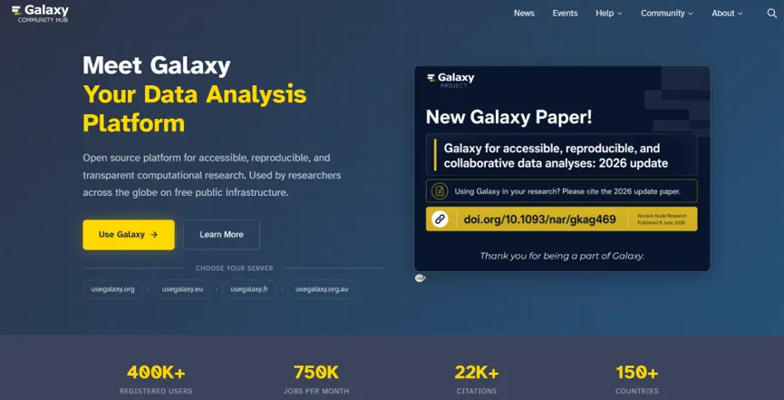
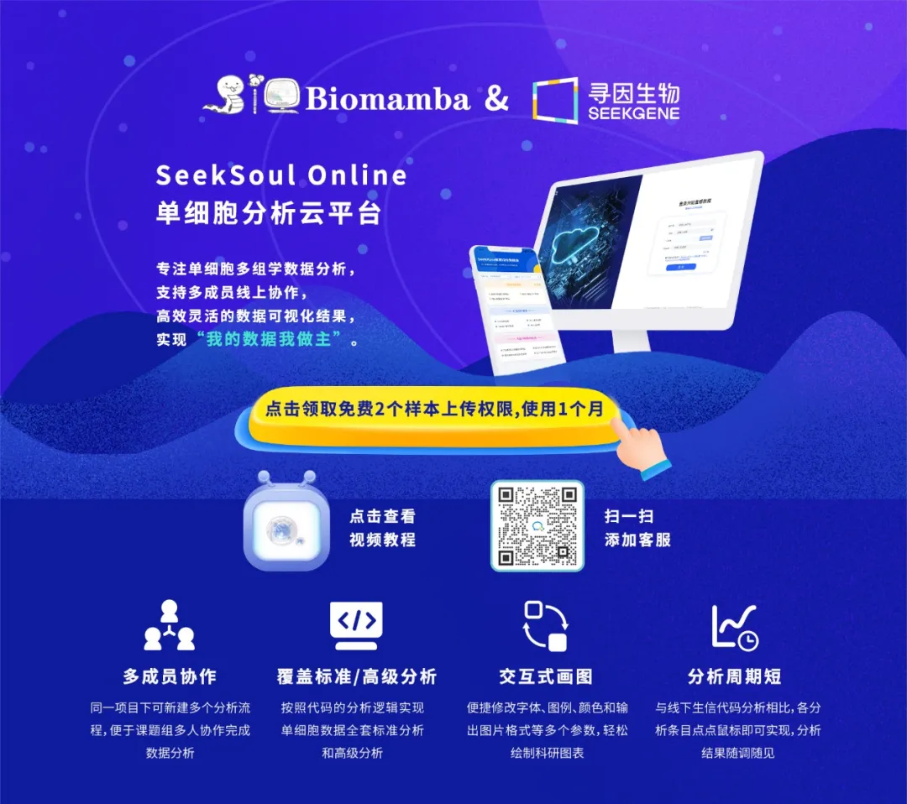

# Vibe coding盛行，生信GUI工具和零代码平台的路在何方？

> 原文：https://mp.weixin.qq.com/s?__biz=MzAwMzIzOTk5OQ==&mid=2247540981&idx=1&sn=24e80ac8b179dafd401c8bc6773faea8&chksm=9b3c59a5ac4bd0b38c1f808af2f02182be7ab0fad0c9ff0765ab794954cb1d0a56dd3a324762#rd
> 合集：AI时代，不用就会被淘汰

**一、AI对生信GUI工具/零代码平台的影响**

2021年，Biomamba曾分享过[Galaxy](<https://mp.weixin.qq.com/s?__biz=MzAwMzIzOTk5OQ==&mid=2247484148&idx=1&sn=acd3eb831d8d6061bff9b3e6a1e6dd5b&scene=21#wechat_redirect>)，当时它能把命令行里的组学分析流程搬进浏览器，上传数据、选择参数、点击运行，不会命令行的玩家也能完成一套分析。可以说是“云平台流”的早期玩家。

五年后的2026年，AI盛行，如：ChatGPT、[Codex](<https://mp.weixin.qq.com/s?__biz=MzAwMzIzOTk5OQ==&mid=2247539318&idx=2&sn=332e397d2ce4d0b0201987b681966f2f&scene=21#wechat_redirect>)、[Claude](<https://mp.weixin.qq.com/s?__biz=MzAwMzIzOTk5OQ==&mid=2247539308&idx=1&sn=c1b2915aac125f4fa31bd50ffb8b98b9&scene=21#wechat_redirect>)等通用AI已经能写[R](<https://mp.weixin.qq.com/s?__biz=MzAwMzIzOTk5OQ==&mid=2247528126&idx=2&sn=668c2709891956b567b316f9f2fb26ea&scene=21#wechat_redirect>)/[Python](<https://mp.weixin.qq.com/s?__biz=MzAwMzIzOTk5OQ==&mid=2247537399&idx=1&sn=d14c7987d1384fe133094748844b8d59&scene=21#wechat_redirect>)、解释参数、排查报错；[BioMNI](<https://mp.weixin.qq.com/s?__biz=MzAwMzIzOTk5OQ==&mid=2247539790&idx=1&sn=87a5ca957d3bd0e6cc6ee8df631e14a2&scene=21#wechat_redirect>)、GeneAgent、CellVoyager等科研智能体甚至能规划并执行完整科研级生物信息分析。既然自然语言已经可以“生成代码、运行流程、解释结果”；Galaxy、[SeekSoul Online](<https://mp.weixin.qq.com/s?__biz=MzAwMzIzOTk5OQ==&mid=2247510401&idx=1&sn=a616e5f1661bffff5afe3ed4b33b66e7&scene=21#wechat_redirect>)这样的生信GUI工具和零代码平台的路在何方？**
**

**这类平台还是有用武之地的，当下 需要的是"AI与GUI或零代码平台深度结合"：让 AI 负责理解分析需求、规划流程和辅助解读，让平台负责可靠执行、数据管理与结果复现，研究者把更多精力放在科学问题、关键决策和生物学意义上。再者说了，大部分Ai Agent只提供"智慧"，而不提供真正干活的算力([足够支持你完成硕博生涯的共享服务器](<https://mp.weixin.qq.com/s?__biz=MzAwMzIzOTk5OQ==&mid=2247540790&idx=2&sn=3e34a111e77e0cf29ee21b48a7940a9a&scene=21#wechat_redirect>))。所以不是“AI会取代GUI”，也不是“GUI永远不可替代”。真正发生的是一次分工重组：AI 正在拿走GUI最表层的价值，同时把可靠平台更深层的价值推到了前台**。

\- Biomamba

**二、AI替代的究竟是什么？**

传统生信GUI最直接的价值，是替用户隐藏命令行，让用户感觉是零代码。以前完成一次差异表达分析，研究者要[安装R](<https://mp.weixin.qq.com/s?__biz=MzAwMzIzOTk5OQ==&mid=2247533722&idx=2&sn=4730e67f215e607e7b6354cbd803b290&scene=21#wechat_redirect>)、配置Bioconductor、理解对象格式、修改脚本，还要处理依赖冲突。GUI把这些工作封装成表单：选择输入、填写参数、点击运行。

今天，通用AI可以按自然语言生成DESeq2、[Seurat](<https://mp.weixin.qq.com/s?__biz=MzAwMzIzOTk5OQ==&mid=2247540715&idx=2&sn=3cd1ae2f3bb66978317dc04097eef826&scene=21#wechat_redirect>)、[Scanpy](<https://mp.weixin.qq.com/s?__biz=MzAwMzIzOTk5OQ==&mid=2247534702&idx=1&sn=f1531163f8f620b59cf63dfaa1c03e67&scene=21#wechat_redirect>)或[CellChat](<https://mp.weixin.qq.com/s?__biz=MzAwMzIzOTk5OQ==&mid=2247501735&idx=2&sn=35fc792961507f4ae1cbae3a2882fba6&scene=21#wechat_redirect>)代码；遇到报错，还能继续修改。对熟悉研究问题、具备基本判断力的人来说，过去必须依赖网页表单完成的工作，确实可以转回代码环境。

因此，AI 首先淘汰的不是“平台”，而是“脚本被生硬的封装为网页”。
---

如果一个零代码工具的全部竞争力只是“免安装、免敲命令、一键出图”，它在2026年环境下实力很薄。尤其是单一功能的小工具：[火山图](<https://mp.weixin.qq.com/s?__biz=MzAwMzIzOTk5OQ==&mid=2247536970&idx=1&sn=9b51f3c942793be68dbaaa12e1ab39b4&scene=21#wechat_redirect>)、[热图](<https://mp.weixin.qq.com/s?__biz=MzAwMzIzOTk5OQ==&mid=2247530154&idx=1&sn=90de71a3b453e635920d309faedb36c7&scene=21#wechat_redirect>)、富集图、简单的表达量比较，AI生成代码往往更灵活，也更容易满足个性化修改，更不用严格的限定输入的文件格式。

但代码能生成，不代表分析就可靠。[AI容易出现幻觉，](<https://mp.weixin.qq.com/s?__biz=MzAwMzIzOTk5OQ==&mid=2247540791&idx=1&sn=310273e0de61c25bedbb5eb44321bb93&scene=21#wechat_redirect>)[《PNAS》误用AI撤稿，不怕被坑，那就把所有工作都丢给AI就好了](<https://mp.weixin.qq.com/s?__biz=MzAwMzIzOTk5OQ==&mid=2247540791&idx=1&sn=310273e0de61c25bedbb5eb44321bb93&scene=21#wechat_redirect>)：可能成功运行一段程序，却在不被察觉的地方读错了矩阵方向、混淆了基因ID、把技术重复当成生物学重复，或者采用了不适合当前实验设计的统计检验。生信分析最危险的错误，往往不是程序报错，而是程序顺利运行、图片也很漂亮，但回答了错误的问题。不知道自己不知道才是最可怕的。

**三、**五年了Galaxy依旧还在，它做对了啥？****

Galaxy 没有被 AI 取代。它正在从“鼠标点击的网页”，演变成“给人和 AI 共同使用的生信执行系统”，所以它活下来了。
---

2021年的Galaxy，核心还是经典的“三栏式”网页工作台：左侧找工具，中间填写参数，右侧History保存数据和结果。但随后五年，它并没有停留在工具表单。

2021~2022：无AI时代

Galaxy推出Remote Files，开始直接连接FTP、Dropbox、S3和其他远程文件源；随后加强大型History、dataset collection、批量操作、延迟取数、密钥管理和远程计算调度。它处理的对象，从“一个用户跑一个软件”变成了“大量样本、复杂任务和长期项目”。

2023~2024：流程管理、分享、归档

Galaxy重做Workflow Editor，加入条件步骤、工作流注释和更清楚的运行图；又支持RO-Crate、BioCompute Object等标准化导出。分析不再只是一次点击记录，而可以连同输入、参数、版本、工作流和元数据一起保存、交换和发表。

到2024年，美国、欧洲和澳大利亚主要公共Galaxy服务合计已超过50万注册用户。平台范围也从传统基因组学扩展到单细胞、空间组学、蛋白质组、代谢组、微生物组、成像、流式和机器学习。Galaxy任务，更像一个科研项目。

2025—2026：从“人操作GUI”转向“AI调用平台”

真正具有转折意义的是AI和MCP。Galaxy 26.0加入ChatGXY：用户可以直接询问工具、工作流、报错和教程；Vintent 可以把自然语言转成交互式可视化；[Jupyter](<https://mp.weixin.qq.com/s?__biz=MzAwMzIzOTk5OQ==&mid=2247531443&idx=2&sn=eb26532ba3998955bf46d9d9529ed8d9&scene=21#wechat_redirect>)Lite则让GUI、代码和AI辅助探索连接在一起。

Galaxy 26.1又内置MCP接口，使外部AI客户端可以搜索工具、检查 History和Dataset、运行工作流、监控作业并取得结果。到2026年，Galaxy 官方披露注册用户超过65万，主要公共服务器每月运行约200万个分析任务，Galaxy Training Network已有500多个免费教程。

**四、 寻因SeekSoul Online：垂直零代码平台的优势在哪里？**

云平台访问链接：https://seeksoul.online/t_static/Biomamba/Biomamba.html

Galaxy是开放、通用、社区驱动的科研基础设施；[寻因SeekSoul Online](<https://mp.weixin.qq.com/s?__biz=MzAwMzIzOTk5OQ==&mid=2247510401&idx=1&sn=a616e5f1661bffff5afe3ed4b33b66e7&scene=21#wechat_redirect>) 则是一条更垂直的路线：围绕[单细胞转录组](<https://mp.weixin.qq.com/s?__biz=MzAwMzIzOTk5OQ==&mid=2247538847&idx=1&sn=2ad605c6d70d4e6ee921fda1798bfd8b&scene=21#wechat_redirect>)、[空间转录组](<https://mp.weixin.qq.com/s?__biz=MzAwMzIzOTk5OQ==&mid=2247540874&idx=2&sn=e82c75a1a8b029644b2e4e98d373d10b&scene=21#wechat_redirect>)和[单细胞多组学](<https://mp.weixin.qq.com/s?__biz=MzAwMzIzOTk5OQ==&mid=2247540613&idx=1&sn=19c8c98bb46c8e3751a244ba57733c87&scene=21#wechat_redirect>)，提供标准分析、高级分析、可视化和配套服务。

平台能实现“不写代码也能做单细胞”。但在AI时代，单纯强调零代码已经不够。SeekSoul Online真正可能形成差异化的，是寻因在单细胞实验、样本处理、质控、细胞注释、项目交付和研究解释中积累的垂直经验。

一个通用AI可以生成[Seurat](<https://mp.weixin.qq.com/s?__biz=MzAwMzIzOTk5OQ==&mid=2247540715&idx=2&sn=3cd1ae2f3bb66978317dc04097eef826&scene=21#wechat_redirect>)代码，却未必知道某种组织为什么容易出现高背景RNA、某类细胞为何在特定解离条件下丢失、某个小群究竟是稀有亚群还是 doublet，也不知道平台历史项目中哪些阈值和流程更稳健。

寻因云平台需实现让AI成为平台内部的“研究意图解释层”：用户描述科学问题，AI检查数据和实验设计，生成结构化分析计划；平台调用经过验证的单细胞模块执行；在质控、批次校正、细胞注释、统计单位和高级分析等关键节点，要求用户或专家确认。

值得一提的是，[SeekSoulOnline也能写代码，你也能在其中快乐的使用Jupyter与AI。](<https://mp.weixin.qq.com/s?__biz=MzAwMzIzOTk5OQ==&mid=2247531443&idx=1&sn=5715568b395142a79f837b8f2bf0054f&scene=21#wechat_redirect>)

“单细胞AI平台”的护城河，不是模型本身，而是经过验证的流程、真实项目经验、专业数据、专家反馈和完整证据链。
---

**五、是继续被AI边缘化?在时代的浪潮又应该如何？**

2026年，普通研究者应该怎么选？1\. 如果你是生信初学者有时间型：可以先学习编程课程（[Linux](<https://mp.weixin.qq.com/s?__biz=MzAwMzIzOTk5OQ==&mid=2247505777&idx=1&sn=f3efae390566b838a445ab9f832323c8&scene=21#wechat_redirect>)、[R](<https://mp.weixin.qq.com/s?__biz=MzAwMzIzOTk5OQ==&mid=2247535038&idx=2&sn=717a8673a8bf82d5ac40af4441a07f65&scene=21#wechat_redirect>)、[Python](<https://mp.weixin.qq.com/s?__biz=MzAwMzIzOTk5OQ==&mid=2247537399&idx=1&sn=d14c7987d1384fe133094748844b8d59&scene=21#wechat_redirect>)），再跟着老师学习[R语言单细胞数据分析](<https://mp.weixin.qq.com/s?__biz=MzAwMzIzOTk5OQ==&mid=2247538847&idx=1&sn=2ad605c6d70d4e6ee921fda1798bfd8b&scene=21#wechat_redirect>)/[Python单细胞数据分析](<https://mp.weixin.qq.com/s?__biz=MzAwMzIzOTk5OQ==&mid=2247537658&idx=2&sn=f3adf25c6d116aa2fcc4ef6f9cc9bc2e&scene=21#wechat_redirect>)/[Python空间转录组数据分析](<https://mp.weixin.qq.com/s?__biz=MzAwMzIzOTk5OQ==&mid=2247540874&idx=2&sn=e82c75a1a8b029644b2e4e98d373d10b&scene=21#wechat_redirect>)/[单细胞多组学](<https://mp.weixin.qq.com/s?__biz=MzAwMzIzOTk5OQ==&mid=2247540613&idx=1&sn=19c8c98bb46c8e3751a244ba57733c87&scene=21#wechat_redirect>)课程，当然也可以自学哦~

无时间型：优先使用[SeekSoul Online ](<https://mp.weixin.qq.com/s?__biz=MzAwMzIzOTk5OQ==&mid=2247510401&idx=1&sn=a616e5f1661bffff5afe3ed4b33b66e7&scene=21#wechat_redirect>)、Galaxy等受控平台建立分析概念，同时用 AI 解释参数、术语和报错。不要一开始就让AI独立生成一套长代码并直接相信结果。平台能减少环境错误，但仍要学习实验设计、质控和统计基础。还可以带着[带着你的生信idea](<https://mp.weixin.qq.com/s?__biz=MzAwMzIzOTk5OQ==&mid=2247539480&idx=1&sn=9f1d8a76c0a5ddad4983c3fcf7620622&chksm=9b3c2248ac4bab5e30c2b38a268a6368663b32f530dbb46a15b66d4d3bca57ab417d61afc825&token=822465782&lang=zh_CN&scene=21#wechat_redirect>)来找我们，欢迎联系助手[Biomamba_zhushou]

2\. 如果你有一定 R/Python 基础

采用混合模式最合适：探索性分析（跟着[课程学习进阶分析](<https://mp.weixin.qq.com/s?__biz=MzAwMzIzOTk5OQ==&mid=2247536399&idx=2&sn=6c73155a0393ed9c246fee69cb06341f&scene=21#wechat_redirect>)）和个性化修改交给 AI 辅助代码；标准流程、大批量运行、团队协作和需要复现的分析交给 Workflow平台。不要为了“零代码”牺牲灵活性，也不要为了“全代码”重复搭建平台已经解决的基础设施。

2026年，GUI/零代码平台应该怎么如何？

结合AI，增加团队协作和流程沉淀

重点不应再是增加多少个网页模块，而应建设 AI 可调用的工具目录、结构化参数、版本控制、自动评测、预算限制、权限边界、人工确认点和结果证据链。

AI 会淘汰一批只负责“藏代码”的 GUI，却会成就一批能够“约束 AI、执行分析、保存证据”的科研平台。
---

真正的问题已经不是“还要不要 GUI”，GUI工具也可以嵌入AI内核，二者并不冲突。而是：当 AI 开始替我们操作工具时，我们是否拥有一个足够可靠的平台，能让它的每一步都看得见、查得到、跑得回？所以下期预告：同一份数据，分别交给零代码平台和AI分析，结果会有多大差异？谁更可靠？

**欢迎交流**

 留一个领取[资料](<https://mp.weixin.qq.com/s?__biz=MzAwMzIzOTk5OQ==&mid=2247539170&idx=1&sn=ebd269635da35335554c53709fa0a0c0&scene=21#wechat_redirect>)、[开箱即用的单细胞分析镜像](<https://mp.weixin.qq.com/s?__biz=MzAwMzIzOTk5OQ==&mid=2247536307&idx=1&sn=8d03259be06f54521aac5251dec988d5&scene=21#wechat_redirect>)的助手[Biomamba_zhushou]，方便各位随时交流。同时我们也构建了[交流群矩阵](<https://mp.weixin.qq.com/s?__biz=MzAwMzIzOTk5OQ==&mid=2247536307&idx=2&sn=2d030173f51d24a4fee43bd0d83da03b&scene=21#wechat_redirect>)，欢迎大家一起讨论。
您点的每个赞和在看，我都认真当成了喜欢
