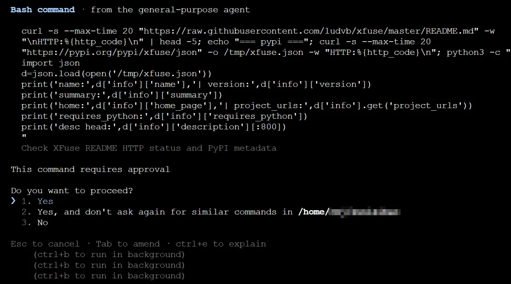
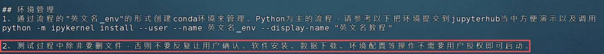
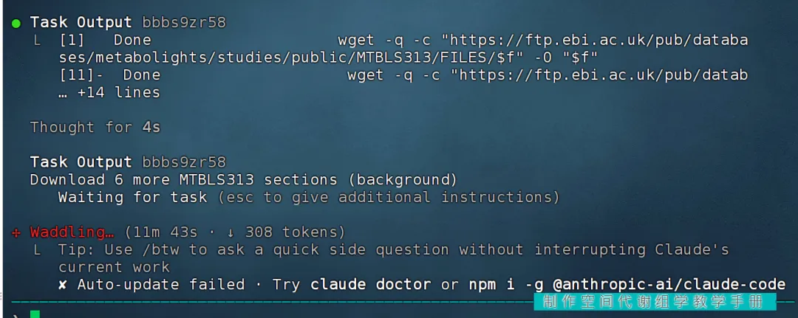
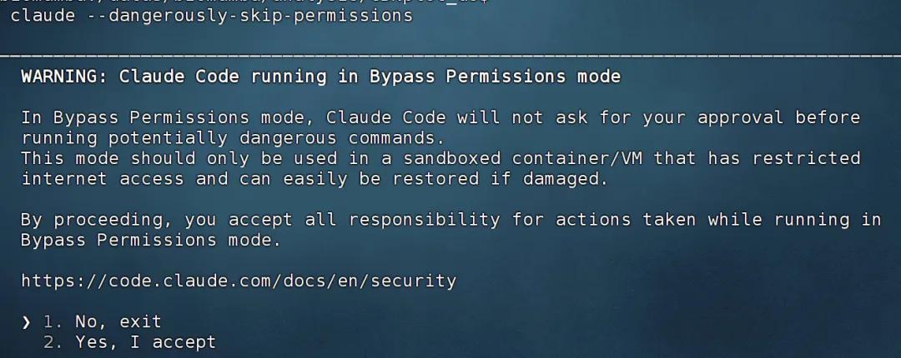
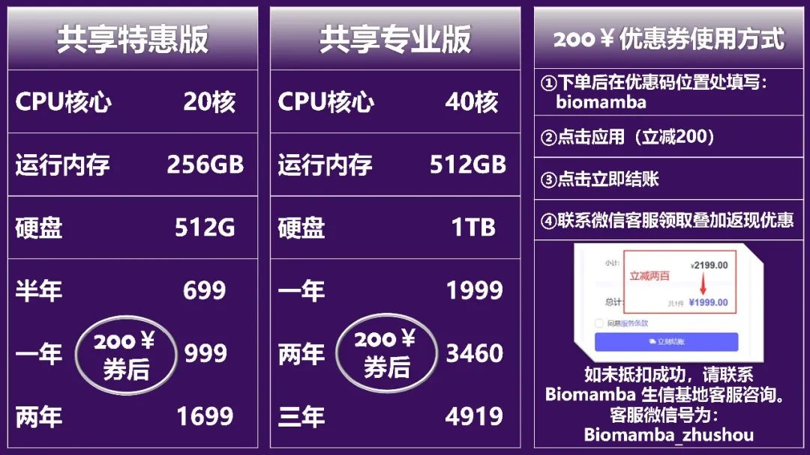
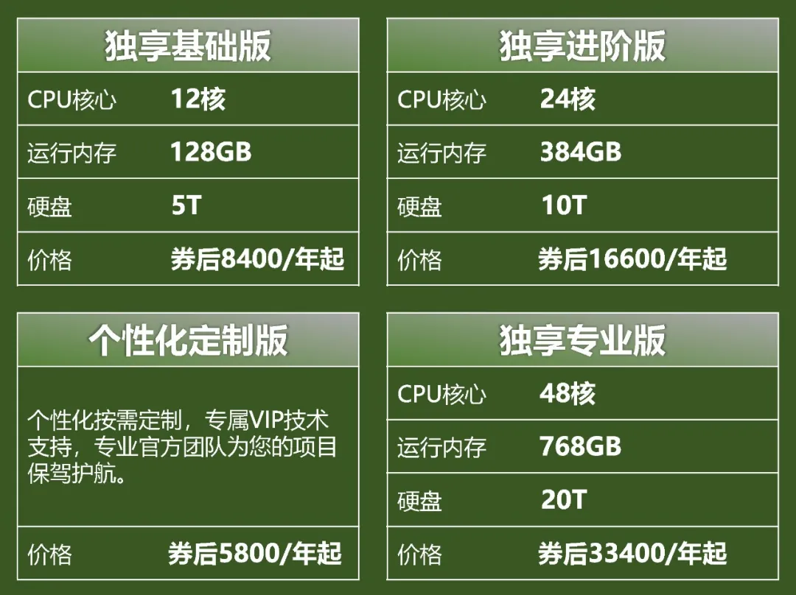

# 一招教你跳过Claude频繁请求确认，实测安全有效

> 原文：https://mp.weixin.qq.com/s?__biz=MzAwMzIzOTk5OQ==&mid=2247541434&idx=1&sn=17b7dd5922f5092d774a373f585dea8e&chksm=9b3c5beaac4bd2fc4798b595788547c3006a591ac2bc7533cde0cd84c18172e70037e6ccf280#rd
> 合集：AI时代，不用就会被淘汰

一、疯狂的approval请求

我们一直在尝试让AI Agent实质性参与生信教程、个性化分析，Claude算是我们常用的工具：

[直接让claude code帮我复现单细胞文章](<https://mp.weixin.qq.com/s?__biz=Mzk0ODQwNTU5NQ==&mid=2247488116&idx=1&sn=7a5628157f1aec2306e19e6c4e220108&scene=21#wechat_redirect>)

[试试D老师的单细胞代码分析能力怎么样](<https://mp.weixin.qq.com/s?__biz=MzAwMzIzOTk5OQ==&mid=2247538520&idx=1&sn=6858ae5260580c74fd46e658dbc4e49b&scene=21#wechat_redirect>)

[Codex复现单细胞论文实测（基于gpt‑5.6‑sol high）](<https://mp.weixin.qq.com/s?__biz=Mzk0ODQwNTU5NQ==&mid=2247488235&idx=1&sn=4b6216b968eeec945bd25b91df4334ed&scene=21#wechat_redirect>)

但实际使用过程中，相信大家会遇到一个最常见且头疼的问题，Claude经常会向你请求一些非常非常非常基础命令的权限。应该还是Anthropic怕背锅，万一写了点什么bug导致丢数据或者其它风险，它并不向替你承担。所以直接向你发起请求，哎，你用户自己确认的，发生点什么你可不能再怪我AI了。

如果需要[单细胞数据分析](<https://mp.weixin.qq.com/s?__biz=MzAwMzIzOTk5OQ==&mid=2247531160&idx=2&sn=04d3798dc60958af2c9020fe7c4bd9b8&scene=21&token=827157490&lang=zh_CN&poc_token=HLe6Q2mjR5L5stXqZGOdzOvf2Vk8eTYi05UUYRRy#wechat_redirect>)教学、生信热点[全文复现](<https://mp.weixin.qq.com/mp/appmsgalbum?__biz=MzAwMzIzOTk5OQ==&action=getalbum&album_id=2981710763847614469&token=827157490&lang=zh_CN#wechat_redirect>)、自测数据个性化分析辅导、[实验科研服务](<https://mp.weixin.qq.com/s?__biz=MzAwMzIzOTk5OQ==&mid=2247537678&idx=1&sn=578993fdfa060d38c80e2df6fc200c39&scene=21#wechat_redirect>)和[常态化实验学习](<https://mp.weixin.qq.com/s?__biz=MzAwMzIzOTk5OQ==&mid=2247539358&idx=2&sn=1c28c3a16370b1243285cd2c217f4969&scene=21#wechat_redirect>)，欢迎联系客服微信[Biomamba_zhushou]

二、设置json白名单与黑名单

我尝试过在skills里和claude约定“测试过程中除非要删文件，否则不要让用户确认。软件安装、数据下载、环境配置等操作不需要用户授权即可启动”，但显然没有用，我还是会遇到上面的问题。这是因为Skill/SKILL.md 属于“模型侧自然语言提示”，只能约束 AI “想做什么”；settings.json 是 Claude Code 底层原生“引擎硬权限”，真正控制工具能不能直接执行、要不要弹窗确认。所以skills里的模型文字约定无法绕过引擎底层的安全校验，所以不写JSON配置就一定会弹窗。



此时，你可以选择在~/.claude/settings.json里面加上配置，可以添加claude向用户请求时的黑名单和白名单，例如：

  *   *   *   *   *   *   *   *   *   *   *   *   *   *   *   *   *   *   *   *   *   *   *   *   *   *   *   *   *   *   *   *   *   *   *   *   *   *   *   *   *   *   *   *   *   *   *   *   *   *   *   *   *   *   *   *   *   *   *   *   *   *   *

```
{  "permissions": {    "allow": [      "Read(*)",      "Glob(*)",      "Grep(*)",      "Stat(*)",      "View(*)",      "Bash(ls)",      "Bash(ls -l*)",      "Bash(cat)",      "Bash(head)",      "Bash(tail)",      "Bash(pwd)",      "Bash(whoami)",      "Bash(df)",      "Bash(free)",      "Bash(top)",      "Bash(ps)",      "Bash(uname)",      "Bash(date)",      "Bash(wc)",      "Bash(sort)",      "Bash(uniq)",      "Bash(cut)",      "Bash(awk)",      "Bash(tr)",      "Bash(du -sh *)",      "Bash(md5sum)",      "Bash(python)",      "Bash(python3)",      "Bash(Rscript)",      "Bash(R)",      "Bash(samtools view)",      "Bash(samtools flagstat)",      "Bash(samtools stats)",      "Bash(bowtie2)",      "Bash(fastqc)",      "Bash(multiqc)",      "Bash(featureCounts)",      "Bash(vcftools --view)",      "Bash(bedtools intersect)",      "Bash(bedtools coverage)"    ],    "deny": [      "Bash(rm *)",      "Bash(rm -rf *)",      "Bash(sudo *)",      "Bash(eval *)",      "Bash(exec *)",      "Bash(chmod *)",      "Bash(chown *)",      "Bash(> *)",      "Bash(>> *)",      "Bash(mv *)",      "Bash(cp *)",      "Bash(ssh *)",      "Bash(scp *)",      "Bash(wget *)",      "Bash(curl *)"    ]  }}
```

亲测有效，例如下面这个wget命令就没有再跟我确认了：


注：json配置不能热加载，新配置的json文件只会在新的claude会话中生效，“老claude”会话窗口还是会沿用“老办法”

三、claude自带选项参数

大家还可以根据自己的实际使用中得体验，不断得在~/.claude/settings.json中修改白名单与黑名单。还有以下几种方式，也能让你的claude使用起来更“无感”一些：

1、Auto Mode /acceptEdits

只自动放行文件读写修改，shell 命令、高危操作依旧会确认，适合生信脚本、批量文件处理日常工作：

  *   *

```
# 启动直接启用claude --permission-mode acceptEdits
```

2、全量绕过（YOLO 模式，高风险、慎用！仅隔离测试容器/临时沙盒用）

白名单和自动放行也不能绕过所有请求确认，最直白的就是全局放过：

\--dangerously-skip-permissions，所有文件、shell、MCP 工具调用全部自动放行，不再确认，这是目前用过确认次数最少的模式了。

  *   *   *

```
claude --dangerously-skip-permissions# 一次性指令任务claude --dangerously-skip-permissions -p "运行这个生信R代码，输出图片"
```

你觉得自己有风险承受能力也可以设置成alias：

  *   *

```
echo "alias claude='claude --dangerously-skip-permissions'" >> ~/.bashrcsource ~/.bashrc
```

风险提示：

3、新版官方 Auto Mode（Anthropic 原生智能自动放行）

内置模型判断，安全操作自动过，高危自动拦截，不需要手动配置白名单

  *

```
claude --permission-mode auto
```

四、注意事项

注意注意注意（重说三）

不要在本地电脑、生产服务器、公共服务器、带敏感数据（测序原始数据、密钥、密码、.env）直接开全量 bypass，存在误删、恶意执行风险；生信测试容器、或隔离的环境内可以放心用。否则还是以配置~/.claude/settings.json的白名单、黑名单。

# 如果你需要一个能部署AI Agent的服务器

短平快，配置与价格见下图，详细介绍见[入手足够完成硕博生涯的生信环境](<https://mp.weixin.qq.com/s?__biz=MzAwMzIzOTk5OQ==&mid=2247530226&idx=2&sn=0522eb4eae67efeea2b96404474af611&scene=21#wechat_redirect>)、[独享用户连技术支持都是独享的](<https://mp.weixin.qq.com/s?__biz=MzAwMzIzOTk5OQ==&mid=2247529475&idx=1&sn=10827e982a637e0fc36e4b6e857736c8&scene=21#wechat_redirect>)、[RTX5090、4080S、5070显卡上机](<https://mp.weixin.qq.com/s?__biz=MzAwMzIzOTk5OQ==&mid=2247529840&idx=1&sn=704b0a3d60a17c5bc2445d54c97b834f&scene=21#wechat_redirect>)。随时滴滴**微信号[Biomamba_zhushou]咨询获取[教程](<https://mp.weixin.qq.com/s?__biz=MzAwMzIzOTk5OQ==&mid=2247505777&idx=1&sn=f3efae390566b838a445ab9f832323c8&scene=21#wechat_redirect>),也欢迎注册试用：https://biomamba.xiyoucloud.net/**[](<https://mp.weixin.qq.com/s?__biz=MzAwMzIzOTk5OQ==&mid=2247530226&idx=2&sn=0522eb4eae67efeea2b96404474af611&scene=21#wechat_redirect>)
[](<https://mp.weixin.qq.com/s?__biz=MzAwMzIzOTk5OQ==&mid=2247529475&idx=1&sn=10827e982a637e0fc36e4b6e857736c8&scene=21#wechat_redirect>)[](<https://mp.weixin.qq.com/s?__biz=MzAwMzIzOTk5OQ==&mid=2247529840&idx=1&sn=704b0a3d60a17c5bc2445d54c97b834f&scene=21#wechat_redirect>)


**欢迎交流**

 留一个领取[资料](<https://mp.weixin.qq.com/s?__biz=MzAwMzIzOTk5OQ==&mid=2247539170&idx=1&sn=ebd269635da35335554c53709fa0a0c0&scene=21#wechat_redirect>)、[开箱即用的单细胞分析镜像](<https://mp.weixin.qq.com/s?__biz=MzAwMzIzOTk5OQ==&mid=2247536307&idx=1&sn=8d03259be06f54521aac5251dec988d5&scene=21#wechat_redirect>)的助手[Biomamba_zhushou]，方便各位随时交流。同时我们也构建了[交流群矩阵](<https://mp.weixin.qq.com/s?__biz=MzAwMzIzOTk5OQ==&mid=2247536307&idx=2&sn=2d030173f51d24a4fee43bd0d83da03b&scene=21#wechat_redirect>)，欢迎大家一起讨论。您点的每个赞和在看，我都认真当成了喜欢
