# 都是自己人就是好办事，workbuddy可以蒸馏任何公众号

> 原文：https://mp.weixin.qq.com/s?__biz=MzAwMzIzOTk5OQ==&mid=2247542768&idx=1&sn=8633e07784d588918a29ce40609a6938&chksm=9b3c5ea0ac4bd7b6e79fe422f509cbac830da4c6c1df595dd2b080a389f0ac6c25fc567c6621#rd
> 合集：AI时代，不用就会被淘汰

**一、写在前面**

在很早之前我就有这个想法了，应该把生信基地的所有内容都蒸馏一下，只可惜用claude、codex等产品尝试时都失败了，因为它们都无法去抓取公众号页面的信息。但是，WorkBuddy出现就不一样了，毕竟大家都姓马，互通有无是应该的吧。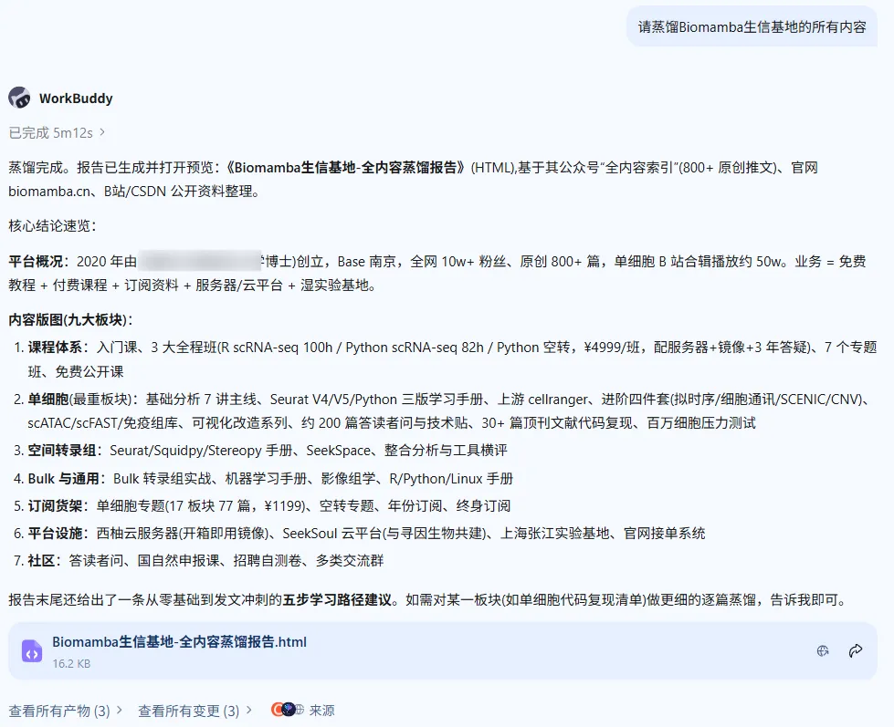
蒸馏出的报告大概这么个情况，大家可以自己注册一个试一试(阅读原文可直达)，理论上可以蒸馏任何公众号[1]。一代人有一代人的鸡蛋要领，注册领token：https://www.workbuddy.cn/events/invite?inviteCode=6o82rjr9r4i2csk7

# Biomamba生信基地 · 全内容蒸馏报告

基于其公众号「全内容索引」、官网 biomamba.cn、B站/CSDN 等公开渠道整理蒸馏。覆盖培训课程、单细胞、空间转录组、Bulk 转录组、编程语言、订阅资料、服务器与平台服务等全部板块。

📍 Base 南京（线下基地+上海张江实验基地）👤 运营主体：Biomamba 生信教学团队📅 创立：2020.02（公众号）→ 2024 注册公司📈 全网 10w+ 粉丝 / 点击量近千万 / 原创 800+ 篇

## 一、平台定位与生态全景

定位：降低生信学习门槛的"教学 + 科研服务"综合平台。核心业务矩阵如下：

**318+** 在线课程

**636+** 在线视频

**800+** 公众号原创内容

  * **教学培训**

：全程班 / 专题班 / 入门与编程语言班 / 公开课 / 线下基地集训
  * **免费教程**

：公众号推文 + B站视频（单细胞合辑播放量约 50w）+ CSDN/知乎/抖音/小红书
  * **付费订阅**

：年份订阅、单细胞专题、空间转录组专题、终身订阅（官网 biomamba.cn/materials）
  * **平台服务**

：西柚云服务器租售、SeekSoul Online 单细胞云平台（与寻因生物共建）、官网生信需求发布/工程师接单
  * **湿实验**

：Biomamba 实验基地（细胞培养、WB、qPCR、流式凋亡、免疫荧光）
  * **个性化分析**

：多组学分析、三代基因组组装、AI 分子设计（RFdiffusion / AlphaFold / 分子对接）

## 二、培训课程体系（核心付费产品）

层级| 课程| 要点
---|---|---
入门| 生信小白入门课（4h 回放）、R 语言入门、Python 入门| 零基础概念 + 编程语言起步
全程班
（约 2 个月学制，¥4999/班）| R 语言 scRNA-seq 小白全程班（约 100h）| Seurat V5 全流程 + 文献复现，完成复现可解锁结业证书
Python scRNA-seq 全程班（约 82h）| Scanpy 生态 + 文献复现
Python 空间转录组全程班| Squidpy / scanpy 空转全流程
专题班（短平快）| 基础分析 / 进阶质控 / 轨迹分析 / 细胞通讯 / 基因共表达网络 / 拷贝数变异 / 文献复现| 单项技能突破，每个专题配套理论自测题
公开课| Linux 保姆级教程、SeekSoul Online 云平台课、单细胞多组学全家桶（scFAST、scATAC、SeekSpace 空转、单细胞甲基化）| 免费视频

权益：全程班/专题班赠 3 个月高性能服务器（256G 内存 + 500G 盘 + 20 线程，预装"开箱即用"分析镜像），3 年答疑、永久回放、循环复听。技术栈覆盖见课程矩阵：上游（cellranger / seeksoultools / Space Ranger）、整合（Harmony / scVI / BBKNN）、轨迹（monocle / paga / palantir / scvelo）、通讯（CellChat / cellphoneDB / nichenet / Commot）、网络（SCENIC / pySCENIC / hdWGCNA / hotspot）、CNV（infercnv / copykat / SCEVAN / numbat）、去卷积（cell2location / tangram）、AI 注释（CellTypist / scVI）。

## 三、单细胞教程全收录（内容最重的板块）

### ① 基础分析主线（Seurat 系）

  * 《手把手教你做单细胞测序数据分析》1-7 讲：绪论 → 数据结构与读取 → 单样本分析 → 多样本整合 → 细胞类型注释（"从入门到入土"）→ 组间差异 → 基因集富集
  * scRNA-Seq 学习手册系列：**Seurat V4 修订版 / Seurat V5 更新版（2025 最新修订）/ Python 版** （扫描版 PDF + 订阅 HTML）
  * B站配套视频（建议"先视频后代码，至少三遍"）

### ② 上游 fastq 处理

  * cellranger、dropseqRunner、BD Rhapsody 定量流程与输出读取、10X Visium 上游定量、华大 C4 平台定量

### ③ 进阶分析四大专题

专题| 核心教程
---|---
拟时序 / 轨迹| monocle2（精简版/完整版）、monocle3、Slingshot、RNA velocity、orderCells 报错排查、下游可视化；"一文学会四种轨迹分析"
细胞通讯| CellChat 基础/多组别、iTalk、CellphoneDB、SeekSpace 空转通讯、CellChat 内存压测；"一文学会四种细胞通讯分析"
转录因子 / 共表达网络| SCENIC 全 9 讲（构建 regulon → AUCell 评分 → 二元矩阵 → 聚类降维 → 下游）、PySCENIC（快几十倍）、非模式物种流程、"一文学会四种基因共表达网络分析"、WGCNA（单细胞/空转）
拷贝数变异（CNV）| infercnv、copykat（含加速）、四种 CNV 方法横评、肿瘤细胞鉴定

### ④ 多组学扩展

  * **scATAC**

：学习手册、Signac 实操、SeekOne® DD 一胞双组学（4.6 万字长文）、seekarctools 定量
  * **scFAST 系列**

（单细胞全长转录组）：绪论→准备→fast 模块→Seurat 可视化→mut 模块，共 5 讲
  * **免疫组库**

：scTCR + scBCR 学习手册；**虚拟基因敲除** ：scTenifoldKnk；**NMF** ：GeneNMF 亚群分析；**甲基化** ：methylSig / Biseq WGBS 流程

### ⑤ 可视化改造计划（特色系列）

DimPlotFeaturePlotVlnPlotDotPlotDoHeatmap3D/动图降维图沉浸式统计细胞比例ggplot2 DIYComplexHeatmap 手册Figure 1 常见图表（含视频）

### ⑥ 技术贴 + 答读者问（约 200 篇实用问答）

  * 数据与性能：Seurat 对象/h5ad 格式转换大全、稀疏矩阵读取提速、SCTransform vs ScaleData、双细胞过滤、GEO 数据批量整理、加快 Seurat 计算、genesorteR（比 FindAllMarkers 快百倍）、pseudo bulk 差异分析
  * 坑与排错：Read10X 报错、CsparseMatrix_validate、monocle 报错、分辨率选择、以"**-"开头基因、无 barcode 文件读取、合并样本文件读取等
  * 方法论：GSVA/AUCell 基因集评分、Ro/e 分析、MOFA 多组学因子、CellOracle 调控网络、sc 与 sn 差异、十个单细胞数据库、Bulk 数据免疫浸润反卷积

### ⑦ 压力测试系列（硬核实测）

30w/100w 细胞内存占用实测、R 与 Python 百万细胞挑战、Monocle2 内存测试、硬件升级对比 —— 回答"做单细胞到底要什么配置"。

### ⑧ 文献代码复现（30+ 篇实战）

覆盖 Cell / Nature / Nature Communications / Cancer Cell / Developmental Cell / Nature Genetics 等期刊：胎肾注释、纤维化皮肤病、头颈癌免疫逃逸、中性粒细胞图谱、透明细胞肾癌微环境、结直肠癌 Visium HD+Xenium、急性心梗外周血、肝脏发育图谱、T 细胞图谱与耗竭、CellRank 重现等 —— 从图 1 到末图的完整复现。

### ⑨ 文献速递 / 领域跟踪

领域前沿阅读（肿瘤免疫微环境、肾脏/糖尿病、发育、神经、铁死亡/铜死亡、机器学习+多组学联合），以及"单细胞做到什么程度能毕业（硕士篇/博士篇）""哪些组织/物种已有 scRNA-seq 数据"等数据地图类文章。

## 四、空间转录组板块

  * **技术手册合辑**

：Seurat 空转、Scanpy(Squidpy)、Stereopy 空间转录组学习手册；10X Visium 上游定量；CellChat 空转通讯；SeekSpace（"会单细胞就会空间转录组"）；空转+单细胞整合分析、Tangram 深度学习整合、整合工具大比拼
  * **文献解读**

：时空转录组揭示大脑再生（Cell, Stereo-Seq）、空转平台挑选指南（Nature Methods）、空转做到啥程度能博士毕业、2024/2025 各组织/物种空转数据地图、基于 scRNA+空转的 AKI 研究等
  * **付费产品**

：Python 空间转录组全程班 + 空间转录组专题订阅

## 五、Bulk 转录组与通用技能

### 通用分析

  * Bulk RNA-seq 转录组实战（2024 订阅）
  * microRNA-靶标-疾病-药物关联分析
  * 影像组学学习手册
  * 机器学习基础手册（LASSO、随机森林、XGBoost、SHAP 等）
  * 单细胞药物敏感性预测（oncoPredict / beyondcell 虚拟筛药）

### 编程语言手册

  * R 语言基础学习手册、生信 Python 速查手册
  * 十小时学会 Linux
  * 基于深度学习的图像分类任务（Python 深度学习实践）
  * AI 接入分析：GPTCelltype 自动注释、AI 与搜索引擎对比等探讨

## 六、订阅资料体系（付费内容货架）

订阅类型| 内容
---|---
单细胞专题订阅（¥1199）| 17 个板块 77 篇万字手册（R/Python 分析、可视化、质控、轨迹、通讯、网络、CNV、scATAC、免疫组库、虚拟敲除、加速方案、药敏、NMF、TCGA 解卷积生存分析等），编译为带注释 HTML，持续更新
空间转录组专题订阅| 空转手册合辑与文献解读
年份订阅| 2023（含2022）/2024 龙年/2025/2026 订阅：R、Python、Linux 手册，机器学习、Bulk 转录组、影像组学、ComplexHeatmap、深度学习图像分类等
终身订阅（¥1999）/ 八年订阅| 2022–2029 全部资料自动更新

统计口径：4500+ 页精选内容、200+ 深度报告/指南。

## 七、平台与基础设施

### 服务器（西柚云·大禹系统）

  * 共享/独享服务器、工作站配置指南、实验室"生信不动产"
  * 卖点：正经 Linux、超融合存储、开箱即用分析镜像（教程环境一致，杜绝版本差异）、AI 无缝接入 RStudio、国际专线
  * 入口：biomamba.xiyoucloud.net

### 共建平台

  * **SeekSoul Online**

（与寻因生物）：单细胞云平台 + 《2 周学会单细胞生信全套分析》课程
  * **实验基地**

（上海张江）：细胞培养、WB、qPCR、流式凋亡、免疫荧光，免费线下培训常态化
  * **官网生信服务**

：需求发布 → 工程师接单 → 平台监督托管支付
  * **许愿池**

：用户提交想要的教程，官方实现（如拟时序流程）

## 八、社区与软性内容

  * **答读者问系列**

（20+ 期）：读者常见报错与概念问答，是单细胞技术贴的重要组成
  * **基金申报**

：生信基地第三课"手把手教你写国自然"、国自然申报秘籍（青椒医学大咖）
  * **漫谈/杂谈**

：单细胞前景、学习弯路、AI 与生信等话题
  * **社群矩阵**

：单细胞云平台群、影像组学群、国自然交流群、测序群、Linux 群、实验基地群等
  * **求职招聘**

：招运营、招生信工程师，附自测卷（入门级/B卷）作为筛选工具
  * **助推科研**

：多篇 Biomamba 助推合作论文发表（累计影响因子 100+）

## 九、蒸馏结论：学习路径建议

  1. **零基础**

：生信小白入门课（4h）→ R 或 Python 入门 → 十小时 Linux → 上服务器（免费学习版镜像）
  2. **单细胞入门**

：B站《手把手教你做单细胞测序数据分析》视频 + 《手把手 1-7 讲》推文，跑通 Seurat V5 单样本→整合→注释→差异→富集
  3. **进阶四件套**

：拟时序（monocle2/3）→ 细胞通讯（CellChat）→ SCENIC/pySCENIC → copykat/infercnv，各配"一文学会四种×××"横评文做索引
  4. **扩展组学**

：按需选 scATAC（Signac）、免疫组库、scFAST、空间转录组（Squidpy/SeekSpace）
  5. **冲刺发表**

：文献代码复现系列 + 压力测试选硬件 + TCGA 解卷积生存分析/药敏预测提升临床转化价值

免费内容（公众号+B站）已可覆盖完整学习链路；订阅与全程班的价值主要在：整理成册的 HTML 手册、答疑辅导、开箱即用环境与证书体系。

蒸馏自 Biomamba 生信基地公众号全内容索引、官网 biomamba.cn 及公开报道 · 整理日期 2026-09-13 · ·仅供学习参考

**二、蒸馏技能提示词**

显然这还不够，应该把我们的文献解读、分析教程做成skills，能用于大家以后的文献整理和分析工作中，自然是最妙的。这个时候我们就可以弄点专业的提示词：

  *   *   *   *   *   *   *   *   *   *   *   *   *   *   *   *   *   *   *   *   *   *   *   *   *   *   *   *   *   *   *   *   *   *   *   *   *   *   *   *

```
你是一位专注于单细胞/空间多组学/AI药物设计领域的资深生信研究人员，具备阅读高分文献、拆解方法学逻辑、提炼可复现分析流程的能力。请以"文献分享"类推送内容为输入，输出结构化蒸馏笔记"Biomamba文献阅读skills"，用于后续文献整理、课题设计。【输入】抓取Biomamba生信基地公众号"文献分享"系列推送全文（含标题、作者、期刊、摘要、图表解读、方法学拆解、代码/数据链接、编者点评）。【输出要求】按以下8个模块结构化输出，每个模块用二级标题标注，内容要可直接复用，不要泛泛而谈：1. 文献元信息   - 标题（中英文对照）、期刊、IF、发表时间、DOI   - 通讯/一作单位、研究方向   - 一句话核心结论（不超过50字）2. 科学问题与创新点   - 本文要解决的领域内具体痛点是什么   - 与既往工作相比，本文的3个核心创新点（方法学/生物学发现/数据集三方面分别提炼）   - 研究的临床/转化价值3. 实验设计与队列   - 样本类型（组织/细胞系/动物模型）、物种、数量   - 组学技术清单（scRNA-seq/scATAC/空间转录组平台/Bulk/ChIP等），标注各自平台与样本量   - 对照组/实验组设置逻辑4. 核心分析流程（重点）   - 从原始数据到最终结论的完整分析管线，按步骤列出   - 每个步骤使用的工具/软件/算法名称及版本（如Seurat v5、Harmony、CellPhoneDB v5）   - 关键参数与质控阈值（nFeature、nCount、MT%、聚类分辨率等，原文给出就写，没给出标注"原文未披露"）   - 细胞类型注释策略与参考数据集5. 关键结果与图表解读   - 按正文图（Figure1-6）逐张解读：这张图回答了什么问题、用了什么统计方法、核心结论是什么   - 突出可复现的图型与可视化方式（UMAP、小提琴图、气泡图、空间热图、轨迹图等）6. 数据与代码资源   - 数据存储库编号（GEO/SRA/ArrayExpress等）   - GitHub/分析代码链接   - 补充材料、网页工具、数据库访问方式7. 对我们工作的可借鉴点   - 哪些分析方法/策略可以直接迁移到我们当前课题   - 有哪些容易踩坑的细节（原文提到的注意事项）   - 这篇文章适合作为我们哪个章节的方法学参考8. 待深入学习/延伸阅读   - 本文引用的关键参考文献（3-5篇最相关的）   - 值得追踪的后续进展或争议点【风格要求】- 用中文输出，专业术语保留英文原文并括号注释中文- 不要堆砌原文句子，要做信息压缩与逻辑重组- 方法学细节要具体到参数和工具版本，不要用"使用了常见的单细胞分析流程"这类模糊表述- 如有原文中作者的评论/编者按，单独标注为【作者观点】
```

代码类推送蒸馏：

  *   *   *   *   *   *   *   *   *   *   *   *   *   *   *   *   *   *   *   *   *   *   *   *   *   *   *   *   *   *   *   *   *   *   *   *   *   *   *   *   *   *   *   *   *   *   *   *   *   *   *   *

```
你是一位具备R/Python双语言能力的生信工程师，熟悉Seurat、Scanpy、ArchR、CellChat、Monocle、SPARK、Giotto等主流生信工具链，能够把教程类代码拆解成可复现、可教学的结构化笔记。请以"代码分析"类推送内容为输入，输出结构化蒸馏笔记，用于后续数据分析复现、教程制作、代码模板沉淀。【输入】Biomamba生信基地公众号"代码分析"系列推送全文（含环境配置、数据准备、逐段代码、参数解释、结果图、常见报错与解决方法）。【输出要求】按以下9个模块结构化输出，代码块用```r或```python标注，注释清晰：1. 教程元信息   - 教程主题（如：Seurat单细胞标准流程、空间转录组去卷积、scATAC motif分析）   - 适用对象（入门/进阶/方法学开发）   - 软件环境与版本（R/Python版本、核心包版本、操作系统）   - 预计运行时间与硬件要求（内存/CPU/GPU）2. 学习目标与前置知识   - 学完本教程能解决什么具体问题   - 需要先掌握哪些前置知识/工具   - 最终产出物是什么（图/表/模型/报告）3. 环境搭建与数据准备   - 完整的环境安装命令（conda/pip/install.packages）   - 测试数据获取方式（下载链接、内置数据集、模拟数据）   - 输入数据格式说明（10x矩阵、h5ad、Seurat对象、CZI等）   - 数据预处理的第一步操作4. 核心代码流程（重点，按步骤拆解）   按分析步骤分小节，每节包含：   - 步骤目标（这一步要做什么）   - 完整可运行代码块   - 关键参数解释（每个非默认参数的含义、取值依据、调参建议）   - 预期输出（对象类型、维度、文件）   - 中间结果可视化代码（如有）5. 关键参数与调参指南   - 整理本教程中所有可调参数，做成表格：     | 参数名 | 所在函数 | 默认值 | 推荐取值 | 调参影响 |   - 哪些参数对结果影响最大   - 不同数据规模下的参数调整建议6. 结果解读与质控   - 每一步输出的图怎么看（如UMAP分群、小提琴图、热图）   - 哪些指标说明结果正常，哪些说明需要回退检查   - 常见的质控阈值与判断标准7. 常见报错与解决方案   - 原文提到的报错信息与解决方法   - 我补充：同类问题的排查思路（按报错关键词分类）   - 版本兼容性问题与降级/升级建议8. 可复用代码模板   - 把本教程中最常用的代码片段抽成函数/模板，加上输入输出注释   - 标注哪些部分可以直接复制到自己的项目中使用   - 给出一个最小可运行示例（minimal working example）9. 延伸与进阶   - 本教程方法的局限性   - 有哪些替代工具/算法可以对比   - 如何将本流程迁移到自己的数据上（迁移检查清单）   - 相关进阶教程/文献推荐【风格要求】- 代码必须完整可运行，不要省略关键行- 注释用中文，解释"为什么这么做"而不只是"做了什么"- 对原文中作者强调的注意事项、踩坑经验，用【⚠️ 注意】单独标注- 如原文有配套视频/数据集/镜像链接，统一放在末尾"资源链接"小节
```

**三、利用蒸馏skills做产出**

不知道为啥，workbuddy输出的skills是html文件格式的，不过不碍事，反正也是大模型去识别+产出。我们测试一下，这时告诉AI：请使用《Biomamba代码分析skills》复现这篇文章：“Single cell analysis in head and neck cancer reveals potential immune evasion mechanisms during early metastasis”；要求使用python。

# 真实数据复现结果报告

**Quah HS, Cao EY, et al. Single cell analysis in head and neck cancer reveals potential immune evasion mechanisms during early metastasis. Nat Commun 2023;14:1680**

数据：GSE188737（官方 Seurat 对象 → Python 解析）｜ 流程：scanpy 1.12.4 + Harmony + Leiden（R→Python 等价复现）｜ 跑批时间：2026-09-27，全程约 4 分钟，内存狗守护无异常

## 0 · 数据完整性核验

指标| 原文值| 本次复现| 结论
---|---|---|---
总细胞数| 53,459| 53,459| ✅ 完全一致
基因数| 23,148| 23,148| ✅ 完全一致
患者数| 7 对原发–淋巴结配对| 7（HN237/242/251/257/263/272/279）| ✅ 完全一致
每患者细胞数区间| 3,553–11,308| 3,553（HN242）–11,308（HN251）| ✅ 完全一致
位点构成| 原发 + 颈部淋巴结| P=22,780 / M=30,679| ✅ 与作者对象内注释一致

下载完整性：1,455,476,891 字节与 GEO Content-Length 逐字节一致，gzip 校验通过；rdata 解析后 counts 矩阵 58,189,778 个非零值。

## 1 · 全队列细胞图谱（53,459 细胞）

Python 流程（logNormalize → HVG 2000 → scale → PCA 50 → Harmony 按患者整合 → Leiden res=0.6 → UMAP）重建的 UMAP，按作者官方注释着色：

### 作者官方细胞类型（13 类）

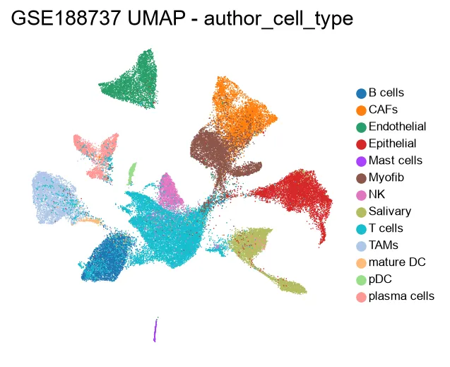

### 本次 Leiden 聚类（res=0.6）

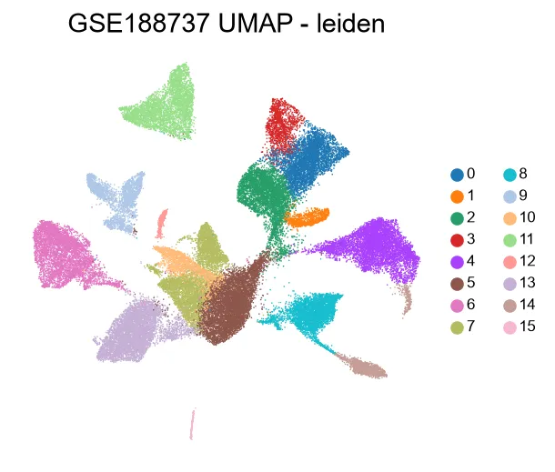

### 按位点（P 原发 / M 淋巴结）

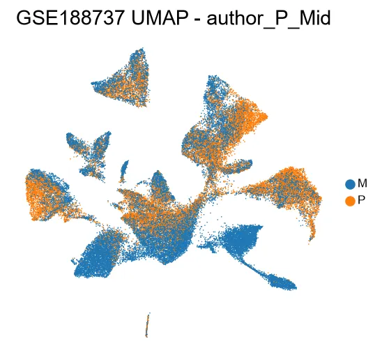

### 按患者

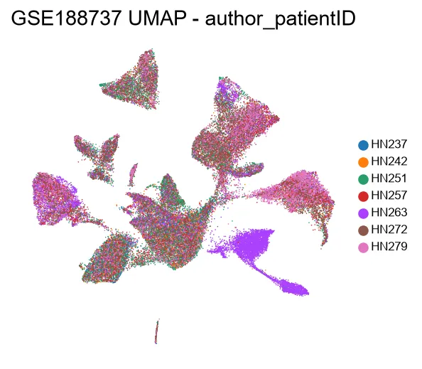

✅ 与原文 Fig.1 格局一致：上皮细胞呈明显患者特异性分团（恶性细胞的个体异质性），免疫/基质细胞跨患者混合良好——正是原文"恶性细胞不做跨患者整合"设计的原因。

### 我们的聚类 vs 作者注释的一致性（行归一化）

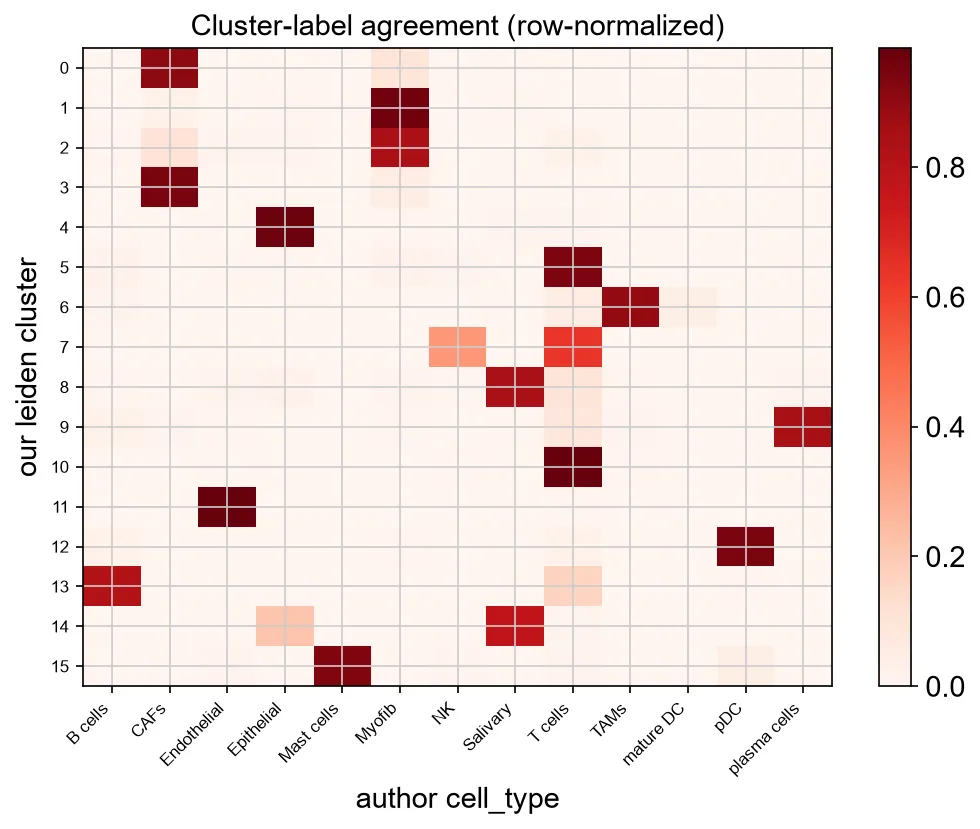

Leiden 聚类与作者 13 类细胞标签的平均最佳匹配纯度 = **0.888** ，Python 复现的分群与作者 Seurat 分群高度一致。

### 谱系 marker 点图

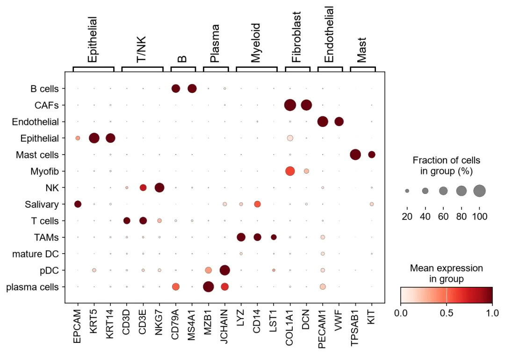

EPCAM/KRT 标记上皮、CD3D/E 与 NKG7 标记 T/NK、LYZ/CD14 标记 TAM、COL1A1 标记 CAF/Myofib、PECAM1/VWF 标记内皮、TPSAB1 标记肥大细胞——各类群 marker 表达模式与预期完全吻合。Salivary（正常涎腺上皮）表达 KRT5/KRT14 但免疫 marker 阴性，与原文将其单独归类一致。

## 2 · CD8⁺ T 细胞耗竭与 SOX4（复现原文 Fig.4 核心结论）

从作者注释的 13,049 个 T 细胞中按 CD8A/CD8B⁺ 且 CD4⁻ 圈定 **2,947 个 CD8⁺ T 细胞** （原文 CD8 亚群为 3,387，圈定策略不同属合理差异）。

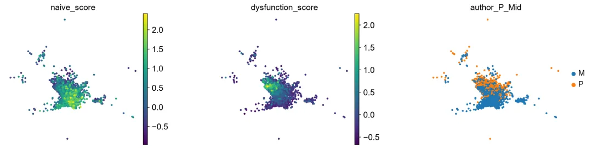

左：naïve 评分（IL7R/TCF7/LEF1/CCR7/SELL）；中：耗竭评分（TIGIT/HAVCR2/LAG3/PDCD1/TOX/CXCL13/ENTPD1）；右：位点。可见 naïve 与耗竭评分呈空间分离的两个极端，且高耗竭区在 M（淋巴结）中占比更高——与原文"淋巴结中 T 细胞功能失常更严重"一致。

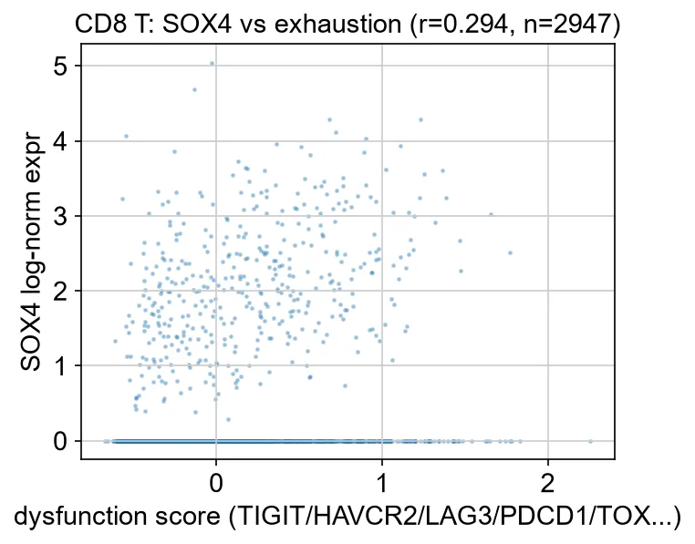

### SOX4–耗竭相关性

Pearson **r = 0.294** （n=2,947），显著正相关。

✅ 复现了原文最关键的机制结论之一：**SOX4 表达与 CD8⁺ T 细胞耗竭程度正相关** （原文通过轨迹调控分析+功能实验确立 SOX4 驱动 T 细胞耗竭）。

## 3 · 恶性上皮细胞：AXL 与 EMT（复现原文 Fig.2–3 方向性结论）

作者注释的 6,191 个恶性上皮细胞（原文终判恶性 6,115，差异为注释版本），按位点比较：

### EMT 评分 P vs M

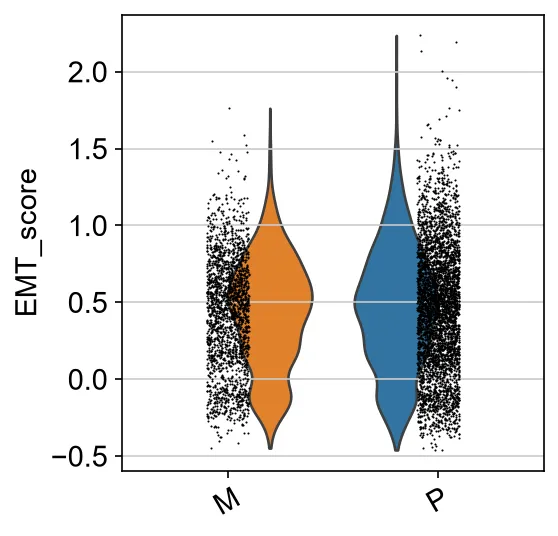

### AXL / AURKA / AURKB / MDK / SOX4 P vs M

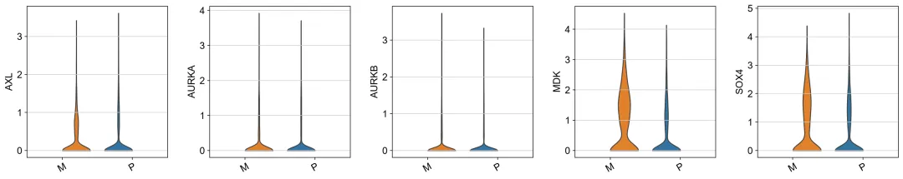基因| M（淋巴结）vs P（原发）logFC| 校正后 P| 解读
---|---|---|---
**AXL**|  +0.179| 6.7×10⁻⁷| ✅ 转移灶上皮中显著上调，与原文"AXL 驱动 pre-metastatic 表型、抑制剂可阻断侵袭"方向一致
AURKA| −0.044| 0.60（不显著）| ⚠️ 原文 AURK 信号存在于**原发灶内的小 pre-metastatic 亚群** （需轨迹分析才能显露），整体 P vs M 比较中被稀释属预期；分亚群分析需 monocle 轨迹（R 端）或后续 Palantir 复现
AURKB| +0.043| 0.22（不显著）

全量上皮差异表达表：`tables/DE_epithelial_P.csv` / `tables/DE_epithelial_M.csv`（wilcoxon，23,148 基因）。

## 4 · MDK（Midkine）免疫调节轴（复现原文 Fig.5–6 方向性结论）

### MDK 在各细胞类型中的表达

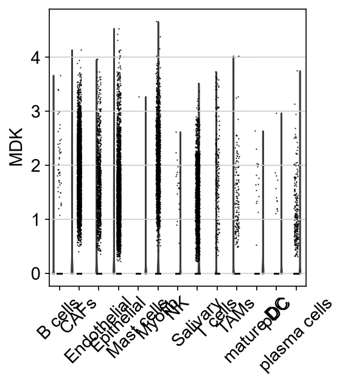

### MDK 在 UMAP 上的分布

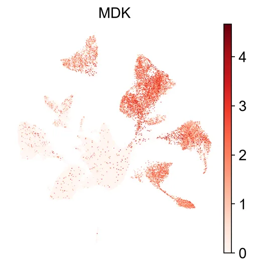

✅ MDK 高表达集中于上皮细胞团（恶性细胞是 Midkine 信号的主要发送方），与原文"pre-metastatic 肿瘤细胞经 MDK 通路作用于 CD8⁺ T 细胞、介导免疫逃逸"的发送方定位一致。配受体互作显著性检验（CellChat/liana）依赖 OmniPath 数据库，留待联网环境跑批。

## 5 · 本次跑批清单与环境

项目| 内容
---|---
输入| GSE188737_hnscc_seu.RData.gz（GEO 官方，1.46 GB，16 段并行下载+字节级校验）→ convert_seu_to_h5ad.py 解析为 h5ad
环境| 隔离 venv：python 3.13.12 + scanpy 1.12.4 + anndata 0.13.4 + harmonypy 0.0.9（纯 Python 版，新版需 C++ 编译不可用）+ psutil
流程| run_real_pipeline.py：normalize_total(1e4)+log1p → HVG(2000) → scale → PCA(50) → Harmony(patient) → neighbors(30/30PCs) → Leiden(0.6) → UMAP(0.3) + 下游 5 组分析
内存保护| 线程封顶 8 + MemGuard 步骤前检查 + 外部 watchdog 守护全程（系统可用内存阈值 4 GB），实际峰值平稳
耗时| 约 4 分钟（53,459 细胞全流程）
产物| figures/ 12 张 PNG、tables/ 5 个 CSV/JSON、GSE188737_processed.h5ad（529 MB，含 leiden/UMAP/作者注释）

⚠️ 诚实边界：本次复现覆盖「图谱重建 + 注释一致性 + SOX4 耗竭相关 + AXL/MDK 方向性结论」。原文的癌细胞 monocle 轨迹（132 基因面板）、Slingshot 双轨迹、CellChat 互作显著性、inferCNV/CopyKAT、scTCR 克隆结构、TCGA 生存验证六个模块为 R 端方法或需额外资源，Python 等价实现已在蒸馏笔记中给出（scFates/Palantir、liana、infercnvpy、scirpy、lifelines），可按需继续跑批。

请使用《Biomamba文献阅读skills》解读这篇文章：“Single cell analysis in head and neck cancer reveals potential immune evasion mechanisms during early metastasis”。解读生成的结果如下：

Biomamba 文献阅读 skills · 结构化蒸馏笔记(8 模块)

# 单细胞分析揭示头颈癌早期转移中的潜在免疫逃逸机制

## Single cell analysis in head and neck cancer reveals potential immune evasion mechanisms during early metastasis

Nature Communications (2023) 14:1680DOI: 10.1038/s41467-023-37379-yPMID: 369732612023-03-27 在线发表

1

## 文献元信息

项目| 内容
---|---
中文标题| 头颈癌单细胞分析揭示早期转移过程中的潜在免疫逃逸机制
英文标题| Single cell analysis in head and neck cancer reveals potential immune evasion mechanisms during early metastasis
期刊 / IF| Nature Communications,2023 年(IF≈14.7,JCR Q1 综合类)
发表时间| 收稿 2021-10-14;接收 2023-03-15;在线 2023-03-27
DOI / 编号| 10.1038/s41467-023-37379-y;Nat Commun 14:1680;PMCID: PMC10042873
作者 / 单位| Quah HS、Cao EY(共同一作)等;通讯:N. Gopalakrishna Iyer(新加坡国立癌症中心 NCCS / Duke-NUS 医学院,合作单位含 A*STAR 新加坡免疫学网络 SIgN)
数据编号| GEO: GSE188737(人 10x scRNA/scTCR-seq)、GSE225170(人源化小鼠)、GSE225331(Fluidigm C1 PDC);代码:Zenodo 10.5281/zenodo.7692887;浏览器:hnc.ddnetbio.com

一句话结论(≤50 字)对 7 对原发-淋巴结配对 HNSCC 行 scRNA/scTCR-seq,轨迹分析锁定 AXL/AURK 驱动的"转移前"癌细胞亚群,并发现其经 MDK 通路削弱 CD8+ T 细胞功能、介导早期转移免疫逃逸。

2

## 科学问题与创新点

### 痛点(Pain point)

  * 淋巴结转移是 HNSCC(头颈鳞癌)预后最差的事件,且早于远处转移;但多数研究聚焦终末转移与完全 EMT,而 bulk 分析提示 **EMT 并非淋巴结播散的必要前提** ——传统方法分辨率不足,找不到真正具有转移潜能的稀有亚克隆。
  * 淋巴结是 T 细胞启动、扩增与转运的主要器官,肿瘤如何在淋巴结内逃逸免疫杀伤、从而完成早期转移,机制不清。

### 三大创新点

① 方法学创新:配对采样 + 轨迹聚焦"会迁移的细胞"原发灶/颈部淋巴结配对取样(7 对 scRNA-seq + scTCR-seq),只对跨两个解剖位点迁徙的两类细胞(癌细胞、CD8+ T)重建进化轨迹(Monocle 2 / Slingshot + CytoTRACE + GeneSwitches),定义"转移前亚群"为原发灶中去分化评分前 25% 的细胞。

② 生物学发现:可成药的转移前驱动通路 + T 细胞功能障碍双轨迹转移前亚群由 AXL、AURKB、TYMS、STAT2 驱动,药物(BGB324、barasertib)可在患者来源培养物(PDC)中阻断侵袭;CD8+ T 存在 naïve→dysfunction 与 TRM→dysfunction 两条汇聚轨迹,SOX4 为耗竭关键调控因子。

③ 数据集 / 机制创新:MDK–NFKB1 免疫逃逸轴 + 人源化小鼠验证CellChat 互作组发现转移前细胞分泌 Midkine(MDK)作用于 CD8+ T 受体(ITGA4/ITGA6/ITGB1/NCL/LRP1),经 NFKB1 削弱 PD1 阻断的 T 细胞再激活;人源化 NOG-EXL 小鼠 scRNA-seq 体内证实。

### 转化价值

  * **AXL / AURK 为可成药靶点**

:bemcentinib(BGB324)已进入多项临床试验,直接衔接"抗转移辅助治疗"场景。
  * **MDK 阻断 + 抗 PD1 联用**

:为 ICB 原发/继发耐药提供联合用药假设。
  * **SOX4**

为 T 细胞耗竭的潜在干预节点(siRNA 敲低可降低 PD1+/CD39+ 群体)。

3

## 实验设计与队列

14

初治 HPV 阴性 HNSCC 患者

7 对

原发+淋巴结 scRNA/scTCR-seq

53,459

单细胞(23,148 基因)

7 例

成功建立原代培养 PDC

8 只

NOG-EXL 人源化小鼠

### 组学清单

组学 / 实验| 平台| 样本
---|---|---
scRNA-seq + scTCR-seq| 10x Chromium 5' V(D)J(GEX + TCR 富集),HiSeq 4000 151bp PE;CD45 磁珠分选后 CD45+:CD45− = 1:1 混合上机| 7 对原发灶 + 颈部淋巴结
Fluidigm C1 scRNA-seq| C1(10–17 µm IFC),STAR+RSEM→TPM| 7 对 PDC(1,317 细胞)
人源化小鼠 scRNA-seq| 10x(CD8+ 与肿瘤细胞 1:1 混合)| HN279 皮下瘤 ± pembrolizumab
功能实验| Boyden chamber 侵袭、划痕、克隆形成、FACS 分选、siRNA 敲低、MDK 抑制剂、ICC/IF、流式| PDC / REP-TIL / 健康 PBMC

### 对照逻辑

  * **空间对照**

:同一患者原发灶 vs 配对淋巴结转移灶(个体内部对照,控制遗传背景)。
  * **外部验证**

:Puram et al. HNSCC(GSE103322)与皮肤鳞癌 PD1 阻断前后队列(GSE123813)、TCGA HNSCC(xCell 反卷积 + 生存分析)。
  * **体内外互证**

:PDC 药敏(体外)→ NOG-EXL 人源化小鼠抗 PD1(体内)。
  * **CNV 恶性确认**

:inferCNV(同样本免疫/成纤维/内皮作参考)+ CopyKAT 复核(检出 HNSCC 特征性 7 号、8q 获得与 3p、5q 缺失)。

设计注意点全部为 HPV 阴性、局部晚期、初治患者——结论外推至 HPV 阳性 HNSCC 需谨慎;每患者回收 3,553–11,308 细胞,恶性上皮共 6,115 个。

4

## 核心分析流程(原始数据 → 结论)

新鲜组织快速处理→Cell Ranger 比对定量→QC + Seurat 整合聚类→inferCNV/CopyKAT 恶性确认→Monocle/Slingshot 轨迹→GeneSwitches 开关基因→CellChat 互作组→外部队列 + 湿实验验证

### 工具与版本(逐步)

步骤| 工具(版本)| 关键参数 / 说明
---|---|---
比对定量(人 10x)| Cell Ranger **v2.2.0**|  参考基因组 GRCh38
TCR 定量| Cell Ranger **v3.1.0**|  vdj_GRCh38_alts_ensembl-3.1.0 参考
C1 数据定量| STAR **v2.6.0** \+ RSEM **v1.3.0**|  hg19,输出 TPM
整合聚类| Seurat **v3.1.5**|  全细胞:CCA dims 1:30,k.filter=200,前 83 PC(JackStraw),resolution=0.6(clustree 选定),UMAP min.dist=0.3;恶性细胞不跨患者整合(肿瘤患者特异性),SCTransform,前 15 PC,res=0.5
恶性鉴定| inferCNV **v1.2.2** \+ CopyKAT **v1.0.8**|  >95% 上皮细胞携带 CNV
肿瘤细胞轨迹| Monocle **v2.16.0**(DDRTree)| 根节点 = 低 EMT 评分 + CytoTRACE 更分化的 state
干性 / 去分化评分| CytoTRACE **v0.3.2**|  转移前亚群 = 原发灶 CytoTRACE 前 25%(HN257 前 30%)
CD8 T 轨迹| Slingshot **v1.4.0**|  以 CXCL13-high/LAYN-high 耗竭群为终点,得两条汇聚轨迹
伪时序开关基因| GeneSwitches **v0.1.0**|  logistic 回归找轨迹上的转换基因
互作组| **CellChat**(版本原文未披露)| 转移前亚群 × 免疫细胞配体-受体分析
TCR 克隆型聚类| GLIPH(版本原文未披露)| CDR3 共有序列,跨患者共享克隆识别
通路 / 富集| PAGODA(scde **v1.99.2**)、GSEA **v4.1.0**|  C1 数据 pathway overdispersion;HALLMARK EMT 用 AddModuleScore 评分
其他| xCell(TCGA 反卷积)、NODES(PDC 差异表达,预印本)、FlowJo v10.5.3、inForm v2.4.2、ImageJ| —

### QC 阈值

  * **人 10x**

:去除线粒体 RNA >20%、基因数 <200、UMI >40,000 且基因数 >6,000 的细胞;上机前活率 >85%,目标回收 4,000–7,000 细胞/样本。
  * **NOG-EXL 小鼠**

:线粒体 >10%、基因数 <100 或 >7,000 剔除。
  * **C1**

:原始 counts <100,000、唯一外显子比对率 <10%、表达基因(TPM>1)<1,000 剔除。

### 注释策略

  * 粗注释:上皮(KRT7/KRT17)、唾液腺(STATH)、成纤维(COL1A2)、内皮(PECAM)、免疫(PTPRC);细分 CAF(MMP2)vs 肌成纤维(ACTA2),T(CD3E/NKG7)、NK(XCL2)、B(CD79A)、浆(IGHG1)、肥大(TPSAB1)、cDC(LAMP3)、pDC(LILR4)、巨噬/单核(CD163)。
  * T 细胞子集:剔除 IG/线粒体/RP-/RPL/RPS 基因后整合(k.filter=70,前 30 PC,res=0.8);CD8+ 提取依 CD4 零表达 + CD8A/B 阳性规则,细胞周期回归后二次整合。
  * 功能评分:naïve-like(IL7R+前 30 共表达基因)、dysfunction(TIGIT+前 30 共表达基因)、proliferation(S 与 G2M 均值)。

⚠ 纠偏提示(易写错)本文**未使用** SCENIC / CellPhoneDB / NicheNet / Palantir。互作组为 **CellChat** ;轨迹为 **Monocle 2(肿瘤)+ Slingshot(CD8 T)+ CytoTRACE(定根)** 组合。CellChat/GLIPH 具体版本原文未披露。

5

## 关键结果与图表解读(Fig 1–6)

主图共 6 幅(无 Fig 7);以下按原文结构概括,逐 panel 细节以原文为准。

### Fig 1|原发-淋巴结配对单细胞图谱

  * **回答问题**

:HNSCC 原发灶与淋巴结转移灶的整体细胞景观是否不同?
  * 53,459 细胞 / 14 例;原发灶富集 CAF 与 TAM,淋巴结灶富集 B 细胞、浆细胞、DC;inferCNV/CopyKAT 证实上皮群为恶性,且原发与转移灶 CNV 谱高度重叠(同源克隆播散)。图型:流程图 + UMAP + 组成条形图 + CNV 热图。

### Fig 2|癌细胞轨迹识别"转移前"亚群

  * **回答问题**

:原发灶中哪群细胞是淋巴结转移的"种子"?
  * Monocle 轨迹呈现三种演进模式(逐步有序 / 路径清晰但原发持续进化 / 无方向复杂型);GeneSwitches 锁定 AXLAURKBTYMSSTAT2,外部 Puram 数据复现;HN257 侵袭亚群高 SNAI2/高 EMT/高 CytoTRACE(132 上调基因富集氧化磷酸化,45 下调基因涉免疫逃逸),TCGA 中该特征对应更差生存(KM 曲线)。

### Fig 3|PDC 中 AXL/AURK 功能验证

  * **回答问题**

:轨迹预测的可成药靶点能否在患者来源培养物中阻断侵袭?
  * C1 平台 1,317 细胞;PAGODA 显示 EMT 为原发 vs 转移主区分通路。BGB324(AXLi,0.25 µM)显著降低 HN137 原发+转移细胞侵袭,且**仅抑制 AXL-high 分选亚群** ;barasertib(pan-AURKi)仅抑制 HN159/HN220 转移细胞侵袭;克隆形成无差异 → 抗侵袭而非杀伤效应。统计:侵袭面积 ImageJ 定量,组间 t 检验/ANOVA(以原文为准)。

### Fig 4|CD8+ T 细胞功能障碍双轨迹

  * **回答问题**

:肿瘤内 CD8+ T 如何走向失能?
  * 3,387 个 CD8+ T 分 6 群;Slingshot 得**两条汇聚轨迹** :① naïve→proliferative→dysfunctional(n=2,904);② TRM→dysfunctional(n=2,863)。GeneSwitches:早期 **KLF2 丢失** → 中期 NKG7 上升 → 晚期 SOX4DUSP4RBPJ 上升。

### Fig 5|SOX4 验证 + TCR 克隆结构

  * 外部数据复现 SOX4/RBPJ/DUSP4 在耗竭群高表达,且仅 SOX4、DUSP4 在 PD1 阻断后下降;siRNA 敲低 SOX4 → PBMC 中 CD57+/PD1+/CD39+ 群体减少,TIL 中 PD1+CD39+CD8+(推定肿瘤靶向)减少。
  * scTCR-seq:1,590 个独特克隆型,17.39% CD8+ 细胞克隆扩增(2–60);6/7 例原发-淋巴结克隆重叠,提出**克隆替代(clonal replacement)与克隆复兴(clonal revival)** 两种模型,并观察到双向迁移;GLIPH 显示跨患者共享克隆极少(126 簇中仅 5 个)。

### Fig 6|MDK 通路介导免疫逃逸

  * CellChat:转移前亚群分泌 MDK(Midkine),作用于 CD8+ T 受体 ITGA4/ITGA6/ITGB1/NCL/LRP1,3/3 例均为复发性免疫抑制通路(外部 p17 复现)。
  * MDK 抑制剂(100 nM,5 天)体外:CD8+ T 比例升高、panCK+/ki67+ 癌细胞减少;人源化小鼠抗 PD1 后增殖基因(AURKB/TOP2A)下调,但 **MDK/SNAI2/AXL/STAT2 等转移前表型不受 ICB 影响** ;表达 MDK 受体的 CD8+ T 在 pembrolizumab 后 dysfunctional 反升、proliferative 反降,dysfunctional 群中 NFKB1 上调且与 MDK 受体表达正相关 → **MDK–NFKB1 轴削弱 PD1 阻断疗效** 。

6

## 数据与代码资源

资源| 编号 / 链接| 内容
---|---|---
GEO GSE188737| ncbi.nlm.nih.gov/geo(GSE188737)| 人 10x scRNA-seq 原始数据 + Seurat 对象(7 对原发/淋巴结)
GEO GSE225170| GEO| NOG-EXL 人源化小鼠 ± 抗 PD1 scRNA-seq
GEO GSE225331| GEO| Fluidigm C1 PDC 单细胞数据
分析代码| Zenodo: 10.5281/zenodo.7692887| 全文分析脚本
交互浏览器| hnc.ddnetbio.com| Shiny app 在线探索数据
外部验证集| GSE103322(Puram HNSCC)、GSE123813(皮肤鳞癌 PD1 阻断)、TCGA HNSCC| 轨迹基因 / SOX4 / 互作通路复现
伦理| SingHealth CIRB 2014/2093、2018/2512、2016/2757;IACUC 161192、191496| —

7

## 对我们工作的可借鉴点

### 可直接迁移的方法组合

  * **"配对采样 + 只对迁徙细胞做轨迹"**

的设计范式:原发/转移配对后,不追求全图谱轨迹,而是聚焦跨位点细胞类型(癌细胞、CD8 T),显著降低轨迹噪声——适用于任何转移相关 scRNA 项目(如 CRC 肝转移、黑色素瘤淋巴结转移)。
  * **Monocle 2 + CytoTRACE 定根 + GeneSwitches 找开关基因**

三件套:根节点用"低 EMT + 更分化"双重标准而非主观指定;GeneSwitches(logistic 回归)比单纯沿伪时序差异基因更能定位"转换点"基因。
  * **转移前亚群的操作性定义**

:原发灶中 CytoTRACE 前 25% 细胞——可量化、可复现,适合在客服/教程中作为"稀有亚群鉴定"的标准案例。
  * **T 细胞双轨迹思路**

:Slingshot 以 CXCL13+/LAYN+ 耗竭群为终点反向推断,识别 naïve 来源与 TRM 来源两条耗竭路径;功能评分用"核心基因 + 前 30 共表达基因"的模块评分,比固定 gene list 更适配数据。
  * **互作组→体内验证闭环**

:CellChat 筛出配体-受体对后,在人源化小鼠(NOG-EXL + CD34+ HSC)+ ICB 处理下做 scRNA-seq,直接检验"该互作是否削弱免疫治疗"——是互作分析从"描述"走向"机制"的范本。
  * **恶性细胞双保险**

:inferCNV + CopyKAT 互相复核,并用癌种特征性 CNV(7/8q 获得、3p/5q 缺失)佐证。

### 踩坑细节

  * 恶性细胞**不做跨患者整合**(肿瘤患者特异性强,整合会抹掉个体信号);T 细胞整合前需剔除 IG/线粒体/RP-/RPL/RPS 基因并回归细胞周期。
  * CD45 分选后 1:1 混合 CD45+/CD45− 上机,平衡免疫与非免疫细胞比例——不做分选则上皮/免疫细胞比例严重失衡。
  * HN257 这类"原发灶 EMT 反而更高"的复杂模式提示:轨迹不是总能给出干净方向,**需预设多种演进模式框架** 而非强行拟合单一路径。
  * 药物验证要配克隆形成对照,区分"抗侵袭"与"细胞毒"效应;FACS 按靶点表达分选后再给药,是"亚群特异性药敏"最硬核的证据。

### 适合引用的章节(写综述/教程时)

  * 转移前亚群概念与 AXL/AURK 靶点 → 引 Fig 2–3;
  * T 细胞耗竭双轨迹与 SOX4 → 引 Fig 4–5;
  * MDK 免疫逃逸与 ICB 耐药 → 引 Fig 6 + 人源化小鼠实验;
  * HNSCC 单细胞图谱资源 → 引 GSE188737 + Shiny 浏览器。

8

## 待深入学习 / 延伸阅读

### 关键参考文献(3–5 篇)

  1. **Puram SV et al., Cell 2017**

(GSE103322):HNSCC 首个单细胞图谱,p-EMT 程序与转移关联——本文轨迹与互作分析的主要外部验证集。
  2. **Yost KE et al., Nat Med 2019**

(GSE123813):PD1 阻断前后皮肤鳞癌 scTCR-seq,克隆替代(clonal replacement)概念出处——本文 TCR 双模型的理论源头。
  3. **Gulati GS et al., Science 2020**

(CytoTRACE):去分化评分算法原文——理解"转移前亚群 = CytoTRACE 前 25%"定义的前提。
  4. **Jin S et al., Nat Commun 2021**

(CellChat):互作组推断工具原文,配体-受体-通路三层框架。
  5. **AXL 靶向临床背景**

:bemcentinib(BGB324)在 NSCLC/AML 等瘤种的 Ib/II 期试验系列报道,评估"抗转移辅助治疗"转化路径时必读。

### 值得追踪的科学问题

  * MDK–NFKB1 轴在 CD8+ T 细胞内的**下游信号机制**(NFKB1 是促存活还是促耗竭?本文停留在相关性)。
  * SOX4 调控耗竭的**直接靶基因与表观机制**(需 ChIP-seq/CUT&RUN 或 scATAC 验证);SOX4 与 TOX/NR4A 经典耗竭通路的关系。
  * 空间维度缺失:MDK 分泌细胞与受体+ CD8 T 是否在淋巴结内**空间共定位**?可用 Xenium/Visium 跟进。
  * 队列仅 HPV 阴性、样本量 7 对——HPV 阳性 HNSCC 是否共用同一转移前程序与 MDK 轴,需大队列验证。
  * "克隆复兴(clonal revival)"模型在更多瘤种中的普遍性,以及淋巴结作为 T 细胞"再训练场"的免疫学含义。

【作者观点】作者强调:本研究的价值不止于具体发现,更在于示范了"肿瘤异质性分析如何在早期转移窗口识别可干预的脆弱性"——即把单细胞图谱当作**靶点发现引擎** 而非纯描述工具。

**四、文件下载**

本文产出结果下载：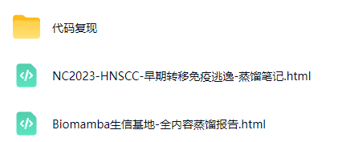

通过网盘分享的文件：都是自己人就是好办事，workbuddy可以蒸馏任何公众号

链接: https://pan.baidu.com/s/1W4y0_l3TjhMJwo_0UwpOKg

提取码请联系客服微信[Biomamba_zhushou]领取

给大家组建了AI生信交流群，欢迎加入：
参考：[1]https://www.workbuddy.cn/events/invite?inviteCode=out2i4pzqzx
[2]Quah HS, Cao EY, Suteja L, Li CH, et al. Single cell analysis in head and neck cancer reveals potential immune evasion mechanisms during early metastasis. Nat Commun. 2023 Mar 27;14(1):1680. doi: 10.1038/s41467-023-37379-y. PMID: 36973261; PMCID: PMC10042873.

**欢迎交流**

 留一个领取[资料](<https://mp.weixin.qq.com/s?__biz=MzAwMzIzOTk5OQ==&mid=2247539170&idx=1&sn=ebd269635da35335554c53709fa0a0c0&scene=21#wechat_redirect>)、[开箱即用的单细胞分析镜像](<https://mp.weixin.qq.com/s?__biz=MzAwMzIzOTk5OQ==&mid=2247536307&idx=1&sn=8d03259be06f54521aac5251dec988d5&scene=21#wechat_redirect>)的助手[Biomamba_zhushou]，方便各位随时交流。同时我们也构建了[交流群矩阵](<https://mp.weixin.qq.com/s?__biz=MzAwMzIzOTk5OQ==&mid=2247536307&idx=2&sn=2d030173f51d24a4fee43bd0d83da03b&scene=21#wechat_redirect>)，欢迎大家一起讨论。您点的每个赞和在看，我都认真当成了喜欢
