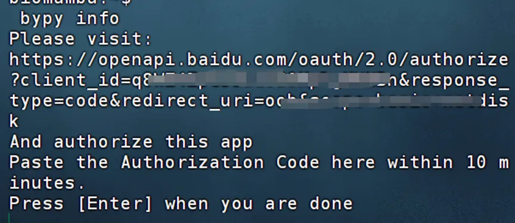
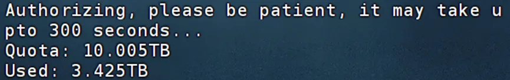
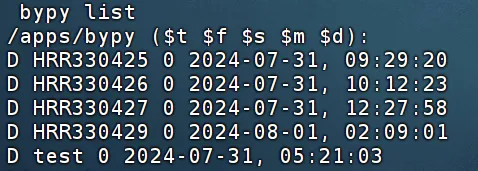
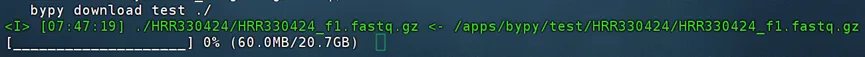

# Linux也有百度云喔~

> 原文：https://mp.weixin.qq.com/s?__biz=MzAwMzIzOTk5OQ==&mid=2247521009&idx=1&sn=06a9e3d1c7564992399ca1e4055dc293&chksm=9b3ceba1ac4b62b7d39ce16b55b272599a3f1491977dc9feb64ac114b8c0d7a0961603c0d556#rd
> 合集：答读者问


**一、写在前面**

经常有粉丝向我抱怨，为什么每次发放资料都用百度云，自己下载了一遍之后还得再上传一遍服务器才能分析。其实大家大可不必这么周转，百度云也有**Linux** 的发行版本，利用python包**bypy** 来管理/传输百度云盘资源也很方便(别问我为什么不用阿里云、腾讯云。。。，我用了这些还会有人提出相同的问题)。
如果你对下面的教程比较迷茫，那么你可以先行学习Linux教程：[十小时学会Linux](<http://mp.weixin.qq.com/s?__biz=MzAwMzIzOTk5OQ==&mid=2247505777&idx=1&sn=f3efae390566b838a445ab9f832323c8&chksm=9b3cae21ac4b2737f5923b246470d699474c041bb78de50d2b71b99d537f9f44ca2938002cda&scene=21#wechat_redirect>)
[生信Linux及服务器使用技巧](<https://mp.weixin.qq.com/mp/appmsgalbum?__biz=MzAwMzIzOTk5OQ==&action=getalbum&album_id=2980604042328702978#wechat_redirect>)
如果你的计算机不足以支持下面流程的计算，可按需选用适合自己的计算资源：共享(经济实惠)：[有root权限的共享服务器,报我名字立减200￥](<http://mp.weixin.qq.com/s?__biz=MzAwMzIzOTk5OQ==&mid=2247503869&idx=1&sn=142f8c7ba8620815a8770773df077f12&chksm=9b3cb6adac4b3fbb1acdf7593df06af5ac77d1fe9c0144c999de7109bd063b76080a33c50e0d&scene=21#wechat_redirect>)独享(省电省心)：[生信分析不求人](<http://mp.weixin.qq.com/s?__biz=MzAwMzIzOTk5OQ==&mid=2247508226&idx=1&sn=69e0eea720ac6aecc0362bcb9ac339ba&chksm=9b3cd852ac4b51445651a091be0fb6f638bd8cf5eb399af1c54804631fe3047706cf1d4044de&scene=21#wechat_redirect>)

[](<http://mp.weixin.qq.com/s?__biz=MzAwMzIzOTk5OQ==&mid=2247508226&idx=1&sn=69e0eea720ac6aecc0362bcb9ac339ba&chksm=9b3cd852ac4b51445651a091be0fb6f638bd8cf5eb399af1c54804631fe3047706cf1d4044de&scene=21#wechat_redirect>)实体(稳定高效)：[配置一个心仪的工作站(硬件+环境配置)](<http://mp.weixin.qq.com/s?__biz=MzAwMzIzOTk5OQ==&mid=2247519707&idx=1&sn=73dcab26f9b2ed75a954327317d07112&chksm=9b3cf48bac4b7d9df5b5a432fbe70d4f9c13bc8d739aa401732614f022223d1912642a7e4bea&scene=21#wechat_redirect>)

访问链接：https://biomamba.xiyoucloud.net/

更多内容可咨询客服微信[**Biomamba_kefu**]


**二、通过bypy使用百度云**

首先需要确保你的Linux环境中有python([生信Python速查手册](<http://mp.weixin.qq.com/s?__biz=MzAwMzIzOTk5OQ==&mid=2247499921&idx=1&sn=dcd6f95596e3de9bf378d850c217fe78&chksm=9b3cb9c1ac4b30d7bbd44057b181f87541f5904d24f903494ae557e768ae00c208c1b68b45c7&scene=21#wechat_redirect>))我这里的版本是3.10.0。

  *   *   *   *

```
# 安装bypypip install bypy# 配置账号密码：bypy info
```

会返回以下页面：
用浏览器访问上面提供的网址，登录自己的百度云盘账号：
授权后会返回授权码，复制授权码：回到终端粘贴授权码，回车后会自动配置百度网盘账号密码及初始设置，返回百度云盘的存储信息，下面的信息会与各位的windows客户端相一致：

配置好之后，在Windows客户端会多出这么一个文件夹，这个文件夹就是Linux和windows交换文件的桥梁：
在Linux终端使用百度云，大家就得使用命令行啦，最常用的是：1、查看目录下包含哪些内容：

  *

```
bypy list
```



/apps/bypy/即为bypy访问的根目录

2、上传文件

  *

```
bypy upload /path/to/local/file /remote/path
```

3、下载文件

  *

```
bypy download /remote/path /path/to/local/file
```

假如我在“我的网盘/我的应用数据/bypy”下有一个名为test的文件夹，我希望把它下载到我的家目录中，那么我应该：

  *

```
bypy download test /home/biomamba
```

下载时也会有进度条：



大文件建议大家挂载在后台下载：[程序可以自己跑的，不用盯着](<http://mp.weixin.qq.com/s?__biz=MzAwMzIzOTk5OQ==&mid=2247511096&idx=1&sn=14191291fa6fbdb625b9601d230509f7&chksm=9b3cd568ac4b5c7e77ef9c3bf2970902e77d96474cc2ce36b14f406824c5363bb4c0b754306f&scene=21#wechat_redirect>)

更多用法：

  *   *   *   *   *   *   *   *   *   *   *   *   *   *   *   *   *   *   *   *   *   *   *   *   *   *   *   *   *   *   *   *   *   *   *   *   *   *   *   *   *   *   *   *   *   *   *   *   *   *   *   *   *   *   *   *   *   *   *   *   *   *   *   *   *   *   *   *   *   *   *   *   *   *   *   *   *   *   *   *   *   *   *   *   *   *   *   *   *   *   *   *   *   *   *   *   *   *   *   *   *   *   *   *   *   *   *   *   *   *   *   *   *   *   *   *   *   *   *   *   *   *   *   *   *   *   *   *   *   *   *   *   *   *   *   *   *   *   *   *   *   *   *   *   *   *   *   *   *   *   *   *   *   *   *   *   *   *   *   *   *   *   *   *   *   *   *   *   *   *   *   *   *   *   *   *   *   *   *   *   *   *   *   *   *   *   *   *   *   *   *   *   *   *   *   *   *   *   *   *   *   *   *   *   *   *   *   *   *   *   *   *   *   *   *   *   *   *   *   *   *   *   *   *   *

```
positional arguments:  command              operations (quota,                       list, etc)
options:  -h, --help           show this help                       message and exit  -V, --version        show program's                       version number and                       exit  -d, --debug          set debugging level                       (-dd to increase                       debugging level,                       -ddd to enable HTPP                       traffic debugging as                       well (very                       talkative))                       [default: 0]  -v, --verbose        set verbosity level                       [default: 0]  -r RETRY, --retry RETRY                       number of retry                       attempts on network                       error [default: 5                       times]  -q, --quit-when-fail                       quit when maximum                       number of retry                       failed [default:                       False]  -t TIMEOUT, --timeout TIMEOUT                       network timeout in                       seconds [default:                       300]  -s SLICE, --slice SLICE                       size of file upload                       slice (can use                       '1024', '2k', '3MB',                       etc) [default: 20                       MB]  --chunk CHUNK        size of file                       download chunk (can                       use '1024', '2k',                       '3MB', etc)                       [default: 20 MB]  -e, --verify         verify upload /                       download [default :                       False]  -f, --force-hash     force file MD5 /                       CRC32 calculation                       instead of using                       cached value  --no-resume-download                       resume instead of                       restarting when                       downloading if local                       file already exists                       [default: True]  --include-regex INCREGEX                       regular expression                       of files to include.                       if not specified                       (default),                       everything is                       included. for                       download, the regex                       applies to the                       remote files; for                       upload, the regex                       applies to the local                       files. to exclude                       files, think about                       your regex, some                       tips here: https://s                       tackoverflow.com/que                       stions/406230/regula                       r-expression-to-                       match-string-not-                       containing-a-word                       [default: ]  --on-dup ONDUP       what to do when the                       same file / folder                       exists in the                       destination:                       'overwrite', 'skip',                       'prompt' [default:                       overwrite]  --no-symlink         DON'T follow symbol                       links when uploading                       / syncing up  --disable-ssl-check  DON'T verify host                       SSL cerificate  --cacerts CACERTS    Specify the path for                       CA Bundle [default:                       None]  --mirror MIRROR      Specify the PCS                       mirror (e.g.                       bj.baidupcs.com.                       Open 'https://pcs.ba                       idu.com/rest/2.0/pcs                       /manage?method=listh                       ost' to get the                       list) to use.                       [default:                       pcs.baidu.com]  --select-fastest-mirror                       Let the program run                       some tests and                       select the fastest                       PCS mirror it                       detectes. [default:                       False]  --rapid-upload-only  only upload large                       files that can be                       rapidly uploaded  --resume-download-revert-back RCOUNT                       Revert back at least                       RCOUNT download                       chunk(s) and align                       to chunk boundary                       when resuming the                       download. A negative                       value means NO                       reverts. [default:                       1]  --move               Delete source                       files/directories                       after download/uploa                       d/syncdown/syncup is                       successful (This                       will force                       verification of the                       files). [default:                       False]  --processes PROCESSES                       Number of parallel                       processes. (Only                       applies to dir                       sync/dl/ul).                       [default: 1]  --downloader DOWNLOADER                       downloader to use                       (use python if not                       specified). valid                       values: ['aria2']                       [default: ]  --downloader-arguments DOWNLOADER_ARGS                       arguments for the                       downloader:                       normally, the string                       is the arguments to                       be passed to the                       downloader. however,                       when it begins with                       '@', it will be                       treated as the name                       of file, whose                       contents will be                       used as the                       downloader arguments                       (example: when                       specifying                       '@args.txt', file                       contents of                       'args.txt' will be                       used as the                       downloader                       arguments, not the                       string '@args.txt'                       itself). you can                       also use environment                       variable 'DOWNLOADER                       _ARGUMENTS' to                       specify the                       downloader arguments                       (the environment                       variable has lower                       priority compared to                       this argument).                       default values:                       {'aria2': '-c -k10M                       -x4 -s4 --file-                       allocation=none'}  --config-dir CONFIGDIR                       specify the config                       path [default: /home                       /biomamba/.bypy]  -c, --clean          remove the token                       file (need re-auth)                       and upload progress                       file, -cc: clean                       hash cache file as                       well
Commands:help <command> - provide some information for the commandcdl_add <source_url> [save_path] [timeout] - add an offline (cloud) download taskcdl_addmon <source_url> [save_path] [timeout] - add an offline (cloud) download task and monitor the download progresscdl_cancel <task_id>  - cancel an offline (cloud) download taskcdl_list - list offline (cloud) download taskscdl_query <task_ids>  - query existing offline (cloud) download taskscleancache - remove invalid entries from hash cache filecombine <remotefile> [localfile] [md5s] - try to create a file at PCS by combining slices, having MD5s specifiedcompare [remotedir] [localdir] - compare the remote directory with the local directorycopy/cp <from> <to> - copy a file / dir remotely at Baidu Yundelete/remove/rm <remotepath> - delete a file / dir remotely at Baidu Yundowndir [remotedir] [localdir] - download a remote directory (recursively)downfile <remotefile> [localpath] - download a remote file.download [remotepath] [localpath] - download a remote directory (recursively) / filedumpcache - display file hash cachelist/ls [remotepath] [format] [sort] [order] - list the 'remotepath' directory at Baidu PCSlistrecycle [start] [limit] - list the recycle contentsmeta <remotepath> [format] - get information of the given path (dir / file) at Baidu Yun.mkdir <remotedir> - create a directory at Baidu Yunmove/mv/rename/ren <from> <to> - move a file / dir remotely at Baidu Yunquota/info - display the quota informationrefreshtoken - refresh the access tokenrestore <remotepath> - restore a file from the recycle binsearch <keyword> [remotepath] [recursive] - search for a file using keyword at Baidu Yunstream <remotefile> <localpipe> [format] [chunk] - stream a video / audio file converted to M3U format at cloud side, to a pipe.syncdown [remotedir] [localdir] [deletelocal] - sync down from the remote directory to the local directorysyncup [localdir] [remotedir] [deleteremote] - sync up from the local directory to the remote directoryupload [localpath] [remotepath] [ondup] - upload a file or directory (recursively)whoami - display the user information
```


本教程参考：https://github.com/houtianze/bypy


**如何联系我们**

 公众号后台消息回复不便，这里给大家留一下领取资料及免费服务器([足够支持你完成硕博生涯的生信环境](<http://mp.weixin.qq.com/s?__biz=MzAwMzIzOTk5OQ==&mid=2247507693&idx=1&sn=d9517a0803ad75cb7be430806834e7b8&chksm=9b3ca7bdac4b2eaba1ad01ed04ab1fbcbafcf4f6ddfe9e4f76ed9229707f545fe7d9c9ffd6ae&scene=21#wechat_redirect>))的**微信号** ，方便各位随时交流、提建议（别问在么，添加时直接说来意）。此外呼声一直很高的**交流群** 也建好了，欢迎大家入群讨论：

[永久免费的生信、科研交流群](<http://mp.weixin.qq.com/s?__biz=MzAwMzIzOTk5OQ==&mid=2247505868&idx=2&sn=20c81313eaef9a7031a84ef3a691d1b5&chksm=9b3cae9cac4b278a42c8de97e864c7664a37e9a4adb5973625fe3f8dd1093e55aeda88d443aa&scene=21#wechat_redirect>)

大家可以阅读完这几篇之后添加[给生信入门初学者的小贴士](<http://mp.weixin.qq.com/s?__biz=MzAwMzIzOTk5OQ==&mid=2247493329&idx=1&sn=597870b7f7ce10346da3561e7c281627&chksm=9b3c9f81ac4b169794088ce9abbcacb5f18e9fd174fc0d7e28da62d78facadf3100ef38aaf22&scene=21#wechat_redirect>)
[如何搜索公众号过往发布内容](<http://mp.weixin.qq.com/s?__biz=MzAwMzIzOTk5OQ==&mid=2247506266&idx=2&sn=22b1164bc9602c25620d058847785422&chksm=9b3ca00aac4b291c16d738271746ffb90149282a728f484e8a1952463c46a8e7dc4f883ab928&scene=21#wechat_redirect>)


您点的每个赞和在看，我都认真当成了喜欢
