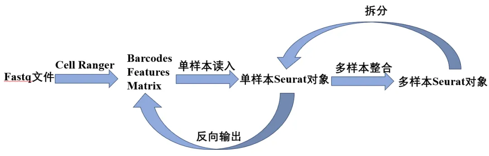
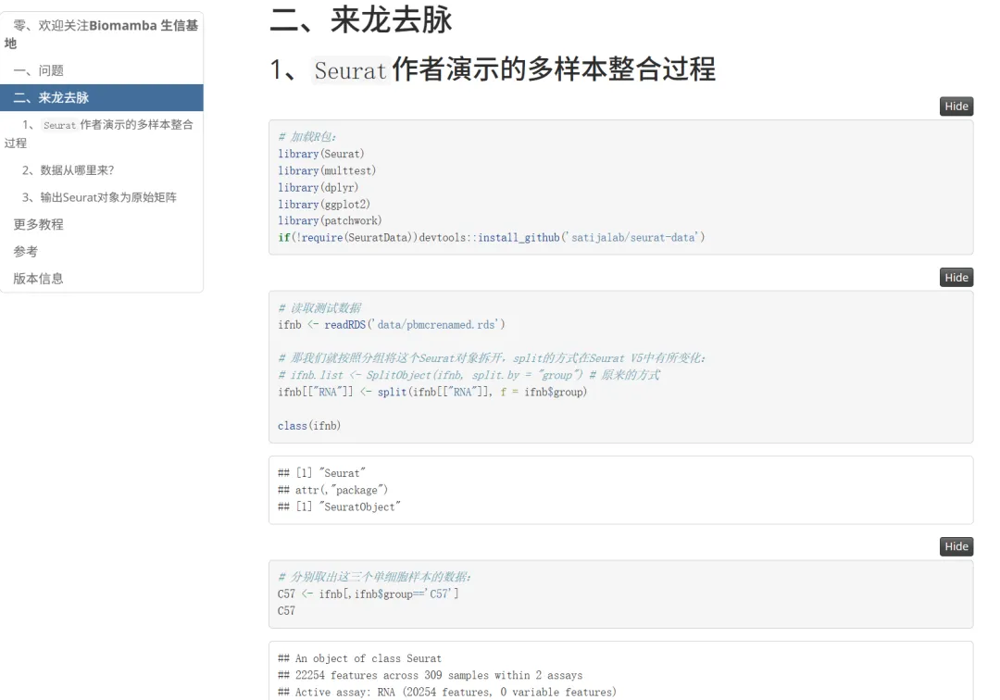

# 怎么就不会合并单细胞数据了呢

> 原文：https://mp.weixin.qq.com/s?__biz=MzAwMzIzOTk5OQ==&mid=2247529812&idx=1&sn=cb6b4244cafe8fa0575c07f106e78ff6&chksm=9b3c0c04ac4b8512e69a1b430464eb920563486e10e689384ee03aeab528f6c68d267cc0d0a3#rd
> 合集：答读者问

**一、写在前面**

如下图，总是有同学在观看我们[多样本整合](<https://mp.weixin.qq.com/s?__biz=MzAwMzIzOTk5OQ==&mid=2247500117&idx=2&sn=cef0b0abec6d73a8c2615980ef68aec1&scene=21#wechat_redirect>)[1]时不能理解为何我们拿一个已经整合好的样本拆分后再合并。其实也不是我们故意给大家使绊子，Seurat官网[2]也是这么操作的。Biomamba第一次看的时候也绕晕了，不过细品之下才了解了作者的良苦用心。既然这样，我们本篇推送就带大家完完全全地梳理一下[单样本数据读取](<https://mp.weixin.qq.com/s?__biz=MzAwMzIzOTk5OQ==&mid=2247499795&idx=2&sn=68e6298eb43633c71939c146d90230ff&scene=21#wechat_redirect>)与[多样本整合](<https://mp.weixin.qq.com/s?__biz=MzAwMzIzOTk5OQ==&mid=2247500117&idx=2&sn=cef0b0abec6d73a8c2615980ef68aec1&scene=21#wechat_redirect>)之间的衔接。


[1]https://www.bilibili.com/video/BV1S44y1b76Z?vd_source=6335356a0d3631ad476b7c7de83892db&p=5

[2]https://satijalab.org/seurat/articles/integration_introduction

**二、来龙去脉**

##  1、`Seurat`作者演示的多样本整合过程
```r
# 加载R包：
library(Seurat)
library(multtest)
library(dplyr)
library(ggplot2)
library(patchwork)
if(!require(SeuratData))devtools::install_github('satijalab/seurat-data')
```

```r
# 读取测试数据
ifnb <-readRDS('data/pbmcrenamed.rds')

# 那我们就按照分组将这个Seurat对象拆开，split的方式在Seurat V5中有所变化：
# ifnb.list <- SplitObject(ifnb, split.by = "group") # 原来的方式
ifnb[["RNA"]] <-split(ifnb[["RNA"]], f = ifnb$group)

class(ifnb)
```
```
## [1] "Seurat"
## attr(,"package")
## [1] "SeuratObject"
```

```r
# 分别取出这三个单细胞样本的数据：
C57 <- ifnb[,ifnb$group=='C57']
C57
```
```
## An object of class Seurat
## 22254 features across 309 samples within 2 assays
## Active assay: RNA (20254 features, 0 variable features)
##  2 layers present: counts.C57, data.C57
##  1 other assay present: integrated
##  3 dimensional reductions calculated: pca, umap, tsne
```

```r
AS1 <- ifnb[,ifnb$group=='AS1']
AS1
```
```
## An object of class Seurat
## 22254 features across 287 samples within 2 assays
## Active assay: RNA (20254 features, 0 variable features)
##  2 layers present: counts.AS1, data.AS1
##  1 other assay present: integrated
##  3 dimensional reductions calculated: pca, umap, tsne
```

```r
P3 <- ifnb[,ifnb$group=='P3']
P3
```
```
## An object of class Seurat
## 22254 features across 304 samples within 2 assays
## Active assay: RNA (20254 features, 0 variable features)
##  2 layers present: counts.P3, data.P3
##  1 other assay present: integrated
##  3 dimensional reductions calculated: pca, umap, tsne
```

```r
# 简单利用merge整合这两个数据
scRNA <-merge(C57, y =c(AS1,P3), add.cell.ids =c("C57", "AS1",'P3'), project ="ALL")
# 这时我们就获得了一个新的Seurat对象
scRNA
```
```
## An object of class Seurat
## 22254 features across 900 samples within 2 assays
## Active assay: RNA (20254 features, 0 variable features)
##  6 layers present: counts.C57.1, data.C57.1, counts.AS1.2, data.AS1.2, counts.P3.3, data.P3.3
##  1 other assay present: integrated
```

## 2、数据从哪里来？  其实我们在[单样本数据读取](<https://mp.weixin.qq.com/s?__biz=MzAwMzIzOTk5OQ==&mid=2247499795&idx=2&sn=68e6298eb43633c71939c146d90230ff&scene=21&token=1716436935&lang=zh_CN#wechat_redirect>)中已经给大家演示了[Cellranger](<https://mp.weixin.qq.com/s?__biz=MzAwMzIzOTk5OQ==&mid=2247501751&idx=2&sn=a79512f54db7456ea577de40f1a2d286&scene=21#wechat_redirect>)标准输出文件的 读取方式。如果大家是连贯性跟我们的视频，那这三个样本你已经会依次读入啦：
```r
C57 <-Read10X('10x_output/C57/filtered_gene_bc_matrices/')
C57 <-CreateSeuratObject(C57,project ="C57")

AS1 <-Read10X('10x_output/AS1/filtered_gene_bc_matrices/')
AS1 <-CreateSeuratObject(AS1,project ="AS1")

P3 <-Read10X('10x_output/P3/filtered_gene_bc_matrices/')
P3 <-CreateSeuratObject(P3,project ="P3")
```

所以自然而然的，按照[分类变量处理技巧](<https://mp.weixin.qq.com/s?__biz=MzAwMzIzOTk5OQ==&mid=2247486134&idx=1&sn=e581b8ac20bbc968aeef3f9cf56f3a0f&scene=21#wechat_redirect>)添加好分组变量后，你就可以完成开头的整合过程：
```r
C57$group <-'C57'
AS1$group <-'AS1'
P3$group <-'P3'

# 简单利用merge整合这两个数据
scRNA <-merge(C57, y =c(AS1,P3), add.cell.ids =c("C57", "AS1",'P3'), project ="ALL")
# 这时我们就获得了一个新的Seurat对象
scRNA
```
```
## An object of class Seurat
## 20254 features across 900 samples within 1 assay
## Active assay: RNA (20254 features, 0 variable features)
##  3 layers present: counts.C57, counts.AS1, counts.P3
```

```
# 可以查看到其中包含原来的3个Group：
unique(scRNA$group)
```
```
## [1] "C57" "AS1" "P3"
```
```r
# 这时我们需要把三个组别的矩阵layer合并到一起：
scRNA <-JoinLayers(scRNA)

# 那我们就可以按照上面的拆分过程进行拆分，从而完成上门一模一样的整合过程：
scRNA[["RNA"]] <-split(scRNA[["RNA"]], f = scRNA$group)
```

## 3、输出Seurat对象为原始矩阵

## 其实如果你对[R语言](<https://mp.weixin.qq.com/s?__biz=MzAwMzIzOTk5OQ==&mid=2247528126&idx=2&sn=668c2709891956b567b316f9f2fb26ea&payreadticket=HFfLfr-yBqyQT7n_i8AMm5gBSN9zlIPw9xtADxKrmEiXpxRHQCJYPy43_O_E0oGV6TZHrDg&scene=21#wechat_redirect>)和[Seurat对象](<https://mp.weixin.qq.com/s?__biz=MzAwMzIzOTk5OQ==&mid=2247519711&idx=1&sn=d25d4f5daf609bda8367f16db676ecf3&payreadticket=HGnOGHNS5MBoZUKpzH1JsNUGRroOyR1yHQ40uwxCVuS9p6AAGrqem26ZFqsnULTwJ5zc6vs&scene=21#wechat_redirect>)足够了解，你甚至可以逆向输出已经构建好的`Seurat`对象为原始矩阵的`barcodes`、`matrix`、`features`文件
```r
# 加载必要的包
library(Seurat)
library(Matrix)

# 我们来定义一个将Seurat对象输出为三个原始矩阵本地文件的函数：
export_as_10x_gz <-function(seurat_obj, sample_name, output_dir ="./10x_output") {
# 创建目录
  final_dir <-file.path(output_dir, sample_name, "filtered_gene_bc_matrices")
if (!dir.exists(final_dir)) {
dir.create(final_dir, recursive =TRUE)
  }

# 1. 输出并压缩矩阵文件
  counts <-GetAssayData(seurat_obj, assay ="RNA", slot ="counts")
writeMM(counts, file =file.path(final_dir, "matrix.mtx"))
system(paste("gzip -f", file.path(final_dir, "matrix.mtx")))  # 压缩为 .gz

# 2. 输出并压缩条形码文件
write.table(
data.frame(colnames(counts)),
file =file.path(final_dir, "barcodes.tsv"),
sep ="\t", row.names =FALSE, col.names =FALSE, quote =FALSE
  )
system(paste("gzip -f", file.path(final_dir, "barcodes.tsv")))

# 3. 输出并压缩基因特征文件
  features <-data.frame(
gene_id =rownames(counts),
gene_name =rownames(counts),  # 或替换为实际基因名
feature_type ="Gene Expression"
  )
write.table(
    features,
file =file.path(final_dir, "features.tsv"),
sep ="\t", row.names =FALSE, col.names =FALSE, quote =FALSE
  )
system(paste("gzip -f", file.path(final_dir, "features.tsv")))

message("10X格式文件（压缩版）已保存至：", final_dir)
}

# 重新导出三个样本（带压缩）
export_as_10x_gz(C57, "C57")
```

```
## Warning: The `slot` argument of `GetAssayData()` is deprecated as of SeuratObject 5.0.0.
## ℹ Please use the `layer` argument instead.
## This warning is displayed once every 8 hours.
## Call `lifecycle::last_lifecycle_warnings()` to see where this warning was
## generated.
```
```
## 10X格式文件（压缩版）已保存至：./10x_output/C57/filtered_gene_bc_matrices
```

```
export_as_10x_gz(AS1, "AS1")
```
```
## 10X格式文件（压缩版）已保存至：./10x_output/AS1/filtered_gene_bc_matrices
```
```
export_as_10x_gz(P3, "P3")
```
```
## 10X格式文件（压缩版）已保存至：./10x_output/P3/filtered_gene_bc_matrices
```
```
# 查看输出的文件：
list.files('10x_output/',recursive = T)
```

```
## [1] "AS1/filtered_gene_bc_matrices/barcodes.tsv.gz"
## [2] "AS1/filtered_gene_bc_matrices/features.tsv.gz"
## [3] "AS1/filtered_gene_bc_matrices/matrix.mtx.gz"
## [4] "C57/filtered_gene_bc_matrices/barcodes.tsv.gz"
## [5] "C57/filtered_gene_bc_matrices/features.tsv.gz"
## [6] "C57/filtered_gene_bc_matrices/matrix.mtx.gz"
## [7] "P3/filtered_gene_bc_matrices/barcodes.tsv.gz"
## [8] "P3/filtered_gene_bc_matrices/features.tsv.gz"
## [9] "P3/filtered_gene_bc_matrices/matrix.mtx.gz"
```
```r
# 这些文件依旧可以按照单样本读入：
C57 <-Read10X('10x_output/C57/filtered_gene_bc_matrices/')
```

怕大家又绕晕了，也许画一个示意图更方便大家理解上面的各种操作：


**更多教程**

如果你觉得当前教程有用，不妨看看：
[生信基地122篇单细胞教程全索引](<https://mp.weixin.qq.com/s?__biz=MzAwMzIzOTk5OQ==&mid=2247528470&idx=1&sn=7f3ced59b2b97bed1ac9df560b11ddd6&scene=21#wechat_redirect>)
[scRNA-seq，从小白到文献复现大神！](<https://mp.weixin.qq.com/s?__biz=MzAwMzIzOTk5OQ==&mid=2247529435&idx=1&sn=cc7e9ff271f0ce0157008532ef4829c3&scene=21#wechat_redirect>)

# 参考

[1]https://www.bilibili.com/video/BV1S44y1b76Zvd_source=6335356a0d3631ad476b7c7de83892db&p=5
[2]https://satijalab.org/seurat/articles/integration_introduction

**版本信息**
```
sessionInfo()
```
```
## R version 4.4.2 (2024-10-31)
## Platform: x86_64-pc-linux-gnu
## Running under: Ubuntu 20.04.4 LTS
##
## Matrix products: default
## BLAS:   /usr/lib/x86_64-linux-gnu/openblas-pthread/libblas.so.3
## LAPACK: /usr/lib/x86_64-linux-gnu/openblas-pthread/liblapack.so.3;  LAPACK version 3.9.0
##
## locale:
##  [1] LC_CTYPE=en_US.UTF-8       LC_NUMERIC=C
##  [3] LC_TIME=en_US.UTF-8        LC_COLLATE=en_US.UTF-8
##  [5] LC_MONETARY=en_US.UTF-8    LC_MESSAGES=en_US.UTF-8
##  [7] LC_PAPER=en_US.UTF-8       LC_NAME=C
##  [9] LC_ADDRESS=C               LC_TELEPHONE=C
## [11] LC_MEASUREMENT=en_US.UTF-8 LC_IDENTIFICATION=C
##
## time zone: Etc/UTC
## tzcode source: system (glibc)
##
## attached base packages:
## [1] stats     graphics  grDevices utils     datasets  methods   base
##
## other attached packages:
##  [1] Matrix_1.7-2              stxBrain.SeuratData_0.1.1
##  [3] SeuratData_0.2.2.9001     patchwork_1.3.0
##  [5] ggplot2_3.5.1             dplyr_1.1.4
##  [7] multtest_2.58.0           Biobase_2.66.0
##  [9] BiocGenerics_0.52.0       Seurat_5.2.1
## [11] SeuratObject_5.0.2        sp_2.2-0
##
## loaded via a namespace (and not attached):
##   [1] RColorBrewer_1.1-3     rstudioapi_0.17.1      jsonlite_1.8.9
##   [4] magrittr_2.0.3         spatstat.utils_3.1-4   farver_2.1.2
##   [7] rmarkdown_2.29         vctrs_0.6.5            ROCR_1.0-11
##  [10] spatstat.explore_3.4-3 htmltools_0.5.8.1      sass_0.4.9
##  [13] sctransform_0.4.1      parallelly_1.42.0      KernSmooth_2.23-26
##  [16] bslib_0.9.0            htmlwidgets_1.6.4      ica_1.0-3
##  [19] plyr_1.8.9             plotly_4.10.4          zoo_1.8-12
##  [22] cachem_1.1.0           igraph_2.1.4           mime_0.12
##  [25] lifecycle_1.0.4        pkgconfig_2.0.3        R6_2.5.1
##  [28] fastmap_1.2.0          fitdistrplus_1.2-2     future_1.34.0
##  [31] shiny_1.10.0           digest_0.6.37          colorspace_2.1-1
##  [34] tensor_1.5             RSpectra_0.16-2        irlba_2.3.5.1
##  [37] progressr_0.15.1       spatstat.sparse_3.1-0  httr_1.4.7
##  [40] polyclip_1.10-7        abind_1.4-8            compiler_4.4.2
##  [43] withr_3.0.2            fastDummies_1.7.5      R.utils_2.12.3
##  [46] MASS_7.3-64            rappdirs_0.3.3         tools_4.4.2
##  [49] lmtest_0.9-40          httpuv_1.6.15          future.apply_1.11.3
##  [52] goftest_1.2-3          R.oo_1.27.0            glue_1.8.0
##  [55] nlme_3.1-168           promises_1.3.2         grid_4.4.2
##  [58] Rtsne_0.17             cluster_2.1.8          reshape2_1.4.4
##  [61] generics_0.1.3         gtable_0.3.6           spatstat.data_3.1-6
##  [64] tzdb_0.4.0             R.methodsS3_1.8.2      tidyr_1.3.1
##  [67] data.table_1.16.4      hms_1.1.3              spatstat.geom_3.4-1
##  [70] RcppAnnoy_0.0.22       ggrepel_0.9.6          RANN_2.6.2
##  [73] pillar_1.10.1          stringr_1.5.1          spam_2.11-1
##  [76] RcppHNSW_0.6.0         later_1.4.1            splines_4.4.2
##  [79] lattice_0.22-6         cherryblossom_0.1.0    survival_3.8-3
##  [82] deldir_2.0-4           tidyselect_1.2.1       miniUI_0.1.1.1
##  [85] pbapply_1.7-2          knitr_1.49             gridExtra_2.3
##  [88] scattermore_1.2        airports_0.1.0         stats4_4.4.2
##  [91] xfun_0.50              matrixStats_1.5.0      stringi_1.8.4
##  [94] lazyeval_0.2.2         yaml_2.3.10            evaluate_1.0.3
##  [97] codetools_0.2-20       tibble_3.2.1           cli_3.6.3
## [100] uwot_0.2.2             xtable_1.8-4           reticulate_1.40.0
## [103] munsell_0.5.1          jquerylib_0.1.4        Rcpp_1.0.14
## [106] globals_0.16.3         spatstat.random_3.4-1  png_0.1-8
## [109] spatstat.univar_3.1-3  parallel_4.4.2         usdata_0.3.1
## [112] readr_2.1.5            dotCall64_1.2          listenv_0.9.1
## [115] viridisLite_0.4.2      scales_1.3.0           ggridges_0.5.6
## [118] purrr_1.0.2            crayon_1.5.3           openintro_2.5.0
## [121] rlang_1.1.5            cowplot_1.1.3
```

**当前推送资料**

同我们以前的推送一样，我们给大家准备了学习手册和学习资料
通过网盘分享的文件：

链接: https://pan.baidu.com/s/1DUOBOSCqKxl1QTv-4J9fXA?pwd=92c1

提取码: 92c1


共包含27文件，9个文件夹，大家可以自取计算资源本教程基于Linux中的Rstudio环境演示，计算资源不足的同学可参考：
[生信分析为什么要使用服务器？](<https://mp.weixin.qq.com/s?__biz=MzAwMzIzOTk5OQ==&mid=2247491007&idx=1&sn=8619c2bad23791b3252a1c4cb1831931&chksm=9b3f64efac48edf9c02f84959aeee9b12480736fce70c5ddb8b41d79cfc22ce590ea2cb60fba&token=1760636281&lang=zh_CN&scene=21#wechat_redirect>)
[足够支持你完成硕博生涯的生信环境](<http://mp.weixin.qq.com/s?__biz=MzAwMzIzOTk5OQ==&mid=2247511780&idx=1&sn=3acc0874f7d2fa75f1abbe7a9a9b4069&chksm=9b3cd7b4ac4b5ea27d4d53964e4a4a9fa8c806a19103729dd4ff0fa72e621411f46a251d269f&scene=21#wechat_redirect>)
[独享服务器，生信分析不求人](<http://mp.weixin.qq.com/s?__biz=MzAwMzIzOTk5OQ==&mid=2247503618&idx=1&sn=ca47ca985aa8560f6b38f15f210519e2&chksm=9b3cb652ac4b3f44292560071b7e98e2f6fa6ec03581cd882a4d59b9d7fa063a5b9ac1b923f3&scene=21#wechat_redirect>)

**如何联系我们**

 留一个领取[资料](<https://mp.weixin.qq.com/s?__biz=MzAwMzIzOTk5OQ==&mid=2247528482&idx=1&sn=7cc0715eace4f592a62bdaf157b25c01&scene=21#wechat_redirect>)、[开箱即用的单细胞分析镜像](<https://mp.weixin.qq.com/s?__biz=MzAwMzIzOTk5OQ==&mid=2247528410&idx=2&sn=0f2bac25479cf8d20dab5d82ae986f2e&scene=21#wechat_redirect>)的**微信号[Biomamba_zhushou]**，方便各位随时交流。同时我们也构建了[交流群矩阵](<https://mp.weixin.qq.com/s?__biz=MzAwMzIzOTk5OQ==&mid=2247528057&idx=1&sn=bb348c2a88c977c7cce67ee6731a3591&scene=21#wechat_redirect>)，欢迎大家入群讨论。
大家可以阅读完这几篇之后添加[给生信入门初学者的小贴士](<http://mp.weixin.qq.com/s?__biz=MzAwMzIzOTk5OQ==&mid=2247493329&idx=1&sn=597870b7f7ce10346da3561e7c281627&chksm=9b3c9f81ac4b169794088ce9abbcacb5f18e9fd174fc0d7e28da62d78facadf3100ef38aaf22&scene=21#wechat_redirect>)
[没有检索，就没有发言权](<https://mp.weixin.qq.com/s?__biz=MzAwMzIzOTk5OQ==&mid=2247529398&idx=2&sn=5a429852d61721916a405712677d5905&scene=21#wechat_redirect>)

**已有生信基地联系方式的同学****无需重复添加**

 您点的每个赞和在看，我都认真当成了喜欢
