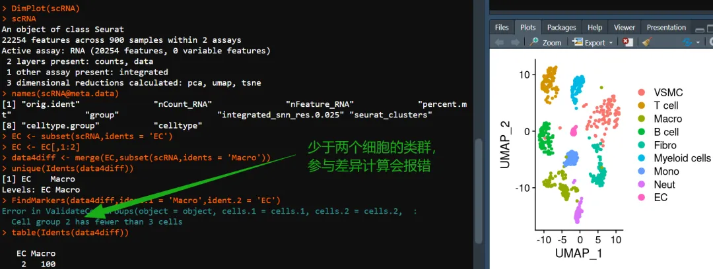
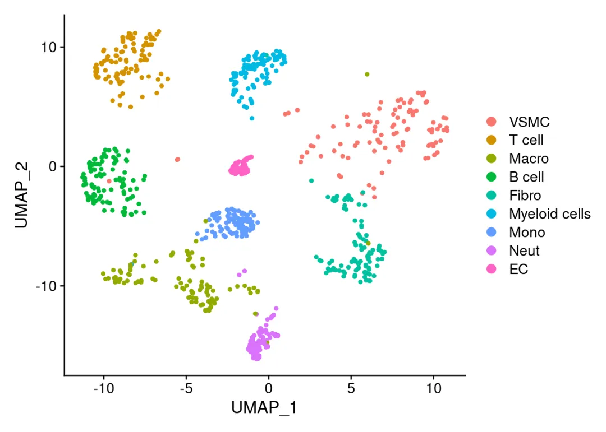
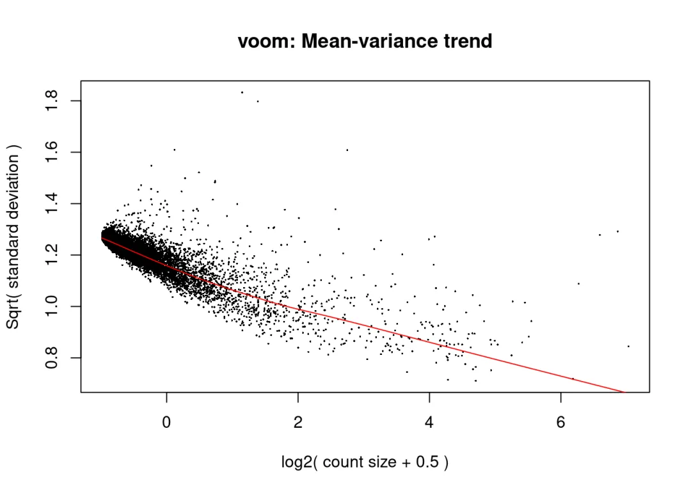
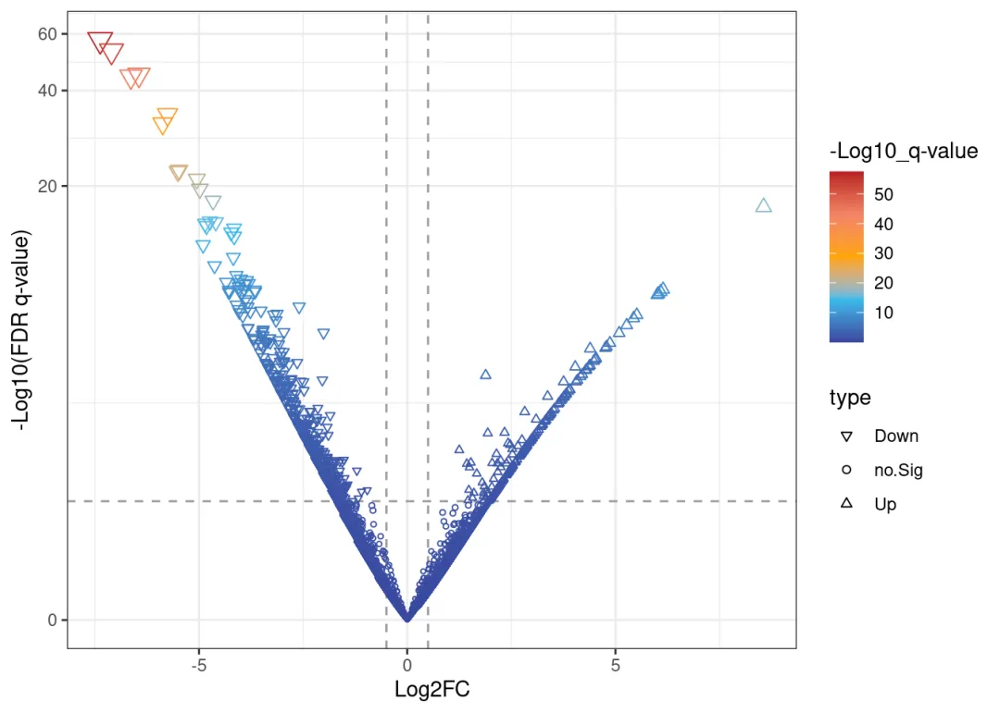
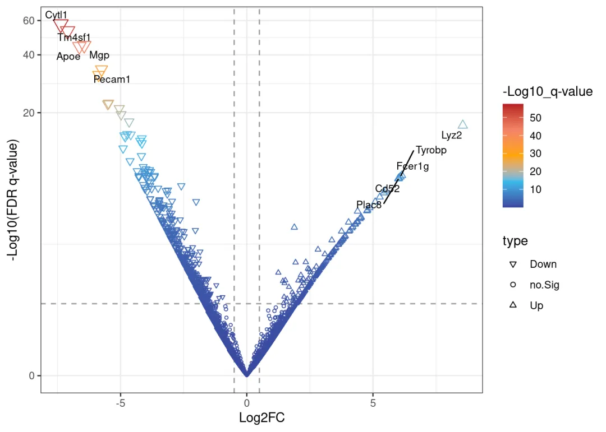
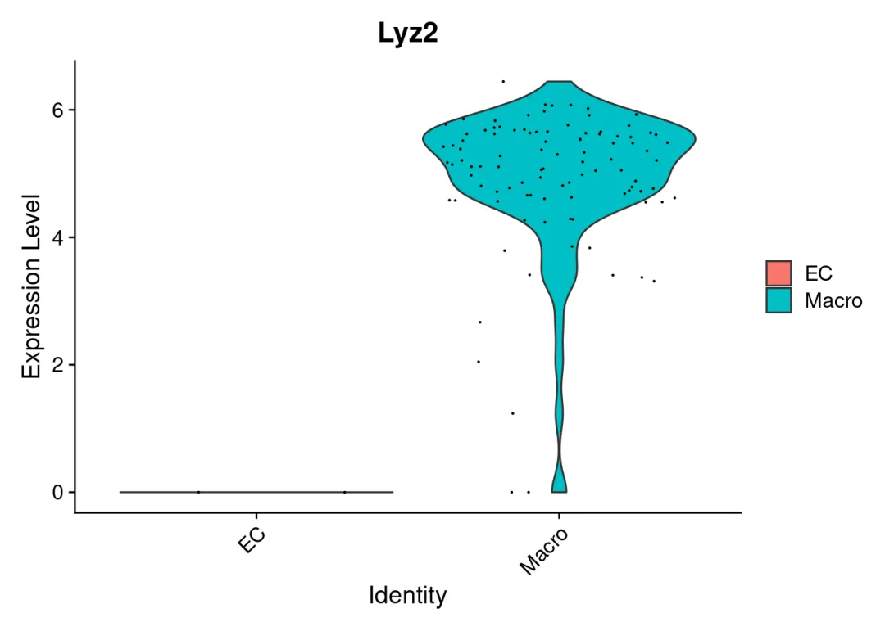

# 不足3个细胞怎么做差异分析？

> 原文：https://mp.weixin.qq.com/s?__biz=MzAwMzIzOTk5OQ==&mid=2247530311&idx=1&sn=3cfbe93216b11c76923f326dd7b44439&chksm=9b3c0e17ac4b8701e1af4b7197600f23f02c6c06a6f299e58d1b9adb2888f89790ece848c126#rd
> 合集：答读者问

**一、写在前面**

如图，有粉丝发现，当差异基因时存在细胞类型不足三个细胞，则会出现报错。解决方法自然是有的，我们此前分享的[应审稿人要求| pseudo bulk差异分析](<https://mp.weixin.qq.com/s?__biz=MzAwMzIzOTk5OQ==&mid=2247521437&idx=1&sn=d47b48170f7189b8fb74b2316d0c4898&scene=21#wechat_redirect>)便可解决这一问题。只是，为何要强求这一两个细胞的分析？做出的差异结果可信度大大的存疑，后续的验证也只怕是难上加难，不如及时止损。系统性单细胞教程可见：[scRNA-seq，从小白到文献复现大神！](<https://mp.weixin.qq.com/s?__biz=MzAwMzIzOTk5OQ==&mid=2247529435&idx=1&sn=cc7e9ff271f0ce0157008532ef4829c3&scene=21#wechat_redirect>)


**二、重现报错**

这里的测试数据来自经典教案，[多样本整合](<https://mp.weixin.qq.com/s?__biz=MzAwMzIzOTk5OQ==&mid=2247500117&idx=2&sn=cef0b0abec6d73a8c2615980ef68aec1&scene=21#wechat_redirect>)

## 1、构建模拟数据
```r
# 加载包：
library(Seurat)
```

##

```
## Loading required package: SeuratObject
```
```
## Loading required package: sp
```
```
## 'SeuratObject' was built with package 'Matrix' 1.7.1 but the current
## version is 1.7.2; it is recomended that you reinstall 'SeuratObject' as
## the ABI for 'Matrix' may have changed
```
```
##
## Attaching package: 'SeuratObject'
```
```
## The following objects are masked from 'package:base':
##
##     intersect, t
```
```r
# 读取数据：
scRNA <-readRDS('./pbmcrenamed.rds')

# 查看包含细胞类型：
DimPlot(scRNA)
```


```r
# 取出EC：
EC <-subset(scRNA,idents ='EC')
# 保留两个EC
EC <- EC[,1:2]
# 整合EC与Macro
data4diff <-merge(EC,subset(scRNA,idents ='Macro'))

# 此时我们就获得了包含EC、Macro的单细胞对象，其中EC的数量只有两个：
table(Idents(data4diff))
```
```
##
##    EC Macro
##     2   100
```

##

## 2、查看报错

其实是我还挣扎过，尝试更改`FindMarkers`函数的`test.use`的参数来规避这个问题。事实上，这种情况下无论你采用什么内置差异分析算法，都会报`Cell group 2 has fewer than 3 cells`的错误，应该是`ValidateCellGroups`的底层逻辑了。
```
try({FindMarkers(data4diff,ident.1 ='Macro',ident.2 ='EC')})
```
```
## Error in ValidateCellGroups(object = object, cells.1 = cells.1, cells.2 = cells.2,  :
##   Cell group 2 has fewer than 3 cells
```
```
try({FindMarkers(data4diff,ident.1 ='Macro',ident.2 ='EC',test.use ='wilcox')})
```
```
## Error in ValidateCellGroups(object = object, cells.1 = cells.1, cells.2 = cells.2,  :
##   Cell group 2 has fewer than 3 cells
```
```
try({FindMarkers(data4diff,ident.1 ='Macro',ident.2 ='EC',test.use ='wilcox_limma')})
```
```
## Error in ValidateCellGroups(object = object, cells.1 = cells.1, cells.2 = cells.2,  :
##   Cell group 2 has fewer than 3 cells
```
```
try({FindMarkers(data4diff,ident.1 ='Macro',ident.2 ='EC',test.use ='bimod')})
```
```
## Error in ValidateCellGroups(object = object, cells.1 = cells.1, cells.2 = cells.2,  :
##   Cell group 2 has fewer than 3 cells
```
```
try({FindMarkers(data4diff,ident.1 ='Macro',ident.2 ='EC',test.use ='roc')})
```
```
## Error in ValidateCellGroups(object = object, cells.1 = cells.1, cells.2 = cells.2,  :
##   Cell group 2 has fewer than 3 cells
```
```
try({FindMarkers(data4diff,ident.1 ='Macro',ident.2 ='EC',test.use ='t')})
```
```
## Error in ValidateCellGroups(object = object, cells.1 = cells.1, cells.2 = cells.2,  :
##   Cell group 2 has fewer than 3 cells
```
```
try({FindMarkers(data4diff,ident.1 ='Macro',ident.2 ='EC',test.use ='negbinom')})
```
```
## Error in ValidateCellGroups(object = object, cells.1 = cells.1, cells.2 = cells.2,  :
##   Cell group 2 has fewer than 3 cells
```
```
try({FindMarkers(data4diff,ident.1 ='Macro',ident.2 ='EC',test.use ='poisson')})
```
```
## Error in ValidateCellGroups(object = object, cells.1 = cells.1, cells.2 = cells.2,  :
##   Cell group 2 has fewer than 3 cells
```
```
try({FindMarkers(data4diff,ident.1 ='Macro',ident.2 ='EC',test.use ='LR')})
```
```
## Error in ValidateCellGroups(object = object, cells.1 = cells.1, cells.2 = cells.2,  :
##   Cell group 2 has fewer than 3 cells
```

**三、解决问题**

##  3.1 `Seurat`的伪`bulk`方案
```r
### 生成拟bulk RNA数据 ###
bulk <-AggregateExpression(scRNA, return.seurat = T, slot ="counts", assays ="RNA",
group.by =c("celltype", # 细胞类型对应的注释
"orig.ident", # 样本对应的注释
"group")# 分组变量对应的注释
    )
```
```
## Centering and scaling data matrix
```
```
# 生成的是一个新的Seurat对象
bulk
```
```
## An object of class Seurat
## 20254 features across 26 samples within 1 assay
## Active assay: RNA (20254 features, 0 variable features)
##  3 layers present: counts, data, scale.data
```
```
# 下面的额计算依赖DESeq2，做过Bulk RNA-Seq的同学都知道：
if(!require(DESeq2))BiocManager::install('DESeq2')
```
```
## Loading required package: DESeq2
```
```
## Loading required package: S4Vectors
```
```
## Loading required package: stats4
```
```
## Loading required package: BiocGenerics
```
```
##
## Attaching package: 'BiocGenerics'
```
```
## The following object is masked from 'package:SeuratObject':
##
##     intersect
```
```
## The following objects are masked from 'package:stats':
##
##     IQR, mad, sd, var, xtabs
```
```
## The following objects are masked from 'package:base':
##
##     anyDuplicated, aperm, append, as.data.frame, basename, cbind,
##     colnames, dirname, do.call, duplicated, eval, evalq, Filter, Find,
##     get, grep, grepl, intersect, is.unsorted, lapply, Map, mapply,
##     match, mget, order, paste, pmax, pmax.int, pmin, pmin.int,
##     Position, rank, rbind, Reduce, rownames, sapply, saveRDS, setdiff,
##     table, tapply, union, unique, unsplit, which.max, which.min
```
```
##
## Attaching package: 'S4Vectors'
```
```
## The following object is masked from 'package:utils':
##
##     findMatches
```
```
## The following objects are masked from 'package:base':
##
##     expand.grid, I, unname
```
```
## Loading required package: IRanges
```
```
##
## Attaching package: 'IRanges'
```
```
## The following object is masked from 'package:sp':
##
##     %over%
```
```
## Loading required package: GenomicRanges
```
```
## Loading required package: GenomeInfoDb
```
```
## Loading required package: SummarizedExperiment
```
```
## Loading required package: MatrixGenerics
```
```
## Loading required package: matrixStats
```
```
##
## Attaching package: 'MatrixGenerics'
```
```
## The following objects are masked from 'package:matrixStats':
##
##     colAlls, colAnyNAs, colAnys, colAvgsPerRowSet, colCollapse,
##     colCounts, colCummaxs, colCummins, colCumprods, colCumsums,
##     colDiffs, colIQRDiffs, colIQRs, colLogSumExps, colMadDiffs,
##     colMads, colMaxs, colMeans2, colMedians, colMins, colOrderStats,
##     colProds, colQuantiles, colRanges, colRanks, colSdDiffs, colSds,
##     colSums2, colTabulates, colVarDiffs, colVars, colWeightedMads,
##     colWeightedMeans, colWeightedMedians, colWeightedSds,
##     colWeightedVars, rowAlls, rowAnyNAs, rowAnys, rowAvgsPerColSet,
##     rowCollapse, rowCounts, rowCummaxs, rowCummins, rowCumprods,
##     rowCumsums, rowDiffs, rowIQRDiffs, rowIQRs, rowLogSumExps,
##     rowMadDiffs, rowMads, rowMaxs, rowMeans2, rowMedians, rowMins,
##     rowOrderStats, rowProds, rowQuantiles, rowRanges, rowRanks,
##     rowSdDiffs, rowSds, rowSums2, rowTabulates, rowVarDiffs, rowVars,
##     rowWeightedMads, rowWeightedMeans, rowWeightedMedians,
##     rowWeightedSds, rowWeightedVars
```
```
## Loading required package: Biobase
```
```
## Welcome to Bioconductor
##
##     Vignettes contain introductory material; view with
##     'browseVignettes()'. To cite Bioconductor, see
##     'citation("Biobase")', and for packages 'citation("pkgname")'.
```
```
##
## Attaching package: 'Biobase'
```
```
## The following object is masked from 'package:MatrixGenerics':
##
##     rowMedians
```
```
## The following objects are masked from 'package:matrixStats':
##
##     anyMissing, rowMedians
```
```
##
## Attaching package: 'SummarizedExperiment'
```
```
## The following object is masked from 'package:Seurat':
##
##     Assays
```
```
## The following object is masked from 'package:SeuratObject':
##
##     Assays
```
```r
Idents(bulk) <-'celltype'
bulk_deg <-FindMarkers(bulk,
ident.1 ="Macro", ident.2 ="EC", # 这样算出来的Fold Change就是Macro/EC
slot ="counts", test.use ="DESeq2",# 这里可以选择其它算法
verbose = F# 关闭进度提示
      )
```
```
## converting counts to integer mode
```
```
## gene-wise dispersion estimates
```
```
## mean-dispersion relationship
```
```
## final dispersion estimates
```
```
head(bulk_deg)# 看一下差异列表
```
```
##                p_val avg_log2FC pct.1 pct.2     p_val_adj
## Lyz2   1.319068e-167   8.390904 1.000     1 2.671640e-163
## Pecam1  1.676724e-48  -5.088600 1.000     1  3.396037e-44
## Fabp4   7.472478e-46  -6.226709 0.667     1  1.513476e-41
## Tyrobp  5.513580e-45   5.530070 1.000     1  1.116720e-40
## Cytl1   3.912488e-34  -6.691938 0.667     1  7.924352e-30
## Cd52    1.527090e-33   5.216027 1.000     1  3.092968e-29
```

## 3.2 生成`bulk`矩阵

当然我们也可以把`sc`直接变成`Bulk`矩阵，然后直接用[Bulk RNASeq| 转录组实战](<https://mp.weixin.qq.com/s?__biz=MzAwMzIzOTk5OQ==&mid=2247529986&idx=2&sn=301d44caa8d63cba8243d13579775cf5&scene=21#wechat_redirect>)里经典的差异分析方法即可完成。
```r
library(dplyr)
```
```
##
## Attaching package: 'dplyr'
```
```
## The following object is masked from 'package:Biobase':
##
##     combine
```
```
## The following object is masked from 'package:matrixStats':
##
##     count
```
```
## The following objects are masked from 'package:GenomicRanges':
##
##     intersect, setdiff, union
```
```
## The following object is masked from 'package:GenomeInfoDb':
##
##     intersect
```
```
## The following objects are masked from 'package:IRanges':
##
##     collapse, desc, intersect, setdiff, slice, union
```
```
## The following objects are masked from 'package:S4Vectors':
##
##     first, intersect, rename, setdiff, setequal, union
```
```
## The following objects are masked from 'package:BiocGenerics':
##
##     combine, intersect, setdiff, union
```
```
## The following objects are masked from 'package:stats':
##
##     filter, lag
```
```
## The following objects are masked from 'package:base':
##
##     intersect, setdiff, setequal, union
```
```r
# 获取countss数据：
rna_count <-GetAssayData(data4diff,'RNA','count') %>%as.data.frame()
# 得到的数据是一个列名是细胞barcode名(现在应该叫做样本名)，行名是基因名的矩阵
rna_count[1:4,1:4]
```
```
##         AACCCAAAGGCCTTGC-1_1 AAGACTCAGGCTCACC-1_1 GATGTTGGTGACAGGT-1_1
## Xkr4                       0                    0                    0
## Gm19938                    0                    0                    0
## Sox17                      1                   14                    0
## Gm37587                    0                    0                    0
##         GCCTGTTAGAGCTTTC-1_1
## Xkr4                       0
## Gm19938                    0
## Sox17                      0
## Gm37587                    0
```
```r
# 构建分组信息：
group_info <-data.frame(sample =colnames(rna_count),
group = data4diff$celltype)

# 查看整理好的分组信息：
group_info
```
```
##                                    sample group
## AACCCAAAGGCCTTGC-1_1 AACCCAAAGGCCTTGC-1_1    EC
## AAGACTCAGGCTCACC-1_1 AAGACTCAGGCTCACC-1_1    EC
## GATGTTGGTGACAGGT-1_1 GATGTTGGTGACAGGT-1_1 Macro
## GCCTGTTAGAGCTTTC-1_1 GCCTGTTAGAGCTTTC-1_1 Macro
## TACTTGTGTAGAGACC-1_1 TACTTGTGTAGAGACC-1_1 Macro
## AAAGTCCCAAGCTCTA-1_2 AAAGTCCCAAGCTCTA-1_2 Macro
## AACCTTTGTGTGACCC-1_2 AACCTTTGTGTGACCC-1_2 Macro
## ACATTTCAGGGTGAGG-1_2 ACATTTCAGGGTGAGG-1_2 Macro
## ACGGTTAGTTGAATCC-1_2 ACGGTTAGTTGAATCC-1_2 Macro
```
```
# 安装和加载必要的包：
if(!require(limma))BiocManager::install("limma")
```
```
## Loading required package: limma
```
```
##
## Attaching package: 'limma'
```
```
## The following object is masked from 'package:DESeq2':
##
##     plotMA
```
```
## The following object is masked from 'package:BiocGenerics':
##
##     plotMA
```
```r
# 设置因子的水平，保证后续求出的fold change是Macro vs EC的结果：
group_info$group <-factor(group_info$group, levels=c("EC", "Macro"))

# 使用voom转换count数据：
v <-voom(rna_count[,group_info$sample], plot=TRUE, design=model.matrix(~ group_info$group))
```


```r
# 创建设计矩阵
design <-model.matrix(~ group_info$group)

# 拟合线性模型
fit <-lmFit(v, design)

# 应用经验贝叶斯方法
fit <-eBayes(fit)

# 获取差异表达结果
results <-topTable(fit, adjust="BH", sort.by="P", number=Inf)
```
```
## Removing intercept from test coefficients
```
```
# 查看差异计算结果：
head(results)
```
```
##            logFC  AveExpr         t      P.Value    adj.P.Val         B
## Cytl1  -7.373118 6.217164 -16.08714 3.166532e-58 6.413494e-54 120.39129
## Tm4sf1 -7.100361 6.313693 -15.44600 8.084909e-54 8.187587e-50 110.46178
## Mgp    -6.442328 7.011167 -14.15988 1.630966e-45 1.101120e-41  91.80967
## Apoe   -6.635193 6.164305 -14.06780 6.019744e-45 3.048097e-41  90.43574
## Pecam1 -5.754467 6.615233 -12.22598 2.264653e-34 9.173657e-31  66.70513
## Bgn    -5.872551 6.342975 -11.82165 3.024253e-32 1.020887e-28  61.83869
```
```r
######## 火山图 ##########
data <-data.frame(gene =row.names(results),
pval =-log10(results$P.Value), #pval已做-log10处理
lfc = results$logFC)

# 查看数据：
head(data)
```
```
##     gene     pval       lfc
## 1  Cytl1 57.49942 -7.373118
## 2 Tm4sf1 53.09232 -7.100361
## 3    Mgp 44.78755 -6.442328
## 4   Apoe 44.22042 -6.635193
## 5 Pecam1 33.64500 -5.754467
## 6    Bgn 31.51938 -5.872551
```
```r
# pval 小于0.05，且上下调log(Fold change)大于0.5(差异倍数为1.41)的为显著差异基因并标注上下调，其余
data <-mutate(data, type =case_when(data$lfc >0.5& data$pval >abs(log10(0.05)) ~"Up",
                                      data$lfc <-0.5& data$pval >abs(log10(0.05)) ~"Down",
                                      data$pval <abs(log10(0.05)) ~"no.Sig"))
# 去除包含na的数据
data <-na.omit(data)

# 通过ggplot定义火山图
if(!require(ggplot2))install.packages('ggplot2')
```
```
## Loading required package: ggplot2
```
```r
myplot <-ggplot(data,aes(lfc, pval))+# 横坐标为差异倍数，纵坐标为显著性
# 横向水平参考线：
geom_hline(yintercept =-log10(0.05), linetype ="dashed", color ="#999999")+
# 纵向垂直参考线：
geom_vline(xintercept =c(-0.5,0.5), linetype ="dashed", color ="#999999")+
# 散点图:
geom_point(aes(size=pval, shape=type,color= pval))+
# 指定颜色渐变模式：
scale_shape_manual(values =c(6,1,2))+
scale_color_gradientn(values =seq(0,1,0.2),
colors =c("#39489f","#39bbec",'#FFA500',"#f38466","#b81f25"))+
# 指定散点大小渐变模式：
scale_size_continuous(range =c(0.5,4))+
# 主题调整：
theme_bw()+
guides(col =guide_colourbar(title ="-Log10_q-value"),
size ="none")+
xlab("Log2FC")+
ylab("-Log10(FDR q-value)")+
scale_y_continuous(trans ="log1p")

# 这时的火山图还是光秃秃的：
print(myplot)
```


```r
# 过滤上下调top5的基因：
top_m <- data %>%group_by(type) %>%top_n(n =5, wt = pval) %>%# 如果你想改成top10，把5替换成对应的数字就好
filter(type !='no.Sig')

# 把top标签添加到火山图中
if(!require(ggrepel))install.packages('ggrepel')
```
```
## Loading required package: ggrepel
```
```r
myplot <- myplot +
geom_text_repel(data=top_m,aes(x=lfc,y=pval,label=gene), size =3)

# 查看最终的火山图，这时标签已经被添加好啦：
print(myplot)
```


```
# 挑一个差异看起来比较大的基因，在单细胞里检查一番：
VlnPlot(data4diff,features ='Lyz2')
```



虽然是给大家捣鼓出来了，`Lyz2`的差异还是很明显的，确实是巨噬细胞的marker，不过火山图还是有些奇怪的。还是劝大家及时止损，这两三个细胞的，不研究也罢。

**四、文件下载**

一切不给测试文件和分析环境版本的教程都是耍流氓，本推送的代码和测试文件可以在以下链接中下载：

通过网盘分享的文件：不足3个的单细胞如何做差异分析

链接: https://pan.baidu.com/s/1B8H6eZR-rjIOe4BPe2rdYg?pwd=86nt

提取码: 86nt


分析环境：

  *   *   *   *   *   *   *   *   *   *   *   *   *   *   *   *   *   *   *   *   *   *   *   *   *   *   *   *   *   *   *   *   *   *   *   *   *   *   *   *   *   *   *   *   *   *   *   *   *   *   *   *   *   *   *   *   *   *   *   *   *   *   *   *   *   *   *   *   *   *   *   *   *   *   *   *   *   *   *   *   *   *   *   *   *

```
sessionInfo()## R version 4.4.2 (2024-10-31)## Platform: x86_64-pc-linux-gnu## Running under: Ubuntu 20.04.4 LTS## ## Matrix products: default## BLAS:   /usr/lib/x86_64-linux-gnu/openblas-pthread/libblas.so.3 ## LAPACK: /usr/lib/x86_64-linux-gnu/openblas-pthread/liblapack.so.3;  LAPACK version 3.9.0## ## locale:##  [1] LC_CTYPE=en_US.UTF-8       LC_NUMERIC=C              ##  [3] LC_TIME=en_US.UTF-8        LC_COLLATE=en_US.UTF-8    ##  [5] LC_MONETARY=en_US.UTF-8    LC_MESSAGES=en_US.UTF-8   ##  [7] LC_PAPER=en_US.UTF-8       LC_NAME=C                 ##  [9] LC_ADDRESS=C               LC_TELEPHONE=C            ## [11] LC_MEASUREMENT=en_US.UTF-8 LC_IDENTIFICATION=C       ## ## time zone: Etc/UTC## tzcode source: system (glibc)## ## attached base packages:## [1] stats4    stats     graphics  grDevices utils     datasets  methods  ## [8] base     ## ## other attached packages:##  [1] ggrepel_0.9.6               ggplot2_3.5.1              ##  [3] limma_3.62.2                dplyr_1.1.4                ##  [5] DESeq2_1.36.0               SummarizedExperiment_1.36.0##  [7] Biobase_2.66.0              MatrixGenerics_1.18.1      ##  [9] matrixStats_1.5.0           GenomicRanges_1.58.0       ## [11] GenomeInfoDb_1.42.1         IRanges_2.40.1             ## [13] S4Vectors_0.44.0            BiocGenerics_0.52.0        ## [15] Seurat_5.2.1                SeuratObject_5.0.2         ## [17] sp_2.2-0                   ## ## loaded via a namespace (and not attached):##   [1] RcppAnnoy_0.0.22        splines_4.4.2           later_1.4.1            ##   [4] bitops_1.0-9            tibble_3.2.1            polyclip_1.10-7        ##   [7] XML_3.99-0.18           fastDummies_1.7.5       lifecycle_1.0.4        ##  [10] globals_0.16.3          lattice_0.22-6          MASS_7.3-64            ##  [13] magrittr_2.0.3          plotly_4.10.4           sass_0.4.9             ##  [16] rmarkdown_2.29          jquerylib_0.1.4         yaml_2.3.10            ##  [19] httpuv_1.6.15           sctransform_0.4.1       spam_2.11-1            ##  [22] spatstat.sparse_3.1-0   reticulate_1.40.0       cowplot_1.1.3          ##  [25] pbapply_1.7-2           DBI_1.2.3               RColorBrewer_1.1-3     ##  [28] abind_1.4-8             zlibbioc_1.52.0         Rtsne_0.17             ##  [31] purrr_1.0.2             RCurl_1.98-1.16         GenomeInfoDbData_1.2.13##  [34] irlba_2.3.5.1           listenv_0.9.1           spatstat.utils_3.1-4   ##  [37] genefilter_1.84.0       openintro_2.5.0         airports_0.1.0         ##  [40] goftest_1.2-3           RSpectra_0.16-2         spatstat.random_3.4-1  ##  [43] annotate_1.84.0         fitdistrplus_1.2-2      parallelly_1.42.0      ##  [46] codetools_0.2-20        DelayedArray_0.32.0     tidyselect_1.2.1       ##  [49] UCSC.utils_1.2.0        farver_2.1.2            spatstat.explore_3.4-3 ##  [52] jsonlite_1.8.9          progressr_0.15.1        ggridges_0.5.6         ##  [55] survival_3.8-3          tools_4.4.2             ica_1.0-3              ##  [58] Rcpp_1.0.14             glue_1.8.0              gridExtra_2.3          ##  [61] SparseArray_1.6.0       xfun_0.50               withr_3.0.2            ##  [64] fastmap_1.2.0           digest_0.6.37           R6_2.5.1               ##  [67] mime_0.12               colorspace_2.1-1        scattermore_1.2        ##  [70] tensor_1.5              spatstat.data_3.1-6     RSQLite_2.3.9          ##  [73] tidyr_1.3.1             generics_0.1.3          data.table_1.16.4      ##  [76] usdata_0.3.1            httr_1.4.7              htmlwidgets_1.6.4      ##  [79] S4Arrays_1.6.0          uwot_0.2.2              pkgconfig_2.0.3        ##  [82] gtable_0.3.6            blob_1.2.4              lmtest_0.9-40          ##  [85] XVector_0.46.0          htmltools_0.5.8.1       geneplotter_1.84.0     ##  [88] dotCall64_1.2           scales_1.3.0            png_0.1-8              ##  [91] spatstat.univar_3.1-3   knitr_1.49              rstudioapi_0.17.1      ##  [94] tzdb_0.4.0              reshape2_1.4.4          nlme_3.1-168           ##  [97] cachem_1.1.0            zoo_1.8-12              stringr_1.5.1          ## [100] KernSmooth_2.23-26      vipor_0.4.7             parallel_4.4.2         ## [103] miniUI_0.1.1.1          AnnotationDbi_1.68.0    ggrastr_1.0.2          ## [106] pillar_1.10.1           grid_4.4.2              vctrs_0.6.5            ## [109] RANN_2.6.2              promises_1.3.2          xtable_1.8-4           ## [112] cluster_2.1.8           beeswarm_0.4.0          evaluate_1.0.3         ## [115] readr_2.1.5             locfit_1.5-9.11         cli_3.6.3              ## [118] compiler_4.4.2          rlang_1.1.5             crayon_1.5.3           ## [121] future.apply_1.11.3     labeling_0.4.3          ggbeeswarm_0.7.2       ## [124] plyr_1.8.9              stringi_1.8.4           viridisLite_0.4.2      ## [127] deldir_2.0-4            BiocParallel_1.40.0     munsell_0.5.1          ## [130] Biostrings_2.74.1       lazyeval_0.2.2          spatstat.geom_3.4-1    ## [133] Matrix_1.7-2            RcppHNSW_0.6.0          hms_1.1.3              ## [136] patchwork_1.3.0         bit64_4.6.0-1           future_1.34.0          ## [139] statmod_1.5.0           KEGGREST_1.46.0         shiny_1.10.0           ## [142] ROCR_1.0-11             igraph_2.1.4            memoise_2.0.1          ## [145] bslib_0.9.0             bit_4.5.0.1             cherryblossom_0.1.0
```


**如何联系我们**

 留一个领取[资料](<https://mp.weixin.qq.com/s?__biz=MzAwMzIzOTk5OQ==&mid=2247530154&idx=2&sn=e5d0a63646094c3094b7b916350d22ad&scene=21#wechat_redirect>)、[开箱即用的单细胞分析镜像](<https://mp.weixin.qq.com/s?__biz=MzAwMzIzOTk5OQ==&mid=2247528410&idx=2&sn=0f2bac25479cf8d20dab5d82ae986f2e&scene=21#wechat_redirect>)的**微信号[Biomamba_zhushou]**，方便各位随时交流。同时我们也构建了[交流群矩阵](<https://mp.weixin.qq.com/s?__biz=MzAwMzIzOTk5OQ==&mid=2247528057&idx=1&sn=bb348c2a88c977c7cce67ee6731a3591&scene=21#wechat_redirect>)，欢迎大家入群讨论。
大家可以阅读完这几篇之后添加[给生信入门初学者的小贴士](<http://mp.weixin.qq.com/s?__biz=MzAwMzIzOTk5OQ==&mid=2247493329&idx=1&sn=597870b7f7ce10346da3561e7c281627&chksm=9b3c9f81ac4b169794088ce9abbcacb5f18e9fd174fc0d7e28da62d78facadf3100ef38aaf22&scene=21#wechat_redirect>)
[没有检索，就没有发言权](<https://mp.weixin.qq.com/s?__biz=MzAwMzIzOTk5OQ==&mid=2247529398&idx=2&sn=5a429852d61721916a405712677d5905&scene=21#wechat_redirect>)

**已有生信基地联系方式的同学****无需重复添加**

 您点的每个赞和在看，我都认真当成了喜欢
