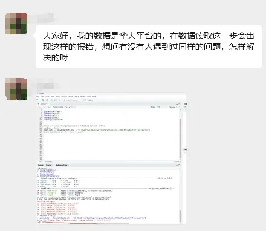
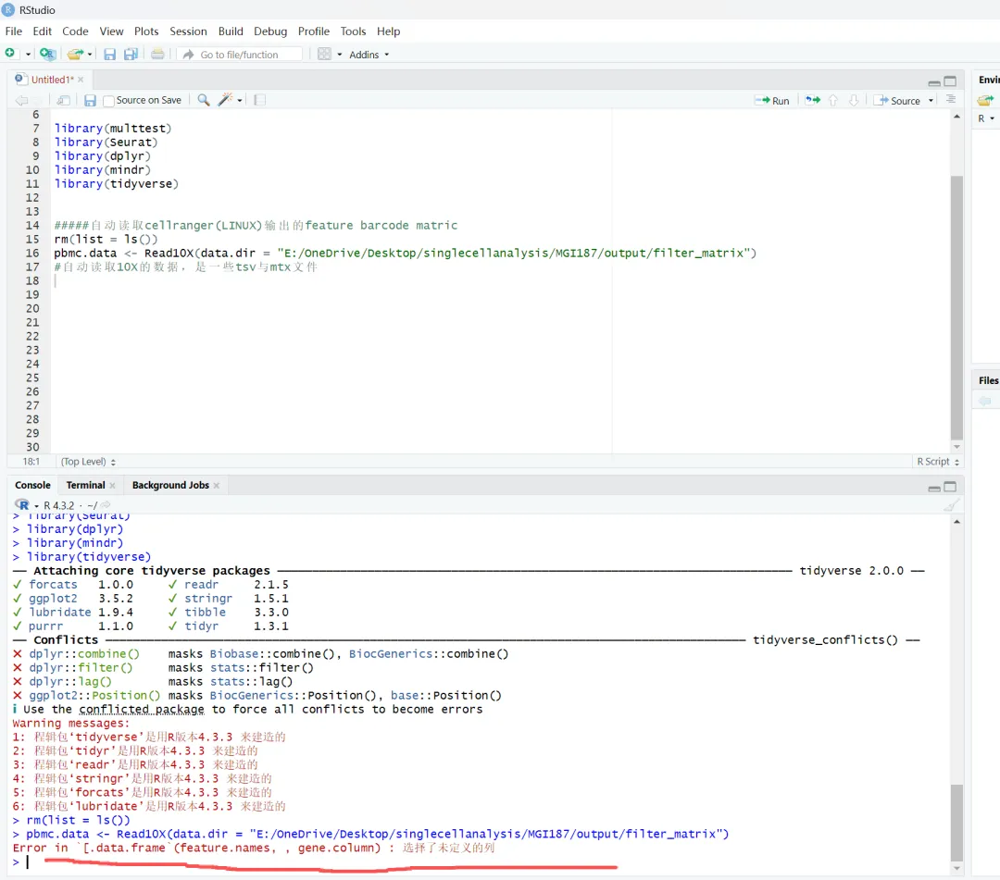
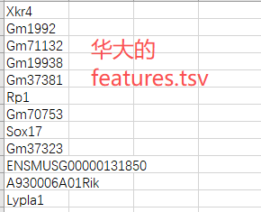
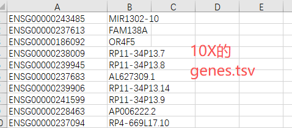
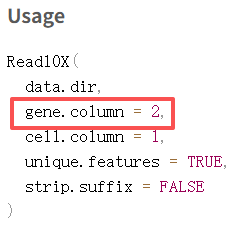
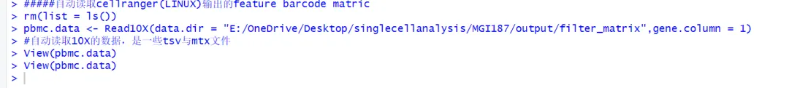
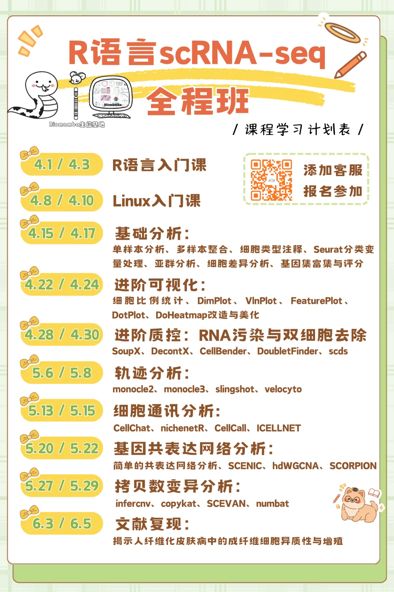
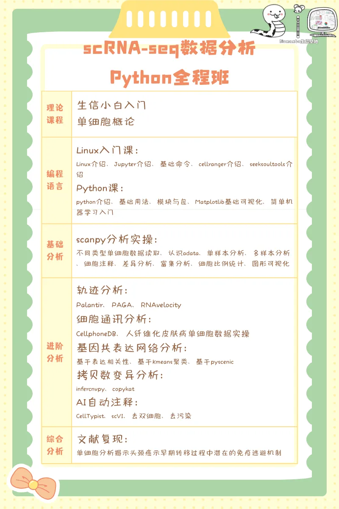

# 掌握数据格式，才不怕报错

> 原文：https://mp.weixin.qq.com/s?__biz=MzAwMzIzOTk5OQ==&mid=2247535927&idx=1&sn=6a24970ba3c55977ac8b6799fb7f2c06&chksm=9b3c3467ac4bbd711f1405c02db9e4426d159d958d7190bb04d4a60f33624bcd64eb4c8221d1#rd
> 合集：答读者问

**一、写在前面**

有小伙伴在交流群中表示出师不利，还没开始分析，读取数据便遇到了报错，用Read10X()读取[华大](<https://mp.weixin.qq.com/s?__biz=MzAwMzIzOTk5OQ==&mid=2247533649&idx=1&sn=1cbe6e3116527a14c239f4e6fa2ab553&scene=21#wechat_redirect>)的单细胞矩阵时报错"Error in `[.data.frame` (feature.names, ,gene.column) : 选了未义的列"。
本教程基于Linux环境的[Rstudio](<https://mp.weixin.qq.com/s?__biz=MzAwMzIzOTk5OQ==&mid=2247524106&idx=1&sn=f23405302a3705007d33b688870196e0&scene=21#wechat_redirect>)演示，计算资源不足的同学可参考：

[足够支持你完成硕博生涯的生信环境](<https://mp.weixin.qq.com/s?__biz=MzAwMzIzOTk5OQ==&mid=2247511780&idx=1&sn=3acc0874f7d2fa75f1abbe7a9a9b4069&chksm=9b3cd7b4ac4b5ea27d4d53964e4a4a9fa8c806a19103729dd4ff0fa72e621411f46a251d269f&scene=21&token=1904068475&lang=zh_CN#wechat_redirect>)

[忘记宣传了，独享用户连技术支持都是独享的](<https://mp.weixin.qq.com/s?__biz=MzAwMzIzOTk5OQ==&mid=2247529475&idx=1&sn=10827e982a637e0fc36e4b6e857736c8&scene=21&token=1904068475&lang=zh_CN&poc_token=HF-eN2mj01zsfxe_I4r8D5pfZx80xO2AVYSB6qtT#wechat_redirect>)

[RTX5090、4080S、5070显卡上机](<https://mp.weixin.qq.com/s?__biz=MzAwMzIzOTk5OQ==&mid=2247529840&idx=1&sn=704b0a3d60a17c5bc2445d54c97b834f&scene=21#wechat_redirect>)访问链接：https://biomamba.xiyoucloud.net/
如果需要[单细胞数据分析](<https://mp.weixin.qq.com/s?__biz=MzAwMzIzOTk5OQ==&mid=2247535408&idx=1&sn=1f3b4b99bab378887d11dd83fd87feb7&scene=21#wechat_redirect>)[教学](<https://mp.weixin.qq.com/s?__biz=MzAwMzIzOTk5OQ==&mid=2247535408&idx=1&sn=1f3b4b99bab378887d11dd83fd87feb7&scene=21#wechat_redirect>)、生信热点[全文复现](<https://mp.weixin.qq.com/mp/appmsgalbum?__biz=MzAwMzIzOTk5OQ==&action=getalbum&album_id=2981710763847614469#wechat_redirect>)、自测数据个性化分析辅导、[常态化实验学习](<https://mp.weixin.qq.com/s?__biz=MzAwMzIzOTk5OQ==&mid=2247530174&idx=1&sn=c3b0499adcc9093546e4ba1cfffba7bd&scene=21#wechat_redirect>)，欢迎联系客服微信[Biomamba_zhushou]。

**二、有问题就有答案**

显然这不能怪10X和华大，更不能怪Seurat，每个平台有自己输出文件的习惯很正常，此前我们演示过[华大C4平台scRNA-seq定量分析](<https://mp.weixin.qq.com/s?__biz=MzAwMzIzOTk5OQ==&mid=2247533649&idx=1&sn=1cbe6e3116527a14c239f4e6fa2ab553&scene=21#wechat_redirect>)流程，输出的features.tsv.gz文件中只包含了一列Gene的Symbol，而10X的genes.tsv第一列是ENS编号，第二列才是基因Symbol：
但Read10X()默认读取第二列作为gene名，显然，你不能读取一个不存在的列：
这是个古老的问题([答读者问（八）为什么Read10X也会报错?](<https://mp.weixin.qq.com/s?__biz=MzAwMzIzOTk5OQ==&mid=2247485012&idx=1&sn=6007c8d7cb2a236dd7240a678dac0391&scene=21#wechat_redirect>))，所以这位同学遇到的报错只需要在Read10X()函数中设置一下gene.column=1即可。一个简单的问题落在小白的身上就是一座山([突然想起学单细胞走过的弯路](<https://mp.weixin.qq.com/s?__biz=MzAwMzIzOTk5OQ==&mid=2247533491&idx=1&sn=1dd2fe09639fcb52ac5be6d2af2b77b6&scene=21#wechat_redirect>))事实上如果你对R语言和单细胞足够了解，你完全可以不用Read10X()函数：

  *   *   *   *   *   *

```r
# 加载包：library(Matrix)# 读取填充值：mymatrix <- readMM(gzfile('matrix.mtx.gz'))# 转换为dgC矩阵mymatrix <- as(mymatrix,'dgCMatrix')
```

  *   *   *

```r
# 读取基因：feature <- read.table(gzfile('features.tsv.gz'))feature <- feature[,1]# SYMBOL在第二列就写2
```

  *   *   *

```r
# 读取barcodebarcodes <- read.table(gzfile('barcodes.tsv.gz'))barcodes <- barcodes[,1]# barcode在第几列就填几
```

  *   *   *   *

```r
# 合并矩阵并创建Seurat对象rownames(mymatrix) <- feature # 行名为基因名colnames(mymatrix) <- barcodes scRNA <- Seurat::CreateSeuratObject(mymatrix)
```

**三、少走弯路**

少走弯路，更多单细胞分析技巧可见：[限时回归！两个月时间，手把手教会你scRNA-seq数据分析！](<https://mp.weixin.qq.com/s?__biz=MzAwMzIzOTk5OQ==&mid=2247535408&idx=1&sn=1f3b4b99bab378887d11dd83fd87feb7&scene=21#wechat_redirect>)[82h搞定scRNA-seq分析全流程(Python版)](<https://mp.weixin.qq.com/s?__biz=MzAwMzIzOTk5OQ==&mid=2247534762&idx=2&sn=60d56d856036cf523f1dfcf7ea284d18&scene=21#wechat_redirect>)[](<https://mp.weixin.qq.com/s?__biz=MzAwMzIzOTk5OQ==&mid=2247535408&idx=1&sn=1f3b4b99bab378887d11dd83fd87feb7&scene=21#wechat_redirect>)
[](<https://mp.weixin.qq.com/s?__biz=MzAwMzIzOTk5OQ==&mid=2247534762&idx=2&sn=60d56d856036cf523f1dfcf7ea284d18&scene=21#wechat_redirect>)


**如何联系我们**

 留一个领取[资料](<https://mp.weixin.qq.com/s?__biz=MzAwMzIzOTk5OQ==&mid=2247532585&idx=1&sn=e265d2846ec66e5faaaf21403d274d2f&scene=21#wechat_redirect>)、[开箱即用的单细胞分析镜像](<https://mp.weixin.qq.com/s?__biz=MzAwMzIzOTk5OQ==&mid=2247528410&idx=2&sn=0f2bac25479cf8d20dab5d82ae986f2e&scene=21#wechat_redirect>)的**微信号[Biomamba_zhushou]**，方便各位随时交流。同时我们也构建了[交流群矩阵](<https://mp.weixin.qq.com/s?__biz=MzAwMzIzOTk5OQ==&mid=2247528057&idx=1&sn=bb348c2a88c977c7cce67ee6731a3591&scene=21#wechat_redirect>)，欢迎大家入群讨论。
大家可以阅读完这几篇之后添加[给生信入门初学者的小贴士](<http://mp.weixin.qq.com/s?__biz=MzAwMzIzOTk5OQ==&mid=2247493329&idx=1&sn=597870b7f7ce10346da3561e7c281627&chksm=9b3c9f81ac4b169794088ce9abbcacb5f18e9fd174fc0d7e28da62d78facadf3100ef38aaf22&scene=21#wechat_redirect>)
[没有检索，就没有发言权](<https://mp.weixin.qq.com/s?__biz=MzAwMzIzOTk5OQ==&mid=2247529398&idx=2&sn=5a429852d61721916a405712677d5905&scene=21#wechat_redirect>)

**已有生信基地联系方式的同学****无需重复添加**

 您点的每个赞和在看，我都认真当成了喜欢
