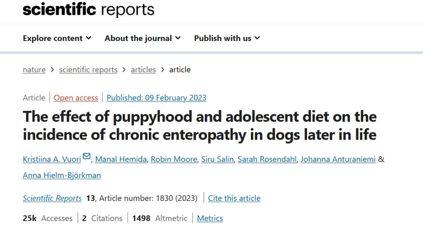
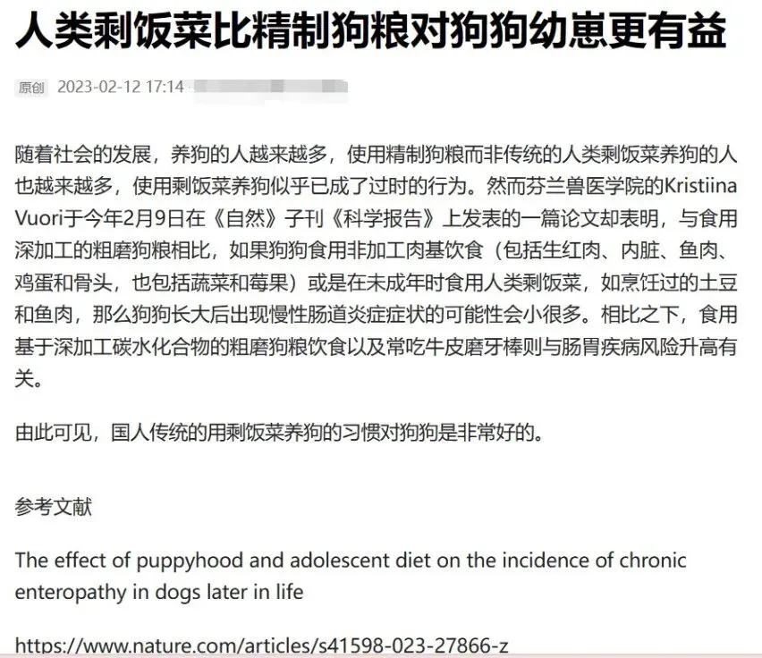
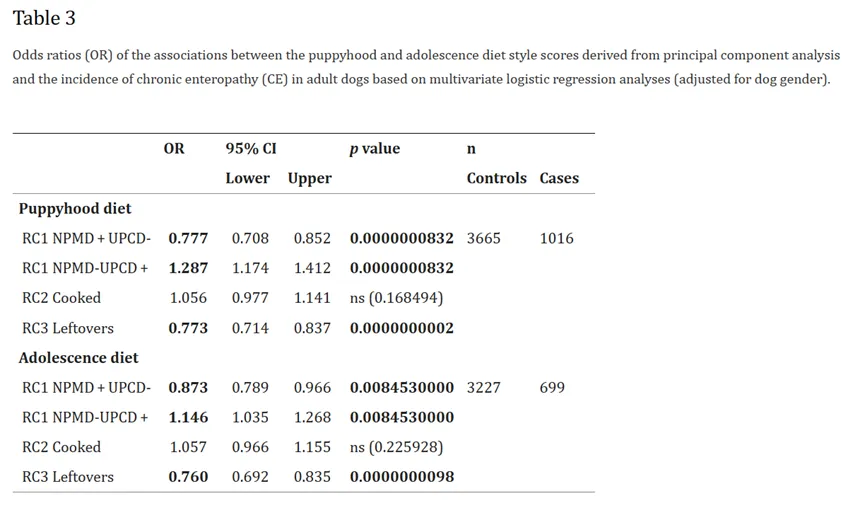
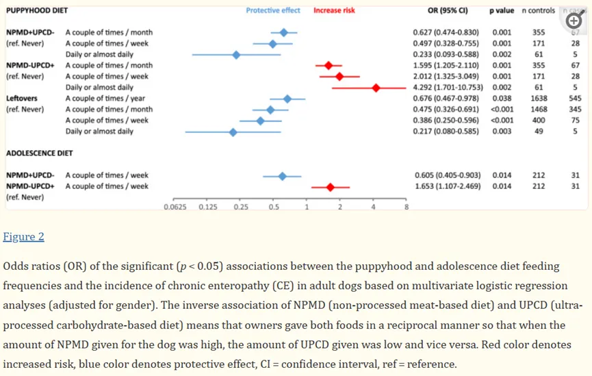
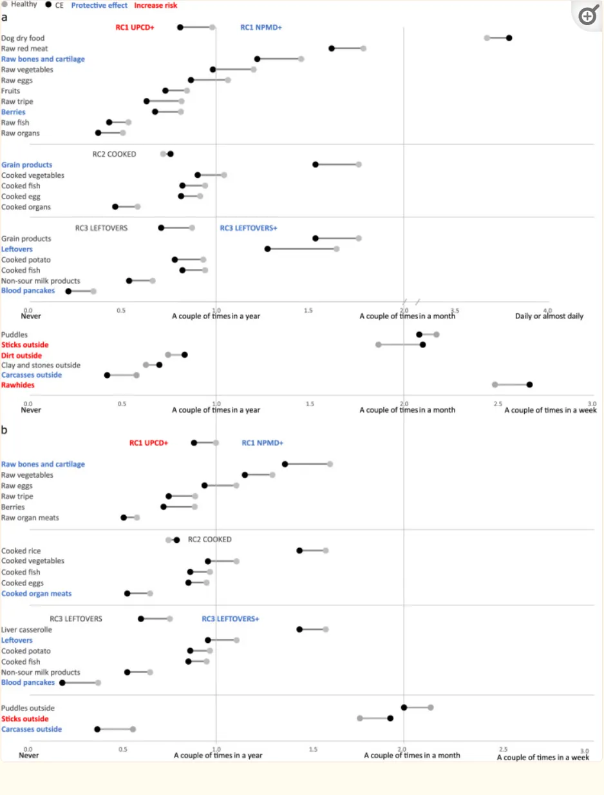
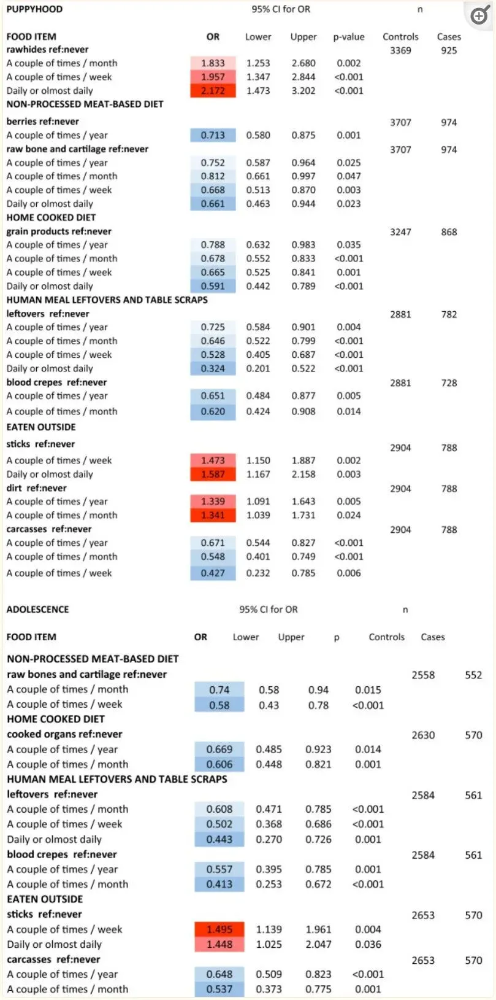
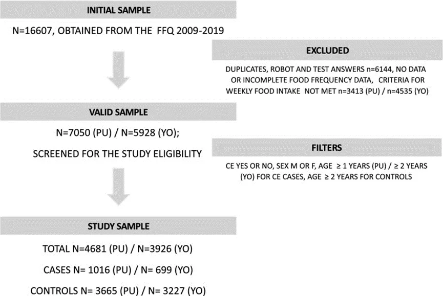

# 狗粮还是剩菜？

> 原文：https://mp.weixin.qq.com/s?__biz=MzAwMzIzOTk5OQ==&mid=2247510366&idx=1&sn=5131bf8857ef6da015ea8876cdda15e3&chksm=9b3cd00eac4b591804a03340a6205affb2527a576e9678e0ee0d9c0f7267d600985461690bf3#rd
> 合集：文献速递

**写在前面**

“狗狗是吃狗粮好还是吃剩饭剩菜好”，关于这个问题的争论从未停止。有的人认为，狗粮是现代科技的产物，其配比和成分为狗狗量身定做，更适合狗狗的生长发育；有的人则认为狗粮太单一，在实际生活中，吃剩饭剩菜的狗狗营养更好，抵抗力更强……去年发表于“scientific reports”上的一篇名为“The effect of puppyhood and adolescent diet on the incidence of chronic enteropathy in dogs later in life”的文章对“伴侣犬的早期生活饮食方式和食物与主人报告的晚年慢性肠病发病率的关联”进行了探索，用科学的实验方法回答了上述争论。我们一起去一探究竟。

**原文链接：** https://pubmed.ncbi.nlm.nih.gov/36759678/**IF:** 4.6**doi:** 10.1038/s41598-023-27866-z.

**一、实验结论**

本研究证实了伴侣犬幼犬和青春期饮食与成年后发生慢性肠病的趋势之间存在显著关联。喂食**非加工肉类饮食** 和**人类餐剩菜和餐桌残渣** ，被发现可以在以后的生活中**预防** 慢性肠病。特别是生骨头和软骨、浆果和剩菜被发现是有益的。在幼犬期和青春期主要或完全喂食以超加工的**干狗粮** （粗磨）为基础的饮食，被发现是晚年慢性肠病风险的重要潜在**危险因素** 。

**二、小编感慨**

小编曾经也看到过一些报道，诸如以下图片中展示的那样绝对。读完文章后，小编想请大家注意的是，这篇文章的作者团队来自**芬兰** ，所说的剩菜剩饭也是芬兰菜肴的剩菜剩饭，如鱼和肉、蔬菜和根茎、蘑菇、酪乳、其他发酵乳制品、浆果和全谷物产品组成（黑麦面包和燕麦片）。很显然和我国的剩菜剩饭还是有很大区别的。咱不能说看完这类报道，就觉得人家科学家都说喂狗狗剩菜比狗粮好，咱就咔咔咔，剩的水煮肉片管上，剩的剁椒鱼头管上……很多事情不是非黑即白的，一些过油过盐的剩菜反而会对狗狗的身体造成负担，不能用简单的“人类剩饭菜”就代表所有情况；对狗粮来说，怎么知道我们买的“狗粮”是我们认为的狗粮，毕竟我的”淀粉肠“也不是我认为的淀粉肠😭。当然，就这篇文章来说，新鲜的食物和文章中使用的芬兰的剩菜是一定是比干狗粮更加健康的。对于我们来说，怎么能够买到**正常****新鲜** 的食物，剩菜是什么样的剩菜，就得大家自行体会了。

**三、饮食介绍**

本文的饮食的种类主要划分为以下4种：

●RC1（非加工肉类饮食）：所有属于非加工的肉类饮食。文章中称为NPMD（生红肉、内脏、鱼、蛋、牛肚、骨头和软骨、蔬菜、浆果和水果）、脂肪补充剂（鱼和植物油、动物脂肪）。

●RC2（煮熟的家常饮食）:熟红肉、家禽、内脏、鱼、蛋、牛肚、骨头和软骨、蔬菜、大米和谷物制品等，作为狗的家常饭菜提供。

●RC3（人类食物**剩菜** 和餐桌残渣）:人类的各种剩菜食物，如各种吃剩的烹饪加工过的肉类，米饭等。

●以超加工的**干狗粮** （粗磨）为基础的饮食：文章中称为UPCD。

**四、实验结果******

**1、幼犬期和青春期的饮食方式会影响以后生活中慢性肠病的发生率**

●犬在幼年（ _p_ < 0.001）和青春期（ _p_ = 0.008）期间吃以超加工碳水化合物饮食以基础的饮食（低RC1评分）对未来的晚年慢性肠病发病率有显著的诱发作用。且饮食对犬晚年慢性肠病的影响在**幼年犬** 数据中更为明显。

●犬在幼年和青春期期间吃人类的剩饭剩菜和餐桌残渣（高RC3评分）对未来的晚年慢性肠病发病率有显著的保护作用（ _p_ < 0.001），而煮熟的家常饮食（高RC2评分）没有显著影响。

●犬幼年期非加工肉类饮食（高RC1评分）的喂养频率增加时，即每月给予更频繁的非加工肉类饮食时，晚年慢性肠病的几率显著**降低** （ _p_ < 0.05）。

●犬幼年期以超加工的干狗粮（粗磨）为基础的饮食的喂养频率增加时，晚年慢性肠病的几率显著**增加** （ _p_ < 0.05）

●犬幼年期剩菜的饲喂频率增加时，晚年慢性肠病的几率也**显著降低** （ _p_ < 0.05）.

●犬青春期，每周喂食几次非加工肉类饮食对晚年慢性肠病风险有显著（ _p_ < 0.05）的降低作用。相反，犬青春期每周喂食几次以超加工的干狗粮（粗磨）为基础的饮食会显著（ _p_ < 0.05）**增加 晚年慢性肠病的风险**。

**2、****在幼犬期和青春期食用的单一食物会影响未来的慢性肠病发病率**

●犬在幼年和青春期期间食用的生骨头和软骨与晚年慢性肠病风险发病率降低显著相关。

●在幼犬期间每年吃几次浆果、谷物产品与晚年慢性肠病风险发病率发病率降低显著相关。

●在青春期间食用的熟器官与未来晚年慢性肠病风险发病率降低显著相关。

●犬在幼年和青春期期间吃的剩菜和血煎饼与发病率降低显著相关。

**五、讨论**

●与喂食 UPCD（干狗粮）的狗相比，喂食 NPMD 已被证明可以刺激狗体内平衡胃肠道微生物组的生长，包括与蛋白质和脂肪利用相关的细菌相对丰度的增加。这些属的成员还通过蛋白质和氨基酸发酵产生丁酸盐，从而有助于肠道稳态。●生命早期接触的微生物越多，成年后的免疫系统就越发达。●新鲜食材，包括作为纤维和植物营养素来源的蔬菜和根茎，是NPMD的一部分。它们含有多种微生物，其中许多可能对肠道健康有益。不可消化和可溶的纤维，它们充当益生元，在结肠中由细菌发酵，产生促进肠道健康的短链脂肪酸。●健康的人可能会共享口腔居民的有益微生物，如唾液链球菌，与他们的狗一起，通过与餐具和手接触转移到小狗身上。此外，给狗提供剩菜剩饭表明人与犬之间的联系更加紧密，减少了小狗的压力，并对狗及其主人的免疫系统产生了积极影响。

**六、实验方法**

本篇文章使用的实验方法为**主成分分析法** 和**logistic回归分析法** ，在这里不进行过多的叙述，感兴趣的同学可以打开原文观看学习。**原文链接：** https://pubmed.ncbi.nlm.nih.gov/36759678/

**如何联系我们**

 公众号后台消息回复不便，这里给大家留一下领取资料及免费服务器([足够支持你完成硕博生涯的生信环境](<http://mp.weixin.qq.com/s?__biz=MzAwMzIzOTk5OQ==&mid=2247507693&idx=1&sn=d9517a0803ad75cb7be430806834e7b8&chksm=9b3ca7bdac4b2eaba1ad01ed04ab1fbcbafcf4f6ddfe9e4f76ed9229707f545fe7d9c9ffd6ae&scene=21#wechat_redirect>))的**微信号** ，方便各位随时交流、提建议（别问在么，添加时直接说来意）。此外呼声一直很高的**交流群** 也建好了，欢迎大家入群讨论：

[永久免费的生信、科研交流群](<http://mp.weixin.qq.com/s?__biz=MzAwMzIzOTk5OQ==&mid=2247505868&idx=2&sn=20c81313eaef9a7031a84ef3a691d1b5&chksm=9b3cae9cac4b278a42c8de97e864c7664a37e9a4adb5973625fe3f8dd1093e55aeda88d443aa&scene=21#wechat_redirect>)

大家可以阅读完这几篇之后添加[给生信入门初学者的小贴士](<http://mp.weixin.qq.com/s?__biz=MzAwMzIzOTk5OQ==&mid=2247493329&idx=1&sn=597870b7f7ce10346da3561e7c281627&chksm=9b3c9f81ac4b169794088ce9abbcacb5f18e9fd174fc0d7e28da62d78facadf3100ef38aaf22&scene=21#wechat_redirect>)
[如何搜索公众号过往发布内容](<http://mp.weixin.qq.com/s?__biz=MzAwMzIzOTk5OQ==&mid=2247506266&idx=2&sn=22b1164bc9602c25620d058847785422&chksm=9b3ca00aac4b291c16d738271746ffb90149282a728f484e8a1952463c46a8e7dc4f883ab928&scene=21#wechat_redirect>)

您点的每个赞和在看，我都认真当成了喜欢
