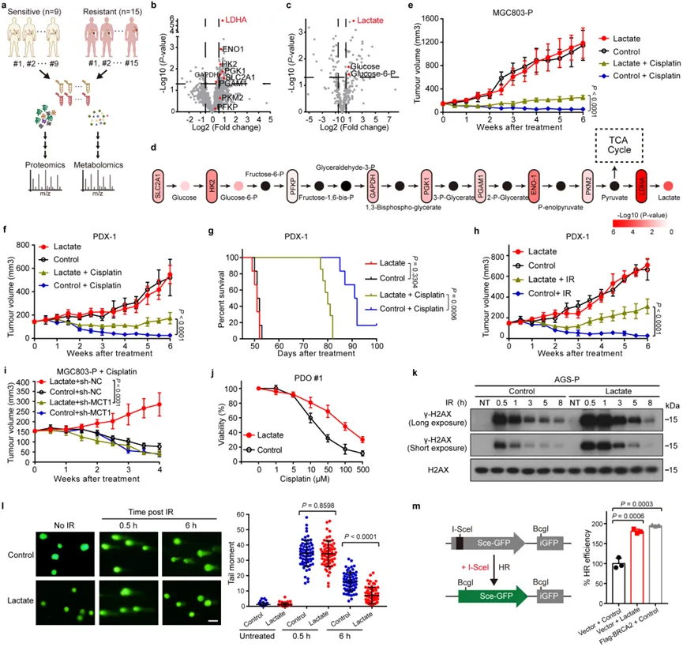
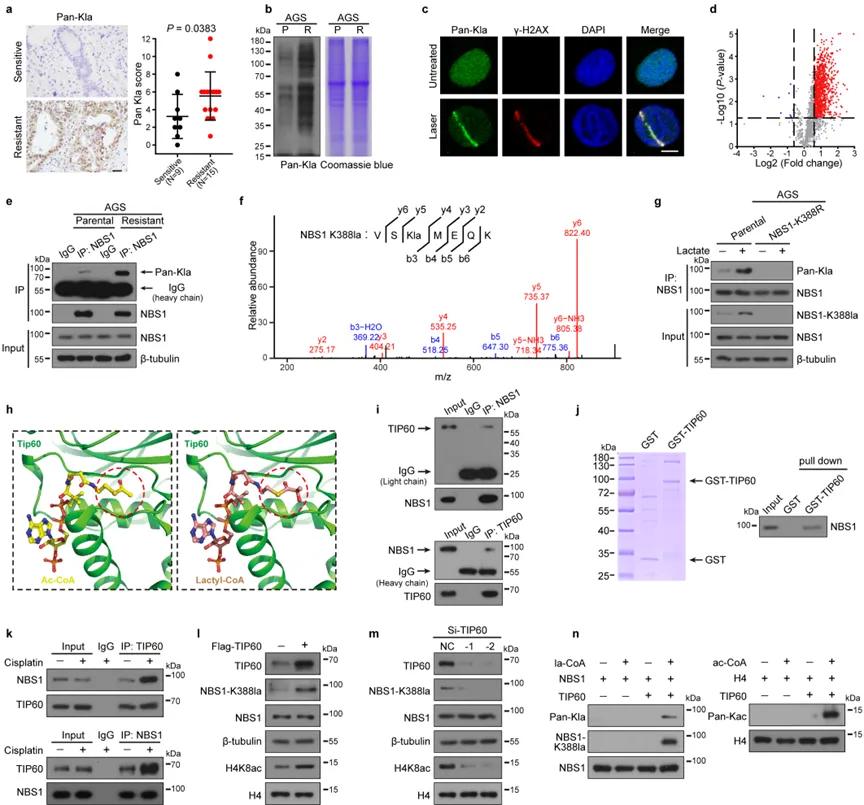
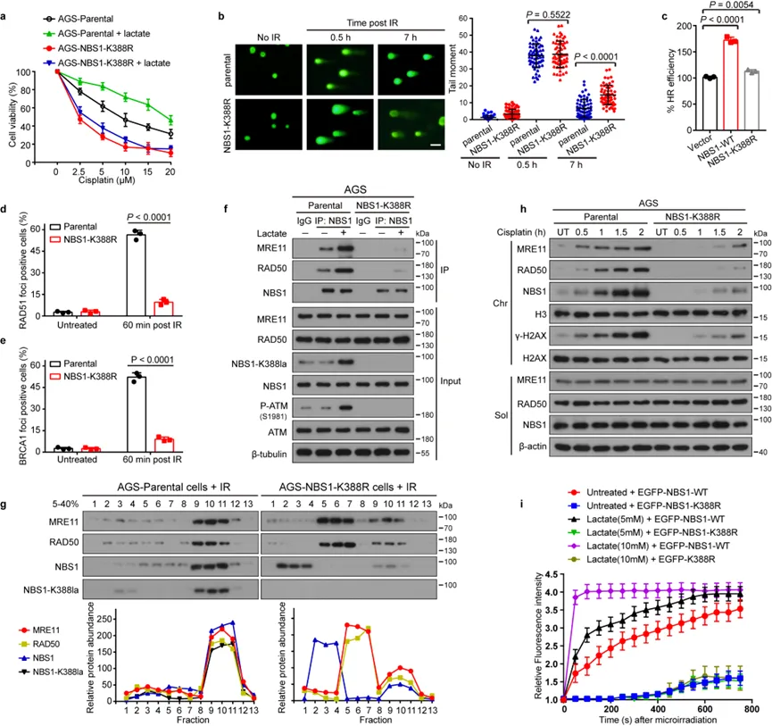
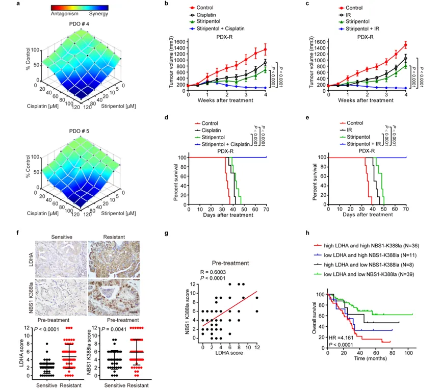
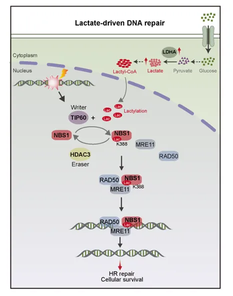

# 2024年，Warburg效应依旧能发《Nature》！

> 原文：https://mp.weixin.qq.com/s?__biz=MzAwMzIzOTk5OQ==&mid=2247519934&idx=1&sn=b81f55682930f0a6813c9cce0a3035b4&chksm=9b3cf7eeac4b7ef8c2d7b4c6dd6c44f6a703b4c8fca7f6ad6b3428a6c1a310b8a3f63fd7643a#rd
> 合集：文献速递

**一、主要内容**

**解码肿瘤糖代谢百年之谜揭示** 司替戊醇化疗增敏剂新作用

●肿瘤细胞的糖代谢特点之一是即使在有氧条件下，它们也倾向于通过无氧糖酵解途径代谢葡萄糖，而不是选择更有效率的线粒体氧化磷酸化，这一现象被称为Warburg效应。Warburg效应最早由Otto Warburg于1923年提出，并因此获得1931年诺贝尔奖，但科学家对于肿瘤为何通过糖酵解代谢供能、有何功能作用仍不清楚，至今已有百年未解。

●Warburg效应导致乳酸在癌细胞中积累，其在癌症代谢中的具体角色，尤其是对DNA修复和化疗耐药的影响，仍不完全清楚。中山大学附属第七医院何裕隆、张常华教授团队联合中山大学孙逸仙纪念医院、英国癌症研究院在国际顶尖期刊Nature发表论文，揭示乳酸通过NBS1蛋白乳酸化修饰在DNA修复和化疗耐药中的关键作用，提供对癌症治疗的新策略和新靶点。

●研究团队通过蛋白质组学和代谢组学，分析新辅助化疗敏感或耐药的胃癌肿瘤组织标本，发现在耐药肿瘤组织中，糖酵解通路显著上调，乳酸水平显著上升。乳酸在小鼠PDX模型和类器官模型中能够降低化疗的抗肿瘤效果，**即乳酸促进了荷瘤小鼠的化疗耐药，** 这表明乳酸在肿瘤耐药中扮演重要角色，但机制不明。进一步研究发现，**乳酸可以显著增强****DNA****同源重组修复（****homologous recombination repair, HRR****）** 。肿瘤细胞在经受化疗造成DNA损伤后，乳酸能够快速修复受损的DNA，从而降低治疗效果，导致耐药发生**（图****1****）** 。

**图****1****乳酸增强肿瘤细胞****DNA****修复和肿瘤化疗耐药**

●接下来，研究人员研究了乳酸是否通过乳酸化修饰促进肿瘤细胞对化疗耐药。实验发现，**乳酸化修饰在化疗耐药肿瘤细胞系及化疗耐药患者肿瘤组织样本中显著上调，** 进一步验证了乳酸化修饰在肿瘤耐药中的重要功能作用，但其调控的关键底物蛋白仍未知。研究团队使用4D-无标记乳酸化修饰蛋白质组学分析，筛选到乳酸化修饰底物蛋白为NBS1。

●NBS1（Nijmegen breakage syndrome protein 1）基因，即奈梅亨断裂综合征蛋白1。NBS1突变可导致一种以染色质不稳定为特征的Nijmegen断裂综合征，主要表现为表现为生长迟缓、智力障碍、免疫缺陷、细胞周期检查点缺失、癌症风险增加以及对电离辐射敏感等。研究发现NBS1蛋白可与MRE11和RAD50蛋白形成一个MRE11-RAD50-NBS1（MRN）复合物，在DNA的复制和DNA双链断裂的修复等过程中起重要作用，主要包括DNA双链断裂部位的识别和启动HRR。**乳酸化修饰质谱提示****NBS1****蛋白存在乳酸化修饰，且****NBS1****蛋白乳酸化修饰在耐药的肿瘤细胞系中显著上调。乳酸可进一步增强****NBS1****蛋白的乳酸化修饰。**

●通过乳酸化修饰质谱和免疫共沉淀等实验，研究团队鉴定并验证出NBS1蛋白上的乳酸化修饰位点位于第388位赖氨酸（K388），并开发了特异性抗体用于检测这一修饰。Co-IP质谱实验显示，乙酰基转移酶TIP60蛋白与NBS1蛋白存在相互作用。通过实验验证，**TIP60****被确定为****NBS1****的乳酸化酶，即****TIP60****通过直接与****NBS1****相互作用，乳酸化修饰****NBS1****蛋白。** 且TIP60的这一作用在乳酸和顺铂处理下显著增强。相反，组蛋白去乙酰化酶HDAC3被确定为NBS1的去乳酸化酶，通过与NBS1的相互作用去除这种修饰，抑制其乳酸化水平。这一发现通过基因编辑和体外实验得到证实，揭示了乳酸化修饰的动态调控机制**（图****2****）** 。

**图****2****乳酸诱导****NBS1 K388****乳酸化，****TIP60****介导****NBS1 K388****乳酸化******

● 研究人员进一步研究NBS1 K388乳酸化在DNA损伤修复中的潜在作用。研究发现K388乳酸化修饰对于NBS1在DNA损伤修复中的功能至关重要。**乳酸促进肿瘤耐药依赖于****NBS1****蛋白****K388****位乳酸化修饰。****K388****乳酸化修饰后的****NBS1****蛋白能够更有效地招募和组装****MRN****复合体，并促进****HRR****蛋白在****DNA****双链断裂部位募集，导致放化疗抵抗。** 深入的分子机制实验提示：乳酸化修饰是NBS1蛋白与MRE11相互作用所必须的，K388乳酸化修饰位点位于NBS1与MRE11的接触面，K388乳酸化修饰改变NBS1蛋白构象，促使NBS1蛋白和MRE11结合形成MRN复合物，MRN复合物快速募集到DNA损伤部位，增强其在DNA损伤修复中的功能**（图****3****）** 。

**图****3 NBS1 K388****乳酸化通过促进****MRN****复合体形成促进****DNA****修复******

● 然而，肿瘤细胞内的乳酸来源仍不明确。既往研究表明，肿瘤细胞中的乳酸主要有两个来源：1、细胞内产生，由肿瘤细胞中的乳酸脱氢酶LDHA产生乳酸；2、细胞外摄取，由定位于肿瘤细胞膜的单羧基转运蛋白MCT1将肿瘤微环境中的乳酸摄取进入细胞内。进一步实验显示，LDHA在耐药株中高表达，而MCT1表达量无显著差异。**表明肿瘤耐药细胞中的乳酸主要通过****LDHA****在细胞内代谢产生。** 进一步实验研究LDHA的生物学功能发现：LDHA促进了NBS1蛋白K388乳酸化修饰；LDHA促进DNA修复依赖于NBS1蛋白K388乳酸化修饰；LDHA和NBS1蛋白乳酸化修饰在耐药患者肿瘤中显著上调且呈正相关；LDHA高表达和NBS1蛋白乳酸化修饰高表达的提示预后不良。综上所述，NBS1乳酸化修饰促进DNA损伤修复及化疗抵抗，导致临床预后不良，**而****LDHA****是这一过程的关键酶。******

● 研究团队发现靶向LDHA，抑制乳酸的产生，可以显著降低NBS1的乳酸化修饰水平，破坏肿瘤细胞的DNA修复机制。这一发现为开发新的抗癌疗法提供了新的思路，**即抑制乳酸代谢、靶向****LDHA****能否逆转肿瘤化疗抵抗？** 司替戊醇（Stiripentol）是一种已被欧洲药品管理局批准用于治疗难治性癫痫的药物，是目前研究最深入的LDHA抑制剂。

●研究发现，司替戊醇可阻断胃癌细胞乳酸的产生，抑制NBS1 K388的乳酸化修饰，从而降低DNA修复效率并克服肿瘤放化疗耐药性。研究在肿瘤患者来源的类器官和异种移植模型中得到证实，司替戊醇与顺铂或IR联合使用，表现出高度协同效应，削弱肿瘤细胞的DNA修复能力并提高放化疗的效果，显著抑制肿瘤生长并延长小鼠的生存期**（图****4****）** 。

**图****4** 司替戊醇**克服肿瘤的放化疗耐药，新辅助化疗耐药肿瘤中****LDHA****和****NBS1 K388****乳酸化水平升高******

**● 由于司替戊醇已在临床上广泛应用，其安全性和药效已得到验证。因此，将其用于肿瘤耐药的临床研究具有极高的临床转化价值，****LDHA****有望成为放化疗增敏新靶点。** 这一发现为开发新的抗癌疗法提供了新的思路，并有望迅速应用于临床。

●目前，研究团队已经**申请了司替戊醇的肿瘤治疗专利，并启动了相关临床研究，招募患者进行临床试验：司替戊醇联合免疫靶向化疗用于常规治疗无效的腹膜转移癌患者单臂前瞻性****2****期临床试验（注册号：****ChicTR2400083649****）。** 此次试验将验证司替戊醇在实际临床中的疗效和安全性，特别是针对那些对常规治疗无效的癌症患者。如果试验成功，这将为癌症治疗带来革命性的变化，极大地提高放化疗的成功率，造福广大肿瘤耐药患者。

●本研究揭示了乳酸在肿瘤代谢中的重要角色，通过NBS1 K388乳酸化修饰，显著增强了DNA修复效率，导致化疗耐药性。TIP60作为乳酸化酶，HDAC3作为去乳酸化酶，分别调控这一修饰的动态平衡。通过抑制乳酸代谢，特别是使用LDHA抑制剂，可以有效降低NBS1 K388乳酸化水平，克服化疗耐药性，显著改善癌症患者的预后。

**图****5****本研究的机制示意图******

**二、学术贡献**

本研究主要取得了以下两大突破性学术贡献：

**1****、揭示****Warburg****效应介导的肿瘤耐药机制：** 研究揭示了乳酸在肿瘤耐药中的关键作用，乳酸通过促进NBS1的乳酸化修饰，增强了肿瘤细胞的DNA损伤修复能力，使其在放化疗损伤后迅速启动修复，降低了治疗效果，导致耐药发生。**这一发现定义了乳酸化作为抗肿瘤耐药的新靶点。******

**2****、首次发现可阻断****DNA****损伤修复的靶向药物司替戊醇：** 研究证明，司替戊醇可以抑制乳酸的产生，降低NBS1的乳酸化修饰水平，从而破坏肿瘤细胞的DNA修复机制，提高放化疗的疗效。**作为一种老药新用，司替戊醇具有极高的临床转化价值，有望为放化疗耐药患者带来新的治疗选择。******

此次研究不仅在基础科学领域取得了重大突破，更为临床治疗提供了新的方向，标志着从基础研究到临床应用的重要一步。研究团队已启动临床试验，期待能够早日为胃癌、肠癌等耐药性肿瘤患者带来福音。未来研究应继续探索乳酸化在其他 DNA修复蛋白中的作用机制，评估不同癌症类型中NBS1乳酸化修饰的普遍性和临床相关性。此外，开发针对乳酸代谢和NBS1乳酸化修饰的新型治疗方法，有望为癌症治疗带来新的突破。通过更深入的分子机制研究和临床试验，将这一发现转化为有效的治疗策略，最终改善癌症患者的生存率和生活质量。

张常华教授、尹东教授、Axel Behrens教授、何裕隆教授是本文的共同通讯作者，陈恒星博士、李贇博士、李华福博士是共同第一作者。本研究得到了以下项目的资助：国家重点研发计划、国家自然科学基金，中国博士后科学基金，中国国家博士后创新人才支持计划，广东省科技厅广东省消化系统肿瘤重点实验室，深圳市“三名工程”，深圳市重点学科建设基金，深圳市可持续发展项目，深圳基础研究项目，以及粤港澳联合研究计划。

**三、相关信息**

文章题目：NBS1 lactylation is required for efficient DNA repair and chemotherapy resistance

DOI：10.1038/s41586-024-07620-9

Online paper*

https://www.nature.com/articles/s41586-024-07620-9

文稿撰写及修改：叶良涛，邓存灿

**如何联系我们**

 公众号后台消息回复不便，这里给大家留一下领取资料及免费服务器([足够支持你完成硕博生涯的生信环境](<http://mp.weixin.qq.com/s?__biz=MzAwMzIzOTk5OQ==&mid=2247507693&idx=1&sn=d9517a0803ad75cb7be430806834e7b8&chksm=9b3ca7bdac4b2eaba1ad01ed04ab1fbcbafcf4f6ddfe9e4f76ed9229707f545fe7d9c9ffd6ae&scene=21#wechat_redirect>))的**微信号** ，方便各位随时交流、提建议（别问在么，添加时直接说来意）。此外呼声一直很高的**交流群** 也建好了，欢迎大家入群讨论：

[永久免费的生信、科研交流群](<http://mp.weixin.qq.com/s?__biz=MzAwMzIzOTk5OQ==&mid=2247505868&idx=2&sn=20c81313eaef9a7031a84ef3a691d1b5&chksm=9b3cae9cac4b278a42c8de97e864c7664a37e9a4adb5973625fe3f8dd1093e55aeda88d443aa&scene=21#wechat_redirect>)

大家可以阅读完这几篇之后添加[给生信入门初学者的小贴士](<http://mp.weixin.qq.com/s?__biz=MzAwMzIzOTk5OQ==&mid=2247493329&idx=1&sn=597870b7f7ce10346da3561e7c281627&chksm=9b3c9f81ac4b169794088ce9abbcacb5f18e9fd174fc0d7e28da62d78facadf3100ef38aaf22&scene=21#wechat_redirect>)
[如何搜索公众号过往发布内容](<http://mp.weixin.qq.com/s?__biz=MzAwMzIzOTk5OQ==&mid=2247506266&idx=2&sn=22b1164bc9602c25620d058847785422&chksm=9b3ca00aac4b291c16d738271746ffb90149282a728f484e8a1952463c46a8e7dc4f883ab928&scene=21#wechat_redirect>)

您点的每个赞和在看，我都认真当成了喜欢
