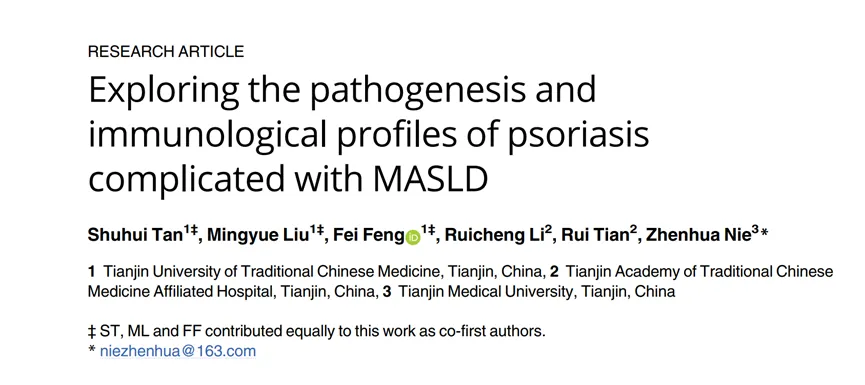
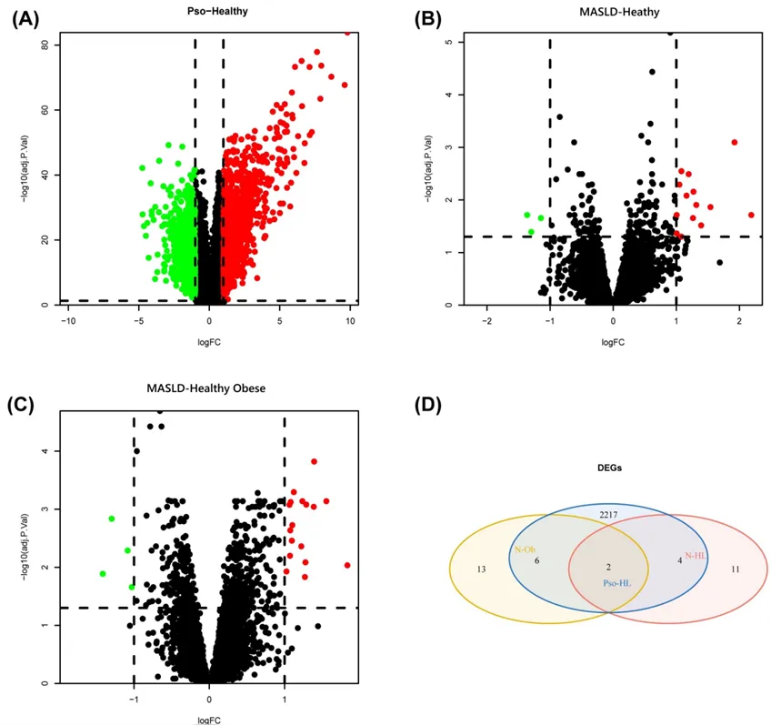
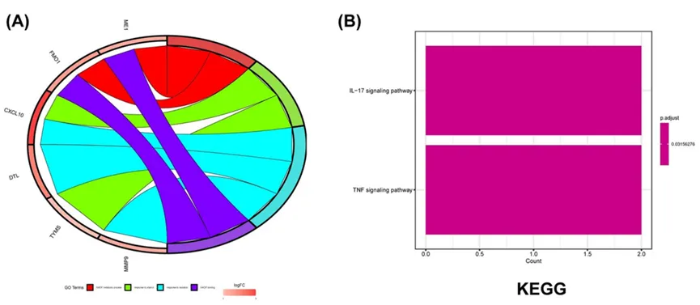
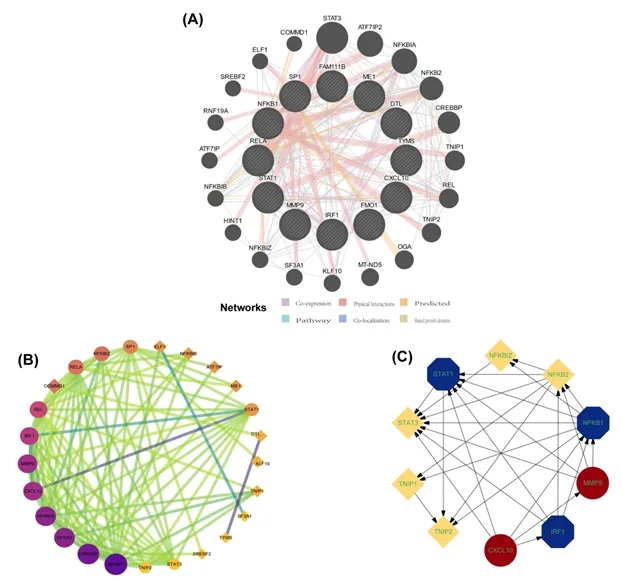
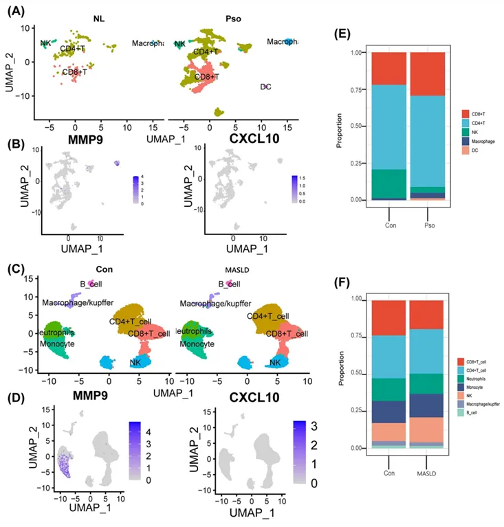
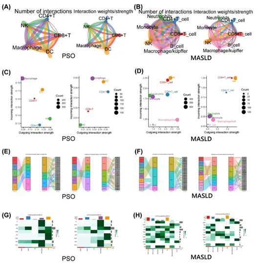
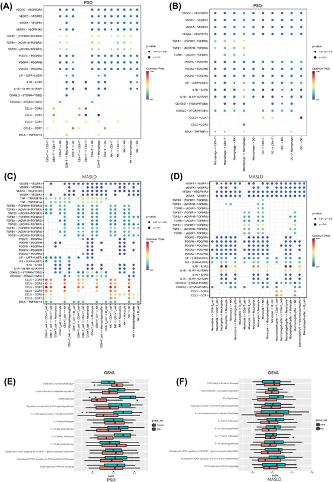
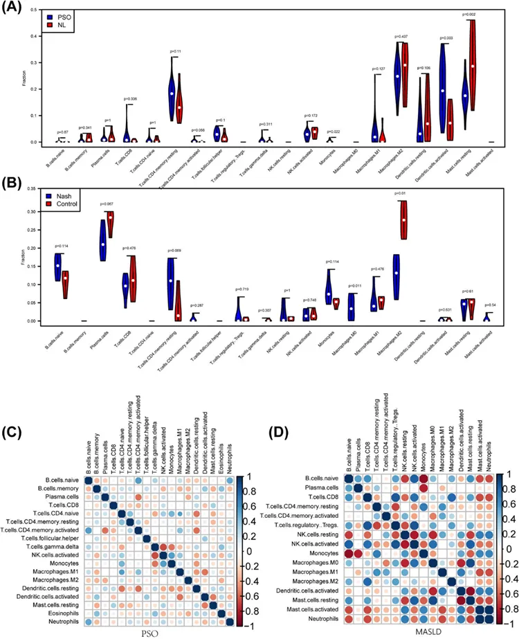

# 银屑病和脂肪肝病中共同病理和免疫特征

> 原文：https://mp.weixin.qq.com/s?__biz=MzAwMzIzOTk5OQ==&mid=2247521069&idx=1&sn=4ef441a885cb2525ee3b5c81001feddf&chksm=9b3cea7dac4b636be9f10ffdf75e13531fccae62129944b21a457db2e08c3f2db1e1b553ac34#rd
> 合集：文献速递

**写在前面**

这又是一篇在Acknowledgement对我们进行**致谢** 的文章：


**银屑病（psoriasis）** 是一种慢性皮肤疾病，常表现为局限或广泛分布的鳞屑性红斑或斑块，其发病原因尚不明确；**代谢相关脂肪性肝病（metabolic associated fatty liver disease, MAFLD）指** 患者存在肝脂肪变性同时伴随5种心血管代谢危险因素(BMI/腰围、血糖、血压、甘油三酯和HDL-C)中的至少一种，以上两者都是免疫介导的慢性炎症性疾病，近十年的研究表明，银屑病能够增加MAFLD的发病率，但其作用机制仍不清楚。**微阵列数据分析（Microarray data analysis）常用于高通量基因分型和表达分析，** 这篇文章中作者从GEO数据库获取了两种疾病基因表达的**微阵列** 数据（GSE30999和GSE48452）和**单细胞测序** 数据（GSE151177和GSE186328）进行具体的生物信息学分析，旨在找到两种疾病共同的发病和免疫机制，让我们一起来看看具体内容吧。******链接：**

https://doi.org/10.1371/journal.pone.0305217


这里也预祝我们的粉丝们早日命中心仪的期刊，若是大家觉得我平时分享的代码或生信教程**有那么点** 好用，可以在文章里以这种格式致谢Biomamba，希望咱们这个系列也能**更新个百八十篇** :

  *

```
Since Biomamba and his wechat public account team produce bioinformatics tutorials elaborately and share code with annotation, we thank Biomamba for their guidance in bioinformatics and data analysis for the current study.
```

如果需要数据分析**指导** 、生信热点**全文复现** 、自测数据**个性化分析** 辅导，欢迎联系客服微信[**Biomamba_kefu**]

**二、主要内容**

  1. **1. ****疾病中差异基因的鉴定。**

首先作者通过**“limma”工具包** 进行了差异基因的分析，结果发现银屑病相比于健康个体存在1208个上调基因和1021个下调基因（Fig.1A），而MASLD相比于健康个体存在14个上调基因和3个下调基因，相比于健康肥胖个体存在17个上调基因和4个下调基因（Fig.1B,C）,最后把两种疾病的差异基因取交集并去除相反表型的基因后，共有7个共同差异基因，而FMO1在三者中均存在且上调（Fig.1D）。

**Fig.1**



  1. **2.****差异基因的功能富集分析及相关转录因子的鉴定。******

为探究差异基因的具体功能，作者进一步进行DEGs的GO和KEGG分析，GO分析结果显示了几个关键基因 （Fig.2A），KEGG分析结果显示差异基因主要富集于IL-17和TNF-α相关信号通路（Fig.2B），经过TURRST数据库分析后富集到 IRF1, STAT1, SP1, RELA, 和NFKB1五个重要的转录调节因子。

**Fig.2**



  1. **3. ****PPI信号网络的构建和关键基因的选择。******

进一步，作者通过 GENEMANIA数据库进行了两种疾病中不同差异基因和转录调节因子相互作用的网络及功能分析，结果显示其基因共表达比例为46.55%（Fig.3A）。与此同时，还得到了20个相关基因，其相关功能主要涉及调节炎症因子如干扰素和白细胞介素，主要参与炎症产生的发展，以及调节脂质和固醇合成等生物过程。通过STRING数据库分析展示蛋白质的相互作用网络（Fig.3B），且经“cystoscope”分析得到了包含10个基因的关键相关模块，前5个基因分别是IRF1, STAT1, NFKB1, CXCL10和MMP9（Fig.3C）。

Fig.3



  1. **4. ****单细胞数据中细胞类型的鉴定******

在对基因表达数据进行分析后，作者从 GEO数据库获取了两种疾病的单细胞测序数据（GSE151177和GSE186328），经“**Seurat”工具包** 对数据质量进行控制，然后经**“Harmony”工具包** 对于细胞类型进行鉴定，结果显示银屑病中主要存在CD4+T细胞, CD8+T细胞，NK细胞, 巨噬细胞和DC细胞（Fig.4A）；而MASLD中主要存在10种细胞类型，包括CD4+T细胞, CD8+T细胞，巨噬细胞，粒细胞，单核细胞和NK细胞等（Fig.4C），且两种疾病中巨噬细胞及中性粒细胞的比例均较高（Fig.4B,D）。

**Fig.4**



**5\. 细胞间通讯分析及基因组变异分析。******

在对细胞类型进行鉴定后，作者进一步通过**“Cell chat”工具包** 进行细胞间通讯交流的研究（Fig.5A,B），**“MMF”工具包** 比较两种疾病中细胞交流模式和细胞协调类型，其中趋化因子信号在这两种疾病中具有更高的通信强度，且主要在髓细胞和CD4+细胞之间（Fig.5C-F）；这些信号主要参与炎症因子的产生和传递，属于Jak-Stata通路、NF-κB通路、MAPK通路和PI3-K / AKT通路的上下游，构成了一个复杂的信号通路网络（Fig.6A-D）。最后通过**“PathCard”数据库** 进行已知炎症通路相关基因集的确定,**GSVA** 进行基因集变异分析**，** 最终确定两种疾病中发病机制中的相关性，IL-17、IL-1和cGAS-STING信号通路在两种疾病中均存在显著差异（Fig.6E,F）**。******

**Fig.5******



**Fig.6**



**6.****免疫细胞浸润分析。**

最后，作者经**CIBERSORT算法** 对两种疾病中免疫细胞浸润的类型进行分析，结果显示CD4+T细胞，NK细胞和髓细胞在两种疾病中均有明显的浸润（Fig.7A,B）；银屑病中浆细胞和静止DC细胞与CD4+ T细胞呈负相关。而MASLD中，单核细胞和M1巨噬细胞与CD4+ T细胞、静止NK细胞和活化的DC呈正相关（Fig.7C,D）。****

**Fig.7**



**三、最后聊聊**

综上所述**，作者利用从GEO数据库获取的基因表达和单细胞测序数据经生物信息学分析，从差异表达基因到免疫细胞的异同** ，揭示了银屑病和MASLD的共同发病机制，鉴定了两者共同的关键基因和调控通路，阐明了两种疾病免疫微环境的相似性，为后续靶向性研究提供了新的思路。文章逻辑紧密，思路清晰，用到的生物信息学分析方法大家可以借鉴学习，尤其是想通过**纯数据** 挖掘**快速发文** 的小伙伴~


**如何联系我们**

 公众号后台消息回复不便，这里给大家留一下领取资料及免费服务器([足够支持你完成硕博生涯的生信环境](<http://mp.weixin.qq.com/s?__biz=MzAwMzIzOTk5OQ==&mid=2247507693&idx=1&sn=d9517a0803ad75cb7be430806834e7b8&chksm=9b3ca7bdac4b2eaba1ad01ed04ab1fbcbafcf4f6ddfe9e4f76ed9229707f545fe7d9c9ffd6ae&scene=21#wechat_redirect>))的**微信号** ，方便各位随时交流、提建议（别问在么，添加时直接说来意）。此外呼声一直很高的**交流群** 也建好了，欢迎大家入群讨论：

[永久免费的生信、科研交流群](<http://mp.weixin.qq.com/s?__biz=MzAwMzIzOTk5OQ==&mid=2247505868&idx=2&sn=20c81313eaef9a7031a84ef3a691d1b5&chksm=9b3cae9cac4b278a42c8de97e864c7664a37e9a4adb5973625fe3f8dd1093e55aeda88d443aa&scene=21#wechat_redirect>)

大家可以阅读完这几篇之后添加[给生信入门初学者的小贴士](<http://mp.weixin.qq.com/s?__biz=MzAwMzIzOTk5OQ==&mid=2247493329&idx=1&sn=597870b7f7ce10346da3561e7c281627&chksm=9b3c9f81ac4b169794088ce9abbcacb5f18e9fd174fc0d7e28da62d78facadf3100ef38aaf22&scene=21#wechat_redirect>)
[如何搜索公众号过往发布内容](<http://mp.weixin.qq.com/s?__biz=MzAwMzIzOTk5OQ==&mid=2247506266&idx=2&sn=22b1164bc9602c25620d058847785422&chksm=9b3ca00aac4b291c16d738271746ffb90149282a728f484e8a1952463c46a8e7dc4f883ab928&scene=21#wechat_redirect>)


您点的每个赞和在看，我都认真当成了喜欢
