# 空间转录组做到啥程度能毕业|硕士篇

> 原文：https://mp.weixin.qq.com/s?__biz=MzAwMzIzOTk5OQ==&mid=2247526918&idx=1&sn=bf37b8dc9825f83a0b19eb46418cf01a&chksm=9b3c1356ac4b9a406dfcd199c77513e92f5ae379e9e6bae0e5b701213100af7cdddb6ec24887#rd
> 合集：文献速递 / 漫谈胡侃

此前我们也整理过类似的话题：

[空间转录组做到啥程度能博士毕业？](<https://mp.weixin.qq.com/s?__biz=MzAwMzIzOTk5OQ==&mid=2247521581&idx=1&sn=0d7e4373a7bd011161e0e2b256c6461e&scene=21#wechat_redirect>)

[单细胞测序做到啥程度能毕业|博士篇](<https://mp.weixin.qq.com/s?__biz=MzAwMzIzOTk5OQ==&mid=2247511793&idx=1&sn=983e054daf2fc46cdf6f7f5b2f12489a&scene=21#wechat_redirect>)
[单细胞测序做到什么程度能毕业|硕士篇](<https://mp.weixin.qq.com/s?__biz=MzAwMzIzOTk5OQ==&mid=2247511793&idx=2&sn=81f2d2e5ce4e61dd76631c650402bed9&scene=21#wechat_redirect>)

读研/读博是一个漫长的过程，就像在一个**黑屋子里洗衣服** ，不开灯的时候永远不知道衣服洗干净没。也就是说在毕业前，大家很难衡量自己的工作是否能作为一个合格甚至优秀的毕业课题来结题。这种情况下，参考已公开的毕业论文就是自我评价与参考的最佳途径，这里选取了四篇具有**代表性** 的硕士论文进行了解析，希望能够帮助到大家。

由于空转仍处于一个高、新、贵技术的地位，能够参与此类技术相关研究的硕士往往受到的经费、学术资源支持充足、个人能力等方面比较超群，论文完成质量与水平也非常高(有被卷到)。总体看来，四篇论文都涉及到单细胞与空转的**联合分析** ，也都涉及到**免疫微环境** 的解析(打单细胞时代开始就有的优势)。涉及到分子原位杂交、免疫荧光等空转"专属"的验证实验，此外也涉及到流式细胞术、ELISA、荧光素酶实验、RIP 测序、transwell迁移等等实验(全员干湿结合，**卷飞了**)。所以还是建议大家早点上车，每年都在水涨船高。

我们也有过比较系统的空转分析教程，供大家参考：

[空间转录组学习手册合辑](<https://mp.weixin.qq.com/s?__biz=MzAwMzIzOTk5OQ==&mid=2247505088&idx=1&sn=9f60dca1b21f5ba8c32d09595a512134&scene=21#wechat_redirect>)

[Stereopy空间转录组学习手册](<https://mp.weixin.qq.com/s?__biz=MzAwMzIzOTk5OQ==&mid=2247505686&idx=2&sn=925ce770136ec3e964b954c639eed29e&scene=21#wechat_redirect>)

[Squidpy空间转录组学习手册](<https://mp.weixin.qq.com/s?__biz=MzAwMzIzOTk5OQ==&mid=2247505844&idx=2&sn=5756c0702d080d6e602c504e7d461013&scene=21#wechat_redirect>)

[Scanpy空间转录组学习手册](<https://mp.weixin.qq.com/s?__biz=MzAwMzIzOTk5OQ==&mid=2247505248&idx=2&sn=18995c7248ca6f13b61edfef24208ae1&scene=21#wechat_redirect>)

[Seurat空间转录组学习手册](<https://mp.weixin.qq.com/s?__biz=MzAwMzIzOTk5OQ==&mid=2247505213&idx=2&sn=6b9aad43c273009c3d7f80c63bb9f619&scene=21#wechat_redirect>)

[一文搞定空间转录组与单细胞测序的整合分析](<https://mp.weixin.qq.com/s?__biz=MzAwMzIzOTk5OQ==&mid=2247507210&idx=1&sn=f32037ffefd60b0d1bcca7bf9c3e0823&scene=21#wechat_redirect>)

[CellChat空转细胞通讯合辑](<https://mp.weixin.qq.com/s?__biz=MzAwMzIzOTk5OQ==&mid=2247512011&idx=1&sn=fbd41832c5995d79fead016931d3bfbd&scene=21#wechat_redirect>)

**第一篇**

“单细胞测序与**空间** 转录组联合分析**狼疮肾炎** 的免疫学机制”作者于2023年毕业于中南大学，培养于**湘雅** 三医院，从事免疫相关疾病的研究。本毕业论文全文58页，主要的研究内容分为两章展开，分别是狼疮肾炎肾脏免疫图谱的建立和**APOE+单核巨噬细胞** 在该疾病肾脏中的关键作用。本研究综合运用了**单细胞转录组测序、空间转录组测序，结合免疫荧光、流式细胞术和酶联免疫吸附法** 等多种技术方法进行了相关研究，是一篇质量较高的毕业论文。
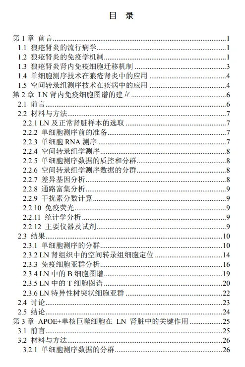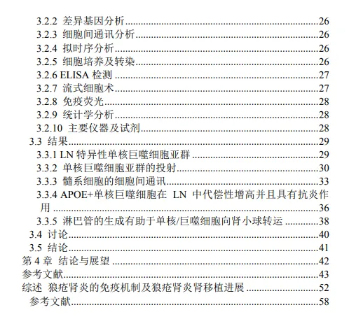
在本研究中，首先作者利用单细胞转录组测序分析了肾脏组织中的肾实质细胞和免疫细胞，确定了狼疮肾炎患者肾脏的特异性免疫细胞。其次，作者通过空间转录组测序对狼疮肾炎患者肾脏特异性细胞的空间分布进行了研究。最后，通过免疫荧光染色验证了狼疮肾炎患者肾脏中特定的免疫细胞类型，通过特异性**流式细胞术** 和**酶联免疫吸附法** 进行了功能实验。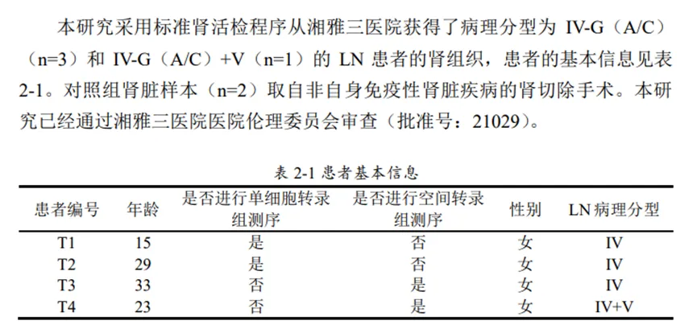肾脏样本的选取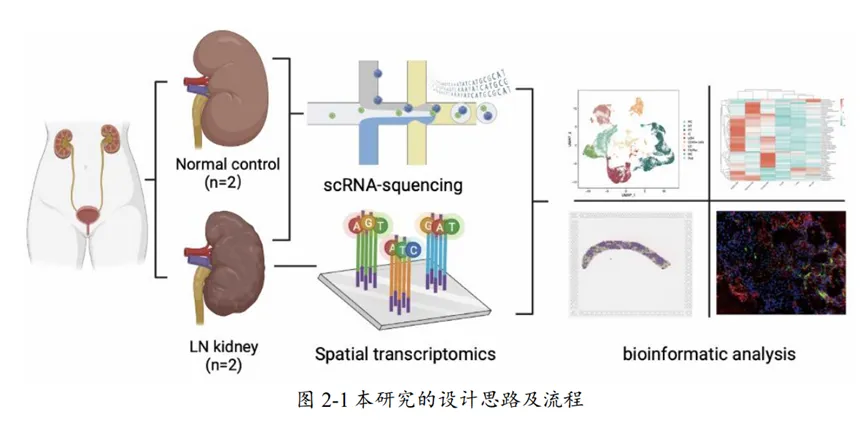研究思路
我们可以看到，本研究采用的是肾活检程序获得的临床样本，结合了多种分析方法和实验手段进行研究，值得一探。下面带大家看一下具体的实验结果： **单细胞测序的分群**

  * 通过质控程序，作者筛选出了基因计数在 0 至 5,500 之间及 UMI 计数低 于 70,000 的细胞，并排除了线粒体基因超过 95%的细胞，共保留了 31,738 个细 胞用于进一步的分析。

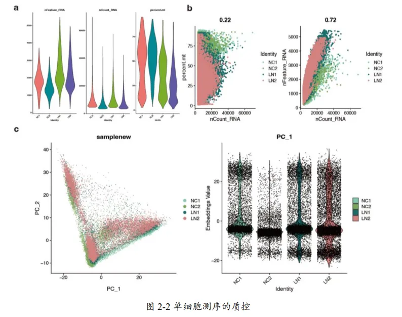

  * 降维聚类分群后，作者最终将肾脏细胞注释为**10种** 主要的细胞类型，并用气泡图展示了各细胞类型的代表性基因表达。

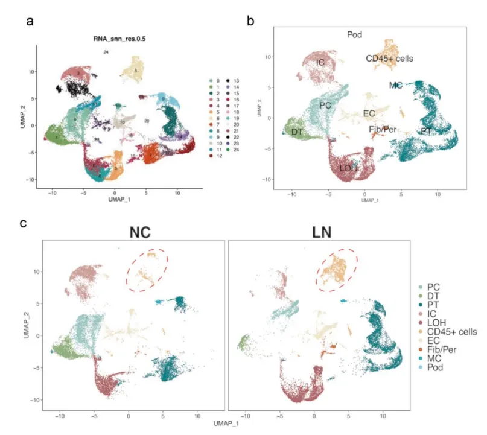

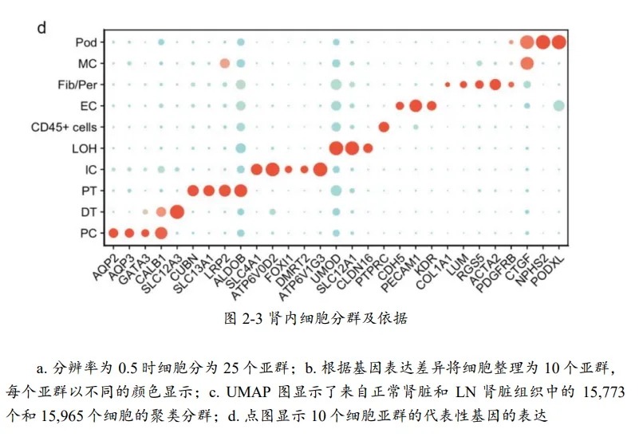

  * 作者对狼疮肾炎患者肾脏和对照组肾脏的各细胞类型比例进行了可视化。作者点出了**CD45+细胞** 在狼疮肾炎患者中明显升高。

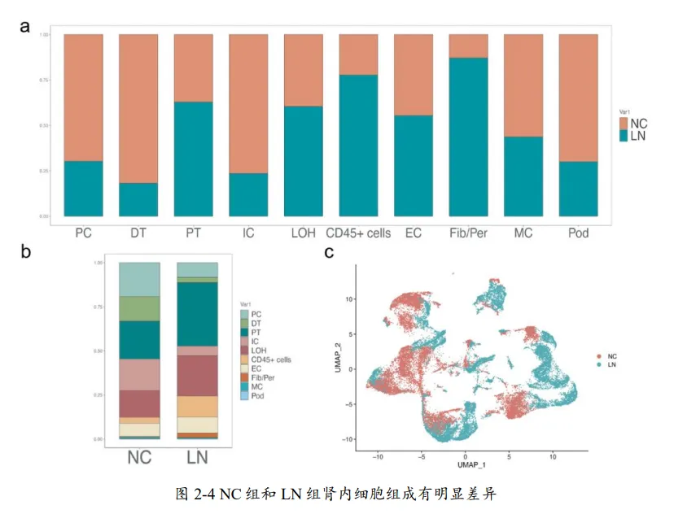

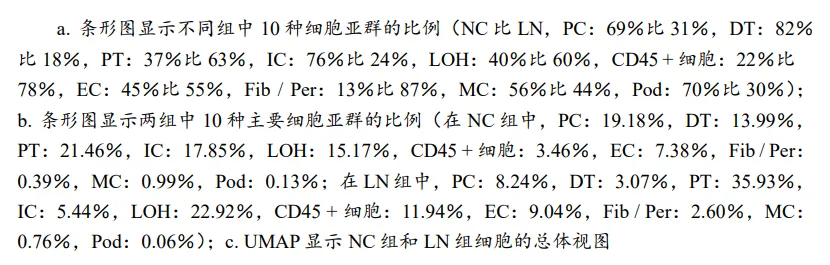

**
****LN 肾组织中的空间转录组细胞定位**

  * 空间转录组学测序的结果主要展示在直径为**55μm** 的圆形区域内。此区域直径大于单个细胞直径（10-20μm）。作者最终将所有细胞类型注释为了6种细胞亚群，其中免疫细胞的数量超过了1/5。

  * 作者通过将这6群细胞表示在空间转录组学的切片上，指出免疫细胞分布在肾小球内外及周围。作者表明，肾小球的免疫浸润可能与狼疮肾炎有关。

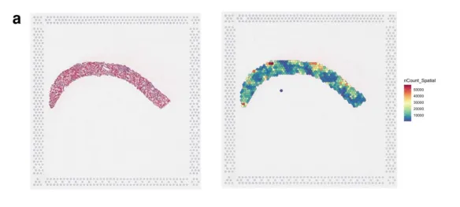

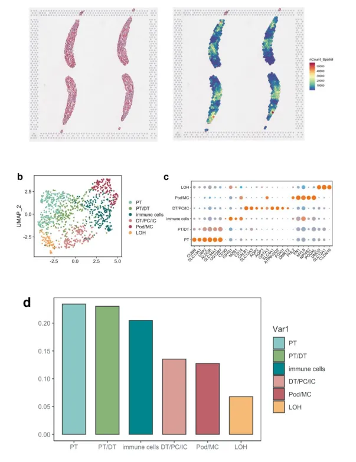

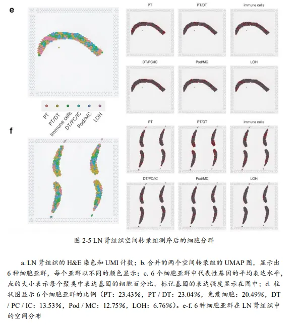

**
****免疫细胞亚群分析**

  * 基于单细胞测序分析的细胞注释结果，作者将对 CD45+免疫细胞进行了 UMAP 的降维分群，通过免疫细胞标志物和细胞分类增殖标志物将其分成了6个亚群。作者指出，与正常组织相比，髓系细胞数量显著增加。

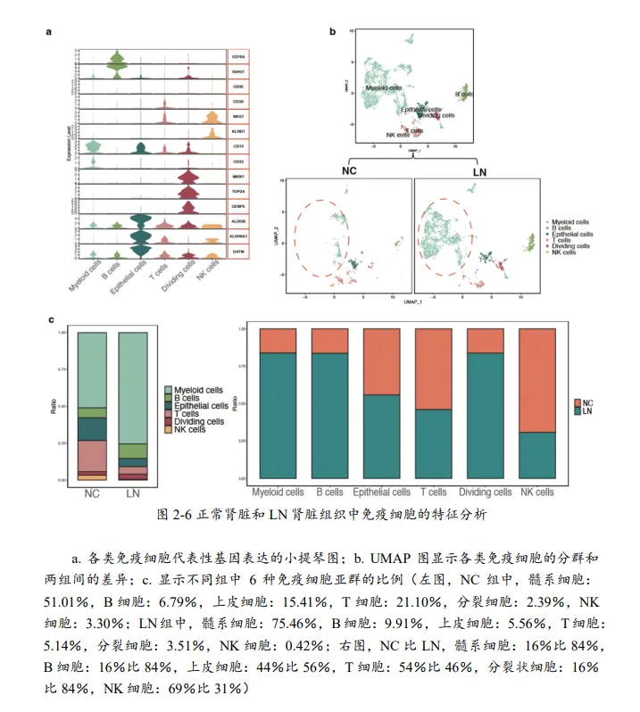

  * 接下来这部分的结果表明，髓系细胞可能在狼疮肾炎患者肾脏的IFN反应中发挥重要作用：

  * 对免疫细胞的KEGG富集分析结果表明髓系细胞的抗原提呈功能在狼疮肾炎的发病中起着重要作用，NK细胞和T细胞的代谢状态可能也发生了改变。
  * GSVA富集结果显示，IFN-α 和 IFN-γ 的反应性在髓系细胞中最为丰富，表明髓系细胞通过分泌IFN和参与IFN反应调节 狼疮肾炎的自身免疫反应。
  * 作者通过AddModuleScore函数计算了IFN分数，发现髓系细胞的 IFN 富集分数相对较高。
  * 对髓系细胞中占比较多的 CD14+单核细胞进行免疫荧光染色的结果显示：CD14+单核细胞与IFN-α 在 狼疮肾炎患者肾内存在明显高表达。

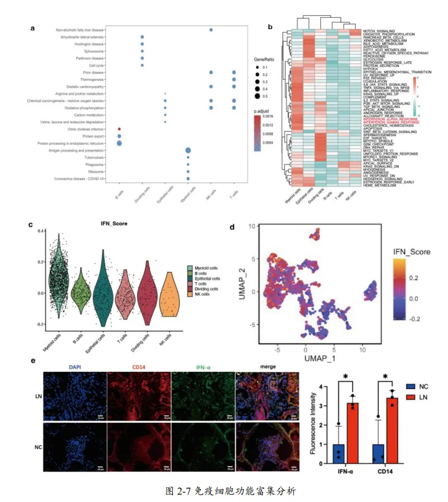

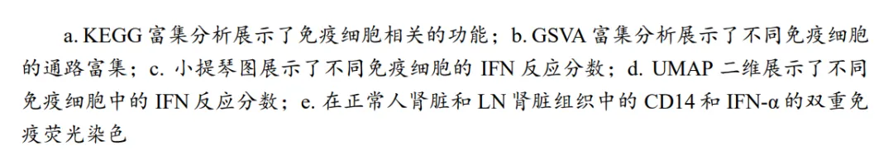

**
****LN 中的 B细胞图谱**

  * 作者将免疫细胞中的所有B细胞进一步分为了**B0和B1两个细胞群** ，发现这两种细胞群中的部分基因表达存在明显差异。B1细胞群的GO功能富集结果显示，B细胞对髓系细胞的分化可能有一定影响。**GSEA 通路富集** 分析表明B细胞激活通路主要为脂质相关通路、MAPK 信号通路等。

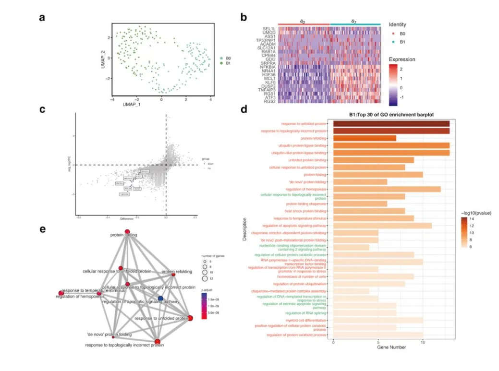

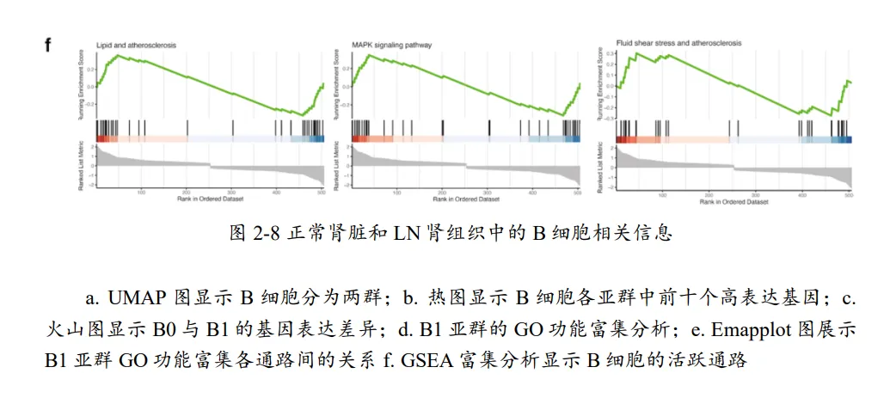

**LN 中的T细胞图谱**

  * 使用与上述B细胞分析相同的分析思路和方法，作者对T细胞也进行了相关分析，最终将**T细胞分为3群** 。研究结果表明，不同亚群的T细胞功能有明显差异。对T细胞整体进**行的GSEA 分析结果显示，与狼疮肾炎相关的通路处于高度激活状态** 。

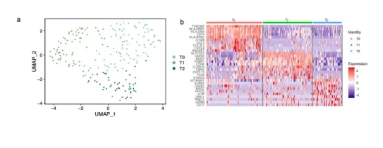

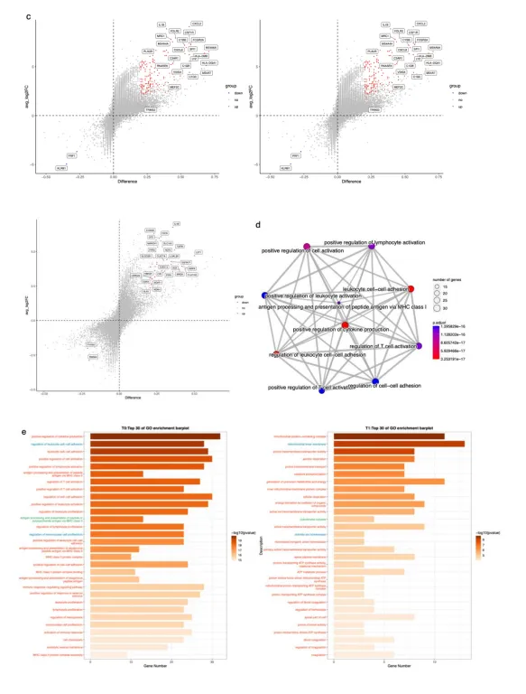

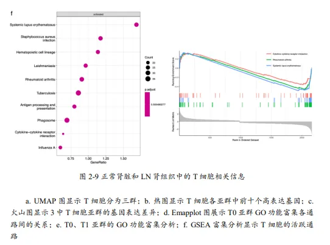

**
**

**LN 特异性树突状细胞亚群**

  * 作者接下来将髓系细胞进一步分为2个经典的细胞亚群： DC 和 Mono/MΦ。Mono/MΦ 在 狼疮肾炎患者的髓系细胞中占据了近 80％，**正常肾脏** 中则几乎**不存在DC细胞** 。作者又进一步将DC细胞注释为了 CD1C+CLEC10A+和 FLT3+CLEC9A+两类。

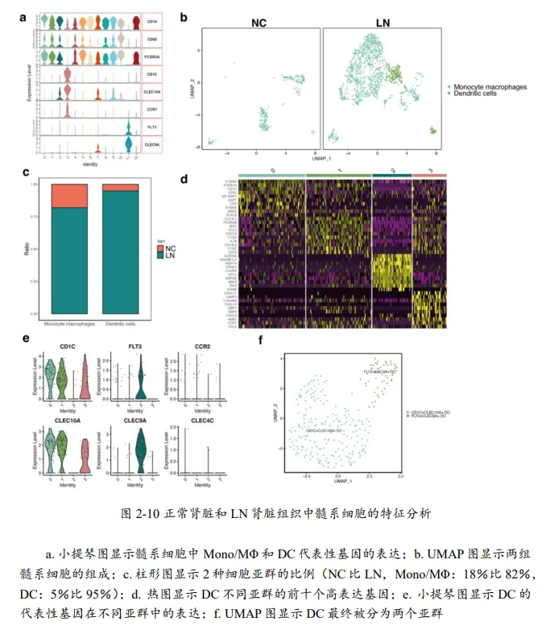

  * 作者这部分的内容中的大篇幅是基于对单细胞测序结果进行分析的，首先通过细胞分群定位到狼疮患者肾脏中 CD45+免疫细胞浸润明显增加，接下来对免疫细胞进行了进一步的分群注释和富集分析，主要包括髓系细胞、T细胞和B细胞。结果表明，狼疮肾炎中干扰素反应的上调和自身性抗原提呈异常升高与髓系细胞密切相关。
  * 基于空间转录组测序，分析占比较少，作者证实了免疫细胞的空间分布集中在**肾小球内外** 及周围。

**LN 特异性单核巨噬细胞亚群**

  * 接下来作者进一步对免疫细胞分型，基于基因差异表达将 LN 肾内单核细胞降维成 9 个 Mono/MΦ 亚群（图 3-1a），且正常与 LN 肾组织中的亚群差异显著。在 LN 患者中，APOE+ Mono、SPP1+ Mono、IL-1B+ Mono 比例显著上升（图 3-1c）；APOE+ Mono 高表达 SELENOP（图 3-1d），RNASE1 表达也与特定小鼠损伤后现象有关。研究还预测了 Mono/MΦ 间的细胞相关性（图 3-1e），APOE+ Mono 与 LYZ+ Mono 相关性低，与 SPP1+ Mono 相关性高，后续拟时序分析也佐证了这一点，显示其分化的特征。

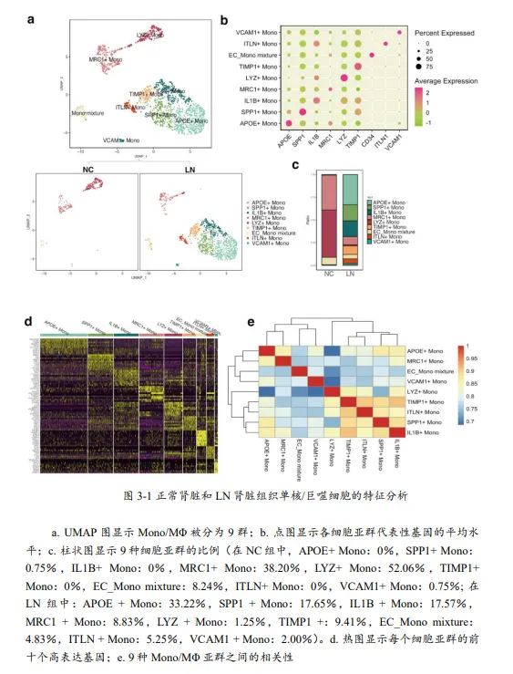

**
**

**单核巨噬细胞亚群的投射**

  * 作者接下来通过 prediction assay 算法将 scRNA-seq 结果投射到 ST 结果（类似教程：[一文搞定空间转录组与单细胞测序的整合分析](<https://mp.weixin.qq.com/s?__biz=MzAwMzIzOTk5OQ==&mid=2247523835&idx=3&sn=76597dfbd4f9b6240b51ad897c346b93&scene=21#wechat_redirect>)），分析 55μm 圆形区域细胞成分。TIMP+ Mono 和 ITLN+ Mono 未投射成功，提示其聚集和数量状况不佳。APOE+ Mono 等主要分布于肾小球周围及肾间质（图 3-2a-b），EC_Mono mixture 等在肾小球内分布，暗示肾小球内细胞相互作用与 LN 进程有关。

  * 免疫荧光染色验证结果显示，LN 患者肾脏中 APOE 与 CD14 共表达（正常无），IL1B 或**SPP1 与 CD14 共表达** 高于正常组织，**LYZ 和 CD14 共表达** 无差异（图 3-2c），与前期结果一致。

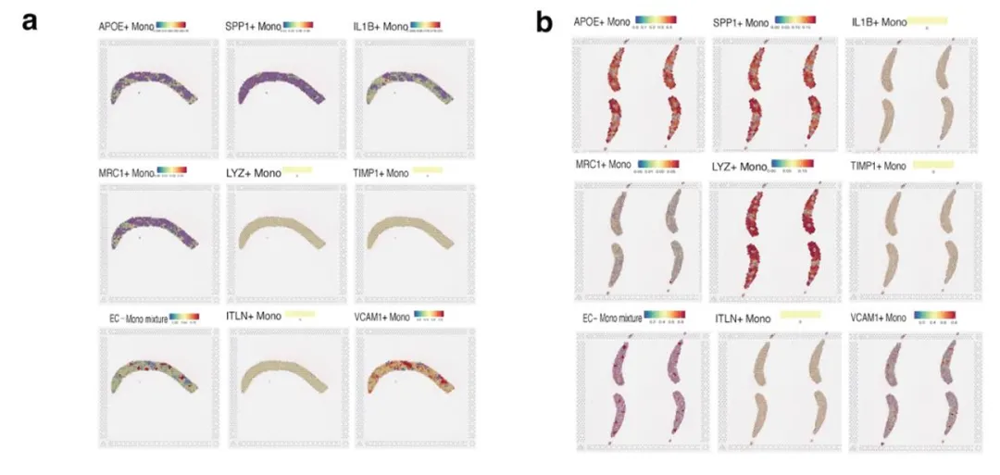

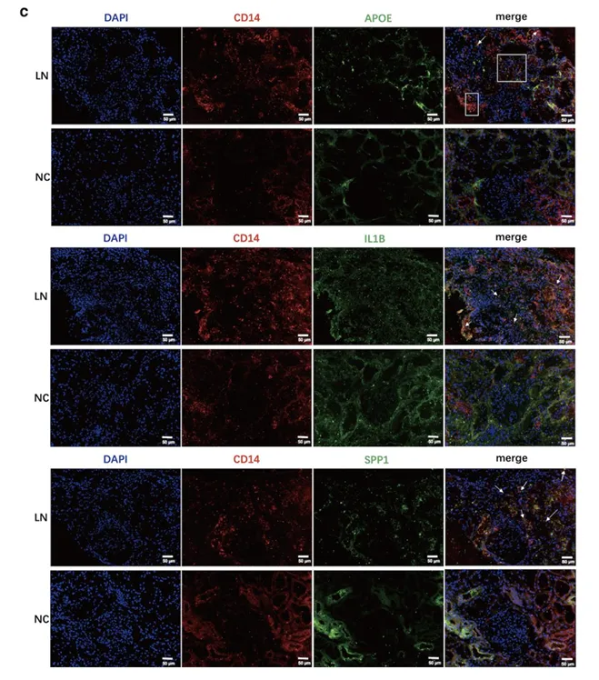

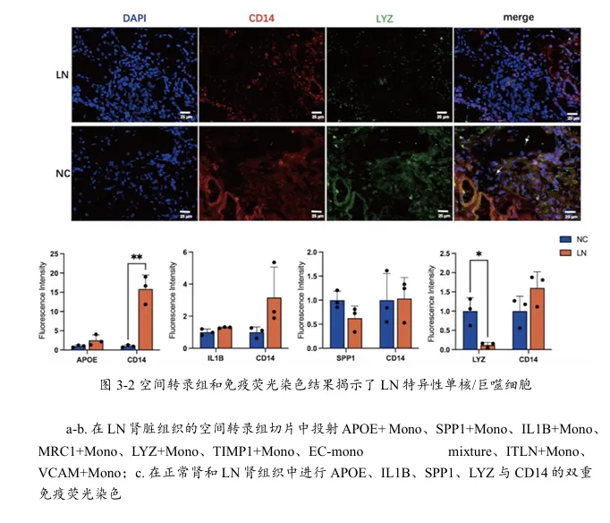

**髓系细胞的细胞间通讯**

  * 接下来作者运用 NicheNet 算法分析髓系细胞通讯()，按配体活性选免疫细胞前 20 个活性配体，其在 LN 患者中的表达高于正常对照组（图 3-3a）。

  * NicheNet 分析出 IFNG、APOE、TNF 等为高优先级配体。IFNG 的预测目标基因含髓系细胞标志物，表明髓系细胞是 IFN-γ 主要效应细胞；APOE 目标基因是 CCL3 和 CXCL12，可能调节免疫细胞趋化（图 3-3b - c）。基因相关性分析显示 APOE 与干扰素刺激基因正相关（图 3-3d），进一步证实 APOE 在 LN 中的重要性。

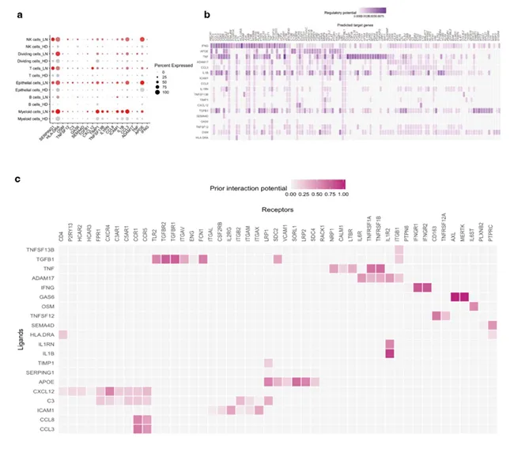

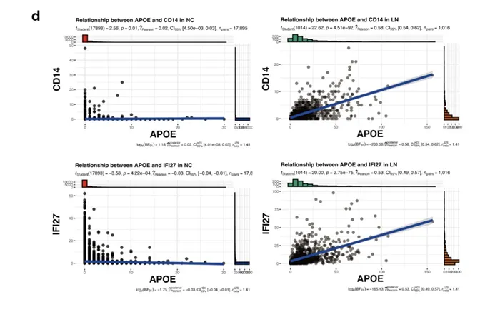

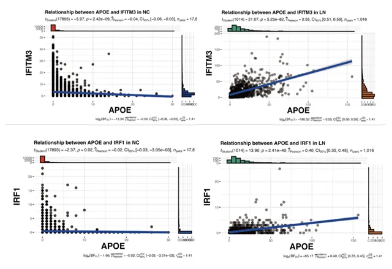

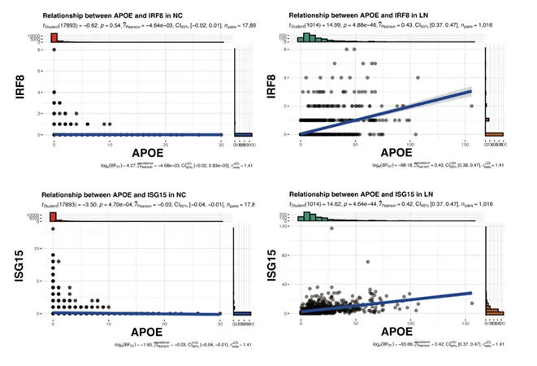

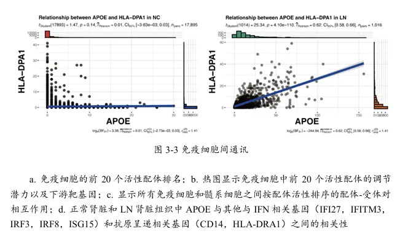

**
**

**APOE+单核巨噬细胞在LN中代偿性增高并且具有抗炎作用**

  * 作者接下来用 Monocle 3 (教程：[《拟时序分析》6.monocle3的拟时序分析](<https://mp.weixin.qq.com/s?__biz=MzAwMzIzOTk5OQ==&mid=2247490418&idx=1&sn=18ae0b6139fe1a2436dcf6cc47850297&scene=21#wechat_redirect>))对狼疮肾组织 Mono/MΦ 进行拟时序分析，结果与Seurat一致，MRC1+ Mono 为起点，正常时分化为 LYZ+ Mono，LN 环境下变为 APOE+ Mono，分化中 TIMP1、IL1B、SPP1 高表达。

  * 在 HSV 刺激的 RAW264.7 细胞中，敲低 APOE 致 CD86 等表达改变，ELISA结果 显示 APOE 影响 IFN-α、IFN-γ 分泌。

  * 作者用这部分内容表明，APOE 在LN中起到了抗炎作用，APOE+ Mono 是 LN 下单核细胞分化终点，其抗原呈递下降或为机体在自身免疫性攻击环境中的自救。

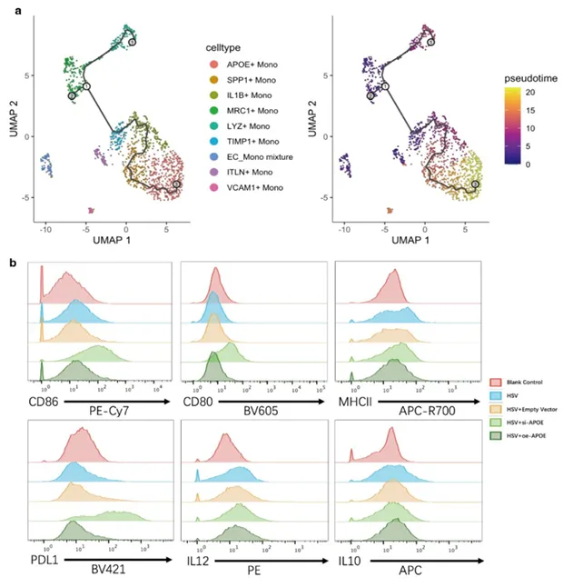

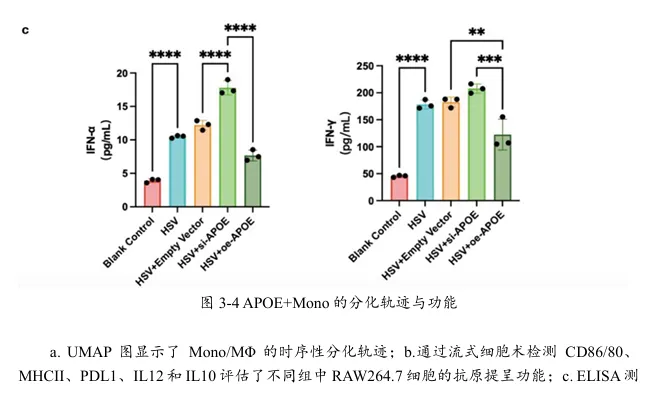

**
**

**淋巴管的生成有助于单核/巨噬细胞向肾小球转运**

  * 作者确定 LN 特异性 Mono/MΦ 亚群及定位后，继续深入研究了其进入肾病灶的方式。因免疫细胞常经淋巴管入肾，故绘制相关标志物分布，发现 PDPN 沿肾小球线型分布，PROX1 和 VEGFC 围绕其周围，且 CD14 与淋巴管标志物相关（图 3-5a - b），推测 CD14 + 细胞借新生淋巴管到肾小球附近。

  * 免疫荧光证实 PDPN 和 VEGFC 共分布（图 3-5c），且 LN 患者中 CD14 和 PDPN 呈线型，表明 CD14 + 细胞可能在淋巴管旁浸润（图 3-5d）。

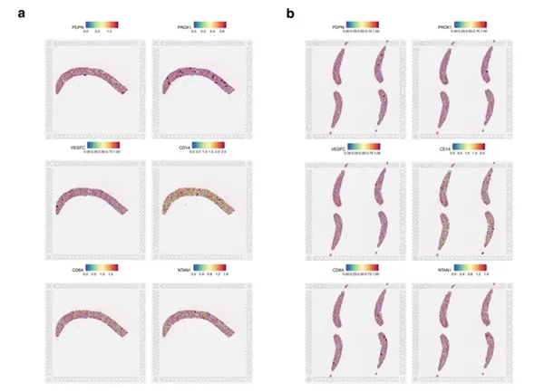

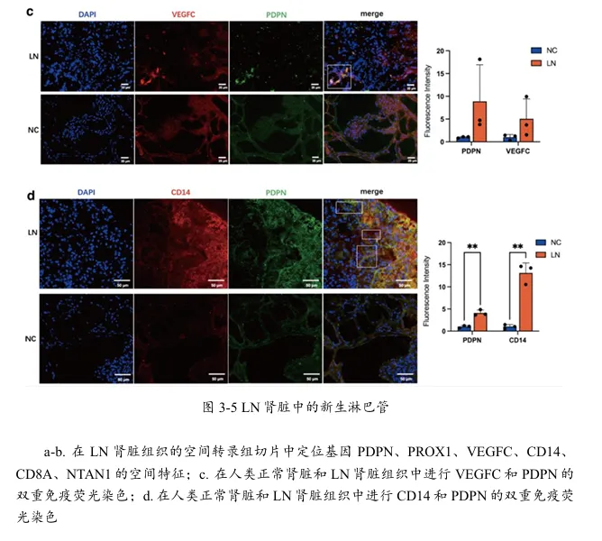

  * 作者通过结合单细胞转录组测序和空间转录组测序，发现 APOE+ Mono是LN中特殊的Mono/MΦ亚群，而APOE的上调能够显著降低单核细胞的抗原呈递和分泌IFN的能力。此外，LN中的淋巴管生成可能促进了Mono/MΦ在LN肾脏中的转运。

**第二篇**

“空间转录组测序揭示原发性肝细胞癌微环境异质性”作者于2022年毕业于**海军军医大学基础医学院** ，从事遗传学的研究。本毕业论文全文**94页** ，主要的研究结果共有**8小节** 。涵盖了多个方面的研究内容，包括对肝癌组织的空间转录组分析、多种细胞类型标志物的检测、特定基因（如 CCL15、YTHDF1 和 YTHDF2 等）的功能探究以及相关动物模型和临床样本的验证。从肿瘤微环境中的细胞组成、基因表达模式到特定分子的作用机制及临床意义，研究内容较为广泛和深入，呈现了一个较为全面的肝癌相关研究图景。在整个研究过程中，作者的逻辑推理较为严谨。从发现肝癌组织中基因表达的空间异质性，到进一步探究特定区域的基因功能和细胞相互作用，再到综合运用多种实验技术和方法，包括**空间转录组测序、细胞培养、动物模型构建、免疫组化、流式细胞术、荧光素酶实验、RIP 测序** 等，从不同层面和角度对研究问题进行了深入探究，每一步都建立在前一步的研究基础之上，环环相扣。总之，对于硕士研究者生来说，这篇文章展现出了较为充实的工作量，从基础机制探索到临床相关性验证都有涵盖。非常值得我们参考和学习，相信会给大家的课题带来一些新的思路。

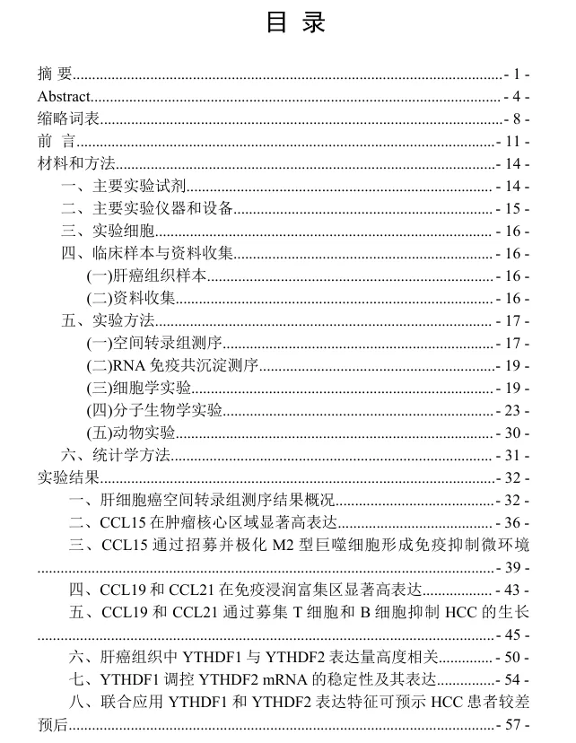

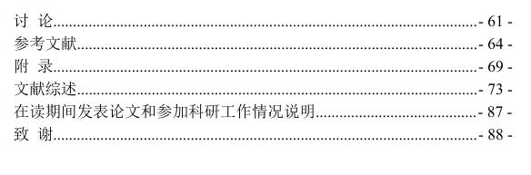

**1、****肝细胞癌空间转录组测序结果概况**

  * 在第一部分内内容中，作者就首先展示了肝细胞癌空间转录组测序结果概况：研究选取了**1例** 病理证实为HCC的病例，在靠近肿瘤包膜区域**随机选三个部位** （命名为 HCC-R1、R2、R3）的组织做空间转录组测序，各组织含肿瘤内部、边界及癌旁区域。
  * 测序流程及结果如下：先对三块组织 HE 染色，依组织学位置标注癌区、癌旁区和纤维条索区（图 1A）。质量控制与数据标准化后，ST 测序获 12,545 个捕获区域（spot），因测序精度限制，每个 spot 长 55μm，是细胞混合结构及测序分析单元。数据归一化后，平均 reads 数为 114,789，平均基因数（nFeature）为 3,503，基因平均表达量（nCount）为 16,114，测序质量高且深度与过往研究一致。

  * 接着把所有 spot 聚类成**20 个亚群** ，探究其在三块组织的分布（图 1A），检测 nCount 的空间分布（图 1A）及各亚群 nCount 数量（图 1B）。结果显示，癌区的 cluster（或 spot）基因表达丰度高于癌旁区等，表明肿瘤内处于**高增殖** 状态，与前人研究相符。部分亚群（cl.1、4、8、15、18、19）nCount 数目更多。

  * UMAP 二次降维分析发现：①不同亚群 spot 有明显分离与聚类；②癌区、癌旁区和纤维条索区的亚群有显著空间距离；③HCC-R1 部分亚群与同源位置的 HCC-R2/R3 亚群不同，一些亚群只在特定样本中存在；④HCC-R1 亚群显示较低水平 nCount（图 1C - 1D），可见不同空间区域有特定表达模式，能区分各区域，但 HCC-R1 与 HCC-R2/R3 在癌区内基因表达分布存在显著异质性，可能源于采样或测序深度差异，肿瘤内异质性影响程度不明。

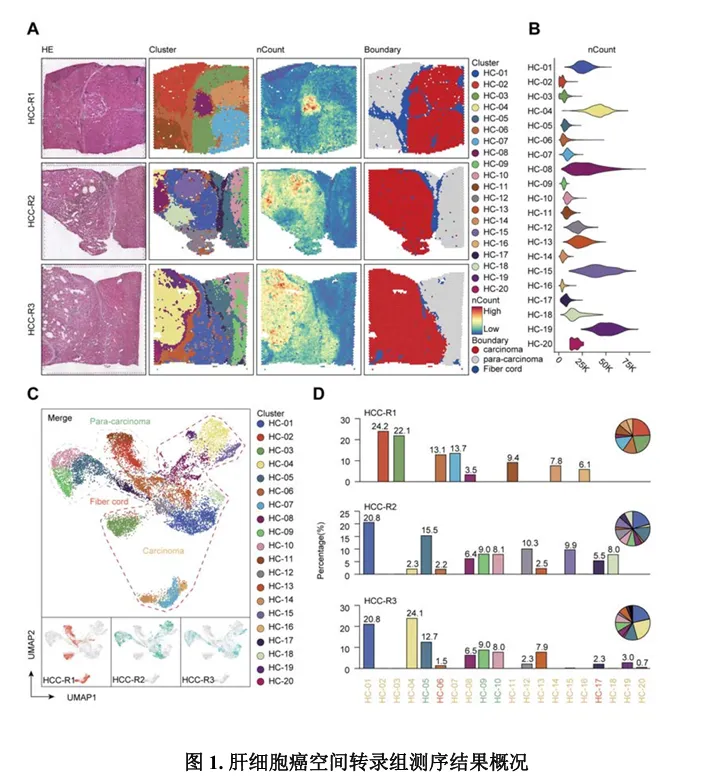

  * 作者接着检测了三块组织中常见细胞类型标志物的空间表达情况，发现正常肝细胞标志物 ALB 和 CYP2E1 在癌旁区高表达；GPC3 和 AKR1B10 在癌区显著高表达；**ACTA2 和 COL1A1在纤维条索和间质区域明显表达** （图 2A），由此证实空间转录组测序结果可靠。

  * 为鉴定不同亚群的肿瘤表型特征，作者在20个亚群中做差异表达基因分析，设倍数变化阈值为 logFC≥0.25，p<0.05，并展示各亚群特异性表达基因（图 2B）。

  * 进一步分析每个 cluster 的增殖功能，作者先确定了不同细胞周期（G1、S、G2/M）特征性表达基因（表 2），再对各亚群所处细胞周期评分（依据标志物基因表达水平）。当 G2/M 期和 S 期阈值设为 0.67 时，发现 cl.1、4、8、13、15、18、19 这些亚群与先前 nCount 结果一致，处于高增殖状态且位于癌区，其中**HC-19 亚群细胞增殖功能最强** （图 2C）。

  * 另外，作者也评估了不同亚群的上皮 / 间质特征（阈值设为 0.33），结果显示纤维条索区的 HC-06 和 HC-17 亚群，其 EMT 标志物基因表达最突出；癌区的 HC-08、12、13 和 18 亚群上皮间质特征评分更高，意味着这些亚群有较高恶性侵袭能力（图 2C）。

  * 综上，通过对三个 HCC 样本空间转录组学分析，初步揭示肝癌微环境内不同区域基因表达模式差异大，表明基因表达空间特征在肝癌肿瘤内异质性形成中有重要作用。

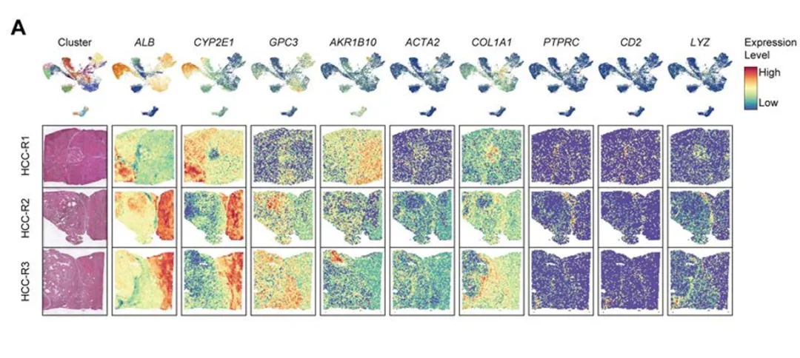

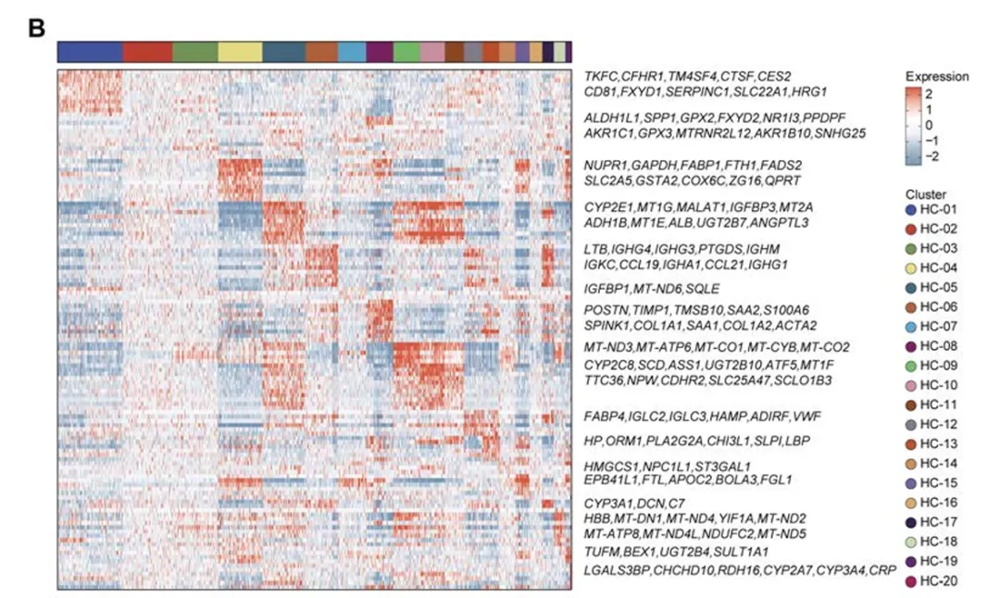

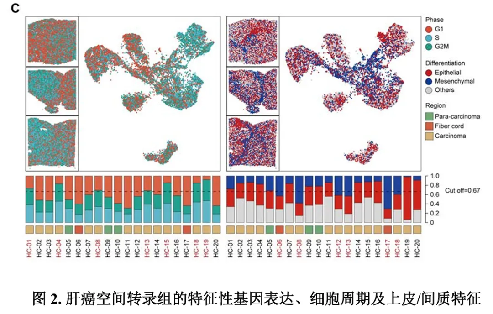

**
**

**2、CCL15在肿瘤核心区域显著高表达**

  * 作者接下来进一步深入探究癌区亚群的空间表达模式与内在规律，鉴于 HCC-R1 和 HCC-R2/R3 存在显著异质性，所以分别对 HCC-R1 以及 HCC-R2/R3 做了伪时序分析。在 HCC-R2&R3 的联合分析里，HC-04/15/18/19 亚群与 HC-01/12/13 亚群相较于其他亚群，处在癌区发展轨迹的末期（图 3A），而且前者这些亚群的 nCount 数目较高，基因表达更复杂，在空间分布上都位于癌区内部区域，据此把这些亚群集合定义为**肿瘤核心区域** （tumor core region）。在 HCC-R1 中，HC-07/16 亚群相比 HC-03/14 亚群处于癌区发展轨迹的末期（图 3B）。

**
**

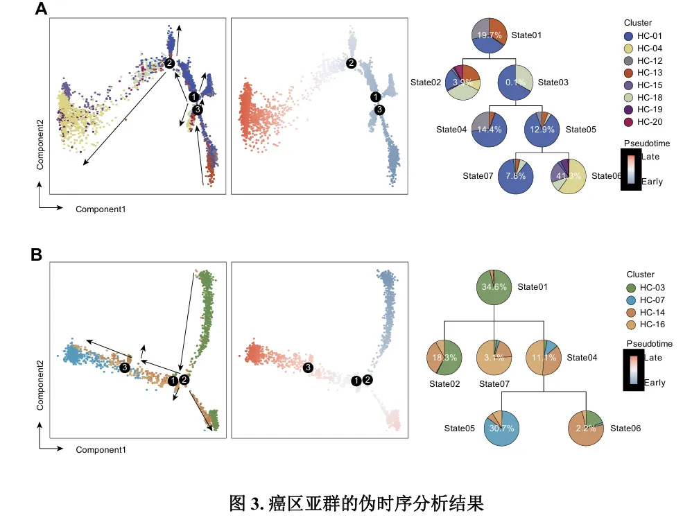

  * 接下来，作者分析了肿瘤核心区域的基因空间表达模式（图 4A），并标记出其前 20 个差异表达基因（图 4B）。IGHG1、IGHG3等体液免疫重要作用分子在核心区域显著下调，表明肝癌肿瘤核心区域已形成**免疫抑制微环境** （ISME）。而 NUPR1、GSTA2、CCL15等基因在肿瘤核心区域显著上调，且据报道它们通过多种机制发挥致癌作用。

  * 进一步伪时序分析发现，下调的基因主要在 HCC - R2/R3 亚群早期发展轨迹表达，随伪时间轴推移逐渐减少，末期表达最低；而上调的基因大多相反，逐渐增加，且多数在发展轨迹终末阶段表达（图 4C）其中，**趋化因子 CCL15** 随伪时间轴进展表达水平逐渐升高，其被认为可促进 ISME 形成（图 4D）。TCGA 数据库证实，CCL15 在 21 个实体肿瘤里，于肝癌中表达量最高（图 4E），提示其在肝癌进展中作用重要。在 TIMER 数据库中看到 CCL15 与 M2 型巨噬细胞浸润程度呈正相关（图 4F），鉴于 M2 型巨噬细胞可促进肿瘤发生和进展，综合来看，推测在肿瘤核心区显著上调表达的 CCL15 可能通过**募集 M2 型巨噬细胞** 增加其在肝癌中的浸润程度，协同促进 HCC 微环境形成与肝癌进展。

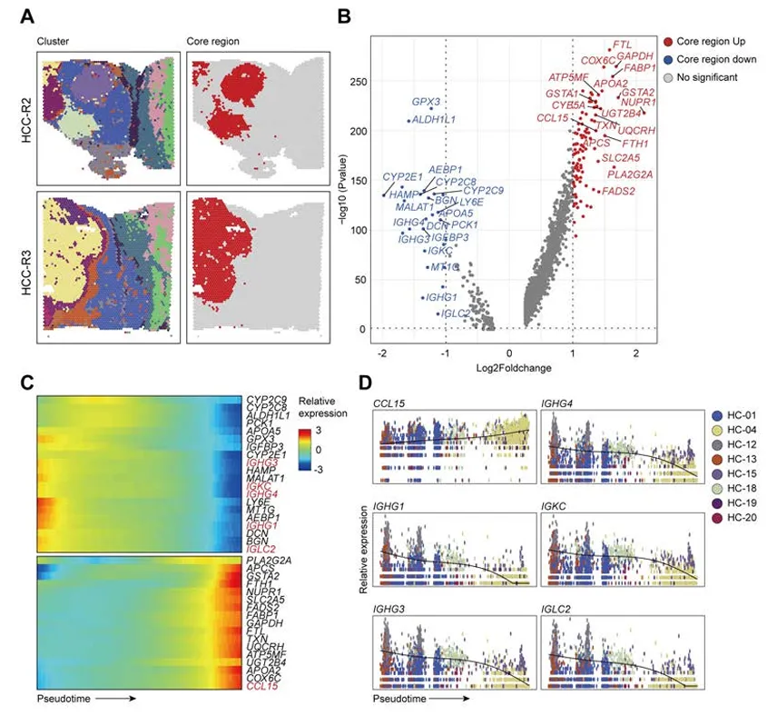

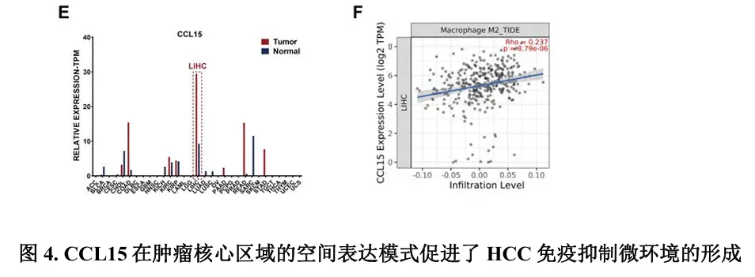

**3、CCL15通过招募并极化M2型巨噬细胞形成免疫抑制微环境**

  * 为进一步深入探究 CCL15 与 M2 型巨噬细胞之间的联系。作者构建了体外巨噬细胞模型，发现CCL15 作用于体外巨噬细胞后 M2 型巨噬细胞标志物 CD163、CD206 及其受体 CCR1 在转录和蛋白水平均出现上调（图 5E - 5H）。流式分析显示，CCL15 刺激后，CD163 + CD206 + 双阳性细胞比例相较于对照组显著增加，这提示巨噬细胞有向 M2 型极化的趋势（图 5I - 5J）。**transwell 迁移** 实验表明，在 CCL15 存在时，巨噬细胞的迁移能力增强了，也就说明 CCL15 具备趋化巨噬细胞的功能（图 5K - 5L）。综合上述体外实验结果可知，CCL15 有着招募单核细胞并使其向 M2 型巨噬细胞极化的功能。

**
**

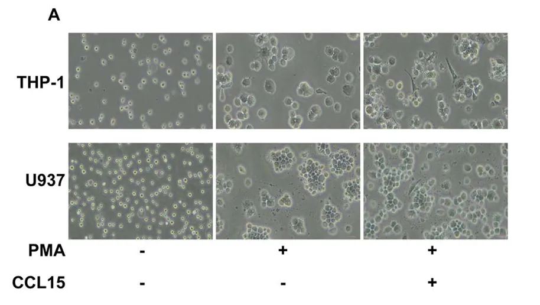

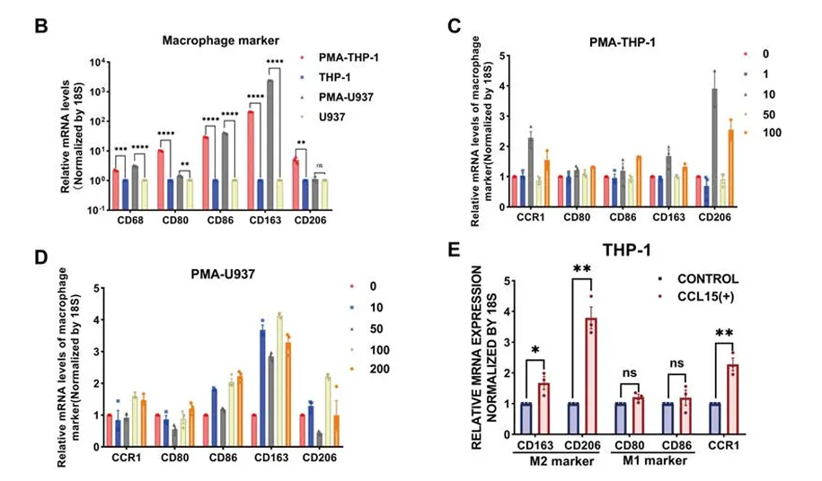

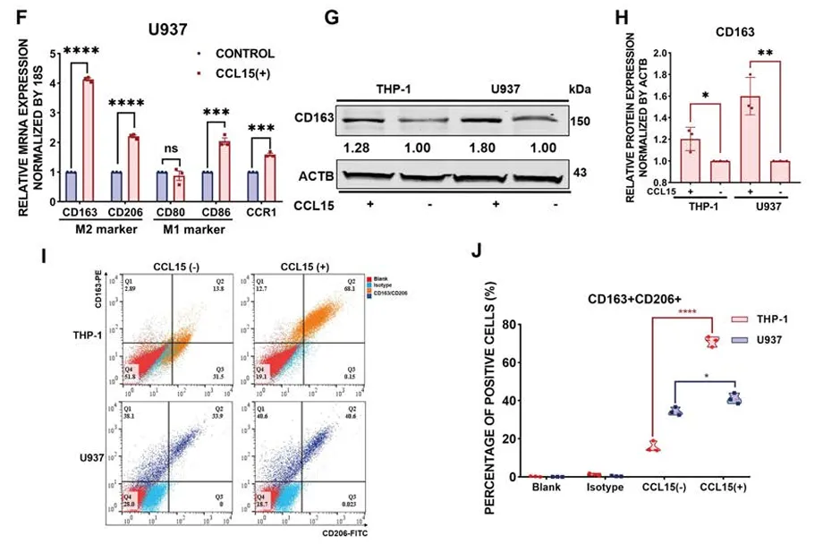

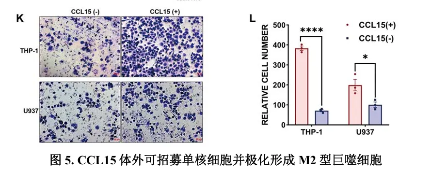

  * 接着作者基于 CCL15 对 M2 型巨噬细胞的作用，在 89 例肝癌组织样本的 CH 队列里，用免疫组化分析**CCL15** 和**M2 型巨噬细胞** 标志物 CD163 表达及相关性（图 6A），二者呈显著正相关（R=0.4367，p<0.0001）（图 6B）。Kaplan-Meier 生存分析显示**CCL15 和 CD163 都与预后相关** ，表达越高，OS 和 RFS 越差（图 6C - 6F）。ROC 分析表明，联合用 CCL15 和 CD163 预测 1 年、5 年 OS 的 AUC 高于单独用它们，对预后判断更优（图 6G - 6H）。再按二者表达差异分四组对比，CCL15hiCD163hi 组和 CCL15loCD163lo 组生存差异最显著，前者 OS 和 RFS 最差（图 6I - 6J），不过因样本量限制，两组临床病理特征没明显差异数据。总之，研究表明 CCL15 可能通过招募、**极化 M2 型巨噬细胞影响肝癌预后** ，二者高表达预示预后差，联合应用预测预后更好，但其促癌机制还需深入探究。

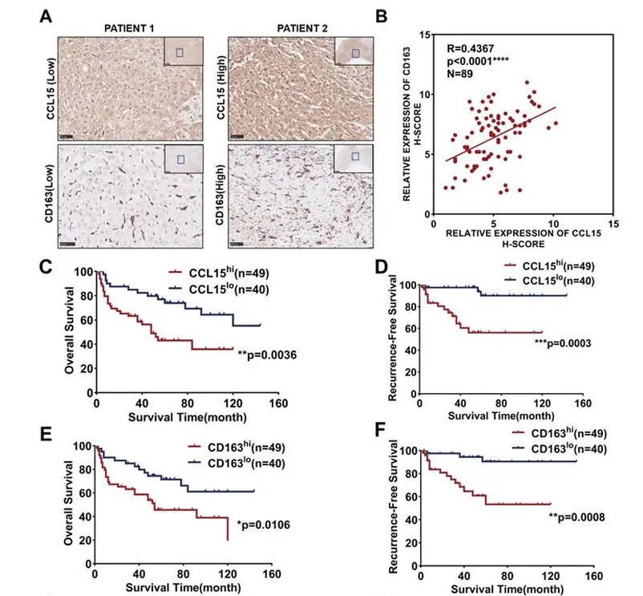

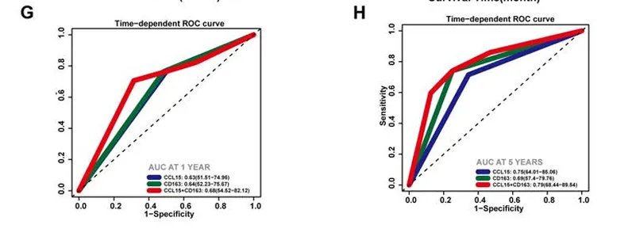

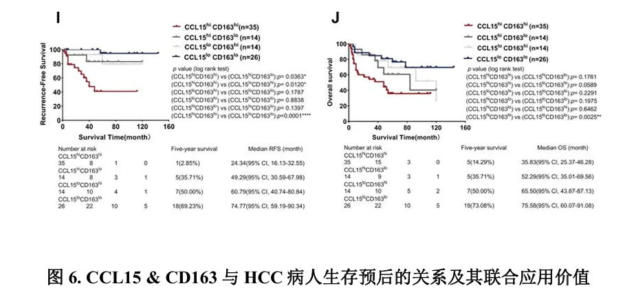

**4、CCL19和CCL21在免疫浸润富集区显著高表达**

  * 作者接下来评估了20个亚群中 T、B、NK、髓系细胞的浸润程度（图 7A），展示其空间表达模式（图 7B）。结果显示T、B 细胞在特定区域或亚群中；NK 细胞在 HCC中丰度低、分布局限无序；髓系细胞多但难分亚型，无显著空间特征。分层聚类免疫细胞浸润程度，HC-06/08/12/17 亚群免疫细胞富集且整合好（图 7C），定义为免疫浸润富集区（IIE）。作者发现免疫球蛋白相关分子在 IIE 显著上调，表明有大量 B 细胞聚集（图 7D）。

  * 此外，趋化因子 CCL19、CCL21 在 IIE 显著上调，二者来源、功能、机制相似，作者推测其上调致免疫细胞在 IIE 富集。因此，作者检测了 CCL19、CCL21 在 20个亚群中的表达水平与空间分布（图 7E - 7F）。结果显示二者在肝癌组织空间表达模式相似，纤维条索区表达最显著，CCL21 表达高于 CCL19，且二者在肝癌中表达正相关（R = 0.42）（图 7G）。

5、**CCL19和CCL21通过募集T细胞和B细胞抑制 HCC的生长**

  * 因CCL19 和 CCL21 在多方面相关性强，作者猜想其协同抑制肝癌。用TCGA 数据库验证了二者表达相关系数达 0.99（图 8A），还发现高表达这二者的肝癌病人预后好（图 8B）。

  * 为了显示其免疫治疗潜能，作者构建了过表达 Ccl19/Ccl21a 的腺相关病毒 AAV 载体（附录 5），并造 hepa1 - 6 小鼠肝癌细胞皮下荷瘤和 DEN/CCl4 诱导肝癌 C57/BL6 小鼠两模型（图 8C）。皮下荷瘤模型中，oe - AAV 组瘤内注病毒后肿瘤生长慢、体积渐小，对照组则相反（图 8D），oe - AAV 组肿瘤重量和体积显著更小（图 8E - 8F），证明 CCL19 和 CCL21 能抑 HCC 生长。因已有研究显示 CCL19 和 CCL21 可招募免疫细胞影响肺癌进展，且肿瘤**浸润 B 细胞能抑制肝癌** ，故作者猜想二者通过招募肿瘤浸润 T 细胞和 B 细胞来抑制肝癌生长。

  * 作者接着利用**TIMER 数据库** 考察 CCL19 和 CCL21 与各类免疫细胞浸润程度关联性(去卷积教程：[什么？不做单细胞也能分析细胞类群和免疫浸润？](<https://mp.weixin.qq.com/s?__biz=MzAwMzIzOTk5OQ==&mid=2247485798&idx=1&sn=c849bc7a0093af92fc99e13b55842bb2&scene=21#wechat_redirect>))，发现 CCL19/CCL21 与 CD4 + T 细胞、CD8 + T 细胞、B 淋巴细胞呈正相关（图 9A），尤其和幼稚型 T 细胞、中央记忆型 T 细胞、效应型 T 细胞、Th - 1 样细胞相关（图 9B）。

  * 随后在皮下荷瘤模型中验证，通过 qRT - PCR 进一步验证 Ccl19 与皮下荷瘤组织里 T 细胞标志物（Cd3e、Cd4、Cd8a）、B 细胞标志物（Cd19、Cd20）以及 Ifng（T 细胞活化标志物）的相关性，结果显示 Ccl19 与 Cd3e、Cd19、Cd20、Ifng 在荷瘤组织中的表达水平呈正相关（图 9C - 9H）。综上，作者证明了CCL19 和 CCL21 或许是通过影响 T、B 细胞的浸润程度来发挥抑制肝癌生长的功能。

  * 作者接着做了WB实验，结果显示与对照组比，oe - AAV 组的 T 细胞标志物 CD3、B 细胞标志物 CD20 蛋白表达显著上调（图 10A - 10B）。流仪分析和组织免疫荧光结果表明，oe - AAV 组荷瘤组织内 CD3 + 细胞、CD20 + 细胞浸润程度更高（图 10C - 10E）。

  * 在 DEN/CCl4 诱导的肝癌模型里，尾静脉注射 oe - AAV 和对照组 AAV，确认肿瘤存在后，3 个月后取小鼠肝脏做后续实验（图 10F）。结果是整体肿瘤数量差异不大（图 10G），但 oe - AAV 组相比对照组，最大肿瘤体积以及大于 3mm 的肿瘤数量明显减少，有统计学意义（图 10H - 10J）。综上，作者表明CCL19 和 CCL21 能通过增强肿瘤浸润 T、B 细胞的浸润程度抑制 HCC 生长，可能可以作为 HCC 免疫治疗新策略。

**6、肝癌组织中YTHDF1与YTHDF2表达量高度相关**

  * 接下来，作者首先通过在线GEPIA数据库评估了目前公认的21个**m6A** 相关的酶或蛋白的mRNA表达水平与33种恶性肿瘤预后之间的相关性，发现：不同肿瘤中同一修饰物功能及指示意义有别；同类型修饰酶在同种肿瘤功能不同（图 11A）。

  * 作者观察到YTHDF1、METTL3、RBM15B和IGF2BP3与**肝癌的OS和RFS显著相关** ，这些分子的高表达预示着肝癌病人预后较差。因此作者试图通过肝癌空间转录组测序探究HCC中m6A修饰相关酶或蛋白的空间表达模式（图11B），发现 YTHDF1 等在癌区亚群（如 HC - 4/19）上调，进一步验证了数据库的结果，且 YTHDF 家族尤其是 YTHDF1 和 YTHDF2 显著上调且可能有关联。

  * 作者接着比较了 YTHDF 家族不同亚群的相关性，YTHDF1 与 YTHDF2 相关性高于与 YTHDF3（图 11C - 11D）。YTHDF1 的 RIP 测序显示，hepG2.2.15 细胞中 YTHDF2 和 YTHDF3 的 mRNA 有结合峰（图 11E），先前 Hela 细胞研究也有类似发现，表明 YTHDF 家族蛋白显著相关且可能有调控作用。

**
**

  * 作者进一步通过WB研究发现，在 hepG2 和 hep3B 细胞中，慢病毒过表达 YTHDF1 时，YTHDF2 的 mRNA 及其蛋白水平上升，YTHDF3 无明显改变（图 12A - 12B）；干扰 YTHDF1 后，YTHDF2 的 mRNA 和蛋白水平一致下降，YTHDF3 表达仍无明显变化（图 12C - 12D）。由此，作者认为 YTHDF1 作为 m6A 阅读蛋白，能结合到同源分子 YTHDF2 的 mRNA 上，以某种方式调控 YTHDF2 的表达。

  * 接着作者构建了过表达**YTHDF1 的野生型质粒** （oe - YTHDF1 - wt），证实将其转染到 hep3B 和 hepG2 细胞后，YTHDF2 的 mRNA 和蛋白表达水平都有显著变化，与之前结果相符（图 12E - 12F）。

**7、YTHDF1调控YTHDF2mRNA的稳定性及其表达**

  * 接下来作者构建了过表达 YTHDF1 突变体质粒（oe - YTHDF1 - mut，含特定突变位点），并利用双荧光素酶报告载体构建 YTHDF2 的 3' - UTR 野生型质粒（YTHDF2 - wt）及 m6A 位点突变型质粒（YTHDF2 - mut）。经不同质粒排列组合共转染后发现，oe - YTHDF1 - wt 能增强 YTHDF2 - wt 的荧光素酶活性，oe - YTHDF1 - wt 可增强 YTHDF2 - wt 但无法增强 YTHDF2 - mut 组的荧光素酶活性（图 13A - 13B）。

  * 同时，作者通过 anti - YTHDF1 - RIP、RT - qPCR 及琼脂糖电泳实验验证了 YTHDF1 可结合至 YTHDF2 的 mRNA，而非 YTHDF3 的 mRNA（图 13C - 13D），这些结果说明**YTHDF1 能结合至 YTHDF2 的 mRNA 上的 m6A 修饰位点** ，以 m6A 依赖方式调控其表达。

  * 接着，作者在过表达 YTHDF1 及对照的 hep3B 细胞中用放线菌素 D 抑制转录，检测 YTHDF2 的 mRNA 衰减率和半衰期，结果显示过表达 YTHDF1 时，YTHDF2 的 mRNA 半衰期明显延长、更稳定（图 13E），这表明 YTHDF1 可依赖 m6A 修饰影响 YTHDF2 的 mRNA 稳定性，进而调控其表达。

**
**

**8、****联合应用YTHDF1和YTHDF2表达特征可预示HCC 患者较差预后**

  * 最后一部分作者的研究始于对 YTHDF1 和 YTHDF2 临床价值与意义的未知探索。首先在 30 对 HCC 组织中，证实二者蛋白水平在癌组织显著高于癌旁组织（图 14A - 14B），且蛋白水平定性定量皆呈强相关（图 14C）。

  * 随后作者收集了 293 例 HCC 病人肿瘤组织（EHBH 队列）制备组织芯片（图 14D），免疫组化结果显示二者在肿瘤区域表达强相关（图 14E - 14F）。经 X - tile 软件定最佳 cutoff 值，Kaplan - Meier 生存分析表明，二者均与预后显著相关，表达越高，患者 OS 和 RFS 越差（图 14G - 14H）。ROC 分析显示，联合二者预测 1 年和 5 年 OS 的 AUC 优于单独使用，预测价值更佳（图 14I）。

  * 进一步评估联合表达水平与预后关系，依二者差异分四组，发现 F2hi 组和F2lo 组生存差异最显著，前者 OS 和 RFS 最差（图 14J - 14K）。而且二者均高表达与侵袭性临床病理特征相关，单因素分析显示 F2hi 组微血管侵犯、子灶程度高于 F2lo 组，**病理 Edmonson 分级和临床 BCLC 分期也提示更高恶性程度** （表 7）。

  * 总之，YTHDF1 和 YTHDF2 在临床组织样本中相关性强，共同促进肿瘤恶性表型与进展，影响肝癌预后，联合二者表达量预测预后优于单指标，有更好预测价值。

**第三篇**

这是华中农业大学肿瘤生物学硕士2023年的毕业论文，题为“空间转录组和单细胞转录组联合分析探究**斑马鱼** 胚胎发育调控机制”，全篇66页。结果部分分5部分进行阐述，共11页，占全篇幅内容的1/6，处于一个较为合适的区间。运用**单细胞转录组测序、空间转录组测序、原位杂交、以及SPOTlight 整合分析** 阐述了斑马鱼胚胎发育阶段的细胞特征、关键基因的表达特征与功能、细胞分化轨迹与异质性、数据整合分析的有效性。有**一个问题** 需要提醒大家注意一下。这篇文章的结果部分用大量篇幅阐述了**具体的实验的操作细节** 。比如类似下图中的语句在结果部分多次出现。结果部分的表达效率降低，打破了读者对于结果部分应着重展示数据和发现而非实验过程细节的阅读预期。还是建议大家尽可能的将这部分阐述放到方法中。当然了，如果是为了凑字数来的，大家也是可以理解的哈。
有需要的话大家可以**参考** 咱们的这篇推送去撰文（超链接，可直接点击跳转）：**[写SCI论文前首先要问自己11个问题](<https://mp.weixin.qq.com/s?__biz=MzAwMzIzOTk5OQ==&mid=2247494517&idx=1&sn=c15c4377723454e6cb01239443fc9293&scene=21#wechat_redirect>)** 下面就带大家一起看一下这篇文章吧~~

**1、斑马鱼早期胚胎发育时空转录组图谱构建**

  * 作者以野生型斑马鱼为研究对象，收集了其受精后 3.3 h、5.25 h、10 h、12 h、18 h 和 24 h 这 6 个关键发育阶段的胚胎，用于空间转录组分析。作者通过多切片策略和 Stereo - seq 技术，成功创建了高质量的斑马鱼胚胎发生时空转录组图谱。

  * 作者在对这张Figure3-1的结果描述中，提到了3-1E。应该不是我眼花吧，这张Figure以及Figure legend里都**没有** 图3-1E，可能是作者的小粗心。大家自己撰写毕业论文的时候一定要多检查几遍，可以同学间相互浏览一下，可能会发现在你思维盲区的小错误。

**2、****斑马鱼早期胚胎发育空间聚类特征分析**

  * 作者把不同发育时期的所有斑马鱼胚胎组织切片进行无监督聚类分群，依据标记基因表达差异与空间位置予以注释，绘制出了时空转录组图谱（图 3-2 A）。各阶段情况如下总结，大家可以对照着解读。

3.3 hpf 处于囊胚晚期，母源 mRNA 降解，合子基因表达活跃，细胞均为囊胚细胞。5.25 hpf 处于原肠发生时期，产生原始胚层和胚轴，形态 50% 外包，细胞以表皮细胞为主，部分表达卵黄合胞层标记基因。10 hpf 处于体节发生时期，脊索原基分离，神经板增厚，形态 100% 外包、分头部尾部，细胞主要表达卵黄合胞层和中胚层标记基因。12 hpf 处于体节期，分化出 6 个体节，细胞主要表达中胚层、神经龙骨等多类相关标记基因。18 hpf 处于体节期，分化有 18 个体节、10 个神经原节，后脑神经元显著，细胞主要表达神经系统、前脑等相关标记基因，少量表达眼睛和视泡标记基因。24 hpf 处于咽囊期，体节期结束，松果体、小脑可见，感觉 - 运动反射循环起作用，胚体以中胚层标记基因表达为主，前脑、眼睛等相关标记基因分布较集中。

  * 接下来，作者针对发育至 3.3 hpf 的胚胎展开分析，从中明显区分出边缘胚泡、深部胚泡和浅表胚层这三种空间分布不同的细胞类型（图 3-3 A）。通过热图分析可知，边缘胚泡主要表达基因 AL935186.10、AL935186.2、NC-002333.4 等，浅表胚层主要表达基因 thy1、mad2l1、cldng 等。再进行拟时序分析（图 3-3 B），发现其分化序列是从边缘胚泡到深部胚泡和浅表胚层。而经典标记基因粒头样转录因子 3（grhl3），具备**染色质结合活性** 与**序列特异性 DNA 结合活性** ，参与多个生命活动，特异性表达在浅表胚层中。

  * 接着，作者分析了空间组数据获取潜在标记基因，**如 thy1 参与细胞粘附等，phf5a 参与 mRNA 剪接，rps27a 涉及蛋白质分解代谢等，rps20 参与翻译过程** 。选取 grhl3 和 thy1 合成 mRNA 探针，对 3.3 hpf 全胚胎原位杂交染色验证（图 3-3 C），结果与空间数据分析一致，证实其有作标记基因的潜力。

  * 作者针对 24 hpf 胚胎做无监督聚类分群分析与细胞类群注释，发现其共分 19 个类群（图 3-4 A），涵盖神经系统、肌节等不同类别。在 24 hpf 时，前肾、脊髓、红系谱系细胞等有细分情况，且脊髓、底板和脊索相互作用，通过细致分群能区分出区域特异性表达基因，像 slc4a2a 特异性表达在后前肾，mfs4ab 在前前肾，ntd5 在脊索，ntn1b 在底板，prdm8 在脊髓。从基因表达量点图（图 3-4 B）也能看出，高表达于不同区域的基因功能各异、参与不同生命活动过程。

**3、关键调控基因在斑马鱼早期胚胎发育的表达验证**

  * 作者聚焦于ntd5这一蛋白质编码基因，其定位于 16 号染色体，有肽酶抑制活性，在细胞外区域定位，斑马鱼早期发育时特异性高表达于脊索。作者针对 ntd5 - mRNA 序列选特异性片段，经分子克隆构建载体，体外转录合成特异性 mRNA 探针用于原位杂交。收集斑马鱼不同发育阶段（3.3 hpf 至 24 hpf）的胚胎，经过系列处理后获取了染色的胚胎图像（图 3-5）。原位杂交染色结果表明，ntd5 在早期的 3.3 hpf、5.25 hpf 不表达，10 hpf 至 24 hpf 高表达于脊索。其中，10 hpf 和 12 hpf 时表达在近轴细胞和轴中胚层中；18 hpf 和 24 hpf 时表达在脊索神经铰链、下脊索、后肠和体节中。该**原位杂交结果** 与时空组学分析中 ntd5 在斑马鱼早期发育的表达位置相符。

  * 接着，作者围绕 E2F 转录因子 3（e2f3）展开研究。作者先选取 e2f3 - mRNA 序列的特异性片段，通过分子克隆构建载体，体外转录合成特异性 mRNA 探针用于原位杂交，得到染色胚胎图像（图 3-6）。结果显示，e2f3 在 3.3 hpf、5.25 hpf 呈非特异性表达，10 hpf 至 24 hpf 主要表达于端脑、前脑、中脑、视网膜和视泡中，在后脑表达量较低，且在 24 hpf 胚胎中集中表达于端脑。该原位杂交结果与时空组学分析里 e2f3 在斑马鱼早期发育中的表达位置相契合。

  * 在3-7和3-8中，作者又用同样的方法分别围绕复制蛋白因子A3 (rpa3)和 凋亡诱导因子1 ( siva1)展开了研究。结果显示，原位杂交结果与时空组学分析结果的表达位置均一致。

**4、斑马鱼早期胚胎后脑神经干细胞分化异质性的空间分布**

  * 当胚胎发育至 24 hpf 时，大脑各脑区界限明显，神经系统趋于成熟，作者提取时空组学数据中的神经成分细致分群，得到了神经系统精密空间转录组图谱（图 3-9 A），能看到对应不同细胞类型特征的亚团簇分布于不同解剖区域，如端脑、视网膜等。通过基因表达量热图分析可知，不同特征亚团簇高表达基因有别。综合来看，干细胞高表达的基因大多具备 DNA 结合活性、DNA 结合转录因子活性和 RNA 聚合酶 Ⅱ 特异性等相似活性，但因表达位置不同，参与不同生命活动。

  * 作者对后脑结构深入分析，发现后脑背侧的神经干细胞（NSCs）和腹侧的神经中间祖细胞（nIPCs）（图 3-10 A），NSCs 在背侧富集，nIPCs 分布于腹侧，与此前研究相符。进行拟时序分析后，鉴定出两个分化分支点，分别来自早期神经干细胞和神经中间祖细胞，也与以往研究结论一致（图 3-10 B）。通过对比拟时序分析所得的干细胞分支和神经中间祖细胞分支的先后位置，将二者进一步分成 5 种细胞状态，比较了不同状态细胞类群的差异表达，以此区分其分化特性。同时结合细胞所处空间位置（图 3-10 C）来看，状态 1 干细胞倾向分布在前侧和背侧，状态 2 干细胞倾向分布在后侧和腹侧。通过分析热图（图 3-10 D）能够发现，不同状态下的细胞所表达的基因存在差异。

**5、SPOTlight 整合分析scRNA-seq和Stereo-seq 数据**

  * 作者指出 Stereo - seq 数据和之前的 scRNA - seq 数据显示，发育时间是重要变异来源，源于胚胎发生时细胞状态的活跃转换。为构建胚胎细胞时空发育轨迹，作者在与 Stereo - seq 分析相同的 6 个关键发育时间点（受精后 3.3 h、5.25 h、10 h、12 h、18 h 和 24 h）对斑马鱼胚胎进行基于微滴的单细胞转录组测序。该研究从 6 个发育阶段胚胎中获取 86307 个细胞，鉴定出 71 种细胞类型，与此前研究基本相符。通过 UMAP 可视化不同发育时期细胞（图 3 - 11，B）可看出，3.3 hpf、5.25 hpf 细胞与其他时间点细胞类群相距较远，剩余 4 个时期细胞连贯性较大，且 10 hpf 与 12 hpf、18 hpf 与 24 hpf 细胞距离更近，进一步体现了不同发育阶段细胞类型的保守性和差异性。

  * 接下来，作者应用 SPOTlight 来计算 Stereo - seq([Stereopy空间转录组学习手册](<https://mp.weixin.qq.com/s?__biz=MzAwMzIzOTk5OQ==&mid=2247505686&idx=2&sn=925ce770136ec3e964b954c639eed29e&scene=21#wechat_redirect>))数据里每个位点的细胞组成，以此整合 scRNA - seq 和 Stereo - seq 的数据，进而预测各单细胞类群的空间位置。在 3.3 hpf 胚胎中，观察到出现两种细胞类型（图 3 - 12 A），经拟时序分析确定分别为早期胚泡和晚期胚泡（图 3 - 12 B）。利用 SPOTlight 映射结果显示，早期胚泡分布于胚胎腹侧，晚期胚泡盘主要分布在背侧（图 3 - 12 C）。这进一步表明 SPOTlight 整合预测的 scRNA - seq 细胞分群位置结果和 Stereo - seq 数据中不同分群的空间位置高度一致，体现了 SPOTlight 整合分析这两种数据的准确性。

**第四篇**

“应用高分辨率空间转录组技术初步揭示非小细胞肺癌空间异质性特征”作者于2022年毕业于**郑州大学华大基因学院** ，从事遗传学的研究。本毕业论文全文**109页，** 结果部分内容23页**。** 主要内容总共分为“ Stereo-seq揭示**正常小鼠** 肺内部组织结构及功能特征”、“**人类肺癌临床样本** 的处理条件测试和优化”和“**人类非小细胞肺癌** 肿瘤空间异质性研究”这三个部分。总体而言，就硕士阶段的研究要求来看，目前的工作量达到了一定的水平，能够展现出作者在硕士期间付出的科研努力以及具备的科研能力。

**1、Stereo-seq 揭示正常小鼠肺内部组织结构及功能特征**

  * 作者对出生后 35 天正常**雌性** 小鼠肺从近肺端到远肺端的连续 3 张 10μm 切片开展了空间转录组实验，归一化处理数据后，运用 SCENIC、RCTD、Hotspot 进行个性化分析。同时，作者对该空间转录组实验**相邻的一张切片** 进行了 H&E 染色并拍照。

  * 作者先是比较了两张完全相邻的小鼠肺切片的形态结构，一张用于 H&E 染色（图 2.5A），另一张用于 Stereo-seq 实验（图 2.5B）。H&E 染色切片与进行 Stereo-seq 实验的切片在整体形貌以及肺内部气管、血管的具体分布上高度一致。作者还计算并可视化了整张切片的线粒体基因捕获和表达情况，观察到线粒体基因表达量很低，由此说明该切片的数据质量在线粒体基因表达方面表现较高（图 2.5C）。

  * 作者接着对另外两张相邻的空间组切片（Section2，Section3）开展了与之前同样的 UMI 以及线粒体基因表达和可视化分析，结果显示三张相邻切片在整体形态、UMI 和线粒体基因空间分布方面高度一致（图 2.6）。为评估数据的一致性，作者计算了三张切片之间表达基因的线性回归决定系数R2，结果表明三张连续切片的空间转录组数据有着高度的一致性，也体现了空间转录组实验具备高度的重现性。

  * 作者为体现 Stereo-seq 技术在肺器官应用中的优越性，将其与已公开发表的 Visium 数据在小鼠肺中的表现进行了比较。针对 Stereo-seq 数据，作者把 Acta2 基因（平滑肌相关）的空间表达和分布分别在 bin1（500nm）、bin5（2.5μm）以及 bin10（5μm）中予以展示，结果表明 Stereo-seq 能够在不同分辨率下出色地呈现**同一空间分布结果** ，且不同级别分辨率之间的结果有着高度的一致性（图 2.7A）。而在 Visium 的数据里，其最高分辨率为 100μm，从中可以看出，无法凭借该数据以高精度级别去确定每一种细胞类型或基因的空间位置（图 2.7B）。

  * 作者利用空间转录组技术能提供空间维度信息这一优势来构建小鼠肺空间转录图谱。先是分析了已知结构和细胞 marker的空间表达情况。结果显示，这些 marker 各自有着独特的空间分布，整体形态清晰可见（图 2.8）。另外，作者还发现了像 Foxj1、Malat1、Jarid2等这类具有区域聚集性高表达（在肺远端）的基因。

  * 接下来，为把这些单独呈现的 group 整合到一张切片的空间表达情况里，作者对所有 group 进行了模块评分，并运用 K-means 聚类算法聚集成 6 个确定的 clusters（图 2.9A）。作者计算了上述 6 个 clusters 在整张肺切片的占比情况（图 2.9B）以及它们彼此之间的相关性（图 2.9C）。依据 marker 基因的表达水平、分布及其相关性，作者确定了不同 clusters 所代表的结构或细胞类型。并用气泡图展示了肺切片中每个cluster中包含的基因表达占比和基因平均表达水平。

  * 为深入探究这种空间分布差异性现象及成因，先是计算了 cluster2 和 4 的差异表达基因，结果显示在肺远端和和在肺近端高表达不同基因（图 2.10 A）。接着作者进行了基因通路富集分析，从结果来看，肺近端主要与能量生成和转移相关；肺远端主要与细胞增值相关（图 2.10B）。作者通过空间组学结果揭示了出生后 35 天小鼠肺发育存在空间异步的现象，即肺远端更不成熟，肺近端更成熟，同时也表征出了与空间异步相关基因的空间分布图谱。

  * 作者接着开展了肺内转录因子活性调节的空间分布研究。首先，借助 SCENIC （[SCENIC单细胞转录因子预测|4.精简版流程](<https://mp.weixin.qq.com/s?__biz=MzAwMzIzOTk5OQ==&mid=2247501260&idx=1&sn=f1e2a165599e753e2959aad7c8a298cb&scene=21#wechat_redirect>)）算法重构了小鼠肺切片空间转录组数据的基因调控网络，最终确定了 99 个有着不同空间分布的 regulon（图 2.11A）。接着，通过计算不同 regulon 的空间分布相关性（图 2.11B），作者发现部分转录模块呈现出特异性的富集情况，分别在细支气管上、肺泡上、肺泡内富集。

**2、人类肺癌临床样本的处理条件测试和优化**

  * 作者在本研究中共采集了 125 个样本，这些样本包含 57 对肺癌、癌旁组织或正常组织。其中，研究阶段采集了 33 对组织，总计 77 个样本；验证阶段采集了 24 对组织，共 48 个样本。这 125 个样本里仅有 54 个样本符合空间转录组要求，制备成功率为 43%。此外，作者还通过表格（表 3.1）总结了患者的临床表型情况。

  * 作者为探究肺癌组织的病理特征与获取高质量空间转录组数据的相关性，总计总结了 33 例肺癌病例的病理特征，随后依据 RIN 评分把它们划分为三组，又按照 H&E 评分将其分成两组（表 3.2）。经研究发现，这些临床表型和 RIN 或 H&E 评分之间并没有显著的相关性。

  * 作者接下来详细呈现了肺癌组织切片的 H&E 染色图像，同时列出了与之对应的病理表型以及样本数量情况。

  * 作者依据样本采集与处理的具体操作过程，对手术室保存和样本处理过程中各组织处理的细节通过图示进行了展示（图 3.3）。

  * 作者为系统揭示不同处理方式对样本以及测序结果造成的影响差异，将不同处理方式与最终结果进行了统计分析。

  * 作者为进一步评估不同样本类型以及处理步骤与 RIN 和 H&E 之间的关系，对上述相关信息展开了统计及相关性评估（见表 3.3）。

  *

  * 作者为揭示不同变量与 Stereo-Seq 数据质量的相关性，提出了 BUSSTR 概念，即相同测序深度、相同 bin50 捕获面积下可成功捕获的 UMI 数量，它代表基于 bin50 捕获区域等条件的 RNA 捕获效率。

  * 作者经过前期统计分析，确定 “样本离体小于 30 分钟内处理” 和 “干燥处理条件” 与测序结果显著相关后，为进一步表征其与 Stereo-seq 结果的关系，用空间转录组的可视化数据对不同影响因素做了质控分析。得出满足 “样本离体小于 30 分钟内处理” 和 “干燥处理条件” 这两个关键步骤的样本测序结果质量更佳。

**3、人类非小细胞肺癌肿瘤空间异质性研究**

  * 作者在本部分收集了 12 个非小细胞肺癌患者的共 24 个组织（包含癌症组织 T、正常组织 N），开展 Stereo-seq 实验，通过对测序数据按标准流程分析，得到了 Stereo-seq 初始数据。同时，取相邻切片进行 H&E 染色并拍照获取图像，之后交由病理医生鉴定样本的病理信息（图 4.1）。

  * 作者首先对切片的 UMI 进行了可视化表达，从结果来看，部分样本的 UMI 捕获在不同区域呈现出不一样的情况，特别是在癌症样本中。

  * 作者接着对所有切片进行了整张切片范围的无监督聚类分析，展示了 #23 的肿瘤样本和正常组织样本切片的空间注释结果（图 4.3）。结果显示，无论是肿瘤组织切片还是正常组织切片，都能够成功鉴定出巨噬细胞、上皮细胞、B 细胞以及肌成纤维细胞。尤其值得注意的是，在肿瘤组织切片中，可鉴定出更多的上皮细胞亚型，像 Basel cell、Club cell 和 AT2，而正常组织切片仅鉴定出了 AT2 和 Club cell 这两种细胞类型。

  * 作者通过计算癌症样本切片的 CNV，鉴定出了切片内不同 CNV 程度的区域，并且将其和相邻切片经病理医生依据 H&E 染色中的细胞组织形态学判定的肿瘤区域进行对比，结果显示二者高度一致（图 4.4A）。此外，把肿瘤切片中注释出的细胞类型与 CNV 高区域([单细胞拷贝数变异学习手册](<https://mp.weixin.qq.com/s?__biz=MzAwMzIzOTk5OQ==&mid=2247522733&idx=1&sn=4e3a0707fd8f83b5ad9377bc91ee8e53&scene=21#wechat_redirect>))作比较，能够发现发生癌变的上皮细胞区域和 CNV 高变区域同样具有一致性（图 4.4B）。这表明利用 CNV 区分癌症样本切片肿瘤区域的方法在非小细胞肺癌中是可行的。

  * 作者通过对整张癌症样本切片进行 hallmark 分析，以此来揭示肿瘤区域和非肿瘤区域所存在的代谢差异。从 #2-T-FO13 的分析结果来看，存在部分代谢通路会特异性地在肿瘤区域呈现出高激活状态，且这种激活状态是由与信号通路相关的基因来体现的（图 4.5）。

  * 从 #2-T-FO13 的 hallmark 结果可以看出，在肿瘤组织与非肿瘤组织的交界处，存在着一些特殊的代谢通路呈现出高激活状态（图 4.7），例如炎症、癌症驱动靶点 KRAS 增强等。

  * 在 #14-T 的样本中（图 4.8）同样观察到了在肿瘤区域与非肿瘤区域交界处有特殊的代谢通路呈现高激活状态，比如上皮间质转化等情况。

  * 作者以 #14-T 样本为例，先鉴定出肌成纤维细胞、肿瘤细胞、成纤维细胞和巨噬细胞等主要细胞类型，并进行细胞类型空间可视化表达，发现巨噬细胞在肿瘤区域和非肿瘤区域都有分布。接着，作者将 M2 型极化状态巨噬细胞空间分布可视化，看到其在肿瘤组织边缘区域高表达，提示 M2 型巨噬细胞在肿瘤进展边缘聚集的现象，符合其促进肿瘤发展的特点。作者还可视化并量化了从远肿瘤组织区域到肿瘤组织区域不同程度的 M2 型巨噬细胞空间分布，结果显示其极化状态逐渐增强，进一步证明了 M2 型巨噬细胞在肿瘤发生发展中的促进作用。

  * 作者同样在 #2-T-FO13 切片中观察了不同巨噬细胞亚型的空间分布情况（图 4.10）。发现**M1 型和 M2 型极化状态巨噬细胞都聚集在肿瘤边界区域** 。

  * 作者在 #35 的癌症与正常组织切片中对 CAFs 进行空间可视化与共定位分析。已知不同 CAFs 亚型功能有别，如 CAF（COL）能助肿瘤细胞转移生存（图 4.11A）。在癌症切片中，经聚类分析鉴定出多种细胞类型（图 4.11B）。癌症切片中存在正常组织未鉴定出的细胞类型，聚焦其空间分布，可见**不同上皮细胞和 CAFs 亚型呈聚集分布** ，可能预示不同功能（图 4.11C）。

  * 为揭示肿瘤组织差异性，作者对两种上皮细胞进行信号通路富集和差异基因鉴定分析，确定 Epithelial cell 1 和 2 代表不同恶性程度且有空间分布差异（图 4.11D、E）。随后进行空间共定位相关性分析，显示 Epithelial cell 1 和 C1R + 的 CAFs 亚型、Epithelial cell 2 和 POSTN + 的 CAFs 亚型分别空间共定位（图 4.11F）。最后通过生存曲线预后分析，表明 POSTN + 的 CAFs 亚型对肿瘤细胞有恶性促进作用，降低患者生存比例（图 4.11G）。

**总结**

今年上半年我们也带大家解读过4篇单细胞测序的毕业论文：[单细胞测序做到什么程度能毕业|硕士篇](<https://mp.weixin.qq.com/s?__biz=MzAwMzIzOTk5OQ==&mid=2247511793&idx=2&sn=81f2d2e5ce4e61dd76631c650402bed9&scene=21#wechat_redirect>)相较而言，这次带大家解读的4篇空间转录组测序的毕业论文在工作量方面明显大了不少，看来逐渐越来越卷了，也不知道是我们的福还是孽。总体而言，硕士空间转录组测序毕业逐渐也需要达到一定的深度，除了鉴定细胞类型及亚型，深度分析基因表达差异和挖掘细胞与基因空间分布及关联之外，有条件也需要解析分子机制与调控网络，整合多组学数据以及深入研究生物过程动态变化。祝各位都有一个光明的未来~

**参考文献**

[1]张颖.单细胞测序与空间转录组联合分析狼疮肾炎的免疫学机制[D].中南大学,2023.DOI:10.27661/d.cnki.gzhnu.2023.005788.

[2]王月帆.空间转录组测序揭示原发性肝细胞癌微环境异质性[D].中国人民解放军海军军医大学,2022.DOI:10.26998/d.cnki.gjuyu.2022.000017

[3]裴晨羽.空间转录组和单细胞转录组联合分析探究斑马鱼胚胎发育调控机制[D].华中农业大学,2023.DOI:10.27158/d.cnki.ghznu.2023.001331

[4]姜宇佳.应用高分辨率空间转录组技术初步揭示非小细胞肺癌空间异质性特征[D].郑州大学,2022.DOI:10.27466/d.cnki.gzzdu.2022.005800

**如何联系我们**

 公众号后台消息回复不便，这里给大家留一下领取资料及免费服务器([足够支持你完成硕博生涯的生信环境](<http://mp.weixin.qq.com/s?__biz=MzAwMzIzOTk5OQ==&mid=2247507693&idx=1&sn=d9517a0803ad75cb7be430806834e7b8&chksm=9b3ca7bdac4b2eaba1ad01ed04ab1fbcbafcf4f6ddfe9e4f76ed9229707f545fe7d9c9ffd6ae&scene=21#wechat_redirect>))的**微信号** ，方便各位随时交流（别问在么，添加时直接说来意）。呼声很高的**交流群** 也建好了，欢迎大家入群讨论：

[永久免费的生信、科研交流群](<http://mp.weixin.qq.com/s?__biz=MzAwMzIzOTk5OQ==&mid=2247505868&idx=2&sn=20c81313eaef9a7031a84ef3a691d1b5&chksm=9b3cae9cac4b278a42c8de97e864c7664a37e9a4adb5973625fe3f8dd1093e55aeda88d443aa&scene=21#wechat_redirect>)

大家可以阅读完这几篇之后添加[给生信入门初学者的小贴士](<http://mp.weixin.qq.com/s?__biz=MzAwMzIzOTk5OQ==&mid=2247493329&idx=1&sn=597870b7f7ce10346da3561e7c281627&chksm=9b3c9f81ac4b169794088ce9abbcacb5f18e9fd174fc0d7e28da62d78facadf3100ef38aaf22&scene=21#wechat_redirect>)
[如何搜索公众号过往发布内容](<http://mp.weixin.qq.com/s?__biz=MzAwMzIzOTk5OQ==&mid=2247506266&idx=2&sn=22b1164bc9602c25620d058847785422&chksm=9b3ca00aac4b291c16d738271746ffb90149282a728f484e8a1952463c46a8e7dc4f883ab928&scene=21#wechat_redirect>)

**已有生信基地联系方式的同学****无需重复添加**

 您点的每个赞和在看，我都认真当成了喜欢
