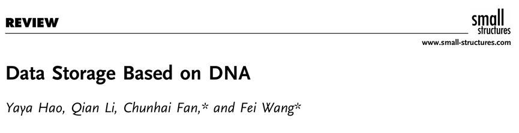
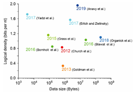
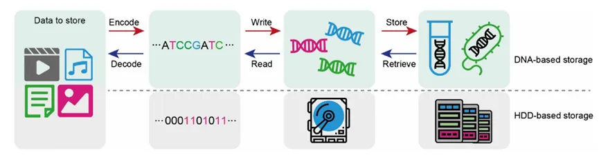
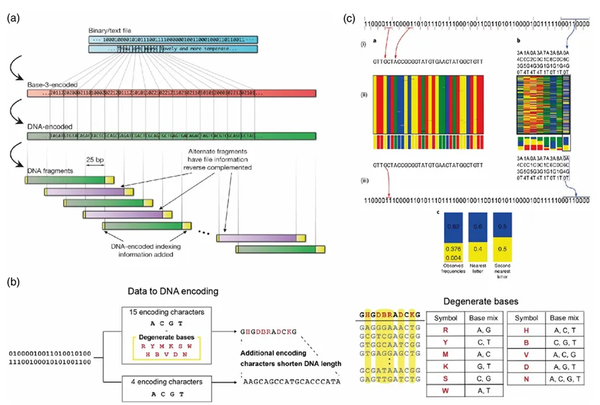
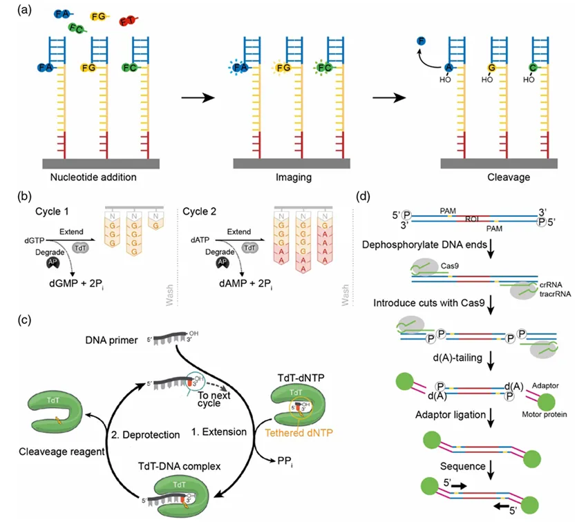
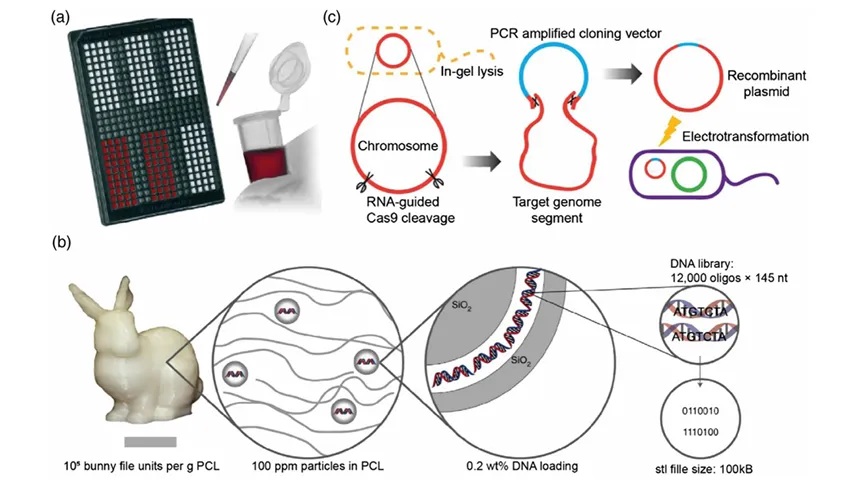
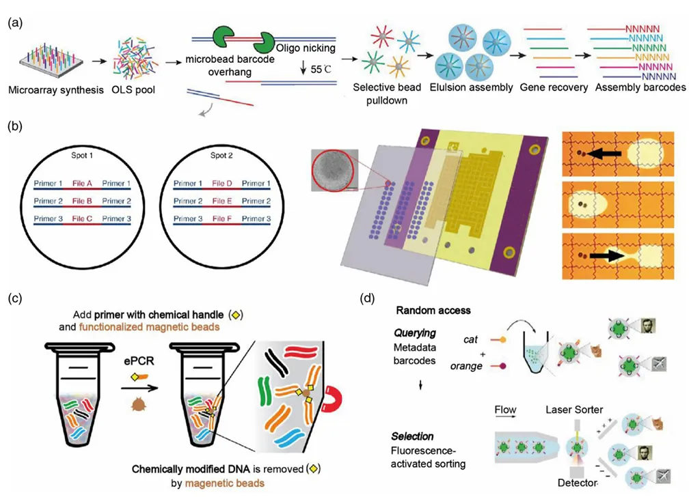
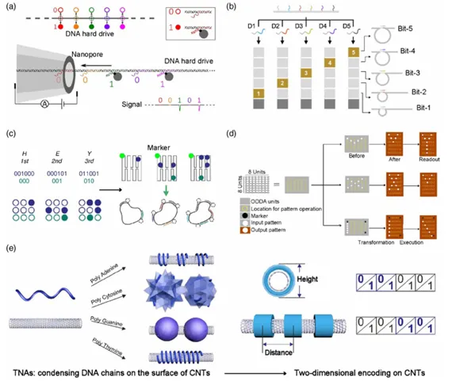
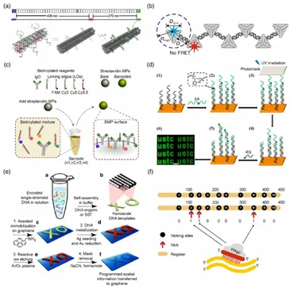
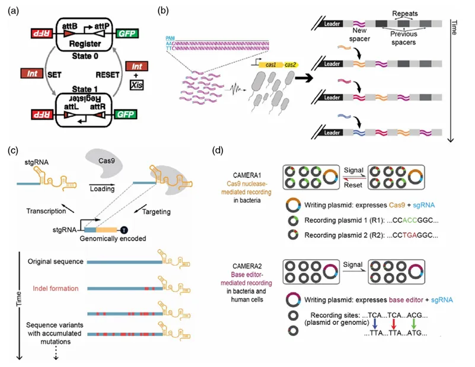

# 也就是说，DNA能当硬盘使？

> 原文：https://mp.weixin.qq.com/s?__biz=MzAwMzIzOTk5OQ==&mid=2247526975&idx=1&sn=0212499173fcc2159fd1132f2f5af412&chksm=9b3c136fac4b9a793ff4184b3bd37231a767deb07d722d4cdf091a05b9cf5de46b8990f3154d#rd
> 合集：文献速递 / 漫谈胡侃

**一、写在前面**

自人类进入信息时代以来，信息总量飞速膨胀，预计到2025年全球数据量将达到**175泽字节** （ZB），为数据存储带来极大挑战。传统存储系统（如磁、电子或光介质）可能因寿命、基础设施成本和功耗问题而不可持续(可以参考：[大家的宝贝数据怎么存储才最安全](<https://mp.weixin.qq.com/s?__biz=MzAwMzIzOTk5OQ==&mid=2247490796&idx=1&sn=99bdd182e1f02f88d30b196e4960b9b0&scene=21#wechat_redirect>))，而**DNA** 因具有超高的**物理密度** ；可通过聚合酶链反应（PCR）放大；在适宜的环境下长时间保存和可通过相互作用分子进行信息保护等特性能够作为优质的存储介质，同时DNA测序技术的发展也为DNA存储信息检测提供了技术手段。今天分享得这篇文章提供了便对**DNA数据存储** 领域的进展进行了深入了解，展示了其作为一种新兴存储技术的巨大潜力和目前的研究前言成果。文章DOI: https://doi.org/10.1002/sstr.202000046
如果你也对生信大数据的计算感兴趣，那么你可以先行学习编程教程：[十小时学会Linux](<http://mp.weixin.qq.com/s?__biz=MzAwMzIzOTk5OQ==&mid=2247505777&idx=1&sn=f3efae390566b838a445ab9f832323c8&chksm=9b3cae21ac4b2737f5923b246470d699474c041bb78de50d2b71b99d537f9f44ca2938002cda&scene=21#wechat_redirect>)
[生信Linux及服务器使用技巧](<https://mp.weixin.qq.com/mp/appmsgalbum?__biz=MzAwMzIzOTk5OQ==&action=getalbum&album_id=2980604042328702978#wechat_redirect>)[R语言基础学习手册](<https://mp.weixin.qq.com/s?__biz=MzAwMzIzOTk5OQ==&mid=2247506720&idx=1&sn=fe897ba3c33a8e63bf6a4e35aeac1896&scene=21#wechat_redirect>)

大家可按需选用适合自己的计算资源：共享(经济实惠)：[有root权限的共享服务器,报我名字立减200￥](<http://mp.weixin.qq.com/s?__biz=MzAwMzIzOTk5OQ==&mid=2247503869&idx=1&sn=142f8c7ba8620815a8770773df077f12&chksm=9b3cb6adac4b3fbb1acdf7593df06af5ac77d1fe9c0144c999de7109bd063b76080a33c50e0d&scene=21#wechat_redirect>)独享(省电省心)：[生信分析不求人](<http://mp.weixin.qq.com/s?__biz=MzAwMzIzOTk5OQ==&mid=2247508226&idx=1&sn=69e0eea720ac6aecc0362bcb9ac339ba&chksm=9b3cd852ac4b51445651a091be0fb6f638bd8cf5eb399af1c54804631fe3047706cf1d4044de&scene=21#wechat_redirect>)

实体(稳定高效)：[为实验室准备一份生物信息学不动产](<http://mp.weixin.qq.com/s?__biz=MzAwMzIzOTk5OQ==&mid=2247506028&idx=2&sn=3b479a92f0c6119c4584efbc23b8c32a&chksm=9b3ca13cac4b282a9ffe1fc4f4ab1a50b14688c6490f859ef714b84a755c286cb8a585054486&scene=21#wechat_redirect>)

访问链接：https://biomamba.xiyoucloud.net/

更多内容可咨询客服微信[**Biomamba_yunying**]

**二、主要内容**

  1. **1. ****DNA****存储的最新进展。******

DNA 储存的快速发展始于1999年，Church等人在2012年发表的工作引领了我们对DNA数字技术的重新思考，他们的工作实现了将长达650kb的文件写入115-nt寡核苷酸并成功测序，从那时起，**基于****DNA****的策略的存储能力提高了近 三个数量级，其他功能，如逻辑密度、稳健性、稳定性以及读写的便利性也得到了改进**（Fig.1）。

**Fig.1**

**
**

  1. **1. ****DNA****序列数据存储的主要步骤。******

DNA 的四种碱基（A、T、C、G）的多样性排列使其成为一种天然的信息存储介质，**每个核苷酸** 可以存储**2 个bits**的数字信息。其主要步骤包括：**1.****将数字信息编码成****DNA****序列（编码）；****2.****合成****DNA****（合成或写入）；****3.****在物理或生物条件下保存****DNA****（保存）；从大量****DNA****池中随机访问特定****DNA****（检索）；测序****DNA****（读取）和将****DNA****序列解码成数字信息（解码）** （Fig.2）**。******

Fig.2

**2.1****编码******

******编码是DNA数据存储的第一步** ，它使用计算机算法将二进制数字信息转换成DNA序列，但由于低错误率合成的DNA片段（oligos）长度有限，因此需要将长的DNA序列分割成许多短的DNA序列。编码策略分为**二进制编码，三进制编码和四进制编码。** 但编码过程中也存在某些问题：如高GC含量或长重复碱基（同源多聚体）的序列难以合成，因此需要**序列过滤算法** 来限制DNA的存储容量，而且合成的DNA可能会丢失信息或产生错误信息。为解决这些问题，科学家提出了两种编码策略来纠正错误，这些策略的核心是增加冗余信息，包括**物理冗余和逻辑冗余** ，分别通过增加编码相同信息的DNA序列或在编码中增加额外的校验信息（Fig.3a）。在此基础上，科学家为获得高存储容量也开发了新的编码策略，例如使用**四进制霍夫曼编码** 在将二进制信息编码成DNA序列之前对其进行压缩，从而增加了信息容量和存储密度（Fig.3b）和使用复合DNA字母编码信息以减少合成周期，类似于简并碱基，复合DNA字母也是由序列中特定位置的混合NTs表示，并且有一个预定的比例（Fig.3c）。总而言之，DNA数据存储领域存在对于高效编码策略的需求，以及如何通过不同的编码和错误校正方法来提高存储密度和数据恢复的准确性。

**Fig.3******

**2.2****写入和读取******

编码后，生成的 DNA序列需要写入DNA分子中。合成长度通常为100-200条NT链。目前也已经开发了几种合成DNA链以存储信息的技术。**基于亚磷酰胺的寡核苷酸合成** 已常用于DNA数据存储中，通过化学方式逐步添加核苷酸来构建DNA序列；随着**微阵列基合成技术** 的出现，可以并行合成大量不同的寡核苷酸，在不同位置上合成不同的序列（Fig.4a）。Lee等人描述了一种**无终止子的数字模板独立酶促****DNA****合成策略** ，他们利用终端脱氧核糖核酸转移酶（TdT）在动力学控制条件下进行合成，其能够独立于模板地在DNA链的3'末端添加所有四种dNTPs（Fig.4b）。同时科学家也开发了TdT-dNTP缀合物可以定量地将引物延伸一个NT（Fig.4c）。DNA序列在转换为二进制数据之前可以通过测序读取。到目前为止，已经应用了共三代测序技术，包括Sanger、Illumina和nanopore技术，**Illumina****因其边合成边测序的性质而被广泛应用** ，其主要流程包括在固体相模板富集后，将带有碱基特异性、可切割荧光团的NTs、引物混合物和DNA聚合酶添加到流动池中。在每个循环中，由于**3'-O- 叠氮甲基**的阻止，每个片段只整合一个NT。然后，未结合的碱基被冲走，并通过全内反射荧光（TIRF）显微镜使用两个或四个激光通道进行成像；捕获的颜色识别每个片段中整合了哪个碱基。然后，修饰的染料被切割，3'-OH通过还原剂TCEP再生。之后，下一轮NT添加、延伸和切割的循环将开始。

除此之外，**纳米孔测序技术** 是另一种显著的DNA测序方法，其能够通过基因组编辑工具（Cas9）切割染色体DNA，然后将接头连接到感兴趣的区域。然后通过纳米孔测序技术读取带有纳米孔测序接头的DNA（Fig.4d）。

**Fig.4**

  1. **1.3 ****保存******

**DNA****序列的高准确度、可重复性和可靠性对于****DNA****储存至关重要。因此，需要延长****DNA****寿命的方法。目前长期保存的方法主要有三种，包括干燥保存—** 商业化的GenPlates和自制的聚乙烯醇（PVA）板被用来实现室温下的干燥保存；**坚固的化学保存—** DNA与二氧化硅封装和**体内保存—** 在体外进行质粒的构建后，然后转染细胞，DNA在细胞体内可以自然扩增（Fig.5）。

Fig.5:

**
**

**
**

  1. **1.3 ****随机访问******

**当想要读取****DNA****信息时，我们可以从****DNA****库中选中特定****DNA****数据集，通过利用****DNA****可****PCR****扩增的特性，添加特异性引物从而获取目的数据集。** Organick等人报道了在每个序列平均只有十个副本存储的情况下，使用基于PCR的随机访问可靠地恢复文件。他们成功地从一个超过10^10个独特序列每微升的巨大池中检索特定的DNA链。****

尽管基于 PCR的随机访问对于扩增特定的DNA序列非常方便，但由于单个DNA序列地址空间有限，当访问艾字节规模DNA数据池中的任意数据子集时会受到限制。因此研究者开发了很多新的测序，如**基于****DNA****杂交、物理隔离、分子相互作用和荧光激活排序** （Fluorescence-Activated Sorting, FAS）进行随机访问。Plesa等人使用微阵列基础合成寡核苷酸，并暴露一个单链区域，该区域作为基因特异性的微珠条形码，用于拉下互补的寡核苷酸以组装每个基因（Fig.6a）。Newman等人在物理隔离的脱水DNA中存储文件，并使用数字微流体装置通过水滴检索文件,他们使用点地址作为文件地址的一部分，存储可以共享相同引物的文件（Fig.6b）。Tomek等人在PCR中使用带有化学手柄的引物来创建不同所需文件链的化学标记副本，并使用功能化的磁珠选择所需文件的链（Fig.6c）。Banal等人将DNA数据集封装在带有多个**唯一条形码** 的二氧化硅胶囊中。为了查询文件或几个文件，向数据池中添加了与文件条形码互补的荧光标记的15-mer ssDNA探针。然后使用两到四个荧光通道同时进行荧光激活排序（FAS）对颗粒进行排序（Fig.6d）。未来很有可能会有更多的条形码形式，如形状条形码，被用于随机访问，以提高从大规模数据池中选择数据子集的能力。****

Fig.6:

**
**

**3.1****基于****DNA****纳米结构的体外数据存储******

**DNA****纳米结构因其高度的可编程性而能够提供多样化的地址位点来存储数字数据。利用****Watson-Crick****碱基配对，可以在双链****DNA****的特定位置杂交纳米结构，如发夹结构** ；Chen等人使用8-bp和16-bp的DNA发夹沿DNA双链编码数字信息，并开发了一种高分辨率的集成纳米孔系统，能够检测长度约为3纳米的DNA发夹以解码数字信息（Fig.7a）。Chandrasekaran等人开发了一个可重写的5位DNA记忆系统，使用DNA纳米开关的不同且可逆的构象，并用凝胶电泳解码信息（Fig.7b）。

除此之外，科学家基于DNA纳米工程还发明了**DNA origami****技术** ，使用数百个短的“钉子”（staples）将长的单链“支架”（scaffold）编织成可设计的形态。这种技术不仅能够编码信息，而且每个钉子都提供了一个地址位点，可以通过扩展链或修饰来存储数据。Zhang等人开发了一种基于**DNA****折纸** 的编码方法（Fig.7c）,Fan等人通过**结合构象转变和构象转变诱导的****toehold****介导的链位移级联** ，在近距离内实现了复杂的模式操作，包括“写入”、“擦除”和“移位（Fig.7d）。此外，凝结在其他材料表面的DNA链可能表现出不同的构象。这些不同的构象也可用于数据存储（Fig.7e）。

**Fig.7**

**
**

**3.1****基于****DNA****修饰的体外数据存储******

**除了****DNA****纳米结构外，用荧光修饰的****DNA****、金属化****DNA****结构和经酶切口修饰的****DNA****缺口也可用于数据存储。** 例如荧光标记的DNA被探索作为存储元素，其中“ON”状态的荧光信号代表二进制位“1”，“OFF”状态的信号代表二进制位“0”（Fig.8a）。科学家为了提高存储密度，也生产了更多种类的荧光条形码（Fig.8b）。与此同时，**Shah****等人开发了时间基放大自由单分子条形码技术，** 这种策略可以通过将报告程序从染料颜色转移到DNA序列来实现高单色光多重性。Dagher等人构建了一个集合多色Förster共振能量转移（emFRET）模型，使用四种染料标记的DNA，并用它设计了580个条形码（Fig.8c）。Huang等人将toehold介导的DNA链替换反应与DNA光刻技术相结合，制造了具有复杂几何结构的微米级DNA芯片表面。通过紫外线照射修饰有2-硝基苯基连接的DNA链，以可编程的方式产生多个短DNA链，然后这些短DNA链与修饰有荧光的互补链杂交（Fig.8d）。也有科学家开发了一种**金属化****DNA****纳米光刻技术** ，能够将空间信息转移到能够等离子体刻蚀的2D纳米材料上（Fig.8e）。**DNA****缺口** 也被证实可以存储数据，它是一种在天然双链DNA主链上的预定位置打孔以形成缺口的宏分子存储机制（Fig.8f）。以上研究表明，DNA链替换、DNA光刻和DNA芯片表面图案技术为DNA数据存储提供了多样化的方法。通过结合这些技术，可以实现高密度、高效率和高可靠性的数据存储。

**Fig.8**

**4****基于****DNA****纳米结构的体外数据存储******

**在质粒中组装的数据编码****DNA****在被翻译成细胞进行保存时可以自然复制** 。在此基础上，随着合成生物学的发展，科学家已经提出几种将数字数据写入基因组或记录活细胞中的分子事件的策略。首先是**基于重组酶的方法** ，重组酶可以结合两个识别位点并反转中间DNA的方向，对应于[0,1]的状态（Fig.9a）。除此之外，科学家还利用**CRISPR-Cas****系统进行体内数据存储，** Cas1-Cas2整合酶能够将外源DNA整合到基于基因组的CRISPR阵列中，形成短序列（spacers），这使得定义的生物学事件可以被记录到稳定的遗传记忆中（Fig.9b）。除了Cas1-Cas2，Cas9是广泛用于记录细胞分子事件的基因编辑工具，通过工程化自靶向导向RNA（stgRNAs）来切割编码stgRNAs的DNA位点，能够诱导突变并累积在人类细胞中进行数据存储（Fig.9c）。在此基础上，Komor等人通过将dCas9与胞嘧啶脱氨酶酶融合，实现了胞嘧啶到尿嘧啶（C→T）或鸟嘌呤到腺嘌呤（G→A）的直接转换（Fig.9d）。CRISPR-Cas系统提供了一种强大的工具，用于在活细胞中存储和处理信息。

**Fig.9**

**如何联系我们**

 公众号后台消息回复不便，这里给大家留一下客服**微信号** ，方便各位随时交流、提建议（别问在么，添加时直接说来意）。此外呼声一直很高的**交流群** 也建好了，欢迎大家入群讨论：

[永久免费的生信、科研交流群](<http://mp.weixin.qq.com/s?__biz=MzAwMzIzOTk5OQ==&mid=2247505868&idx=2&sn=20c81313eaef9a7031a84ef3a691d1b5&chksm=9b3cae9cac4b278a42c8de97e864c7664a37e9a4adb5973625fe3f8dd1093e55aeda88d443aa&scene=21#wechat_redirect>)

大家可以阅读完这几篇之后添加[给生信入门初学者的小贴士](<http://mp.weixin.qq.com/s?__biz=MzAwMzIzOTk5OQ==&mid=2247493329&idx=1&sn=597870b7f7ce10346da3561e7c281627&chksm=9b3c9f81ac4b169794088ce9abbcacb5f18e9fd174fc0d7e28da62d78facadf3100ef38aaf22&scene=21#wechat_redirect>)
[如何搜索公众号过往发布内容](<http://mp.weixin.qq.com/s?__biz=MzAwMzIzOTk5OQ==&mid=2247506266&idx=2&sn=22b1164bc9602c25620d058847785422&chksm=9b3ca00aac4b291c16d738271746ffb90149282a728f484e8a1952463c46a8e7dc4f883ab928&scene=21#wechat_redirect>)

**已有生信基地联系方式的同学****无需重复添加**

 您点的每个赞和在看，我都认真当成了喜欢
