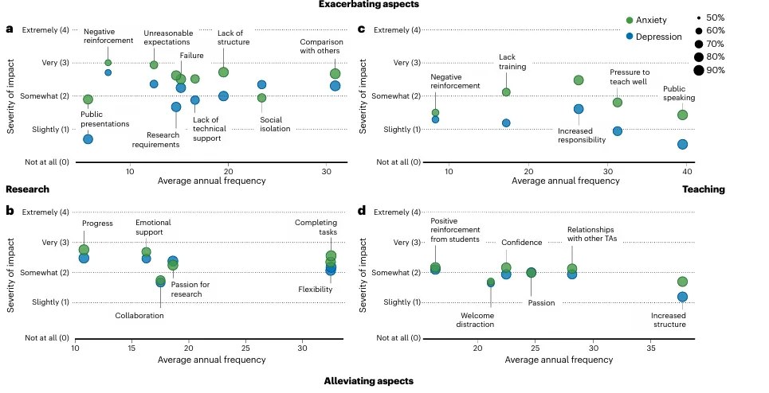
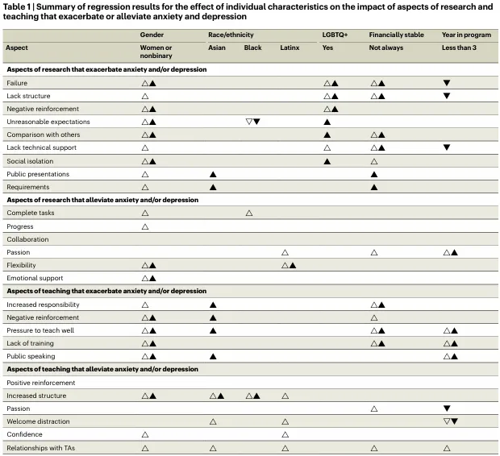
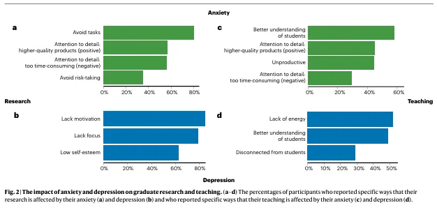

# 研究生哪有不疯的？

> 原文：https://mp.weixin.qq.com/s?__biz=MzAwMzIzOTk5OQ==&mid=2247528250&idx=1&sn=ffd79ef846d30bf783c397fc8db0ae30&chksm=9b3c166aac4b9f7cae88291bc62a453bc1123d257db5cbde08deabfda90fcef67d0611f50f47#rd
> 合集：文献速递 / 漫谈胡侃

**一、写在前面**

本次分享这篇论文标题为 “Behind the graduate mental health crisis in science”，发表于《Nature Biotechnology》 （IF 33.1）2024 年第 42 卷，作者 Carly A. Busch 等人通过对美国 142 所机构 2161 名硕士和博士生的心理健康调查，探究科研与教学的哪些方面会加重或缓解研究生的焦虑和抑郁症状，以及学生心理问题如何影响科研和教学，为改善研究生心理健康状况提供了方向。Biommaba也很好奇，大家觉得自己在学期间的科研体验如何呢：
想要了解这篇文献具体内容的伙伴，请继续往下划。参考文献：Busch, C. A. et al.  _Nat. Biotechnol._ **42** , 1749–1753 (2024).

**二、研究方法**

##  ●深度访谈：首先对患有焦虑和抑郁的科学博士生进行访谈，了解他们在科研和教学中遇到的具体问题。

## ●大规模调查：基于访谈结果，设计了一份心理健康调查问卷，覆盖142所美国高校的2161名硕士和博士生。

心理健康状况：9% 学生有焦虑，13% 有抑郁，78% 两者皆有（加起来正好100%。。。）。焦虑者中，51% 为中度，16% 为轻度，31% 为重度；抑郁者中，49% 为中度，24% 为轻度，23% 为重度。 其他特征：包括不同学科、学位类型、性别、经济稳定性等。80% 以上参与者担任过助教，入学时间 1 年以内到 7 年以上不等。

## ●数据分析：使用回归分析等方法，探讨个人特征（如性别、经济状况）和项目特征（如学位类型、研究领域）如何影响心理健康。

**三、研究结果**

#### **1\. 科研与教学中的“推手”与“解药” **

#### **研究结果通过图1展示了科研和教学中影响研究生心理健康的具体因素及其严重程度。**

#### **科研压力对焦虑的负面影响是教学的 2.93倍！ **

#### **图1a：科研中加剧焦虑和抑郁的因素 **

  * #### **负面反馈 （如导师的严厉批评）和 不合理期望 （如超负荷任务）是最严重的压力源，对焦虑和抑郁的影响最大。 **

  * #### **社会孤立 和 缺乏技术支持 也对心理健康产生了显著的负面影响。**

#### ** 图1b：科研中缓解焦虑和抑郁的因素 **

  * #### **研究进展 和 情感支持 是最有效的缓解因素，尤其是对焦虑的缓解作用更为明显。 **

  * #### **任务完成 和 合作研究 也对心理健康有积极影响。**

#### ****

#### **图1c：教学中加剧焦虑和抑郁的因素**

  * #### ** 责任过重 和 缺乏培训 是教学中最主要的压力源，尤其是对焦虑的影响更为显著。 **

  * #### **公开演讲焦虑 也是教学中常见的心理挑战。**

#### ****

#### **图1d：教学中缓解焦虑和抑郁的因素**

  * #### **学生的 积极反馈 （如好评的教学评估）和 清晰的教学结构 是最有效的缓解因素。 **

  * #### **与助教团队的合作 也对心理健康有积极影响。**

#### **
**

#### **2\. 谁在承受更大的压力？**

#### ** 表1：个体特征对科研和教学影响的回归分析结果**

#### **重度抑郁学生考虑退学的概率是轻度抑郁的 5.47倍！**

  * #### ** 女性/非二元性别者：科研中的负面反馈对其心理影响更严重，但情感支持的缓解作用也更明显。 **

  * #### **LGBTQ+群体： 教学压力（如公开演讲）引发的焦虑程度更高。 **

  * #### **经济困难学生： 焦虑和抑郁对其研究效率的负面影响是经济稳定学生的1.5倍。 **

  * #### **低年级博士生： 前三年因教学责任导致的抑郁风险显著增加。**

#### **
**

#### **
**

#### **3\. 焦虑和抑郁对科研与教学的具体影响**

#### **经济不稳定或入学 3 年及以上的学生，对科研/教学的影响更加明显**

#### ** 图2a：焦虑对科研的影响 **

  * #### **避免任务：超过60%的焦虑学生报告因焦虑而避免某些科研任务。**

  * #### **注意力过度集中：虽然焦虑可能导致过度关注细节，但这也带来了更高质量的研究成果。**

#### ** 图2b：抑郁对科研的影响 **

  * #### ** 缺乏动力：超过70%的抑郁学生表示抑郁导致他们缺乏科研动力。 **

  * #### ** 注意力不集中：抑郁学生还报告了注意力不集中和低自尊的问题。 **

#### ** 图2c：焦虑对教学的影响**

  * #### **更好的学生理解： 焦虑学生报告他们对学生的需求更敏感，这有助于提高教学质量。 **

  * #### ** 过度消耗时间：焦虑学生也报告因过度关注细节而导致教学效率下降。 **

#### ** 图2d：抑郁对教学的影响 **

  * #### ** 缺乏精力：超过50%的抑郁学生表示抑郁导致他们在教学中缺乏精力。 **

  * #### ** 与学生脱节：抑郁学生还报告了与学生脱节的问题，影响了教学效果。**

#### ****

#### **
**

#### **4\. 焦虑和抑郁严重程度与考虑离开研究生院的关系**

#### ** 研究还探讨了焦虑和抑郁的严重程度与研究生考虑离开研究生院之间的关系。结果显示：**

#### ** 焦虑与考虑退学的关系： **

  * #### **中度焦虑：与轻度焦虑的学生相比，中度焦虑的学生考虑离开研究生院的概率增加了 60%（OR = 1.60, P < 0.001）。 **

  * #### **重度焦虑：重度焦虑的学生考虑离开研究生院的概率是轻度焦虑学生的近 3倍（OR = 2.97, P < 0.001）。 **

#### ** 抑郁与考虑退学的关系： **

  * #### **中度抑郁：与轻度抑郁的学生相比，中度抑郁的学生考虑离开研究生院的概率增加了 96%（OR = 1.96, P < 0.001）。 **

  * #### **重度抑郁：重度抑郁的学生考虑离开研究生院的概率是轻度抑郁学生的 5.47倍（OR = 5.47, P < 0.001）。**

####

#### 5\. 更换导师的影响

####  患有抑郁的学生更有可能更换导师（中度抑郁：OR = 1.52, P = 0.03；重度抑郁：OR = 2.17, P < 0.001）。 其中，69.3%的抑郁学生认为更换导师增加了他们完成研究生课程的时间。

**四、研究结论**

##  ● 科研与教学对心理健康的影响：科研压力对焦虑的影响更大，而教学压力对抑郁的影响更显著。

## ●群体差异：女性、LGBTQ+、经济困难学生和低年级博士生更容易受到心理健康问题的冲击。

##  ●干预方向：改善导师反馈方式、提供教学培训、增强经济支持、建立社群互助网络是缓解研究生心理健康危机的关键。

**五、Biomamba有话说**

首先，心理困扰并非个人脆弱，而是系统性压力的产物，大家无需刻意隐藏自己的负面情绪，可以勇敢的找人倾诉！单纯依靠个人心理调节无法从根本上解决问题，高校和科研机构需要从制度层面为大家提供支持。 上面的研究也指出，经济困难学生的心理健康问题尤为突出，提高研究生津贴或提供紧急补助基金或是当务之急。这两年也有越来越多的利好政策推出，奖助学金覆盖比例不断提升。毕竟研究生顶着25、6的“高龄“”问家里要钱的滋味，总是有点奇怪的（当然也有补贴高的学校，也有奖学金拿到手软的优秀硕博，也有能有时间兼职挣钱的学生，也有年纪轻轻就到硕博阶段的英才）。

其次，这项研究不仅揭示了科研和教学对研究生心理健康的双重影响，更暴露了当前研究生导师制度中的一些深层次问题。当导师权力被滥用为 “资源分配工具” 或 “情感剥削手段” 时，它不仅摧毁了学术公平，更成为研究生心理崩溃的导火索。

这里Biommaba也胡侃几点建议：

1、希望将 “心理健康支持”“建设性反馈”“反性骚扰” 纳入导师必修课程，强制考核合格后方可招生；

2、设立 “师德档案”，记录导师的学术行为与师生互动表现，作为职称晋升的重要依据；

3、公开科研经费使用明细、项目参与名单及论文署名规则，接受全体学生与社会的监督

4、高校应建立透明的反馈和申诉机制，确保导师的权力受到制衡；

5、高校应建立研究生工作量评估机制，确保导师分配的任务在合理范围内；

6、高校应要求导师为研究生提供职业发展支持，并建立职业发展中心，为学生提供更多的职业资源和机会。

**如何联系我们**

 留一个领取资料、[免费两周学习版上](<https://mp.weixin.qq.com/s?__biz=MzAwMzIzOTk5OQ==&mid=2247527585&idx=1&sn=fa32112c11b215b33096cab43baf08ea&scene=21#wechat_redirect>)服务器的**微信号** ，方便各位随时交流（别问在么，添加时直接说来意）。同时我们也构建了[交流群矩阵](<https://mp.weixin.qq.com/s?__biz=MzAwMzIzOTk5OQ==&mid=2247528057&idx=1&sn=bb348c2a88c977c7cce67ee6731a3591&scene=21#wechat_redirect>)，欢迎大家入群讨论。

大家可以阅读完这几篇之后添加[给生信入门初学者的小贴士](<http://mp.weixin.qq.com/s?__biz=MzAwMzIzOTk5OQ==&mid=2247493329&idx=1&sn=597870b7f7ce10346da3561e7c281627&chksm=9b3c9f81ac4b169794088ce9abbcacb5f18e9fd174fc0d7e28da62d78facadf3100ef38aaf22&scene=21#wechat_redirect>)
[如何搜索公众号过往发布内容](<http://mp.weixin.qq.com/s?__biz=MzAwMzIzOTk5OQ==&mid=2247506266&idx=2&sn=22b1164bc9602c25620d058847785422&chksm=9b3ca00aac4b291c16d738271746ffb90149282a728f484e8a1952463c46a8e7dc4f883ab928&scene=21#wechat_redirect>)

**已有生信基地联系方式的同学****无需重复添加**

 您点的每个赞和在看，我都认真当成了喜欢
