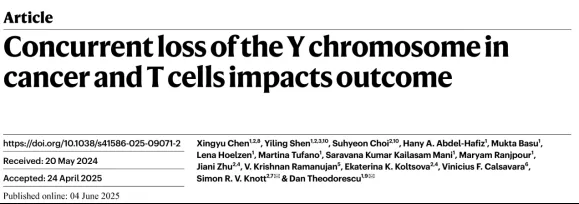
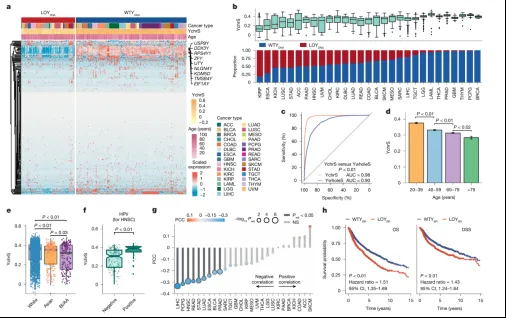
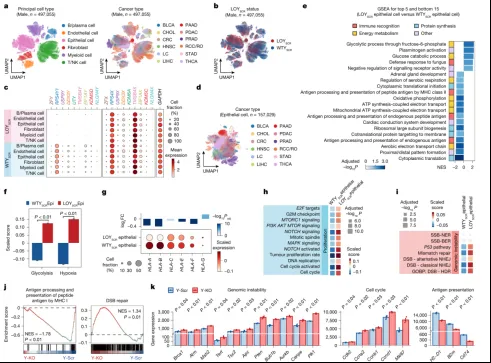
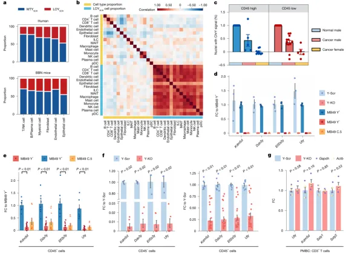
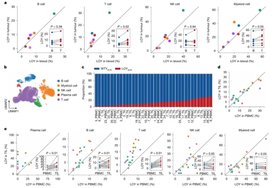
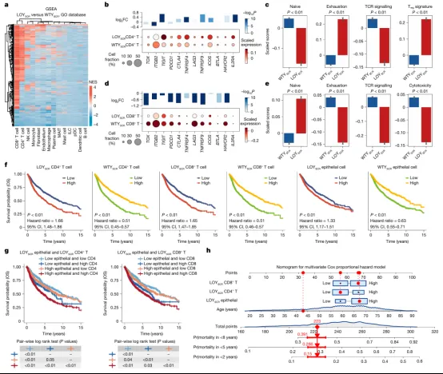

# 25年纯生信《Nature》|肿瘤和T细胞中丢失Y染色体影响癌症预后

> 原文：https://mp.weixin.qq.com/s?__biz=MzAwMzIzOTk5OQ==&mid=2247529841&idx=1&sn=365d4f2b6b8ad7af215e7ff804ad4ccc&chksm=9b3c0c21ac4b85373bf9a680f2b1e04f3aa6ee8f1c110aab950b8d78374e90a268a8bafc259e#rd
> 合集：文献速递

**一、写在前面**

本次分享的是一篇"纯生信"的《Nature》（IF=48.5），主图中没有任何实验Figure，纯"干实验"上王者！“Xingyu Chen, Yiling Shen,Suhycon Choi, et al. Concurrentloss of the Ychromosome in cancer and T cells impacts outcome”DOI:10.1038/s41586-025-09071-2****

研究表明 肿瘤细胞中Y染色体缺失（LOY）与肿瘤的不良预后相关，同时在外周血单个核细胞（PBMCs）中，LOY是最常见的体细胞改变之一，并且与癌症的发病风险增加以及癌症相关死亡率升高有关，但PBMCs中的LOY、PBMC衍生的肿瘤免疫细胞中的LOY以及恶性细胞中的LOY之间是否存在关联仍不清楚。

这篇文章中，作者使用了人类肿瘤细胞的**RNA 测序（bulk RNA-seq）**和**单细胞 RNA测序（scRNA-seq）**数据，探讨了染色体Y缺失（LOY）在良性细胞和恶性细胞中的基因组学、组织病理学、生物学和临床预后。结果发现**肿瘤细胞中的 Y 染色体缺失会传播扩散到免疫细胞 T 细胞中，导致 T 细胞失去抗癌能力**。这意味着，癌症对于男性而言，不仅是一次“突变”的恶性起点，更是一场由内而外的系统性崩塌。

如果需要[数据分析](<https://mp.weixin.qq.com/s?__biz=MzAwMzIzOTk5OQ==&mid=2247529435&idx=1&sn=cc7e9ff271f0ce0157008532ef4829c3&scene=21#wechat_redirect>)**指导** 、生信热点**全文复现** 、自测数据**个性化分析** 辅导、[常态化实验学习](<https://mp.weixin.qq.com/s?__biz=MzAwMzIzOTk5OQ==&mid=2247528769&idx=1&sn=53528029a1595c5dde109a461ec3708d&scene=21#wechat_redirect>)，欢迎联系客服微信[**Biomamba_zhushou**]

**二、主要结果**

**肿瘤细胞中 Y染色体缺失和队列特征**

为了在泛癌水平上研究LOY的影响，作者开发了一个“Y染色体转录特征”（YchrS），用于预测基于DNA的染色体Y丢失（LOY）与野生型（WTY）的分类。通过对癌症基因组图谱（TCGA）中具有可用外显子捕获数据的LOYDNA和WTYDNA肿瘤样本进行差异分析，作者识别出26个在LOYDNA肿瘤中表达较低的Y染色体基因。随后，作者利用人类蛋白图谱进一步筛选，重点关注9个基因（DDX3Y、UTY、KDM5D、USP9Y、ZFY、RPS4Y1、TMSB4Y、EIF1AY和NLGN4Y），这些基因在多种男性组织中的RNA和蛋白水平均稳定表达（Fig. 1a）。同时，结果显示**Y 染色体转录特征（YchrS）的平均得分与不同癌症类型中DNA水平的染色体Y丢失（LOYDNA）频率呈负相关**（Fig. 1b）。之后，作者将YchrS与全外显子测序（whole-exome sequencing, WES）获得的拷贝数变异（copy number alteration, CNA）数据进行整合分析，结果显示与WTY细胞系相比，LOY细胞系的Y染色体特异性拷贝数变异的平均值极低，这表明LOYBR组中**存在显著的染色体 Y丢失现象**（Fig. 1c）。**且****患者年龄与 YchrS呈负相关**（Fig. 1d），并且在肿瘤细胞中的LOY程度上存在显著的**种族差异** （Fig. 1e）。除此之外，作者还发现，人乳头瘤病毒（HPV）阳性的HNSC患者的YchrS得分高于HPV阴性患者（Fig. 1f）;YchrS与癌-睾丸抗原（CTA），一种通常仅限于生殖细胞但在癌症中常常过表达并与不良预后相关的蛋白质，存在很强的负相关（Fig. 1g）;LOY还伴随着更差的总生存率（OS）和疾病特异性生存（DSS）（Fig. 1h）。

Fig.1

**癌细胞 LOY驱动肿瘤侵袭******

为了研究 LOY在细胞类型水平的影响，作者整合了来自17种上皮癌的单细胞RNA测序（scRNA-seq）（Fig. 2a），由于YchrS经常将低RNA计数的细胞错误地分类为具有LOY，因此作者开发了一个机器学习模型，通过训练随机森林模型，利用九个YchrS基因的表达水平从邻近正常scRNA-seq样本中预测男性和女性细胞，从而在单细胞水平上预测LOY或WT状态（Fig. 2b）,当该模型用于分类男性肿瘤细胞时，预测为LOY的上皮细胞Y染色体基因表达极低，但整体测序计数正常（Fig. 2c）。GSEA分析显示上皮细胞中**LOY****下调与免疫识别、有氧能量代谢以及与蛋白质合成****等****通路****相关** （Fig. 2d-e）;**LOY****上调与糖酵解和缺氧相关的通路****相关****，表明其代谢发生了与肿瘤发生和进展一致的转变** （Fig. 2f），此外，发生LOY的上皮细胞还降低了特定MHC I类和MHC II类基因的表达（Fig. 2g）。LOY还上调了增殖相关通路，如细胞周期、DNA复制、有丝分裂纺锤体形成和G2M检查点（Fig. 2h），且LOY上皮细胞高表达与双链断裂（DSB）修复相关的同源重组、非同源末端连接和p53通路的基因（Fig. 2i）。

为了研究LOY癌细胞中改变的基因，作者使用了CRISPR-Cas9介导的选择性消除Y染色体的MB49细胞进行RNA测序，对Y-KO和Y-Scr的 RNA测序数据进行基因集富集GSEA富集分析表明，与Y-Scr细胞相比，Y-KO细胞表现出更高的基因组不稳定性（双链断裂修复）、细胞周期调控，以及降低的抗原呈递（Fig. 2j）,Y-KO细胞中关键的DNA修复基因表达上调（Fig. 2k）。

Fig.2

**癌细胞和良性细胞中的 LOY 相关******

之后作者 使用单细胞转录组测序（scRNA-seq）技术，分析不同细胞类型中LOY的频率。发现**在人类样本中， LOY在上皮细胞中****发生****的频率最高****（ Fig. 3a），但在一些其他非上皮细胞中也能观察到LOY****。** 为进一步验证这个发现，作者通过N-丁基-N-(4-羟基丁基)亚硝胺（BBN）诱导产生膀胱癌（BLCA），得到了一致的结论（Fig. 3b）。之后作者分析了人类scRNA-seq数据中不同细胞类型之间LOY细胞比例的相关性；通过荧光原位杂交（FISH）和CD45免疫组化（IHC）检测33例BLCA样本中的LOY，发现癌症样本中的CD45−和CD45+细胞均表现出LOY（Fig. 3c）。

为了进一步验证肿瘤微环境中的基质细胞和免疫细胞是否表现出LOY，并研究恶性细胞LOY是否促进良性细胞群体中的LOY，作者在将（1）自然发生的Y+和LOY细胞；（2）LOY克隆系；（3）CRISPR Y-KO和CRISPR Y-Scr细胞皮下注射到免疫正常小鼠，并评估四个Y染色体基因（Kdm5d、Uty、Eif2s3y和Ddx3y）的DNA水平（Fig. 3d），之后使用磁珠和流式细胞分选（FACS）将细胞分为CD45+和CD45−群体并通过DNA qPCR分析四个Y染色体基因**，****结果显示****与 Y****+****细胞系生成的肿瘤相比， LOY MB49细胞生成的肿瘤中的CD45****+****细胞显示出更低的 Y染色体基因DNA水平**（Fig. 3e-f），但是在携带Y+或LOY肿瘤的小鼠的外周血单核细胞（PBMCs）中未发现LOY（Fig. 3g）。**以上结果提示我们****肿瘤中的免疫细胞显示出比 PBMCs更高的LOY水平，这可能表明具有LOY的PBMCs优先积聚在肿瘤中，或者肿瘤诱导了浸润肿瘤的Y****+****PBMCs 中的LOY**。细胞数量统计教程可参考：[沉浸式统计细胞比例](<https://mp.weixin.qq.com/s?__biz=MzAwMzIzOTk5OQ==&mid=2247503971&idx=2&sn=7dafb1e743ebbb95e488d8d1b7024448&scene=21#wechat_redirect>)

Fig.3

**癌细胞 LOY与PBMC LOY相关******

之后作者 分析了一组肾细胞癌（RCC）患者的肿瘤样本和PBMC样本（来自同一批患者）。结果显示，肿瘤中的T细胞和髓系细胞（myeloid cells）显示出显著高于匹配PBMCs的LOY比例（Fig. 4a）。进一步分析了另一组头颈部鳞状细胞癌（HNSC）患者的CD45+分选的肿瘤细胞和匹配的PBMCs，结果显示肿瘤和血液中的LOY比例之间存在相关性（Fig. 4b-d）。除此之外作者还分析了特定的免疫细胞亚型，发现肿瘤中的免疫细胞（尤其是T细胞和B细胞）的LOY比例显著高于PBMCs（Fig. 4e）。**以上结果说明****肿瘤中的免疫细胞（如 T细胞和B细胞）显示出比外周血更高的LOY比例****，****表明肿瘤微环境诱导了 LOY的发生，或者具有LOY的免疫细胞更倾向于积聚在肿瘤中。相关性分析参考：[相关性分析的最新选择：linkET](<https://mp.weixin.qq.com/s?__biz=MzAwMzIzOTk5OQ==&mid=2247491702&idx=1&sn=5b786a572142e66fa8b0a1a7f71ff6ee&scene=21#wechat_redirect>)**

Fig.4

**LOY 良性细胞协同LOY恶性上皮对肿瘤患者生存****产生****影响******

为了研究 LOY在非上皮细胞中的分子特征，作者进行了细胞类型特异性的差异表达和通路分析，结果显示LOY的CD4\+ T细胞表现出多种**免疫检查点和共刺激分子的高表达** （例如IL2RA、HAVCR2、ICOS、TNFRSF9、TNFRSF4、CTLA4和TIGIT），同时显示出更高的**耗竭标志物和调节性 T细胞（Treg）表型的表达**（Fig. 5a-c）。LOY的CD8+ T细胞表现出HAVCR2、BTLA、TNFRSF9、LAG3、CTLA4、PDCD1、TIGIT、ITGB2和TOX等标志物的低表达，同时显示出更低的细胞毒性、TCR信号和耗竭标志物的表达（Fig. 5d-e）。

同时，作者还聚焦了**LOY 与患者预后的关联****，** 发现LOY的CD4+ T细胞、CD8\+ T细胞和上皮细胞与患者的生存结果（包括总生存期OS和疾病特异性生存期DSS）相关（Fig. 5f）。得出了高预测水平的LOY上皮细胞和CD4+或CD8+ T细胞的患者预后最差，而具有低预测的LOY上皮细胞和T细胞的患者预后最好的结论（Fig. 5g）。最后，作者开发了一个结合患者年龄以及上述三种 LOY特征评分的列线图（Nomogram）（Fig. 5h）。该工具能较准确地量化预测患者 2 年、5 年和 8 年的死亡风险，**为个体化预后评估和临床决策提供了新的理论工具。**

Fig.5

**总结讨论**

该研究提出了一个新概念框架，推动了以**Y 染色体丢失（LOY）**为重点的**癌症研究领域** 发展。研究揭示了上皮细胞LOY对肿瘤微环境（TME）的重塑作用，发现LOY在肿瘤中的多种良性细胞（包括T细胞）中普遍存在，并且LOY上皮细胞能够促进良性细胞中的LOY发生，进而影响免疫细胞功能和肿瘤进展。此外，研究还证实上皮细胞和非上皮细胞中的LOY均为独立的预后标志物，强调了多细胞LOY在癌症中的重要性。未来，在治疗前筛查患者肿瘤组织和/或外周血中的**LOY 状态**，可能成为**优化男性癌症患者治疗方案** 的关键步骤。

**如何联系我们**

 留一个领取[资料](<https://mp.weixin.qq.com/s?__biz=MzAwMzIzOTk5OQ==&mid=2247528482&idx=1&sn=7cc0715eace4f592a62bdaf157b25c01&scene=21#wechat_redirect>)、[开箱即用的单细胞分析镜像](<https://mp.weixin.qq.com/s?__biz=MzAwMzIzOTk5OQ==&mid=2247528410&idx=2&sn=0f2bac25479cf8d20dab5d82ae986f2e&scene=21#wechat_redirect>)的**微信号[Biomamba_zhushou]**，方便各位随时交流。同时我们也构建了[交流群矩阵](<https://mp.weixin.qq.com/s?__biz=MzAwMzIzOTk5OQ==&mid=2247528057&idx=1&sn=bb348c2a88c977c7cce67ee6731a3591&scene=21#wechat_redirect>)，欢迎大家入群讨论。
大家可以阅读完这几篇之后添加[给生信入门初学者的小贴士](<http://mp.weixin.qq.com/s?__biz=MzAwMzIzOTk5OQ==&mid=2247493329&idx=1&sn=597870b7f7ce10346da3561e7c281627&chksm=9b3c9f81ac4b169794088ce9abbcacb5f18e9fd174fc0d7e28da62d78facadf3100ef38aaf22&scene=21#wechat_redirect>)
[没有检索，就没有发言权](<https://mp.weixin.qq.com/s?__biz=MzAwMzIzOTk5OQ==&mid=2247529398&idx=2&sn=5a429852d61721916a405712677d5905&scene=21#wechat_redirect>)

**已有生信基地联系方式的同学****无需重复添加**

 您点的每个赞和在看，我都认真当成了喜欢
