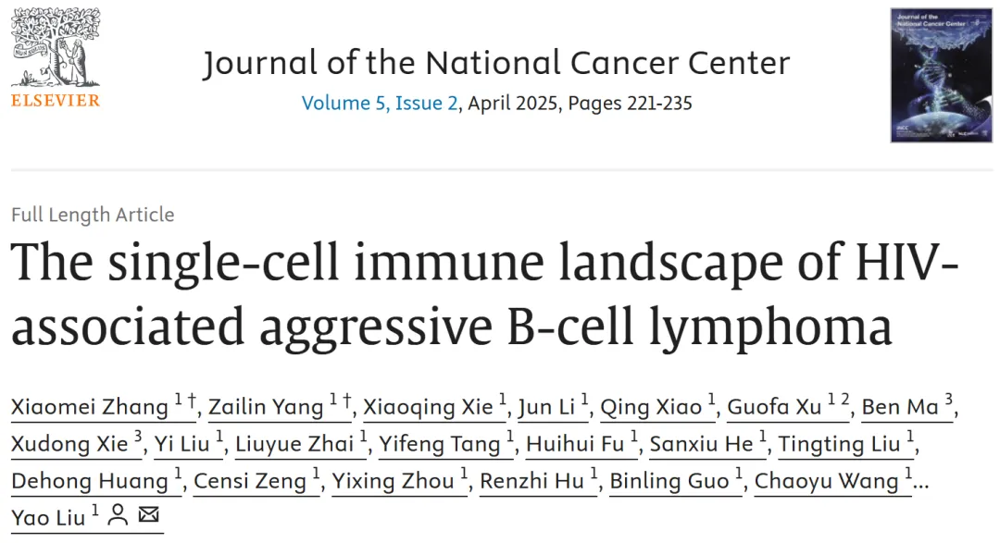
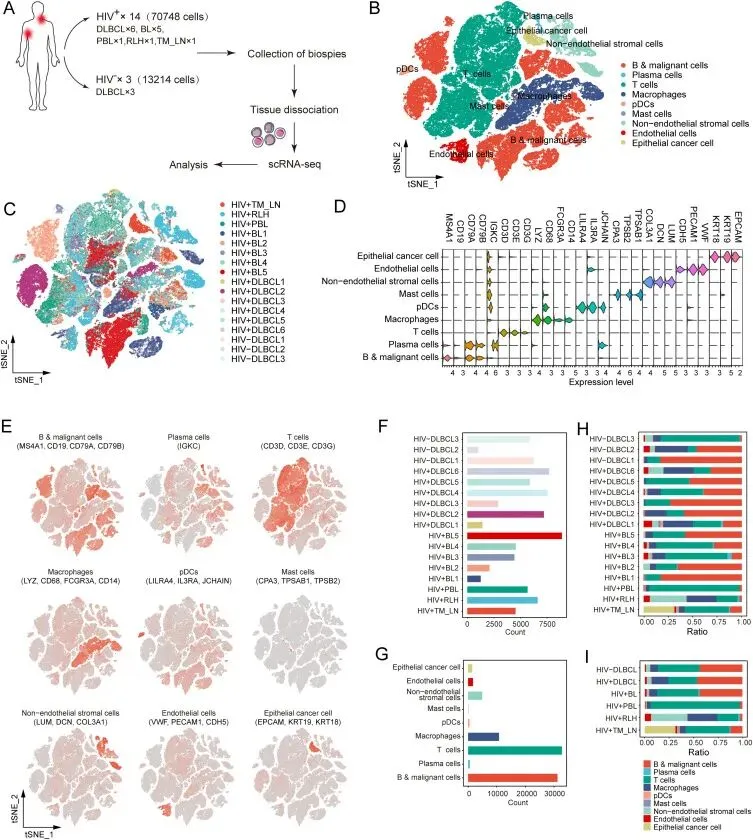
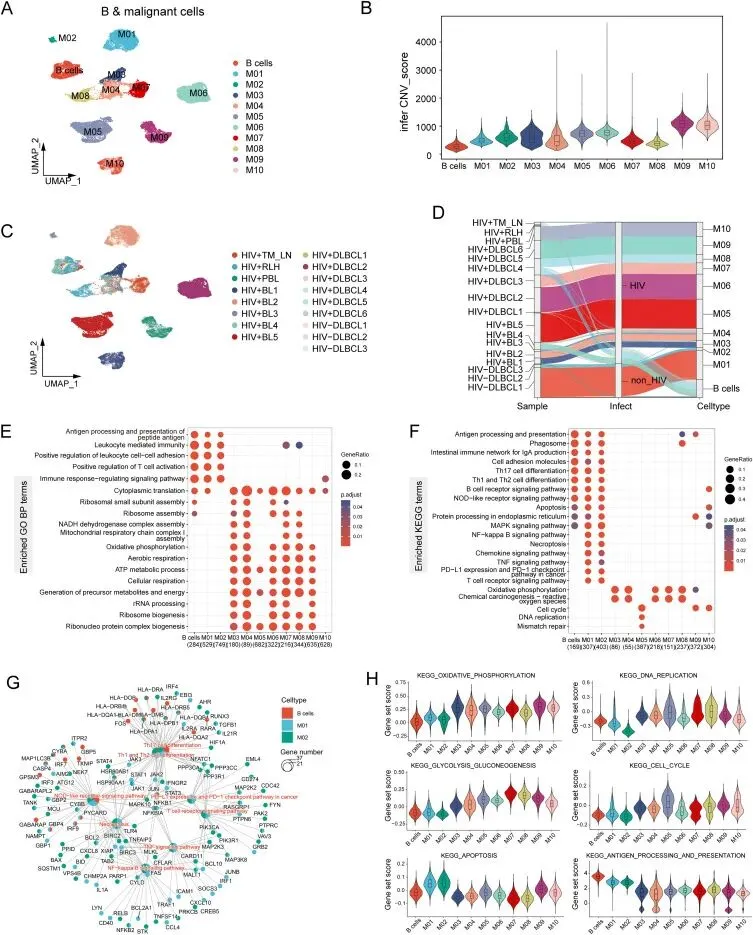
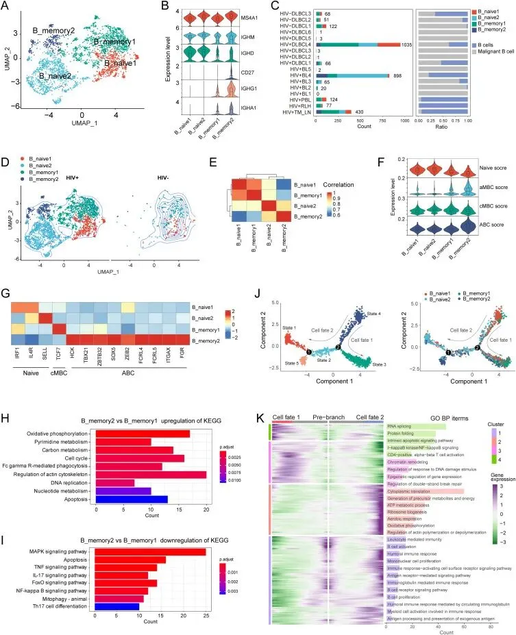
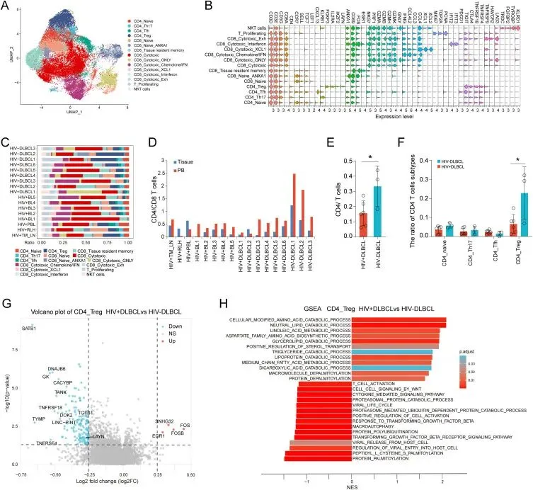
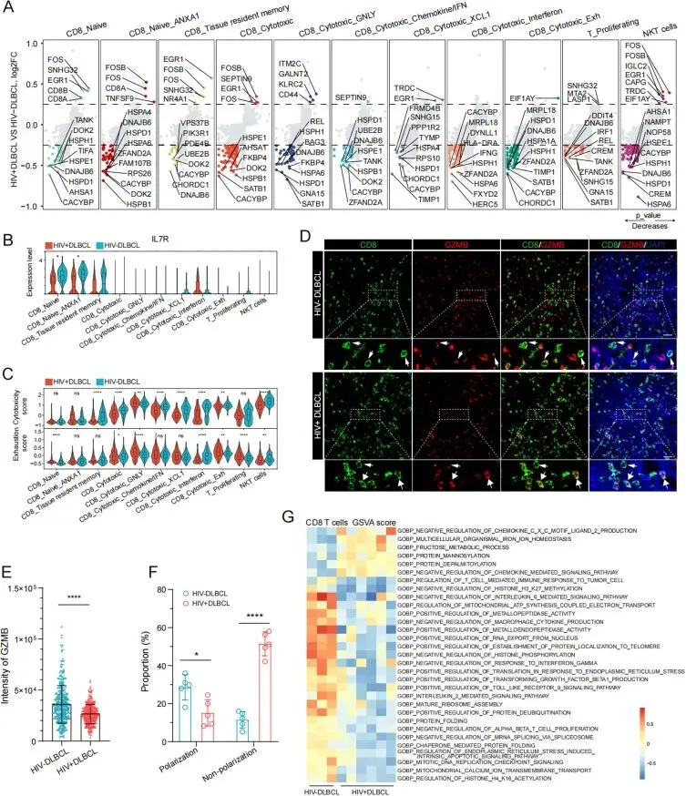
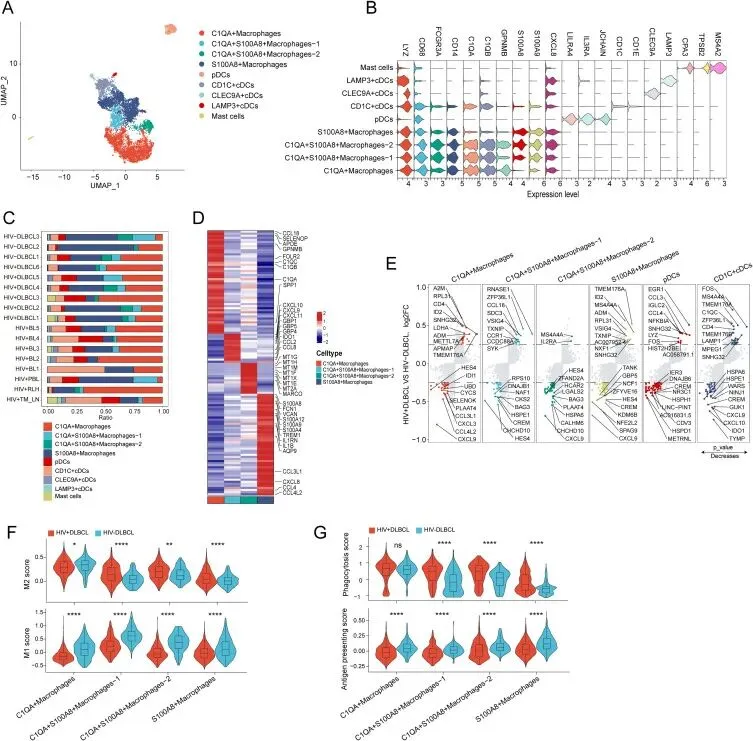
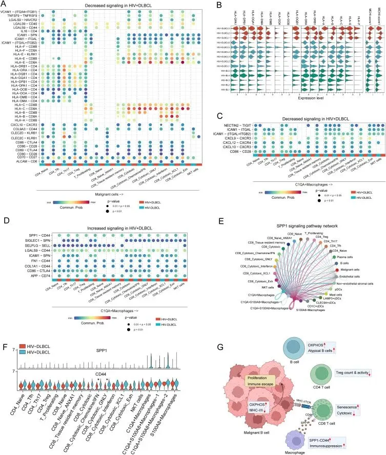

# HIV相关侵袭性B细胞淋巴瘤的单细胞免疫图谱

> 原文：https://mp.weixin.qq.com/s?__biz=MzAwMzIzOTk5OQ==&mid=2247529922&idx=1&sn=a9b607de186454fb4acd1f211a13c0eb&chksm=9b3c0c92ac4b8584df614bed231f6388b7613783cde18e28ea3c1c35397404a2f576f38d094f#rd
> 合集：文献速递

**一、写在前面**

本次分享的就是此前[应审稿人要求| pseudo bulk差异分析](<https://mp.weixin.qq.com/s?__biz=MzAwMzIzOTk5OQ==&mid=2247521437&idx=1&sn=d47b48170f7189b8fb74b2316d0c4898&scene=21#wechat_redirect>)的当事文章，现已见刊《Journal of the National Cancer Center》（IF=7.6）“The single-cell immune landscape of HIV-associated aggressive B-cell lymphoma”，希望学习单细胞发文的同学不妨看看：[scRNA-seq，从小白到文献复现大神！](<https://mp.weixin.qq.com/s?__biz=MzAwMzIzOTk5OQ==&mid=2247529435&idx=1&sn=cc7e9ff271f0ce0157008532ef4829c3&scene=21#wechat_redirect>)

DOI: 10.1016/j.jncc.2025.02.001

链接：https://pubmed.ncbi.nlm.nih.gov/40265092/

****

**HIV相关侵袭性B细胞淋巴瘤（HAL）** 因其高侵袭性和复杂的免疫微环境，成为HIV感染者癌症研究中的关键挑战。单细胞RNA测序技术的兴起，为解析HAL的细胞异质性及其免疫逃避机制提供了重要工具。先前研究表明，HAL中恶性B细胞依赖氧化磷酸化（OXPHOS）代谢并伴随**MHC-I表达缺失** ，同时T细胞和巨噬细胞的功能异常进一步加剧免疫抑制。**本文在前述单细胞图谱基础上，深入探讨HAL的分子机制与潜在治疗靶点，聚焦于恶性B细胞代谢特征、免疫微环境重塑及其对治疗策略的启示，旨在为HAL的精准干预提供新的科学依据** 。

如果需要[数据分析](<https://mp.weixin.qq.com/s?__biz=MzAwMzIzOTk5OQ==&mid=2247529435&idx=1&sn=cc7e9ff271f0ce0157008532ef4829c3&scene=21#wechat_redirect>)**指导** 、生信热点**全文复现** 、自测数据**个性化分析** 辅导、[常态化实验学习](<https://mp.weixin.qq.com/s?__biz=MzAwMzIzOTk5OQ==&mid=2247528769&idx=1&sn=53528029a1595c5dde109a461ec3708d&scene=21#wechat_redirect>)，欢迎联系客服微信[**Biomamba_zhushou**]

**二、主要成果**

1\. HAL 中主要细胞类型的鉴定

研究团队首先对14例HIV感染者（包括6例DLBCL和5例BL等）及3例非HIV感染的DLBCL患者的淋巴结活检样本进行了**单细胞RNA测序（scRNA-seq）** （图1A和补充表1）。质控后共获得83,962个单细胞用于分析，并依据经典标记基因鉴定出了九种主要的细胞类型，包括B细胞、T细胞及巨噬细胞等（图1B-E）。在所有样本中，T细胞是丰度最高的免疫细胞，其次是巨噬细胞（图1G），但各类细胞的比例在不同样本间存在显著波动（图1H）。值得注意的是，**通过比较HIV+ DLBCL和HIV- DLBCL样本，研究发现包括B细胞、T细胞、巨噬细胞在内的各种主要细胞类型的比例并无明显差异** （图1H-I）。这一结果表明，**HAL与非HAL在主要的细胞类型构成上是相似的** 。(教程可参考：[25年最新视频|《手把手教你做scRNA-seq数据基础分析》](<https://mp.weixin.qq.com/s?__biz=MzAwMzIzOTk5OQ==&mid=2247528512&idx=1&sn=d316bffcbe59e676cd22248936f07b69&scene=21#wechat_redirect>))

图1

#### 2\. HAL中恶性B细胞呈现独特的增殖和代谢特征

为了表征HAL中的恶性B细胞，作者先对B细胞和恶性细胞群进行了亚聚类，并利用**inferCNV** 分析，根据拷贝数变异（CNV）评分成功将细胞区分为10个恶性B细胞簇（M01-M10）和1个非恶性B细胞簇（图2A,B）。这些恶性细胞簇表现出显著的肿瘤异质性，并能大致对应到其来源：**M01-M02簇主要来自非HAL（HIV- DLBCL），而M03-M10簇主要来自HAL（HIV+ DLBCL和HIV+ BL）** 。进一步的功能富集分析揭示了HAL和非HAL在生物学特征上的显著差异。非HAL的恶性细胞（M01-M02）高表达与B细胞受体信号、NF-κB信号及细胞凋亡等相关的基因（图 2E-F）。与此相反，HAL的恶性细胞（M03-M10）则呈现出完全不同的模式，其高表达的基因主要富集在**氧化磷酸化（OXPHOS）** 、ATP代谢、细胞周期和DNA复制等与高增殖和高代谢相关的通路上，而与抗原呈递相关的基因表达则受到抑制（图2E-F, 补充图2A-B）。基因集评分分析也证实，**与非HAL相比，HAL恶性B细胞的OXPHOS、细胞周期活性更高，而抗原呈递和细胞凋亡活性更低** （图2H）。作者还通过**SCENIC** 分析转录调控网络发现，非HAL恶性细胞的增殖和存活可能由NFκB和AP-1家族驱动；而HAL恶性细胞则表现出由AKR1A1和ENO1等代谢相关转录因子的活性升高（补充图2E）。这些发现共同揭示了HAL的独特生物学基础：**其侵袭性可能源于一种高增殖、依赖OXPHOS代谢且免疫原性降低的独特表型** 。

拷贝数变异可参考：[单细胞拷贝数变异学习手册](<https://mp.weixin.qq.com/s?__biz=MzAwMzIzOTk5OQ==&mid=2247522733&idx=1&sn=4e3a0707fd8f83b5ad9377bc91ee8e53&scene=21#wechat_redirect>)

基因集评分可参考：[一文搞定单细胞基因集评分](<https://mp.weixin.qq.com/s?__biz=MzAwMzIzOTk5OQ==&mid=2247497831&idx=2&sn=82fa51c76a381fba0b444e9b6b23eb5f&scene=21#wechat_redirect>)

图2

#### 3\. HAL中存在独特的非典型B细胞亚群

研究人员进一步对非恶性B细胞进行亚聚类，鉴定出四种亚型：两种幼稚B细胞（B_naive1, B_naive2）和两种记忆B细胞（B_memory1, B_memory2）（图3A, B）。一个关键的发现是，B_naive2和B_memory2亚型仅在HIV+样本中存在，而在非HIV感染者的样本中缺失（图3D）。通过基因签名评分，作者证实B_memory2亚型与先前报道的**非典型B细胞（Atypical B Cells, ABC）** 特征高度一致（图3F），并高表达 _TBX21_ 、 _FCRL4_ 等ABC的经典标记基因（图3G和补充表4）。功能分析显示，这个在HAL中特有的ABC亚群（B_memory2），其上调的基因主要富集在氧化磷酸化（OXPHOS）、细胞周期等与高代谢活性相关的通路中（图3H）。为探究这些细胞的动态发展过程，作者进行了**轨迹分析** ，揭示了两条不同的细胞分化路径（图3J）。第一条路径是常规的B细胞分化，即从B_naive1分化为经典记忆B细胞B_memory1。而第二条路径则是HAL独有的，展示了从B_naive1经由B_naive2最终分化为非典型记忆B细胞B_memory2（ABC）的过程（图3J）。这条独特的路径与能量代谢（如OXPHOS、ATP代谢）和免疫激活过程的基因富集紧密相关（图 3K）。综上，这些结果表明HAL的肿瘤微环境中存在一群特殊的、具有高代谢和免疫激活转录谱的非典型B细胞亚群。

轨迹分析教程可参考：[一文学会四种scRNA-seq轨迹分析](<https://mp.weixin.qq.com/s?__biz=MzAwMzIzOTk5OQ==&mid=2247528666&idx=1&sn=d29545d296bac3e41de322e43fde80dd&scene=21#wechat_redirect>)

图3

#### 4\. HAL中Treg细胞不仅数量减少且功能存在缺陷

通过对T细胞进行了亚群鉴定，共识别出15种T细胞亚型，包括多种CD4+和CD8+T细胞（图4A,B）。通过比较不同组间的细胞比例，作者发现与非HAL相比，HAL样本的CD4/CD8比率普遍较低（图4D），这主要是由于CD4+调节性T细胞（Treg）的数量显著减少所致（图4E-F）。接下来，作者将重点放在Treg细胞的功能状态上。通过比较HAL与非HAL中Treg细胞的基因表达，发现HAL中的Treg细胞虽然上调了与HIV感染激活相关的 _FOS_ 和 _FOSB_ 等基因，但对其免疫抑制功能至关重要的基因（如 _SATB1_ 、 _TGFB1_ ）以及共刺激分子（ _TNFRSF4_ 、 _TNFRSF18_ ）的表达却显著下调（图4G）。**基因集富集分析（GSEA）** 进一步证实了这一功能缺陷：**在HAL的Treg细胞中，与T细胞激活和TGF-β受体信号通路相关的通路被下调，而与功能损害相关的通路（如蛋白质去棕榈酰化）则被富集** （图4H）。综合来看，这些结果表明，**HAL中的Treg细胞不仅在数量上有所减少，其免疫抑制活性本身也可能存在缺陷** 。

图4

#### 5\. HAL中浸润的CD8+ T细胞呈现衰老样功能障碍

在CD8+T细胞中，同样观察到了显著的功能异常。与非HAL相比，HAL中的CD8+T细胞亚型虽然上调了 _FOS_ 、 _CD44_ 等激活相关基因，但同时也下调了与衰老相关的关键基因 _IL7R_ 的表达（图5A,B）。功能评分显示，HAL中的CD8+T细胞具有显著更低的细胞毒性评分和略高的耗竭评分（图5C）。**免疫荧光（Immunofluorescence）** 分析从蛋白层面证实了这一点：**HAL中CD8+T细胞的杀伤颗粒GZMB的蛋白水平更低，且GZMB在细胞内呈分散状的比例更高，表明其形成有效免疫突触和执行细胞毒性功能的能力受损** （图5D-F）。作者重新分析了无淋巴瘤的HIV感染者外周血T细胞数据，发现了相似的衰老相关基因表达变化，证实HIV感染本身就可能加速T细胞的“老化”（补充图3B-H）。进一步地，**基因集变异分析（GSVA）** 显示，HAL中的CD8+ T细胞在蛋白质折叠、端粒维持、DNA复制和线粒体功能等多个与细胞衰老密切相关的生物学过程中的活性均显著降低（图5G）。这些证据共同表明，**HAL中的CD8+T细胞存在一种衰老样的功能障碍，削弱了其抗肿瘤免疫的能力** 。

下图A绘制教程可参考：[单细胞Figure 1常见图表](<https://mp.weixin.qq.com/s?__biz=MzAwMzIzOTk5OQ==&mid=2247509260&idx=1&sn=9ff90a428c3f22d43a31ec864e2d8a94&scene=21#wechat_redirect>)

图5

#### 6\. 浸润性髓系细胞加剧HAL中的免疫抑制

团队成员对髓系细胞进行分析，共鉴定出九种亚型，包括四种巨噬细胞、三种常规树突状细胞（cDC）、一种pDC和肥大细胞（图6A,B）。 尽管这些亚型的细胞比例在HAL与非HAL之间无显著差异（图6C），但其功能状态却大相径庭。四种巨噬细胞亚型各具特征，其中C1QA+巨噬细胞高表达与M2型促肿瘤功能相关的基因（如 _SPP1_ ），而S100A8+巨噬细胞则表现出更强的炎症和抗原呈递潜力（图6D）。通过比较发现，HAL中的巨噬细胞显著上调了新型M2极化标记物 _ID2_ （图 6E），同时下调了与I型干扰素反应相关的基因。为了更精确地评估其功能表型，作者进行了**M1/M2基因集评分** 。 结果清晰地表明，**与非HAL相比，HAL中所有的巨噬细胞亚型均表现出更高的M2（免疫抑制）和吞噬作用评分，而M1（促炎）和抗原呈递评分则显著降低** （图6F,G）。这揭示了HAL中的巨噬细胞整体上向更强的免疫抑制表型偏移，从而可能加剧了肿瘤微环境的免疫抑制状态。

图6

#### 7\. HAL 中肿瘤与肿瘤浸润免疫细胞之间的交互，加剧免疫抑制与逃逸

为了阐明细胞间的通讯变化，作者采用**CellChat** 对细胞互作网络进行了比较分析。 结果显示，**与非HAL相比，HAL中的细胞相互作用总数有所降低，这主要是由于源自恶性B细胞的信号减弱所致** （补充图 4A, B）。 具体而言，恶性B细胞向T细胞发出的、用于招募和激活T细胞的信号在HAL中普遍减弱（图 7A）。 更重要的是，**由于MHC-I/II基因及蛋白表达的普遍丧失，恶性B细胞的抗原呈递信号也显著降低，这直接导致了肿瘤免疫原性下降和免疫逃逸** （图 7A, B; 补充图 5）。同时，源自C1QA+巨噬细胞的信号网络也发生了重塑。一方面，其促进T细胞招募和激活的信号（如CXCL12-CXCR4）减少了（图 7C）。 另一方面，其抑制T细胞活性的信号，尤其是**SPP1-CD44** 相互作用，在HAL中显著增强（图 7D）。 该相互作用主要源于高表达 _SPP1_ 的C1QA+巨噬细胞和高表达 _CD44_ 的T细胞，已知其能直接抑制T细胞激活并促进免疫耐受（图 7E, F）。 综上，**HAL中细胞串扰网络的重塑，表现为恶性细胞的“隐身”（免疫原性降低）和巨噬细胞的“压制”（抑制信号增强），共同构建了一个更利于肿瘤生长和免疫逃逸的微环境** 。

细胞通讯教程可参考：[一文学会四种scRNA-seq细胞通讯分析](<https://mp.weixin.qq.com/s?__biz=MzAwMzIzOTk5OQ==&mid=2247528770&idx=1&sn=6242bce437a9d60f81a8651ea9b57e0b&scene=21#wechat_redirect>)

图7

**最后聊聊**

这些研究揭示了HAL中恶性B细胞的OXPHOS代谢依赖及MHC-I缺失如何驱动免疫逃避，同时阐明T细胞衰老样功能障碍与SPP1+巨噬细胞的免疫抑制作用在微环境中的协同效应。**这些发现不仅深化了对HAL独特生物学的认识，也为免疫治疗和代谢靶向策略提供了理论支持** 。然而，研究样本量有限，结果的普适性需进一步验证。未来可探索OXPHOS抑制剂与免疫检查点阻断的联合应用，并聚焦 SPP1-CD44轴的靶向干预，以期突破 HAL 治疗瓶颈。

希望学习单细胞发文的同学不妨看看：[scRNA-seq，从小白到文献复现大神！](<https://mp.weixin.qq.com/s?__biz=MzAwMzIzOTk5OQ==&mid=2247529435&idx=1&sn=cc7e9ff271f0ce0157008532ef4829c3&scene=21#wechat_redirect>)

**如何联系我们**

 留一个领取[资料](<https://mp.weixin.qq.com/s?__biz=MzAwMzIzOTk5OQ==&mid=2247528482&idx=1&sn=7cc0715eace4f592a62bdaf157b25c01&scene=21#wechat_redirect>)、[开箱即用的单细胞分析镜像](<https://mp.weixin.qq.com/s?__biz=MzAwMzIzOTk5OQ==&mid=2247528410&idx=2&sn=0f2bac25479cf8d20dab5d82ae986f2e&scene=21#wechat_redirect>)的**微信号[Biomamba_zhushou]**，方便各位随时交流。同时我们也构建了[交流群矩阵](<https://mp.weixin.qq.com/s?__biz=MzAwMzIzOTk5OQ==&mid=2247528057&idx=1&sn=bb348c2a88c977c7cce67ee6731a3591&scene=21#wechat_redirect>)，欢迎大家入群讨论。
大家可以阅读完这几篇之后添加[给生信入门初学者的小贴士](<http://mp.weixin.qq.com/s?__biz=MzAwMzIzOTk5OQ==&mid=2247493329&idx=1&sn=597870b7f7ce10346da3561e7c281627&chksm=9b3c9f81ac4b169794088ce9abbcacb5f18e9fd174fc0d7e28da62d78facadf3100ef38aaf22&scene=21#wechat_redirect>)
[没有检索，就没有发言权](<https://mp.weixin.qq.com/s?__biz=MzAwMzIzOTk5OQ==&mid=2247529398&idx=2&sn=5a429852d61721916a405712677d5905&scene=21#wechat_redirect>)

**已有生信基地联系方式的同学****无需重复添加**

 您点的每个赞和在看，我都认真当成了喜欢
