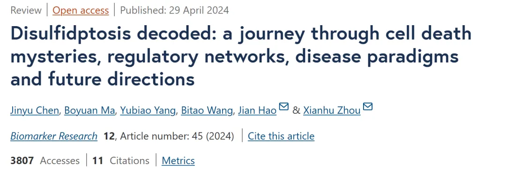
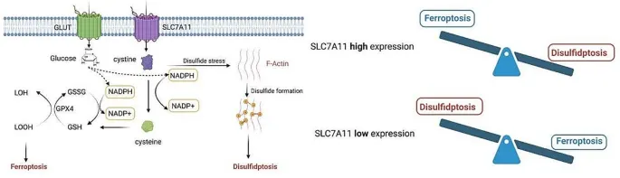
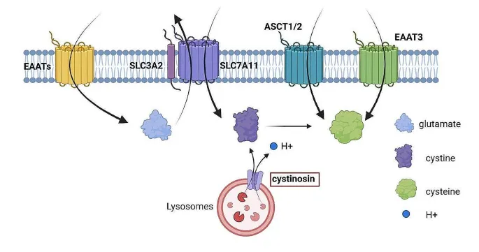
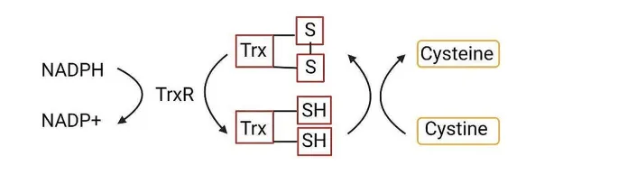
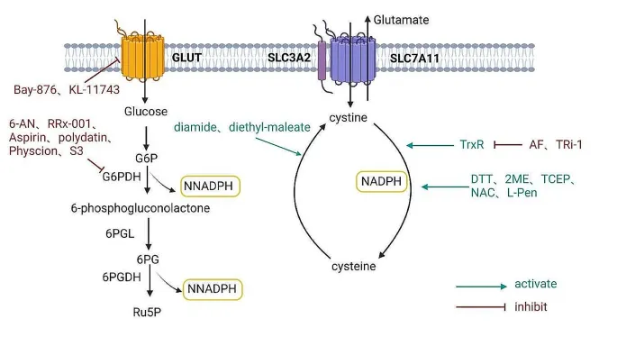
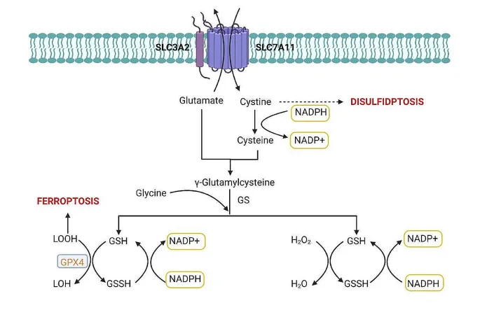

# 细胞花式死亡之双硫化物死亡

> 原文：https://mp.weixin.qq.com/s?__biz=MzAwMzIzOTk5OQ==&mid=2247528471&idx=1&sn=43af1a39a8f28e2526e74f7c805eb49e&chksm=9b3c0947ac4b8051fe5a67bc9704b343494622a90248324f5dbcbf885d0cb3ed2e4780b69c71#rd
> 合集：文献速递

**一、写在前面**

细胞死亡作为生物体发育与稳态调控的核心机制，近年来因多种新型程序性细胞死亡模式的发现而备受关注（论细胞的花式死亡。。。）。本文聚焦于一种新近提出的细胞死亡类型——**双硫化物死亡（Disulfidptosis）** ，该机制由**Liu Xiaoguang** 等人首次报道，揭示了在葡萄糖匮乏条件下，**高表达SLC7A11** 的癌细胞因**胱氨酸异常积累** 而引发的独特死亡途径。这一过程涉及二硫键应激、肌动蛋白骨架重塑及**RAC1-WRC通路** 的调控，展现出与铁死亡等传统模式的显著差异。本文通过系统梳理**双硫化物死亡** 的发现历程、分子机制及调控网络，结合其在肿瘤、神经退行性疾病等病理中的潜在作用，旨在为读者提供一个全面的认知框架。希望通过此次解读，能够深入理解这一新兴领域的研究进展及其未来潜力。

**DOI: 10.1186/s40364-024-00593-x **

**链接：**

https://biomarkerres.biomedcentral.com/articles/10.1186/s40364-024-00593-x

**二、主要内容**

****

#### 1.**双硫化物死亡的发现历程**

**双硫化物死亡** 的发现历程揭示了细胞内物质运输在调控细胞命运中的深远意义。综述作者通过文献分析指出，溶质载体（SLC）家族转运蛋白在葡萄糖、氨基酸和金属离子转运中的关键作用，为理解复杂的细胞动态变化提供了重要窗口，其中**SLC7A11** 因其在氧化还原平衡中的独特功能而备受关注。通过梳理相关研究，作者追溯了**SLC7A11** 从铁死亡保护因子到**双硫化物死亡** 触发因子的转变过程，展现了这一领域的突破性进展。

早期文献表明，**SLC7A11** 在维持细胞内谷胱甘肽（GSH）水平和预防氧化应激诱导的细胞死亡中至关重要。研究显示，胱氨酸匮乏或**SLC7A11** 功能受阻会导致GSH耗竭，削弱谷胱甘肽过氧化物酶4（GPX4）活性，进而引发ROS积累和铁死亡。这些发现确立了**SLC7A11高表达** 通过支持GSH合成抑制铁死亡的机制。然而，更引人注目的是，近期研究揭示，在葡萄糖饥饿条件下，**SLC7A11** 的作用发生了逆转。文献记录，在胶质母细胞瘤细胞中，**高表达SLC7A11** 通过xCT转运蛋白大量摄取胱氨酸，导致**NADPH耗竭** 和二硫键应激加剧。

这一关键转折点由**Liu Xiaoguang** 等人于2020年在《自然·细胞生物学》报道。他们的研究表明，在葡萄糖剥夺时，**胱氨酸积累** 触发F-肌动蛋白内非典型二硫键形成，导致肌动蛋白骨架收缩并与细胞膜分离，最终诱导细胞死亡。尤其值得注意的是，抑制二硫键形成可显著减缓这一过程，这一新型死亡模式因此被命名为“**双硫化物死亡** ”。综述作者强调，这一发现凸显了肌动蛋白骨架对二硫键应激的高度敏感性，标志着程序性细胞死亡研究的新篇章。

通过整合文献，作者进一步分析了**SLC7A11** 的双重角色。在正常条件下，**SLC7A11高表达** 通过促进胱氨酸摄取和GSH合成抑制铁死亡；而在葡萄糖饥饿时，**高表达SLC7A11** 因**NADPH不足** 导致**胱氨酸积累** ，诱发**双硫化物死亡** 。反之，**SLC7A11低表达** 则促进铁死亡，但不易触发**双硫化物死亡** 。这一双重功能表明，**SLC7A11** 可能在铁死亡与**双硫化物死亡** 之间起到桥梁作用。综述作者指出，这些发现不仅深化了对**双硫化物死亡** 机制的理解，也为癌症等疾病的相关研究提供了理论基础，预示着未来在治疗策略上的广阔前景。

**图1**

####  2\. **双硫化物死亡的调控网络**

**双硫化物死亡** 的调控机制涉及多重因素的协同作用，综述作者通过文献整合，聚焦于**胱氨酸积累** 、**NADPH耗竭** 以及WRC组装这三大关键要素，揭示它们如何共同促成F-肌动蛋白内二硫键的形成（见图1a）。为深入剖析这一新型细胞死亡模式的复杂性，作者系统梳理了相关研究，阐明了这些因素在**双硫化物死亡** 进程中的具体作用。

#### 3\. **胱氨酸代谢**

**胱氨酸代谢** 在**双硫化物死亡** 的调控中占据重要地位，综述作者通过文献分析指出，其在蛋白质合成、谷胱甘肽生成及细胞内氧化还原平衡维持中的作用不容忽视（见图2）。研究表明，胱氨酸的过度积累是引发二硫键应激的关键诱因，而这一应激正是**双硫化物死亡** 的启动信号（见图1a）。为深入理解**胱氨酸代谢** 在这一过程中的作用，作者整合多项研究，聚焦于相关转运蛋白及代谢循环的调控机制。

综述作者首先分析了**胱氨酸代谢** 的转运蛋白，其中xCT转运蛋白尤为突出。文献显示，xCT由**SLC7A11** 和SLC3A2亚基组成，能够实现细胞外胱氨酸与细胞内谷氨酸的交换（见图2）。在**SLC7A11高表达** 的细胞中，**NADPH耗竭** 导致胱氨酸大量积累，触发**双硫化物死亡** （见图1b）。尤其引人注目的是，研究发现，xCT抑制剂（如erastin、索拉非尼）通过阻断胱氨酸摄取，干扰GSH合成并诱导铁死亡，而其对**双硫化物死亡** 的具体影响尚待探索。这些结果表明，xCT不仅是**胱氨酸代谢** 的关键节点，还可能在铁死亡与**双硫化物死亡** 之间起到桥梁作用。

接着，作者探讨了胱氨酸蛋白（Cystinosin）在代谢中的角色。研究表明，Cystinosin是一种溶酶体跨膜蛋白，通过协同转运胱氨酸和H+，将溶酶体内胱氨酸移至细胞质，随后还原为半胱氨酸并参与GSH合成（见图2）。值得注意的是，Cystinosin功能障碍会导致胱氨酸在溶酶体内异常积累，引发胱氨酸病，而半胱胺作为治疗药物可分解胱氨酸并缓解症状。然而，综述作者指出，文献尚未明确Cystinosin异常或半胱胺应用是否影响细胞质胱氨酸水平，进而触发**双硫化物死亡** ，这一问题为未来研究提供了新方向。

最后，作者关注了半胱氨酸转运蛋白的作用，包括ASCT1/2和EAAT3。文献记录，这些转运蛋白负责将细胞外半胱氨酸运入细胞，维持氨基酸平衡（见图2）。尤其令人关注的是，研究提示，硫醇氧化剂（如二酰胺）可促进半胱氨酸向胱氨酸转化，加剧二硫键应激，但ASCT1/2和EAAT3的过度激活是否模拟**SLC7A11** 效应尚无定论。综述作者强调，**胱氨酸代谢** 的多重转运路径及其与**双硫化物死亡** 的关联，构成了复杂的调控网络，亟待进一步研究以揭示其全貌。

图2

#### 4\. **半胱氨酸转运蛋白**

**半胱氨酸转运蛋白** 在**胱氨酸代谢** 和**双硫化物死亡** 调控中扮演着重要角色，综述作者通过文献分析，聚焦于ASCT1、ASCT2和EAAT家族，探讨它们在半胱氨酸运输及潜在**双硫化物死亡** 诱导中的功能（见图2）。这些转运蛋白通过调控细胞内氨基酸平衡，可能影响二硫键应激的发生，作者整合相关研究，揭示其在这一过程中的作用。

综述作者首先分析了ASCT1的功能。文献表明，ASCT1由SLC1A4基因编码，广泛分布于骨骼肌、肺、肾等多个人体组织，特别是在大脑中负责半胱氨酸的重摄取（见图2）。值得注意的是，研究显示，ASCT1在维持神经系统半胱氨酸水平方面具有重要作用，但其是否直接影响**胱氨酸积累** 和**双硫化物死亡** 尚缺乏明确证据。接着，作者转向ASCT2，由SLC1A5基因编码，对多种氨基酸（如半胱氨酸、谷氨酰胺）具有高亲和力。尤其引人注目的是，ASCT2在肝细胞癌、非小细胞肺癌等多种增殖性癌细胞中过表达，这一现象被认为与癌细胞对谷氨酰胺的需求增加有关（见图2）。尽管ASCT2的半胱氨酸转运并非高度特异，综述作者指出，文献提示其可能通过半胱氨酸积累间接影响**双硫化物死亡** ，这一潜在作用亟待深入研究。

随后，作者探讨了兴奋性氨基酸转运蛋白（EAAT）家族，特别是EAAT3的独特功能。研究表明，EAAT家族包括五种转运蛋白，其中EAAT1和EAAT2主要在星形胶质细胞表达，而EAAT3、EAAT4和EAAT5分布于神经元（见图2）。尤其令人关注的是，EAAT3能够将细胞外半胱氨酸转运至神经元，作为谷胱甘肽合成的限速步骤，同时EAAT4和EAAT5还具备谷氨酸门控氯离子通道功能。文献强调，EAAT家族在维持谷氨酸能信号传导和防止谷氨酸毒性积累中至关重要，而EAAT3的半胱氨酸转运能力可能与其在氧化还原平衡中的作用相关。

通过综合分析，作者指出，ASCT1/2和EAAT3已被确认为半胱氨酸转运的关键蛋白（见图2）。研究发现，硫醇氧化剂（如二酰胺）可促进半胱氨酸向胱氨酸转化，加剧二硫键应激，从而可能与**双硫化物死亡** 相关（见图1a）。然而，综述作者强调，文献尚未明确这些转运蛋白的过度激活是否会模拟**SLC7A11高表达** 细胞中的**胱氨酸积累** 效应，进而诱导**双硫化物死亡** 。这一关联性的证据仍需进一步挖掘，作者认为，深入研究这些转运蛋白的机制将为**双硫化物死亡** 的调控网络提供新的指导方向。

#### 5\. **胱氨酸-半胱氨酸循环**

**胱氨酸-半胱氨酸循环** 在**双硫化物死亡** 的调控中具有核心地位，综述作者通过文献分析指出，这一动态机制在硫氧还蛋白系统（Trx）的参与下，对维持细胞氧化还原平衡和影响细胞死亡进程至关重要（见图3）。研究表明，胱氨酸的代谢状态直接关系到二硫键应激的发生，作者整合相关研究，深入探讨了这一循环在**双硫化物死亡** 中的作用。

综述作者首先分析了循环的基本过程。文献显示，胱氨酸主要通过**SLC7A11** 转运蛋白进入细胞，在**NADPH** 供能条件下被还原为半胱氨酸（见图2）。尤其引人注目的是，硫氧还蛋白系统通过其二硫键还原酶活性，调控蛋白质的二硫键与二硫醇平衡，抵御氧化应激（见图3）。研究发现，这一系统在胱氨酸还原过程中发挥关键作用，当其功能受阻时，**胱氨酸积累** 可能加剧二硫键应激，进而诱导**双硫化物死亡** 。

接着，作者探讨了胞外氧化环境对循环的影响。文献表明，由于胞外富含氧化性物质，半胱氨酸的还原性硫醇基团易快速氧化为胱氨酸（见图1a）。值得注意的是，这一氧化过程可能放大细胞内胱氨酸水平，尤其在**NADPH耗竭** 时，进一步推动**双硫化物死亡** 的发生。研究还提示，**SLC7A11高表达** 细胞在葡萄糖饥饿条件下更容易受到这种效应的影响，凸显了循环与代谢状态的紧密联系。

最后，作者关注了调控循环的多种激活剂。研究发现，二硫键还原剂（如二硫苏糖醇）、硫醇化合物（如N-乙酰半胱氨酸）及硫醇氧化剂（如二酰胺）均可通过调节**胱氨酸-半胱氨酸循环** 影响**双硫化物死亡** 进程（见图4）。尤其令人关注的是，还原剂能够阻止**胱氨酸积累** ，从而抑制**双硫化物死亡** ，而氧化剂则加剧二硫键应激，促进死亡发生。综述作者指出，这些发现揭示了**胱氨酸-半胱氨酸循环** 作为**双硫化物死亡** 调控枢纽的潜力，为理解其分子机制和开发干预策略提供了重要依据。

#### 6\. **硫氧还蛋白系统**

**硫氧还蛋白系统** 在**双硫化物死亡** 的调控中扮演着关键角色，综述作者通过文献分析指出，这一系统由**NADPH** 、硫氧还蛋白还原酶（TrxR）和硫氧还蛋白（Trx）组成，作为重要的抗氧化机制，通过二硫键还原酶活性对抗氧化应激（见图3）。研究表明，该系统通过调控胱氨酸与半胱氨酸的平衡，有效预防**胱氨酸积累** 引发的**双硫化物死亡** ，作者整合多项研究，深入探讨其在这一过程中的作用及潜在应用。

综述作者首先分析了**硫氧还蛋白系统** 的核心功能。文献显示，TrxR利用戊糖磷酸途径（PPP）生成的**NADPH** ，维持Trx的还原状态，促进胱氨酸持续转化为半胱氨酸（见图3）。尤其引人注目的是，研究发现，哺乳动物细胞中存在三种TrxR亚型——细胞质的TRXR1、线粒体的TRXR2及睾丸特异性的TRXR3，以及两种Trx形式——细胞质的Trx1和线粒体的Trx2。这些亚型共同支持抗氧化防御、细胞周期调控及基因转录控制，对细胞存活至关重要。作者指出，当该系统受抑制时，**胱氨酸积累** 加剧，可能触发二硫键应激和**双硫化物死亡** 。

### 

### **图3**

接着，作者探讨了TrxR抑制剂在调控中的作用。文献表明，硫代葡萄糖金（Auranofin）和TRXR1特异性抑制剂（TRi-1）能够显著降低二硫键还原速率，导致**胱氨酸积累** （见图4）。值得注意的是，研究发现，破骨细胞前体细胞对这些抑制剂尤为敏感，抑制TRXR1后，细胞内二硫键应激水平升高，最终诱导**双硫化物死亡** 。综述作者强调，尽管当前研究集中于破骨细胞前体细胞，但这一机制提示**硫氧还蛋白系统** 在多种细胞类型中的普遍意义。此外，文献还揭示，该系统在癌症、心血管疾病和神经退行性疾病中的异常调控与病理进程密切相关，例如在癌细胞中促进存活，在神经元中保护免受氧化损伤，为其作为治疗靶点提供了可能性。

在分析激活剂的作用时，作者进一步指出，**胱氨酸-半胱氨酸循环** 受多种化合物的调控。研究表明，二硫键还原剂（如二硫苏糖醇、β-巯基乙醇、三(2-羧乙基)膦）和硫醇化合物（如N-乙酰半胱氨酸、L-青霉胺）可在葡萄糖饥饿条件下，保护**SLC7A11高表达** 细胞免于**双硫化物死亡** （见图4）。尤其令人关注的是，这些化合物通过直接还原胱氨酸或促进游离硫醇再生，阻止**胱氨酸积累** ，而2-脱氧葡萄糖则通过提供**NADPH** 支持还原过程。相反，硫醇氧化剂（如二酰胺）加剧二硫键应激，加速**双硫化物死亡** 。综述作者认为，这些激活剂的研究揭示了**硫氧还蛋白系统** 与其他调控因子的协同作用，为开发针对氧化应激相关疾病的干预策略提供了潜在靶点。

### ****

### **图4**

####  7\. **谷胱甘肽代谢**

**谷胱甘肽代谢** 在调控铁死亡和**双硫化物死亡** 中具有不可忽视的作用，综述作者通过文献分析指出，谷胱甘肽（GSH）作为细胞内最丰富的低分子量抗氧化剂，在维持氧化还原平衡中至关重要（见图5）。研究表明，GSH通过清除自由基和活性氧（如羟基自由基、H2O2）保护细胞免受氧化损伤，作者整合相关研究，探讨其在两种死亡模式中的双重效应。

综述作者首先分析了GSH在铁死亡中的保护作用。文献显示，**高表达SLC7A11** 通过促进胱氨酸摄取和GSH合成，激活谷胱甘肽过氧化物酶4（GPX4），将脂质氢过氧化物转化为脂质醇，从而抑制脂质过氧化和铁死亡（见图5）。尤其引人注目的是，研究表明，这一机制赋予**SLC7A11阳性细胞** 对铁死亡的抵抗力。然而，作者指出，在特定条件下，GSH的保护作用可能发生逆转。文献记录，在**高SLC7A11表达细胞** 中，H2O2处理导致胱氨酸及其他二硫化物分子过度积累，同时伴随**NADPH耗竭** ，使GSH的抗氧化功能“过载”，迅速诱发**双硫化物死亡** （见图5）。

接着，作者探讨了**NADPH** 在**谷胱甘肽代谢** 中的关键地位。研究表明，GSH的合成依赖**NADPH** 作为还原力来源，而**NADPH耗竭** 不仅削弱GSH生成，还可能直接促进**双硫化物死亡** （见图4）。值得注意的是，在葡萄糖饥饿条件下，**SLC7A11高表达** 细胞因**NADPH不足** 而易发生**双硫化物死亡** ，H2O2诱导的类似效应也被归类为同一模式。综述作者强调，这一现象表明，**NADPH耗竭** 是**双硫化物死亡** 的重要诱因，而非单一因素所致，提示代谢状态在细胞死亡中的复杂调控。

通过综合分析，作者指出，**谷胱甘肽代谢** 在铁死亡和**双硫化物死亡** 中扮演双重角色。研究揭示，**胱氨酸积累** 与**NADPH耗竭** 共同决定了细胞命运走向，尤其令人关注的是，**SLC7A11阳性细胞** 虽对铁死亡有抵抗力，却在**NADPH不足** 时易受**双硫化物死亡** 影响。综述作者认为，这些发现不仅深化了对细胞代谢与死亡机制的理解，还为癌症等疾病的治疗干预提供了新思路，特别是通过靶向GSH代谢调控细胞存活的潜力值得进一步探索。

### **图5**

####  8\. **NADPH代谢**

**NADPH代谢** 在**双硫化物死亡** 的发生中具有决定性作用，综述作者通过文献分析指出，这一独特细胞死亡模式与葡萄糖剥夺和**NADPH耗竭** 密切相关（见图4）。研究表明，**NADPH代谢紊乱** 是**双硫化物死亡** 的显著特征，凸显了维持其稳态作为对抗该死亡模式的重要策略，作者整合多项研究，聚焦于**NADPH** 的来源及其在戊糖磷酸途径中的调控机制。

##### **NADPH的来源**

综述作者首先探讨了**NADPH** 在细胞中的多重来源及其重要性。文献显示，**NADPH** 是维持氧化还原平衡的关键分子，参与多种代谢途径，包括细胞质中的戊糖磷酸途径（PPP）、叶酸介导的单碳代谢、NAD激酶、苹果酸酶等（见图4）。尤其引人注目的是，研究表明，葡萄糖剥夺导致的**NADPH耗竭** 是**双硫化物死亡** 的关键步骤，而PPP被认为是其主要来源。作者指出，尽管其他途径如谷氨酰胺代谢和脂肪酸氧化也贡献**NADPH** ，但在**双硫化物死亡** 背景下的作用尚待阐明。这些发现强调了深入理解**NADPH** 产生与消耗途径的必要性，以全面揭示其在细胞死亡中的角色。

##### **戊糖磷酸途径（PPP）**

随后，作者详细分析了PPP在**NADPH合成** 及**双硫化物死亡** 中的核心作用。文献记录，PPP通过氧化相的三个不可逆反应生成**NADPH** ：葡萄糖-6-磷酸脱氢酶（G6PDH）将葡萄糖-6-磷酸氧化为6-磷酸葡萄糖酸内酯，6-磷酸葡萄糖酸内酯酶生成6-磷酸葡萄糖酸，最终6-磷酸葡萄糖酸脱氢酶催化生成核酮糖-5-磷酸和第二个**NADPH** 分子（见图4）。值得注意的是，研究表明，葡萄糖剥夺通过减少PPP活性显著降低**NADPH水平** ，是诱导**双硫化物死亡** 的关键环节。例如，GLUT1/3抑制剂（如BAY-876、KL-11,743）阻断葡萄糖摄取，导致**SLC7A11高表达** 癌细胞发生**双硫化物死亡** （见图4）。

综述作者进一步关注了靶向PPP的抑制剂潜力。文献显示，G6PD抑制剂（如6-氨基烟酰胺、RRx-001）通过调控G6PD活性减少**NADPH生成** ，在癌症治疗中展现出应用前景（见图4）。尤其令人关注的是，这些抑制剂可能模拟葡萄糖剥夺效应，诱导**双硫化物死亡** ，但其具体机制仍需验证。研究还揭示，肿瘤细胞依赖PPP产生高水平**NADPH** 以适应氧化应激，这一特性为靶向PPP提供了理论依据。综述作者认为，深入研究PPP及其抑制剂不仅有助于阐明**双硫化物死亡** 的分子基础，还为开发针对癌症等代谢紊乱疾病的新疗法开辟了道路。

#### 9\. **RAC1-WRC通路**

**RAC1-WRC通路** 在**双硫化物死亡** 的晚期阶段发挥重要作用，综述作者通过文献分析指出，该通路可能被细胞二硫化物代谢应激激活，影响F-肌动蛋白内二硫键的形成（见图1a）。研究表明，这一通路涉及RAC1及WAVE调控复合体（WRC）的多个亚基，包括NCKAP1、WAVE-2、CYFIP1、Abi2和HSPC300，作者整合相关研究，探讨其调控机制及潜在研究方向。

##### **RAC1**

综述作者首先聚焦于RAC1的作用。文献显示，RAC1作为Rho家族小GTP酶，调控细胞骨架重组、转录和增殖，定位于迁移细胞前缘促进片状伪足形成（见图1a）。尤其引人注目的是，研究表明，在**SLC7A11高表达** 细胞中，组成型激活的RAC1（Rac1 Q61L突变体）通过激活WRC和Arp2/3复合体，催化肌动蛋白聚合并诱导**双硫化物死亡** ，而NCKAP1敲除则阻断这一过程。作者指出，RAC1与WRC的相互作用可能通过分支状肌动蛋白网络为二硫键形成提供靶点，尽管其具体机制尚待阐明。

##### **NCKAP1**

接着，作者分析了NCKAP1的功能。文献表明，NCKAP1是WRC的关键组分，在阿尔茨海默病及大脑发育中广泛表达，与细胞增殖和癌症转移相关（见图1a）。值得注意的是，研究发现，NCKAP1通过RB1/P53通路抑制癌细胞生长，并与RAC1及其他WRC亚基协同调控肌动蛋白聚合和片状伪足形成，这一过程在**双硫化物死亡** 中至关重要。综述作者强调，NCKAP1的潜在作用提示其可能成为疾病干预的候选靶点。

##### **WAVE-2**

综述作者随后探讨了WAVE-2的角色。研究显示，WAVE-2属于WASP家族，定位于片状伪足前缘，通过VCA结构域与Arp2/3和肌动蛋白单体结合，促进肌动蛋白成核（见图1a）。尤其令人关注的是，文献表明，RAC1激活WAVE-2并释放VCA区域，可能与**双硫化物死亡** 中的二硫键形成相关。作者指出，WAVE-2在细胞骨架动态重组中的作用为其在死亡调控中的功能提供了线索。

##### **CYFIP1**

在CYFIP1的分析中，作者指出其与RAC1和F-肌动蛋白的直接相互作用。文献记录，CYFIP1（Sra1）调控WRC活性，其缺失降低WRC组件的mRNA表达，且与脆性X综合征相关（见图1a）。值得一提的是，研究表明，Notch1信号上调CYFIP1表达，可能间接影响**双硫化物死亡** 相关的肌动蛋白调控。综述作者认为，CYFIP1的多重信号作用为其在氧化还原状态中的潜在功能提供了研究空间。

##### **Abi2**

对于Abi2，综述作者指出其在肌动蛋白重组和片状伪足形成中的重要性。文献显示，Abi2通过SH3结构域与WAVE2相互作用，增强WRC活性，且PIM1磷酸化Abi2促进癌症侵袭（见图1a）。尤其引人注目的是，研究提示，Abi2可能通过WAVE2的WHD结构域参与**双硫化物死亡** 调控，尽管具体结构域尚待明确。作者认为，Abi2在癌症进展中的作用为其在死亡机制中的功能提供了新视角。

##### **HSPC300**

最后，作者分析了HSPC300的作用。研究表明，HSPC300是WRC中保守的小型亚基，与WAVE蛋白的SHD结构域结合，参与细胞骨架重塑（见图1a）。尤其令人关注的是，文献发现，Nudel蛋白通过稳定HSPC300支持WRC组装，但其在**双硫化物死亡** 中的具体机制仍不清楚。综述作者指出，HSPC300的保守性提示其在通路中的基础作用值得深入研究。

通过综合分析，作者指出，**RAC1-WRC通路** 通过片状伪足形成间接影响二硫键生成，WRC亚基的缺失可抑制**双硫化物死亡** （见图1a）。研究揭示，该通路与细胞外基质蛋白及蛋白质相互作用网络相连，反映了其功能的复杂性。综述作者认为，尽管当前研究为理解**RAC1-WRC通路** 的生物学意义提供了宝贵见解，但其体内组装机制和疾病靶向潜力仍需进一步探索，这些努力将为细胞死亡机制及治疗应用带来新的突破。

#### 10\. **双硫化物死亡与疾病**

**双硫化物死亡** 自发现以来，其与多种疾病的关联日益受到关注，综述作者通过文献分析指出，这一新型细胞死亡模式的相关基因在肿瘤、神经退行性疾病和代谢性疾病的预后中具有重要意义（见表1）。研究揭示，**双硫化物死亡** 信号通路的调控机制为疾病研究提供了新视角，作者整合多项研究，全面探讨其在不同病理状态下的作用及潜在应用。

##### **癌症**

综述作者首先聚焦于**双硫化物死亡** 在癌症中的研究进展。文献显示，当前工作多集中于生物信息学分析，利用数据集预测治疗靶点，为后续实验验证奠定基础（见表1）。尤其引人注目的是，研究表明，**双硫化物死亡** 相关基因在多种癌症中与预后和肿瘤微环境密切相关，为开发新型疗法提供了方向。

##### **消化系统肿瘤**

在消化系统肿瘤中，作者分析了若干关键基因的作用。研究发现，SPP1和MYBL2作为**双硫化物死亡** 特征基因，与肝癌患者生存预后相关，而**SLC7A11** 被认为是肝细胞癌的潜在预后标志物（见表1）。值得注意的是，体外实验表明，SLCO1B1过表达可抑制肝癌细胞增殖和侵袭，提示其治疗潜力。此外，文献指出，结直肠癌中8个特征基因（如MXRA8、IGFBP5）和4个相关基因（如TRIP6、OXSM）可能影响微环境和药物敏感性，而CD96下调显著抑制食管鳞癌细胞增殖，凸显其作为靶点的价值。

##### **泌尿系统肿瘤**

对于泌尿系统肿瘤，作者指出，POU5F1和CTSE在膀胱癌中通过促进增殖和转移成为潜在靶点（见表1）。尤其令人关注的是，研究发现，MSH3过表达在葡萄糖饥饿条件下诱导肾细胞癌**双硫化物死亡** ，而AJAP1和ISG20的下调与肾癌预后相关。文献还揭示，**SLC7A11** 等基因在膀胱癌免疫浸润中起作用，尽管其与NCKAP1的矛盾功能尚待澄清，提示肿瘤特异性研究的必要性。

##### **呼吸系统肿瘤**

在呼吸系统肿瘤中，综述作者关注G6PD的角色。研究表明，G6PD抑制剂通过减少**NADPH** 诱导肺癌细胞**双硫化物死亡** ，显著抑制增殖（见表1）。值得一提的是，抑制长链非编码RNA OGFRP1可降低肺癌细胞侵袭能力，暗示**双硫化物死亡** 在肺癌调控中的潜在角色。

##### **生殖系统肿瘤**

对于生殖系统肿瘤，作者分析了免疫检查点基因CD80和CD276与乳腺癌进展的关联（见表1）。尤其引人注目的是，研究发现，DNUFS1、LRPPRC和**SLC7A11** 在乳腺癌中差异表达，具有预后价值，为免疫治疗研究提供了新思路。

##### **神经退行性疾病**

综述作者随后探讨了**双硫化物死亡** 在神经退行性疾病中的作用。以阿尔茨海默病为例，文献鉴定出7个相关基因（如MYH9、IQGAP1），可用于亚型评估和诊断（见表1）。尤其令人关注的是，这些基因可能揭示疾病潜在机制，为治疗策略开发提供新方向。

##### **代谢性疾病**

在代谢性疾病中，作者指出**双硫化物死亡** 与破骨细胞调控的联系。研究表明，NFATC1介导的**SLC7A11表达** 使破骨细胞前体细胞对TRXR1抑制剂敏感，导致**胱氨酸积累** 和**双硫化物死亡** （见表1）。值得注意的是，这一机制选择性靶向破骨细胞，为骨质疏松症等疾病提供了新型治疗策略。

通过综合分析，综述作者认为，**双硫化物死亡** 在癌症、神经退行性疾病和代谢性疾病中展现出广泛的应用潜力（见表1）。研究不仅揭示了其分子机制，还为疾病预后评估和靶向治疗提供了候选靶点。然而，作者强调，当前发现多依赖生物信息学，未来需更多实验验证以阐明具体作用，为临床转化奠定基础。

**三、最后聊聊**

总而言之，本文详细阐述了**双硫化物死亡** 作为一种新型程序性细胞死亡的独特特征及其复杂的调控机制，从**胱氨酸代谢** 、**NADPH耗竭** 到**RAC1-WRC通路** 的协同作用，揭示了其在细胞命运决定中的关键角色。研究表明，**双硫化物死亡** 不仅与**SLC7A11** 介导的氧化还原失衡密切相关，还在多种疾病中展现出潜在的治疗价值，尤其是在癌症靶向治疗领域。然而，其具体分子靶点及与其他细胞死亡模式的交互机制仍待进一步阐明。希望未来的研究大佬们聚焦于这些未解之谜，以验证其普适性并推动临床转化。这不仅能为细胞死亡研究开辟新视角，还有望在疾病干预中发挥重要作用。

**如何联系我们**

 留一个领取资料、[免费两周学习版](<https://mp.weixin.qq.com/s?__biz=MzAwMzIzOTk5OQ==&mid=2247527585&idx=1&sn=fa32112c11b215b33096cab43baf08ea&scene=21#wechat_redirect>)服务器的**微信号[Biomamba_zhushou]**，方便各位随时交流。同时我们也构建了[交流群矩阵](<https://mp.weixin.qq.com/s?__biz=MzAwMzIzOTk5OQ==&mid=2247528057&idx=1&sn=bb348c2a88c977c7cce67ee6731a3591&scene=21#wechat_redirect>)，欢迎大家入群讨论。

大家可以阅读完这几篇之后添加[给生信入门初学者的小贴士](<http://mp.weixin.qq.com/s?__biz=MzAwMzIzOTk5OQ==&mid=2247493329&idx=1&sn=597870b7f7ce10346da3561e7c281627&chksm=9b3c9f81ac4b169794088ce9abbcacb5f18e9fd174fc0d7e28da62d78facadf3100ef38aaf22&scene=21#wechat_redirect>)
[如何搜索公众号过往发布内容](<http://mp.weixin.qq.com/s?__biz=MzAwMzIzOTk5OQ==&mid=2247506266&idx=2&sn=22b1164bc9602c25620d058847785422&chksm=9b3ca00aac4b291c16d738271746ffb90149282a728f484e8a1952463c46a8e7dc4f883ab928&scene=21#wechat_redirect>)

**已有生信基地联系方式的同学****无需重复添加**

 您点的每个赞和在看，我都认真当成了喜欢
