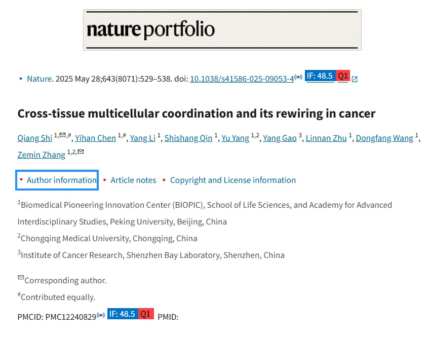
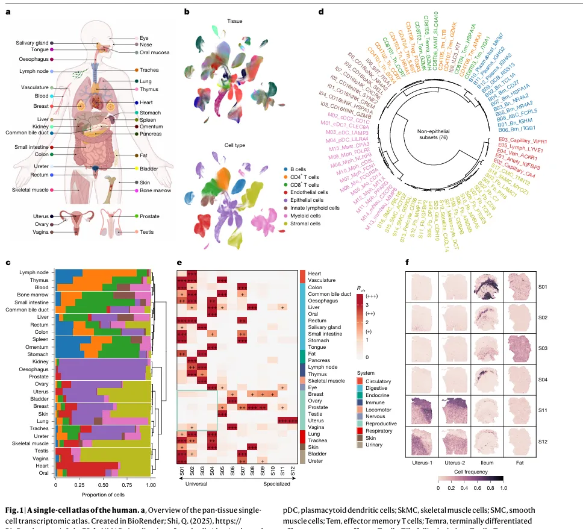
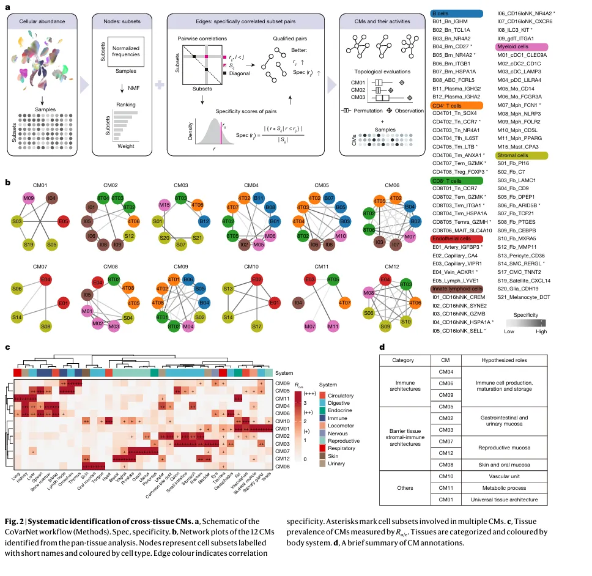
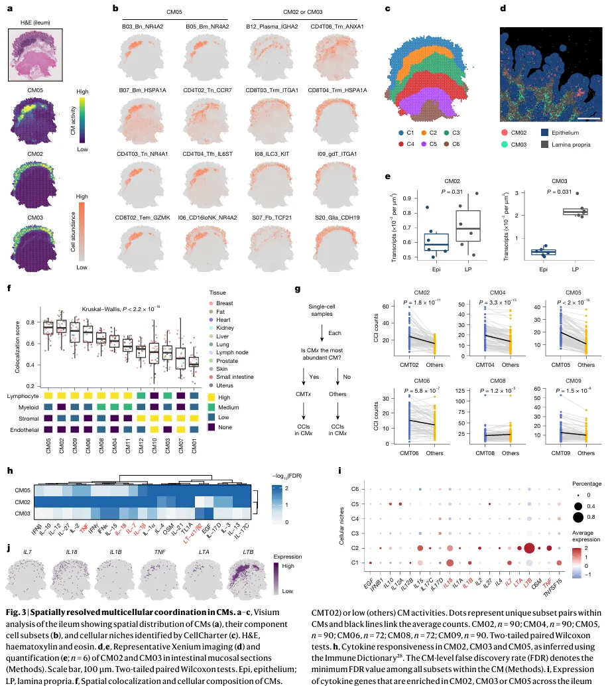
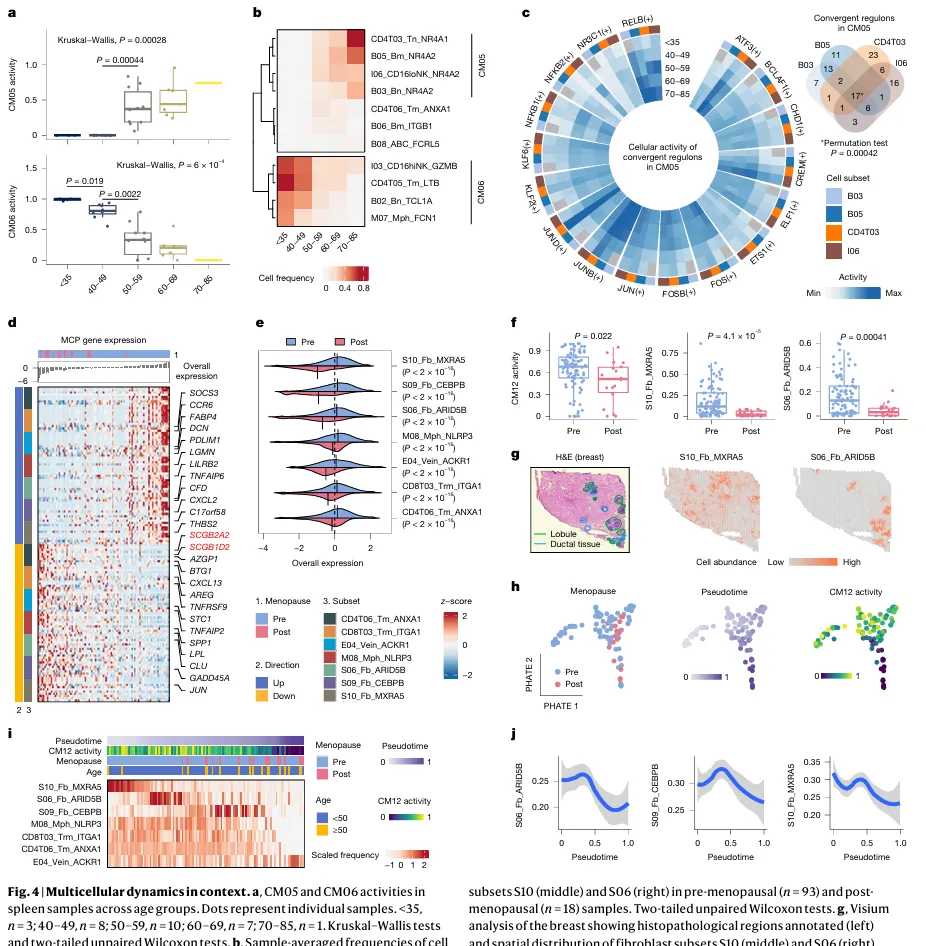
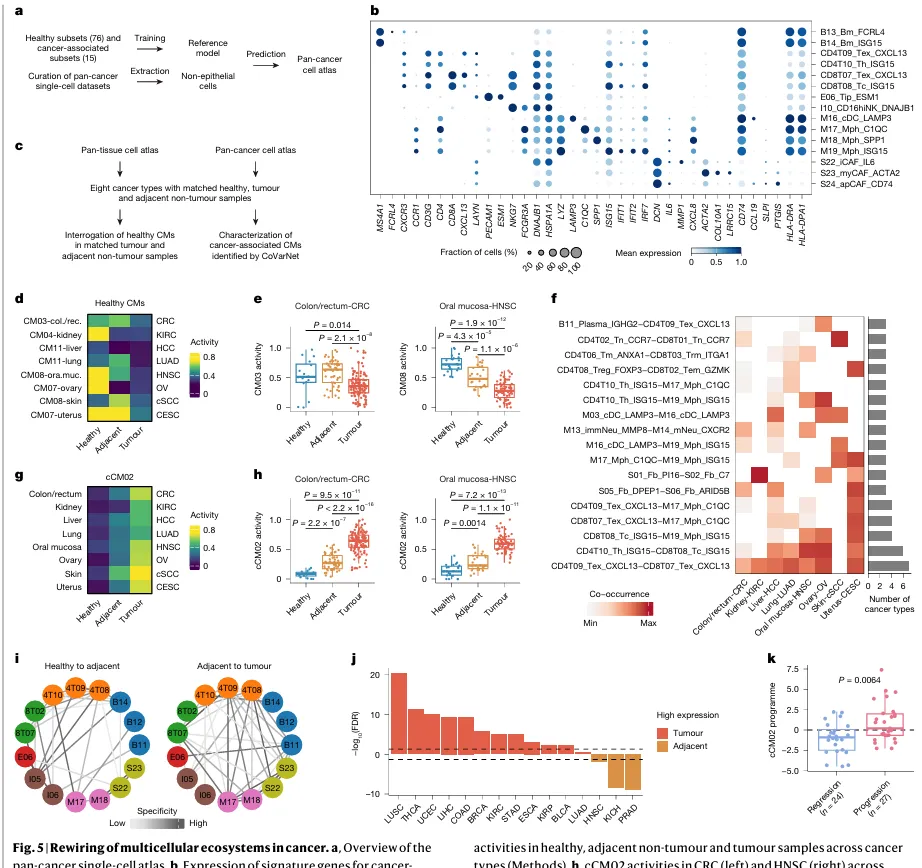

# 张泽民院士的《Nature》|706个单细胞样本、35种组织，这篇article的数据量比你的综述都多

> 原文：https://mp.weixin.qq.com/s?__biz=MzAwMzIzOTk5OQ==&mid=2247530984&idx=1&sn=41ea9b742095ea9f22e943fc7422a5f1&chksm=9b3c00b8ac4b89ae685f91e9ccd96416a1b33a615f6cf574b4bac017bcb77fed50600f06e767#rd
> 合集：文献速递

**一、写在前面**

今天我们要深入剖析一篇今年7月发表在《Nature》上的重磅研究 ——《Cross-tissue multicellular coordination and its rewiring in cancer》，影响因子48.5。本文构建了覆盖35种健康组织 \+ 29种癌症的[单细胞](<https://mp.weixin.qq.com/s?__biz=MzAwMzIzOTk5OQ==&mid=2247530022&idx=2&sn=5c6aa081663719ce2f0f9b7f4d173c93&scene=21#wechat_redirect>)图谱，开发了多细胞模块分析工具 CoVarNet，揭示了多细胞协作的普适规律，并为癌症研究提供了新的标志物，是典型的“数据+方法+科学发现” 三位一体的顶刊成果。通讯作者是大家熟知的["单细胞院士"](<https://mp.weixin.qq.com/s?__biz=MzAwMzIzOTk5OQ==&mid=2247505275&idx=1&sn=1ed0f9e1142bbdd8f554cedb6b1d515a&scene=21#wechat_redirect>)——**张泽民 老师。**这篇文章从多组织单细胞图谱构建到癌症微环境重构，系统性揭示了健康与疾病状态下多细胞生态系统的组织规律，无论是研究思路还是技术方法，都对我们生信领域的硕博研究极具启发意义。原文链接:https://pmc.ncbi.nlm.nih.gov/articles/PMC12240829/DOI: 10.1038/s41586-025-09053-4**如果需要[ 单细胞数据分析](<https://mp.weixin.qq.com/s?__biz=MzAwMzIzOTk5OQ==&mid=2247530022&idx=2&sn=5c6aa081663719ce2f0f9b7f4d173c93&scene=21#wechat_redirect>)**教学** 、生信热点**[全文复现](<https://mp.weixin.qq.com/mp/appmsgalbum?__biz=MzAwMzIzOTk5OQ==&action=getalbum&album_id=2981710763847614469#wechat_redirect>)** 、自测数据**个性化分析** 辅导、[常态化实验学习](<https://mp.weixin.qq.com/s?__biz=MzAwMzIzOTk5OQ==&mid=2247530174&idx=1&sn=c3b0499adcc9093546e4ba1cfffba7bd&scene=21#wechat_redirect>)，欢迎联系客服微信[**Biomamba_zhushou**]**

#

二、研究方法

本文的技术路线围绕 “**数据构建→模块鉴定→功能验证→疾病延伸** ” 展开，核心方法可分为四大类，每一步都针对领域关键问题设计，逻辑严密且可复现：

### 1\. 单细胞与空间转录组数据的整合与质控

  * **数据收集**

    * 健康组织：收集33个数据集、706个样本，覆盖35种人体组织，经严格质控后保留229万个高质量单细胞（排除冷冻样本、单一细胞富集样本，仅保留 10x Genomics 单细胞数据，减少批次效应）；
    * 癌症组织：收集48个数据集、1062个样本，覆盖29种癌症，保留303万个高质量非上皮细胞，同时纳入癌旁组织作为 “癌前状态” 对照。
  * **数据整合**

    * 用 scIB 平台 benchmark 多种整合工具（BBKNN、Harmony、scVI 等），最终选择**BBKNN** （批次校正效果最佳，且能保留生物异质性）；
    * 统一基因注释（仅保留GRCh38不同版本共有的21812个基因），校正细胞周期、线粒体基因比例等混杂因素。
  * **细胞注释**

    * 分层聚类：先按经典标志物分为 8 大类细胞（免疫细胞、上皮细胞、内皮细胞等），再细分 76 个非上皮细胞亚群（如年龄相关 B 细胞 ABC、组织驻留记忆 T 细胞 Trm）；
    * 工具辅助：用 CellTypist（自动细胞注释工具）和 TOSICA（Transformer-based 转移学习工具）验证注释结果，确保准确性。

### 2\. 多细胞模块（CM）鉴定：CoVarNet 工具开发

为解决 “如何从海量心问题，团队开发了**CoVarNet** 计算框架，核心逻辑是 “基于细胞丰度协方差推断功能模块”，具体步骤：

  * 输入数据

  * 非上皮细胞亚群的标准化丰度矩阵（排除上皮细胞，因其组织特异性过强，干扰跨组织规律）；

  * 双模块联合分析

     * 模块 1（节点筛选）：用**非负矩阵分解（NMF）** 提取细胞亚群共现因子，选择 cophenetic 相关系数最高的 12 个因子作为候选模块（每个因子的 Top10 亚群为模块 “节点”）；
     * 模块 2（边缘筛选）：计算亚群对的 Pearson 相关系数，结合 “特异性指数（Spec）” 筛选 “特异性共现对”（排除泛化相关，保留模块内专属关联）

  * 模块验证

     * 通过拓扑分析和置换检验验证模块的统计学显著性。

### 3\. 多维度功能验证

  * **空间验证**

    * 用**[cell2location](<https://mp.weixin.qq.com/s?__biz=MzAwMzIzOTk5OQ==&mid=2247507210&idx=1&sn=f32037ffefd60b0d1bcca7bf9c3e0823&scene=21#wechat_redirect>)** （贝叶斯空间解卷积工具）将 CM 映射到[Visium](<https://mp.weixin.qq.com/s?__biz=MzAwMzIzOTk5OQ==&mid=2247505213&idx=2&sn=6b9aad43c273009c3d7f80c63bb9f619&scene=21#wechat_redirect>)空间转录组数据，验证模块内细胞的空间共定位（如 CM08 在皮肤表皮的富集）；
    * 用**Xenium** （超高分辨率原位测序）解析单细胞水平的模块分布（如小肠 CM02/CM03 在固有层 vs 上皮的差异定位）。
  * **细胞互作验证**

    * 用**[CellPhoneDB](<https://mp.weixin.qq.com/s?__biz=MzAwMzIzOTk5OQ==&mid=2247528770&idx=1&sn=6242bce437a9d60f81a8651ea9b57e0b&scene=21#wechat_redirect>)** 和**[CellChat](<https://mp.weixin.qq.com/s?__biz=MzAwMzIzOTk5OQ==&mid=2247501735&idx=2&sn=35fc792961507f4ae1cbae3a2882fba6&scene=21#wechat_redirect>)**[ 分析配体 - 受体互作](<https://mp.weixin.qq.com/s?__biz=MzAwMzIzOTk5OQ==&mid=2247501735&idx=2&sn=35fc792961507f4ae1cbae3a2882fba6&scene=21#wechat_redirect>)（如内皮细胞分泌多种配体，淋巴细胞富集特异性互作）；
    * 结合"Immune Dictionary"（细胞因子响应数据库），推断模块内细胞的细胞因子调控网络（如CM05中 IL7/IL18 的富集）。
  * **表型关联验证**

    * 结合临床表型（年龄、绝经状态、癌症分期）分析CM活性变化；
    * 用**GTEx[ bulk RNA-seq 数据](<https://mp.weixin.qq.com/s?__biz=MzAwMzIzOTk5OQ==&mid=2247510793&idx=1&sn=bfa69e8f261932d9bea74443fab732f0&scene=21#wechat_redirect>)**（12240 个样本）验证CM的组织分布规律，确保单细胞结果可推广到 bulk 水平。

### 4\. 癌症多细胞重构分析

  * **健康CM在癌症中的变化** 计算8种癌症（有健康 - 癌旁 - 肿瘤匹配样本）中健康CM的活性，评估 “组织特异性模块丢失”；
  * **癌症相关模块（cCM）鉴定** 将CoVarNet应用于泛癌单细胞数据，鉴定4个cCM，重点分析**cCM02** （富集癌症相关亚群，如耗竭T细胞Tex、癌相关成纤维细胞CAF）；
  * **临床价值验证**

    * 用**TCGA[ bulk 数据](<https://mp.weixin.qq.com/s?__biz=MzAwMzIzOTk5OQ==&mid=2247510793&idx=1&sn=bfa69e8f261932d9bea74443fab732f0&scene=21#wechat_redirect>)**验证cCM02相关基因程序的泛癌表达模式；
    * 用肺癌癌前病变数据（51 例，已知进展结局）验证cCM02程序对癌症进展的预测价值。

**三、主要结果
**

本文结果按 “**健康组织多细胞模块→模块的时空动态→癌症中模块重构** ” 的逻辑展开，共5张核心结果图，每张图都对应关键科学问题，我们逐一解析：

### ●图 1：人类泛组织单细胞图谱的构建与细胞亚群特征

**1、核心问题** ：健康人体35种组织的细胞组成有何规律？细胞亚群是否存在组织偏好性？
**2、分析方法** ：[单细胞数据整合](<https://mp.weixin.qq.com/s?__biz=MzAwMzIzOTk5OQ==&mid=2247500117&idx=2&sn=cef0b0abec6d73a8c2615980ef68aec1&scene=21#wechat_redirect>)、分层聚类、[组织丰度分析](<https://mp.weixin.qq.com/s?__biz=MzAwMzIzOTk5OQ==&mid=2247503971&idx=2&sn=7dafb1e743ebbb95e488d8d1b7024448&scene=21#wechat_redirect>)（Rₒ/ₑ比值：观察值 / 期望值，评估亚群在组织中的富集程度，值得一提的是，这一方法也是张老师团队此前首创的）；

**3、关键结论** ：健康组织的细胞组成具有组织特异性，且细胞亚群存在 “通用 - 特异” 分层，尤其是成纤维细胞和免疫细胞的组织偏好性显著。

Figure 1

### ●图 2：跨组织多细胞模块（CM）的系统鉴定

**1、核心问题** ：跨组织的多细胞协作是否存在统一模块？这些模块的组织分布有何规律？
**2、分析方法** ：CoVarNet 工具、组织丰度分析（Rₒ/ₑ比值）、GTEx bulk 数据验证；

**3、关键结论** ：健康人体存在 12 个跨组织多细胞模块，每个模块具有明确的细胞组成、组织偏好性和功能定位，且可通过 GTEx bulk 数据复现。

Figure2

### ●图 3：多细胞模块的空间特征与细胞互作

**1、核心问题** ：CM 内的细胞是否在空间上共定位？模块内的细胞互作有何规律？
**2、分析方法** ：[空间转录组](<https://mp.weixin.qq.com/s?__biz=MzAwMzIzOTk5OQ==&mid=2247505088&idx=1&sn=9f60dca1b21f5ba8c32d09595a512134&scene=21#wechat_redirect>)（Visium/Xenium）、[细胞互作分析](<https://mp.weixin.qq.com/s?__biz=MzAwMzIzOTk5OQ==&mid=2247512011&idx=1&sn=fbd41832c5995d79fead016931d3bfbd&scene=21#wechat_redirect>)（CellPhoneDB）、细胞因子响应分析；
**3、关键结论** ：CM 内细胞存在严格的空间共定位，且细胞互作模式与细胞谱系组成相关（淋巴细胞依赖接触互作，内皮 / 基质细胞依赖长距离信号），细胞因子是模块功能的核心调控因子。

Figure 3

### ●图 4：多细胞模块的时空动态（年龄与绝经）

**1、核心问题** ：CM 是否随生理状态（年龄、绝经）动态变化？变化的分子机制是什么？
**2、分析方法** ：年龄分层分析、绝经状态关联分析、[调控网络推断](<https://mp.weixin.qq.com/s?__biz=MzAwMzIzOTk5OQ==&mid=2247529410&idx=1&sn=9bbaf955d93ddce60874e1cdc2f16115&scene=21#wechat_redirect>)（[SCENIC](<https://mp.weixin.qq.com/s?__biz=MzAwMzIzOTk5OQ==&mid=2247530488&idx=1&sn=e0c57d42b1ecb73e8b7b9f6caecbb81d&scene=21#wechat_redirect>)）、[轨迹分析](<https://mp.weixin.qq.com/s?__biz=MzAwMzIzOTk5OQ==&mid=2247528666&idx=1&sn=d29545d296bac3e41de322e43fde80dd&scene=21#wechat_redirect>)（PHATE/Palantir）；
**3、关键结论** ：CM 的动态变化与生理状态紧密关联 —— 脾脏 CM05/06 随年龄呈现 “此升彼降” 的协同变化，核心调控子为 AP-1 和 NR4A1；乳腺 CM12 随绝经呈现 “炎症下调、成纤维细胞减少” 的轨迹，成纤维细胞是绝经相关组织重构的关键载体。

Figure 4

### ●图 5：癌症中多细胞生态系统的重构

**1、核心问题** ：癌症如何改变健康组织的 CM？是否存在泛癌共有的 “癌症相关多细胞模块（cCM）”？其临床价值如何？
**2、分析方法** ：泛癌单细胞数据整合、cCM 鉴定（CoVarNet）、临床样本验证（TCGA / 癌前病变）；
**3、关键结论** ：癌症会同时重构两种多细胞生态 —— 健康组织特异性 CM 的丢失，以及泛癌共有的 cCM（如 cCM02）的出现；cCM02 不仅是癌症进展的标志物，还可预测癌前病变的恶性转化，具有重要临床价值。

Figure 5

**四、最后聊聊**

这篇文章通过构建大规模单细胞图谱、开发CoVarNet计算框架，系统揭示了人体多细胞模块的组织原则及其在癌症中的重编程机制，是一项集**数据资源、计算方法、生物学发现** 于一体的高水平研究，为理解组织稳态与疾病机制提供了新范式。本文用到的许多分析方法我们也制作过教程，具体可跳转：[cell2location](<https://mp.weixin.qq.com/s?__biz=MzAwMzIzOTk5OQ==&mid=2247507210&idx=1&sn=f32037ffefd60b0d1bcca7bf9c3e0823&scene=21#wechat_redirect>)（贝叶斯空间解卷积工具）[Visium](<https://mp.weixin.qq.com/s?__biz=MzAwMzIzOTk5OQ==&mid=2247505213&idx=2&sn=6b9aad43c273009c3d7f80c63bb9f619&scene=21#wechat_redirect>)空间转录组数据分析[CellPhoneDB](<https://mp.weixin.qq.com/s?__biz=MzAwMzIzOTk5OQ==&mid=2247528770&idx=1&sn=6242bce437a9d60f81a8651ea9b57e0b&scene=21#wechat_redirect>)[CellChat分析配体 - 受体互作](<https://mp.weixin.qq.com/s?__biz=MzAwMzIzOTk5OQ==&mid=2247501735&idx=2&sn=35fc792961507f4ae1cbae3a2882fba6&scene=21#wechat_redirect>)[bulk RNA-seq 数据](<https://mp.weixin.qq.com/s?__biz=MzAwMzIzOTk5OQ==&mid=2247510793&idx=1&sn=bfa69e8f261932d9bea74443fab732f0&scene=21#wechat_redirect>)实战

[单细胞数据整合](<https://mp.weixin.qq.com/s?__biz=MzAwMzIzOTk5OQ==&mid=2247500117&idx=2&sn=cef0b0abec6d73a8c2615980ef68aec1&scene=21#wechat_redirect>)

[组织丰度分析](<https://mp.weixin.qq.com/s?__biz=MzAwMzIzOTk5OQ==&mid=2247503971&idx=2&sn=7dafb1e743ebbb95e488d8d1b7024448&scene=21#wechat_redirect>)

[调控网络推断](<https://mp.weixin.qq.com/s?__biz=MzAwMzIzOTk5OQ==&mid=2247529410&idx=1&sn=9bbaf955d93ddce60874e1cdc2f16115&scene=21#wechat_redirect>)（[SCENIC](<https://mp.weixin.qq.com/s?__biz=MzAwMzIzOTk5OQ==&mid=2247530488&idx=1&sn=e0c57d42b1ecb73e8b7b9f6caecbb81d&scene=21#wechat_redirect>)）

[轨迹分析](<https://mp.weixin.qq.com/s?__biz=MzAwMzIzOTk5OQ==&mid=2247528666&idx=1&sn=d29545d296bac3e41de322e43fde80dd&scene=21#wechat_redirect>)

**参考文献**

[1]: Shi Q, Chen Y, Li Y, Qin S, Yang Y, Gao Y, Zhu L, Wang D, Zhang Z. Cross-tissue multicellular coordination and its rewiring in cancer. Nature. 2025 Jul;643(8071):529-538. doi: 10.1038/s41586-025-09053-4. Epub 2025 May 28. PMID: 40437094; PMCID: PMC12240829.

**如何联系我们**

 留一个领取[资料](<https://mp.weixin.qq.com/s?__biz=MzAwMzIzOTk5OQ==&mid=2247530154&idx=2&sn=e5d0a63646094c3094b7b916350d22ad&scene=21#wechat_redirect>)、[开箱即用的单细胞分析镜像](<https://mp.weixin.qq.com/s?__biz=MzAwMzIzOTk5OQ==&mid=2247528410&idx=2&sn=0f2bac25479cf8d20dab5d82ae986f2e&scene=21#wechat_redirect>)的**微信号[Biomamba_zhushou]**，方便各位随时交流。同时我们也构建了[交流群矩阵](<https://mp.weixin.qq.com/s?__biz=MzAwMzIzOTk5OQ==&mid=2247528057&idx=1&sn=bb348c2a88c977c7cce67ee6731a3591&scene=21#wechat_redirect>)，欢迎大家入群讨论。
大家可以阅读完这几篇之后添加[给生信入门初学者的小贴士](<http://mp.weixin.qq.com/s?__biz=MzAwMzIzOTk5OQ==&mid=2247493329&idx=1&sn=597870b7f7ce10346da3561e7c281627&chksm=9b3c9f81ac4b169794088ce9abbcacb5f18e9fd174fc0d7e28da62d78facadf3100ef38aaf22&scene=21#wechat_redirect>)
[没有检索，就没有发言权](<https://mp.weixin.qq.com/s?__biz=MzAwMzIzOTk5OQ==&mid=2247529398&idx=2&sn=5a429852d61721916a405712677d5905&scene=21#wechat_redirect>)

**已有生信基地联系方式的同学****无需重复添加**

 您点的每个赞和在看，我都认真当成了喜欢
