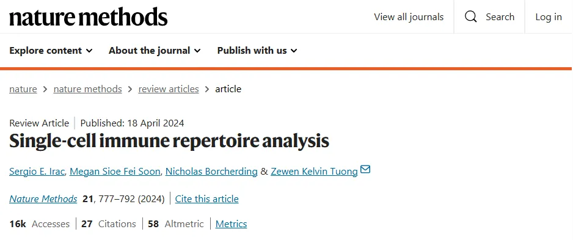
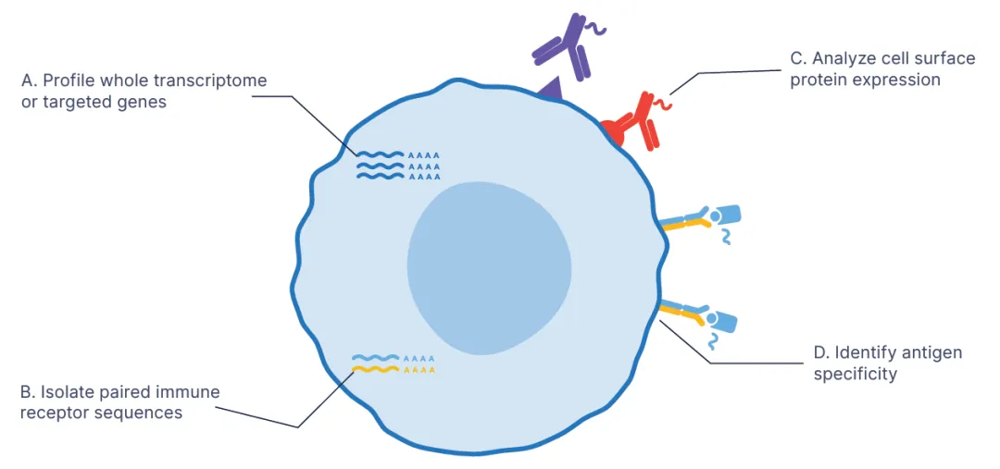
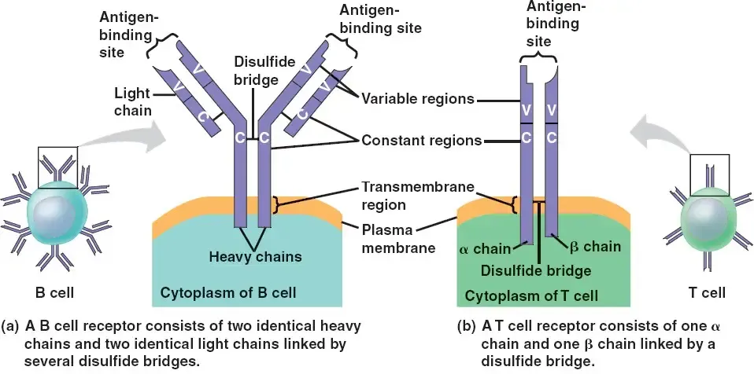
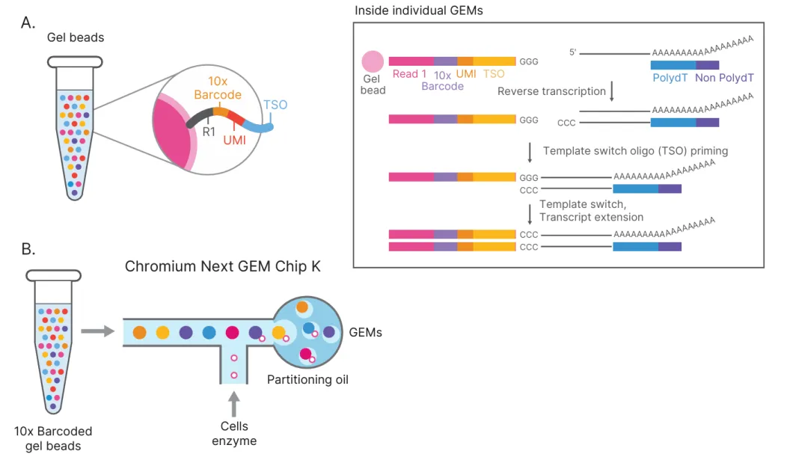
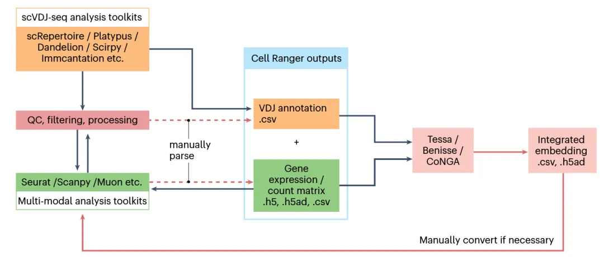
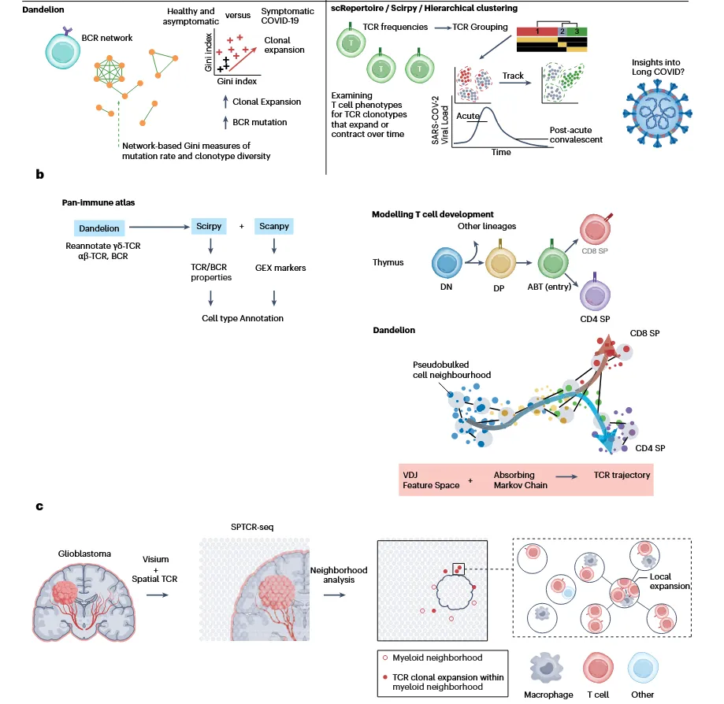

# 《Nature Methods》|单细胞免疫组库测序的原理与应用

> 原文：https://mp.weixin.qq.com/s?__biz=MzAwMzIzOTk5OQ==&mid=2247531444&idx=1&sn=4c0dc129bb3255899f30fcdaf40a88e1&chksm=9b3c02e4ac4b8bf20a7f4887173e1220dff2d02153b8b8511d78f4617f25555e7f580bccd139#rd
> 合集：文献速递

**一、写在前面**

本次分享的是《Nature Methods》（IF= 32.1）的文章****，**** 感兴趣的同学可以看看原文： Single-cell immune repertoire analysis DOI: 10.1038/s41592-024-02243-4

文章背景：

**适应性免疫系统依靠免疫组库的巨大多样性来识别和应对广泛的病原体和外来物质。这是由大量表面结合的 T细胞抗原受体(TCR)和B细胞抗原受体(BCR)介导的。后者也可在B细胞分化为浆细胞或浆母细胞后作为可溶性抗体分泌。这些受体广泛的抗原特异性也使T细胞和B细胞能够区分自我和非自我抗原，使免疫系统能够对威胁做出适当的反应，同时使宿主不受伤害。**

****

本文献相关的教程大家可参考：

[ 100个小时沉浸式学会scRNA-seq数据分析](<https://mp.weixin.qq.com/s?__biz=MzAwMzIzOTk5OQ==&mid=2247531092&idx=1&sn=9968319b84186bb9b717b7b409132d8b&scene=21#wechat_redirect>)

**[单细胞免疫组库测序(scTCR+scBCR)学习手册](<https://mp.weixin.qq.com/s?__biz=MzAwMzIzOTk5OQ==&mid=2247530826&idx=1&sn=f95a284a432695c9b8f6878cd3691bfc&scene=21#wechat_redirect>)**

**
**

如果需要[ 生信分析指导教学](<https://mp.weixin.qq.com/s?__biz=MzAwMzIzOTk5OQ==&mid=2247531410&idx=1&sn=e0850491da199c8abaa538f2d64e0035&scene=21#wechat_redirect>)、生信热点**[全文复现](<https://mp.weixin.qq.com/mp/appmsgalbum?__biz=MzAwMzIzOTk5OQ==&action=getalbum&album_id=2981710763847614469#wechat_redirect>)** 、自测数据**个性化分析** 辅导、[常态化实验学习](<https://mp.weixin.qq.com/s?__biz=MzAwMzIzOTk5OQ==&mid=2247531145&idx=1&sn=5cbe98083cb0fd67f2b0c18ea3c5fe74&scene=21#wechat_redirect>)，欢迎联系客服微信[**Biomamba_zhushou**]

**二、主要内容**

****

1、结构组成

每个TCR或BCR是由两条不同的链组成的二聚体。TCR由αβT细胞中的**α链(TRA)** 与**β链(TRB)** 配对组成，或γδ T细胞中的**γ链(TRG)** 与**δ链(TRD)** 配对组成。BCRs由**重链(IgH)** 和**轻链** 组成；轻链来自 κ(IgK) 或 λ(IgL) 基因座。这些链是由 RAG1 和 RAG2 蛋白协调的**可变(V)、多样性(D)和连接(J)** 基因片段的基因重组的复杂过程的产物，分别发生在胸腺和骨髓中发育的T细胞和B细胞中。在这些片段的交界处还可以引入随机的**无模板法(N)** 和或**回文(P)** 核苷酸插入，进一步增加了复杂性。 这些重组事件发生在被称为**互补决定区(CDR)3** 的交界处，而 CDR1 和CDR2 则完全在V基因区域内。由于 CDRs 是与同源抗原结合的区域，它们，特别是 **CDR3** 区域，已成为大多数下游分析的焦点。此外，B细胞活化后，在活化诱导的胞苷脱氨酶(cytidine deaminase，AID)的介导下，BCRs可在整个受体中发生(随机)体细胞超突变(somatic hypermutations，SHMs)。AID也是BCR的类别转换重组(CSR)所必需的，这是一个生物学过程，它取代了编码同型类的BCR恒定基因，对B细胞成熟和整体体液免疫产生广泛的影响。

## 2、单细胞免疫组库测序

有多种”批量”高通量技术用于免疫组库测序，涉及从给定组织中分析混合的**BCR** 或**TCR** 。Bulk’s免疫组库测序技术在很大程度上仅限于分析单链（例如,只有**TRB** 或**IgH** ），并不能捕获适应性免疫受体的二聚体性质。文库构建和测序策略也阻碍了使用”大容量”方法恢复真正的配对链测序。

通过单细胞技术，使成对链的适应性免疫受体在规模上的分析成为可能。各种高通量测序**TCRs** 和**BCRs** 的技术。针对**BCR** 和**TCR** 的VDJ序列的异质性，10X genomics公司推出了在cDNA的基础上，进一步进行扩增子测序，通过分析**BCR** 和**TCR** 的不同序列，分析免疫环境中的克隆型多样性，解析有机体抵制病原微生物入侵的免疫机制。

10X genomics的**单细胞BCR/TCR** 测序的原理，与单细胞转录组类似，通过微流控系统将带有条形码和引物的凝胶珠与单个细胞包裹在油滴中；接下来在每个油滴内，凝胶珠溶解，细胞裂解释放 mRNA，通过逆转录产生带有 10X barcode 和 UMI 信息的 cDNA。破油（Breaking Emulsions）之后，cDNA 一分为二，后续同时进行基因表达和免疫组库的文库构建。其中 **TCR** 或者 **BCR** 的 **V(D)J** 序列通过设计在 C 区的巢式引物进行 PCR 富集；而 mRNA 的信息，与 10X Genomics 3’mRNA 文库不同，保留的是 **5’端** 的信息。测序后即可一次性获得大量单细胞的基因表达和免疫组库数据。结合单细胞转录组测序数据与**BCR/TCR** 多样性数据，解析免疫细胞中更高维度的异质性。

**三、总结讨论**

处理scTCR/BCR-seq数据的典型工作流程如下：

  * 数据准备：获取10x单细胞V(D)J测序数据（filtered_contig_annotations.csv / filtered_contig_annotations.json）,同时获取对应的scRNA-seq表达矩阵（用于后续整合）,准备元数据（metadata，如样本分组信息）
  * 重新注释：标准化链类型名称（IgH/IgK/IgL）,接下来注释细胞克隆类型（如完整重链、轻链是否都存在），分别提取 V、J、C、CDR3 区域信息，准确识别TCR/BCR配对信息和克隆特征，确保分析可靠性。
  * 克隆聚类与筛选：去除非配对链、低质量链，基于CDR3序列进行相似性聚类（相同CDR3表示同源克隆），统计克隆频数、构建免疫克隆谱图，揭示免疫细胞克隆扩增特征。
  * 单细胞免疫受体与表达谱整合分析：将克隆信息整合进Seurat对象或Scanpy对象中，联合UMAP图上可视化免疫克隆空间分布，分析免疫细胞类型与克隆扩增的关系。

  * 高级整合分析：

富集分析：是否特定克隆富集在某亚群轨迹分析：追踪克隆扩增细胞的分化路径（使用 monocle3 / scvelo 拟时序分析克隆动态）疾病相关性：对比健康vs疾病样本克隆谱（分析CDR3长度、多样性指数（Shannon, Simpson））

**如何联系我们**

 留一个领取[资料](<https://mp.weixin.qq.com/s?__biz=MzAwMzIzOTk5OQ==&mid=2247528482&idx=1&sn=7cc0715eace4f592a62bdaf157b25c01&scene=21#wechat_redirect>)、[开箱即用的单细胞分析镜像](<https://mp.weixin.qq.com/s?__biz=MzAwMzIzOTk5OQ==&mid=2247528410&idx=2&sn=0f2bac25479cf8d20dab5d82ae986f2e&scene=21#wechat_redirect>)的**微信号[Biomamba_zhushou]**，方便各位随时交流。同时我们也构建了[交流群矩阵](<https://mp.weixin.qq.com/s?__biz=MzAwMzIzOTk5OQ==&mid=2247528057&idx=1&sn=bb348c2a88c977c7cce67ee6731a3591&scene=21#wechat_redirect>)，欢迎大家入群讨论。
大家可以阅读完这几篇之后添加[给生信入门初学者的小贴士](<http://mp.weixin.qq.com/s?__biz=MzAwMzIzOTk5OQ==&mid=2247493329&idx=1&sn=597870b7f7ce10346da3561e7c281627&chksm=9b3c9f81ac4b169794088ce9abbcacb5f18e9fd174fc0d7e28da62d78facadf3100ef38aaf22&scene=21#wechat_redirect>)
[没有检索，就没有发言权](<https://mp.weixin.qq.com/s?__biz=MzAwMzIzOTk5OQ==&mid=2247529398&idx=2&sn=5a429852d61721916a405712677d5905&scene=21#wechat_redirect>)

**已有生信基地联系方式的同学****无需重复添加**

****

您点的每个赞和在看，我都认真当成了喜欢
