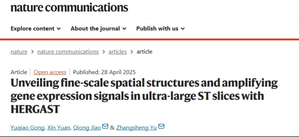
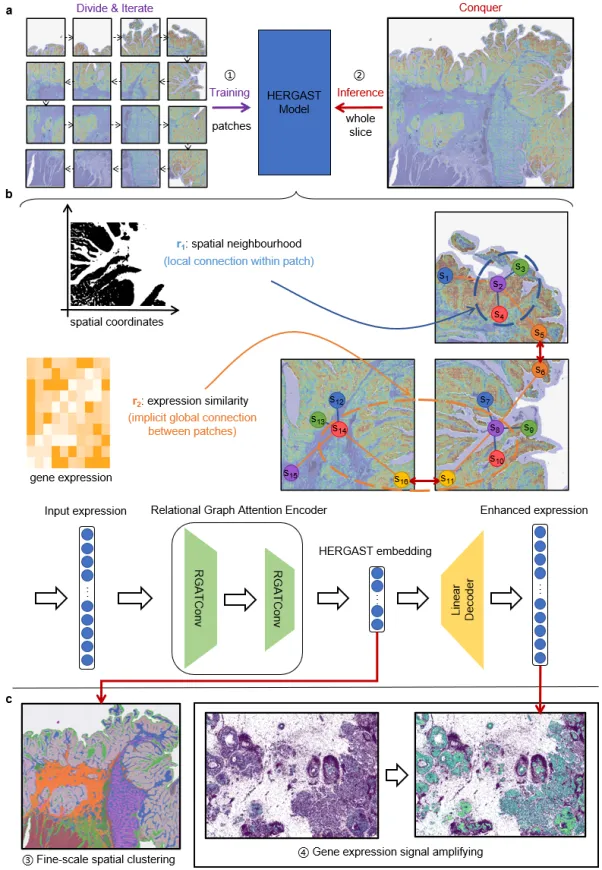
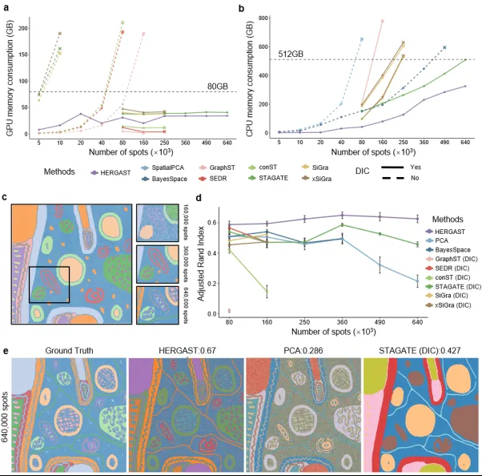
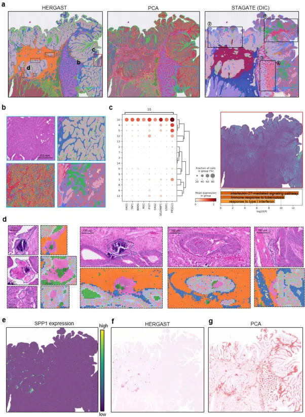
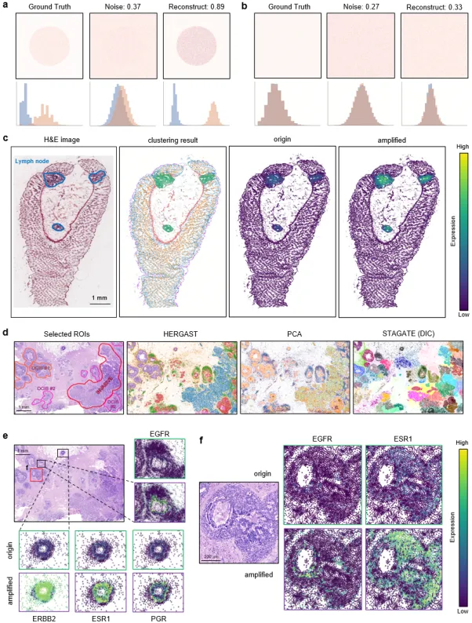

# 《NC》新工具：HERGAST揭示超大空转切片的精细空间结构&放大基因表达信号

> 原文：https://mp.weixin.qq.com/s?__biz=MzAwMzIzOTk5OQ==&mid=2247531918&idx=1&sn=2d2c563ccd5ef6cf115cf96d6c025d31&chksm=9b3c04deac4b8dc8b8e5eadaaa31862999948189122fc2dc4fb4edb53fb02f9e1bd098df89c0#rd
> 合集：文献速递

**一、写在前面**

本次分享的是《nature communications》（IF=14.7）“Unveiling fine-scale spatial structures and amplifying gene expression signals in ultra-largeST slices with HERGAST”，更多空转知识与教学可见：[学习总是东拼西凑？Python空间转录组分析全程班了解一下](<https://mp.weixin.qq.com/s?__biz=MzAwMzIzOTk5OQ==&mid=2247531284&idx=1&sn=cc785f60e85a3caa8117792de60e1393&scene=21#wechat_redirect>)

DOI:https://doi.org/10.1038/s41467-025-59139-w

链接：https://www.nature.com/articles/s41467-025-59139-w

****

空间转录组学（ ST）技术彻底改变了我们对组织内基因表达组织的理解，为细胞异质性和组织结构提供了宝贵的见解。近年来，空间转录组学技术正向高分辨率平台过渡，如Visium HD和Xenium，这大大增加了数据的大小和稀疏性，给描绘空间组织结构、识别细胞类型和检测空间特异性基因表达带来了计算上的挑战。现有的计算方法在处理这些超大规模和超高分辨率技术产生的数据时，往往会遇到计算效率低、内存消耗大、过平滑以及生物信号稀释等问题。

近期，上海交通大学生命科学技术学院/交大医学院临床研究中心俞章盛教授课题组在《Nature Communications》在线发表“Unveiling fine-scale spatial structures and amplifying gene expression signals in ultra-large ST slices with HERGAST”论文。该研究提出了HERGAST(High-resolution Enhanced Relational Graph Attention Network for ST)，一个用于超大规模和超高分辨率空间转录组数据中空间结构识别和信号放大的系统，用于克服现有空间组学计算方法的局限性。

如果需要[单细胞数据分析](<https://mp.weixin.qq.com/s?__biz=MzAwMzIzOTk5OQ==&mid=2247531160&idx=2&sn=04d3798dc60958af2c9020fe7c4bd9b8&scene=21#wechat_redirect>)**教学** 、生信热点**[全文复现](<https://mp.weixin.qq.com/mp/appmsgalbum?__biz=MzAwMzIzOTk5OQ==&action=getalbum&album_id=2981710763847614469#wechat_redirect>)** 、自测数据**个性化分析** 辅导、[常态化实验学习](<https://mp.weixin.qq.com/s?__biz=MzAwMzIzOTk5OQ==&mid=2247531463&idx=2&sn=47b53ce445e3fb25ed4902f83416ab52&scene=21#wechat_redirect>)，欢迎联系客服微信[**Biomamba_zhushou**]

**二、 HERGAST模型**

**HERGAST的核心思想是采用“分而治之”的策略。将整个组织切片分割成可处理的小块，在这些小块上迭代训练一个先进的模型，然后在整个切片上进行推断，并基于模型的输出进行下游分析。** 作者将这个策略框架称为“分-迭-治”（Divide-Iterate-Conquer, DIC）。

为了解决数据分割可能导致的“过平滑”问题，即模型在训练一个特定小块时忽略了其他小块的信息，从而导致学习到的空间模式是碎片化和局部的，本研究构建了一个异构图网络。这个网络同时包含了局部和全局的空间关系。具体来说，模型不仅考虑了空间上相邻的“点”（spots）之间的关系，还利用了基因表达谱的相似性来建立不同“点”之间的连接，从而让信息在训练过程中可以流动，使得模型能够捕捉到全局的模式。此外，HERGAST还引入了交叉注意力机制，让模型可以动态地学习不同关系的权重，实现局部和全局空间关系的自适应融合。训练完成后，模型会在整个切片上进行全面的推断，编码器会生成一个低维嵌入，这个嵌入同时捕捉了基因表达相似性和空间邻近性，可以用于阐明复杂的空间结构。而解码器则会生成一个重建的表达谱，可以用来增强关键的空间模式，并放大原始数据中可能很微弱的生物学上重要的信号。

图1\. HERGAST模型概览

**三、主要研究成果**

模拟研究验证了**HERGAST的可扩展性和卓越性能**

研究者们首先通过生成不同规模的ST数据集来评估不同现有方法的可扩展性。结果显示，在不使用DIC策略的情况下，许多基于深度学习的图神经网络模型由于GPU内存限制，无法分析超过8万个“点”的ST切片。引入DIC策略后，这些方法的可扩展性得到了提升。然而，当数据规模进一步增大时，CPU内存消耗成为了新的瓶颈。在所有方法中，HERGAST消耗的CPU内存最少，使其能够在相同的计算条件下处理更大的数据集（图2a-b）。在识别精细空间结构的模拟研究中，HERGAST在所有设置下都持续优于其他方法，在调整兰德指数（ARI）等多个评估指标上平均提高了10%以上（图2d-e）。

图2\. HERGAST在模拟数据中的性能表现

**HERGAST在结直肠癌中实现精细的肿瘤微环境图谱绘制******

为了验证在真实世界超大样本中的性能，研究团队应用 HERGAST分析了一例包含545,913个空间单元（bins）的人类结直肠癌（CRC）Visium HD数据 。分析结果显示：

  * 精准的组织区域划分：HERGAST能够清晰地描绘出肿瘤区域和基质区域的边界，结果平滑且在生物学上更具解释性。相比之下，PCA的结果中区域混杂，而STAGATE(DIC)则存在明显的过平滑现象，破坏了肿瘤区域的连续性（图3a-b）。

  * 发现肿瘤区域中的免疫上调区：在肿瘤区域内，HERGAST 能够识别出独特的基因表达谱区域。该区域内高表达的基因被归一化并合并成一个元基因，显示出明显的空间分布模式，富集分析揭示了免疫相关途径的显著上调，表明肿瘤微环境中抗肿瘤免疫反应的增强和免疫细胞的积极浸润。（图3c）。

  * 发现关键免疫细胞亚群：最引人注目的发现是，HERGAST成功识别并定位了一簇独特的SPP1+巨噬细胞，它们聚集在肿瘤内部并环绕着钙化区域 。这些细胞在肿瘤免疫微环境中扮演着重要角色，并与患者预后密切相关。 而其他对比方法，如PCA和STAGATE(DIC)，均未能识别出这一关键的细胞群落，再次证明了HERGAST在揭示复杂组织异质性方面的卓越能力（图3d-g）。

图3. HERGAST在结直肠癌中精细绘制肿瘤微环境图谱

**HERGAST高灵敏度和高特异性地增强了关键的分子特征******

高分辨率的 ST数据（如Xenium）虽然优势明显，但也存在高强度信号过度饱和，可能掩盖低强度生物学信号的风险。除了精准聚类，HERGAST的另一大功能是增强微弱的基因表达信号 。研究团队首先在模拟数据中验证了这一功能。即使向具有清晰空间模式的基因表达数据中添加大量噪声（皮尔逊相关系数降至0.37），HERGAST的解码器依然能有效重建原始信号，恢复其空间模式（皮尔逊相关系数高达0.89，图4a）。同时，对于完全没有空间模式的随机数据，HERGAST不会凭空创造出虚假信号，证明了其高度的特异性（图4b）。接下来，作者在人类正常结肠组织中的Xenium数据集进行了测试。结果表明，HERGAST除了能够准确识别淋巴结区域，重构的相关marker基因表达在且仅在人工标注的淋巴结区域出现了信号增强，进一步证明了其高敏感性和特异性（图4c）。

在对一例包含167,780个细胞的人类乳腺癌Xenium样本的分析中，HERGAST成功识别并分离了浸润性癌、导管原位癌（DCIS）#1和DCIS#2（图4d）。此外，HERGAST的信号增强功能揭示了重要的生物学现象 。增强后的表达数据显示：

  * 清晰地勾勒出了ERBB2、ESR1和PGR（HER2、ER、PR）“三阳性”乳腺癌细胞的富集区域，这与临床发现一致（图4e）。

  * 揭示了EGFR和ESR1在导管原位癌（DCIS）区域内存在独特的、几乎不重叠的空间分布模式：EGFR阳性细胞主要环绕在坏死区域周围，而ESR1阳性细胞则弥散分布。这些在原始数据中难以辨别的精细模式，对于理解肿瘤内部的细胞互作和微环境影响至关重要（图4f）。

图4. HERGAST高精度增强关键分子特征

**总结**

综上所述，HERGAST是一种专为超大规模和超高分辨率空间转录组数据分析而设计的有效方法，在空间聚类和信号放大方面表现出色。本文提出的DIC策略为处理海量ST数据提供了可行的解决方案。通过整合异构图网络和交叉注意力机制，HERGAST能够巧妙地结合基因表达相似性和空间邻近性，从而准确捕捉局部和全局空间关系的复杂细节，并有效避免了过平滑的问题。HERGAST的出现将助力研究人员以前所未有的分辨率和深度探索复杂的生物系统。

**如何联系我们**

 留一个领取[资料](<https://mp.weixin.qq.com/s?__biz=MzAwMzIzOTk5OQ==&mid=2247528482&idx=1&sn=7cc0715eace4f592a62bdaf157b25c01&scene=21#wechat_redirect>)、[开箱即用的单细胞分析镜像](<https://mp.weixin.qq.com/s?__biz=MzAwMzIzOTk5OQ==&mid=2247528410&idx=2&sn=0f2bac25479cf8d20dab5d82ae986f2e&scene=21#wechat_redirect>)的**微信号[Biomamba_zhushou]**，方便各位随时交流。同时我们也构建了[交流群矩阵](<https://mp.weixin.qq.com/s?__biz=MzAwMzIzOTk5OQ==&mid=2247528057&idx=1&sn=bb348c2a88c977c7cce67ee6731a3591&scene=21#wechat_redirect>)，欢迎大家入群讨论。
大家可以阅读完这几篇之后添加[给生信入门初学者的小贴士](<http://mp.weixin.qq.com/s?__biz=MzAwMzIzOTk5OQ==&mid=2247493329&idx=1&sn=597870b7f7ce10346da3561e7c281627&chksm=9b3c9f81ac4b169794088ce9abbcacb5f18e9fd174fc0d7e28da62d78facadf3100ef38aaf22&scene=21#wechat_redirect>)
[没有检索，就没有发言权](<https://mp.weixin.qq.com/s?__biz=MzAwMzIzOTk5OQ==&mid=2247529398&idx=2&sn=5a429852d61721916a405712677d5905&scene=21#wechat_redirect>)

**已有生信基地联系方式的同学****无需重复添加**

****

您点的每个赞和在看，我都认真当成了喜欢
