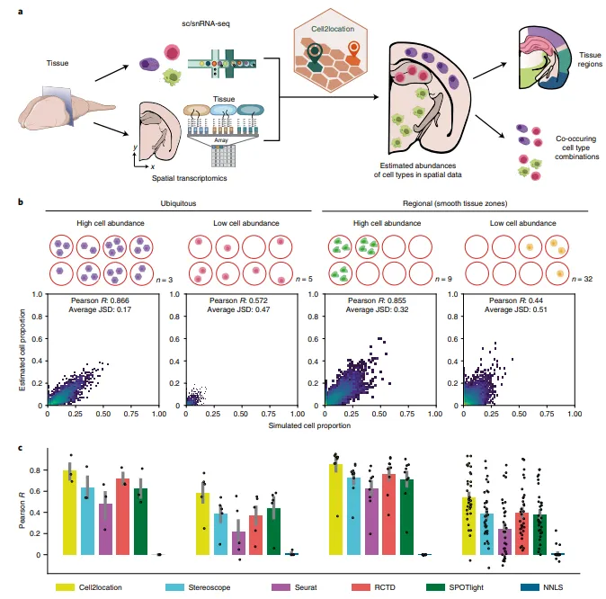
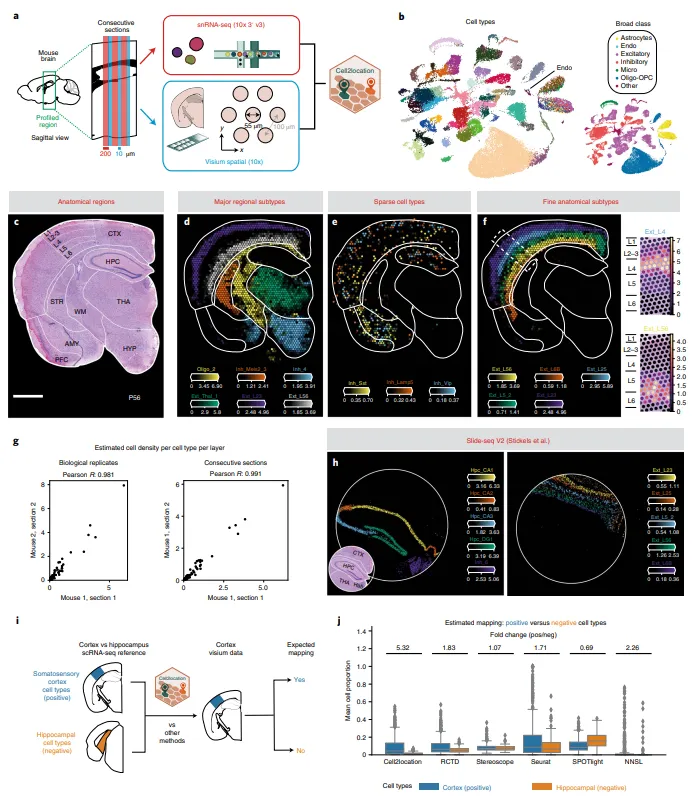
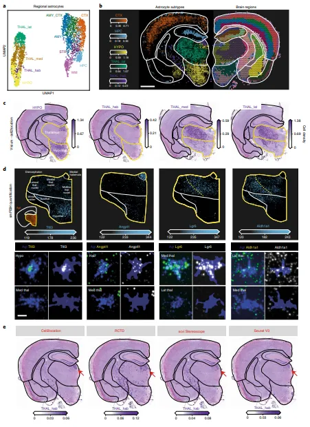
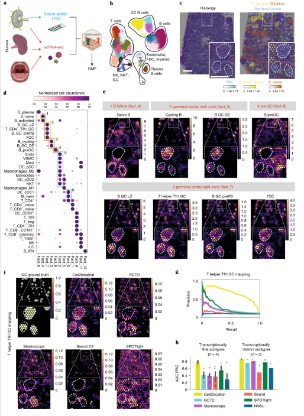
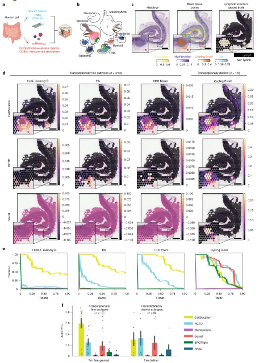

# 《NBT》| Cell2location注释空间数据细胞

> 原文：https://mp.weixin.qq.com/s?__biz=MzAwMzIzOTk5OQ==&mid=2247532458&idx=3&sn=95ace7ea7c6155478a1d3fd86c5ebf94&chksm=9b3c06faac4b8fec26e201ca45fdd792b31010738ad4ceb57e3e0720c4524d98a154267880d9#rd
> 合集：文献速递

**一、写在前面**

不同的细胞类型在在组织中的**空间** 中具有不同的**分布** 结构，这是细胞通讯、组织功能、病理特征发生的基础。空转技术的出现为大规模地**原位观察细胞信号** 提供了机会，也为健康和疾病组织的细胞图谱做出了贡献。例如`Visium`、`HDST`、`Slide-seq`等利用**微阵列** 或**磁珠阵列** 对组织切片的mRNA进行捕获能高通量的获得基因组级别的表达数据以及简单的组织学染色。但是由于细胞的异质性(免疫、基质、神经细胞)、复杂程度(细胞亚群)、分辨率**不足** 等问题,在原位上**`mapping` 注释细胞类型**仍是一个挑战。因此作者发布了`cell2location`这一基于**贝叶斯模型** 的工具来进行空转细胞类型的`mapping`。这一工具能够对技术来源的变量、位置信息的统计量进行综合考虑，从而对整合单细胞数据与空转数据进行高敏感性、高分辨率的整合。作者在小鼠脑部、人类淋巴结等数据中均进行了测试，证明了工具的**可靠性** 。

这一过程中最重要的策略就是将单细胞测序中已经测到的细胞类型`mapping`到空转数据的对应位置上，但现有的`grid-based`空转建库策略无法达到单细胞的分辨率水平(通常是一个位点包含数量不确定的多个细胞)。因此可以借助算法以单细胞转录组数据为参考来进行去卷积。`cell2location`在人类淋巴结、小鼠闹中数据的`mapping`中敏感度较高，不仅能够识别到占比较少的B Cell状态，且对鼠脑中的星形胶质细胞的亚群进行了识别。

**Cell2location** 的使用**代码教程** 与**测试文件** 可见：

[一文搞定空间转录组与单细胞测序的整合分析](<http://mp.weixin.qq.com/s?__biz=MzAwMzIzOTk5OQ==&mid=2247507210&idx=1&sn=f32037ffefd60b0d1bcca7bf9c3e0823&chksm=9b3ca45aac4b2d4cf0c68299db3a2891130d89d9e0fe2a9ecb34b394736550bcf7d7c51090cc&scene=21#wechat_redirect>)

自学有困难的小伙伴可见：[Python实战-玩转空间转录组分析](<https://mp.weixin.qq.com/s?__biz=MzAwMzIzOTk5OQ==&mid=2247531284&idx=1&sn=cc785f60e85a3caa8117792de60e1393&scene=21#wechat_redirect>)

如果想系统性的学习空间转录组数据分析也可以看这里：

[空间转录组学习手册合辑](<https://mp.weixin.qq.com/s?__biz=MzAwMzIzOTk5OQ==&mid=2247505088&idx=1&sn=9f60dca1b21f5ba8c32d09595a512134&scene=21#wechat_redirect>)

[Stereopy空间转录组学习手册](<https://mp.weixin.qq.com/s?__biz=MzAwMzIzOTk5OQ==&mid=2247505686&idx=2&sn=925ce770136ec3e964b954c639eed29e&scene=21#wechat_redirect>)

[Squidpy空间转录组学习手册](<https://mp.weixin.qq.com/s?__biz=MzAwMzIzOTk5OQ==&mid=2247505844&idx=2&sn=5756c0702d080d6e602c504e7d461013&scene=21#wechat_redirect>)

[Scanpy空间转录组学习手册](<https://mp.weixin.qq.com/s?__biz=MzAwMzIzOTk5OQ==&mid=2247505248&idx=2&sn=18995c7248ca6f13b61edfef24208ae1&scene=21#wechat_redirect>)

[Seurat空间转录组学习手册](<https://mp.weixin.qq.com/s?__biz=MzAwMzIzOTk5OQ==&mid=2247505213&idx=2&sn=6b9aad43c273009c3d7f80c63bb9f619&scene=21#wechat_redirect>)

[一文搞定空间转录组与单细胞测序的整合分析](<https://mp.weixin.qq.com/s?__biz=MzAwMzIzOTk5OQ==&mid=2247507210&idx=1&sn=f32037ffefd60b0d1bcca7bf9c3e0823&scene=21#wechat_redirect>)

[CellChat空转细胞通讯合辑](<https://mp.weixin.qq.com/s?__biz=MzAwMzIzOTk5OQ==&mid=2247512011&idx=1&sn=fbd41832c5995d79fead016931d3bfbd&scene=21#wechat_redirect>)

[SeekSpace| 会单细胞就会空间转录组](<https://mp.weixin.qq.com/s?__biz=MzAwMzIzOTk5OQ==&mid=2247511779&idx=1&sn=23868525d86a9ed7867a3837ed18612c&scene=21#wechat_redirect>)

如果需要数据分析**指导** 、生信热点**全文复现** 、自测数据**个性化分析** 辅导、[常态化实验学习](<https://mp.weixin.qq.com/s?__biz=MzAwMzIzOTk5OQ==&mid=2247528769&idx=1&sn=53528029a1595c5dde109a461ec3708d&scene=21#wechat_redirect>)，欢迎联系客服微信[**Biomamba_zhushou**]

**二、主要结果**

#### (1)`cell2location`是一个能够比对空间细胞类型的`Bayesian`模型

`cell2location`与现有的转录组去卷积方式相似：借助统计学的力量对相似的细胞组成进行解卷积、考虑到切片间的去批次效应、评估细胞类型的绝对丰度；但`cell2location`的计算更高效(支持GPU加速并整合了`scvi-tools`)。`cell2location`的空间细胞类型注释主要是通过给定组织的`sc`或`sn`数据与空转数据之间的`mapping`来完成(Fig.1a)：第一步`cell2location`会利用负二项回归评估参考数据集(`sc`/`sn`)的细胞类型特征(即marker基因表达矩阵的质量) ；第二步，`cell2location`会利用参考特征与一个或多个空间数据作为输入数据对每个空间位置上的细胞按照参考细胞类型进行分解。构建完该工具后，作者测试了一个包含普遍存在细胞类型以及空间特有细胞类型的模拟测试数据，在包含`2500`个位点的空间转录组上共`mapping`到了49种细胞类型(Fig.b，不得不说，还是丰度高的细胞类型`mapping`起来更稳定)。在高丰度、低丰度、区域性细胞、广泛分布的细胞这几种组合中，`cell2location`的对每个位点中细胞占比丰度预测相关性始终要高于`stereoscope`、`Seurat`、`RCTD`、`SPOTlight`、`NNLS`(Fig.1c)。

**Figure1**

#### (2) `cell2location`能够精准`mapping`鼠脑的细胞类型

不得不说，脑组织切片是空转测试数据集的老演员了。作者利用来自小鼠端脑与间脑的`sn`数据与`Visium`空转数据进行了测试，在`sn`数据能够观测到的59个细胞类型中，无论是广泛分布的`excitatory neurons of thalamus`(Fig.2d)还是分布较少的`cortical interneurons`(Fig.2e)、甚至是跨区域的`excitatory neurons`(Fig.2e)均能够被较好的`mapping`。作者额外找了一个`scRNA-seq`多脑区数据集，其中仅有部分细胞类型包含在本部分测试的空转数据中，但它们仍然能够成功的`mapping`(Fig.2i)。与此同时，其它的工具在`mapping`时，会把空转数据中不存在的细胞(`negative`)进行错误的`mapping`(Fig.2j)，这可能意味着其它数据集存在**过拟合** 的情况。这里，作者还使用`Slide-seq`进行了验证，发现超过50%的位点包含不止一种细胞类型(Fig.2h)。

**Figure2**

#### (3) `cell2location`能够识别星形区域性胶质细胞亚群

上面的脑部数据已足以证明`cell2location`的`mapping`准确度与敏感性，考虑到星形胶质细胞是数量最多的胶质细胞且直接调控神经的发育与功能，这部分作者主要关注这部分细胞的异质性。作者将前面获得的3013个星形胶质细胞(Fig.2b)通过`BBKNN`划分为17种细胞亚群，`mapping`后发现灰质与白质星形胶质细胞在空间中富集于`THAL`、`HYPO`、`CTX`、`AMY`、`HPC`、`STR`中(Fig.3b)。作者关注的四种间脑灰质星形胶质细胞也能够被很好的标记并区分所在区域(Fig.3c)，并且能够通过`smFISH`加以验证(Fig.3d)。在与其它工具的对比中，`cell2location`是唯一能够准确将`THAL_hab astrocytes`比对到对应组织的工具。

**Figure3**

#### (4)精准解析淋巴结的细胞组成¶

脑部组织结构清晰、细胞类型较少，经常用于空转工具开发的测试工具，因此，作者挑战了一下人类淋巴结(细胞常常出于动态过程且细胞类型进程交叉出现)的测试效果。测试数据为`Visium`以及包含34种细胞类型的`scRNA-seq`数据(Fig.4a,b)，常规的`T Cell`、`B Cell`、`germinal centers`(`GC`)、`follicular dendritic cells`显然`mapping`起来十分的容易(Fig.4c)。这里作者对各细胞亚群进行了非负矩阵因子分解(Fig.4d)，发现每个因子对应特定的细胞功能从而能够进一步分析它们之间的调控关系(Fig.4e)。利用`NMF`来进行亚群功能鉴定并耦合细胞通讯似乎是一个很不错的思路。
为进一步评估`cell2location`在淋巴细胞中的`mapping`效果，作者将`GC`分为了六个亚群，并通过组织染色进行了验证(Fig.4f)，不出意外地，各个亚群地准确率都很高(Fig.4g)，并且效果优于其它工具(Fig.4h)。当然，淋巴结中富含免疫细胞，从而降低了`mapping`的难度，于是作者希望在人类的肠道中进行免疫细胞的`mapping`，因此他同样获得了这部分的单细胞与空间数据(Fig.5a)。免疫/基质细胞的划分通过CD45的表达与否进行，最终获得了76种细胞类型(Fig.5b)。作者依据组织染色结果与marker基因的表达划分了淋巴囊(Fig.5c)后对空转数据进行了`mapping`，不出以外地，基质细胞与免疫细胞(19种)均被精准地识别到(Fig.5d)。而在其它工具种，`FCRL4+ memory B Cell`与`Tfh cell`的`mapping`特异性较低(Fig.5e,f)。

**Figure4**

**Figure5**

**三、总结**

综合来说，`cell2location`是一个敏感性非常高的工具，对于复杂组织中的各类亚群也能够精准的识别；作者利用多物种、多平台、多组织来源的数据证明了`cell2location`的可靠性。按作者的逻辑来说，至少要优于`stereoscope`、`Seurat`、`RCTD`、`SPOTlight`、`NNLS`等一众工具/算法。在未来，作者希望`cell2location`能进一步支持分辨率更高的空转技术(彼时还没有测试亚细胞如`stereo-seq`和单细胞`SeekSpace`分辨率的空转技术)。3D水平的图像以及转录组图谱`mapping`也能够帮助科研工作者重构生物体的组织信息，这也在作者的规划之中。

**Cell2location** 的使用**代码教程** 与**测试文件** 可见：

[一文搞定空间转录组与单细胞测序的整合分析](<http://mp.weixin.qq.com/s?__biz=MzAwMzIzOTk5OQ==&mid=2247507210&idx=1&sn=f32037ffefd60b0d1bcca7bf9c3e0823&chksm=9b3ca45aac4b2d4cf0c68299db3a2891130d89d9e0fe2a9ecb34b394736550bcf7d7c51090cc&scene=21#wechat_redirect>)

Cell2location支持GPU加速，需要GPU算力的同学可参考：[5090终于上架啦](<https://mp.weixin.qq.com/s?__biz=MzAwMzIzOTk5OQ==&mid=2247529343&idx=1&sn=988d600e144e51b48bc4b66df45d8e05&scene=21#wechat_redirect>)

也可以来找找组织：[生信Linux交流群](<https://mp.weixin.qq.com/s?__biz=MzAwMzIzOTk5OQ==&mid=2247528896&idx=1&sn=d06db51cab9a61ebd9e1865a9d6ca28b&scene=21#wechat_redirect>)

计算资源不足的同学可参考：
[生信分析为什么要使用服务器？](<https://mp.weixin.qq.com/s?__biz=MzAwMzIzOTk5OQ==&mid=2247491007&idx=1&sn=8619c2bad23791b3252a1c4cb1831931&chksm=9b3f64efac48edf9c02f84959aeee9b12480736fce70c5ddb8b41d79cfc22ce590ea2cb60fba&token=1760636281&lang=zh_CN&scene=21#wechat_redirect>)
[足够支持你完成硕博生涯的生信环境](<http://mp.weixin.qq.com/s?__biz=MzAwMzIzOTk5OQ==&mid=2247511780&idx=1&sn=3acc0874f7d2fa75f1abbe7a9a9b4069&chksm=9b3cd7b4ac4b5ea27d4d53964e4a4a9fa8c806a19103729dd4ff0fa72e621411f46a251d269f&scene=21#wechat_redirect>)
[独享用户硬件升级对比报告](<https://mp.weixin.qq.com/s?__biz=MzAwMzIzOTk5OQ==&mid=2247526418&idx=1&sn=d1ab22d2f98854faf21cb14dc0b494ee&scene=21#wechat_redirect>)

访问链接：https://biomamba.xiyoucloud.net/

更多内容可咨询客服微信[**Biomamba_zhushou**]

参考：

Kleshchevnikov, V., Shmatko, A., Dann, E. et al. Cell2location maps fine-grained cell types in spatial transcriptomics. Nat Biotechnol 40, 661–671 (2022). https://doi.org/10.1038/s41587-021-01139-4

**如何联系我们**

 留一个领取[资料](<https://mp.weixin.qq.com/s?__biz=MzAwMzIzOTk5OQ==&mid=2247530154&idx=2&sn=e5d0a63646094c3094b7b916350d22ad&scene=21#wechat_redirect>)、[开箱即用的单细胞分析镜像](<https://mp.weixin.qq.com/s?__biz=MzAwMzIzOTk5OQ==&mid=2247528410&idx=2&sn=0f2bac25479cf8d20dab5d82ae986f2e&scene=21#wechat_redirect>)的**微信号[Biomamba_zhushou]**，方便各位随时交流。同时我们也构建了[交流群矩阵](<https://mp.weixin.qq.com/s?__biz=MzAwMzIzOTk5OQ==&mid=2247528057&idx=1&sn=bb348c2a88c977c7cce67ee6731a3591&scene=21#wechat_redirect>)，欢迎大家入群讨论。
大家可以阅读完这几篇之后添加[给生信入门初学者的小贴士](<http://mp.weixin.qq.com/s?__biz=MzAwMzIzOTk5OQ==&mid=2247493329&idx=1&sn=597870b7f7ce10346da3561e7c281627&chksm=9b3c9f81ac4b169794088ce9abbcacb5f18e9fd174fc0d7e28da62d78facadf3100ef38aaf22&scene=21#wechat_redirect>)
[没有检索，就没有发言权](<https://mp.weixin.qq.com/s?__biz=MzAwMzIzOTk5OQ==&mid=2247529398&idx=2&sn=5a429852d61721916a405712677d5905&scene=21#wechat_redirect>)

**已有生信基地联系方式的同学****无需重复添加**

 您点的每个赞和在看，我都认真当成了喜欢
