# 樊嘉院士近年高分文章集锦（2022-2026）

> 原文：https://mp.weixin.qq.com/s?__biz=MzAwMzIzOTk5OQ==&mid=2247534596&idx=1&sn=34fe7230dc63961b8bc5240f6112e347&chksm=9b3c3154ac4bb8423272cf3b4d605871e5ba67eb140e86cb2ccaf94b8f52ade8c5886f8d9870#rd
> 合集：文献速递

* * *

**一、写在前面**

中国科学院院士、复旦大学附属中山医院名誉院长樊嘉，长期深耕肝胆肿瘤临床诊治、肝脏移植和肝癌转移复发机制及转化研究等邻域，为推动胆道癌诊疗水平的持续提升提供了权威洞见与方向指引。

本期报道将聚焦樊嘉院士近年来的高分研究成果集锦。当然，樊院士深耕医学领域数十载，取得的科研成就远不止于此。如果有感兴趣的朋友不妨在评论区留言，分享你关注的相关研究文章。

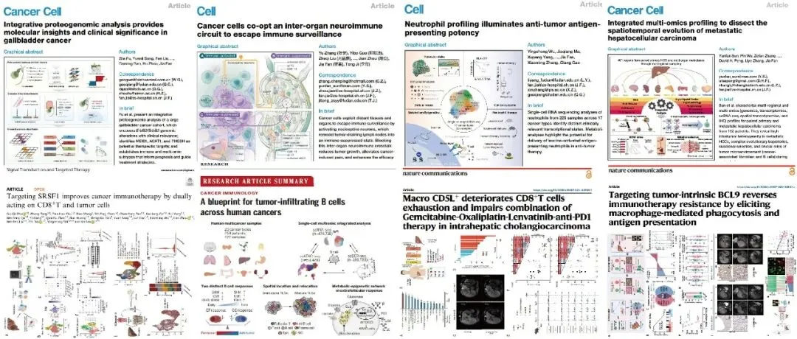

**
**

**专家介绍：**

樊嘉，1983年毕业于南通医学院(现南通大学医学院)，学士学位；1988年毕业于南京铁道医学院(现东南大学医学院)，硕士学位；1995年毕业于上海医科大学(现复旦大学上海医学院)，医学博士学位。1999年美国匹兹堡大学移植中心，高级访问学者，2013年复旦大学附属中山医院，院长，2017年当选中国科学院院士，2019年被聘为中国医学科学院学部委员。

从事肝肿瘤外科临床与基础研究三十余年。在肝癌临床诊疗技术上有诸多创新，提出多项肝癌临床综合治疗新策略，并实现基础研究向临床应用转化，明显提高了肝癌早期诊断率及中晚期肝癌的临床疗效。至今个人完成各类复杂肝癌切除手术近8000余例，成功实施肝脏移植2200余例，其中包括亚洲首例成人肝心联合移植、上海市首例成人－成人右半肝活体肝移植、上海市第一、二例成人-儿童活体肝移植等。首创肝癌合并门静脉癌栓多模式治疗技术；提出肝癌肝移植“复旦标准”和移植后转移复发防治综合策略；系统解析了肝癌转移复发微环境调控分子机制；建立了肝癌早期诊断及转移复发预测模型并实现临床转化，开发了世界首个miRNA肝癌早期分子诊断试剂盒并在临床广泛应用，显著提高了肝癌病人早期诊断率，为确立我国肝癌临床及研究在国际学术界的领先地位做出了重要贡献。

更多单细胞/空转相关内容分享可见：[Python scRNA-seq分析全流程](<https://mp.weixin.qq.com/s?__biz=MzAwMzIzOTk5OQ==&mid=2247533067&idx=1&sn=7ef76058cbcf7bd45f58147766c75854&scene=21#wechat_redirect>)[R语言 scRNA-seq数据分析教程](<https://mp.weixin.qq.com/s?__biz=MzAwMzIzOTk5OQ==&mid=2247531092&idx=1&sn=9968319b84186bb9b717b7b409132d8b&scene=21#wechat_redirect>)[Python 空间转录组分析教程](<https://mp.weixin.qq.com/s?__biz=MzAwMzIzOTk5OQ==&mid=2247533721&idx=1&sn=9648ed4701224e5d2e4c704d7046d9de&scene=21#wechat_redirect>)

**二、主要内容**

一、题目：Integrative proteogenomic analysis provides molecular insights and clinical significance in gallbladder cancer

IF：44.5

期刊：Cancer cell

发表日期：2026.01

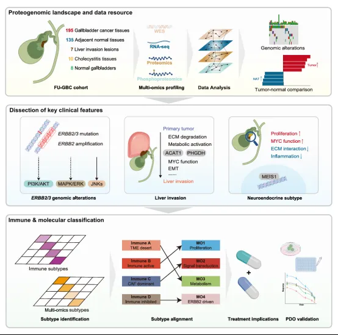

该研究通过收集195例多中心样本，整合全外显子组、[转录组](<https://mp.weixin.qq.com/mp/appmsgalbum?__biz=MzAwMzIzOTk5OQ==&action=getalbum&album_id=2959853503529910274#wechat_redirect>)、蛋白组与磷酸化蛋白组数据，系统描绘了GBC的突变背景、与重要临床病理特征的相关分子驱动因素以及[肿瘤免疫微环境](<https://mp.weixin.qq.com/s?__biz=MzAwMzIzOTk5OQ==&mid=2247528289&idx=1&sn=b56f00f3d8a4b152e54f3acd40aef21d&scene=21#wechat_redirect>)（TIME），并在此基础上构建了与预后关联的GBC多组学分型框架，为后续转化研究提供依据与数据支撑。

二、题目：Cancer cells co-opt an inter-organ neuroimmune circuit to escape immune surveillance

IF：42.5

期刊：Cell

发表日期：2025.11

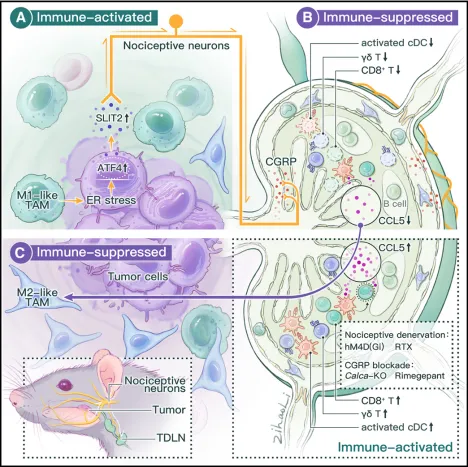

本研究从两个头颈鳞状细胞癌的临床队列出发，发现肿瘤组织中感觉神经富集，且高感觉神经丰度与患者更强的术前疼痛相关。通过[单细胞转录组](<https://mp.weixin.qq.com/s?__biz=MzAwMzIzOTk5OQ==&mid=2247531221&idx=1&sn=2346109f4cf6d3398dd15351474edf95&scene=21#wechat_redirect>)、[空间转录组](<https://mp.weixin.qq.com/s?__biz=MzAwMzIzOTk5OQ==&mid=2247532178&idx=2&sn=45a5f43b44ae5eb3346bb67238caea5d&scene=21#wechat_redirect>)、CODEX、蛋白质组、CyTOF等技术，发现高感觉神经丰度促进患者肿瘤组织及外周血中的抑制性免疫景观。其中尤为显著的是：肿瘤相关巨噬细胞（TAM）与感觉神经在肿瘤组织中空间毗邻。通过多种小鼠模型与患者肿瘤组织验证，结合小鼠行为学、神经元钙成像等技术，研究人员发现：肿瘤组织中受到TAM压力的肿瘤细胞可以通过ATF4介导的SLIT2分泌激活支配肿瘤的感觉神经并产生疼痛。

三、题目：Harnessing alternative splicing for off-the-shelf mRNA neoantigen vaccines in hepatocellular carcinoma****

IF：25.9

期刊：Cell Research

发表日期：2025.11

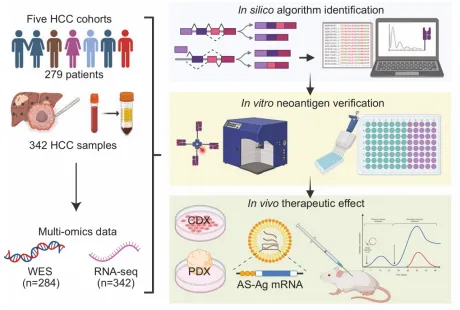

本研究围绕**肝细胞癌（ HCC）免疫治疗**展开，提出了一种靶向**[可变剪接](<https://mp.weixin.qq.com/s?__biz=MzAwMzIzOTk5OQ==&mid=2247529986&idx=1&sn=4aa7f4e1721d707703fb83b1e0ad8574&scene=21#wechat_redirect>) （AS）衍生新抗原**的创新策略。免疫疗法已革新肝癌治疗格局，而传统突变来源新抗原受限于肿瘤突变负荷低、异质性高的问题，易引发治疗耐药与复发，且需高度个体化方案。该研究证实，异常可变剪接可产生大量**肿瘤特异性公共新抗原（ AS-NeoAgs）**，这类抗原能被内源性呈递，且约 70% 携带常见 HLA 等位基因（HLA-A _02 或 HLA-A_11）的肝癌患者可受益于 HLA 匹配的 AS-NeoAgs 混合疫苗。该疫苗不仅能增强抗原呈递、激活 CD8⁺和 CD4⁺ T 细胞应答，诱导显著肿瘤消退，还可在抗原加工相关转运体（TAP）缺陷的肿瘤细胞中实现呈递，为攻克免疫逃逸肿瘤提供新思路。

四、题目：T**argeting tumor-intrinsic BCL9 reversesimmunotherapy resistance by elicitingmacrophage-mediated phagocytosis andantigen presentation**

IF：15.7

期刊：Nature Communications

发表日期：2025.11

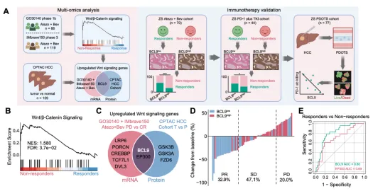

此研究通过对159名中国[肝癌](<https://mp.weixin.qq.com/s?__biz=MzAwMzIzOTk5OQ==&mid=2247529253&idx=1&sn=136209939b24c9b3508da46dd364c15a&scene=21#wechat_redirect>)患者的组学分析发现，Wnt通路核心基因突变频繁，如AXIN1(18%)和CTNNB1(19%)。进一步分析发现，在40例复发性肝癌患者中，团队发现了 _BCL9_ 基因存在7.5%的特异性体细胞突变和高达65%的拷贝数增殖。这些基于中国人群的扎实数据，**证实了**** _BCL9_****和**** _CTNNB1_****是具有中国特色的抗癌原创靶标** 。

五、题目：Neutrophil profiling illuminates anti-tumor antigen-presenting potency****

IF：44.5

期刊：Cell

发表日期：2024.03

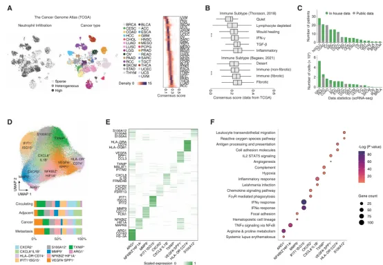
作者从17种癌症类型（来自143例患者的225个样本）中生成并整合单细胞中性粒细胞转录组。[中性粒细胞](<https://mp.weixin.qq.com/s?__biz=MzAwMzIzOTk5OQ==&mid=2247526776&idx=1&sn=99eb6a16c7bf345445b6ff4b61110138&scene=21#wechat_redirect>)表现出异常的复杂性，有10种不同的状态，包括炎症、血管生成和抗原呈递。值得注意的是，在大多数癌症中，抗原提呈程序与良好的生存率相关，并可通过亮氨酸代谢和随后的组蛋白H3K27ac修饰引起。这些中性粒细胞可以进一步引起（neo）抗原特异性和抗原非依赖性T细胞反应。中性粒细胞传递或亮氨酸饮食微调免疫平衡，以增强抗pd-1治疗。总之，这些数据不仅表明癌症间中性粒细胞的差异，而且还提示治疗机会，如抗原呈递中性粒细胞传递。

六、题目：Integrated multi-omics profiling to dissect the spatiotemporal evolution of metastatic hepatocellular carcinoma

IF：44.5

期刊：Cancer cell

发表日期：2024.01

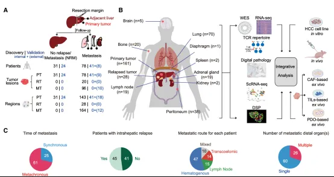

目前针对转移性肝细胞癌（HCC）的综合性分子层面分析仍较为缺乏。此研究对 182 例肝癌患者的 257 个原发灶区域和 176 个转移灶区域开展了多组学分析，发现**富含缺氧特征的原发肿瘤** 更易发生多克隆播散；原发灶与转移灶之间的基因组差异显著，且肿瘤早期播散现象普遍存在。转移灶中存在显著的新抗原瘤内异质性，这种异质性会破坏新抗原的呈递过程，进而导致 T 细胞反应性降低。研究证实，**体细胞[ 拷贝数变异](<https://mp.weixin.qq.com/s?__biz=MzAwMzIzOTk5OQ==&mid=2247531103&idx=2&sn=cad11d768e252d2489d124e68b71c7b0&scene=21#wechat_redirect>)**是驱动肿瘤转移的强选择事件；与携带 Wnt 基因突变的肿瘤亚克隆相比，不携带该突变的亚克隆具有更强的转移选择优势，其微环境中富含活化的[成纤维细胞](<https://mp.weixin.qq.com/s?__biz=MzAwMzIzOTk5OQ==&mid=2247530338&idx=1&sn=2d092e76080359f5a169ec14d54d1241&scene=21#wechat_redirect>)，利于促转移表型的形成。此外，不携带 Wnt 突变的转移灶中，免疫抑制性 B 细胞的富集程度更高，这类细胞可通过 HLA-E:CD94-NKG2A 检查点轴介导 CD8⁺ T 细胞的终末耗竭。综上，该研究从多维度解析了肝癌转移复杂的演化过程。

七、题目：Targeting SRSF1 improves cancer immunotherapy by dually acting on [CD8+T ](<https://mp.weixin.qq.com/s?__biz=MzAwMzIzOTk5OQ==&mid=2247531388&idx=6&sn=0bcbbe65b4e3e86d96db8972ceb8d30f&scene=21#wechat_redirect>)and tumor cells

IF：42.5

期刊：Signal transduction and targeted therapy

发表日期：2025.01

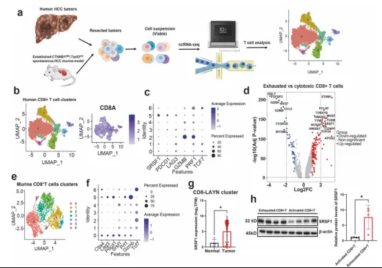

富含丝氨酸精氨酸剪接因子 1（SRSF1）是多种癌症中的关键致癌剪接因子，可通过翻译后调控促进异常基因表达。尽管其促肿瘤功能已明确，但抑制肿瘤内在 SRSF1 对肿瘤微环境的影响及其在 CD8⁺ T 细胞介导的抗肿瘤免疫中的作用尚不清晰。此研究发现，敲低 CD8⁺ T 细胞中的 SRSF1 可改善其抗肿瘤免疫功能、糖酵解代谢，并提升过继性 T 细胞治疗的疗效；而抑制肿瘤细胞中的 SRSF1 会降低 c-Jun、c-myc、JunB 等转录因子水平，推动糖酵解代谢重编程，进而恢复 CD8⁺ T 细胞功能并抑制肿瘤生长。小分子抑制剂 TN2008 可靶向 SRSF1，在小鼠模型中增强抗肿瘤免疫应答并提升免疫治疗效果。综上，此研究提出了靶向 SRSF1 的全新治疗范式，该范式可同时破坏肿瘤细胞代谢并增强 CD8⁺ T 细胞的抗肿瘤免疫活性。

八、题目：Metabolism archetype cancer cells induce protumorTREM2 macrophages via oxLDL-mediated metabolicinterplay in hepatocellular carcinoma

IF：15.7

期刊：Nature Communications

发表日期：2025.07

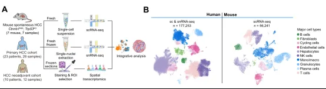

肝癌细胞的功能调控模式及其对肿瘤微环境的影响十分复杂，且尚未明确。此研究在肝癌细胞中鉴定出**代谢型、干细胞型、炎症型** 三种不同的单细胞表型亚型，各亚型具有独特的空间分布特征。进一步分析发现，**代谢型肝癌细胞** 与 TREM2 阳性肿瘤相关[巨噬细胞](<https://mp.weixin.qq.com/s?__biz=MzAwMzIzOTk5OQ==&mid=2247529353&idx=2&sn=2dc1406e0d153849f4e23c1a80ed5697&scene=21#wechat_redirect>)（TREM2⁺ TAMs）， 会共同形成免疫抑制微环境，该微环境会加重免疫排斥现象，导致患者预后不良。机制研究表明，代谢型肝癌细胞中**角鲨烯环氧酶（ SQLE）的表达显著上调，可促进氧化型低密度脂蛋白（oxLDL）的生成；oxLDL 通过TREM2-SYK-CEBPα 信号轴**诱导巨噬细胞向 TREM2⁺ TAMs 表型极化，而这类巨噬细胞会进一步促进肝癌细胞侵袭、增强肿瘤细胞对效应细胞因子的抵抗性，并导致 CD8⁺ T 细胞功能障碍。

九、题目：A blueprint for tumor-infiltrating B cells across human cancers****

IF：45.8

期刊：Science

发表日期：2024.03

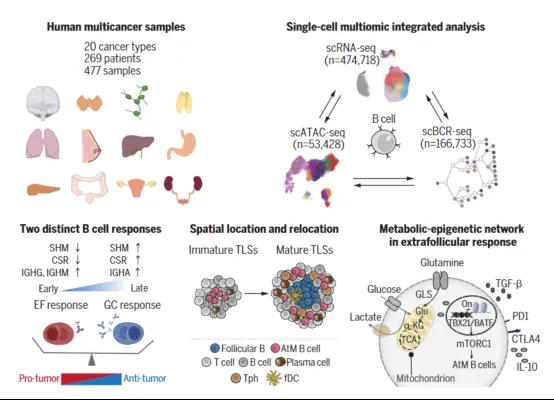

研究团队分析了肝癌、胆管癌、胆囊癌等多个癌种的临床样本数据发现，B细胞可以分为15个不同功能的亚群。其中,一类叫作DUSP4+非典型记忆B细胞的亚群引起了研究团队的注意。这类细胞通过滤泡外应答途径分化为浆细胞，能够分泌识别自身抗原的抗体,并抑制T细胞的功能,导致肿瘤微环境处于免疫抑制状态,不利于患者的预后和抗癌免疫治疗。**这一发现为未来精准调控[ B细胞](<https://mp.weixin.qq.com/s?__biz=MzAwMzIzOTk5OQ==&mid=2247531330&idx=2&sn=e76516ee4e2fea9c404c5808b2d4479e&scene=21#wechat_redirect>)、鉴定新的免疫治疗靶点以及开发新的免疫联合治疗方案提供了重要线索。**

**
**

十、题目： Stromal architecture and fibroblast subpopulations with opposing effects on outcomes in hepatocellular carcinoma****

IF：12.5

期刊：Cell Discovery

发表日期：2025.01

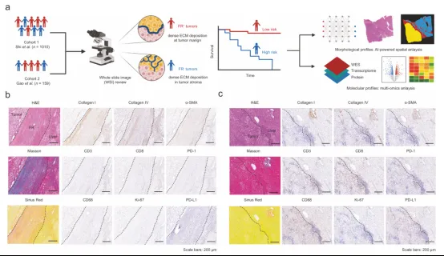

本研究通过**整合病理学分析、空间蛋白组学、单细胞及空间转录组学等多模态技术** ，系统研究了[肝细胞癌](<https://mp.weixin.qq.com/s?__biz=MzAwMzIzOTk5OQ==&mid=2247528014&idx=1&sn=d285c9ebd415be328fc682d00e6182c0&scene=21#wechat_redirect>)（HCC）中肿瘤相关[成纤维细胞](<https://mp.weixin.qq.com/s?__biz=MzAwMzIzOTk5OQ==&mid=2247530338&idx=1&sn=2d092e76080359f5a169ec14d54d1241&scene=21#wechat_redirect>)（CAFs）的空间异质性及其功能。基于临床病理特征定义了两种间质结构原型，利用激光显微切割和质谱技术解析不同肿瘤区域的蛋白表达谱，结合高分辨率Stereo-seq和单细胞测序刻画CAF亚群的空间分布与转录特征，并通过表观遗传学分析揭示关键调控因子。通过体外共培养和体内原位模型验证CAF亚群与免疫细胞的相互作用机制，最终探索靶向CAF的空间特异性治疗策略。

**十一、题目：Macro CD5L****+****deteriorates CD8****+****T cells exhaustion and impairs combination of Gemcitabine-Oxaliplatin-Lenvatinib-anti-PD1 therapy in intrahepatic cholangiocarcinoma******

IF：15.7

期刊：Nature Communications

发表日期：2024.01

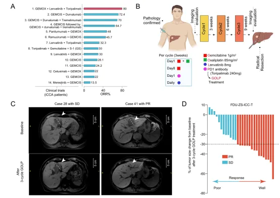

**该研究通过单细胞 RNA测序和TCR测序，解析了iCCA患者接受GOLP治疗前后肿瘤免疫微环境的动态变化，发现CD8****+****GZMB****+****细胞与增殖型 CD8****+****T细胞高比例、CD5L****+****巨噬细胞低比例可预测良好治疗响应，而 Macro CD5L****+****通过上调 CD8****+****GZMB****+****细胞的 CTLA-4表达加剧其耗竭，导致耐药，抗CTLA-4抗体可逆转这一过程。**这些发现为iCCA联合治疗优化提供了新方向，兼具科研与临床价值。

十二、题目：Spatiotemporal Immune Landscape of Colorectal Cancer Liver Metastasis at Single-Cell Level

IF：33.3

期刊：Cancer Discovery

发表日期：2022.01

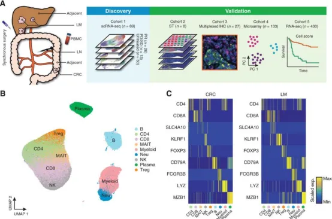

肝转移是结直肠癌患者死亡的首要原因，其特征是肿瘤微环境存在高度异质性且呈现免疫抑制状态。此研究对**97 例配对样本开展[ 单细胞 RNA 测序与空间转录组测序](<https://mp.weixin.qq.com/s?__biz=MzAwMzIzOTk5OQ==&mid=2247529485&idx=2&sn=441d93a7eb0db896b642a1e588945c4f&scene=21#wechat_redirect>)分析**。研究发现一个显著现象：转移灶微环境中的免疫抑制性细胞（如 _MRC1_ ⁺ _CCL18_ ⁺ M2 样巨噬细胞）发生了显著的空间重编程。研究人员进一步开发了一种用于量化单细胞代谢水平的计算分析流程 ——**scMetabolism** ，借助该工具发现上述[巨噬细胞](<https://mp.weixin.qq.com/s?__biz=MzAwMzIzOTk5OQ==&mid=2247529353&idx=2&sn=2dc1406e0d153849f4e23c1a80ed5697&scene=21#wechat_redirect>)的代谢活性显著增强。有趣的是，在对新辅助化疗产生应答的患者中，化疗能够阻断这类巨噬细胞的高代谢活化状态，并恢复抗肿瘤免疫平衡；而在无应答患者体内，免疫抑制微环境的抑制程度则会进一步加剧。本研究阐明了结直肠癌肝转移过程中的免疫演化规律，并揭示了肿瘤对新辅助化疗应答机制的关键未知环节。

**三、随便聊聊**

站在巨人的肩膀上，方能看得更远。追随前辈学者的脚步，是我们深耕科研的重要路径。此前，我们已推出多期科学家系列专题，诚邀各位同道交流探讨，共促学术精进。同时我们也发布许多[单细胞分析复写](<https://mp.weixin.qq.com/mp/appmsgalbum?__biz=MzAwMzIzOTk5OQ==&action=getalbum&album_id=2981710763847614469&scene=173&subscene=&sessionid=svr_e046d41b20b&enterid=1768466561&from_msgid=2247526776&from_itemidx=1&count=3&nolastread=1#wechat_redirect>)，如果对文献复现感兴趣的朋友欢迎联系客服[Biomamba_zhushou]进群，大家一起交流和学习~[汤神近5年学术成果集锦](<https://mp.weixin.qq.com/s?__biz=MzAwMzIzOTk5OQ==&mid=2247532347&idx=1&sn=a09f432dec4ab0c2b08385aee9365512&scene=21#wechat_redirect>)[张泽民院士近年高分文章集锦（2020-2025）](<https://mp.weixin.qq.com/s?__biz=MzAwMzIzOTk5OQ==&mid=2247534016&idx=1&sn=7202c83e5e2f24a25736ca5ebcc4e3bd&scene=21#wechat_redirect>)
如果需要[单细胞数据分析](<https://mp.weixin.qq.com/s?__biz=MzAwMzIzOTk5OQ==&mid=2247531160&idx=2&sn=04d3798dc60958af2c9020fe7c4bd9b8&scene=21&token=827157490&lang=zh_CN&poc_token=HLe6Q2mjR5L5stXqZGOdzOvf2Vk8eTYi05UUYRRy#wechat_redirect>)教学、生信热点[全文复现](<https://mp.weixin.qq.com/mp/appmsgalbum?__biz=MzAwMzIzOTk5OQ==&action=getalbum&album_id=2981710763847614469&token=827157490&lang=zh_CN#wechat_redirect>)、自测数据个性化分析辅导、[常态化实验学习](<https://mp.weixin.qq.com/s?__biz=MzAwMzIzOTk5OQ==&mid=2247532039&idx=2&sn=1e7a1ae6097fe217182f1ff305325512&scene=21&token=827157490&lang=zh_CN&poc_token=HAu7Q2mj4g12fl0KnW3ea82YSsZC41y8EAkeGbBI#wechat_redirect>)，欢迎联系客服微信[Biomamba_zhushou]。

**如何联系我们**

 留一个领取[资料](<https://mp.weixin.qq.com/s?__biz=MzAwMzIzOTk5OQ==&mid=2247532585&idx=1&sn=e265d2846ec66e5faaaf21403d274d2f&scene=21#wechat_redirect>)、[开箱即用的单细胞分析镜像](<https://mp.weixin.qq.com/s?__biz=MzAwMzIzOTk5OQ==&mid=2247528410&idx=2&sn=0f2bac25479cf8d20dab5d82ae986f2e&scene=21#wechat_redirect>)的**微信号[Biomamba_zhushou]**，方便各位随时交流。同时我们也构建了[交流群矩阵](<https://mp.weixin.qq.com/s?__biz=MzAwMzIzOTk5OQ==&mid=2247528057&idx=1&sn=bb348c2a88c977c7cce67ee6731a3591&scene=21#wechat_redirect>)，欢迎大家入群讨论。
大家可以阅读完这几篇之后添加[给生信入门初学者的小贴士](<http://mp.weixin.qq.com/s?__biz=MzAwMzIzOTk5OQ==&mid=2247493329&idx=1&sn=597870b7f7ce10346da3561e7c281627&chksm=9b3c9f81ac4b169794088ce9abbcacb5f18e9fd174fc0d7e28da62d78facadf3100ef38aaf22&scene=21#wechat_redirect>)
[没有检索，就没有发言权](<https://mp.weixin.qq.com/s?__biz=MzAwMzIzOTk5OQ==&mid=2247529398&idx=2&sn=5a429852d61721916a405712677d5905&scene=21#wechat_redirect>)

**已有生信基地联系方式的同学****无需重复添加**

 您点的每个赞和在看，我都认真当成了喜欢
