# 哈佛大学终身教授刘小乐高分文章合集

> 原文：https://mp.weixin.qq.com/s?__biz=MzAwMzIzOTk5OQ==&mid=2247536315&idx=1&sn=2000e847107cb514007de16d04acefd8&chksm=9b3c37ebac4bbefdefe993b806d4813dddd8b30f19efff028381e9f59483e6a1cc85946628b5#rd
> 合集：文献速递

* * *

**一、写在前面**

今天整理的学术前沿主人公是：哈佛大学终身教授、Dana-Farber癌症研究所生物统计与计算生物学教授——刘小乐。她在计算生物学、癌症基因组学和免疫肿瘤学领域深耕二十余载，致力于开发创新性的生物信息学算法与工具，从海量高通量数据中解析癌症发生、进展及免疫治疗响应的基因调控密码。她不仅是全球生物信息学领域的标杆性人物，更被誉为“生信女神”，其开发的MACS、TIDE、TIMER2.0等工具已成为[表观遗传学](<https://mp.weixin.qq.com/s?__biz=MzAwMzIzOTk5OQ==&mid=2247510114&idx=1&sn=f7e8b1df1804a6bba0d79b1ffec2467c&scene=21#wechat_redirect>)和肿瘤免疫研究的“金标准”。

本期我们特意为大家梳理了刘小乐老师团队近期的高分研究成果。当然，这位科学家的重磅成果远不止篇幅所限的这几篇，欢迎大家在评论区留言交流你关注的相关研究文章。

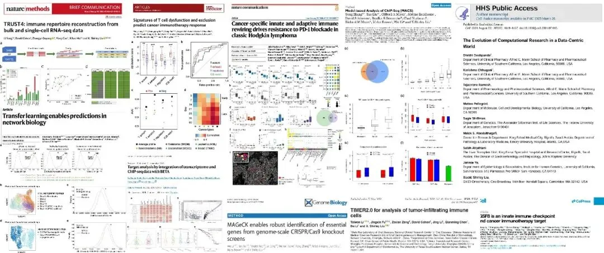
专家介绍：

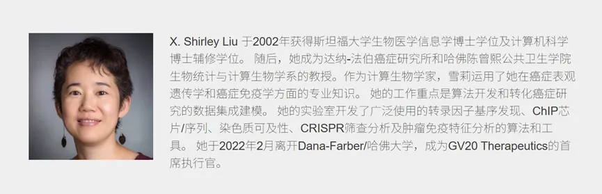

  * 教育背景：

出生于天津，1992年赴美留学，双修生物化学与计算机科学。2002年获得斯坦福大学生物医学信息学博士学位。

  * 学术生涯

  * 毕业后加入哈佛大学，任统计学系助理教授，后晋升为终身教授。

  * 兼任达纳 \- 法伯癌症研究所（DFCI）数据科学系生物统计与计算生物学教授。

  * 曾任DFCI功能性癌症表观遗传学中心主任。

  * 被誉为“生信女神”，在癌症基因组学、表观遗传学及免疫治疗数据分析领域具有全球影响力。

  * 创业经历：

  * 2016年：创立寻百会生物（GV20 Therapeutics），致力于利用基因组学、大数据和AI发现癌症新靶点及开发全人源抗体药物。

  * 2022年：正式从哈佛大学辞职，全职加入寻百会担任CEO，推动科研成果的临床转化。

  * 研究方向与成就

  * 核心领域：计算生物学、癌症基因组学、免疫肿瘤学、表观遗传学。

  * 主要贡献：开发了多种广泛使用的生物信息学算法和工具（如ChIP-seq分析工具），用于解析癌症发生机制及免疫微环境。她提出“治愈癌症的希望在于唤醒身体里沉睡的免疫军队”，致力于通过数据驱动的方法寻找免疫治疗的突破口。

  * 荣誉奖项：获得多项国际大奖，包括美国国立卫生研究院（NIH）杰出新人奖、国际计算生物学学会（ISCB）Overton Prize等，发表高影响力论文数百篇。

刘小乐老师团队的研究重点是算法开发和从高通量数据中整合挖掘，以理解癌症生物学中的基因调控。他们开发了多种广泛使用的转录因子基序查找算法，包括ChIP芯片/ChIP-seq/DNase-seq/CRISPR筛查数据分析。通过整合全基因组转录因子结合、[染色质](<https://mp.weixin.qq.com/s?__biz=MzAwMzIzOTk5OQ==&mid=2247522998&idx=1&sn=843d378d3b679951ad3c8e5da7c32d87&scene=21#wechat_redirect>)动态、基因表达谱以及化学和功能筛选，我们尝试建模转录因子、染色质调控因子、RNA结合蛋白、激酶和LNCRNA在肿瘤发育、进展、药物反应和耐药中的特异性和功能。

她始终秉持“治愈癌症的希望在于唤醒身体里沉睡的免疫军队”这一理念，通过数据驱动的方法寻找免疫治疗的突破口。从转录因子基序查找、ChIP-seq峰值检测，到CRISPR筛选分析、免疫受体库重建，她的工作贯穿了癌症基因组学与免疫微环境研究的核心环节，为全球科学家提供了强大的计算武器。

更多单细胞/空转课程内容可见：[R语言 scRNA-seq数据分析教程](<https://mp.weixin.qq.com/s?__biz=MzAwMzIzOTk5OQ==&mid=2247535408&idx=1&sn=1f3b4b99bab378887d11dd83fd87feb7&scene=21#wechat_redirect>)[R语言scRNA-seq分析系列专题](<https://mp.weixin.qq.com/mp/appmsgalbum?__biz=MzAwMzIzOTk5OQ==&action=getalbum&album_id=4421772406013378566#wechat_redirect>)[Python scRNA-seq分析全流程](<https://mp.weixin.qq.com/s?__biz=MzAwMzIzOTk5OQ==&mid=2247533067&idx=1&sn=7ef76058cbcf7bd45f58147766c75854&scene=21#wechat_redirect>)[Python 空间转录组分析教程](<https://mp.weixin.qq.com/s?__biz=MzAwMzIzOTk5OQ==&mid=2247533721&idx=1&sn=9648ed4701224e5d2e4c704d7046d9de&scene=21#wechat_redirect>)

**二、主要内容**

一、题目：**Transfer learning enables predictions in network biology**

IF：48.5

期刊：Nature

发表日期：2023.06

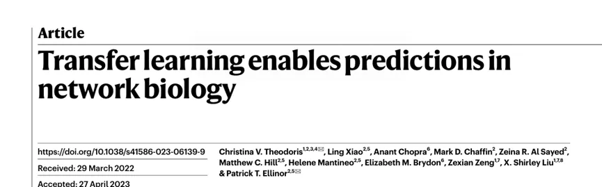

研究组建了一个大规模的预训练语料库Genecorpus-30M，包含来自公共可用数据的广泛组织中的2990万个人类单细胞转录组。**开发了一种基于注意力的预训练模型 Geneformer：**Geneformer是一种基于注意力的[深度学习](<https://mp.weixin.qq.com/s?__biz=MzAwMzIzOTk5OQ==&mid=2247507794&idx=1&sn=c70dd03a962adb3f3b92ffed47e978bb&scene=21#wechat_redirect>)模型，具备上下文感知能力，通过在大规模转录组数据上进行预训练，能够在数据有限的网络生物学设置中通过迁移学习进行预测。通过将每个单细胞中的基因按其在该细胞中的表达进行排序的排名值编码呈现给模型，将每个基因嵌入到一个256维的空间中，通过汇聚得到的基因嵌入，得到细胞水平的嵌入。

二、题目：**IGSF8 is an innate immune checkpoint and cancer immunotherapy target**

IF：42.5

期刊：Cell

发表日期：2024.05

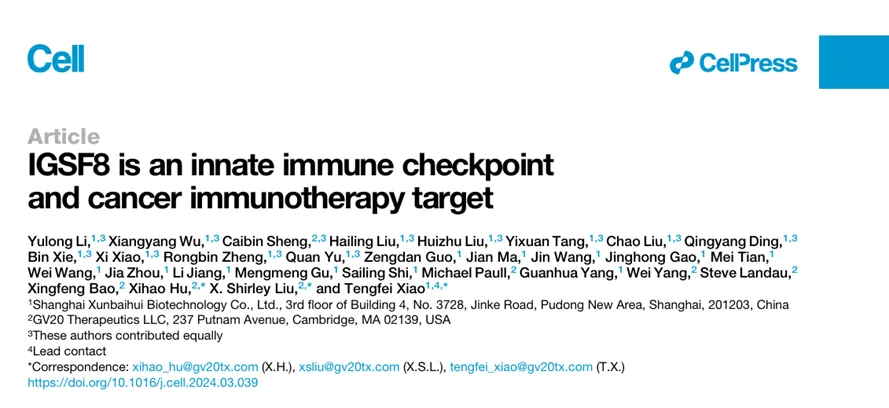

这篇研究首次揭示免疫球蛋白超家族成员8（IGSF8）是一个在肿瘤细胞上高表达的**天然免疫检查点** ，它通过与自然杀伤（NK）细胞表面的KIR3DL2（人）或Kira9（小鼠）受体相互作用，抑制NK细胞的杀伤功能，帮助肿瘤逃避免疫清除。该研究通过**CRISPR 筛选**技术，在多种肿瘤细胞与NK细胞共培养体系中，系统性筛选出IGSF8这一关键[免疫逃逸](<https://mp.weixin.qq.com/s?__biz=MzAwMzIzOTk5OQ==&mid=2247526426&idx=2&sn=e33c59e785800a498b57d7a971a6e27a&scene=21#wechat_redirect>)分子。研究进一步开发了靶向IGSF8的单克隆抗体，并在临床前模型中证实，该抗体单用或与抗PD-1联合使用，能有效激活NK细胞、抑制肿瘤生长。这一发现不仅解答了“为何MHC-I缺陷的肿瘤能逃脱NK细胞杀伤”这一长期悬而未决的免疫学难题，更为治疗“免疫冷”肿瘤、克服免疫检查点抑制剂耐药提供了全新的靶点和策略。

三、题目：**Cancer-specific innate and adaptive immune rewiring drives resistance to PD-1 blockade in classic Hodgkin lymphoma**

IF：15.7

期刊：Nature Communications

发表日期：2024.12

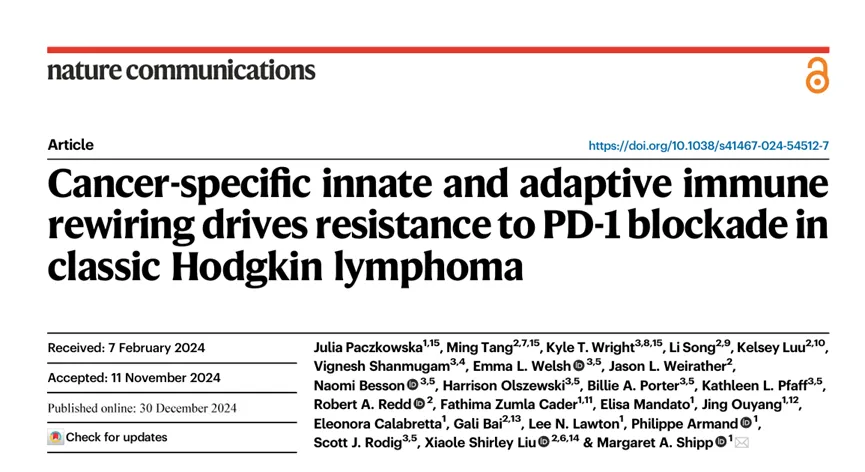

这项研究利用单细胞多组学技术，深入解析了经典霍奇金淋巴瘤（cHL）患者对PD-1抑制剂产生耐药的免疫机制，发现耐药性并非单一因素导致，而是由**先天性与适应性免疫系统的协同重编程** 所驱动。在耐药患者中，肿瘤微环境发生了显著的“免疫重塑”：一方面，[肿瘤相关巨噬细胞](<https://mp.weixin.qq.com/s?__biz=MzAwMzIzOTk5OQ==&mid=2247529353&idx=2&sn=2dc1406e0d153849f4e23c1a80ed5697&scene=21#wechat_redirect>)极化为高度免疫抑制亚群，并伴随髓系抑制细胞（MDSCs）的富集，构建了阻碍T细胞浸润的物理与化学屏障；另一方面，效应CD8+ T细胞陷入深度耗竭状态，调节性T细胞（Tregs）显著扩增，且TCR克隆演化显示抗肿瘤特异性克隆被抑制，共同形成了强大的免疫逃逸网络。

基于这些发现，文章提出克服耐药的关键在于打破这种“双重封锁”，建议采用**联合治疗策略** ：除了阻断PD-1外，还需联合靶向替代检查点（如LAG-3、TIGIT）、重编程或清除抑制性巨噬细胞（如CSF1R抑制剂）、阻断TGF-β信号通路以及干预腺苷代谢等。研究不仅揭示了cHL耐药的复杂动态图谱，还鉴定了可预测治疗响应的潜在生物标志物，为开发针对难治性淋巴瘤的新一代精准免疫疗法提供了重要的理论依据和靶点方向。

四、题目：**Signatures of T cell dysfunction and exclusion predict cancer immunotherapy response******

IF ：50.0

期刊：Nature Medicine

发表日期：2018.10

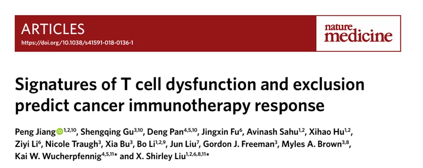

作者针对免疫检查点阻断疗法（ICB）响应率低的难题，开发了名为**TIDE** 的计算预测模型。该模型创新性地量化了[肿瘤免疫逃逸](<https://mp.weixin.qq.com/s?__biz=MzAwMzIzOTk5OQ==&mid=2247528088&idx=1&sn=ac4c0e71d5a37e073bf63f65e597541e&scene=21#wechat_redirect>)的两大核心机制：一是**T 细胞功能障碍**（即T细胞已浸润肿瘤但因耗竭而丧失杀伤力），二是**T 细胞排斥**（即免疫抑制微环境阻碍T细胞进入肿瘤）。通过整合大规模肿瘤队列数据，TIDE利用治疗前的基因表达谱，精准模拟并区分这两种逃逸状态，从而克服了传统标志物（如PD-L1表达量或肿瘤突变负荷）预测不准的局限。

验证结果显示，TIDE在预测黑色素瘤患者对抗PD-1或抗CTLA-4疗法的临床响应方面，准确率显著优于现有标准生物标志物。此外，该框架不仅具有临床指导价值，还能反向推导发现新的耐药调控因子（如SERPINB9），为解析免疫耐药机制和开发新型联合疗法提供了强有力的计算工具与理论依据，已成为全球肿瘤免疫研究领域广泛使用的标准分析方法之一。

五、题目：**TIMER2.0 for analysis of tumor-infiltrating immune cells**

IF：13.1

期刊：Nucleic Acids Res

发表日期：2020.06

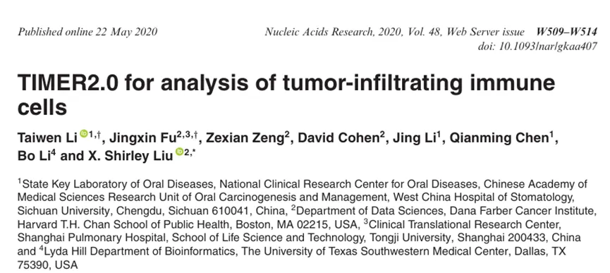

文章展示了团队新开发的**TIMER2.0** ，这是一个全面升级的交互式Web平台，旨在更精准、全面地分析[肿瘤浸润免疫细胞](<https://mp.weixin.qq.com/s?__biz=MzAwMzIzOTk5OQ==&mid=2247532107&idx=2&sn=7afc7517afb7dbdefeb7fd3312c1d5e8&scene=21#wechat_redirect>)。其核心突破在于摒弃了单一算法的局限，创新性地整合了 **TIMER****、 CIBERSORT、quanTIseq、MCP-counter、xCell 和 EPIC**等 **6****种主流去卷积算法** ，为用户提供“共识性”的免疫细胞丰度评估，显著提高了结果的稳健性和可靠性；同时，平台数据规模大幅扩展，涵盖了TCGA项目中32种癌症类型的近1.1万个样本，并纳入了多个免疫治疗临床队列。

在功能应用上，TIMER2.0提供了基因相关性、生存分析、差异比较及用户数据上传估算等六大核心模块，支持研究人员无需编程即可深入探索免疫细胞与基因表达、临床特征及治疗响应之间的复杂关联。作为全球癌症免疫研究领域的“基础设施”级工具，TIMER2.0与团队开发的TIDE模型形成互补，极大地降低了肿瘤微环境分析的门槛，已成为解析免疫逃逸机制、发现预后生物标志物及指导免疫治疗策略制定的标准分析平台。

六、题目：**The evolution of computational research in a data-centric world**

IF：42.5

期刊：Cell

发表日期：2024.08

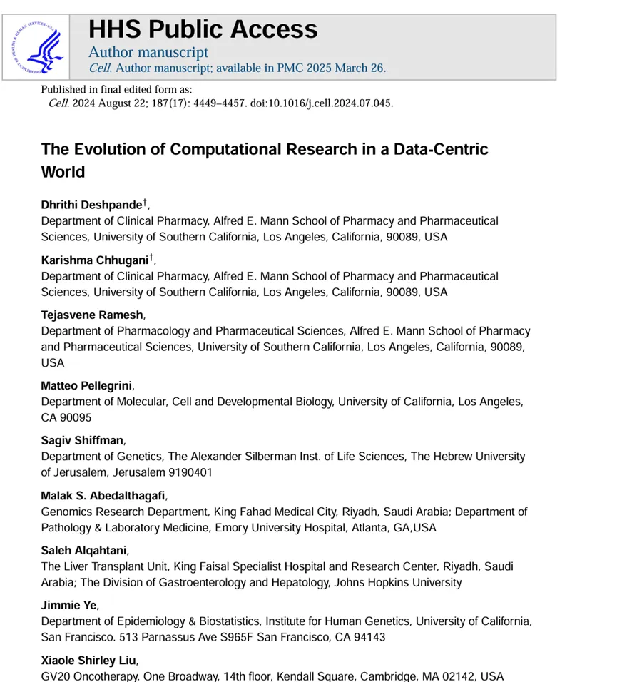

文章强调了计算研究人员在如今的科学研究中起到的重要作用，**从过去的湿实验科研人员产生数据，计算研究人员分析数据或者产生分析数据工作的辅助地位正在慢慢转变为独立的，甚至在科学研究中发挥主导作用** ，而这得益于在过去十到二十年间测序技术（高通量）的快速发展，[大量的生物数据产出](<https://mp.weixin.qq.com/s?__biz=MzAwMzIzOTk5OQ==&mid=2247534017&idx=2&sn=010bcc65fcf732851b8400d7c0154954&scene=21#wechat_redirect>)，并且现在仍有大量的数据在源源不断的产出，而这些数据的挖掘度可能只有50%不到，甚至更低。

文章主要讨论了以计算数据为中心的研究在现代生物学中的变革作用，说明了它如何从支持性工具过渡为驱动科学创新的核心组件。计算研究人员和传统实验人员之间的合作带来了新的见解和技术的进步，支持了各个领域的重大进展，包括药物发现和疾病进展监测。

七、题目：**Model-based analysis of ChIP-Seq (MACS)**

IF：9.4

期刊：Genome Biol

发表日期：2008.09

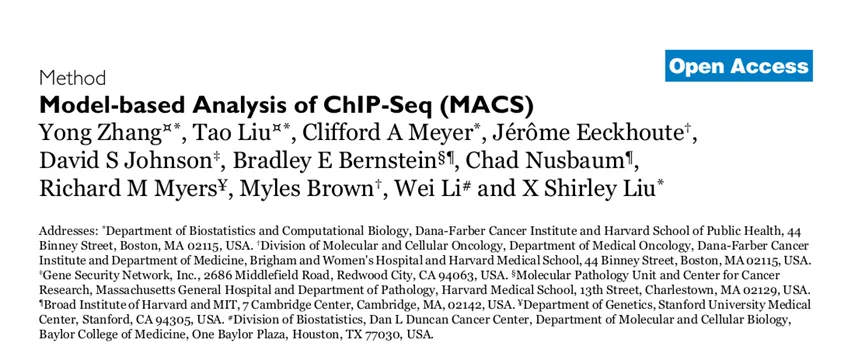

这篇文章提出了**MACS** （Model-based Analysis of ChIP-Seq）算法，旨在解决ChIP-seq数据分析中峰值检测不准、假阳性高及分辨率低的核心难题。其核心创新在于构建了**动态泊松分布模型** 来适应不同测序深度，利用**局部背景校正** （Local Lambda）消除基因组开放区域带来的系统性偏差，并独创了**双峰移位模型** ：通过识别正负链Reads在结合位点两侧形成的特征性偏移，将 Reads 向中心延伸以精确重构结合位点，从而将定位分辨率从数百碱基对提升至**单碱基水平** 。

通过在多种转录因子和组蛋白修饰的真实数据集上验证，MACS展现出比当时现有工具更高的灵敏度和更低的假阳性率，能够精准识别尖锐的转录因子结合峰及宽域的组蛋白修饰峰。该研究不仅确立了ChIP-seq数据分析的**新标准** ，其开源软件更成为过去十余年表观遗传学研究中全球使用最广泛的“金标准”工具，极大地推动了人类对基因调控网络和[染色质状态](<https://mp.weixin.qq.com/s?__biz=MzAwMzIzOTk5OQ==&mid=2247522998&idx=1&sn=843d378d3b679951ad3c8e5da7c32d87&scene=21#wechat_redirect>)的理解，后续升级版MACS2至今仍是该领域的基石算法。

八、题目：**Target analysis by integration of transcriptome and ChIP-seq data with BETA**

IF：16.0

期刊：Nat Protoc

发表日期：2013.12

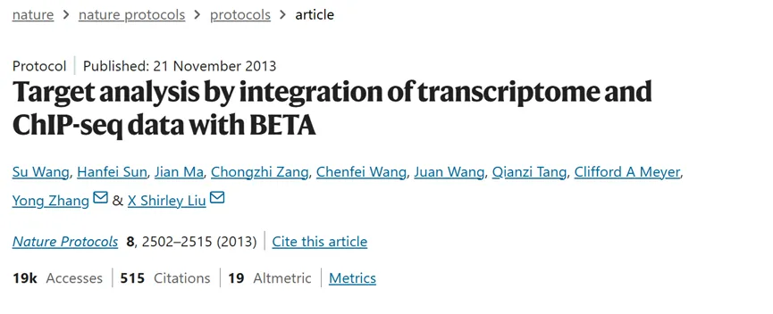

这篇文章介绍了团队开发的**BETA (Binding and Expression Target Analysis)** 算法，旨在解决单一组学数据无法精准鉴定转录因子或染色质修饰蛋白**直接功能靶基因** 的难题。BETA 通过独创的统计模型，将 **ChIP-seq** 的蛋白结合位置信息与**[RNA-seq](<https://mp.weixin.qq.com/s?__biz=MzAwMzIzOTk5OQ==&mid=2247529986&idx=2&sn=301d44caa8d63cba8243d13579775cf5&scene=21#wechat_redirect>)** 的基因表达变化数据进行深度整合：它首先根据结合位点与基因启动子的距离计算调控权重，随后自动推断该蛋白在特定细胞环境下的功能属性（激活或抑制），最后仅将那些既有显著结合信号、又表现出符合功能逻辑的表达变化的基因判定为高置信度的直接靶点。

该方法的核心优势在于能有效过滤 ChIP-seq 中大量的非功能性结合噪音，并区分直接调控与间接下游效应，从而将候选靶基因列表从数千个大幅缩减至数十个关键目标，显著提高了后续实验验证的成功率。作为表观遗传学领域的标准分析工具，BETA 成功实现了从“相关性描述”到“因果性推断”的跨越，被广泛应用于干细胞多能性维持、癌症驱动基因解析及基因调控网络构建等研究中，极大深化了人类对转录调控机制的理解。****

九、题目：**MAGeCK enables robust identification of essential genes from genome-scale CRISPR/Cas9 knockout screens**

IF：9.4

期刊：Genome Biol

发表日期：2014.08

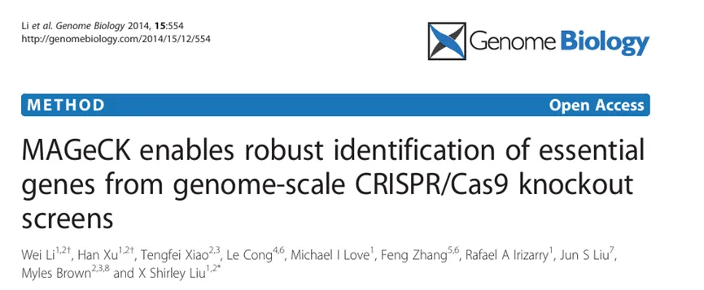

这篇文章介绍了团队开发的**MAGeCK** 算法，旨在解决全基因组 CRISPR/Cas9 敲除筛选数据分析中噪音大、假阳性高及缺乏统一标准的难题。该研究创新性地改进了 **鲁棒秩聚合（ RRA）**[统计模型](<https://mp.weixin.qq.com/s?__biz=MzAwMzIzOTk5OQ==&mid=2247484505&idx=1&sn=762f80bd6840ec03d5151592679240f9&scene=21#wechat_redirect>)，能够有效校正测序深度差异、sgRNA 效率偏差及实验随机误差，从而从复杂的计数数据中精准识别出与表型（如细胞存活、药物耐药）显著相关的必需基因或非必需基因，适用于正选和负选等多种筛选场景。

作为 CRISPR 筛选数据分析领域的**全球金标准** ，MAGeCK 凭借其卓越的稳健性和准确性，迅速被国际学术界广泛采用，极大地推动了功能基因组学的发展。基于此核心算法，刘小乐团队后续还推出了支持复杂实验设计的**MAGeCK-VISPR** 和增强下游功能分析的 **MAGeCK-Flute** ，构建了一套完整的分析生态系统，成为解析基因功能网络、发现药物靶点及理解疾病机制不可或缺的计算工具。

**
**

十、题目：**TRUST4: immune repertoire reconstruction from bulk and single-cell RNA-seq data**

IF：32.1****

期刊： Nat Methods

发表日期：2021.06

这篇文章介绍了**TRUST4** ，这是一款用于从 **RNA****测序（ RNA-seq）数据**中重建 **αβ /γδ T细胞**和 **B****细胞**[ 免疫受体库](<https://mp.weixin.qq.com/s?__biz=MzAwMzIzOTk5OQ==&mid=2247531444&idx=2&sn=77ad356b087fca6a03e90d4f9cc973de&scene=21#wechat_redirect>)的开源算法。与现有竞争方法相比，TRUST4 具有显著优势：它不仅支持 **FASTQ** 和 **BAM** 两种输入格式，而且在组装速度上更快，灵敏度更高，能够重建出更长甚至**全长** 的受体序列，从而提供更完整的免疫组库信息。

此外，TRUST4 具备强大的**单细胞兼容性** ，能够直接从 **单细胞 RNA-seq (scRNA-seq)**数据中识别受体序列，而**无需** 进行昂贵的 V(D)J 富集实验。该工具广泛兼容主流测序平台，包括 **SMART-seq** 和 **5****′ 10x Genomics**，使得研究者能够利用常规转录组数据低成本、高效率地解析单个细胞的免疫克隆特征及其基因表达状态，极大地拓展了公共数据资源的利用价值。

十一、题目：Landscape of tumor-infiltrating T cell repertoire of human cancers****

IF ：29.0****

期刊： Nat Genet

发表日期：2016.06

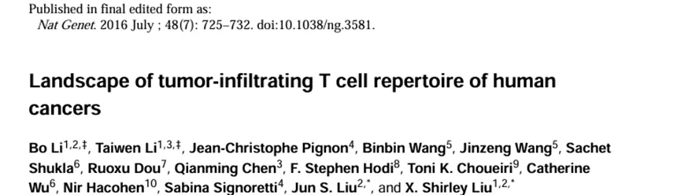

作者开发了一种计算方法，用于从跨越 29 种癌症类型的 9,142 个 RNA-seq 样本中推断肿瘤浸润 T 细胞的互补决定区 3（CDR3）序列。鉴定出了超过 60 万个 CDR3 序列，其中15% 为全长序列。研究发现，除脑癌和肾癌外，许多肿瘤中浸润 T 细胞的 CDR3 序列长度分布、氨基酸保守性以及可变基因使用情况，与健康供体外周血中的特征相似。作者观察到 T 细胞多样性与肿瘤突变负荷之间存在强相关性，并预测 SPAG5 和 TSSK6 是多种癌症中潜在的免疫原性癌症/睾丸抗原。最后，基于 CDR3 序列与共现关系的分析，鉴定出 3 个潜在的免疫原性体细胞突变。其中，PRAMEF4 F300V 突变被预测能强效结合 MHC-I 和 MHC-II 分子，且与其携带者的 HLA 类型匹配。作者的分析方法具有同时识别免疫原性[新抗原](<https://mp.weixin.qq.com/s?__biz=MzAwMzIzOTk5OQ==&mid=2247529353&idx=1&sn=7bcab5f0fdab9058103a23e4730fc201&scene=21#wechat_redirect>)和肿瘤反应性 T 细胞克隆型的潜力。

**三、随便聊聊**

站在巨人的肩膀上，方能看得更远。追随前辈学者的脚步，是我们深耕科研的重要路径。此前，我们已推出多期科学家系列专题，诚邀各位同道交流探讨，共促学术精进。同时我们也发布许多[单细胞分析复写](<https://mp.weixin.qq.com/mp/appmsgalbum?__biz=MzAwMzIzOTk5OQ==&action=getalbum&album_id=2981710763847614469&scene=173&subscene=&sessionid=svr_e046d41b20b&enterid=1768466561&from_msgid=2247526776&from_itemidx=1&count=3&nolastread=1#wechat_redirect>)，如果对文献复现感兴趣的朋友欢迎联系客服[Biomamba_zhushou]进群，大家一起交流和学习~[汤神近5年学术成果集锦](<https://mp.weixin.qq.com/s?__biz=MzAwMzIzOTk5OQ==&mid=2247532347&idx=1&sn=a09f432dec4ab0c2b08385aee9365512&scene=21#wechat_redirect>)[张泽民院士近年高分文章集锦（2020-2025）](<https://mp.weixin.qq.com/s?__biz=MzAwMzIzOTk5OQ==&mid=2247534016&idx=1&sn=7202c83e5e2f24a25736ca5ebcc4e3bd&scene=21#wechat_redirect>)[樊嘉院士近年高分文章集锦（2022-2026）](<https://mp.weixin.qq.com/s?__biz=MzAwMzIzOTk5OQ==&mid=2247534596&idx=1&sn=34fe7230dc63961b8bc5240f6112e347&scene=21#wechat_redirect>)[84岁高龄依旧在做高质量科研，陈润生院士近年文章集锦（2021-2026）](<https://mp.weixin.qq.com/s?__biz=MzAwMzIzOTk5OQ==&mid=2247534674&idx=1&sn=b44e01032fe0b18399b6519c9f99b210&scene=21#wechat_redirect>)[谭蔚泓院士高分文章汇总(2025-2026)](<https://mp.weixin.qq.com/s?__biz=MzAwMzIzOTk5OQ==&mid=2247535281&idx=1&sn=b8c0f7eb9b9ce9d147e803d7c683b542&scene=21#wechat_redirect>)

如果需要[单细胞数据分析](<https://mp.weixin.qq.com/s?__biz=MzAwMzIzOTk5OQ==&mid=2247531160&idx=2&sn=04d3798dc60958af2c9020fe7c4bd9b8&scene=21&token=827157490&lang=zh_CN&poc_token=HLe6Q2mjR5L5stXqZGOdzOvf2Vk8eTYi05UUYRRy#wechat_redirect>)教学、生信热点[全文复现](<https://mp.weixin.qq.com/mp/appmsgalbum?__biz=MzAwMzIzOTk5OQ==&action=getalbum&album_id=2981710763847614469&token=827157490&lang=zh_CN#wechat_redirect>)、自测数据个性化分析辅导、[常态化实验学习](<https://mp.weixin.qq.com/s?__biz=MzAwMzIzOTk5OQ==&mid=2247532039&idx=2&sn=1e7a1ae6097fe217182f1ff305325512&scene=21&token=827157490&lang=zh_CN&poc_token=HAu7Q2mj4g12fl0KnW3ea82YSsZC41y8EAkeGbBI#wechat_redirect>)，欢迎联系客服微信[Biomamba_zhushou]。

**如何联系我们**

 留一个领取[资料](<https://mp.weixin.qq.com/s?__biz=MzAwMzIzOTk5OQ==&mid=2247535983&idx=1&sn=99378a252908b06f56432eb08741d278&scene=21#wechat_redirect>)、[免费两周学习版](<https://mp.weixin.qq.com/s?__biz=MzAwMzIzOTk5OQ==&mid=2247527585&idx=1&sn=fa32112c11b215b33096cab43baf08ea&scene=21#wechat_redirect>)服务器的**微信号[Biomamba_zhushou]**，方便各位随时交流。同时我们也构建了[交流群矩阵](<https://mp.weixin.qq.com/s?__biz=MzAwMzIzOTk5OQ==&mid=2247536307&idx=2&sn=2d030173f51d24a4fee43bd0d83da03b&scene=21#wechat_redirect>)，欢迎大家入群讨论。
大家可以阅读完这几篇之后添加[给生信入门初学者的小贴士](<http://mp.weixin.qq.com/s?__biz=MzAwMzIzOTk5OQ==&mid=2247493329&idx=1&sn=597870b7f7ce10346da3561e7c281627&chksm=9b3c9f81ac4b169794088ce9abbcacb5f18e9fd174fc0d7e28da62d78facadf3100ef38aaf22&scene=21#wechat_redirect>)
[如何搜索公众号过往发布内容](<http://mp.weixin.qq.com/s?__biz=MzAwMzIzOTk5OQ==&mid=2247506266&idx=2&sn=22b1164bc9602c25620d058847785422&chksm=9b3ca00aac4b291c16d738271746ffb90149282a728f484e8a1952463c46a8e7dc4f883ab928&scene=21#wechat_redirect>)

**已有生信基地联系方式的同学****无需重复添加**

 您点的每个赞和在看，我都认真当成了喜欢
