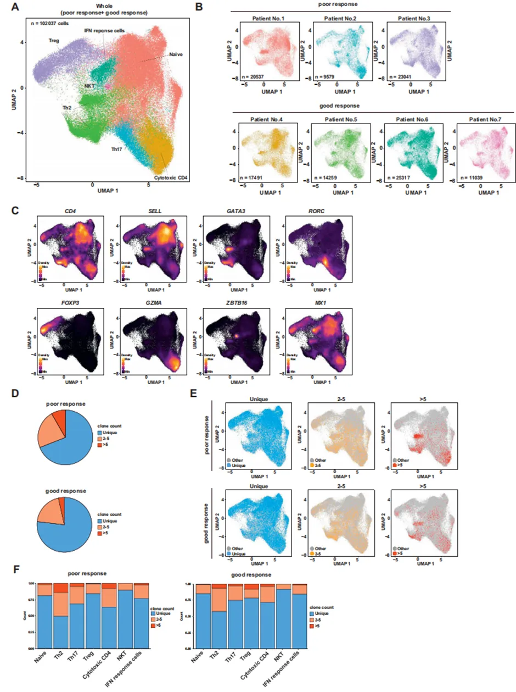
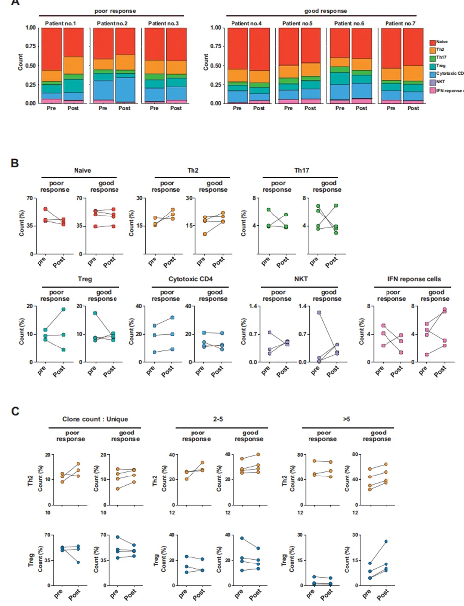
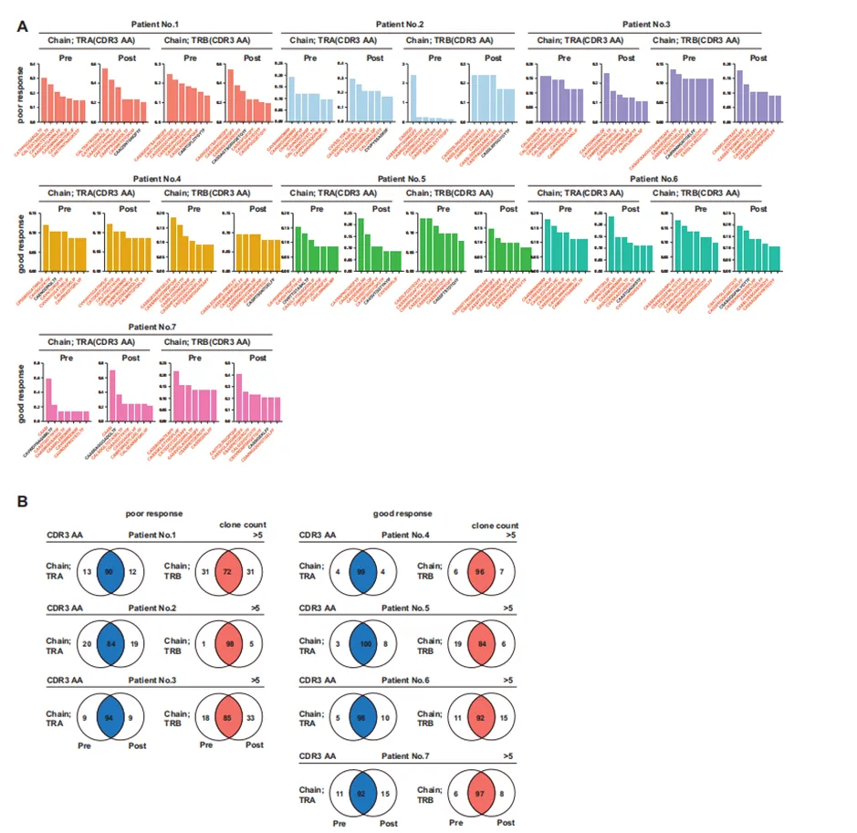
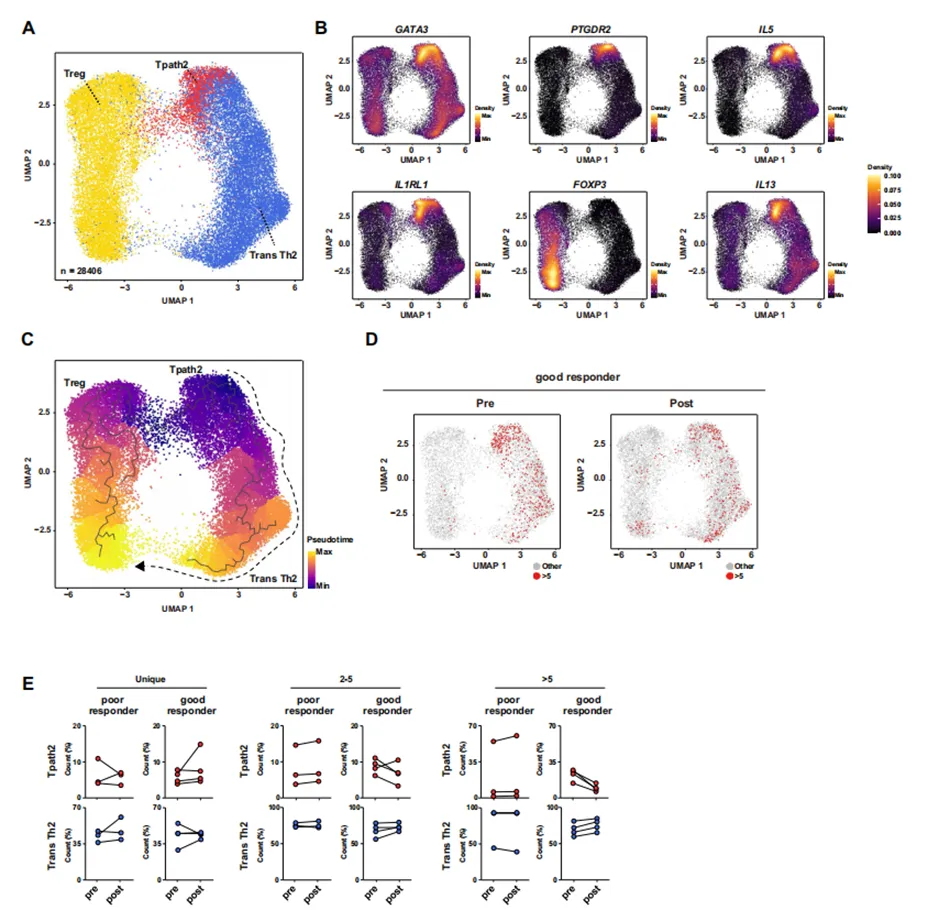
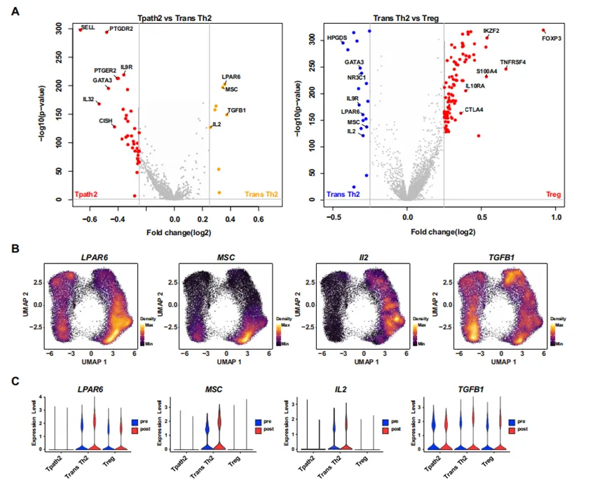
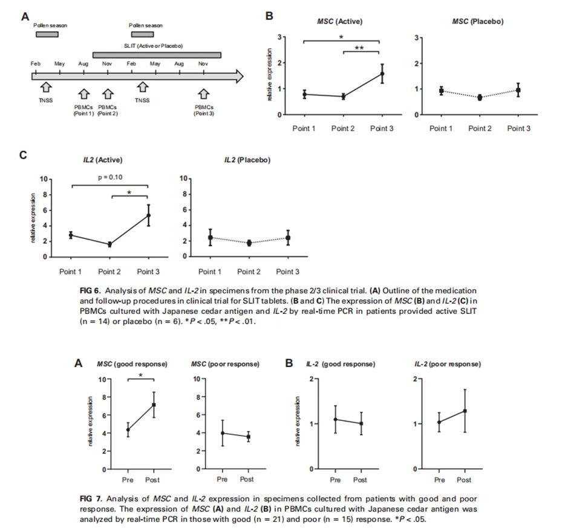

# 过敏性鼻炎免疫治疗后的单细胞免疫图谱分析揭示致病性TH2细胞的功能性抑制与克隆转换

> 原文：https://mp.weixin.qq.com/s?__biz=MzAwMzIzOTk5OQ==&mid=2247536908&idx=1&sn=b9e96f8ebd6433429d32bd28f329c878&chksm=9b3c285cac4ba14abe90741951fd4336c713074fad9d81e956a63e97d789692d8b8a73a54807#rd
> 合集：文献速递

* * *

**一、写在前面**

**文章《Single-cell immunoprofiling after immunotherapy for allergic rhinitis reveals functional suppression of pathogenic TH2 and clonal conversion》 （IF=11.2）**发布于2022年杂志《**Journal of Allergy and Clinical Immunology》 。**

背景：过敏性鼻炎是一个日益严重的全球性问题。目前唯一能有效改善疾病的治疗方法是抗原特异性免疫疗法，但其作用机制尚未完全阐明。

目的：本文全面研究了日本杉花粉症舌下[免疫](<https://mp.weixin.qq.com/s?__biz=MzAwMzIzOTk5OQ==&mid=2247533717&idx=1&sn=655c7290a42905cee5346fc3c5025496&scene=21#wechat_redirect>)疗法（SLIT）前后抗原特异性T细胞的作用和变化。

方法：我们培养了从开始SLIT前和开始1年后患者中提取的外周血单个核细胞，并结合使用了单细胞RNA测序和受体库测序技术。为了研究生物标志物，我们使用了参与日本杉花粉症SLIT片剂2/3期临床试验的患者的细胞，以及反应良好和反应不良的门诊患者的细胞。

结果：SLIT后的抗原刺激培养导致了Th2细胞和调节性T细胞的克隆扩增，并大部分CD4+ T细胞在治疗前后保留了CDR3区域，表明SLIT引起了抗原特异性的克隆反应和分化。然而，SLIT减少了功能性Th2细胞的克隆，但增加了表达肌蛋白（MSC）、TGF-β和IL-2的Trans型Th2细胞群。轨迹分析表明，SLIT诱导了Trans型Th2细胞向调节性T细胞的克隆分化。通过实时PCR发现：SLIT治疗一年后，积极SLIT组以及治疗反应良好组的MSC水平升高。

结论：[单细胞](<https://mp.weixin.qq.com/mp/appmsgalbum?__biz=MzAwMzIzOTk5OQ==&action=getalbum&album_id=2168829347397156865#wechat_redirect>)RNA测序和受体库分析的结合有助于揭示部分潜在机制：SLIT促进致病性Th2细胞上MSC的表达并抑制其功能。MSC可能成为过敏性鼻炎SLIT的潜在生物标志物。

如果你希望有人真的手把手教你学[R语言单细胞](<https://mp.weixin.qq.com/s?__biz=MzAwMzIzOTk5OQ==&mid=2247535408&idx=1&sn=1f3b4b99bab378887d11dd83fd87feb7&scene=21#wechat_redirect>)：
更多课程：[Python版scRNA-seq分析全流程](<https://mp.weixin.qq.com/s?__biz=MzAwMzIzOTk5OQ==&mid=2247533067&idx=1&sn=7ef76058cbcf7bd45f58147766c75854&scene=21#wechat_redirect>)
[Python 空间转录组全程班](<https://mp.weixin.qq.com/s?__biz=MzAwMzIzOTk5OQ==&mid=2247533721&idx=1&sn=9648ed4701224e5d2e4c704d7046d9de&scene=21#wechat_redirect>)
如果需要[单细胞数据分析](<https://mp.weixin.qq.com/s?__biz=MzAwMzIzOTk5OQ==&mid=2247531160&idx=2&sn=04d3798dc60958af2c9020fe7c4bd9b8&scene=21#wechat_redirect>)**指导** 、生信热点[全文复现](<https://mp.weixin.qq.com/mp/appmsgalbum?__biz=MzAwMzIzOTk5OQ==&action=getalbum&album_id=2981710763847614469#wechat_redirect>)、自测数据**个性化分析** 辅导、[常态化实验学习](<https://mp.weixin.qq.com/s?__biz=MzAwMzIzOTk5OQ==&mid=2247530174&idx=1&sn=c3b0499adcc9093546e4ba1cfffba7bd&scene=21#wechat_redirect>)，欢迎联系客服微信[**Biomamba_zhushou**]。

**二、主要内容**

1.1 研究背景

1\. 过敏性鼻炎（AR）全球高发，而在日本，日本杉花粉症（JCP）患病率不断增加。虽然AR并不危及生命，但AR因生产力效率和治疗费用对经济带来严重的负担。

2\. SLIT是目前唯一能改变疾病进程的疗法，但其需在非花粉季长期每日用药才可起效，且作用机制尚未完全阐明。

3\. 有报告指出：SLIT可增加抗原特异性调节性T细胞（Treg）的数量，IgG4抗体阻断IgE活性。但Treg细胞是否增殖且被诱导增殖的机制尚不明确。

4\. 已知致病性Th2（Tpath2）细胞参与变态反应性疾病的发病机制，在人体中，CRTH2阳性、CD161阳性的Th2细胞产生大量Th2细胞因子并表达ST2会进一步加剧变态反应。SLIT减少了Tpath2细胞的数量，解释了其治疗效果，但使Tpath2细胞减少的过程，以及他们与Treg细胞和其他T细胞亚群的关系尚不明确。

5\. 单细胞组学技术为解析免疫细胞动态提供了新工具，单细胞RNA测序和单细胞受体库测序可用于全面研究SLIT引起的抗原特异性T细胞之间的作用关系。

1.2 研究目的

1\. 探究 SLIT 对过敏性鼻炎患者抗原特异性 T 细胞的影响。

2\. 揭示 SLIT 调控 T 细胞功能与分化的分子机制。

3\. 寻找可预测 SLIT 疗效的生物标志物。

1.3 研究方法

1\. 单细胞 RNA 测序（[scRNA-Seq](<https://mp.weixin.qq.com/mp/appmsgalbum?__biz=MzAwMzIzOTk5OQ==&action=getalbum&album_id=2168829347397156865#wechat_redirect>)）：分析 T 细胞亚群基因表达。

2\. 单细胞受体测序（scVDJ-Seq）：追踪 T 细胞克隆动态。

3\. 实时 PCR：验证 MSC 等关键基因表达。

4\. 轨迹分析：推断 T 细胞分化路径。

1.4 研究设计

研究对象与样本

①单细胞测序样本：7名日本衫花粉症患者（编号1-7），在SLIT治疗前及治疗1年后分别采集外周血单个核细胞，共14份样本。(门诊收集，TNSS评分高，即症状严重者。)

②生物标志物验证样本（PCR）：

第一组（临床试验组）：22名患者，来自鸟居制药的一项2/3期试验。

第二组（门诊患者组）：36名门诊开始SLIT治疗的患者。

疗效评估与分组标准：

①评分标准：采用日本过敏与免疫学会指南，对打喷嚏、流涕、鼻塞3个症状按0－4分计分，计算总鼻部症状评分（TNSS评分）。

②疗效分组：根据SLIT能否有效缓解症状，将患者分为：

反应良好组：SLIT后TNSS评分改善＞2分。

反应不良组：不符合上述标准的其他患者。

1.5研究问题

1\. SLIT 如何影响抗原特异性 T 细胞的克隆组成与功能？

2\. SLIT 是否诱导 Th2细胞向 Treg 细胞转化？

3\. MSC 是否可作为 SLIT 疗效的生物标志物？

1.6结果分析

问题1：CD4+记忆T细胞的功能亚群与克隆比例

基于已知转录因子和标记基因的表达水平，在外周血单个核细胞的CD4+记忆T细胞中鉴定出7个T细胞簇：初始T细胞、调节性[T细胞](<https://mp.weixin.qq.com/s?__biz=MzAwMzIzOTk5OQ==&mid=2247531388&idx=7&sn=801a250297aa2871f840a57e23ca4b86&scene=21#wechat_redirect>)、TH2细胞、TH17细胞、细胞毒性CD4细胞、自然杀伤T细胞和干扰素反应细胞（图A:7个T细胞簇；图B:每个受试者的情况；图C：决定各亚群特征的定型基因表达）。

在这些细胞中，67.2%至78.5%具有独特的TCR构型（图D）。而拥有超过1个细胞的克隆记忆CD4+ T细胞，在反应不良组中占32.8%，在反应良好组中占21.5%。其中，细胞数大于5个的较大克隆，在反应不良组中占所有细胞的10.3%，在反应良好组中占4.7%。

接下来，为了比较不同克隆规模的T细胞簇，基于scVDJ-Seq数据计算了独特克隆、2-5个细胞克隆及大于5个细胞克隆的相对比例，并在UMAP图上进行了描绘(图E)。随着克隆细胞数量的增加，这些克隆倾向于富集在效应细胞中。研究显示，发生多克隆扩增的T细胞主要为TH2、TH17、Treg或细胞毒性CD4细胞，并且值得注意的是，克隆细胞比例在TH2细胞簇中最高（图F）。

Fig1

问题2：SLIT治疗前后T细胞亚群及克隆性的变化

为研究T细胞反应，比较SLIT治疗前后针对日本杉抗原的T细胞亚群谱，发现虽然存在较大的个体差异，但若不对亚群按克隆计数进行分类，则在反应不良和反应良好的患者中，SLIT前后整体T细胞亚群均未观察到一致的变化（图2，A和B）。

因此，将细胞重新分类为形成单克隆的独特细胞群和形成多克隆的克隆群，重新分析了这些细胞。观察到独特克隆及2-5个细胞的克隆群在SLIT前后未显示显著变化，而大于5个细胞的克隆群则显示，TH2和Treg细胞仅在反应良好的患者中发生了扩增（图2，C）。各T细胞亚群的详细结果见本文在线资源中的图E1（www.jacionline.org）。

为评估SLIT前后因[TCR受体库](<https://mp.weixin.qq.com/s?__biz=MzAwMzIzOTk5OQ==&mid=2247531444&idx=2&sn=77ad356b087fca6a03e90d4f9cc973de&scene=21#wechat_redirect>)变化引起的抗原特异性变化，比较所有患者CDR3区的TRA和TRB氨基酸序列。前7个CDR区域中，具有高克隆频率的T细胞克隆在SLIT前后显示出60%至80%的重叠（图3，A）。此外，若将克隆数量限制在大于5个，则SLIT前后样本的TRA和TRB的CDR区域有80%的重叠（图3，B）。

Fig2

Fig3

问题3：SLIT后Th2和Treg细胞的功能变化

有研究表明SLIT可诱导具有相同抗原特异性的TH2和Treg细胞发生克隆扩增，本实验对SLIT后显示克隆扩增的TH2和Treg细胞进行了[免疫图谱](<https://mp.weixin.qq.com/s?__biz=MzAwMzIzOTk5OQ==&mid=2247530664&idx=8&sn=1b814305b0a2c742560ebe8211ddc5f7&scene=21#wechat_redirect>)分析，并进行了主成分分析以提高分辨率并重新评估免疫图谱（图4，A）。因此，基于IL-5、IL-13、PTGDR2和KLRB1的表达，TH2细胞可被分为两个簇：一个高功能的致病性TH2细胞群和一个功能受损的TH2细胞群（图4，B）。

接下来，进行轨迹分析以识别这些细胞群中的分化途径，并基于基因表达谱的相似性评估了伪时间。于是，在TH2细胞中观察到了从致病性TH2细胞到Trans TH2细胞的分化轨迹（图4，C），同时，在Trans TH2细胞和Treg细胞群之间存在连续的中间细胞，表明Trans TH2细胞向Treg细胞的转分化。

此外，比较SLIT前后这些细胞群中的TCR克隆显示，在治疗后具有多个克隆（尤其是大于5个克隆）的反应良好患者中，观察到了Treg细胞（图2，C）和Trans TH2细胞的克隆扩增以及致病性TH2细胞的减少（图4，D和E）。

结论：

fig4.A B：对TH2细胞亚群细分，明确了SLIT治疗后TH2细胞内部存在功能异质性；

fig4.C：对细胞分化轨迹分析，为TH2细胞向Treg细胞转分化提供了动态证据。

fig4.D E：表明SLIT的疗效与诱导致病性TH2细胞功能抑制/转分化，并促进调节性细胞扩张有关。

Fig4

问题4：TH2细胞向Treg细胞的基因改变

为了寻找促进Trans TH2细胞介导向Treg细胞分化及SLIT后免疫耐受的功能分子，全面比较了各细胞群的基因表达谱。核心发现如下：

Trans TH2细胞的独特基因特征：

与致病性TH2细胞相比，在Trans TH2细胞中，肌蛋白（一种抑制TH2细胞转录程序的转录因子）和LPAR6（一种T细胞迁移抑制受体）的表达显著上调（图5，A）。

MSC在Trans TH2细胞分化轨迹的末端也高且特异性地表达（图5，B）。

功能分子的表达转变：

致病性细胞因子降低：Trans TH2细胞中IL-5的表达较低（图4，B）。

促Treg分化因子升高：Trans TH2细胞中，能诱导Treg细胞分化的IL-2和TGF-β的表达更高。

Trans TH2与Treg细胞的比较：

与Trans TH2细胞相比，Treg细胞表达更多的FOXP3、抑制性细胞因子（如TGF-β和IL-10RA）以及抑制性免疫检查点因子CTLA4。

SLIT诱导的基因表达变化：

在Trans TH2细胞中：SLIT后，MSC和IL-2的表达上调。

在Trans TH2和Treg细胞中：SLIT后，TGF-β的表达均上调（图5，C）。

结论：这些基因表达数据共同揭示了SLIT诱导免疫耐受的潜在分子机制：通过上调MSC来抑制TH2细胞的致病性转录程序，同时通过上调IL-2和TGF-β创造了一个促进这些功能被抑制的TH2细胞（Trans TH2）进一步分化为具有完全抑制功能的Treg细胞的微环境。这为MSC作为SLIT疗效的关键调节因子和潜在生物标志物提供了分子基础。

Fig5

问题5：有潜力的生物标志物

鉴于MSC和IL-2的表达变化及其在Trans TH2细胞中的强表达，从抑制TH2细胞功能的角度出发，研究这些分子是否可作为SLIT的生物标志物，所使用的样本来自先前一项针对日本杉花粉症的SLIT片剂临床试验。研究方案如图6，A所示。具体而言，除了安慰剂组的6名患者外，活性药物组原有16名患者，但其中2名患者在SLIT后症状加重被排除，最终活性药物组有14名患者显示症状抑制。

为了评估它们作为生物标志物的效用，在抗原刺激后通过PCR分析了全PBMC中MSC和IL-2的表达。与安慰剂组样本在SLIT后未显示MSC特定增加相反，活性药物组在治疗开始1年后显示出MSC的显著增加（图6，B）。还观察到治疗1年后IL-2表达有增加的趋势（图6，C）。

此外，分析36名门诊患者以确认MSC是否可作为SLIT疗效的生物标志物。对治疗前和治疗1年后的PBMC进行培养并做PCR。在SLIT后反应良好的患者中观察到MSC表达显著增加（图7，A）。然而，IL-2表达未观察到显著变化（图7，B）。

结论：在PBMC中检测MSC的表达，特别是在抗原刺激后，能够有效区分SLIT治疗组与安慰剂组，并能鉴别出治疗反应良好的患者。因此，MSC 展现出作为SLIT疗效预测和评估的潜在生物标志物的重要价值。而IL-2的变化在不同队列中不一致，其作为生物标志物的可靠性较低。

Fig6

1.7研究结论

1\. SLIT 能促进多克隆T细胞中的 TH2和Treg 细胞的克隆扩增，且多数为同一克隆来源。这种克隆增殖发生在功能被抑制的Trans TH2细胞中。

2\. SLIT 通过抑制抗原特异性TH2细胞的功能，并诱导其分化为Treg细胞群来发挥作用。TH2细胞表达MSC，在此过程中扮演关键角色。TH2细胞通过增强IL-2和TGF-β的表达向 Treg 细胞转化。

3\. MSC 在 SLIT 有效患者中表达显著上调，具有作为生物标志物的潜力。

**三、总结与展望**

3.1 理论启示

1\. 本研究首次在单细胞层面揭示了 SLIT 通过 MSC 介导的 TH2 抑制与 Treg 转化机制。

2\. 为理解免疫治疗中 T 细胞的可塑性提供了新视角。

3\. 为开发基于 MSC 的免疫治疗策略或疗效评估工具奠定基础。

3.2 创新与不足

3.2.1 创新点

结合[scRNA-Seq](<https://mp.weixin.qq.com/s?__biz=MzAwMzIzOTk5OQ==&mid=2247531447&idx=1&sn=242b49b5e2f5496efbd4484bf2e81604&scene=21#wechat_redirect>)与 scVDJ-Seq，动态解析 SLIT 前后 T 细胞克隆与功能变化。

3.2.2 不足之处

1\. 样本量较小，性别与年龄差异未完全控制；

2\. 未深入探讨 MSC 上游调控机制。

3.3 自我思考

本文展示了单细胞组学技术在免疫治疗机制研究中的强大能力。我认识到：

1\. 单细胞技术能揭示传统方法难以捕捉的[细胞异质性](<https://mp.weixin.qq.com/s?__biz=MzAwMzIzOTk5OQ==&mid=2247530338&idx=1&sn=2d092e76080359f5a169ec14d54d1241&scene=21#wechat_redirect>)。

2\. 结合多组学数据（转录组+[免疫组](<https://mp.weixin.qq.com/s?__biz=MzAwMzIzOTk5OQ==&mid=2247531444&idx=2&sn=77ad356b087fca6a03e90d4f9cc973de&scene=21#wechat_redirect>)库）可更全面地理解免疫应答。

3\. MSC 作为治疗靶点或标志物，具有转化医学潜力，值得进一步研究。

**如何联系我们**

 留一个领取[资料](<https://mp.weixin.qq.com/s?__biz=MzAwMzIzOTk5OQ==&mid=2247535983&idx=1&sn=99378a252908b06f56432eb08741d278&scene=21#wechat_redirect>)、[开箱即用的单细胞分析镜像](<https://mp.weixin.qq.com/s?__biz=MzAwMzIzOTk5OQ==&mid=2247536307&idx=1&sn=8d03259be06f54521aac5251dec988d5&scene=21#wechat_redirect>)的**微信号[Biomamba_zhushou]**，方便各位随时交流。同时我们也构建了[交流群矩阵](<https://mp.weixin.qq.com/s?__biz=MzAwMzIzOTk5OQ==&mid=2247536307&idx=2&sn=2d030173f51d24a4fee43bd0d83da03b&scene=21#wechat_redirect>)，欢迎大家入群讨论。
大家可以阅读完这几篇之后添加[给生信入门初学者的小贴士](<http://mp.weixin.qq.com/s?__biz=MzAwMzIzOTk5OQ==&mid=2247493329&idx=1&sn=597870b7f7ce10346da3561e7c281627&chksm=9b3c9f81ac4b169794088ce9abbcacb5f18e9fd174fc0d7e28da62d78facadf3100ef38aaf22&scene=21#wechat_redirect>)
[没有检索，就没有发言权](<https://mp.weixin.qq.com/s?__biz=MzAwMzIzOTk5OQ==&mid=2247529398&idx=2&sn=5a429852d61721916a405712677d5905&scene=21#wechat_redirect>)

**已有生信基地联系方式的同学****无需重复添加**

 您点的每个赞和在看，我都认真当成了喜欢
