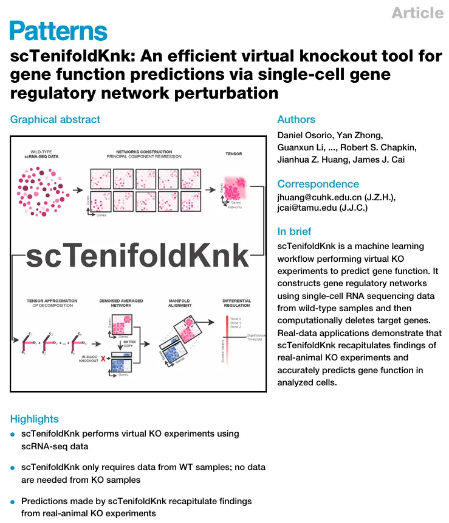
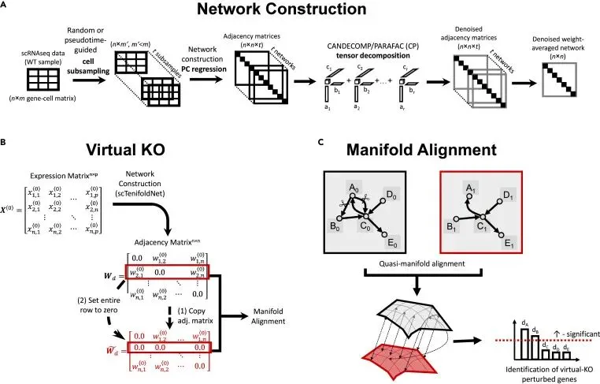
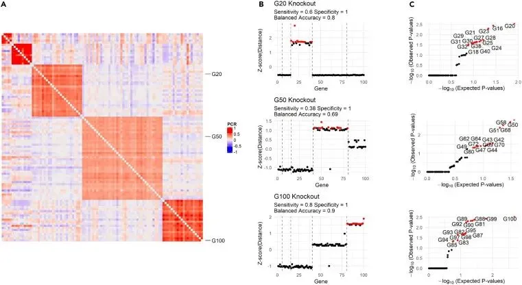
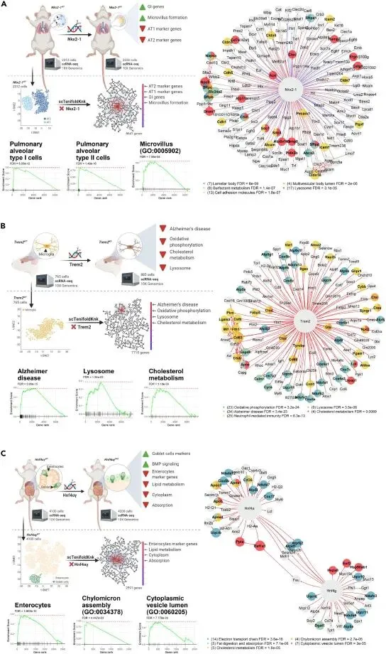
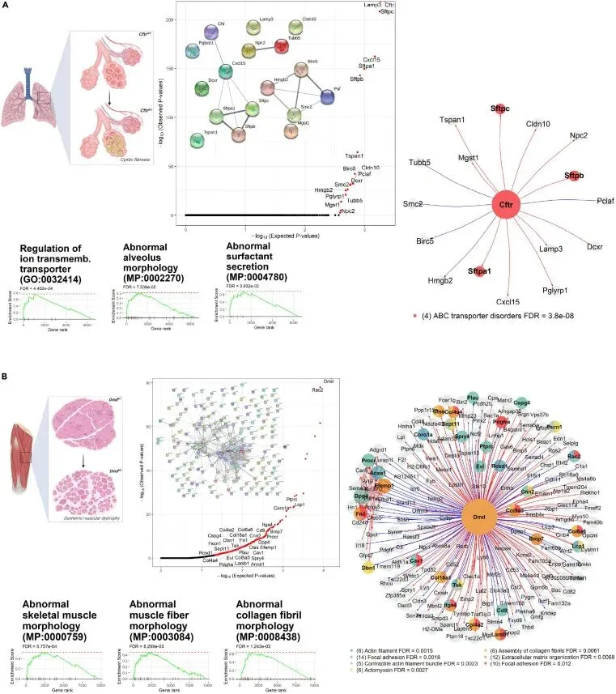
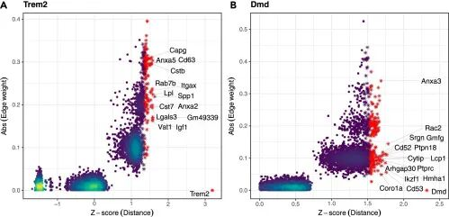
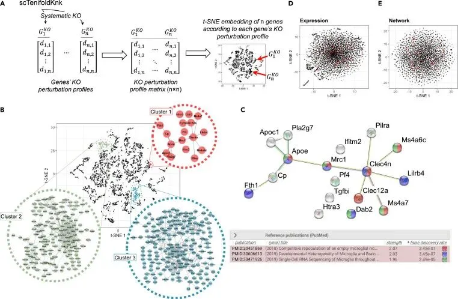
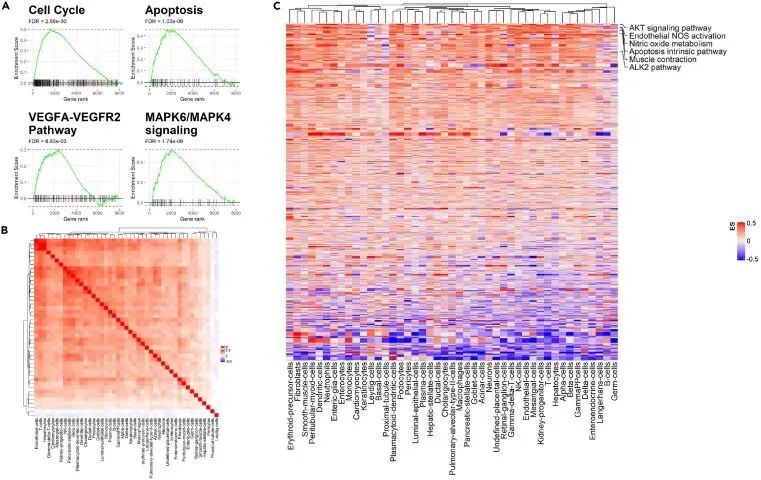

# 一文搞懂虚拟基因敲除原理：scTenifoldKnk文献介绍

> 原文：https://mp.weixin.qq.com/s?__biz=MzAwMzIzOTk5OQ==&mid=2247537448&idx=1&sn=e7d08e94045c55652bbd4331c66646e1&chksm=9b3c2a78ac4ba36e25855911099ba684317ebbf36ad5818dc177573b30d0cc7ab5e332984cc0#rd
> 合集：文献速递

* * *

**一、写在前面**

基因敲除（KO）实验几乎是验证基因功能与生物学表型/功能的金标准。`scTenifoldKnk`是一个于2022年发表在《Patterns》（IF= 7.4）上的神器，在2025年末肉眼可见的火了起来。

一句话描述就是`scTenifoldKnk`能够在单细胞中虚拟敲除某一个/几个基因。其核心原理是能够通过基因调控网络(Gene regulatory Network, GRN)的构建，再通过张量分解生成去噪后的临近矩阵，将目的基因在临近矩阵中的权重归零即可完成虚拟敲除预测。我们之前已出scTenifoldKnk教程：[风靡一时的scTenifoldKnk单细胞虚拟基因敲除,准不准?](<https://mp.weixin.qq.com/s?__biz=MzAwMzIzOTk5OQ==&mid=2247535112&idx=1&sn=95a6b88cd49fb2bbb7aa091a00e09e2c&scene=21#wechat_redirect>)

文献解读视频：

实操视频：

资料链接：

https://pan.baidu.com/s/1Z5BVyGr05Q8iBTc_6Y76-w

参考文献：Osorio D, Zhong Y, Li G, et al. scTenifoldKnk: An efficient virtual knockout tool for gene function predictions via single-cell gene regulatory network perturbation. Patterns (N Y). 2022 Feb 1;3(3):100434.

https://www.sciencedirect.com/science/article/pii/S2666389922000010

原文代码：https://github.com/cailab-tamu/scTenifoldKnk

更多课程：[Python版scRNA-seq分析全流程](<https://mp.weixin.qq.com/s?__biz=MzAwMzIzOTk5OQ==&mid=2247533067&idx=1&sn=7ef76058cbcf7bd45f58147766c75854&scene=21#wechat_redirect>)
[Python 空间转录组全程班](<https://mp.weixin.qq.com/s?__biz=MzAwMzIzOTk5OQ==&mid=2247533721&idx=1&sn=9648ed4701224e5d2e4c704d7046d9de&scene=21#wechat_redirect>)
如果需要[单细胞数据分析](<https://mp.weixin.qq.com/s?__biz=MzAwMzIzOTk5OQ==&mid=2247531160&idx=2&sn=04d3798dc60958af2c9020fe7c4bd9b8&scene=21#wechat_redirect>)**指导** 、生信热点[全文复现](<https://mp.weixin.qq.com/mp/appmsgalbum?__biz=MzAwMzIzOTk5OQ==&action=getalbum&album_id=2981710763847614469#wechat_redirect>)、自测数据**个性化分析** 辅导、[常态化实验学习](<https://mp.weixin.qq.com/s?__biz=MzAwMzIzOTk5OQ==&mid=2247530174&idx=1&sn=c3b0499adcc9093546e4ba1cfffba7bd&scene=21#wechat_redirect>)，欢迎联系客服微信[**Biomamba_zhushou**]。

**二、主要内容**

1\. scTenifoldKnk的工作流程

scTenifoldKnk 以野生型样本的基因-细胞计数矩阵为单一输入。该工作流先从输入的计数矩阵构建野生型单细胞基因调控网络（WT scGRN），再通过在野生型网络中虚拟敲除目标基因，生成伪敲除单细胞基因调控网络（pseudo-KO scGRN）。最终，该工具采用网络比对方法，对伪敲除网络与野生型网络进行比较，以识别**差异调控基因（DR 基因）** 。这些差异调控基因即为**虚拟敲除扰动基因** —— 本文中这两个术语可互换使用。通过对这些虚拟敲除扰动基因进行功能富集分析，即可推断被虚拟敲除基因的功能。scTenifoldKnk 采用模块化结构实现，包含如图 1 所示的三个核心模块，具体步骤总结如下：流程分为三步：

1.1 基于野生型样本的单细胞 RNA 测序数据构建单细胞基因调控网络

scTenifoldKnk 利用野生型样本的单细胞 RNA 测序（scRNA-seq）数据，基于本团队前期提出的**scTenifoldNet** 流程，首先构建单细胞基因调控网络。该网络构建步骤包含三个子步骤（图 1A）：

### 子步骤 1.1.1 随机细胞亚抽样

设**X** 为 scRNA-seq 表达数据矩阵，包含**p 个基因** 在**n 个细胞** 中的表达量。采用**n 抽 m** 的自助抽样法，从 X 中随机抽取 m（m<n）个细胞，构建亚样本集 X'。该抽样过程重复 t 次，生成 t 个细胞亚集：X'₁, …, X'_t。

### 子步骤 1.1.2 为每个细胞亚集构建基因调控网络

对每个细胞亚集 X'_i，执行**p 次主成分（PC）回归** 以构建基因调控网络。每次回归以一个基因的表达量为因变量，其余所有基因的表达量为自变量。由 X'_i 构建的基因调控网络以**有符号、加权、有向图** 的形式存储，并用**p×p 邻接矩阵 W_i** 表示；矩阵的每一列存储一个基因主成分回归的回归系数。随后，将 W_i 除以其最大绝对值完成归一化。

### 子步骤 1.1.3 邻接矩阵去噪以获得最终基因调控网络

采用**张量分解** 对主成分回归步骤得到的邻接矩阵集合 {W_i} 进行去噪。首先，将 t 个基因调控网络的 {W_i} 整合为一个包含 p×p×t 个元素的**三阶张量 X** ；随后，对 X 执行**CP 分解（CANDECOMP/PARAFAC 分解）** ；再选取前 d 个主成分重构 X，得到去噪后的张量 X_d。对 X_d 中去噪后的 {W_i} 取边权重的均值进行融合，得到最终的平均矩阵**W_d** 。

## 1.2：通过虚拟敲除基因生成伪敲除单细胞基因调控网络

在上一步中，已利用野生型样本的 scRNA-seq 表达矩阵 X 构建了野生型单细胞基因调控网络。在**虚拟敲除** 步骤中，复制野生型网络的邻接矩阵 W_d，并将**目标基因对应的整行数值置为 0** （图 1B），直接在 W_d 上完成虚拟敲除操作。修改后的矩阵记为**W̃_d** ，即伪敲除单细胞基因调控网络的邻接矩阵。

## 1.3：网络比对以识别虚拟敲除扰动基因

本步骤中，已获得野生型网络 W_d 与伪敲除网络 W̃_d。采用**拟流形对齐** 方法对两个网络进行对齐（图 1C，详见实验方法部分）。将两个网络中包含的所有基因投影至**k 维空间** （k<<p）；投影后，每个基因对应两个低维表征：一个来自野生型网络 W_d，另一个来自伪敲除网络 W̃_d。

对每个基因 j，**d_j** 为该基因两个投影点之间的**欧氏距离** ；d_j 越大，代表该基因的差异调控程度越显著。按照 d_j 值对所有基因排序，生成排序基因列表，作为**基因集富集分析（GSEA）**的输入。最后，采用** 卡方检验**筛选显著的差异调控基因，即虚拟敲除扰动基因。

图1

2\. 利用模拟scRNA-seq数据进行虚拟KO分析

我们首先使用模拟数据验证本方法的有效性。为此，我们借助**SERGIO** 模拟器（一种基于基因调控网络的单细胞表达模拟器）生成了一套合成单细胞 RNA 测序（scRNA-seq）数据集。为完成数据模拟，我们向 SERGIO 输入 5 个不同规模的预设基因调控网络，分别包含 5、10、25、40 和 20 个基因。最终得到的模拟 scRNA-seq 数据集为**3000 个细胞 ×100 个基因** 的稀疏矩阵（70% 为零值）。

我们对模拟数据应用主成分（PC）回归方法，构建了单细胞基因调控网络（scGRN）。如预期一致，该网络中的基因清晰聚集成**5 个独立模块** （邻接矩阵见图 2A），与 SERGIO 生成模型预设的模块完全对应。同一模块内的基因在功能上彼此相关，或受同一调控机制支配。由于 SERGIO 仅模拟稳态细胞的基因表达，我们仅用其生成共表达模块，而非模拟上游调控因子对这些模块的调控过程。我们将构建完成的网络作为**野生型（WT）单细胞基因调控网络** 。

随后，我们将野生型网络中**20 号基因** 的边权重置为 0，构建伪敲除（pseudo-KO）单细胞基因调控网络。20 号基因隶属于包含 25 个基因的**第三模块** 。接着使用 scTenifoldKnk 对比伪敲除网络与野生型网络，识别因敲除而发生显著差异调控的基因，这些基因被预测会随 20 号基因的敲除而受到扰动。已知敲除效应仅由 20 号基因缺失引起，我们预期识别出的基因均与 20 号基因高度相关。结果与预期完全吻合：scTenifoldKnk 检出的所有显著差异调控基因均来自 20 号基因所在的第三模块（图 2B、2C，上）。我们分别以**50 号基因** 和**100 号基因** 为例重复上述分析，所得结果同样符合预期（图 2B、2C，中、下）。

据此我们得出结论：当一个紧密调控模块中的成员基因被敲除时，scTenifoldKnk 能够有效检出同一模块内的其他成员基因。从算法原理来看，与敲除基因同模块的基因会被检出，是因为它们在野生型网络与伪敲除网络的低维潜在表征中的投影位置，相较于模块外基因发生了更显著的改变（详见实验方法部分）。

图2

3\. scTenifoldKnk 虚拟敲除分析可重现实体基因敲除实验的研究结果

作为一款虚拟敲除工具，scTenifoldKnk 理应能够重现实体基因敲除实验的研究结果。为验证这一点，我们将 scTenifoldKnk 应用于**3 项体内基因敲除实验** 的单细胞 RNA 测序（scRNA-seq）数据进行分析。三项研究的原始数据集均同时包含野生型（WT）与基因敲除（KO）样本的表达矩阵。

值得注意的是，scTenifoldKnk 的预测结果与原始文献核心结论的对比并非 “对等对比”。原因在于：scTenifoldKnk**仅使用野生型样本的 scRNA-seq 数据** ，完全不接触敲除样本的任何信息；而原始体内敲除研究为解析目标基因功能，不仅同时使用野生型与敲除样本的 scRNA-seq 数据，还结合了批量 RNA 测序、流式细胞术、免疫染色等多组学实验数据。即便如此，scTenifoldKnk 预测的敲除基因功能，与原始文献报道的结果仍**整体高度一致** ，对比总结详见表 S1。

## 3.1 虚拟敲除 vs 实体敲除实验 1：Nkx2-1 对肺泡 1 型、2 型细胞的转录调控、发育与维持至关重要

## NK 同源框基因 2-1（Nkx2-1）在肺泡 1 型（AT1）与肺泡 2 型（AT2）肺上皮细胞中高表达。AT1 细胞覆盖 95% 的气体交换表面积，胞体厚度仅 0.1μm，可实现氧气向血液的被动扩散；Nkx2-1 在 AT1 细胞的整个发育阶段均发挥必需作用，缺失 Nkx2-1 会导致 AT1 细胞三大核心特征受损：分子标记物表达异常、伸展形态缺陷、细胞静息状态失衡。AT2 细胞呈立方形，可分泌表面活性物质以降低肺泡表面张力；Nkx2-1 突变会阻断 Sftpb、Sftpc 的表达，这两个基因是调控 AT2 细胞功能与分子身份的关键基因。

为探究 Nkx2-1 纯合敲除（Nkx2-1−/−）引发的分子与细胞水平改变，Little 等人利用野生型与 Nkx2-1−/−敲除小鼠的肺组织样本，构建了一套完整的实验数据集（GEO 编号：GSM3716703）。该团队通过批量 RNA 测序与免疫染色实验发现：Nkx2-1 突变细胞中 AT1、AT2 细胞标记基因表达下调；Nkx2-1−/−突变型 AT1 细胞的胃肠细胞标记基因表达上调，且细胞顶端形成致密的微绒毛样结构；借助染色质免疫共沉淀测序（ChIP-seq）进一步证实，Nkx2-1 可结合一批调控细胞骨架、膜组成与细胞外基质的基因。此外，Little 等人还分别获取了野生型小鼠（2312 个）与 Nkx2-1−/−敲除小鼠（2558 个）肺组织上皮细胞的 scRNA-seq 数据。

我们获取了 Little 等人产出的 scRNA-seq 数据，以**8647 个基因 ×2312 个细胞** 的野生型小鼠表达矩阵作为 scTenifoldKnk 的输入，构建野生型单细胞基因调控网络后对 Nkx2-1 进行虚拟敲除。scTenifoldKnk 最终筛选出 171 个显著差异基因（错误发现率 FDR<0.05；表 S2）。这些虚拟敲除扰动基因中，包含 32 个 AT1 细胞标记基因中的 7 个（Egfl6、Ager、Cldn18、Icam1、Crlf1、Gprc5a、Aqp5），以及 38 个 AT2 细胞标记基因中的 25 个（表 S2 中标注）。

基于 Enrichr 工具的功能富集分析显示，这些基因显著富集于以下功能类别：由 WNT 信号通路介导的上皮间质转化、表面活性物质稳态、板层小体、细胞黏附分子，这些富集功能均与 AT2 细胞的核心功能高度契合。随后，我们基于 STRING 蛋白互作数据库对 171 个显著基因进行互作富集分析，结果显示这些基因在 STRING 互作网络中形成**完全连通的子网络** （P<0.01），提示其功能密切相关。为在全转录组水平评估 Nkx2-1 敲除引发的扰动程度，我们进一步开展基因集富集分析（GSEA）。结果显示，GSEA 成功识别出包含 AT1、AT2 细胞标记基因的基因集（两项均 FDR<0.01），且 AT1、AT2 细胞标记基因均为 Nkx2-1 缺失引发的**核心扰动基因** 。此外，GSEA 结果还表明，Nkx2-1−/−敲除会影响肠道微绒毛、细胞周期、细胞骨架相关功能基因（图 3A）。上述结果均与原始研究报道完全一致。

# 3.2 虚拟敲除与真实敲除实验对比 2：Trem2 调控小胶质细胞胆固醇代谢

髓系细胞触发受体 2（Trem2）是一种**单次跨膜免疫受体** ，在中枢神经系统中特异性表达于小胶质细胞。已知 Trem2 参与晚发性阿尔茨海默病的发生进程，并调控细胞增殖、存活、免疫应答、钙动员、细胞骨架动力学、mTOR 信号通路、自噬与能量代谢等多种生物学过程。Trem2 的功能需通过信号转导蛋白 Hcst 与衔接蛋白 Tyrobp 介导。同时，Trem2 还参与脂质代谢调控，现有研究多聚焦于脂蛋白颗粒、细胞表面暴露信号（如 Trem2 候选配体）等形式的脂质。

通过对比野生型与 Trem2 敲除（Trem2⁻/⁻）小鼠，Poliani 等人发现 Trem2 可调控载脂蛋白 E（Apoe）、脂蛋白脂酶（Lpl）等多个基因，这些基因负责小胶质细胞内的脂质转运与分解代谢。另有研究证实，Trem2 可调控脂肪组织中巨噬细胞的基因表达，并参与肥胖小鼠的血糖胆固醇代谢调控，进一步将 Trem2 功能与脂质代谢关联。

为探究 Trem2 是否介导小胶质细胞的髓鞘脂质处理过程，Nugent 等人分别从野生型（Trem2⁺/⁺）、杂合型（Trem2⁺/⁻）和纯合敲除型（Trem2⁻/⁻）小鼠中分离并鉴定 Cd11b⁺/Cd45⁽ˡᵒʷ⁾小胶质细胞，所有小鼠均饲喂含 0.2% 双环己酮草酰二腙的脱髓鞘饲料，持续 12 周。研究团队结合流式细胞分选、批量转录组测序、单细胞转录组测序与脂质组学开展多维度分析，结果显示：Trem2 可上调 Apoe 及其他胆固醇转运与代谢相关基因，在长期吞噬刺激下会导致胆固醇储存形式在胞内大量蓄积；同时 Trem2 还调控细胞损伤应答、溶酶体与吞噬体功能、阿尔茨海默病相关及氧化磷酸化相关基因的表达。

本研究开展虚拟敲除分析时，获取了野生型（Trem2⁺/⁺）小鼠的单细胞转录组数据，表达矩阵包含 7715 个基因、765 个 Cd11b⁺/Cd45⁽ˡᵒʷ⁾小胶质细胞。以该野生型表达矩阵为输入，使用 scTenifoldKnk 工具对 Trem2 进行虚拟敲除，最终筛选出**128 个虚拟敲除扰动基因** （错误发现率 FDR<0.05，附表 S3）。富集分析结果显示，这些基因显著富集于阿尔茨海默病、氧化磷酸化、溶酶体、TYROBP 调控网络、低密度脂蛋白 / 高密度脂蛋白 / 甘油三酯代谢通路、小胶质细胞病原体吞噬通路等功能条目，提示对应蛋白存在功能关联性。

STRING 蛋白互作网络分析显示，虚拟敲除扰动基因间存在高度互作，互作数量显著高于随机水平（STRING 互作富集检验，P<0.01），说明这些基因产物具备高度关联的共有功能。综上，scTenifoldKnk 的虚拟敲除结果通过挖掘 Trem2 敲除后的扰动基因，揭示了其核心功能（图 3B），与原始真实敲除研究的结论完全一致。

# 3.3 虚拟敲除与真实敲除实验对比 3：Hnf4a 与 Hnf4g 维持肠上皮细胞特性

肝细胞核因子 4α 与 4γ（Hnf4a、Hnf4g）是调控肠上皮基因表达的转录因子，二者功能冗余，单独敲除其中一个旁系同源基因不会引发明显异常。Hnf4a 与 Hnf4g 双敲除（Hnf4agDKO）小鼠会出现肠积液等肠道功能障碍表型，且突变体上皮细胞无法正常分化。

Chen 等人利用批量转录组测序，对比分析野生型、Hnf4a 单敲除、Hnf4g 单敲除与 Hnf4a/g 双敲除小鼠的十二指肠上皮细胞基因表达，结果显示：双敲除组鉴定出 2892 个差异表达基因（FDR<0.05，log₂倍数变化绝对值> 1），而两个单敲除组仅分别鉴定出 560 个和 77 个。双敲除肠上皮细胞的差异基因主要富集于脂质代谢、微绒毛、物质吸收等消化代谢功能，以及肠上皮细胞形态、细胞质、高尔基体、免疫信号等通路；同时其转录组发生明显偏移，由分化细胞表型转向增殖细胞与杯状细胞表型，说明 Hnf4a/g 双敲除会损伤肠上皮细胞分化、破坏细胞特性稳定性。为验证该结论，研究团队采用单细胞转录组测序检测肠绒毛上皮细胞基因表达，分别获取野生型与双敲除组各 4100 个、4200 个细胞的数据，证实相较于野生型，突变体上皮细胞中杯状细胞特征基因（Agr2、Spink4、Gcnt3、S100a6）表达上调，肠上皮细胞特征基因（Npc1l1、Apoc3、Slc6a19、Lct）表达下调（图 3C 左图）；此外，双敲除细胞的 BMP/SMAD 信号通路基因表达上调，而脂质代谢、微绒毛、物质吸收及细胞质相关基因表达下调。

本研究获取了 4100 个野生型肠上皮细胞的单细胞转录组表达矩阵，以 scTenifoldKnk 构建包含 2591 个基因的野生型单细胞基因调控网络，随后对 Hnf4a 与 Hnf4g 同时进行虚拟双敲除，最终筛选出**65 个虚拟敲除扰动基因** （FDR<0.05，附表 S4）。这些基因显著富集于电子传递链、脂肪消化吸收、胆固醇代谢、乳糜微粒组装、细胞质囊泡腔等功能条目。STRING 数据库分析显示，65 个扰动基因构成完整的互作模块，互作富集检验证实该完整互作模式并非随机出现（P<0.01）。基因集富集分析进一步表明，扰动基因显著富集肠上皮细胞经典标记基因（132 个中的 12 个，图 3C），与原始研究结论一致。

有趣的是，Hnf4a 与 Hnf4g 双敲除后的显著扰动基因数量（65 个），低于 Nkx2-1 单敲除（171 个）与 Trem2 单敲除（128 个）。为探究该差异原因，本研究分析了显著扰动基因数量与敲除基因在网络中的**连接度** （即互作数量）的关联（附图 S1），结果显示二者呈正相关（皮尔逊相关系数 r=0.75，P=0.03）。Hnf4a 与 Hnf4g 的网络连接度低于 Nkx2-1 和 Trem2，这可能是其敲除后扰动基因数量更少的原因。

图3

### 4\. scTenifoldKnk 虚拟敲除分析可鉴定孟德尔遗传病致病基因的功能

孟德尔遗传病是由**单基因缺失或功能异常** 引发的一类疾病，多数孟德尔遗传病的遗传基础与病理生理表型已被深入阐明。本研究选取**囊性纤维化、杜氏肌营养不良、雷特综合征** 三种孟德尔遗传病作为**阳性对照** ，通过虚拟敲除各疾病的致病基因，检验 scTenifoldKnk 能否精准预测基因功能、并推断分子表型改变，以此评估工具性能。下文将详细阐述，每项分析均采用与疾病病变最相关细胞类型的已发表 scRNA-seq 数据开展（表 S1）。

## 囊性纤维化

囊性纤维化（CF）是最常见的**常染色体隐性遗传病** 之一。该病由**CFTR** 基因突变所致，该基因编码**跨膜传导调节因子** ，其蛋白在分泌黏液、汗液、唾液、泪液及消化酶的细胞膜上形成离子通道，并调控其他离子通道功能。CFTR 在肺、肝、胰腺、消化道等多器官的上皮细胞中均有表达。引发囊性纤维化最常见的 CFTR 突变是**苯丙氨酸 508 缺失（ΔF508）** ，该突变破坏氯离子通道功能，导致患者无法正常调控细胞膜内外氯离子与水分的转运。截短型 CFTR 蛋白会造成肺表面活性物质减少，进而引发黏稠黏液淤积、堵塞气道，增加细菌感染与肺组织永久性损伤的风险。

为验证 scTenifoldKnk，本研究从 GEO 数据库获取**7326 个小鼠肺 AT2 细胞** 的 scRNA-seq 数据（GEO：GSM3560282），该原始数据由 Frank 等人构建，用于研究小鼠肺泡上皮细胞的谱系特异性发育，并非直接聚焦囊性纤维化。基于下载的数据，我们构建包含**7107 个基因** 的野生型单细胞基因调控网络，并用 scTenifoldKnk 对 Cftr 进行虚拟敲除。最终筛选出**17 个虚拟敲除扰动基因** （FDR<0.05；图 4A；表 S5）：Cftr、Birc5、Cldn10、Cxcl15、Dcxr、Hmgb2、Lamp3、Mgst1、Npc2、Pclaf、Pglyrp1、Sftpa1、Sftpb、Sftpc、Smc2、Tspan1、Tubb5。其中 Sftpa1、Sftpb、Sftpc 与 ABC 转运体异常、表面活性物质代谢相关；Sftpb、Sftpd 编码的肺表面活性物质蛋白参与囊性纤维化病程与天然免疫；Ctsh 编码的组织蛋白酶 H（半胱氨酸肽酶）参与肺表面活性物质蛋白 B 的加工与分泌。

以**MGI 哺乳动物表型数据库** 的基因集为参考，对排序基因列表进行 GSEA 分析，结果显示 scTenifoldKnk 输出的基因列表在**离子跨膜转运活性、表面活性物质分泌异常、肺泡形态异常** 方面均具有显著性（均 FDR<0.01；图 4A），与 Cftr 功能缺失引发的肺部病理生理改变完全吻合。

为检验 scTenifoldKnk 的**特异性** ，我们选取与 Cftr 表达谱高度相似的基因重复分析。通过计算各基因在细胞中表达水平的均值与方差，筛选出 5 个与 Cftr 最接近的基因：Akap7、Zranb1、Krcc1、Mta1、Rps8，这些基因在 AT2 细胞中未必与 Cftr 功能相关。使用 scTenifoldKnk 预测这些基因敲除引发的扰动谱后发现，其预测功能均与 Cftr 的特异性功能（离子跨膜转运、表面活性物质分泌异常、肺泡形态异常）无关。主成分分析（PCA）证实，Mta1、Akap7、Zranb1 的扰动谱与 Cftr 差异最大，Krcc1、Rps8 的扰动谱与 Cftr 相对相似（图 S2）；已有研究表明，Krcc1 与 Rps8 参与调控细胞可塑性与纤维化进程。

## 杜氏肌营养不良

杜氏肌营养不良（DMD）由**DMD** 基因开放阅读框突变所致。该基因编码**抗肌萎缩蛋白** （一种大分子细胞骨架结构蛋白），该蛋白在杜氏肌营养不良患者体内基本缺失。抗肌萎缩蛋白缺失会破坏细胞骨架与细胞外基质糖蛋白的连接，导致肌肉收缩功能障碍，最终引发肌细胞坏死（图 4B，左）。

本研究从 GEO 数据库获取小鼠肢体（股四头肌）**5159 个肌肉细胞** 的 scRNA-seq 数据（GEO：GSM4116571），原始数据用于研究骨骼肌细胞的基因表达模式，并非聚焦杜氏肌营养不良。基于正常组织的 scRNA-seq 数据，构建包含**9783 个基因** 的野生型单细胞基因调控网络，随后通过 scTenifoldKnk 虚拟敲除 Dmd，预测其缺失引发的分子表型。最终筛选出**190 个虚拟敲除扰动基因** （FDR<0.05；表 S6），这些基因富集于 β1 整合素细胞表面互作、收缩性肌动蛋白丝束、肌动球蛋白、细胞外基质受体互作、细胞外基质组装等功能（图 4B，中）。

以 MGI 哺乳动物表型数据库为参考的 GSEA 分析显示，排名靠前的显著表型为**胶原纤维形态异常、骨骼肌形态异常、骨骼肌纤维形态异常** （均 FDR<0.01；图 4B，右），与 Dmd 功能缺失引发的肌细胞病变效应一致，证实 scTenifoldKnk 可精准预测符合生物学背景的基因敲除表型效应。

## 雷特综合征

本研究选取的第三种孟德尔遗传病为**雷特综合征（RTT；MIM：312750）** ，这是一种严重的神经发育障碍性疾病。雷特综合征由**Mecp2** 基因突变所致，该基因编码转录抑制因子，是维持神经元正常功能的关键基因。脑部 Mecp2 缺失会通过抑制 Rest，下调 BDNF 信号通路相关基因的表达。

本研究获取小鼠脑图谱项目的小鼠神经元 scRNA-seq 数据（SRA：SRX3809326、SRX3809327），两个数据集分别包含 2054 个、2156 个神经元，样本来自两只 CD1 品系 P19 雌鼠，互为**生物学重复** 。我们独立分析两组数据，检验 scTenifoldKnk 能否在生物学重复样本中产出稳定一致的结果。首先分别构建包含 8652 个、8555 个基因的单细胞基因调控网络，对 Mecp2 进行虚拟敲除后，分别筛选出 377 个、322 个虚拟敲除扰动基因（FDR<0.05；表 S7、S8），其中**共有基因 211 个** 。超几何检验显示，共有基因数量远高于随机预期（P<10⁻⁵），表明 scTenifoldKnk 在生物学重复数据中的分析结果高度重合。

我们还对比了两组重复数据产出的排序基因列表，若 scTenifoldKnk 结果稳定，同一基因在两个列表中的排序应比随机排序更具一致性。结果证实，两个列表的基因排序呈**显著正相关** （斯皮尔曼相关系数 ρ=0.68，P<10⁻¹²）。

这 211 个共有基因多为 Rest 的靶基因，功能富集于轴突、突触囊泡循环、γ- 氨基丁酸（GABA）的合成、释放、重摄取与降解、突触融合蛋白结合、化学突触传递等。以排序基因列表为输入的 GSEA 分析显示，**BDNF 信号通路** 呈极显著富集（两组重复均 FDR<0.01；图 S3），与既往实验结果一致。例如，已知 Mecp2 敲除引发的基因产物核心改变与突触及突触囊泡蛋白相关；表型层面，Mecp2 敲除会导致 GABA 能突触早期发育缺陷，引发自闭症样刻板行为与雷特综合征表型；突触融合蛋白 - 1 突变也会诱发类似雷特综合征的表型。

图4

5\. 基于 scTenifoldKnk 的虚拟基因敲除分析的额外验证

scTenifoldKnk 以输入的基因 - 细胞表达矩阵为基础，旨在推断基因敲除产生的影响。其核心流程为：先构建基因调控网络（GRN），再在网络中 “敲除” 目标基因，最后通过**流形对齐** 将敲除后的简化网络与原始网络进行匹配。流形对齐是不可或缺的关键步骤，无法用简单筛选与敲除基因强关联的基因来替代。

为验证这一点，我们重新分析了 Trem2 敲除与 Dmd 敲除的结果，检验差异调控（DR）基因是否分别与 Trem2、Dmd 存在强关联。以 Trem2 为例，我们计算了每个基因的差异调控距离（经 Trem2 虚拟敲除后的流形对齐估算）与该基因和 Trem2 之间边权重的相关性，结果显示二者呈**显著正相关** （斯皮尔曼相关系数 ρ=0.69，P<0.001），这符合预期 —— 与 Trem2 强关联的基因理应受到更显著的影响。但二者并非线性关系：多数显著差异调控基因（即差异调控距离最大的基因）的边权重绝对值在**0.075~0.40** 区间内波动（图 5A）。

Dmd 敲除的结果呈现相同趋势（斯皮尔曼相关系数 ρ=0.53，P<0.001；图 5B），多数显著差异调控基因的边权重绝对值分布在**0.025~0.37** 之间。上述结果表明，scTenifoldKnk 鉴定的显著差异调控基因**并非全部是** 与敲除基因强关联的基因。因此，scTenifoldKnk 并非仅通过分析原始基因调控网络的邻接矩阵，筛选与目标敲除基因强连接的基因；与之相反，许多与敲除基因弱关联的基因也被识别为显著差异调控基因。我们将这一效应归因于 scTenifoldKnk 采用的流形对齐算法。

其次，scTenifoldKnk 的设计目标是预测**差异调控（DR）基因** ，而非差异表达（DE）基因；差异调控基因在基因敲除后可能出现表达水平的改变。为探究虚拟敲除扰动基因的表达变化，我们在 Trem2、Nkx2-1、Hnf4ag 三个数据集中，系统性对比了 scTenifoldKnk 结果与差异表达分析结果。

针对每个数据集，我们先计算所有基因的差异表达统计量：使用差异表达分析软件包 MAST，计算每个基因在野生型样本相对于敲除样本的表达倍数变化（FC，WT/KO）。随后比较**显著差异调控基因** 与非显著差异调控基因的倍数变化。结果显示，scTenifoldKnk 预测的显著差异调控基因（即扰动基因）的倍数变化值**显著更大** （三个数据集 P 值均 < 0.05，对经 log₂转换的倍数变化值进行单侧 t 检验；图 S4）。这表明，scTenifoldKnk 预测的差异调控基因在实体敲除实验样本中更易发生表达下调。

最后，以小胶质细胞的 Trem2 敲除为例，我们评估了虚拟敲除分析对**细胞抽样的鲁棒性** 。每次随机抽取 500 个细胞，重复 10 次抽样。对每个抽样子集数据，使用 scTenifoldKnk 敲除 Trem2 并获得**扰动谱** （即按差异调控距离排序的基因列表）。结果显示，10 个抽样子集的扰动谱呈**显著正相关** （平均斯皮尔曼相关系数 ρ=0.55；图 S5），且基于这些扰动谱的基因集富集分析（GSEA）得到了高度相似的富集基因集。

图5

6\. 对给定样本中的所有基因逐一开展系统性敲除，构建基因敲除扰动谱景观

如前所述，scTenifoldKnk 在设计与实现上具备**高效的计算性能** 。我们通过基准测试验证了该工具的运行效率：在完成野生型单细胞基因调控网络（WT scGRN）构建后，于搭载 Intel Core i7-10700 CPU、16.0GB 内存的计算机上，scTenifoldKnk 可实现**单基因虚拟敲除分析仅需 1 分钟** 的速度。这意味着，对于包含 6000 个基因的数据集，scTenifoldKnk 可在 4~5 天内完成所有基因的逐一虚拟敲除；该分析流程还可拆分并并行运行，进一步提升计算速度。

此类系统性敲除实验的输出结果为**所有基因的扰动谱集合** 。对任意一个基因（如基因 δ）而言，其扰动谱是由 scTenifoldKnk 计算得到的、其余所有基因（δ⁻）的距离向量；该距离值用于量化基因（δ⁻）受目标敲除基因（δ）缺失影响的扰动程度。图 6A 展示了利用 scTenifoldKnk 开展系统性敲除实验的分析流程。对于包含 n 个基因的野生型单细胞基因调控网络，可使用 scTenifoldKnk 对 1~n 号基因逐一进行敲除；针对第 i 个基因的敲除（Gᵢᴷᴼ），scTenifoldKnk 会输出该基因的敲除扰动谱，即一组距离向量：[dᵢ,₁, dᵢ,₂, …, dᵢ,ₙ]ᵀ（i=1,2,…,n）。将所有基因的敲除扰动谱整合为 n×n 的矩阵，即**敲除扰动谱矩阵** ，随后可对基因进行 t-SNE 降维嵌入与聚类分析。

为演示系统性敲除功能的应用，我们从脑免疫图谱数据库下载单细胞 RNA 测序数据，获得包含**6853 个基因、5271 个小胶质细胞** 的表达矩阵（详见实验方法），这些小胶质细胞均来源于野生型稳态小鼠。在完成所有基因的虚拟敲除后，我们构建了全部 6853 个基因的敲除扰动景观，并通过 t-SNE 降维可视化（图 6B）。图中每个点代表一个基因敲除所产生的扰动谱，**扰动谱相似的基因在低维嵌入空间中会紧密聚集** ，因此通过分析空间中邻近的基因，可挖掘其潜在的功能关联。

我们选取了 3 个不同规模的基因簇，探究各簇内基因的组成及功能关联（图 6B）。STRING 互作富集检验结果显示，3 个基因簇内的基因均呈现出**显著高于随机水平的功能关联性** （P<0.01）。基因簇 1 包含 16 个基因（图 6C），其中 12 个基因（Apoc1、Apoe、Clec12a、Clec4n、Cp、Fth1、Lilrb4、Mrc1、Ms4a6c、Ms4a7、Pilra、Pla2g7）经已发表文献验证，在功能上彼此关联，且所有相关研究均聚焦于小胶质细胞；剩余 4 个基因（Htra3、Tgfbi、Pf4、Ifitm2）未与上述 12 个基因形成子网络连接。但最新研究表明，Htra3 在再生型小胶质细胞中高表达，因此这些 “孤立” 基因在小胶质细胞中的功能，及其与 12 个基因子网络的潜在关联，值得进一步深入研究。基因簇 2 包含 123 个基因，显著富集于 “免疫系统通路”（Reactome 数据库，FDR=0.019）；基因簇 3 包含 149 个基因，显著富集于 “RNA 代谢通路”（Reactome 数据库，FDR=2e-4）。

除了基于基因敲除扰动谱构建基因 - 基因关系景观（图 6B），我们也可利用基因表达信息构建同类景观。我们对唯一分子标识符（UMI）计数矩阵进行 t-SNE 降维，得到基因的嵌入图谱（图 6D）。对比可见，**基于敲除扰动谱的嵌入图谱与基于基因表达的嵌入图谱差异显著** ：后者的基因分布无明显结构特征，图 6B 中聚为一簇的基因在表达谱嵌入空间中呈分散分布（图 6D），基于这种无结构的数据云进行聚类无法得到有意义的结果。

随后，我们计算了同一 KEGG 基因集内基因间的平均距离。结果显示，在所有 KEGG 基因集中，**基于敲除扰动谱的嵌入空间内，基因平均距离显著小于基于表达谱的嵌入空间** （图 S6）。此外，我们也可基于基因的网络属性构建嵌入图谱，通过野生型单细胞基因调控网络的基因边权重谱生成降维可视化结果（图 6E），同样发现**基于敲除扰动谱的嵌入空间内基因平均距离更小** （图 S6）。

上述结果表明，相较于基于其他类型基因谱的分析，**基于基因敲除扰动谱鉴定的基因集更具功能关联性** 。

图6

7\. 在多种细胞类型中对基因进行系统性敲除后，利用 scTenifoldKnk 表征多功能基因

scTenifoldKnk 可用于**在不同细胞类型中对某一基因进行系统性虚拟敲除** ，以此识别该基因的**细胞类型特异性功能** 以及**在多种细胞类型中共享的共有功能** 。本节以 MYDGF（髓系衍生生长因子）作为靶基因为例，演示该应用场景。MYDGF（又名**C19orf10** ）是一种由**142 个氨基酸** 组成的蛋白，在多种组织与细胞类型中广泛表达。已有小鼠模型研究证实，**MYDGF 可提升心肌细胞的存活率、促进组织修复，并增强心肌梗死所致的血管生成** 。

为阐明 MYDGF 的功能，我们从**PanglaoDB 数据库** 下载了多套人类单细胞转录组测序数据集，并从中提取了**45 种不同细胞类型** 的细胞。随后，我们在每种细胞类型中分别对**MYDGF 进行虚拟敲除** ，并最终获得了**45 套细胞类型特异性的扰动谱** 。

我们首先分析了**内皮细胞** 的扰动谱（已有研究对 MYDGF 在内皮细胞中的功能进行了验证）。基于基因排序列表的**基因集富集分析（GSEA）**结果显示，MYDGF 的富集功能包括：**细胞周期、VEGFA-VEGFR2 信号通路、高尔基体内运输与活化** 。上述结果与已有研究结论一致，表明**scTenifoldKnk 可复现细胞类型特异性基因功能研究的结果**。

我们还将**45 种不同细胞类型的扰动谱进行合并分析** 。在所有检测的细胞类型中，共有**1294 个基因** 均有表达，其中**364 个基因** 在所有细胞类型的虚拟敲除中均被预测为受扰动基因。如预期所示，**多种细胞类型的扰动谱与内皮细胞高度相似** 。采用 斯皮尔曼相关系数（Spearman’s ρ） 量化内皮细胞与其他细胞类型扰动谱的相似性后，结果显示：**与内皮细胞最为相似的细胞类型** 包括：T 细胞（ρ=0.59）、肝细胞（ρ=0.45）、足细胞（ρ=0.33）、心肌细胞（ρ=0.32）。已有研究证实，**MYDGF 可通过激活 AKT 信号通路调控上述细胞的增殖** 。与之相反，**近端小管细胞（ρ=0）**与** 莱迪希细胞（Leydig 细胞，ρ=-0.08）**的扰动谱与内皮细胞差异最大，提示** MYDGF 在这两种细胞类型中可能发挥截然不同的功能**。此外，我们还绘制了**t-SNE 图** 以展示不同细胞类型之间的差异。基因集富集分析（GSEA）进一步鉴定出 MYDGF 的富集功能，包括：**AKT 信号通路、内皮型一氧化氮合酶（eNOS）活化、凋亡、肌肉收缩、ALK2 信号通路** 。上述发现与已有研究结论一致：**过表达 MYDGF 可通过 AKT/MAPK 信号通路提升 AKT 磷酸化水平，并促进细胞增殖** 。同时，鉴定出的功能也与已有报道的**促进细胞存活与生长** 相关。

综上，本节以**MYDGF** 为例，证实**scTenifoldKnk 可在多种细胞类型中对某一基因进行敲除分析** ，进而**同时鉴定出靶基因的共有功能与细胞类型特异性功能** 。

图7

**三、总结与展望**

##  scTenifoldKnk亮点

  * 虚拟敲除
  * 与真实数据一致的结果
  * 只需野生型数据(scGen需要预训练)
  * 不需要多模态(CellOracle需要scATAC-seq数据)
  * 有python、R、matlib版本

本研究的创新点在于构建了一套计算高效、基于单细胞基因调控网络的虚拟敲除扰动分析体系。我们利用多套已发表的单细胞转录组测序数据开展 scTenifoldKnk 虚拟基因敲除分析，结果表明该方法可通过识别敲除响应基因有效预测基因功能。总体而言，模型推断的靶基因分子功能，与真实基因敲除实验中报道的功能富集结果基本一致。我们还选用孟德尔遗传病相关的多种细胞类型数据对 scTenifoldKnk 进行验证，尽管这类疾病由不同基因突变所致，且伴随多种分子过程异常，但该方法在所有测试体系中均展现出良好的应用价值。最后，我们通过两个案例展示了该方法在系统性基因敲除研究中的应用。

尽管虚拟敲除方法存在一定固有局限，我们首先阐述其优势。第一，本研究构建的 scTenifoldKnk 具有物种通用性，可适用于人与模式动物的单细胞转录组测序数据，这一特性使其在针对人源样本的敲除研究中具备显著优势。由于难以直接获取人源基因敲除样本，目前多采用基因敲除动物作为替代模型。通常认为人与模式动物间的进化差异对同源基因功能的影响较小，但实际并非总是如此。研究者可直接将 scTenifoldKnk 应用于人源单细胞数据，从而避免将动物敲除实验结论外推至人类时产生的诸多偏差。第二，只要野生型样本中可检测到基因表达，scTenifoldKnk 即可对任意基因进行虚拟敲除并开展功能分析。研究者可对全部基因或一组靶基因逐一进行敲除，获得每个基因的扰动特征谱；具有相似扰动谱的基因，大概率共享分子功能或参与同一信号通路。功能已知的基因可作为阳性对照，评估 scTenifoldKnk 在待测体系中的效能。第三，scTenifoldKnk 可用于研究基因敲除在多种细胞类型中的效应。常规单细胞转录组测序可获得多种细胞的表达数据，利用 scTenifoldKnk 可预测任意基因在不同细胞类型中的敲除功能，进而挖掘该基因相关的多种表型。第四，该方法可用于研究必需基因的功能。这类基因敲除常导致个体致死，无法构建相应动物模型；将 scTenifoldKnk 应用于野生型样本中这类基因的胚胎期表达数据，可解析其在发育过程中的功能。

**如何联系我们**

 留一个领取[资料](<https://mp.weixin.qq.com/s?__biz=MzAwMzIzOTk5OQ==&mid=2247535983&idx=1&sn=99378a252908b06f56432eb08741d278&scene=21#wechat_redirect>)、[开箱即用的单细胞分析镜像](<https://mp.weixin.qq.com/s?__biz=MzAwMzIzOTk5OQ==&mid=2247536307&idx=1&sn=8d03259be06f54521aac5251dec988d5&scene=21#wechat_redirect>)的**微信号[Biomamba_zhushou]**，方便各位随时交流。同时我们也构建了[交流群矩阵](<https://mp.weixin.qq.com/s?__biz=MzAwMzIzOTk5OQ==&mid=2247536307&idx=2&sn=2d030173f51d24a4fee43bd0d83da03b&scene=21#wechat_redirect>)，欢迎大家入群讨论。
大家可以阅读完这几篇之后添加[给生信入门初学者的小贴士](<http://mp.weixin.qq.com/s?__biz=MzAwMzIzOTk5OQ==&mid=2247493329&idx=1&sn=597870b7f7ce10346da3561e7c281627&chksm=9b3c9f81ac4b169794088ce9abbcacb5f18e9fd174fc0d7e28da62d78facadf3100ef38aaf22&scene=21#wechat_redirect>)
[没有检索，就没有发言权](<https://mp.weixin.qq.com/s?__biz=MzAwMzIzOTk5OQ==&mid=2247529398&idx=2&sn=5a429852d61721916a405712677d5905&scene=21#wechat_redirect>)

**已有生信基地联系方式的同学****无需重复添加**

 您点的每个赞和在看，我都认真当成了喜欢
